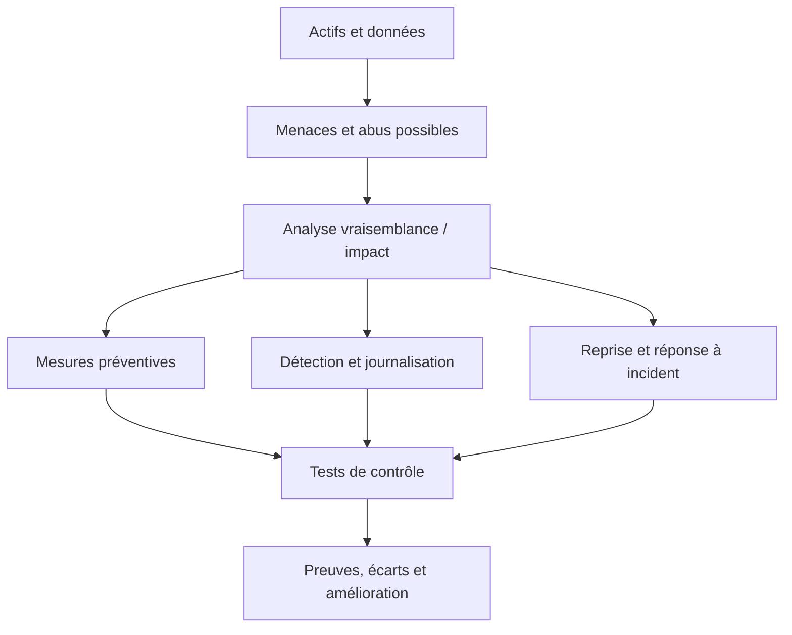
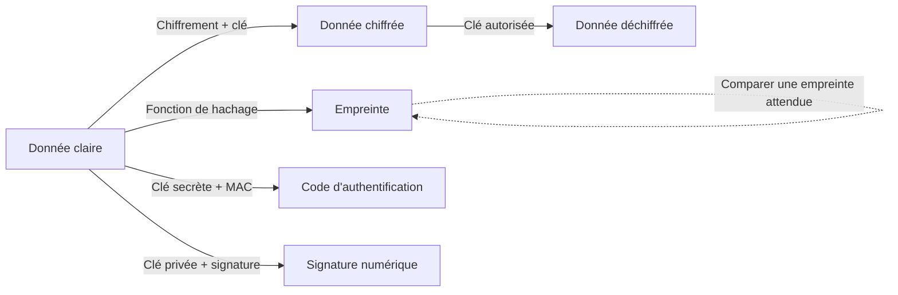
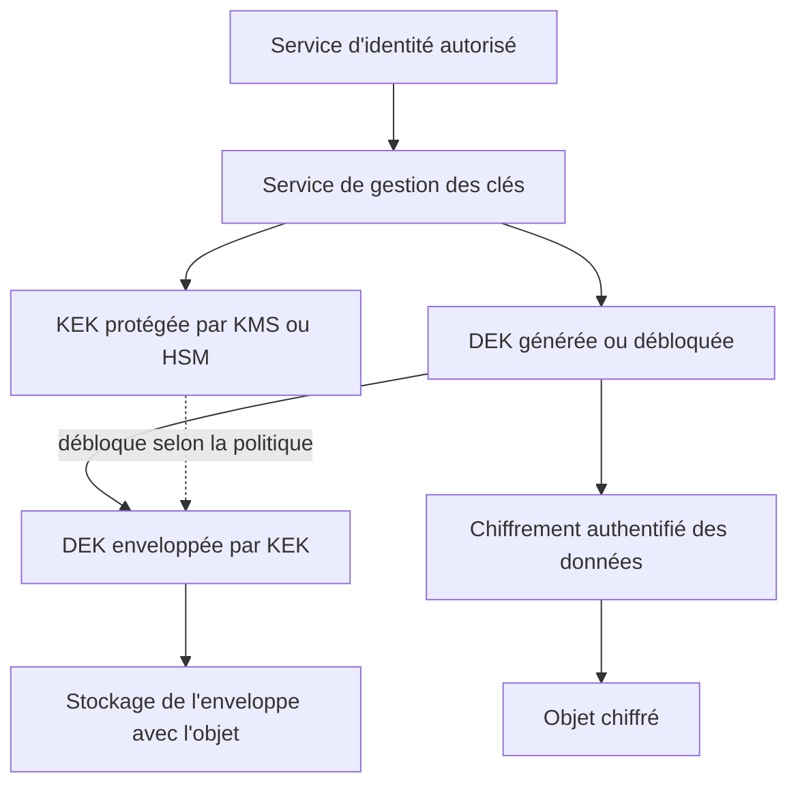
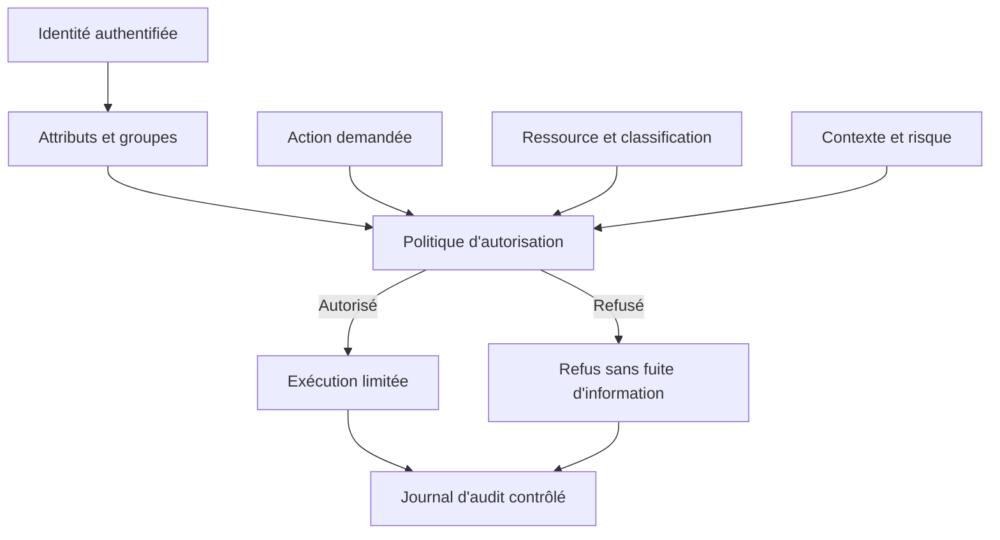
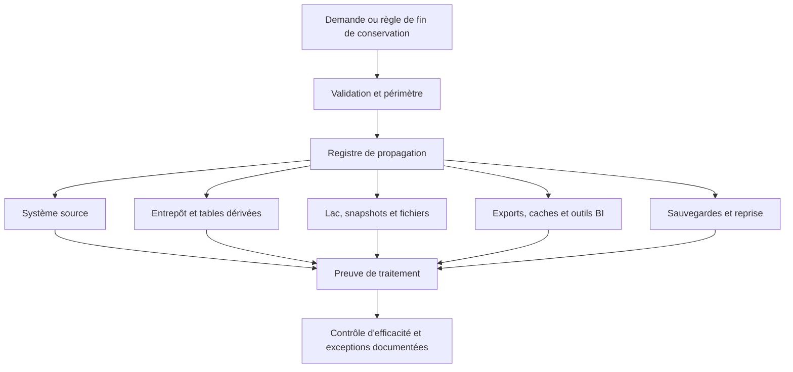
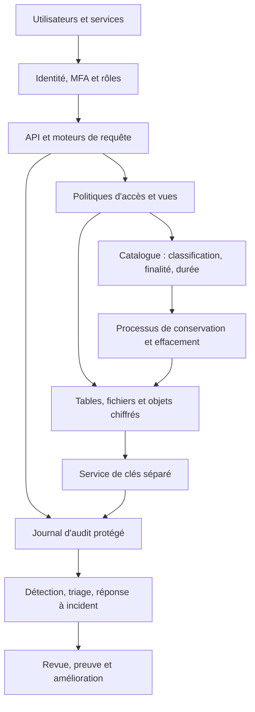

# Chiffrement, RGPD et contrôle d'accès — Expert

> **Mise en contexte.** Une plateforme analytique peut disposer d’un lac de données, d’un entrepôt performant et de pipelines fiables, tout en exposant les personnes si un compte technique trop puissant lit des tables sensibles, si une clé de chiffrement est publiée dans Git, si une sauvegarde reste accessible à tous ou si une donnée supprimée réapparaît dans une ancienne copie. La sécurité avancée consiste à relier les contrôles techniques à une finalité, un risque, une responsabilité et une preuve vérifiable.

Ce cours traite les données comme un actif dont le cycle de vie complet doit être protégé : collecte, transport, stockage, transformation, partage, sauvegarde, archivage et suppression. Il rapproche trois domaines qui se complètent sans se confondre : la cryptographie, le contrôle d’accès et la protection des données personnelles. L’objectif n’est pas d’ajouter un chiffrement « partout » sans comprendre son périmètre, mais de construire des garanties adaptées à une menace et de pouvoir démontrer qu’elles fonctionnent.

Le sujet est abordé dans un contexte d’architecture de données moderne : bases relationnelles, stockage objet, lakehouse, traitements batch et streaming, outils BI, comptes de service, environnements de test, sauvegardes et fournisseurs cloud. Les exemples sont illustratifs. Les choix de mécanismes, de paramètres et de procédures doivent être revus selon les versions des produits, les contraintes réglementaires, la politique de sécurité et l’analyse de risques de l’organisation.

## Objectifs pédagogiques

À la fin de cette leçon, vous saurez concevoir une stratégie de protection pour des données sensibles, distinguer les primitives cryptographiques et choisir où le chiffrement apporte réellement une garantie, gérer le cycle de vie des clés, séparer les droits sur les données de ceux sur les clés, mettre en place des permissions fines, protéger les secrets de connexion, relier le RGPD à des contrôles opérationnels, traiter les demandes d’effacement dans des systèmes distribués et préparer des preuves d’audit.

Vous devrez aussi être capable d’expliquer les limites d’un contrôle. Le chiffrement au repos ne bloque pas un utilisateur applicatif autorisé mais malveillant. La pseudonymisation ne transforme pas automatiquement une donnée personnelle en donnée anonyme. Une politique IAM écrite ne prouve pas qu’elle est effective. Un journal d’audit rempli de données sensibles peut devenir lui-même une fuite. Une procédure d’effacement qui ignore les exports, snapshots et sauvegardes n’est pas un processus d’effacement complet.

## 1. Commencer par les actifs, les menaces et les garanties

Une politique de protection doit partir des actifs, pas d’un produit à acheter. Une donnée peut être sensible en raison de son contenu, de son contexte, de la possibilité de la relier à une personne, de son effet sur une décision ou de l’obligation contractuelle de la protéger. Un identifiant client isolé n’a pas le même risque qu’un identifiant lié à des informations financières, à des habitudes de déplacement ou à des données de santé.

La première étape consiste à inventorier les actifs et leurs chemins. Un enregistrement issu d’une application peut être copié dans une zone brute, transformé en zone préparée, agrégé dans un entrepôt, exporté vers un fichier CSV, ingéré dans un outil de visualisation puis copié dans une sauvegarde. Une protection appliquée uniquement à la base source peut perdre son efficacité dès que la donnée quitte cette base.

### 1.1 Les propriétés à protéger

La confidentialité vise à empêcher la divulgation aux personnes et systèmes non autorisés. L’intégrité vise à empêcher ou détecter les modifications non autorisées et les corruptions. La disponibilité vise à maintenir l’accès aux données et services lorsqu’ils sont nécessaires. L’authenticité permet de vérifier une identité ou l’origine d’un message. La traçabilité permet de reconstruire les actions pertinentes. La limitation de finalité et la minimisation ajoutent une dimension de protection des personnes : certaines données ne devraient pas être collectées ou réutilisées, même si l’organisation peut techniquement les stocker.

Ces propriétés peuvent entrer en tension. Chiffrer une sauvegarde améliore sa confidentialité, mais si la clé est perdue, l’organisation peut perdre la disponibilité de ses données. Conserver des journaux détaillés aide à enquêter, mais des journaux surchargés d’identifiants et de requêtes complètes peuvent porter atteinte à la confidentialité. Un export illimité facilite ponctuellement l’analyse mais augmente l’exposition et la difficulté d’appliquer une suppression.

### 1.2 Construire un modèle de menace exploitable

Un modèle de menace documente ce que l’on protège, contre qui ou quoi, les points d’entrée, les conséquences possibles et les contrôles qui réduisent le risque. Il n’a pas besoin de prédire chaque attaque. Il doit aider à prioriser des décisions concrètes.

Exemples d’adversaires ou d’événements à considérer :
- un attaquant externe qui exploite une injection SQL ou un jeton divulgué ;
- un employé qui consulte des dossiers sans motif professionnel ;
- un compte de service compromis disposant de droits trop larges ;
- un administrateur qui peut lire à la fois les données et les sauvegardes ;
- une erreur de configuration qui rend un bucket public ;
- une clé supprimée ou inaccessible qui empêche une restauration ;
- un fournisseur ou un sous-traitant qui accède à un périmètre plus vaste que prévu ;
- un incident logiciel qui écrit les valeurs sensibles dans les journaux ;
- un pipeline qui copie des données au-delà de leur durée de conservation.



Le modèle devient utile lorsqu’il est relié à une mesure testable. « Les données sont sécurisées » n’est pas une preuve. « Le compte du tableau de bord ne peut lire que la vue agrégée, un test automatisé vérifie ce refus et une revue trimestrielle confirme les membres du rôle » est beaucoup plus exploitable.

### 1.3 Classifier pour choisir des contrôles proportionnés

Une classification simple peut distinguer des données publiques, internes, confidentielles et hautement sensibles. Les noms exacts importent moins que les critères, les responsabilités et les conséquences. Une table de correspondance client, un jeton d’API et une clé de chiffrement ne doivent pas être traités comme de simples fichiers de même niveau : la clé peut donner accès à une grande quantité de données et doit être protégée comme un actif critique.

Pour chaque catégorie, définissez au minimum :
- qui est propriétaire métier et qui est responsable technique ;
- où la donnée peut être stockée et dans quelles régions ou environnements ;
- qui peut la lire, la modifier, l’exporter et l’effacer ;
- quels canaux peuvent la transporter ;
- quelles protections de chiffrement et d’authentification sont nécessaires ;
- quels journaux sont conservés et qui peut les lire ;
- combien de temps la donnée est gardée et comment la fin de vie est vérifiée ;
- comment la donnée peut être utilisée dans les environnements de test.

Ne classifiez pas uniquement les colonnes prises séparément. Plusieurs colonnes peu sensibles peuvent devenir identifiantes une fois combinées. Des horodatages précis, une localisation approximative et un identifiant pseudonyme peuvent permettre de relier un enregistrement à une personne. La classification doit donc réexaminer les données enrichies, les jeux dérivés et les petits groupes statistiques.

## 2. Les primitives cryptographiques sans confusion

La cryptographie apporte plusieurs services différents. Le choix incorrect d’une primitive est une erreur de conception, même si l’algorithme est célèbre.

### 2.1 Chiffrement, hachage, MAC et signature

Le chiffrement transforme un texte clair en texte chiffré à l’aide d’une clé et permet à une entité autorisée de retrouver le contenu. Le hachage produit une empreinte de taille fixe et n’est pas conçu pour retrouver le message initial. Un code d’authentification de message, ou MAC, permet à des détenteurs d’une clé partagée de vérifier l’intégrité et l’authenticité d’un message. Une signature numérique vérifie une preuve liée à une clé privée et une clé publique ; elle ne remplace pas un chiffrement de confidentialité.



Une empreinte peut permettre de détecter des modifications si l’empreinte de référence est digne de confiance. Si un attaquant peut modifier à la fois le document et l’empreinte non protégée, la comparaison ne donne aucune garantie. Pour ce cas, on peut utiliser un MAC, une signature ou un mécanisme de stockage avec intégrité authentifiée et gestion fiable des références.

### 2.2 Chiffrement symétrique

Le chiffrement symétrique utilise la même clé secrète, ou un ensemble de clés dérivées, pour chiffrer et déchiffrer. Il est efficace pour les volumes de données importants. AES est une famille de chiffrement largement déployée ; le mode d’opération fait partie de la sécurité. Il faut utiliser une bibliothèque maintenue et un schéma authentifié moderne plutôt que d’inventer sa propre construction cryptographique.

Le chiffrement authentifié, par exemple AES-GCM lorsqu’il est correctement employé, protège la confidentialité et l’intégrité du texte chiffré. Un nonce ou vecteur d’initialisation doit respecter les contraintes de l’algorithme et ne pas être réutilisé de manière dangereuse avec la même clé. Il faut laisser une bibliothèque reconnue générer et gérer les paramètres requis et respecter sa documentation. Réutiliser un nonce GCM avec la même clé peut avoir des conséquences graves.

Le chiffrement n’empêche pas tous les abus. Les métadonnées, tailles, horaires d’accès ou motifs de consultation peuvent rester visibles. Une application qui déchiffre la donnée en mémoire doit toujours protéger le processus, le compte et la sortie. La cryptographie doit donc être associée au contrôle des identités et au cloisonnement.

### 2.3 Cryptographie asymétrique et chiffrement hybride

La cryptographie asymétrique utilise une paire de clés : une clé publique et une clé privée. Selon le mécanisme, elle permet notamment d’établir un secret, de chiffrer de petits éléments ou de signer des messages. Pour des objets volumineux, un schéma hybride est souvent utilisé : un algorithme symétrique chiffre les données et un mécanisme asymétrique ou un service de gestion de clés protège la clé de données.

Une clé publique n’est pas secrète, mais son authenticité doit être vérifiée. Si une application reçoit la clé publique d’un attaquant en la prenant pour celle du destinataire, le chiffrement peut protéger le contenu… pour l’attaquant. Les certificats, les autorités de certification, les empreintes vérifiées et la rotation contribuent à relier une clé à une identité fiable.

Il est important de distinguer échange ou accord de clé, chiffrement de données et signature. Une primitive comme X25519 sert à établir un secret partagé ; elle ne chiffre pas à elle seule un fichier stocké. Une signature atteste qu’un message est lié à une clé privée, mais ne rend pas ce message confidentiel.

### 2.4 Hachage des mots de passe

Un mot de passe utilisateur ne doit normalement pas être stocké en clair ni stocké dans un format permettant de le déchiffrer. Il doit être transformé par une fonction de hachage conçue pour les mots de passe, avec sel unique et paramètres de coût adaptés, par exemple Argon2id, scrypt ou bcrypt selon le contexte et les capacités de la pile technique. Les fonctions rapides génériques, comme un SHA-256 seul, permettent de tester trop rapidement des listes de mots de passe.

Le sel n’est pas un secret. Il empêche surtout que des mots de passe identiques produisent la même empreinte et rend plus difficile l’usage de tables pré-calculées. Un éventuel « pepper » partagé peut ajouter une barrière, mais impose une gestion de secret et de récupération. La politique de mots de passe ne doit pas dépendre uniquement de la complexité théorique : authentification multifacteur, protection contre les tentatives massives, détection de compromission et récupération de compte restent nécessaires.

### 2.5 Pourquoi ne pas inventer un algorithme maison

Assembler une fonction de hachage, un XOR et un encodage Base64 ne crée pas un système de chiffrement. Base64 est un encodage réversible, pas une protection. Le chiffrement sans authentification peut permettre des modifications non détectées. Une clé choisie par un humain, un générateur pseudo-aléatoire non cryptographique ou une clé fixe partagée entre tous les environnements affaiblit la protection.

La règle opérationnelle est de sélectionner une bibliothèque reconnue, vérifier sa documentation, tenir compte des versions, utiliser les API de haut niveau, éviter les algorithmes obsolètes et faire examiner la conception. Les formats cryptographiques doivent embarquer les paramètres nécessaires et être versionnés pour permettre une migration sans ambiguïté. La cryptographie ne tolère pas l’improvisation silencieuse.

## 3. Chiffrer au bon niveau

Il n’existe pas un unique « chiffrement de la base ». Plusieurs couches répondent à différents scénarios.

### 3.1 Chiffrement en transit

TLS protège les communications entre clients, applications, bases, services de stockage, moteurs de traitement et outils d’administration. Il faut vérifier les certificats, utiliser des versions et suites cryptographiques appropriées, renouveler les certificats, gérer les noms d’hôtes et supprimer les chemins qui retombent silencieusement en clair. Le chiffrement du trafic à l’intérieur d’un réseau privé reste utile : le réseau n’est pas une frontière de confiance suffisante.

Pour les systèmes sensibles, une connexion TLS validant le certificat du serveur est le minimum attendu. Dans certains échanges service à service, le TLS mutuel peut aussi authentifier le client à l’aide d’un certificat. Il faut planifier l’expiration et la rotation de ces certificats et surveiller les erreurs d’établissement de session. La configuration précise dépend du serveur, du client et de la plateforme ; une option qui désactive la validation de certificat en production n’est pas un correctif acceptable.

### 3.2 Chiffrement au repos

Le chiffrement au repos peut être appliqué au niveau du disque, du système de fichiers, du volume, du service de base de données, du stockage objet ou de l’application. Il protège typiquement contre certaines formes de vol de support, d’accès aux snapshots ou d’exposition des fichiers hors du contexte autorisé. Il protège moins bien contre un attaquant déjà capable d’interroger le moteur avec un compte légitime.

Le chiffrement transparent de base de données, souvent nommé TDE selon les produits, chiffre des fichiers de données et certains journaux sans obliger chaque requête à être modifiée. Il est utile contre l’exposition de fichiers sous-jacents, mais il ne signifie pas que chaque utilisateur SQL est isolé des autres. Un compte autorisé à exécuter un SELECT peut recevoir des valeurs en clair, puisque le moteur déchiffre pour traiter la requête.

Le chiffrement au niveau applicatif peut protéger certaines colonnes avant leur insertion dans la base. Il peut réduire la visibilité côté DBA ou en cas de copie brute des tables, mais rend certaines recherches, jointures, indexations et agrégations plus complexes. Il exige une bonne gestion des clés, des versions de schéma, des traitements de déchiffrement et des usages autorisés. Ne chiffrez pas chaque champ au même niveau sans considérer les besoins analytiques et le modèle de menace.

### 3.3 Comparer les couches

| Couche | Menace principalement réduite | Limite à documenter |
|---|---|---|
| Transit TLS | Écoute ou modification du trafic sur le trajet | Ne protège pas les extrémités compromises |
| Disque ou volume | Vol du support ou accès hors service | Ne bloque pas un processus autorisé à lire |
| Base de données / TDE | Exposition de fichiers ou snapshots bruts | Les requêtes autorisées voient les valeurs |
| Application / colonne | Limite certains accès privilégiés à la base | Complexité sur les recherches et la gestion de clés |
| Stockage objet avec clé gérée | Accès aux objets copiés hors du périmètre | Les permissions IAM et l’accès au service restent critiques |

La décision doit être fondée sur les risques et l’exploitation. Multiplier les couches peut être justifié, mais chaque couche nécessite une personne responsable, une surveillance et des procédures de récupération. Une couche oubliée ou impossible à restaurer peut être une source de panne plutôt que de sécurité.

## 4. Architecture de gestion des clés

La sécurité du chiffrement dépend autant de la gestion des clés que de l’algorithme. Une clé dans le même dépôt que les données chiffrées peut annuler une grande partie du bénéfice. Une clé copiée dans les journaux, variables exposées ou images de conteneurs rend le chiffrement contournable.

### 4.1 DEK et KEK : le chiffrement enveloppe

Le chiffrement enveloppe sépare la clé qui chiffre les données (DEK, Data Encryption Key) de la clé qui protège cette clé (KEK, Key Encryption Key). La DEK chiffre un objet ou un ensemble cohérent de données. La DEK est ensuite enveloppée avec une KEK gérée séparément ; on stocke le texte chiffré et l’enveloppe, et le service de clés autorisé permet de retrouver la DEK lors du déchiffrement.



L’avantage est de pouvoir effectuer une rotation de la KEK sans réécrire nécessairement tous les octets de données : selon les capacités du système, l’enveloppe de la DEK peut être ré-encryptée. Le détail dépend du service, des formats et des politiques de clés. La DEK a elle aussi un cycle de vie et doit être protégée en mémoire pendant son usage.

### 4.2 KMS, coffre de clés et HSM

Un service de gestion de clés (KMS) centralise la création, les autorisations, la rotation, l’utilisation et parfois l’audit des clés. Un coffre de secrets gère souvent aussi des mots de passe, jetons, certificats et chaînes de connexion. Un HSM est un dispositif ou module cryptographique conçu pour protéger des opérations et du matériel de clé selon un niveau de sécurité donné. Ces termes ne sont pas interchangeables, même si les produits peuvent proposer plusieurs fonctions.

Un KMS n’est pas une décision magique de sécurité. Les politiques IAM qui autorisent decrypt, les rôles d’administration, les sauvegardes des configurations, les procédures de récupération et les accès d’urgence restent déterminants. Une application compromise avec un droit de déchiffrement peut faire déchiffrer ses données par le service ; l’avantage est que l’usage peut être borné, audité et révoqué plutôt que de distribuer une clé exportable à chaque composant.

### 4.3 Génération, rotation, révocation et destruction

Les clés doivent être générées par des mécanismes cryptographiquement sûrs. Les personnes ne doivent pas les choisir manuellement. Il faut séparer les clés des données qu’elles protègent, éviter la réutilisation entre environnements, donner à chaque identité seulement l’usage requis, documenter la durée de vie et prévoir la rotation. Les critères de rotation peuvent inclure le calendrier, un changement de risque, l’exposition d’un secret, le départ d’un administrateur ou une exigence contractuelle.

Rotation, révocation et destruction sont des opérations différentes. La rotation introduit une nouvelle clé tout en organisant la transition. La révocation empêche de nouvelles utilisations autorisées par cette clé ou identité, selon le mécanisme. La destruction rend le matériel de clé définitivement indisponible et doit être gouvernée, car elle peut rendre des sauvegardes irrécupérables. Une clé compromise peut nécessiter une rotation et le rechiffrement de certains objets ; supprimer immédiatement l’ancienne clé sans plan peut casser l’accès aux archives utiles.

Une procédure sérieuse décrit les propriétaires, les opérateurs autorisés, les approbations, le déroulement, les applications dépendantes, la stratégie de retour arrière, les contrôles après opération et les preuves enregistrées. Le plan de reprise après sinistre doit traiter les clés comme des dépendances critiques : sauvegarder les données chiffrées sans assurer la disponibilité légitime des clés peut rendre la sauvegarde inutile.

### 4.4 Données et clés dans deux plans de contrôle

La séparation logique et administrative entre données et clés réduit le risque d’une compromission unique. Les administrateurs qui gèrent les objets ne devraient pas nécessairement pouvoir déchiffrer les contenus. Les responsables de clés ne devraient pas avoir par défaut la capacité de publier les données. Les approbations sensibles peuvent être séparées entre deux rôles, surtout lorsque la donnée présente un risque élevé.

Il faut néanmoins éviter un cloisonnement si strict que les opérations deviennent impraticables. Une procédure d’urgence documentée doit permettre une restauration autorisée, avec contrôle renforcé, journalisation et revue après intervention. L’objectif est de limiter les abus sans rendre la continuité d’activité impossible.

## 5. Contrôle d’accès : identité, autorisation et séparation des rôles

L’authentification répond à « qui se présente ? ». L’autorisation répond à « que cette identité peut-elle faire sur cette ressource dans ce contexte ? ». Une connexion réussie à la base ne doit pas donner le droit de consulter toutes les tables. Les autorisations doivent être explicites, vérifiables et régulièrement réévaluées.

### 5.1 Le moindre privilège

Le moindre privilège accorde les permissions minimales permettant à une identité d’accomplir une tâche précise, sur une ressource définie, pendant la durée nécessaire. Un pipeline qui insère des événements ne devrait pas pouvoir supprimer les comptes utilisateurs. Un outil BI devrait accéder à des vues prévues pour l’analyse et non à l’ensemble des tables brutes. Un compte de migration peut avoir des privilèges temporaires plus élevés, mais il ne doit pas être utilisé comme compte applicatif quotidien.

Le principe « deny by default » consiste à refuser l’accès lorsqu’aucune règle explicite ne l’autorise. Il évite qu’une nouvelle table ou un nouveau schéma hérite automatiquement d’un accès large. Les rôles doivent être attribués à des identités individuelles ou de service identifiables, pas à un compte partagé impossible à attribuer à une personne ou un composant. L’authentification multifacteur est importante pour les accès humains à privilèges.

### 5.2 RBAC, ABAC et contrôles contextuels

Le contrôle basé sur les rôles (RBAC) associe des permissions à des rôles métiers ou techniques : lecteur analytique, opérateur d’ingestion, responsable de qualité, administrateur de base. Il facilite les revues si les rôles sont compréhensibles et limités. Le risque est d’accumuler des rôles trop larges ou des exceptions individuelles peu documentées.

Le contrôle basé sur les attributs (ABAC) décide à partir d’attributs de l’utilisateur, de la ressource, de l’action et du contexte, par exemple l’équipe, la classification, l’environnement, la finalité, l’heure ou le niveau de risque de session. Il peut exprimer des règles plus précises, mais les attributs doivent être fiables et les décisions testées. Un attribut mal maîtrisé devient une voie de contournement.

Une architecture peut combiner RBAC pour les permissions de base, des politiques ABAC pour les restrictions contextuelles et des vues SQL pour exposer des colonnes sélectionnées. Les règles métier ne doivent pas dépendre uniquement d’un filtre placé dans l’interface utilisateur : l’API et la base doivent empêcher l’accès non autorisé côté serveur.



### 5.3 Séparation des tâches

La séparation des tâches empêche qu’une seule identité puisse réaliser toutes les étapes d’une opération sensible sans contrôle. L’auteur d’une demande de modification de privilèges ne devrait pas toujours être le seul à l’approuver et à l’exécuter. L’opérateur qui exporte un jeu de données hautement sensible peut avoir besoin d’une approbation, d’une expiration automatique et d’une trace du destinataire.

Il faut éviter les procédures sur papier qui ne correspondent pas aux droits réels. Comparez régulièrement les rôles déclarés, les autorisations effectives des plateformes et les identités réellement utilisées dans les journaux. Testez le refus des actions interdites. Les droits accumulés au fil des missions et les comptes oubliés sont des causes fréquentes de sur-privilège.

### 5.4 Accès aux lignes et aux colonnes

Un utilisateur analytique peut avoir le droit d’analyser des tendances sans pouvoir voir les détails de chaque personne. Les vues filtrées, les vues matérialisées agrégées, les politiques de sécurité au niveau des lignes et le masquage de colonnes peuvent réduire l’exposition. La protection doit être appliquée là où elle ne peut être contournée par une autre interface ou un accès direct à une table de base.

Une vue ne garantit pas toujours à elle seule une séparation de sécurité ; son comportement dépend du SGBD, des droits du propriétaire, des options de sécurité et des permissions accordées sur les objets sous-jacents. Vérifiez la sémantique du moteur. Évitez d’accorder au compte analytique un droit qui lui permet de désactiver les politiques ou de lire la table brute. Testez avec l’identité réelle de l’utilisateur, pas uniquement avec le compte superutilisateur.

### 5.5 Les comptes de service

Un compte de service doit correspondre à une charge de travail identifiable. Utilisez une identité distincte par application ou par tâche de confiance, un secret dédié, des droits limités et un mécanisme de rotation. Ne partagez pas le compte d’un développeur entre le pipeline de production, l’environnement de test et la BI. Si une identité est compromise, la portée et les dépendances de sa révocation doivent être compréhensibles.

Lorsque la plateforme le permet, privilégiez des identités de charge de travail à courte durée de vie plutôt que des clés statiques valables pendant des années. La fédération d’identité et les jetons de courte durée réduisent la dépendance aux secrets durables, mais les audiences, les expirations et les politiques de confiance doivent être correctement configurées.

## 6. SQL et sécurité des accès aux données

La sécurité ne doit pas reposer sur la bonne volonté de chaque requête. Les requêtes paramétrées empêchent qu’une valeur utilisateur soit interprétée comme du code SQL. Les privilèges minimaux limitent les conséquences d’une faille. Les procédures de migration, les comptes de lecture, les comptes d’écriture et les comptes d’administration doivent avoir des responsabilités distinctes.

### 6.1 Pourquoi les requêtes paramétrées comptent

Construire une requête en concaténant une chaîne fournie par l’utilisateur peut transformer une entrée en instruction SQL. La paramétrisation sépare le texte de la requête et les valeurs. La syntaxe exacte varie avec le pilote et le moteur ; le principe reste le même.

```python
# Exemple avec sqlite3 : les valeurs sont passées séparément
import sqlite3

def charger_client(db_path: str, client_id: int) -> tuple | None:
    with sqlite3.connect(db_path) as connexion:
        connexion.row_factory = sqlite3.Row
        ligne = connexion.execute(
            "SELECT id, nom, statut FROM clients WHERE id = ?",
            (client_id,),
        ).fetchone()
        return tuple(ligne) if ligne is not None else None
```

Le paramètre empêche la valeur de devenir une partie exécutable de la requête. Il ne remplace pas la validation métier ni l’autorisation. Un identifiant valide mais qui appartient à une autre personne reste un accès interdit si le demandeur n’a pas le droit de consulter ce compte. La requête doit donc être liée à l’identité et à son périmètre.

Les noms de table, noms de colonnes et directions de tri ne sont généralement pas des paramètres de valeur. S’ils doivent être dynamiques, ils doivent être choisis parmi une liste blanche de valeurs autorisées, puis assemblés avec une API sûre. Évitez de tenter de sécuriser la concaténation SQL par une suite d’échappements maison.

### 6.2 Exemple de rôles en SQL

Le principe général est de créer des rôles dédiés, puis d’accorder uniquement les actions nécessaires. Les commandes exactes diffèrent selon PostgreSQL, MySQL et d’autres moteurs ; l’exemple suivant est une illustration de style PostgreSQL, à adapter et tester sur l’environnement visé.

```sql
-- Rôle destiné à lire un jeu de données préparé
CREATE ROLE analyste_lecture NOLOGIN;

-- Le compte de service reçoit uniquement le rôle approprié
GRANT analyste_lecture TO svc_tableau_bord;

-- Exposer une vue plutôt que la table sensible complète
CREATE VIEW analytics.commandes_mensuelles AS
SELECT date_trunc('month', cree_le) AS mois,
       region,
       COUNT(*) AS nombre_commandes,
       SUM(montant) AS chiffre_affaires
FROM commerce.commandes
GROUP BY date_trunc('month', cree_le), region;

GRANT USAGE ON SCHEMA analytics TO analyste_lecture;
GRANT SELECT ON analytics.commandes_mensuelles TO analyste_lecture;
```

Ce fragment n’est pas un script universel prêt à exécuter : il suppose notamment que les rôles et schémas existent, que les droits du propriétaire sont maîtrisés et que la vue ne donne pas indirectement accès à des objets au-delà du besoin. Il faut également vérifier si les valeurs agrégées présentent un risque de réidentification lorsque les groupes sont petits. Une somme ou un compte n’est pas automatiquement anonyme.

### 6.3 Défenses additionnelles

Les contrôles utiles comprennent la validation des entrées, les limites de taille et de fréquence, la gestion de sessions, la protection CSRF lorsque pertinente, la limitation des exports, le masquage des erreurs détaillées côté client, la surveillance des requêtes inhabituelles et les mises à jour du moteur. Un pare-feu applicatif ou un outil de détection peut ajouter une barrière, mais ne corrige pas le défaut d’une requête construite dangereusement.

Les comptes applicatifs ne doivent pas avoir le droit de créer des rôles, désactiver l’audit ou lire les secrets stockés dans un autre schéma. Les migrations devraient utiliser un chemin contrôlé, une identité dédiée et une durée d’élévation limitée. Après la migration, on doit vérifier que les droits temporaires ont été retirés.

## 7. Gestion des secrets dans le cycle de développement

Les mots de passe, chaînes de connexion, clés d’API, clés privées, certificats et jetons de déploiement sont des secrets. Un secret placé dans le code peut être copié dans les forks, caches, artefacts, journaux et historiques Git. Supprimer le fichier lors d’un commit ultérieur ne révoque pas le secret qui a déjà été exposé.

### 7.1 Une source de secrets contrôlée

Privilégiez un gestionnaire de secrets ou un service sécurisé de la plateforme. Les applications devraient recevoir uniquement les secrets requis, à l’exécution ou au déploiement, avec une portée limitée. Les secrets ne doivent pas être codés dans l’image de conteneur, les scripts d’exemple, les fichiers de configuration publics ou les tickets. Les exemples fournis au dépôt doivent contenir des valeurs fictives clairement identifiées et inutilisables.

Les variables d’environnement peuvent être pratiques mais ne sont pas automatiquement inviolables. Elles peuvent être exposées par des dumps de processus, un diagnostic mal configuré, un journal verbeux ou une personne disposant de droits suffisants sur la charge de travail. Le bon mécanisme dépend de la plateforme ; l’objectif reste d’éviter la diffusion du secret, de limiter les lecteurs et de faciliter la rotation.

### 7.2 Réagir à une fuite

Si une clé ou un mot de passe est publié, ne vous contentez pas de supprimer la ligne. Considérez le secret comme compromis, révoquez-le ou faites-le tourner, cherchez les usages suspects, déterminez les systèmes dépendants, supprimez l’exposition là où c’est pertinent, nettoyez l’historique selon la procédure et examinez les copies et artefacts. La réécriture de l’historique Git n’annule pas les copies déjà faites et peut perturber les autres clones ; elle doit s’inscrire dans une réponse coordonnée.

Les outils de détection des secrets peuvent analyser les commits, les branches, les journaux CI et les artefacts. Un résultat négatif ne prouve pas qu’aucun secret n’a fuité : les formats personnalisés, secrets encodés et historiques anciens peuvent échapper aux règles. Combinez les scanners avec une procédure d’incident claire et l’éducation des équipes.

### 7.3 Rotation sans interruption

Une rotation bien conçue prévoit une période de chevauchement contrôlée ou un mécanisme de bascule. Par exemple, un service peut accepter temporairement l’ancien et le nouveau jeton pendant le déploiement, puis révoquer l’ancien après vérification. Cette approche ne doit pas devenir une période de validité indéfinie. Fixez une date de fin, observez les dernières utilisations de l’ancien secret et vérifiez que toutes les charges de travail ont été migrées.

La procédure doit inclure les dépendances indirectes : tâches planifiées, workers inactifs, systèmes de secours, environnements de test, restauration d’une sauvegarde et fournisseurs tiers. Un secret apparemment inutilisé peut rester nécessaire au redémarrage d’un ancien service ou à une récupération d’urgence.

## 8. RGPD : transformer les principes en contrôles

Le RGPD est un règlement de protection des données personnelles, pas une spécification de chiffrement. Il définit des principes, des bases de licéité, des droits, des obligations de responsabilité et des mesures organisationnelles et techniques. Les équipes d’ingénierie ne déterminent pas seules toutes les questions juridiques, mais doivent construire des systèmes qui permettent au responsable du traitement d’appliquer les règles validées par l’organisation.

Le cours présente des repères généraux, pas un avis juridique. La qualification d’un traitement, la base légale, les exceptions, les délais et les obligations concrètes doivent être examinés selon les faits, le rôle de chaque organisation et les textes applicables, avec les équipes juridiques ou de protection des données compétentes.

### 8.1 Les données personnelles et le contexte

Une donnée personnelle est une information se rapportant à une personne physique identifiée ou identifiable. L’identification peut être directe ou indirecte. Un nom ou une adresse électronique sont des exemples évidents, mais un identifiant en ligne, un identifiant de transaction, une localisation, une combinaison de caractéristiques ou un pseudonyme peuvent également participer à l’identification.

L’existence d’une table de correspondance, la disponibilité d’autres jeux de données, la granularité des horaires, la taille des groupes et la capacité technique d’un acteur à relier les informations comptent dans l’analyse. Une donnée ne devient pas anonyme simplement parce que le nom a été retiré. Les données pseudonymisées restent en général des données personnelles lorsqu’une réassociation demeure raisonnablement possible.

### 8.2 Principes de l’article 5 en termes d’ingénierie

La licéité, la loyauté et la transparence supposent que les personnes soient informées et que le traitement repose sur une base appropriée. La limitation des finalités évite les réutilisations incompatibles. La minimisation impose de ne collecter que les données adéquates, pertinentes et nécessaires. L’exactitude invite à corriger les données inexactes. La limitation de conservation exige que les données identifiantes ne soient pas gardées plus longtemps que nécessaire. L’intégrité et la confidentialité exigent des mesures adaptées. La responsabilité impose au responsable du traitement de pouvoir démontrer le respect des principes.

Pour un ingénieur, ces principes ont des implications concrètes. Une ingestion doit éviter de collecter des champs inutiles. Les usages et destinataires doivent être décrits. Les corrections doivent pouvoir se propager aux dérivés pertinents. Les durées de conservation doivent être appliquées, pas uniquement rédigées. Les accès sont limités et révisés. La preuve des décisions doit être disponible sans conserver plus de données personnelles que nécessaire.

### 8.3 Protection dès la conception et par défaut

La protection des données dès la conception et par défaut invite à penser aux risques avant la mise en production. Il vaut mieux créer un modèle qui ne collecte pas un attribut inutile que compter sur l’effacement ultérieur. Un produit devrait proposer par défaut le niveau de collecte le plus limité compatible avec la finalité, éviter une exposition publique implicite et séparer les environnements.

La revue d’architecture doit porter sur les fonctionnalités, les accès et les flux. Une nouvelle colonne sensible change les risques. Un nouvel export vers un fournisseur modifie les destinataires. Un nouveau modèle de machine learning peut conserver des copies ou apprendre à partir de données dont la réutilisation n’était pas prévue. La gouvernance de changement doit donc inclure une question explicite sur la protection des données.

### 8.4 Droits des personnes et contraintes techniques

Les droits concernés peuvent notamment inclure l’accès, la rectification, l’effacement, la limitation, la portabilité et l’opposition, lorsque les conditions applicables sont remplies. Leur mise en œuvre dépend du contexte juridique, des exceptions et du type de traitement. Les équipes techniques doivent fournir des capacités d’identification, d’extraction, de correction, de suppression ou de restriction, ainsi qu’une trace de l’exécution.

Il faut définir comment une demande est reçue, validée, attribuée, exécutée et contrôlée. Une recherche à partir du nom n’est pas toujours suffisante : la donnée peut être associée à un identifiant interne, copiée dans un export ou transformée en agrégat. Les systèmes doivent pouvoir retrouver les liens nécessaires en utilisant des mécanismes protégés et en limitant les accès des opérateurs.

### 8.5 Les violations de données personnelles

Un incident qui affecte la confidentialité, l’intégrité ou la disponibilité des données personnelles peut constituer une violation de données personnelles selon les circonstances. Toute panne n’est pas automatiquement une violation au sens réglementaire, et toute violation n’entraîne pas nécessairement les mêmes notifications. Le responsable du traitement doit évaluer le risque et appliquer les obligations pertinentes avec les fonctions concernées.

Le RGPD prévoit notamment une notification à l’autorité de contrôle dans les meilleurs délais et, lorsque possible, au plus tard dans les 72 heures après en avoir pris connaissance, sauf si la violation n’est pas susceptible d’engendrer un risque pour les droits et libertés. Lorsque le risque est élevé, la communication aux personnes concernées peut également être requise, sous réserve des conditions et exceptions applicables. Les équipes techniques doivent donc produire rapidement des faits fiables : données touchées, période, systèmes, catégories de personnes, accès possibles, mesures prises, éléments de preuve et incertitudes.

Ne confondez pas le délai réglementaire de notification avec un objectif interne de résolution. L’organisation doit disposer d’un processus de réponse à incident, d’un canal d’escalade, d’un responsable de décision et d’une capacité à préserver les preuves. Les journaux doivent aider l’enquête sans créer une nouvelle fuite.

## 9. Minimisation, pseudonymisation et anonymisation

### 9.1 La meilleure donnée sensible est souvent celle qui n’est pas collectée

La réduction de collecte diminue la surface d’attaque, les coûts de stockage, les obligations d’accès et d’effacement ainsi que les conséquences d’une fuite. Avant de chiffrer une donnée, demandez pourquoi elle est nécessaire. Si la finalité peut être remplie par une catégorie, un indicateur calculé ou une valeur moins précise, cette transformation peut être plus efficace que la conservation du champ d’origine.

La minimisation s’applique également aux logs, aux traces, aux événements, aux fichiers temporaires, aux tables de test et aux copies de support. Les données techniques peuvent inclure adresses IP, identifiants de session, requêtes SQL, jetons, messages d’erreur ou données de formulaires. Une journalisation plus détaillée n’est pas toujours plus sûre.

### 9.2 Pseudonymisation

La pseudonymisation remplace ou sépare certains identifiants directs afin de réduire la possibilité de relier les informations sans données supplémentaires. La table de correspondance doit être protégée séparément, avec des accès encore plus limités. Une valeur pseudonyme stable peut toujours suivre la même personne entre de nombreuses tables ; elle ne supprime donc pas nécessairement le risque de corrélation.

Un bon design détermine qui peut effectuer la réassociation, dans quelles circonstances, avec quelle approbation et quelle trace. Il limite également le périmètre de données pseudonymisées accessibles à l’analyste. Les données de test devraient être synthétiques lorsque c’est possible ; la pseudonymisation d’un jeu réel n’en fait pas automatiquement un jeu librement partageable.

### 9.3 Anonymisation

L’anonymisation vise à empêcher l’identification d’une personne par des moyens raisonnablement susceptibles d’être utilisés. Elle dépend du contexte et des possibilités de recoupement, et non d’une simple opération de masquage. Retirer les noms tout en gardant des dates précises, une région très fine et des événements rares peut permettre une réidentification.

Les techniques peuvent inclure l’agrégation, la généralisation, la suppression de valeurs rares, la perturbation contrôlée, la limitation de granularité et des méthodes plus formelles selon le besoin. Chaque technique a des compromis entre utilité analytique et risque. Une évaluation doit considérer les informations auxiliaires disponibles, les ressources de l’attaquant, le nombre de personnes, la fréquence de publication et les risques induits par des requêtes répétées.

### 9.4 Agrégats et confidentialité

Une table agrégée n’est pas forcément anonyme. Si une région ne contient qu’une seule personne dans une catégorie donnée, un total peut révéler une information à son sujet. Les différences entre deux requêtes presque identiques peuvent exposer la contribution d’un individu. Des mécanismes comme les seuils de groupe, les restrictions de requêtes ou la confidentialité différentielle peuvent être pertinents, mais demandent une définition rigoureuse du modèle et de l’impact sur les analyses.

Les équipes ne devraient pas utiliser le terme « anonymisé » sans documenter les tests, les hypothèses et les limites. Les décisions doivent être examinées par des personnes compétentes en protection des données et en statistiques lorsque le risque le justifie.

## 10. Effacement, conservation et systèmes distribués

La demande d’effacement est souvent facile dans une table transactionnelle et complexe dans une plateforme distribuée. Une donnée peut être présente dans les tables opérationnelles, un entrepôt, un lac brut, des fichiers Parquet, des index de recherche, un cache, un outil BI, un export CSV, une sauvegarde et un environnement de test. La suppression dans le système source ne garantit pas sa disparition de ces copies.

### 10.1 Cartographier les dérivés

Chaque pipeline devrait documenter les données d’entrée, les sorties, les tables de correspondance, les copies temporaires, les destinations et les politiques de conservation. Les métadonnées de lignage peuvent aider à identifier les consommateurs, mais le lignage technique n’est pas toujours complet : les exports manuels, copies locales et intégrations externes doivent faire partie des procédures.

Une stratégie pratique définit des propriétaires pour les zones de stockage, des contrats de données, des métadonnées de sensibilité et des mécanismes de propagation des suppressions. La traçabilité des transformations facilite la recherche d’un attribut dérivé. Il faut aussi considérer les jeux de données historiques utilisés pour construire des modèles ou des agrégats.

### 10.2 Tombstones, propagation et idempotence

Dans un pipeline événementiel, un message de suppression ou tombstone peut signaler qu’un enregistrement doit être supprimé ou rendu inactif dans les consommateurs. Le message doit inclure un identifiant de référence fiable et une version ou un horodatage permettant de gérer les doublons et l’ordre des événements. Les consommateurs doivent être idempotents : rejouer l’événement ne doit pas recréer la donnée supprimée.

La suppression doit être traitée comme un événement de cycle de vie, pas comme un simple changement de statut qui laisse toutes les valeurs sensibles accessibles. Il est parfois nécessaire de conserver une preuve minimale qu’une demande a été exécutée, sans maintenir inutilement la donnée supprimée. Le type exact de preuve doit être validé selon les exigences de conformité et la finalité.

### 10.3 Snapshots et versions de lakehouse

Les snapshots et fonctions de voyage dans le temps facilitent la reproductibilité, mais peuvent conserver des versions antérieures d’un enregistrement après une suppression logique. Une purge peut nécessiter une opération de maintenance qui réécrit les fichiers, expire les snapshots ou retire les objets non référencés, selon le moteur. Les politiques du catalogue et les délais de rétention doivent être compris avant d’affirmer qu’une donnée est supprimée.

Le chiffrement et la destruction de clé peuvent parfois participer à une stratégie de destruction cryptographique, mais ce n’est pas une solution universelle. Si une clé est partagée entre plusieurs données, sa destruction peut rendre d’autres données inutilisables. Si des copies en clair existent, si la clé a été exportée ou si des versions restent lisibles avec d’autres clés, le résultat n’est pas garanti. Le modèle doit être conçu dès le départ et évalué avec les personnes responsables.

### 10.4 Sauvegardes et exceptions de conservation

Les sauvegardes ont souvent une durée de conservation distincte pour la reprise après sinistre, la lutte contre la fraude ou des exigences légales. Une procédure peut marquer une donnée pour suppression immédiate des systèmes actifs et veiller à ce qu’elle ne revienne pas après restauration. Si les sauvegardes immuables ne permettent pas de modifier un objet, la stratégie doit au minimum documenter l’accès restreint, l’expiration, les obligations applicables et la suppression ultérieure.

Lorsqu’une sauvegarde est restaurée, les demandes de suppression intervenues après sa création doivent être rejouées avant la réouverture aux utilisateurs. Un registre de suppressions minimal, protégé et à conservation justifiée, peut servir à empêcher la réapparition de certaines lignes. Ce registre est lui-même un traitement dont le contenu, la durée et les permissions doivent être évalués.



## 11. Journalisation, audit et surveillance

Un journal d’audit doit aider à répondre à des questions telles que : quelle identité a exécuté quelle action, sur quelle ressource, à quel moment, avec quel résultat et dans quel contexte pertinent ? Les événements utiles incluent les tentatives d’accès refusées, les changements de rôle, les opérations sur les clés, les exports sensibles, les modifications de politique, l’accès administratif et la fin de vie des données.

### 11.1 Minimiser ce que le journal contient

N’enregistrez pas un mot de passe, une clé privée, un jeton complet ou une ligne entière de données personnelles si cela n’est pas nécessaire. Préférez un identifiant d’événement, l’identité, le type d’action, la ressource ou son identifiant technique, le résultat et un contexte minimal. Les valeurs sensibles peuvent être supprimées, masquées ou remplacées par des références. Faites attention aux paramètres de requête, aux messages d’exception et aux payloads de requêtes qui peuvent capturer du contenu privé.

Les journaux doivent être accessibles seulement aux rôles autorisés, protégés contre l’altération, horodatés de façon fiable et conservés pendant une durée justifiée. Les mécanismes d’intégrité, de stockage append-only ou d’export vers un système séparé peuvent améliorer la résistance à l’altération. Ils ne garantissent rien si le compte qui administre l’application peut également modifier toutes les copies de journal.

### 11.2 Détecter les comportements anormaux

Les règles peuvent rechercher des volumes de lecture inhabituels, des exports volumineux, des accès à des tables sensibles hors horaires attendus, une succession d’échecs d’authentification, l’utilisation d’un ancien secret révoqué ou des changements de privilèges par une identité inattendue. Il faut connaître les comportements normaux et calibrer les seuils pour éviter un bruit permanent qui rend les alertes inutiles.

Une alerte doit avoir un propriétaire, une gravité, une procédure de triage et un chemin d’escalade. Les événements qui affectent les données personnelles doivent pouvoir être transmis rapidement aux responsables compétents pour la qualification réglementaire. Les équipes techniques ne doivent pas retarder la conservation des preuves en attendant de connaître la qualification finale de l’incident.

### 11.3 La preuve de contrôle

Pour chaque contrôle important, reliez l’exigence à un test et à une preuve. Exemple : la règle est « le compte BI ne lit pas la table brute ». Le test se connecte avec ce compte, tente le SELECT interdit, confirme le refus puis vérifie l’accès autorisé à la vue agrégée. La preuve enregistrée comporte la version de la politique, l’horodatage et le résultat, sans copier de ligne sensible.

Ce modèle transforme l’audit en boucle d’amélioration. Les tests automatiques s’exécutent à chaque changement de rôle ou de schéma. Une revue périodique vérifie également que les membres du rôle sont toujours légitimes. Il faut traiter les exceptions, les dérives et les contrôles qui échouent ; un tableau de bord vert ne suffit pas si le test n’a jamais couvert le chemin réellement utilisé.

## 12. Gestion des risques et architecture de référence

Une architecture de référence pour un lakehouse sensible peut utiliser des identités de service distinctes, TLS sur tous les liens concernés, chiffrement des volumes et objets, chiffrement enveloppe pour les actifs les plus sensibles, un KMS avec permissions séparées, des vues et politiques d’accès, un catalogue de classification, un registre de conservation, des journaux centralisés et des tests automatisés.



Cette architecture doit être validée contre les menaces spécifiques. Si l’attaquant dispose d’un accès administrateur au moteur, le chiffrement transparent peut ne pas empêcher la lecture. Si l’identité de l’application peut déchiffrer chaque objet, un accès à cette identité peut devenir l’attaque dominante. Si les exports BI ne sont pas gouvernés, la meilleure protection du lac de données n’empêche pas leur copie non autorisée. La revue doit suivre le parcours réel des données, et non uniquement les produits en place.

### 12.1 Prioriser selon le risque

Une évaluation des risques peut tenir compte de la vraisemblance, de l’impact, de la sensibilité, du volume de personnes, de la facilité d’exploitation, de l’exposition des interfaces et de la possibilité de détecter rapidement l’incident. Un risque élevé peut exiger une réduction de collecte, un cloisonnement plus strict, une approbation humaine, une revue indépendante ou une conception différente, plutôt qu’un simple chiffrement supplémentaire.

Les mesures peuvent être préventives, détectives, correctives ou compensatoires. Les mesures préventives empêchent un événement. Les mesures détectives aident à identifier un abus. Les mesures correctives limitent les effets et rétablissent un fonctionnement sain. Les mesures compensatoires peuvent réduire un risque lorsque le contrôle idéal n’est pas disponible, mais elles doivent être justifiées, documentées, temporaires lorsque nécessaire et réévaluées.

### 12.2 Gestion des fournisseurs et sous-traitants

Le traitement peut traverser une plateforme de cloud, un outil de BI, un prestataire de support, un système de support client et des sous-traitants. Il faut savoir quelles données sont transmises, pour quelles finalités, selon quelles instructions et avec quelles garanties. L’analyse doit tenir compte des emplacements de stockage, des accès de support, des sous-traitants ultérieurs, des mécanismes de suppression et de la gestion des incidents.

Les clauses contractuelles ne remplacent pas les contrôles techniques, et les contrôles techniques ne remplacent pas les obligations contractuelles. Une architecture devrait permettre de retirer l’accès d’un fournisseur, de vérifier les données exportées et de supprimer les comptes ou jetons non nécessaires. Les copies temporaires et les exports manuels doivent être couverts, même lorsqu’ils ne sont pas visibles dans le schéma principal.

## 13. Pratique guidée : une base protégée de bout en bout

Nous allons concevoir une mini-plateforme de commandes. La table source contient un identifiant client, une date, une région, un montant et un canal. L’équipe analytique a besoin d’étudier les tendances mensuelles et régionales, pas de voir l’adresse ou l’historique nominatif des clients. L’application de gestion des commandes doit pouvoir insérer les transactions, mais ne doit pas administrer les rôles. Un rôle d’exploitation gère les migrations par une procédure approuvée.

### 13.1 Commencer par la finalité

Documentez les usages : exécution des commandes, service client, agrégats financiers et mesure d’activité régionale. Pour chaque usage, identifiez les colonnes indispensables. Si le tableau de bord n’a besoin que du mois, de la région et du montant agrégé, ne lui donnez pas l’accès aux identifiants directs. Si le service client doit voir un dossier individuel, son accès doit être différent et journalisé selon le risque.

Exemple de matrice à compléter :

| Identité | Lecture détaillée | Écriture transactionnelle | Export agrégé | Gestion des clés |
|---|---:|---:|---:|---:|
| Application commandes | Selon le besoin métier | Oui, dans son périmètre | Non | Non, sauf appel contrôlé au KMS |
| Tableau de bord | Non | Non | Oui, via vues | Non |
| Analyste autorisé | Selon un besoin approuvé | Non | Oui, avec limites | Non |
| DBA d’exploitation | Selon la procédure | Selon mission | Non par défaut | Pas automatiquement |
| Administrateur KMS | Non par défaut | Non | Non | Gestion bornée et auditée |

La matrice n’est pas un substitut aux rôles réels. Elle sert à formuler puis tester les permissions.

### 13.2 Préparer les données de test

Utilisez des données fictives ou synthétiques pour développer le modèle. Évitez de prendre un export de production par facilité. Si un environnement de test doit utiliser des données proches du réel, une procédure encadrée doit définir les champs nécessaires, la méthode de transformation, les accès, la durée de vie et les contrôles de sortie.

Une donnée de test réaliste peut encore être personnelle. Remplacer le nom sans altérer les dates précises, l’adresse, la région rare et le montant exact ne garantit pas l’anonymisation. Les attributs doivent être examinés ensemble et la qualité des tests ne doit pas exiger de conserver des identifiants réels non justifiés.

### 13.3 Créer une vue analytique minimale

Dans un moteur compatible PostgreSQL, une vue mensuelle pourrait agréger les données. Le schéma ci-dessous illustre le résultat attendu ; les autorisations de vue et les règles de sécurité doivent être vérifiées selon la configuration effective.

```sql
CREATE SCHEMA IF NOT EXISTS analytics;

CREATE VIEW analytics.commandes_par_mois_region AS
SELECT date_trunc('month', date_commande)::date AS mois,
       region,
       canal,
       COUNT(*) AS nombre_commandes,
       SUM(montant) AS montant_total
FROM commerce.commandes
GROUP BY date_trunc('month', date_commande)::date, region, canal;

-- Accorder les droits sur le schéma et la vue à un rôle précis.
-- Ne pas accorder au rôle BI un accès générique aux tables sources.
```

La vue doit être testée pour des groupes rares. Si un regroupement donne un résultat sur une seule commande, il peut être nécessaire de réduire la granularité, de regrouper les régions, de masquer certains résultats ou de limiter les filtres. Une fonction d’agrégation n’est pas une preuve d’anonymisation.

### 13.4 Concevoir le transport et le stockage

Pour chaque liaison, indiquez l’identité cliente, le service cible, le protocole, la façon dont le certificat est vérifié et l’endroit où le secret est provisionné. Pour chaque dépôt de données, notez la classification, la couche de chiffrement, le propriétaire de la clé, les permissions de déchiffrement, les copies et la durée de conservation.

Les données critiques peuvent utiliser une clé de chiffrement de données indépendante par objet ou par domaine selon la solution retenue. Les DEK doivent être enveloppées avec des clés contrôlées et les appels de déchiffrement limités aux identités et opérations qui en ont besoin. N’inscrivez aucune clé réelle dans le dépôt ou dans les exemples pédagogiques.

### 13.5 Tester les refus

Les tests de sécurité doivent confirmer les comportements attendus aussi bien que les refus. Une suite de tests peut se connecter avec les identités de service, tenter la lecture de la table sensible, essayer une opération d’écriture non autorisée, confirmer l’accès à la vue prévue, tenter un export hors du périmètre et vérifier la journalisation de l’action interdite.

Un test exécuté en tant que superutilisateur ne démontre pas que la politique fonctionne pour l’application. Un test qui vérifie uniquement le code du rôle ne démontre pas l’autorisation effective. Utilisez un environnement isolé et des identités proches de la production, sans faire de tests destructifs sur les données de production.

## 14. Atelier pratique : contrôle d’accès, secrets et preuve

Cet atelier est destiné à un environnement local de formation, avec des données fictives. Ne l’exécutez pas sur une base de production et n’utilisez aucun secret réel dans les exemples.

### Étape A — Définir le périmètre

Créez un petit schéma de commandes et un jeu de données synthétique. Identifiez les colonnes qui permettent directement ou indirectement d’identifier une personne. Produisez une courte fiche qui décrit finalités, base de données utilisée, rôles, destinataires, durée de conservation, sauvegardes et méthode de suppression.

### Étape B — Supprimer les autorisations superflues

Créez des rôles dédiés avec le plus petit ensemble de permissions nécessaire. Le rôle du tableau de bord doit pouvoir lire la vue agrégée mais pas les tables détaillées. Le rôle d’application ne doit pas pouvoir créer d’utilisateurs ni modifier le schéma. La migration de schéma doit passer par une identité distincte.

Après avoir configuré les rôles, connectez-vous en tant que chaque rôle et essayez une liste explicite d’actions autorisées et interdites. Enregistrez les résultats. Un refus doit être attendu, contrôlé et sans divulgation d’informations supplémentaires.

### Étape C — Tester les requêtes paramétrées

Utilisez un pilote de base de données et des paramètres de requête. Essayez des valeurs ordinaires, absentes, malformées et contenant des caractères spéciaux. Vérifiez que les données ne changent pas la structure de la requête. Ajoutez un test d’autorisation métier : l’identifiant de commande ne suffit pas pour lire une commande qui n’appartient pas au périmètre de l’identité.

### Étape D — Examiner le traitement des secrets

Recherchez dans le dépôt de formation les mots-clés typiques de secrets, sans publier ni copier la valeur découverte. Vérifiez que les fichiers d’exemple sont fictifs, que la configuration locale secrète n’est pas versionnée et que les journaux ne contiennent pas de mot de passe ni de jeton complet. Si un secret réel a été exposé, utilisez la procédure de révocation et d’incident plutôt que de le masquer simplement.

### Étape E — Simuler une demande d’effacement

Ajoutez un identifiant fictif, ses données source et les lignes dérivées qui correspondent. Exécutez une demande de suppression, puis vérifiez les tables dérivées, exports de test, caches et snapshots prévus par l’exercice. Faites en sorte qu’un rejeu de l’événement de suppression n’ait pas d’effet secondaire et ne réinsère pas la donnée. Documentez les exceptions, y compris les sauvegardes, et expliquez comment éviter la réapparition après restauration.

### Étape F — Constituer une preuve

Établissez une fiche par contrôle : objectif, ressource protégée, identité utilisée, scénario, résultat attendu, résultat observé, horodatage, version de configuration et propriétaire. La preuve ne doit pas contenir les valeurs sensibles testées. Rejouez un test après une modification de rôle afin de vérifier qu’il détecte les régressions.

## 15. Tests de sécurité automatisables

Les tests automatisés ont de la valeur s’ils couvrent un comportement observable. Les exemples suivants sont des patrons à adapter. Ils ne supposent pas que chaque moteur SQL expose la même API.

### 15.1 Matrice autorisé / interdit

Pour chaque rôle, préparez une matrice des actions sur chaque ressource. Un test positif confirme que l’action nécessaire fonctionne. Un test négatif confirme que l’accès non prévu est refusé. Un test de régression garantit que la prochaine modification de schéma ne transforme pas accidentellement une table privée en donnée lisible par tous.

Le code d’un test peut suivre ce principe :

```python
def verifier_politique(client_db, role, requete_autorisee, requete_interdite):
    # Le client doit réellement s'authentifier avec l'identité du rôle testé.
    resultat = client_db.executer_en_tant_que(role, requete_autorisee)
    assert resultat.est_autorise, "L'action nécessaire a échoué"

    refus = client_db.executer_en_tant_que(role, requete_interdite)
    assert refus.est_refuse, "Le rôle dispose d'un accès trop large"
```

Cette fonction est un pseudo-exemple : une bibliothèque réelle doit gérer les transactions, les exceptions et la connexion de manière adaptée. Les tests doivent vérifier le résultat produit par le SGBD ou l’API, pas une variable simulée qui ignore l’autorisation effective.

### 15.2 Vérifier la non-divulgation des journaux

Générez des événements de test avec un identifiant synthétique puis examinez les journaux. Cherchez des motifs qui correspondent aux secrets factices et assurez-vous qu’ils n’apparaissent pas en clair. Évitez de tester en injectant de vrais secrets dans des messages qui seront conservés. Les tests peuvent aussi vérifier que les journaux sont accessibles aux analystes d’audit mais pas aux rôles qui n’ont besoin que de lire des agrégats.

### 15.3 Vérifier la propagation de suppression

Créez un identifiant de test unique, faites-le traverser un pipeline simplifié et déclenchez son effacement. Attendez ou déclenchez le cycle de traitement documenté, puis vérifiez toutes les destinations connues. Testez aussi le rejeu et la restauration simulée. La réussite dans la table principale ne suffit pas si une destination secondaire reste accessible.

### 15.4 Tester la configuration cryptographique

La configuration peut être vérifiée par des outils maintenus et une revue de plateforme. Confirmez que TLS est exigé, que la validation de certificats est activée, que les clés ne sont pas codées dans l’image, que les opérations de chiffrement utilisent une bibliothèque reconnue et que les permissions KMS sont limitées. Les tests d’intégration doivent également vérifier les cas d’échec : clé indisponible, certificat expiré, accès refusé et rotation incomplète.

## 16. Réponse à incident : un plan concret

Une réponse à incident de protection des données commence par contenir le risque sans détruire les preuves. Les étapes et responsabilités doivent être définies à l’avance. Une action technique rapide, comme révoquer un jeton, peut être nécessaire, mais elle doit être accompagnée d’une collecte contrôlée des informations permettant de comprendre les usages antérieurs.

### 16.1 Triage et confinement

Identifiez la ressource, le type de secret ou de donnée, l’identité compromise, le début probable de l’exposition, les systèmes dépendants et les possibilités d’accès. Désactivez ou restreignez les identités compromises, faites tourner les secrets, limitez les exports et bloquez le chemin d’exposition. N’éteignez pas automatiquement tout système sans considérer la préservation des preuves, la disponibilité critique et le plan de continuité.

Le confinement peut consister à réduire un rôle, couper une intégration, suspendre un export, isoler une charge de travail ou bloquer une route réseau. Il doit être adapté au scénario et suivi d’une vérification : le jeton révoqué ne doit plus fonctionner, l’accès public doit être fermé, les nouvelles clés doivent être actives et les journaux doivent montrer le changement.

### 16.2 Qualification des données personnelles

Recensez les catégories de données, le nombre approximatif de personnes, les destinataires possibles, le niveau de chiffrement et les clés concernées, la durée d’exposition, les indices d’exploitation et les mesures déjà prises. Les faits inconnus doivent être marqués comme tels et faire l’objet d’une recherche, plutôt que remplacés par des hypothèses rassurantes.

Les équipes sécurité, données, juridique, protection des données et communication doivent avoir un processus d’escalade. Le rôle des ingénieurs est de fournir des faits techniques reproductibles, de préserver les éléments pertinents et d’indiquer les limites de la télémétrie. Les décisions de notification et de communication appartiennent aux responsables compétents selon le cadre applicable.

### 16.3 Remédiation et apprentissage

Après le confinement, corrigez la cause première : droit excessif, secret statique, configuration publique, mauvaise séparation des clés, journaux trop bavards ou procédure de suppression incomplète. Vérifiez que la correction s’applique aux autres environnements et ressources similaires. Une revue post-incident doit produire des actions avec propriétaires, dates, critères de clôture et tests de non-régression.

La leçon n’est pas seulement « changer le mot de passe ». Il peut être nécessaire de réduire les privilèges, automatiser la rotation, améliorer la détection, réduire les données stockées, revoir le contrat du fournisseur ou modifier la conception. Les actions doivent viser le mécanisme qui a rendu l’incident possible et la durée pendant laquelle il aurait pu rester invisible.

## 17. Erreurs fréquentes et façons de les éviter

**Confondre chiffrement et autorisation.** Une base chiffrée au repos peut répondre en clair à un compte autorisé. Il faut à la fois protéger les fichiers et limiter les droits de lecture.

**Garder une clé à côté des données.** Le chiffrement perd beaucoup de sa valeur si les clés sont stockées dans le même espace d’accès. Séparez les plans de contrôle, les identités et les permissions.

**Réutiliser une clé partout.** Un même secret partagé entre dev, préproduction et production augmente le rayon d’impact. Séparez les environnements et les finalités et définissez des identités propres à chaque service.

**Traiter un hash comme un chiffrement.** Une empreinte ne sert pas à récupérer une donnée. Le hachage des mots de passe doit utiliser une fonction lente dédiée, tandis que des champs qui doivent être restitués peuvent nécessiter chiffrement ou autre conception.

**Retirer les noms et annoncer l’anonymisation.** Les recoupements restent possibles. Évaluez les combinaisons, la rareté, les moyens raisonnables de réidentification et la finalité de publication.

**Accorder des droits trop larges pour simplifier l’exploitation.** Le compte DBA ou administrateur peut devenir un point de compromission majeur. Privilégiez des rôles distincts, des élévations temporaires et des actions auditées.

**Mettre les secrets dans Git puis les effacer.** L’historique et les copies subsistent. Révoquez le secret, enquêtez, faites tourner les dépendances et contrôlez les artefacts.

**Journaliser chaque valeur métier.** Les logs peuvent contenir plus de données sensibles que la base prévue. Enregistrez le contexte d’accès nécessaire plutôt que la ligne complète.

**Oublier les copies et snapshots.** Une suppression réussie dans la table principale n’assure pas que les dérivés et sauvegardes ont été traités. Cartographiez les sorties, automatisez la propagation et contrôlez les restaurations.

**Croire qu’un scanner suffit.** Les outils couvrent une partie des risques. La revue de conception, les tests d’autorisation, la gestion du cycle de vie et la réponse à incident sont aussi nécessaires.

**Traiter le RGPD comme une checklist purement technique.** Les obligations dépendent du contexte et des responsabilités. Les choix techniques doivent soutenir une analyse documentée avec les fonctions compétentes, pas se substituer à elle.

## 18. Exercices corrigés

### Exercice 1 — Chiffrement ou hachage ?

Une équipe veut stocker les mots de passe des utilisateurs afin de les comparer à la prochaine connexion. Elle propose de chiffrer les mots de passe avec une clé globale et de déchiffrer à chaque connexion. Quelle conception est préférable ?

**Correction.** Le mot de passe ne devrait pas être récupérable. On stocke une empreinte produite par une fonction dédiée aux mots de passe, avec sel et paramètres de coût adaptés. À la connexion, on vérifie le mot de passe soumis contre l’empreinte. La clé globale ne doit pas devenir le secret unique qui permet d’extraire tous les mots de passe. La protection inclut aussi la limitation des tentatives, MFA et réponse aux identifiants compromis.

### Exercice 2 — Limites de TDE

Un administrateur affirme que TDE empêche tout DBA de lire les informations personnelles. Évaluez l’affirmation.

**Correction.** Elle est incorrecte. TDE protège principalement certains fichiers de données, journaux ou sauvegardes au niveau du moteur, selon le produit et sa configuration. Un administrateur qui dispose d’un accès SQL autorisé peut souvent lire les valeurs déchiffrées par le moteur. Si la menace comprend un accès privilégié au moteur, il faut examiner le chiffrement côté application, la séparation des rôles, les vues, les contrôles au niveau des lignes et les procédures d’administration.

### Exercice 3 — Réutilisation de nonce

Une équipe réutilise un nonce avec la même clé AES-GCM parce que les messages proviennent de deux pipelines différents. Pourquoi est-ce dangereux ?

**Correction.** La sécurité du mode dépend de contraintes précises sur les nonces. La réutilisation d’un nonce avec la même clé peut compromettre l’intégrité et révéler des relations entre messages, avec des conséquences graves. Le fait que les pipelines soient distincts ne change rien si la clé et l’espace de nonce sont partagés. Il faut utiliser une conception et une bibliothèque qui garantissent le respect des contraintes, avec rotation ou séparation de clés si nécessaire.

### Exercice 4 — Séparer les clés

Un lac de données stocke objets et clés de chiffrement dans le même bucket avec les mêmes permissions. Quelles améliorations proposer ?

**Correction.** Utiliser une architecture de gestion de clés distincte, avec KEK protégée par KMS ou HSM, DEK enveloppées, permissions de déchiffrement limitées aux identités nécessaires et journalisation des opérations. Séparer les identités et les plans administratifs. Évaluer les copies et métadonnées, définir le cycle de vie et tester la restauration. Les clés ne doivent pas être exportées vers le même espace de stockage accessible aux consommateurs de données.

### Exercice 5 — RBAC et ABAC

Une entreprise a des analystes répartis entre plusieurs équipes et régions. Le rôle « analyste » donne accès à toutes les lignes, ce qui est trop large. Comment affiner ?

**Correction.** Conserver un rôle de base pour les actions communes et appliquer des politiques contextuelles basées sur des attributs fiables, tels que l’équipe, le périmètre géographique autorisé, la classification et la finalité. Protéger les attributs contre la modification non autorisée, tester les cas limites, conserver une règle de refus par défaut et vérifier que les accès directs au moteur ne contournent pas les politiques.

### Exercice 6 — Injection SQL et autorisation

Une requête utilise des paramètres correctement mais permet d’afficher la commande d’un autre client si l’utilisateur connaît son identifiant. Le code est-il sûr ?

**Correction.** Il est protégé contre une forme d’injection SQL, mais il échoue sur l’autorisation métier. L’identité authentifiée doit être reliée au périmètre des ressources qu’elle peut consulter, et la requête ou la couche d’accès doit appliquer ce périmètre côté serveur. La paramétrisation ne prouve pas qu’un utilisateur a le droit d’obtenir la ligne ciblée.

### Exercice 7 — Pseudonymisation

Les noms sont remplacés par un identifiant aléatoire, mais une table de correspondance existe et les dates et régions précises sont conservées. Le jeu est-il anonyme ?

**Correction.** Pas nécessairement. L’identifiant peut être relié à la personne via la table de correspondance et les autres attributs peuvent faciliter des recoupements. La table de correspondance doit être séparée et fortement protégée. Le jeu demeure pseudonymisé si la réassociation reste possible ; toute conclusion d’anonymisation demande une analyse adaptée aux moyens raisonnables de réidentification.

### Exercice 8 — Droit d’effacement et snapshots

Une ligne est supprimée de la base transactionnelle. Un snapshot historique du lakehouse contient encore l’ancienne ligne. La demande est-elle terminée ?

**Correction.** Pas du seul fait de la suppression transactionnelle. Il faut cartographier les systèmes et copies, appliquer les règles pertinentes sur les snapshots, fichiers dérivés, exports, caches et sauvegardes, puis vérifier la propagation. Les exceptions et délais de rétention doivent être documentés, et le processus doit empêcher la réapparition de la donnée après une restauration.

### Exercice 9 — Fuite de clé dans un commit

Un développeur publie par erreur une clé API puis supprime la ligne dans le commit suivant. Quelles sont les actions prioritaires ?

**Correction.** Considérer la clé comme compromise, la révoquer ou la faire tourner, évaluer les usages depuis l’exposition, identifier les systèmes dépendants, consulter les journaux, remplacer la clé dans les environnements, contrôler les artefacts et l’historique selon une procédure coordonnée. Supprimer la ligne ne révoque pas le secret. Documenter l’incident et améliorer les protections du dépôt.

### Exercice 10 — Logs trop détaillés

Une application enregistre les requêtes complètes, y compris des jetons et des filtres contenant des identifiants personnels. Que changer ?

**Correction.** Réduire la journalisation au contexte nécessaire : identité, action, ressource, horodatage, résultat et identifiant de corrélation. Masquer ou omettre les secrets et valeurs sensibles, restreindre les lecteurs, définir une durée de conservation, protéger l’intégrité et scanner les logs pour vérifier qu’aucune valeur interdite n’est enregistrée. Préserver la possibilité d’enquêter sans transformer le log en copie complète de la base.

### Exercice 11 — Notification de violation

Une équipe soupçonne un accès non autorisé à un export contenant des données personnelles mais ne sait pas encore si les fichiers ont été téléchargés. Que doit-elle faire ?

**Correction.** Contenir le chemin d’exposition, préserver et analyser les preuves, déterminer les catégories de données, les personnes potentielles, la durée et les accès probables, puis transmettre rapidement les faits aux responsables sécurité, juridique et protection des données. Il ne faut ni conclure trop tôt que la violation est certaine, ni attendre une certitude absolue avant d’escalader. L’organisation qualifie le risque et détermine les obligations de notification selon le RGPD et les circonstances, en gardant à l’esprit le délai prévu à l’article 33 lorsque celui-ci s’applique.

### Exercice 12 — Rapport de contrôle

Un audit conclut « chiffrement activé », sans dire quelles ressources sont couvertes ni comment la configuration a été vérifiée. Pourquoi la preuve est-elle insuffisante ?

**Correction.** Elle n’identifie ni le périmètre, ni le mode, ni les identités qui peuvent déchiffrer, ni les copies et sauvegardes, ni la preuve de test. Un rapport exploitable précise les ressources couvertes, les exceptions, la configuration et sa version, les permissions de clés, les essais de lecture autorisée et interdite, les responsables et les résultats. Les affirmations doivent être rattachées à des contrôles observables.

## 19. Défi final : concevoir une plateforme analytique respectueuse des données

### Scénario

Une entreprise exploite une application de commandes et un lakehouse. Les équipes métiers veulent un tableau de bord régional, le service client doit consulter certaines commandes et le support technique dépanne les pipelines. Les données sont copiées dans une zone brute, une zone préparée, un entrepôt et un espace de sauvegarde. Une demande d’effacement doit être prise en compte dans les systèmes actifs. Le risque identifié est qu’un compte de service compromis permette de lire ou exporter des informations trop nombreuses.

### Travail demandé

1. Définissez les catégories de données et les finalités de chaque usage.
2. Dessinez les flux entre application, lac, entrepôt, BI, sauvegardes et outils de support.
3. Proposez les rôles et les identités de service. Indiquez les droits autorisés et interdits.
4. Choisissez les couches de chiffrement et expliquez ce qu’elles protègent et ce qu’elles ne protègent pas.
5. Concevez le cycle de vie des KEK et DEK : génération, permissions, rotation, révocation, récupération et destruction.
6. Décrivez la pseudonymisation ou l’agrégation à appliquer pour la BI et les limites de la réidentification.
7. Définissez une propagation d’effacement idempotente vers les dérivés et la procédure applicable aux snapshots et sauvegardes.
8. Précisez les événements d’audit à enregistrer et les secrets à ne jamais loguer.
9. Définissez cinq tests automatiques comprenant au moins un test de refus d’accès, un test de fuite de secret, un test de rotation et un test de suppression.
10. Décrivez les faits nécessaires à une évaluation d’incident et le chemin d’escalade vers les responsables de conformité.

### Correction indicative

Une solution solide commence par inventorier les données, les finalités et les destinataires, puis retire les attributs qui ne sont pas nécessaires à chaque usage. Le tableau de bord lit une vue agrégée et n’accède pas directement aux tables détaillées. Le service client utilise une identité distincte, avec un accès individuel justifié et contrôlé. Le support observe les métriques et traces nécessaires mais ne possède pas par défaut les droits de lecture des données métier.

Toutes les communications concernées utilisent TLS avec validation de certificat. Les volumes, objets et sauvegardes sont chiffrés au repos. Les données les plus sensibles peuvent recevoir un chiffrement applicatif ou par colonne lorsque le modèle de menace justifie la complexité. Les clés de données sont indépendantes selon la stratégie retenue et enveloppées par un service de clés géré. Les rôles de stockage, d’application, de gestion de clés et d’audit sont séparés ; le droit de déchiffrer est borné par identité, ressource et action.

Le catalogue identifie les données personnelles, leurs finalités, responsables et périodes de conservation. Les données de BI sont agrégées avec une granularité suffisante et une analyse du risque des petits groupes. Si une pseudonymisation est utilisée, la table de correspondance est isolée et les procédures de réassociation sont restreintes et journalisées. Les données de test sont synthétiques si possible.

L’effacement déclenche un processus traçable qui identifie les systèmes dérivés et met en œuvre une opération idempotente. Le traitement tient compte des versions du lakehouse, des exports, des caches et des règles de sauvegarde. Une restauration doit réappliquer les demandes applicables avant de rendre les données disponibles. Les exceptions sont documentées et validées ; elles ne sont pas dissimulées derrière une simple suppression en base.

Les tests se connectent avec les identités réelles de l’application et du tableau de bord. Ils vérifient les vues et refusent l’accès direct aux tables, détectent qu’un secret factice n’apparaît pas dans les journaux, valident qu’une identité révoquée ne peut plus appeler le KMS, confirment la transition de rotation et vérifient que l’identifiant effacé n’existe plus dans les destinations du scénario. Chaque résultat est associé à une version de configuration et à un propriétaire. Le processus d’incident conserve les faits, identifie les catégories et volumes de données, détermine la période et les accès possibles et escalade sans délai vers les responsables chargés de la qualification réglementaire.

Il n’existe pas une seule bonne architecture. La qualité de la proposition repose sur la cohérence entre menace, finalité, contrôles, exploitation et preuve. Toute exception doit être explicite, justifiée, attribuée et réévaluée.

## 20. Checklist opérationnelle avant mise en production

- [ ] Les finalités, catégories de données et propriétaires sont documentés.
- [ ] Chaque flux réseau sensible utilise un canal chiffré avec validation d’identité.
- [ ] Le chiffrement au repos couvre les ressources et copies prévues, y compris les sauvegardes.
- [ ] Les clés ne se trouvent pas dans le dépôt, les images ni les journaux.
- [ ] Les clés sont générées par un mécanisme adapté, avec accès et cycle de vie documentés.
- [ ] Les permissions KMS sont séparées des permissions de lecture des données.
- [ ] Les identités humaines et de service sont distinctes, attribuables et limitées.
- [ ] Les comptes applicatifs n’ont pas de privilèges d’administration inutiles.
- [ ] Les accès sensibles sont testés avec des identités non privilégiées.
- [ ] Les requêtes utilisent la paramétrisation et appliquent aussi l’autorisation métier.
- [ ] Les vues, filtres de lignes et masquages sont vérifiés contre les accès indirects.
- [ ] Les journaux évitent les secrets et les valeurs personnelles inutiles.
- [ ] Les journaux sont protégés, limités aux lecteurs autorisés et conservés pendant une durée justifiée.
- [ ] Les règles de conservation et de suppression couvrent les systèmes dérivés et restaurations.
- [ ] Les environnements de test n’utilisent pas de données de production sans procédure encadrée.
- [ ] La pseudonymisation n’est pas présentée comme une anonymisation sans évaluation.
- [ ] Le processus de gestion d’incident permet d’établir rapidement les faits et d’escalader.
- [ ] Les contrôles disposent de preuves, d’un propriétaire, d’une fréquence et de tests de régression.

## 21. Glossaire essentiel

**Authentification :** vérification de l’identité qui se présente.  
**Autorisation :** décision qui détermine les actions permises à une identité sur une ressource.  
**Chiffrement au repos :** protection cryptographique des données stockées sur un support ou dans un service.  
**Chiffrement en transit :** protection des données pendant leur échange sur un canal réseau.  
**DEK :** clé utilisée pour chiffrer les données.  
**KEK :** clé qui protège ou enveloppe une autre clé.  
**Chiffrement enveloppe :** méthode dans laquelle une clé de données est elle-même protégée par une clé gérée séparément.  
**KMS :** service de gestion du cycle de vie et des usages de clés cryptographiques.  
**HSM :** module matériel de sécurité conçu pour protéger des clés et opérations cryptographiques.  
**Hachage :** transformation produisant une empreinte, conçue pour être difficile à inverser selon la fonction utilisée.  
**MAC :** code d’authentification fondé sur une clé secrète partagée.  
**Signature numérique :** mécanisme vérifiable fondé sur une clé privée et une clé publique.  
**RBAC :** contrôle d’accès basé sur des rôles.  
**ABAC :** contrôle d’accès basé sur des attributs et le contexte.  
**Moindre privilège :** attribution des permissions minimales nécessaires à une tâche.  
**Pseudonymisation :** traitement qui réduit le lien direct avec une personne en séparant ou remplaçant des identifiants, sans garantir l’anonymat.  
**Anonymisation :** transformation visant à rendre la personne non identifiable par des moyens raisonnablement susceptibles d’être utilisés, selon le contexte.  
**Minimisation :** limitation de la collecte et du traitement aux données nécessaires à une finalité.  
**Lignage :** description des sources, transformations et destinations d’une donnée.  
**Tombstone :** événement ou marqueur utilisé dans certains systèmes distribués pour signaler une suppression ou une absence.  
**Violation de données personnelles :** incident de sécurité qui entraîne notamment destruction, perte, altération, divulgation ou accès non autorisé aux données personnelles, selon les circonstances.  
**Preuve de contrôle :** élément vérifiable qui démontre qu’un contrôle défini a été exécuté et que son résultat est connu.

## 22. Pour aller plus loin : références officielles et techniques

- **Règlement général sur la protection des données (RGPD), règlement (UE) 2016/679.** Lire notamment les articles 5 (principes), 12 à 22 (droits), 25 (protection dès la conception et par défaut), 32 (sécurité du traitement), 33 et 34 (violations) et 35 (analyse d’impact, lorsque requise). Texte officiel : https://eur-lex.europa.eu/eli/reg/2016/679/oj
- **CNIL — Sécurité des données personnelles.** Recommandations pratiques sur la gestion des habilitations, la journalisation, les sauvegardes, les postes, les réseaux et le chiffrement : https://www.cnil.fr/fr/securite
- **NIST SP 800-57 — Recommendation for Key Management.** Référence sur les types de clés, leur protection, leur génération, leur usage et leur cycle de vie. La révision 6 est un projet public de révision ; vérifier le statut officiel et la version pertinente au moment de l’implémentation : https://csrc.nist.gov/Projects/Key-Management/key-management-guidelines
- **OWASP Cryptographic Storage Cheat Sheet.** Principes de conception pour le stockage cryptographique, le choix d’algorithmes, la minimisation et le cycle de vie des clés : https://cheatsheetseries.owasp.org/cheatsheets/Cryptographic_Storage_Cheat_Sheet.html
- **OWASP Secrets Management Cheat Sheet.** Gestion des secrets, restrictions d’accès, rotation et réponse en cas d’exposition : https://cheatsheetseries.owasp.org/cheatsheets/Secrets_Management_Cheat_Sheet.html
- **OWASP SQL Injection Prevention Cheat Sheet.** Principes de requêtes paramétrées, validation et réduction du risque d’injection : https://cheatsheetseries.owasp.org/cheatsheets/SQL_Injection_Prevention_Cheat_Sheet.html
- **Documentation officielle du SGBD utilisé.** Vérifier la sémantique réelle des rôles, privilèges, vues, politiques de sécurité par ligne, chiffrement, TLS, sauvegarde et restauration pour la version déployée.
- **Documentation du fournisseur de gestion des clés.** Examiner les politiques d’identité, l’audit, les limites du service, la rotation, la révocation, les sauvegardes et la procédure de récupération.

La sécurité et la conformité évoluent : revisitez ces références au moment de concevoir ou d’auditer la solution. Pour chaque contrôle, conservez une trace de la version documentaire consultée, de la décision prise, des responsables et des tests effectués.