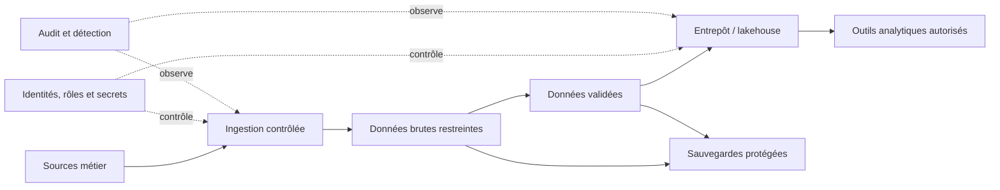

# Chiffrement, RGPD et contrôle d'accès — Expert

> **Mise en contexte.** La sécurité d’une plateforme de données ne se réduit ni à activer le chiffrement ni à limiter l’accès à la base. Elle doit protéger le cycle complet : collecte, transmission, stockage, transformation, consultation, export, archivage et suppression. Les risques incluent accès abusif, fuite de secrets, privilèges excessifs, copies de test mal protégées, journaux trop détaillés, sauvegardes compromises et réidentification de données supposées anonymes. Ce cours relie chiffrement, identités, contrôle d’accès, classification, minimisation, audit et protection des données personnelles. Il ne remplace pas une analyse juridique : les obligations applicables doivent être validées par les responsables compétents pour chaque territoire, secteur et usage.

## Objectifs pédagogiques

À la fin du cours, vous pourrez construire un modèle de menace pour une plateforme de données, distinguer chiffrement en transit, au repos et au niveau du champ, définir la gestion des clés, appliquer le moindre privilège, séparer identités humaines et de service, choisir entre RBAC et attributs contextuels, limiter l’exposition de données sensibles, concevoir un audit utile, organiser rétention et suppression, et intégrer les contrôles de sécurité dans le cycle de développement.

Le niveau expert exige d’indiquer quelles menaces un contrôle réduit et quelles menaces restent présentes. Un disque chiffré ne protège pas une session administrateur déjà authentifiée ; une vue qui masque des colonnes ne protège pas un export accessible par un autre chemin ; un secret dans une variable d’environnement peut encore être exposé par un dump de processus ou des logs mal configurés. Les mesures doivent s’associer à des preuves et à des responsabilités.

## Prérequis et préparation

Vous devez connaître les bases de données relationnelles et documentaires, les rôles, les API, les réseaux, les identités et les mécanismes de sauvegarde. Le cours reste indépendant d’un fournisseur. Utilisez un environnement de laboratoire, des comptes fictifs et des données synthétiques. Ne copiez pas de vrais numéros de compte, identifiants personnels, secrets ou données de production dans les exercices.

## 1. Modèle de menace et surfaces d’exposition

Avant de choisir un contrôle, identifiez ce que vous protégez, les acteurs, les chemins d’accès, les conséquences d’une fuite ou d’une altération et les hypothèses de confiance. Une plateforme peut comprendre base transactionnelle, staging, entrepôt, stockage objet, moteur de calcul, catalogue, notebook, outil BI, sauvegardes, logs, files et exports. Chaque copie ajoute des chemins d’exposition et des identités pouvant y accéder.

Le modèle de menace examine les abus intentionnels, les erreurs humaines, la compromission d’un compte, les vulnérabilités logicielles, les erreurs de configuration, les copies non gérées, les fuites réseau et les accès internes excessifs. Évaluez probabilité, impact, détectabilité et possibilité de récupération. Un contrôle doit correspondre à une menace identifiée ; un système très verrouillé mais qui empêche toute reprise d’urgence sans procédure testée crée aussi un risque.

Le modèle doit préciser les actifs sensibles, les frontières de confiance, les identités, les flux, les secrets, les chemins d’administration et les domaines de panne. Un diagramme de flux de données aide à rendre visibles les exports, journaux ou snapshots que l’équipe oublie souvent. Révisez le modèle quand une nouvelle source, un connecteur, une région, une copie analytique ou un nouveau consommateur est ajouté.

Le diagramme montre des catégories de composants, pas une architecture obligatoire. Chaque flèche doit préciser identité, protocole, droits, classification et mécanisme d’audit. Les contrôles de sécurité doivent suivre les données et pas uniquement protéger la base centrale.

## 2. Classification et minimisation des données

La classification associe sensibilité à des règles d’usage. Les catégories peuvent s’appeler public, interne, confidentiel et restreint, mais les noms doivent correspondre à la politique de l’organisation. La classification détermine qui peut lire, exporter, partager, conserver et supprimer. Une colonne comme `email` ne doit pas être classée selon son nom uniquement : le contexte et l’usage comptent.

La minimisation consiste à ne collecter et conserver que ce qui est nécessaire à une finalité autorisée. Chaque champ doit avoir une utilité, un propriétaire, une durée et un accès. Les données dérivées et agrégées peuvent rester sensibles selon les combinaisons possibles ; enlever un nom ne garantit pas l’anonymat si le jeu peut être relié à d’autres sources.

Faites l’inventaire des champs personnels, identifiants indirects, données financières, secrets, éléments de santé ou autres catégories sensibles applicables. Documentez finalité, base d’utilisation approuvée, droits, rétention et partage prévu. Les catégories particulières et obligations légales doivent être analysées avec les responsables juridiques ou de conformité, non improvisées dans le code.

La minimisation s’applique à la télémétrie. Un journal qui copie le corps d’une requête ou un payload complet peut former une nouvelle base de données sensible sans propriétaire ni rétention. Préférez identifiants de trace, codes d’erreur, tailles et métadonnées utiles. Lorsque le contenu est nécessaire à l’investigation, limitez les personnes qui y accèdent, masquez ce qui peut l’être et supprimez-le à l’échéance définie.

## 3. Chiffrement en transit et au repos

Le chiffrement en transit protège les données contre certaines interceptions entre client, service, stockage et système d’administration. Utilisez TLS et vérification de certificat selon les capacités de la plateforme. Ne désactivez pas la vérification pour « résoudre » un problème de certificat ; il faut réparer la chaîne de confiance ou la configuration. Vérifiez également les connexions internes, exports, outils de maintenance et liens vers des services tiers.

Le chiffrement au repos protège certains risques de perte de supports ou d’accès direct au stockage. Il peut être géré par le disque, le stockage objet, le SGBD ou l’application. Ces couches ont des objectifs et des garanties différentes. Un chiffrement géré par le fournisseur peut protéger le média mais autoriser l’accès au service pour toute identité ayant les droits. Un chiffrement au niveau du champ peut limiter certains accès, mais ajoute gestion des clés, complexité de requête et risque d’exposition lors du traitement.

Le chiffrement ne supprime pas le besoin de contrôle d’accès. Un acteur autorisé à lire une table peut généralement obtenir le texte clair via le moteur. Il ne protège pas un poste compromis où les données sont déchiffrées, ni un secret volé qui donne les mêmes privilèges. Associez chiffrement, moindre privilège, audit, gestion des secrets et réponse à incident.

## 4. Chiffrement au niveau du champ et tokenisation

Le chiffrement au niveau du champ protège des valeurs spécifiques telles que certains identifiants ou attributs sensibles. Il peut être utile lorsque les administrateurs de stockage n’ont pas besoin de lire ces valeurs ou lorsque les exports doivent contenir une forme chiffrée. Il rend toutefois les recherches, jointures, tri et agrégations plus complexes. Les propriétés de l’algorithme et du mode sont importantes ; ne concevez pas votre propre chiffrement.

La tokenisation remplace une valeur par un jeton qui ne révèle pas directement l’original. Le système de correspondance ou de vault est lui-même sensible et doit être fortement protégé. Les jetons peuvent toujours être traçables ou réidentifiants selon leur construction et les données annexes. Ne qualifiez pas automatiquement des données tokenisées d’anonymes.

La stratégie doit identifier où le texte clair existe : application, mémoire, logs, exports, moteurs de recherche, caches et sauvegardes. Le chiffrement protège les colonnes seulement jusqu’au déchiffrement. Les clés sont séparées des données et les opérations de déchiffrement sont auditées. Testez les migrations, la rotation et la restauration ; une base dont les clés sont perdues peut être inaccessible.

## 5. Gestion du cycle de vie des clés

Une clé cryptographique doit avoir un propriétaire, un usage, un niveau de protection, une durée, une politique de rotation, une méthode de révocation et une procédure d’urgence. Conservez les clés dans un gestionnaire ou service de clés approprié, avec contrôle d’accès et audit. Ne stockez pas la clé dans le même dépôt ou le même emplacement que les données chiffrées.

La rotation doit être planifiée. Si une clé change, il faut savoir si les anciennes données restent chiffrées par l’ancienne clé, si une re-chiffrement est requis, comment les nouvelles écritures sont protégées et quand l’ancienne clé peut être retirée. Une révocation prématurée peut rendre des sauvegardes impossibles à restaurer. Une ancienne clé compromise peut exiger une réévaluation de toutes les copies et des accès déjà réalisés.

La séparation des rôles est essentielle : une identité qui administre les données ne doit pas nécessairement pouvoir exporter les clés maîtresses. Un compte d’urgence peut avoir besoin d’un accès, mais cet accès doit être contrôlé, approuvé, journalisé et testé. La procédure de récupération de clé fait partie des exercices de restauration et de reprise après sinistre.

## 6. Gestion des secrets d’application

Les secrets sont des mots de passe, jetons, clés API, certificats et identifiants de connexion. Ils ne doivent pas être commités dans Git, copiés dans les tests, écrits dans des URL ou imprimés dans les logs. Utilisez un gestionnaire de secrets ou des variables d’environnement contrôlées par la plateforme, avec permissions limitées, rotation et séparation entre environnements.

La variable d’environnement réduit les risques associés au dépôt, mais n’est pas un coffre universel. Elle peut être exposée par des dumps de processus, outils de diagnostic, scripts de démarrage ou logs. Limitez l’accès au service et évitez de publier toute la configuration. Les secrets doivent être disponibles uniquement aux processus qui en ont besoin et rester distincts entre développement, CI, staging et production.

En cas de fuite, révoquez ou faites tourner le secret, identifiez les systèmes qui l’utilisent, examinez les journaux d’accès et réémettez les credentials nécessaires. Supprimer la valeur du dernier commit ne retire pas la clé de l’historique ni des clones. L’analyse d’incident doit déterminer la fenêtre d’exposition et les actions réalisées avec ce secret.

## 7. Identités humaines et identités de service

Une identité humaine correspond à une personne ; une identité de service permet à un processus d’exécuter une tâche. Elles doivent être séparées. Les comptes partagés rendent l’attribution difficile et compliquent la révocation. Les identités de service doivent être nommées selon leur fonction, propriétaires et durée de vie connus.

Le cycle de vie inclut création, approbation, affectation des rôles, revue périodique, rotation des secrets, suspension et suppression. Les comptes de départ doivent être révoqués ; les services abandonnés doivent perdre leurs credentials. Une identité d’administration d’urgence doit être séparée du compte d’usage quotidien et soumise à une revue renforcée.

L’authentification multifacteur est recommandée pour les accès humains à privilèges lorsqu’elle est disponible et adaptée. Utilisez des mécanismes robustes pour les automatisations : identités de workload, credentials à courte durée ou mécanismes de fédération selon la plateforme. Évitez les secrets statiques copiés dans des scripts lorsque des identités gérées peuvent répondre au besoin.

## 8. RBAC, ABAC et moindre privilège

Le contrôle d’accès basé sur les rôles (RBAC) attribue des droits à des rôles fonctionnels : lecture analytique, ingestion, transformation, administration ou sauvegarde. Le contrôle basé sur les attributs (ABAC) utilise le contexte, comme classification de la donnée, département, environnement, région ou finalité autorisée. Les deux modèles peuvent se compléter. Le bon modèle est celui dont l’application et l’audit restent compréhensibles.

Attribuez les droits par besoin réel. Un analyste peut lire une table de données validées ou une vue agrégée sans obtenir la lecture de la zone brute. Un pipeline d’ingestion peut écrire dans une zone et lire une source, sans pouvoir supprimer les sauvegardes. Un service applicatif n’a normalement pas besoin de créer des utilisateurs ou d’altérer les paramètres globaux de la base.

Le moindre privilège doit être vérifié par des tests positifs et négatifs. Il ne suffit pas de tester qu’un compte autorisé lit une table ; vérifiez également qu’il ne peut pas lire une table sensible ou modifier le schéma. Contrôlez les privilèges hérités, rôles par défaut, liens entre comptes et permissions de stockage. Les droits effectifs peuvent être plus larges que ceux visibles dans une seule définition de rôle.

## 9. Sécurité au niveau base, table, ligne et colonne

Selon le moteur, les contrôles peuvent exister au niveau instance, base, schéma, table, colonne ou ligne. Les vues peuvent exposer un sous-ensemble de colonnes, et les politiques de sécurité par ligne peuvent limiter la population visible. La disponibilité et la sémantique de ces contrôles dépendent de la version ; vérifiez leur comportement dans le système choisi.

Le masquage est utile pour réduire l’exposition dans certains contextes, mais ne remplace pas la permission. Un masquage dynamique peut masquer une colonne dans une interface tout en laissant la valeur accessible par une autre voie si les droits restent trop larges. Les exports, caches, requêtes ad hoc et outils d’administration doivent respecter le même modèle de sécurité.

Une politique par ligne peut filtrer les données selon l’identité et le contexte. Vérifiez qu’elle s’applique aux chemins de lecture concernés, aux vues, aux procédures, aux opérations d’écriture et aux comptes privilégiés, selon la capacité du moteur. Les administrateurs peuvent avoir des mécanismes de contournement légitimes ; leur usage doit être contrôlé. Les tests doivent utiliser plusieurs identités et jeux synthétiques distincts.

## 10. Données personnelles : finalité, minimisation et droits

La gouvernance des données personnelles doit partir de finalité et usage autorisé. Identifiez quelles données sont réellement nécessaires, qui peut les consulter, combien de temps elles doivent être conservées et à quelles fins elles peuvent être partagées. La conformité juridique dépend du territoire, du secteur, des rôles de l’organisation et du traitement ; sollicitez les responsables juridiques ou de conformité avant de déterminer les exigences applicables.

Le RGPD, lorsqu’il est applicable, prévoit notamment des principes de finalité, minimisation, exactitude, limitation de conservation et sécurité, ainsi que des droits qui doivent être analysés selon le contexte et les exceptions. L’équipe technique doit permettre la recherche, correction, export, restriction ou suppression lorsque le processus approuvé le requiert. Elle ne décide pas seule de la base juridique ni de toutes les exceptions.

Les copies analytiques compliquent la réponse à une demande de personne. Le lignage doit permettre de retrouver où se trouvent les données et quelles transformations les ont propagées. La suppression dans la source peut nécessiter des changements dans staging, warehouse, index, cache, exports et jeux de test. Les sauvegardes suivent une politique documentée qui respecte les exigences applicables et permet de gérer la réapparition d’une donnée lors d’une restauration.

## 11. Pseudonymisation, anonymisation et réidentification

La pseudonymisation remplace ou sépare des identifiants directs, mais une information supplémentaire peut permettre de relier les enregistrements à une personne. L’anonymisation vise à rendre la réidentification suffisamment improbable au regard des moyens raisonnablement susceptibles d’être utilisés ; cette évaluation dépend du contexte, des données annexes et des possibilités techniques. Supprimer une colonne nom ne suffit pas automatiquement.

Des attributs indirects — lieu, date, âge, profession, événements rares — peuvent singulariser des personnes, surtout lorsqu’ils sont croisés avec des données externes. Les agrégats et exports doivent être évalués au regard de la taille des groupes et des requêtes répétées qui pourraient révéler une valeur. Des contrôles de seuil, minimisation des dimensions ou techniques statistiques appropriées peuvent réduire certains risques, mais nécessitent une analyse.

Les données de test devraient être synthétiques lorsque possible, ou masquées selon une méthode validée qui préserve le comportement nécessaire aux tests sans maintenir les identifiants réels. Une copie « pseudonymisée » doit quand même avoir un accès limité, une rétention et un propriétaire. Ne présentez pas une transformation technique comme une garantie légale d’anonymat sans évaluation.

## 12. Journalisation, audit et détection

L’audit doit permettre de répondre à qui a accédé à quelle ressource, quand, par quel mécanisme et selon quelle identité. Les événements utiles comprennent connexions, refus d’accès, changements de rôles, lectures ou exports sensibles lorsque mesurables, modification de politiques, accès aux clés, suppression et opérations de maintenance. Le niveau de journalisation dépend du risque et des capacités du moteur.

Évitez les logs contenant mots de passe, jetons, chaînes de connexion, clés ou contenu complet de données personnelles. Utilisez des identifiants de corrélation, codes d’événement, références de lot et métadonnées minimisées. Les horloges des systèmes doivent être suffisamment synchronisées ; sinon, reconstituer une séquence d’actions devient difficile.

Les journaux sont eux-mêmes des actifs à protéger. Limitez qui peut les lire, empêcher leur modification ou leur suppression non autorisée selon les possibilités de la plateforme, et fixez une rétention cohérente avec les besoins d’enquête et les exigences applicables. Une alerte doit avoir un propriétaire, seuil et action. Des logs sans analyse ou alertes actionnables ne constituent pas une surveillance efficace.

## 13. Changement, vulnérabilités et séparation des environnements

Les environnements développement, test et production doivent être isolés par identités, secrets, ressources et accès. Les données de production ne doivent pas être copiées vers le développement uniquement pour faciliter le débogage. Les tests utilisent des données synthétiques ou masquées et des identifiants distincts. Un outil CI ne doit pas hériter automatiquement de privilèges administrateur de production.

Les mises à jour de moteur, pilotes et bibliothèques nécessitent une gestion de vulnérabilités, des tests de compatibilité et une fenêtre de déploiement. Une dépendance corrigée peut modifier le comportement ; l’absence de test de régression peut introduire un défaut de confidentialité ou de compatibilité. Documentez versions, propriétaire, support et plan de mise à jour.

Une revue de sécurité est requise quand un nouvel export, connecteur, fournisseur, moteur ou consommateur est ajouté. Elle vérifie identité, réseau, classification, partage, rétention, logs, chiffrement, contrats et procédure de révocation. Les modifications de schéma peuvent changer la classification : un nouveau champ personnel doit être détecté et protégé sans attendre le prochain audit manuel.

## 14. Sauvegarde, restauration et incident de sécurité

Les sauvegardes doivent être chiffrées selon le risque, séparées du domaine de panne et restaurables à l’aide de clés accessibles via une procédure contrôlée. Une sauvegarde peut contenir une copie complète de données sensibles et mérite souvent des droits plus stricts que la base courante. Son téléchargement et sa restauration doivent être audités.

En cas de suspicion de compromission, évitez de restaurer immédiatement une sauvegarde sur le système courant sans examiner les preuves et le point de contamination. Déterminez si l’attaquant pouvait altérer les sauvegardes, clés, images ou scripts de déploiement. Une restauration saine peut exiger une nouvelle identité, une rotation de secrets et une reconstruction de l’environnement depuis des artefacts vérifiés.

La reprise après incident doit empêcher le retour du même compte compromis. Révoquez tokens, secrets et clés selon le scénario, vérifiez les droits, examinez les logs et restaurez la confiance dans les images et dépendances. Les données restaurées peuvent contenir le contenu mais pas les contrôles de sécurité nécessaires ; le service n’est pas rétabli tant qu’identités, permissions et surveillance n’ont pas été validées.

## 15. Atelier pratique : sécuriser un mini-entrepôt

### Scénario

Vous possédez des tables synthétiques clients, commandes et produits. Un rôle d’ingestion reçoit les commandes, un rôle analyste consulte les indicateurs et un rôle DBA administre le schéma. Le but est de limiter l’exposition des données et de vérifier les refus d’accès.

### Étape A — Classifier

Pour chaque champ, indiquez finalité, sensibilité, propriétaire, accès nécessaire et durée. Séparez les identifiants directs des données analytiques. Définissez quelles colonnes doivent être absentes d’une vue standard et lesquelles peuvent être agrégées.

### Étape B — Créer les rôles

Implémentez des rôles selon le SGBD : ingestion peut lire les tables source et écrire dans le staging prévu, analyste peut lire la vue publiée, et DBA possède des privilèges administratifs séparés. Les commandes exactes diffèrent ; documentez les grants qui sont réellement utilisés.

### Étape C — Tester les accès

Effectuez une lecture autorisée et des tentatives interdites. Vérifiez que le rôle analyste ne lit pas les champs sensibles bruts, n’altère pas le schéma et ne supprime pas de table. Utilisez la même identité que l’application quand cela est possible et examinez les privilèges hérités.

### Étape D — Protéger les secrets

Utilisez un secret de laboratoire injecté hors du code, contrôlez qui peut le lire et vérifiez qu’aucun log ne le publie. Simulez une rotation puis reconnectez le service. La procédure doit permettre de révoquer l’ancienne valeur sans interrompre plus longtemps que nécessaire.

### Étape E — Vérifier l’audit

Produisez une connexion autorisée, une connexion échouée, une tentative d’accès interdite et un changement de rôle. Vérifiez que les événements nécessaires sont présents, horodatés et ne contiennent pas de secrets. Documentez la rétention et les alertes prévues.

### Critères d’acceptation

Le laboratoire réussit si les privilèges sont minimaux, les refus d’accès sont effectifs et observables, les secrets restent hors des logs, les champs sensibles ne sont pas exposés dans la vue destinée aux analystes et la procédure de rotation est reproductible.

## 16. Étude de cas : fuite via une copie analytique

### Situation

Une équipe crée un export CSV complet pour un test de modèle. Le fichier est déposé dans un stockage partagé et plusieurs comptes peuvent le télécharger. La base centrale reste protégée, mais les données sont désormais exposées par une copie moins contrôlée.

### Analyse

Inventoriez le fichier, période, population, colonnes, identités qui y ont accédé et durée de disponibilité. Examinez les logs de stockage et les partages. Déterminez si des données ont été téléchargées ou copiées ailleurs et quel risque existe. Ne supprimez pas immédiatement les preuves sans respecter la procédure d’incident.

### Correction

Restreignez ou révoquez l’accès, retirez la copie selon la procédure approuvée et recherchez les autres copies. Si l’exposition est confirmée ou possible, informez les responsables sécurité, confidentialité et juridiques selon le protocole de l’organisation. Remplacez le jeu par des données synthétiques ou masquées, puis contrôlez qu’il conserve les propriétés techniques nécessaires.

### Prévention

Les exports sensibles exigent finalité, approbation, minimisation, emplacement contrôlé, propriétaire, expiration et journalisation. Un processus automatisé peut générer un jeu de test masqué, appliquer des droits temporaires et supprimer la copie à échéance. Les équipes doivent comprendre qu’une base protégée ne compense pas une copie non gouvernée.

## 17. Exercices avec corrigés

### Exercice 1 — Le chiffrement au repos suffit-il si l’utilisateur de l’application a trop de privilèges ?

**Correction.** Non. L’application peut lire les données déchiffrées avec ses droits. Réduisez les privilèges, séparez les rôles et auditez les accès. Le chiffrement au repos protège certains scénarios de perte de support mais ne remplace pas l’autorisation.

### Exercice 2 — Peut-on placer une clé de chiffrement dans Git si le dépôt est privé ?

**Correction.** Non. Le dépôt peut être cloné, son accès évoluer ou son historique subsister après retrait du secret. Utilisez un gestionnaire de secrets, révoquez et faites tourner tout secret déjà exposé, puis vérifiez les usages et logs.

### Exercice 3 — Une copie sans nom et email est-elle anonyme ?

**Correction.** Pas nécessairement. Des attributs indirects ou des données externes peuvent permettre de réidentifier des personnes. Évaluez population, granularité, possibilités de recoupement et contexte. La pseudonymisation reste généralement un contrôle de réduction de risque, pas une garantie automatique d’anonymat.

### Exercice 4 — Qui peut décider de la durée de conservation ?

**Correction.** Le propriétaire métier et les responsables appropriés définissent finalité, obligations et exigences de conservation ; les équipes techniques mettent en place les mécanismes et preuves. Les obligations juridiques doivent être confirmées avec les responsables compétents pour le contexte.

### Exercice 5 — Pourquoi les logs doivent-ils être protégés ?

**Correction.** Ils peuvent révéler activités, identifiants, structure technique et parfois données sensibles. Une altération peut aussi détruire les preuves d’incident. Limitez lecture et suppression, évitez les secrets, contrôlez horloge et rétention et surveillez les événements importants.

### Exercice 6 — Que faire lors de la révocation d’un secret utilisé par plusieurs services ?

**Correction.** Identifiez consommateurs, créez et distribuez la nouvelle valeur de manière contrôlée, vérifiez les connexions, révoquez l’ancienne, surveillez les erreurs et conservez une trace. Une révocation non coordonnée peut casser la production ; un chevauchement doit être défini et limité selon le risque.

## 18. Défi final : architecture de sécurité des données

Une plateforme reçoit des données clients, les transforme dans un lakehouse, expose des tableaux de bord et conserve des sauvegardes pour reprise. Plusieurs équipes consomment les données et les règles de rétention doivent s’appliquer à toutes les copies.

### Corrigé attendu

Commencez par classer les données, inventorier les flux et définir les finalités. Modélisez les identités humaines et de service, attribuez des rôles minimaux et séparez ingestion, transformation, lecture et administration. Protégez les données en transit et au repos selon le modèle de menace, centralisez les clés et testez la rotation. Les credentials sont injectés, non versionnés.

Construisez le lignage de la source aux rapports et aux copies. Les vues et produits analytiques limitent les champs sensibles. Les environnements de test utilisent des données synthétiques ou masquées. Les exports doivent être approuvés, tracés, temporaires et limités. Les logs évitent le payload complet et possèdent des droits de lecture et une rétention.

Définissez le processus de réponse aux demandes ou incidents : retrouver les copies, suspendre les accès, préserver preuves, appliquer correction/suppression, tester et communiquer. Les sauvegardes suivent une rétention contrôlée et ne doivent pas être supprimées sans processus ; leur réapparition lors d’une restauration doit être gérée selon la politique applicable. Les obligations légales sont validées par les responsables compétents.

Mettez en place des contrôles continus sur rôles excessifs, secrets expirés, accès anormaux, copies non classifiées, exports, tables sans propriétaire et champs sensibles inconnus. Chaque alerte a un responsable et une action. Testez une fuite simulée et une rotation de clé dans un environnement isolé.

La livraison inclut modèle de menace, diagramme de flux, matrice de rôles, classification, politiques de clés, règles de journalisation, contrôles qualité, rétention, gestion des incidents, tests et risques résiduels. Les garanties annoncées doivent correspondre aux comportements testés et aux versions du système déployé.

## 19. Checklist avant mise en production

- [ ] Le modèle de menace identifie actifs, acteurs, frontières et copies.
- [ ] Les données sont classifiées et minimisées selon la finalité.
- [ ] Le chiffrement en transit et au repos est vérifié sur chaque chemin critique.
- [ ] Les clés disposent d’un propriétaire, rotation, révocation et récupération testées.
- [ ] Les identités de service sont séparées et leurs privilèges limités.
- [ ] Les accès interdits sont testés, pas seulement les accès autorisés.
- [ ] Les secrets ne sont pas versionnés ni journalisés.
- [ ] Les copies analytiques, exports, caches et sauvegardes sont gouvernés.
- [ ] Le lignage aide à identifier les copies et consommateurs.
- [ ] Les journaux sont protégés, utiles, horodatés et limités aux données nécessaires.
- [ ] Rétention et suppression couvrent les dépendances et copies.
- [ ] Les procédures d’incident, de rotation et de récupération sont exercées.

## Conclusion

La sécurité des données doit suivre les données tout au long de leur cycle de vie. Le chiffrement protège certains scénarios, le contrôle d’accès limite les usages, la minimisation réduit l’exposition, la gestion des secrets protège les identités et le lignage rend les copies retrouvables. La conformité dépend du contexte et doit être validée par les responsables compétents. Une architecture experte ne promet pas seulement des contrôles : elle fournit des preuves, mesure les limites et permet une réponse reproductible aux incidents.

## Complément : programme de sécurité continue

### Revues périodiques d’accès

Les droits évoluent avec les équipes, projets et données. Une revue périodique compare les rôles réellement affectés aux usages observés et aux besoins déclarés. Les accès non utilisés ne doivent pas forcément être révoqués automatiquement, car certains peuvent correspondre à des tâches trimestrielles ; ils doivent être confirmés par un propriétaire. Les droits de production et d’urgence font l’objet d’une attention renforcée.

Automatisez l’inventaire des comptes, rôles, privilèges effectifs et dernières connexions lorsque les outils le permettent. Comparez-le à une liste d’identités attendues et détectez les comptes orphelins, privilèges globaux inattendus, secrets expirés et comptes de service sans propriétaire. Les exceptions doivent être documentées, limitées dans le temps et revues. Après modification, rejouez des tests positifs et négatifs pour vérifier que la correction n’a pas bloqué une tâche légitime.

### Évaluer les risques des fournisseurs et connecteurs

Un fournisseur de stockage, de catalogue ou de transformation peut recevoir des données, logs, identifiants ou métadonnées. Avant l’intégration, examinez les flux, régions, comptes, journaux, durée de conservation, export et suppression. Vérifiez quelles identités du fournisseur peuvent accéder au support et comment les incidents sont communiqués. Les aspects contractuels et légaux nécessitent l’accord des responsables compétents.

Un connecteur introduit une nouvelle surface de code et de configuration. Maintenez ses versions, lisez les exigences de permission, isolez les credentials et observez les destinations réellement utilisées. Les tests doivent inclure panne, retry, exposition d’erreur et rotation. Une intégration ne doit pas hériter de droits administrateur simplement pour simplifier le déploiement.

### Secrets et journaux dans la chaîne CI/CD

Les pipelines CI peuvent produire des logs de build, artefacts, captures d’écran et traces de tests. Ils doivent être analysés comme des emplacements potentiels de fuite. Masquez les valeurs sensibles, empêchez l’impression de variables et limitez l’accès aux artefacts. Les secrets de production ne doivent pas être disponibles aux workflows qui n’en ont pas besoin, ni à des branches non approuvées.

Lorsqu’un test nécessite un secret, fournissez-le par le mécanisme sécurisé de la plateforme et ne l’affichez jamais dans le rapport. Utilisez un compte ou secret de test à privilèges limités. Si un artefact peut contenir une donnée personnelle, définissez rétention et personnes autorisées à le télécharger. La politique s’applique aussi aux captures de production et aux traces Playwright.

### Preuves et exercices de sécurité

Un exercice doit démontrer non seulement qu’un contrôle est activé mais qu’il réduit le risque visé. Par exemple, tentez un accès interdit, vérifiez le refus et contrôlez que le journal le consigne. Pour la rotation de clé, prouvez que l’ancienne clé ne peut plus chiffrer ou accéder au nouveau périmètre selon le design, tout en confirmant que les données retenues restent récupérables. Pour un export, testez approbation, expiration et suppression.

Documentez la version, l’identité, l’environnement, l’action et le résultat. Ne conservez pas de payload sensible si une référence et une preuve masquée suffisent. Les exercices révèlent les zones où les procédures dépendent d’une personne ou d’un compte unique. Assignez des actions et répétez les tests après leur fermeture.

### Construire un tableau de bord de sécurité

Les indicateurs utiles incluent comptes à privilèges, comptes inactifs, secrets expirés, échecs d’accès, changements de rôles, téléchargements massifs, exports en attente, données non classifiées, sauvegardes non testées et anomalies de rétention. Les seuils doivent être liés à des actions et à une équipe responsable. Un grand nombre d’alertes sans triage affaiblit la détection.

Ne mesurez pas uniquement le nombre d’incidents détectés. Suivez délai de remédiation, taux d’alertes traitées, couverture des actifs, récurrence et résultat des tests. Les métriques ne doivent pas pousser l’équipe à masquer les problèmes pour rendre un tableau de bord vert. Un risque connu et accepté doit rester visible avec propriétaire, justification et date de réexamen.

### Principes de clôture d’un incident

Un incident est clôturé lorsque le périmètre est connu ou borné, les accès compromis sont révoqués, les données et copies sont traitées, les obligations de communication ont été évaluées, la reprise a été validée et les preuves sont préservées. La cause technique et les facteurs organisationnels doivent être documentés. La correction doit créer des tests ou contrôles qui réduisent la probabilité de récidive.

Une action de sécurité doit être évaluée pour ses effets secondaires. Une rotation peut interrompre des pipelines ; une révocation peut fermer un accès de reprise ; une suppression peut toucher des données utiles à l’audit. Le plan associe donc risque, approbation, fenêtre, rollback ou compensation, contrôle après action et responsable de surveillance.