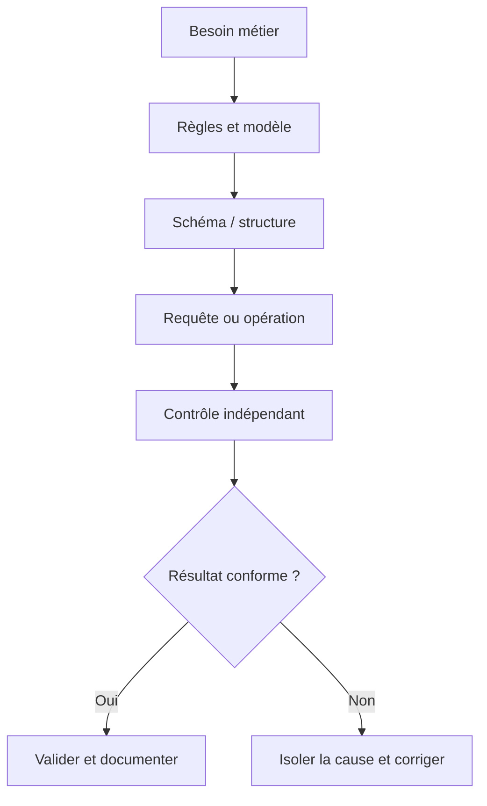
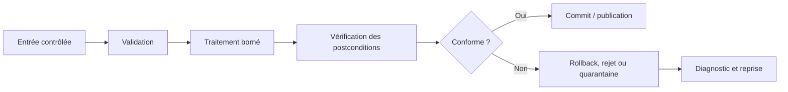
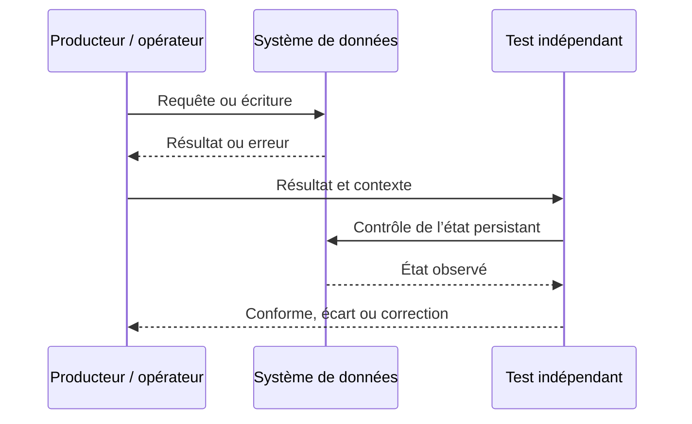
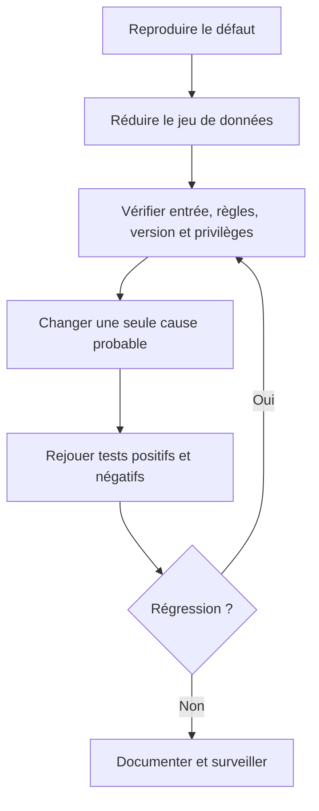

# Requêtes SQL de base (SELECT, INSERT) — Débutant

> **Mise en contexte.** Lire, ajouter et modifier des données SQL de façon précise, paramétrée et vérifiable. Le but n'est pas seulement d'obtenir une sortie plausible, mais de construire une solution dont le sens métier est clair, le comportement vérifiable et les limites connues. Les exemples sont pédagogiques ; adaptez-les au moteur, à sa version, aux exigences de sécurité et aux règles de l'organisation. Utilisez un environnement isolé et des données synthétiques pour les premières manipulations. Ne stockez jamais de secrets dans les scripts, journaux ou captures partagées.

## Introduction et objectifs pédagogiques

À l'issue du cours, vous devez pouvoir expliquer la notion étudiée, reconnaître ses limites, produire un résultat correct et démontrer pourquoi il l'est. Le niveau débutant ne signifie pas apprendre des commandes par cœur ; il signifie être capable d'expliquer une règle, de choisir un exemple discriminant, de vérifier le résultat et de rendre la procédure reproductible.

Objectifs opérationnels : acquérir un vocabulaire commun ; comprendre les composants impliqués ; appliquer une méthode étape par étape ; analyser les erreurs ; vérifier l'état au-delà du code de retour ; documenter les hypothèses et préserver intégrité, sécurité et récupération. La réussite se mesure à la justesse et à la reproductibilité, non au nombre de lignes écrites.

## Prérequis et environnement

Le prérequis du parcours est **data-bases-debutant**. Avant de commencer, notez la version du moteur, le compte utilisé, le périmètre des données et la manière de réinitialiser le laboratoire. Séparez privilèges d'administration et privilèges applicatifs ; vérifiez la cible avant une commande destructive. Les noms d'objets, formats, encodages et paramètres peuvent différer entre environnements et doivent être documentés.

## Concepts clés développés

### 1. Structure de SELECT

SELECT définit les colonnes retournées, FROM la source, WHERE les lignes retenues et ORDER BY l'ordre demandé. Sans ORDER BY le résultat n'a aucun ordre garanti. Les colonnes explicites limitent les transferts et évitent d'exposer de nouveaux champs après une évolution.

**Mise en pratique.** Lister les colonnes nécessaires, ajouter le filtre étape par étape et vérifier nombre et valeurs des lignes. Pour appliquer cette notion de façon reproductible, formulez la règle avant de tester, choisissez un jeu court qui rend les différences visibles et consignez le résultat. N'ajustez pas la conclusion pour la faire correspondre aux données ; si le test échoue, documentez ce qu'il révèle et construisez un test plus discriminant.

**Risque à maîtriser.** SELECT * peut rendre une API fragile et exposer des champs devenus sensibles. Cette erreur peut rester cachée avec les données habituelles. Construisez un test négatif qui prouve que le garde-fou agit et un test de non-régression qui protège la correction.

**Revue technique.** 1. Quel contrat métier est représenté ? 2. Quelle couche fait autorité ? 3. Quelle valeur frontière invaliderait une hypothèse naïve ? 4. Comment corriger un écart sans masquer sa cause ? Une réponse solide inclut une preuve vérifiable, la version de l'environnement et les limites de la conclusion.

### 2. Filtres et logique booléenne

WHERE combine comparaisons, IN, BETWEEN, LIKE, AND et OR. Les parenthèses rendent l'intention visible. Un joker LIKE en début de motif peut être coûteux. Les comparaisons avec NULL exigent IS NULL.

**Mise en pratique.** Tester chaque prédicat séparément, puis la composition, avec valeur frontière et ligne qui ne satisfait qu'une branche. Pour appliquer cette notion de façon reproductible, formulez la règle avant de tester, choisissez un jeu court qui rend les différences visibles et consignez le résultat. N'ajustez pas la conclusion pour la faire correspondre aux données ; si le test échoue, documentez ce qu'il révèle et construisez un test plus discriminant.

**Risque à maîtriser.** Un OR mal parenthésé élargit la population et devient dangereux si le filtre est repris par UPDATE. Cette erreur peut rester cachée avec les données habituelles. Construisez un test négatif qui prouve que le garde-fou agit et un test de non-régression qui protège la correction.

**Revue technique.** 1. Quel contrat métier est représenté ? 2. Quelle couche fait autorité ? 3. Quelle valeur frontière invaliderait une hypothèse naïve ? 4. Comment corriger un écart sans masquer sa cause ? Une réponse solide inclut une preuve vérifiable, la version de l'environnement et les limites de la conclusion.

### 3. INSERT explicite

INSERT INTO table (colonnes) VALUES (valeurs) rend le contrat explicite. Une colonne omise peut recevoir DEFAULT ou NULL. Types, clés et contraintes restent vérifiés et l'insertion doit gérer correctement les rejets.

**Mise en pratique.** Lister les colonnes, utiliser des paramètres liés et vérifier les lignes réellement insérées. Pour appliquer cette notion de façon reproductible, formulez la règle avant de tester, choisissez un jeu court qui rend les différences visibles et consignez le résultat. N'ajustez pas la conclusion pour la faire correspondre aux données ; si le test échoue, documentez ce qu'il révèle et construisez un test plus discriminant.

**Risque à maîtriser.** Assembler SQL par concaténation expose à l'injection ; omettre la liste de colonnes fragilise les migrations. Cette erreur peut rester cachée avec les données habituelles. Construisez un test négatif qui prouve que le garde-fou agit et un test de non-régression qui protège la correction.

**Revue technique.** 1. Quel contrat métier est représenté ? 2. Quelle couche fait autorité ? 3. Quelle valeur frontière invaliderait une hypothèse naïve ? 4. Comment corriger un écart sans masquer sa cause ? Une réponse solide inclut une preuve vérifiable, la version de l'environnement et les limites de la conclusion.

### 4. UPDATE et DELETE sûrs

UPDATE et DELETE affectent les lignes visées par WHERE ; sans filtre, la commande peut toucher toute la table. Les modifications importantes doivent être bornées par une clé stable et précédées d'une vérification du périmètre.

**Mise en pratique.** Effectuer SELECT avec le même filtre, compter les lignes ciblées et relire les postconditions. Pour appliquer cette notion de façon reproductible, formulez la règle avant de tester, choisissez un jeu court qui rend les différences visibles et consignez le résultat. N'ajustez pas la conclusion pour la faire correspondre aux données ; si le test échoue, documentez ce qu'il révèle et construisez un test plus discriminant.

**Risque à maîtriser.** Vérifier un prédicat différent de celui exécuté donne une fausse sécurité. Cette erreur peut rester cachée avec les données habituelles. Construisez un test négatif qui prouve que le garde-fou agit et un test de non-régression qui protège la correction.

**Revue technique.** 1. Quel contrat métier est représenté ? 2. Quelle couche fait autorité ? 3. Quelle valeur frontière invaliderait une hypothèse naïve ? 4. Comment corriger un écart sans masquer sa cause ? Une réponse solide inclut une preuve vérifiable, la version de l'environnement et les limites de la conclusion.

### 5. Tri et pagination

ORDER BY définit l'ordre et LIMIT borne le résultat. Une pagination stable nécessite un critère unique, souvent complété par la clé primaire. OFFSET peut coûter cher sur de grandes tables ; les données peuvent changer entre pages.

**Mise en pratique.** Tester plusieurs lignes partageant la même date, ajouter un critère de départage et mesurer sur un volume réaliste. Pour appliquer cette notion de façon reproductible, formulez la règle avant de tester, choisissez un jeu court qui rend les différences visibles et consignez le résultat. N'ajustez pas la conclusion pour la faire correspondre aux données ; si le test échoue, documentez ce qu'il révèle et construisez un test plus discriminant.

**Risque à maîtriser.** Un ordre non unique peut répéter ou sauter des lignes entre pages. Cette erreur peut rester cachée avec les données habituelles. Construisez un test négatif qui prouve que le garde-fou agit et un test de non-régression qui protège la correction.

**Revue technique.** 1. Quel contrat métier est représenté ? 2. Quelle couche fait autorité ? 3. Quelle valeur frontière invaliderait une hypothèse naïve ? 4. Comment corriger un écart sans masquer sa cause ? Une réponse solide inclut une preuve vérifiable, la version de l'environnement et les limites de la conclusion.

### 6. NULL et agrégats élémentaires

COUNT(*) compte les lignes ; COUNT(colonne) ignore NULL. COALESCE remplace une absence mais représente une décision métier. Les fonctions de date et de conversion peuvent dépendre du dialecte ; la précision numérique doit être explicite.

**Mise en pratique.** Créer des données avec NULL, comparer les agrégats et tester dates et décimaux dans le moteur réel. Pour appliquer cette notion de façon reproductible, formulez la règle avant de tester, choisissez un jeu court qui rend les différences visibles et consignez le résultat. N'ajustez pas la conclusion pour la faire correspondre aux données ; si le test échoue, documentez ce qu'il révèle et construisez un test plus discriminant.

**Risque à maîtriser.** Convertir toute absence en zéro transforme l'inconnu en donnée. Cette erreur peut rester cachée avec les données habituelles. Construisez un test négatif qui prouve que le garde-fou agit et un test de non-régression qui protège la correction.

**Revue technique.** 1. Quel contrat métier est représenté ? 2. Quelle couche fait autorité ? 3. Quelle valeur frontière invaliderait une hypothèse naïve ? 4. Comment corriger un écart sans masquer sa cause ? Une réponse solide inclut une preuve vérifiable, la version de l'environnement et les limites de la conclusion.

### 7. Transactions et erreurs

Plusieurs INSERT peuvent constituer un changement métier unique. COMMIT valide et ROLLBACK annule les changements non validés ; l'application doit gérer l'erreur sans annoncer le succès avant validation.

**Mise en pratique.** Provoquer une violation de contrainte au milieu d'un lot et vérifier l'état final. Pour appliquer cette notion de façon reproductible, formulez la règle avant de tester, choisissez un jeu court qui rend les différences visibles et consignez le résultat. N'ajustez pas la conclusion pour la faire correspondre aux données ; si le test échoue, documentez ce qu'il révèle et construisez un test plus discriminant.

**Risque à maîtriser.** Rejouer aveuglément après une erreur peut créer doublons ou résultats partiels. Cette erreur peut rester cachée avec les données habituelles. Construisez un test négatif qui prouve que le garde-fou agit et un test de non-régression qui protège la correction.

**Revue technique.** 1. Quel contrat métier est représenté ? 2. Quelle couche fait autorité ? 3. Quelle valeur frontière invaliderait une hypothèse naïve ? 4. Comment corriger un écart sans masquer sa cause ? Une réponse solide inclut une preuve vérifiable, la version de l'environnement et les limites de la conclusion.

### 8. Paramètres et privilèges

Les requêtes paramétrées séparent SQL et valeurs. Les identifiants de table ou de colonne doivent souvent venir d'une liste autorisée. Le compte applicatif doit posséder uniquement les droits requis.

**Mise en pratique.** Fournir apostrophes et caractères spéciaux comme valeurs puis examiner les privilèges du compte. Pour appliquer cette notion de façon reproductible, formulez la règle avant de tester, choisissez un jeu court qui rend les différences visibles et consignez le résultat. N'ajustez pas la conclusion pour la faire correspondre aux données ; si le test échoue, documentez ce qu'il révèle et construisez un test plus discriminant.

**Risque à maîtriser.** La paramétrisation ne corrige ni une autorisation métier manquante ni des privilèges excessifs. Cette erreur peut rester cachée avec les données habituelles. Construisez un test négatif qui prouve que le garde-fou agit et un test de non-régression qui protège la correction.

**Revue technique.** 1. Quel contrat métier est représenté ? 2. Quelle couche fait autorité ? 3. Quelle valeur frontière invaliderait une hypothèse naïve ? 4. Comment corriger un écart sans masquer sa cause ? Une réponse solide inclut une preuve vérifiable, la version de l'environnement et les limites de la conclusion.

## Architectures et schémas de référence

Les diagrammes décrivent une méthode logique et ne remplacent pas un schéma de production complet. Celui-ci doit aussi préciser versions, capacité, réseau, authentification, droits, observabilité, sauvegarde et responsabilités. Le premier diagramme relie besoin et preuve, le deuxième rend visible la gestion de l'erreur, le troisième distingue émission et vérification, et le dernier propose un diagnostic reproductible.

## Méthode d'ingénierie : du besoin à une opération sûre

### 1. Définir le contrat
Écrivez le résultat attendu en termes observables : population, règles, état initial, état final et exceptions. Remplacez « cela doit fonctionner » par un test. Une demande peut contenir plusieurs contrats — cohérence, latence, confidentialité et récupération — qui doivent être évalués séparément.

### 2. Identifier composants et source de vérité
Déterminez quel composant reçoit l'entrée, lequel transforme, où l'état est persisté et qui consomme le résultat. Pour chaque interface, notez propriétaire, format, erreurs, limites, version et permissions. Vérifiez les données dans le système faisant autorité plutôt que seulement dans un écran ou un cache.

### 3. Construire un test discriminant
Choisissez un jeu réduit comprenant cas normal, frontière, absence, doublon ou valeur invalide selon le sujet. Un bon test distingue deux hypothèses plausibles. Si le même résultat découle des deux, améliorez le test avant de conclure.

### 4. Isoler une variable
Reproduisez le défaut, conservez les indices et changez une variable à la fois. Examinez configuration, version, données, identité, permissions, ordre d'exécution et transaction avant d'accuser le moteur. Changer plusieurs composants simultanément empêche d'attribuer la cause.

### 5. Vérifier les postconditions
Vérifiez état persistant, nombre d'éléments touchés, contraintes et effets de bord. Une commande sans erreur ne garantit pas que la bonne ligne a été modifiée. Une requête qui renvoie des lignes ne garantit pas qu'elle répond à la question métier.

### 6. Gérer rejets et reprises
Distinguez erreur d'entrée, violation de règle, refus d'autorisation, panne transitoire, conflit concurrent et risque de corruption. Ne rejouez pas aveuglément si la première opération a pu être validée. Les reprises doivent être bornées, sûres si répétées et traçables ; les rejets doivent garder leur motif.

### 7. Rendre le travail reproductible
Versionnez schéma, requêtes, jeux de test et documentation. Définissez préconditions et ordre d'application. Une autre personne doit pouvoir recréer l'environnement ; les modifications manuelles non tracées créent des écarts entre dépôt et réalité.

### 8. Contrôler droits et données
Utilisez privilège minimal, comptes dédiés et secrets injectés hors du code. Les journaux ne doivent pas exposer mots de passe, jetons ou données personnelles inutiles. Les exigences de confidentialité et de rétention doivent être confirmées pour le contexte réel.

### 9. Mesurer qualité et performance
Définissez source, période, population et propriétaire de chaque mesure. Vérifiez qualité en même temps que latence, coût et volume. Un gain de vitesse qui dégrade exactitude, traçabilité ou récupération n'est pas une amélioration complète.

### 10. Transformer l'incident en apprentissage
Consignez symptôme, cause confirmée, correction, risque résiduel et test de prévention. Une note qui ne garde que la commande finale n'aide pas à savoir si un prochain cas est comparable ni à prévenir la récidive.

## Atelier pratique guidé

### But
**Requêtes contrôlées sur un catalogue.** Créer un catalogue d'articles, filtrer des références, insérer une ligne et mettre à jour un prix avec contrôle du périmètre ciblé.

### Déroulement
1. Préparer l'environnement isolé et vérifier cible, compte et version.
2. Formuler les règles puis les traduire en assertions explicites.
3. Construire jeu nominal et jeu d'exceptions.
4. Exécuter de façon limitée et enregistrer l'état avant/après.
5. Déclencher une erreur et confirmer que le contrôle agit.
6. Rejouer sur un environnement propre ou un état initial différent.
7. Faire vérifier le résultat par une autre personne.
8. Documenter les limites et travaux nécessaires avant un usage réel.

### Critères d'acceptation
Le laboratoire réussit si le résultat est correct, les erreurs prévues sont détectées, les cas limites examinés et la procédure répétable. Si un test échoue, indiquez le fait observé, l'hypothèse, la correction et la preuve que l'état final respecte le contrat. La remise doit inclure données d'essai, commandes ou requêtes, postcondition et limites de la conclusion.

## Étude de cas détaillée

### Situation : Une mise à jour modifie trop de prix
Un opérateur oublie WHERE dans un UPDATE. L'écran annonce une confirmation alors que la commande a touché plusieurs centaines de lignes.

### Diagnostic
Déterminez si le défaut est reproductible et s'il concerne toutes les entrées ou une population. Examinez source, format, règles, chemin d'écriture, transaction, permissions et méthode d'observation. Séparez les faits établis, les causes probables et les inconnues. Une hypothèse utile doit préciser quel test pourrait la réfuter.

### Correction proposée
Contrôler le périmètre par SELECT, vérifier le nombre de lignes affectées, utiliser une transaction lorsque possible et journaliser l'opération. Les privilèges limitent les dégâts mais ne remplacent pas la correction ; définir le retour arrière avant la validation.

### Preuve d'efficacité
Établissez une comparaison avant/après sur une population comparable. Ajoutez un test automatisable, vérifiez qu'il échoue avant correction et réussit après. Analysez les effets collatéraux et les données existantes, puis attribuez la surveillance à un responsable. Le correctif n'est accepté que s'il respecte les critères et que le risque résiduel a été évalué.

## Pièges à éviter

**1. SELECT * comme contrat d'API.** Le risque vient souvent d'un contrat implicite ou d'un test limité au cas nominal. Pour le prévenir, explicitez la règle, produisez un cas qui la met en difficulté et vérifiez la postcondition dans le système faisant autorité. Si le défaut apparaît, conservez l'indice, corrigez sa cause puis ajoutez un test de non-régression. Une correction manuelle sans trace ne protège pas la prochaine exécution.

**2. OR sans parenthèses.** Le risque vient souvent d'un contrat implicite ou d'un test limité au cas nominal. Pour le prévenir, explicitez la règle, produisez un cas qui la met en difficulté et vérifiez la postcondition dans le système faisant autorité. Si le défaut apparaît, conservez l'indice, corrigez sa cause puis ajoutez un test de non-régression. Une correction manuelle sans trace ne protège pas la prochaine exécution.

**3. SQL construit par concaténation.** Le risque vient souvent d'un contrat implicite ou d'un test limité au cas nominal. Pour le prévenir, explicitez la règle, produisez un cas qui la met en difficulté et vérifiez la postcondition dans le système faisant autorité. Si le défaut apparaît, conservez l'indice, corrigez sa cause puis ajoutez un test de non-régression. Une correction manuelle sans trace ne protège pas la prochaine exécution.

**4. INSERT à colonnes implicites.** Le risque vient souvent d'un contrat implicite ou d'un test limité au cas nominal. Pour le prévenir, explicitez la règle, produisez un cas qui la met en difficulté et vérifiez la postcondition dans le système faisant autorité. Si le défaut apparaît, conservez l'indice, corrigez sa cause puis ajoutez un test de non-régression. Une correction manuelle sans trace ne protège pas la prochaine exécution.

**5. UPDATE sans périmètre vérifié.** Le risque vient souvent d'un contrat implicite ou d'un test limité au cas nominal. Pour le prévenir, explicitez la règle, produisez un cas qui la met en difficulté et vérifiez la postcondition dans le système faisant autorité. Si le défaut apparaît, conservez l'indice, corrigez sa cause puis ajoutez un test de non-régression. Une correction manuelle sans trace ne protège pas la prochaine exécution.

**6. NULL converti en zéro.** Le risque vient souvent d'un contrat implicite ou d'un test limité au cas nominal. Pour le prévenir, explicitez la règle, produisez un cas qui la met en difficulté et vérifiez la postcondition dans le système faisant autorité. Si le défaut apparaît, conservez l'indice, corrigez sa cause puis ajoutez un test de non-régression. Une correction manuelle sans trace ne protège pas la prochaine exécution.

**7. Pagination non déterministe.** Le risque vient souvent d'un contrat implicite ou d'un test limité au cas nominal. Pour le prévenir, explicitez la règle, produisez un cas qui la met en difficulté et vérifiez la postcondition dans le système faisant autorité. Si le défaut apparaît, conservez l'indice, corrigez sa cause puis ajoutez un test de non-régression. Une correction manuelle sans trace ne protège pas la prochaine exécution.

**8. Succès annoncé avant COMMIT.** Le risque vient souvent d'un contrat implicite ou d'un test limité au cas nominal. Pour le prévenir, explicitez la règle, produisez un cas qui la met en difficulté et vérifiez la postcondition dans le système faisant autorité. Si le défaut apparaît, conservez l'indice, corrigez sa cause puis ajoutez un test de non-régression. Une correction manuelle sans trace ne protège pas la prochaine exécution.

## Diagnostic : fiches de vérification

### Diagnostic 1 — Structure de SELECT

**Question :** le résultat est-il cohérent avec la règle et les données disponibles ? **Preuve :** Lister les colonnes nécessaires, ajouter le filtre étape par étape et vérifier nombre et valeurs des lignes. **Correction :** réduisez le cas à quelques lignes, vérifiez l'hypothèse puis reproduisez le défaut avant de modifier le système. Après correction, contrôlez les contraintes, les données existantes et les opérations voisines. Distinguez erreur d'entrée, règle de modèle, autorisation, concurrence et observabilité.

### Diagnostic 2 — Filtres et logique booléenne

**Question :** le résultat est-il cohérent avec la règle et les données disponibles ? **Preuve :** Tester chaque prédicat séparément, puis la composition, avec valeur frontière et ligne qui ne satisfait qu'une branche. **Correction :** réduisez le cas à quelques lignes, vérifiez l'hypothèse puis reproduisez le défaut avant de modifier le système. Après correction, contrôlez les contraintes, les données existantes et les opérations voisines. Distinguez erreur d'entrée, règle de modèle, autorisation, concurrence et observabilité.

### Diagnostic 3 — INSERT explicite

**Question :** le résultat est-il cohérent avec la règle et les données disponibles ? **Preuve :** Lister les colonnes, utiliser des paramètres liés et vérifier les lignes réellement insérées. **Correction :** réduisez le cas à quelques lignes, vérifiez l'hypothèse puis reproduisez le défaut avant de modifier le système. Après correction, contrôlez les contraintes, les données existantes et les opérations voisines. Distinguez erreur d'entrée, règle de modèle, autorisation, concurrence et observabilité.

### Diagnostic 4 — UPDATE et DELETE sûrs

**Question :** le résultat est-il cohérent avec la règle et les données disponibles ? **Preuve :** Effectuer SELECT avec le même filtre, compter les lignes ciblées et relire les postconditions. **Correction :** réduisez le cas à quelques lignes, vérifiez l'hypothèse puis reproduisez le défaut avant de modifier le système. Après correction, contrôlez les contraintes, les données existantes et les opérations voisines. Distinguez erreur d'entrée, règle de modèle, autorisation, concurrence et observabilité.

### Diagnostic 5 — Tri et pagination

**Question :** le résultat est-il cohérent avec la règle et les données disponibles ? **Preuve :** Tester plusieurs lignes partageant la même date, ajouter un critère de départage et mesurer sur un volume réaliste. **Correction :** réduisez le cas à quelques lignes, vérifiez l'hypothèse puis reproduisez le défaut avant de modifier le système. Après correction, contrôlez les contraintes, les données existantes et les opérations voisines. Distinguez erreur d'entrée, règle de modèle, autorisation, concurrence et observabilité.

### Diagnostic 6 — NULL et agrégats élémentaires

**Question :** le résultat est-il cohérent avec la règle et les données disponibles ? **Preuve :** Créer des données avec NULL, comparer les agrégats et tester dates et décimaux dans le moteur réel. **Correction :** réduisez le cas à quelques lignes, vérifiez l'hypothèse puis reproduisez le défaut avant de modifier le système. Après correction, contrôlez les contraintes, les données existantes et les opérations voisines. Distinguez erreur d'entrée, règle de modèle, autorisation, concurrence et observabilité.

### Diagnostic 7 — Transactions et erreurs

**Question :** le résultat est-il cohérent avec la règle et les données disponibles ? **Preuve :** Provoquer une violation de contrainte au milieu d'un lot et vérifier l'état final. **Correction :** réduisez le cas à quelques lignes, vérifiez l'hypothèse puis reproduisez le défaut avant de modifier le système. Après correction, contrôlez les contraintes, les données existantes et les opérations voisines. Distinguez erreur d'entrée, règle de modèle, autorisation, concurrence et observabilité.

### Diagnostic 8 — Paramètres et privilèges

**Question :** le résultat est-il cohérent avec la règle et les données disponibles ? **Preuve :** Fournir apostrophes et caractères spéciaux comme valeurs puis examiner les privilèges du compte. **Correction :** réduisez le cas à quelques lignes, vérifiez l'hypothèse puis reproduisez le défaut avant de modifier le système. Après correction, contrôlez les contraintes, les données existantes et les opérations voisines. Distinguez erreur d'entrée, règle de modèle, autorisation, concurrence et observabilité.

## Exercices d'application avec corrigés

### Exercice 1 — Structure de SELECT

**Énoncé.** Construisez un test qui révèle clairement cette propriété et proposez un cas où une approche simpliste échouerait. Expliquez quelle mesure ou assertion doit démontrer la correction.

**Corrigé détaillé.** Lister les colonnes nécessaires, ajouter le filtre étape par étape et vérifier nombre et valeurs des lignes. Une réponse acceptable énonce le contrat, utilise une entrée contrôlée, vérifie l'état obtenu et documente les limites. Elle traite le risque suivant : SELECT * peut rendre une API fragile et exposer des champs devenus sensibles. Validez avec un cas positif, un négatif et un test après évolution du schéma ou des données. Une commande sans contrôle de son résultat n'est pas une preuve suffisante.

### Exercice 2 — Filtres et logique booléenne

**Énoncé.** Construisez un test qui révèle clairement cette propriété et proposez un cas où une approche simpliste échouerait. Expliquez quelle mesure ou assertion doit démontrer la correction.

**Corrigé détaillé.** Tester chaque prédicat séparément, puis la composition, avec valeur frontière et ligne qui ne satisfait qu'une branche. Une réponse acceptable énonce le contrat, utilise une entrée contrôlée, vérifie l'état obtenu et documente les limites. Elle traite le risque suivant : Un OR mal parenthésé élargit la population et devient dangereux si le filtre est repris par UPDATE. Validez avec un cas positif, un négatif et un test après évolution du schéma ou des données. Une commande sans contrôle de son résultat n'est pas une preuve suffisante.

### Exercice 3 — INSERT explicite

**Énoncé.** Construisez un test qui révèle clairement cette propriété et proposez un cas où une approche simpliste échouerait. Expliquez quelle mesure ou assertion doit démontrer la correction.

**Corrigé détaillé.** Lister les colonnes, utiliser des paramètres liés et vérifier les lignes réellement insérées. Une réponse acceptable énonce le contrat, utilise une entrée contrôlée, vérifie l'état obtenu et documente les limites. Elle traite le risque suivant : Assembler SQL par concaténation expose à l'injection ; omettre la liste de colonnes fragilise les migrations. Validez avec un cas positif, un négatif et un test après évolution du schéma ou des données. Une commande sans contrôle de son résultat n'est pas une preuve suffisante.

### Exercice 4 — UPDATE et DELETE sûrs

**Énoncé.** Construisez un test qui révèle clairement cette propriété et proposez un cas où une approche simpliste échouerait. Expliquez quelle mesure ou assertion doit démontrer la correction.

**Corrigé détaillé.** Effectuer SELECT avec le même filtre, compter les lignes ciblées et relire les postconditions. Une réponse acceptable énonce le contrat, utilise une entrée contrôlée, vérifie l'état obtenu et documente les limites. Elle traite le risque suivant : Vérifier un prédicat différent de celui exécuté donne une fausse sécurité. Validez avec un cas positif, un négatif et un test après évolution du schéma ou des données. Une commande sans contrôle de son résultat n'est pas une preuve suffisante.

### Exercice 5 — Tri et pagination

**Énoncé.** Construisez un test qui révèle clairement cette propriété et proposez un cas où une approche simpliste échouerait. Expliquez quelle mesure ou assertion doit démontrer la correction.

**Corrigé détaillé.** Tester plusieurs lignes partageant la même date, ajouter un critère de départage et mesurer sur un volume réaliste. Une réponse acceptable énonce le contrat, utilise une entrée contrôlée, vérifie l'état obtenu et documente les limites. Elle traite le risque suivant : Un ordre non unique peut répéter ou sauter des lignes entre pages. Validez avec un cas positif, un négatif et un test après évolution du schéma ou des données. Une commande sans contrôle de son résultat n'est pas une preuve suffisante.

### Exercice 6 — NULL et agrégats élémentaires

**Énoncé.** Construisez un test qui révèle clairement cette propriété et proposez un cas où une approche simpliste échouerait. Expliquez quelle mesure ou assertion doit démontrer la correction.

**Corrigé détaillé.** Créer des données avec NULL, comparer les agrégats et tester dates et décimaux dans le moteur réel. Une réponse acceptable énonce le contrat, utilise une entrée contrôlée, vérifie l'état obtenu et documente les limites. Elle traite le risque suivant : Convertir toute absence en zéro transforme l'inconnu en donnée. Validez avec un cas positif, un négatif et un test après évolution du schéma ou des données. Une commande sans contrôle de son résultat n'est pas une preuve suffisante.

### Exercice 7 — Transactions et erreurs

**Énoncé.** Construisez un test qui révèle clairement cette propriété et proposez un cas où une approche simpliste échouerait. Expliquez quelle mesure ou assertion doit démontrer la correction.

**Corrigé détaillé.** Provoquer une violation de contrainte au milieu d'un lot et vérifier l'état final. Une réponse acceptable énonce le contrat, utilise une entrée contrôlée, vérifie l'état obtenu et documente les limites. Elle traite le risque suivant : Rejouer aveuglément après une erreur peut créer doublons ou résultats partiels. Validez avec un cas positif, un négatif et un test après évolution du schéma ou des données. Une commande sans contrôle de son résultat n'est pas une preuve suffisante.

### Exercice 8 — Paramètres et privilèges

**Énoncé.** Construisez un test qui révèle clairement cette propriété et proposez un cas où une approche simpliste échouerait. Expliquez quelle mesure ou assertion doit démontrer la correction.

**Corrigé détaillé.** Fournir apostrophes et caractères spéciaux comme valeurs puis examiner les privilèges du compte. Une réponse acceptable énonce le contrat, utilise une entrée contrôlée, vérifie l'état obtenu et documente les limites. Elle traite le risque suivant : La paramétrisation ne corrige ni une autorisation métier manquante ni des privilèges excessifs. Validez avec un cas positif, un négatif et un test après évolution du schéma ou des données. Une commande sans contrôle de son résultat n'est pas une preuve suffisante.

## Checklist de mise en œuvre

- [ ] Les colonnes retournées sont explicites.
- [ ] Les filtres couvrent frontières et NULL.
- [ ] Les insertions utilisent colonnes nommées et paramètres.
- [ ] Les modifications destructives ont un périmètre vérifié.
- [ ] Transactions et erreurs sont traitées explicitement.
- [ ] La pagination est stable.
- [ ] Les privilèges sont minimaux.
- [ ] Les tests vérifient valeurs et lignes affectées.

Ajoutez les règles locales de sécurité, confidentialité, rétention et gestion des changements. Si une exigence n'est pas applicable, documentez le motif. Pour une opération risquée, faites vérifier le plan par une personne habilitée et définissez le chemin de récupération avant une exécution réelle.

## Synthèse — à retenir

La maîtrise technique exige des règles explicites, des preuves reproductibles et une compréhension des cas hors nominal. Le modèle ou la requête doit traduire une question métier ; l'entrée doit être contrôlée ; le résultat doit être vérifié à la granularité correcte ; les erreurs doivent rester visibles et avoir un propriétaire. La production impose enfin de traiter privilèges, volume, concurrence, mises à jour et récupération. Les exemples sont un point de départ et l'organisation doit confirmer les règles applicables à son moteur et son contexte.

## Références techniques

- https://www.postgresql.org/docs/current/sql-select.html
- https://www.postgresql.org/docs/current/sql-insert.html
- https://cheatsheetseries.owasp.org/cheatsheets/SQL_Injection_Prevention_Cheat_Sheet.html

Consultez la documentation correspondant à la version réellement utilisée avant de généraliser une commande ou un comportement.