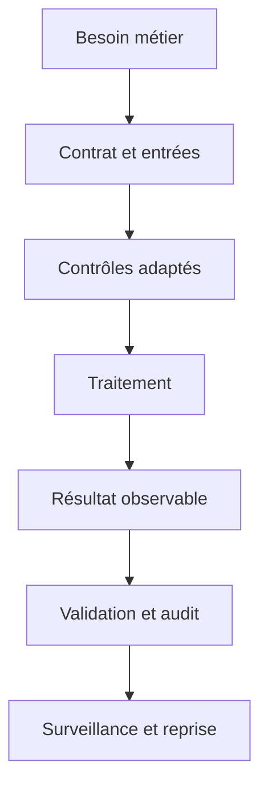
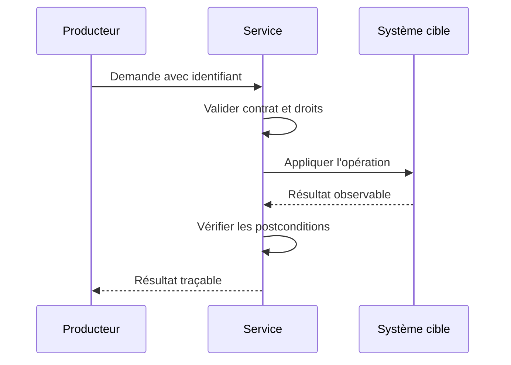
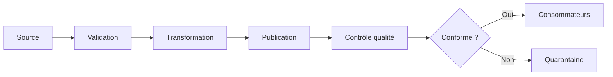
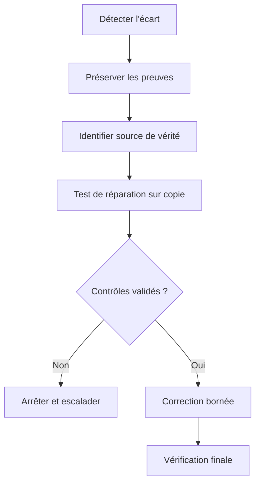
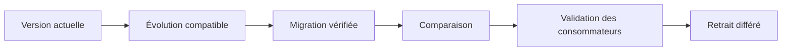

# Requêtes SQL de base (SELECT, INSERT) — Intermédiaire

> **Mise en contexte.** Écrire des requêtes SQL lisibles, sûres, paramétrées et testables. Le fil rouge pratique est un catalogue de formations, apprenants, inscriptions et commandes. Travaillez avec des données synthétiques, des privilèges limités et un environnement isolé. Vérifiez la documentation de la version avant de transposer une commande ou une garantie.

## Introduction et objectifs pédagogiques

Ce cours relie requêtes sql de base (select, insert) à un scénario concret. Il ne s'agit pas de mémoriser des commandes : il faut expliquer le contrat, la frontière de confiance, les effets secondaires et la preuve qui démontre le résultat. Ce niveau vise à traiter les cas limites, comparer les stratégies, mesurer l'effet et organiser la reprise. À la fin, vous devrez décrire les composants, choisir un mécanisme, tester un cas normal et un cas adverse, contrôler les postconditions, lire les erreurs et rendre la procédure reproductible.

Une sortie plausible ou un message de succès ne suffit pas. Comparez l'état attendu à l'état observé. Notez la version, les paramètres et les hypothèses. Si un comportement dépend du moteur ou du format, traitez-le comme une hypothèse à vérifier plutôt que comme une règle universelle.

## Prérequis et environnement

Le scénario de référence est un catalogue de formations, apprenants, inscriptions et commandes. Références initiales : https://www.postgresql.org/docs/current/sql.html, https://dev.mysql.com/doc/refman/8.4/en/sql-statements.html. Préparez un état de départ réinitialisable. N'utilisez pas de secrets ou de données personnelles réelles. Conservez des entrées synthétiques couvrant le succès, l'absence, les doublons et les erreurs utiles au diagnostic.

## 1. Architecture et contrat

Décrivez la source, les producteurs, les transformations, l'état persistant et les consommateurs. Dans « un catalogue de formations, apprenants, inscriptions et commandes », identifiez la source de vérité et les représentations dérivées. Le contrat doit préciser les entrées, les valeurs autorisées, les effets secondaires, les erreurs, le délai acceptable et les postconditions. Cette étape distingue un résultat techniquement réussi d'un résultat fiable du point de vue métier.

## 2. Concepts essentiels

### 1. Projection SELECT

Le concept « Projection SELECT » doit être relié à une règle métier. Pour « un catalogue de formations, apprenants, inscriptions et commandes », identifiez qui produit la donnée, quel composant la transforme et quelle propriété attend le consommateur. Préparez un exemple valide et un contre-exemple avant de lancer l'outil. Cette comparaison met en évidence les erreurs de modèle ou les validations trop faibles. Décrivez la conséquence métier d'un résultat erroné et identifiez qui peut la détecter.

Pour pratiquer projection select, notez les versions et paramètres, vérifiez les préconditions et contrôlez la postcondition dans l'état réel. Si le test échoue, examinez séparément l'entrée, le contrat, les droits, la configuration et l'ordre d'exécution. Ne désactivez pas un contrôle pour obtenir une sortie. La solution doit expliquer le comportement d'une valeur absente, d'un doublon et d'une reprise après interruption, puis préciser quels journaux ou métriques confirment le diagnostic.

### 2. Filtres WHERE

Le concept « Filtres WHERE » doit être relié à une règle métier. Pour « un catalogue de formations, apprenants, inscriptions et commandes », identifiez qui produit la donnée, quel composant la transforme et quelle propriété attend le consommateur. Préparez un exemple valide et un contre-exemple avant de lancer l'outil. Cette comparaison met en évidence les erreurs de modèle ou les validations trop faibles. Décrivez la conséquence métier d'un résultat erroné et identifiez qui peut la détecter.

Pour pratiquer filtres where, notez les versions et paramètres, vérifiez les préconditions et contrôlez la postcondition dans l'état réel. Si le test échoue, examinez séparément l'entrée, le contrat, les droits, la configuration et l'ordre d'exécution. Ne désactivez pas un contrôle pour obtenir une sortie. La solution doit expliquer le comportement d'une valeur absente, d'un doublon et d'une reprise après interruption, puis préciser quels journaux ou métriques confirment le diagnostic.

### 3. Paramètres liés

Le concept « Paramètres liés » doit être relié à une règle métier. Pour « un catalogue de formations, apprenants, inscriptions et commandes », identifiez qui produit la donnée, quel composant la transforme et quelle propriété attend le consommateur. Préparez un exemple valide et un contre-exemple avant de lancer l'outil. Cette comparaison met en évidence les erreurs de modèle ou les validations trop faibles. Décrivez la conséquence métier d'un résultat erroné et identifiez qui peut la détecter.

Pour pratiquer paramètres liés, notez les versions et paramètres, vérifiez les préconditions et contrôlez la postcondition dans l'état réel. Si le test échoue, examinez séparément l'entrée, le contrat, les droits, la configuration et l'ordre d'exécution. Ne désactivez pas un contrôle pour obtenir une sortie. La solution doit expliquer le comportement d'une valeur absente, d'un doublon et d'une reprise après interruption, puis préciser quels journaux ou métriques confirment le diagnostic.

### 4. Tri et pagination

Le concept « Tri et pagination » doit être relié à une règle métier. Pour « un catalogue de formations, apprenants, inscriptions et commandes », identifiez qui produit la donnée, quel composant la transforme et quelle propriété attend le consommateur. Préparez un exemple valide et un contre-exemple avant de lancer l'outil. Cette comparaison met en évidence les erreurs de modèle ou les validations trop faibles. Décrivez la conséquence métier d'un résultat erroné et identifiez qui peut la détecter.

Pour pratiquer tri et pagination, notez les versions et paramètres, vérifiez les préconditions et contrôlez la postcondition dans l'état réel. Si le test échoue, examinez séparément l'entrée, le contrat, les droits, la configuration et l'ordre d'exécution. Ne désactivez pas un contrôle pour obtenir une sortie. La solution doit expliquer le comportement d'une valeur absente, d'un doublon et d'une reprise après interruption, puis préciser quels journaux ou métriques confirment le diagnostic.

### 5. INSERT et valeurs par défaut

Le concept « INSERT et valeurs par défaut » doit être relié à une règle métier. Pour « un catalogue de formations, apprenants, inscriptions et commandes », identifiez qui produit la donnée, quel composant la transforme et quelle propriété attend le consommateur. Préparez un exemple valide et un contre-exemple avant de lancer l'outil. Cette comparaison met en évidence les erreurs de modèle ou les validations trop faibles. Décrivez la conséquence métier d'un résultat erroné et identifiez qui peut la détecter.

Pour pratiquer insert et valeurs par défaut, notez les versions et paramètres, vérifiez les préconditions et contrôlez la postcondition dans l'état réel. Si le test échoue, examinez séparément l'entrée, le contrat, les droits, la configuration et l'ordre d'exécution. Ne désactivez pas un contrôle pour obtenir une sortie. La solution doit expliquer le comportement d'une valeur absente, d'un doublon et d'une reprise après interruption, puis préciser quels journaux ou métriques confirment le diagnostic.

### 6. UPDATE sûr

Le concept « UPDATE sûr » doit être relié à une règle métier. Pour « un catalogue de formations, apprenants, inscriptions et commandes », identifiez qui produit la donnée, quel composant la transforme et quelle propriété attend le consommateur. Préparez un exemple valide et un contre-exemple avant de lancer l'outil. Cette comparaison met en évidence les erreurs de modèle ou les validations trop faibles. Décrivez la conséquence métier d'un résultat erroné et identifiez qui peut la détecter.

Pour pratiquer update sûr, notez les versions et paramètres, vérifiez les préconditions et contrôlez la postcondition dans l'état réel. Si le test échoue, examinez séparément l'entrée, le contrat, les droits, la configuration et l'ordre d'exécution. Ne désactivez pas un contrôle pour obtenir une sortie. La solution doit expliquer le comportement d'une valeur absente, d'un doublon et d'une reprise après interruption, puis préciser quels journaux ou métriques confirment le diagnostic.

### 7. DELETE et rétention

Le concept « DELETE et rétention » doit être relié à une règle métier. Pour « un catalogue de formations, apprenants, inscriptions et commandes », identifiez qui produit la donnée, quel composant la transforme et quelle propriété attend le consommateur. Préparez un exemple valide et un contre-exemple avant de lancer l'outil. Cette comparaison met en évidence les erreurs de modèle ou les validations trop faibles. Décrivez la conséquence métier d'un résultat erroné et identifiez qui peut la détecter.

Pour pratiquer delete et rétention, notez les versions et paramètres, vérifiez les préconditions et contrôlez la postcondition dans l'état réel. Si le test échoue, examinez séparément l'entrée, le contrat, les droits, la configuration et l'ordre d'exécution. Ne désactivez pas un contrôle pour obtenir une sortie. La solution doit expliquer le comportement d'une valeur absente, d'un doublon et d'une reprise après interruption, puis préciser quels journaux ou métriques confirment le diagnostic.

### 8. NULL et expressions

Le concept « NULL et expressions » doit être relié à une règle métier. Pour « un catalogue de formations, apprenants, inscriptions et commandes », identifiez qui produit la donnée, quel composant la transforme et quelle propriété attend le consommateur. Préparez un exemple valide et un contre-exemple avant de lancer l'outil. Cette comparaison met en évidence les erreurs de modèle ou les validations trop faibles. Décrivez la conséquence métier d'un résultat erroné et identifiez qui peut la détecter.

Pour pratiquer null et expressions, notez les versions et paramètres, vérifiez les préconditions et contrôlez la postcondition dans l'état réel. Si le test échoue, examinez séparément l'entrée, le contrat, les droits, la configuration et l'ordre d'exécution. Ne désactivez pas un contrôle pour obtenir une sortie. La solution doit expliquer le comportement d'une valeur absente, d'un doublon et d'une reprise après interruption, puis préciser quels journaux ou métriques confirment le diagnostic.

### 9. Transactions SQL

Le concept « Transactions SQL » doit être relié à une règle métier. Pour « un catalogue de formations, apprenants, inscriptions et commandes », identifiez qui produit la donnée, quel composant la transforme et quelle propriété attend le consommateur. Préparez un exemple valide et un contre-exemple avant de lancer l'outil. Cette comparaison met en évidence les erreurs de modèle ou les validations trop faibles. Décrivez la conséquence métier d'un résultat erroné et identifiez qui peut la détecter.

Pour pratiquer transactions sql, notez les versions et paramètres, vérifiez les préconditions et contrôlez la postcondition dans l'état réel. Si le test échoue, examinez séparément l'entrée, le contrat, les droits, la configuration et l'ordre d'exécution. Ne désactivez pas un contrôle pour obtenir une sortie. La solution doit expliquer le comportement d'une valeur absente, d'un doublon et d'une reprise après interruption, puis préciser quels journaux ou métriques confirment le diagnostic.

### 10. Injection SQL et audit

Le concept « Injection SQL et audit » doit être relié à une règle métier. Pour « un catalogue de formations, apprenants, inscriptions et commandes », identifiez qui produit la donnée, quel composant la transforme et quelle propriété attend le consommateur. Préparez un exemple valide et un contre-exemple avant de lancer l'outil. Cette comparaison met en évidence les erreurs de modèle ou les validations trop faibles. Décrivez la conséquence métier d'un résultat erroné et identifiez qui peut la détecter.

Pour pratiquer injection sql et audit, notez les versions et paramètres, vérifiez les préconditions et contrôlez la postcondition dans l'état réel. Si le test échoue, examinez séparément l'entrée, le contrat, les droits, la configuration et l'ordre d'exécution. Ne désactivez pas un contrôle pour obtenir une sortie. La solution doit expliquer le comportement d'une valeur absente, d'un doublon et d'une reprise après interruption, puis préciser quels journaux ou métriques confirment le diagnostic.

## 3. Méthode opérationnelle

### 1. Formaliser les invariants

Écrivez ce qui doit rester vrai dans un catalogue de formations, apprenants, inscriptions et commandes : exactitude, unicité, ordre, confidentialité, fraîcheur, capacité ou état final. Chaque invariant possède un test observable et une source de vérité. Ajoutez un cas valide et un cas qui doit être refusé. Si la règle ne peut pas être testée, précisez quelle valeur permettrait de constater sa violation. Conservez la règle sous une forme que le métier et l'équipe technique peuvent vérifier. L'évaluation au niveau intermédiaire demande de traiter les cas limites, comparer les stratégies, mesurer l'effet et organiser la reprise. Consignez les résultats, les échecs et les hypothèses plutôt que de conclure à partir d'une seule exécution.

### 2. Préparer les entrées

Définissez types, unités, valeurs optionnelles, bornes, provenance et version. Les cas adversariaux comprennent absence de valeur, doublon, retard, schéma inconnu, entrée volumineuse ou référence invalide. Construisez des exemples synthétiques qui isolent une hypothèse à la fois. Le test ne doit pas dépendre d'une ressource partagée qui change en dehors de l'exercice. Documentez les cas exclus et la raison de cette exclusion. L'évaluation au niveau intermédiaire demande de traiter les cas limites, comparer les stratégies, mesurer l'effet et organiser la reprise. Consignez les résultats, les échecs et les hypothèses plutôt que de conclure à partir d'une seule exécution.

### 3. Choisir le contrôle

Placez le contrôle où il peut empêcher l'état invalide : contrainte persistante, validation de contrat, transaction, autorisation ou test de pipeline. Un contrôle tardif peut signaler l'erreur sans empêcher sa propagation. Séparez les garanties obligatoires des alertes de surveillance. Vérifiez la portée du mécanisme et sa disponibilité dans la version réelle. Un contrôle ne protège pas une règle située en dehors de son périmètre, même si son nom paraît proche. L'évaluation au niveau intermédiaire demande de traiter les cas limites, comparer les stratégies, mesurer l'effet et organiser la reprise. Consignez les résultats, les échecs et les hypothèses plutôt que de conclure à partir d'une seule exécution.

### 4. Interpréter les erreurs

Classez les erreurs en données invalides, incompatibilité de contrat, permission refusée, ressource indisponible, conflit concurrent et erreur temporaire. Définissez une action appropriée pour chaque classe. Une entrée irrécupérable est rejetée ou mise en quarantaine ; une reprise temporaire est bornée et ne répète pas d'effet non idempotent. Les messages d'erreur doivent permettre le diagnostic sans divulguer de secrets. Mesurez le nombre et la durée des échecs afin de distinguer incident ponctuel et dérive. L'évaluation au niveau intermédiaire demande de traiter les cas limites, comparer les stratégies, mesurer l'effet et organiser la reprise. Consignez les résultats, les échecs et les hypothèses plutôt que de conclure à partir d'une seule exécution.

### 5. Protéger les reprises

Un client peut relancer après un timeout, un worker peut redémarrer ou un lot peut être rejoué. Déterminez l'identifiant qui représente une action métier unique et contrôlez le résultat antérieur avant de produire un nouvel effet. Testez les répétitions séquentielles et concurrentes en vérifiant l'état final. Si les effets externes ne partagent pas la même transaction, prévoyez une réconciliation explicite. Une reprise doit être limitée, observable et sûre même lorsque le résultat de l'exécution précédente est incertain. L'évaluation au niveau intermédiaire demande de traiter les cas limites, comparer les stratégies, mesurer l'effet et organiser la reprise. Consignez les résultats, les échecs et les hypothèses plutôt que de conclure à partir d'une seule exécution.

### 6. Mesurer la performance

Définissez une référence mesurée avant optimisation : latence, débit, ressources, taille, fraîcheur ou taux d'erreur. Décrivez le profil de données et la concurrence. Modifiez une seule variable à la fois et répétez les mesures. Une solution rapide sur quelques lignes peut échouer lorsque le volume, la distribution ou le nombre de sessions change. Une optimisation n'est acceptée que si l'exactitude et la sécurité restent intactes. L'évaluation au niveau intermédiaire demande de traiter les cas limites, comparer les stratégies, mesurer l'effet et organiser la reprise. Consignez les résultats, les échecs et les hypothèses plutôt que de conclure à partir d'une seule exécution.

### 7. Sécuriser les accès

Séparez les comptes runtime, migration, lecture analytique et administration selon les responsabilités. Appliquez le moindre privilège, paramétrez les entrées et gardez les secrets hors du dépôt. Testez un chemin autorisé et un chemin interdit depuis le véritable point d'accès. Les journaux doivent permettre la corrélation sans recopier les données privées. Réévaluez les droits après chaque changement de responsabilité ou de déploiement. L'évaluation au niveau intermédiaire demande de traiter les cas limites, comparer les stratégies, mesurer l'effet et organiser la reprise. Consignez les résultats, les échecs et les hypothèses plutôt que de conclure à partir d'une seule exécution.

### 8. Faire évoluer le contrat

Une modification affecte potentiellement producteurs, consommateurs, rapports et tâches asynchrones. Introduisez une évolution compatible, migrez les anciennes données, comparez les résultats et retirez l'ancienne forme après vérification. Rendez le backfill borné, déterministe et mesurable. Testez les bases neuves et les bases historiques. Prévoyez un arrêt sûr si les écarts dépassent le seuil toléré. L'évaluation au niveau intermédiaire demande de traiter les cas limites, comparer les stratégies, mesurer l'effet et organiser la reprise. Consignez les résultats, les échecs et les hypothèses plutôt que de conclure à partir d'une seule exécution.

### 9. Construire l'observabilité

Suivez les signaux qui démontrent la santé réelle de requêtes sql de base (select, insert) : volume, latence, erreurs, fraîcheur, rejets, divergence et ressources. Chaque alerte possède un seuil, un propriétaire et un runbook. Utilisez des identifiants de corrélation et expurgez les données sensibles. Des logs trop riches peuvent créer un risque supplémentaire. Contrôlez aussi que les alertes sont actionnables et que les opérateurs savent comment les fermer après résolution. L'évaluation au niveau intermédiaire demande de traiter les cas limites, comparer les stratégies, mesurer l'effet et organiser la reprise. Consignez les résultats, les échecs et les hypothèses plutôt que de conclure à partir d'une seule exécution.

### 10. Préparer la reprise

Décrivez le retour à un état connu après panne, erreur ou déploiement incomplet. Comptez les éléments touchés avant réparation, testez sur une copie et définissez un critère d'arrêt. Après application, vérifiez les invariants et réconciliez les systèmes externes. Le simple redémarrage d'un processus n'est pas une preuve d'intégrité. Préparez à l'avance les autorisations, sauvegardes et commandes nécessaires pour éviter une intervention improvisée sous pression. L'évaluation au niveau intermédiaire demande de traiter les cas limites, comparer les stratégies, mesurer l'effet et organiser la reprise. Consignez les résultats, les échecs et les hypothèses plutôt que de conclure à partir d'une seule exécution.

### 11. Comparer les compromis

Les décisions autour de requêtes sql de base (select, insert) mettent en balance simplicité, disponibilité, exactitude, coût, latence, sécurité et facilité d'exploitation. Une technologie plus complexe n'est pas automatiquement plus fiable. Documentez les options, hypothèses, risques acceptés, mesures et déclencheurs de réévaluation. Une décision qui est correcte sous une charge donnée peut devenir inadéquate si la distribution ou les exigences changent. L'évaluation au niveau intermédiaire demande de traiter les cas limites, comparer les stratégies, mesurer l'effet et organiser la reprise. Consignez les résultats, les échecs et les hypothèses plutôt que de conclure à partir d'une seule exécution.

### 12. Automatiser les preuves

Les tests doivent couvrir le nominal, une limite, un échec, un doublon et une reprise. Un test doit échouer lorsque l'invariant est violé et fournir assez de contexte pour diagnostiquer. Gardez les données synthétiques et les scripts versionnés afin qu'un autre opérateur puisse recréer le résultat. Évitez les tests qui ne vérifient qu'un texte d'interface lorsque le contrat métier dépend de l'état réellement enregistré. L'évaluation au niveau intermédiaire demande de traiter les cas limites, comparer les stratégies, mesurer l'effet et organiser la reprise. Consignez les résultats, les échecs et les hypothèses plutôt que de conclure à partir d'une seule exécution.

### 13. Valider la compatibilité

Les versions ne fournissent pas toujours les mêmes fonctionnalités ni les mêmes garanties. Confirmez la syntaxe, les valeurs par défaut, la gestion des erreurs et les limites dans la documentation officielle. Si plusieurs moteurs sont supportés, exécutez des tests de contrat sur chacun et documentez les adaptations. Une syntaxe semblable ne prouve pas l'équivalence des transactions, du tri, des valeurs absentes ou du comportement en panne. L'évaluation au niveau intermédiaire demande de traiter les cas limites, comparer les stratégies, mesurer l'effet et organiser la reprise. Consignez les résultats, les échecs et les hypothèses plutôt que de conclure à partir d'une seule exécution.

### 14. Conclure sur l'état métier

Comparez la sortie à l'attente initiale et contrôlez comptages, intégrité, qualité, sécurité, délais et erreurs. Identifiez les scénarios réellement couverts et les limites restantes. Une preuve exploitable comporte versions, entrées, sorties, tests négatifs et procédure de reproduction. Donnez un propriétaire à chaque risque résiduel et définissez le signal qui doit déclencher une nouvelle revue. L'évaluation au niveau intermédiaire demande de traiter les cas limites, comparer les stratégies, mesurer l'effet et organiser la reprise. Consignez les résultats, les échecs et les hypothèses plutôt que de conclure à partir d'une seule exécution.

## 4. Atelier pratique guidé

### Étape 1 — Définir le contrat et la sortie attendue

Pour « un catalogue de formations, apprenants, inscriptions et commandes », écrivez les préconditions, les valeurs synthétiques et les critères de succès. Le résultat doit être observé dans le système cible, pas seulement déduit du message affiché. Documentez les limites de la version et les actions de nettoyage. Écrivez une courte conclusion distinguant faits observés, hypothèses et points à surveiller.

### Étape 2 — Créer un environnement isolé

Pour « un catalogue de formations, apprenants, inscriptions et commandes », notez versions, paramètres, privilèges et commande de remise à zéro. Le résultat doit être observé dans le système cible, pas seulement déduit du message affiché. Documentez les limites de la version et les actions de nettoyage. Écrivez une courte conclusion distinguant faits observés, hypothèses et points à surveiller.

### Étape 3 — Capturer l'état initial

Pour « un catalogue de formations, apprenants, inscriptions et commandes », conservez le schéma ou la configuration ainsi que les comptes de référence. Le résultat doit être observé dans le système cible, pas seulement déduit du message affiché. Documentez les limites de la version et les actions de nettoyage. Écrivez une courte conclusion distinguant faits observés, hypothèses et points à surveiller.

### Étape 4 — Exécuter le cas nominal

Pour « un catalogue de formations, apprenants, inscriptions et commandes », suivez une opération de bout en bout et vérifiez la sortie réelle. Le résultat doit être observé dans le système cible, pas seulement déduit du message affiché. Documentez les limites de la version et les actions de nettoyage. Écrivez une courte conclusion distinguant faits observés, hypothèses et points à surveiller.

### Étape 5 — Ajouter une entrée adverse

Pour « un catalogue de formations, apprenants, inscriptions et commandes », testez une absence, un doublon, une limite ou une entrée invalide. Le résultat doit être observé dans le système cible, pas seulement déduit du message affiché. Documentez les limites de la version et les actions de nettoyage. Écrivez une courte conclusion distinguant faits observés, hypothèses et points à surveiller.

### Étape 6 — Simuler une interruption contrôlée

Pour « un catalogue de formations, apprenants, inscriptions et commandes », repérez les effets déjà appliqués et définissez ce qui doit être annulé ou repris. Le résultat doit être observé dans le système cible, pas seulement déduit du message affiché. Documentez les limites de la version et les actions de nettoyage. Écrivez une courte conclusion distinguant faits observés, hypothèses et points à surveiller.

### Étape 7 — Rejouer la même demande

Pour « un catalogue de formations, apprenants, inscriptions et commandes », réutilisez le même identifiant logique et vérifiez qu'aucun effet n'est doublé. Le résultat doit être observé dans le système cible, pas seulement déduit du message affiché. Documentez les limites de la version et les actions de nettoyage. Écrivez une courte conclusion distinguant faits observés, hypothèses et points à surveiller.

### Étape 8 — Comparer une variante mesurée

Pour « un catalogue de formations, apprenants, inscriptions et commandes », modifiez une seule dimension et comparez la qualité comme le coût. Le résultat doit être observé dans le système cible, pas seulement déduit du message affiché. Documentez les limites de la version et les actions de nettoyage. Écrivez une courte conclusion distinguant faits observés, hypothèses et points à surveiller.

### Étape 9 — Tester les autorisations

Pour « un catalogue de formations, apprenants, inscriptions et commandes », vérifiez un accès permis et un accès qui doit être refusé. Le résultat doit être observé dans le système cible, pas seulement déduit du message affiché. Documentez les limites de la version et les actions de nettoyage. Écrivez une courte conclusion distinguant faits observés, hypothèses et points à surveiller.

### Étape 10 — Réinitialiser et documenter

Pour « un catalogue de formations, apprenants, inscriptions et commandes », recréez l'état de départ et confirmez que l'expérience est reproductible. Le résultat doit être observé dans le système cible, pas seulement déduit du message affiché. Documentez les limites de la version et les actions de nettoyage. Écrivez une courte conclusion distinguant faits observés, hypothèses et points à surveiller.

## 5. Diagnostics guidés

### Cas 1 — résultat incomplet

Dans le contexte « un catalogue de formations, apprenants, inscriptions et commandes », le symptôme peut être lié à projection select. Fixez la période, les versions, les entrées et la postcondition, puis réduisez le cas jusqu'à obtenir une reproduction minimale. Séparez les causes possibles : donnée, contrat, privilège, ressource et ordre des opérations. Vérifiez les compteurs, erreurs et états persistants sans exposer des données privées. La correction doit préserver les données valides, traiter la cause, se limiter au périmètre prévu et pouvoir être rejouée. Confirmez ensuite le cas normal, ajoutez une régression automatisée et définissez le signal qui repérerait le même défaut en exploitation.

### Cas 2 — doublon après relance

Dans le contexte « un catalogue de formations, apprenants, inscriptions et commandes », le symptôme peut être lié à filtres where. Fixez la période, les versions, les entrées et la postcondition, puis réduisez le cas jusqu'à obtenir une reproduction minimale. Séparez les causes possibles : donnée, contrat, privilège, ressource et ordre des opérations. Vérifiez les compteurs, erreurs et états persistants sans exposer des données privées. La correction doit préserver les données valides, traiter la cause, se limiter au périmètre prévu et pouvoir être rejouée. Confirmez ensuite le cas normal, ajoutez une régression automatisée et définissez le signal qui repérerait le même défaut en exploitation.

### Cas 3 — latence anormalement élevée

Dans le contexte « un catalogue de formations, apprenants, inscriptions et commandes », le symptôme peut être lié à paramètres liés. Fixez la période, les versions, les entrées et la postcondition, puis réduisez le cas jusqu'à obtenir une reproduction minimale. Séparez les causes possibles : donnée, contrat, privilège, ressource et ordre des opérations. Vérifiez les compteurs, erreurs et états persistants sans exposer des données privées. La correction doit préserver les données valides, traiter la cause, se limiter au périmètre prévu et pouvoir être rejouée. Confirmez ensuite le cas normal, ajoutez une régression automatisée et définissez le signal qui repérerait le même défaut en exploitation.

### Cas 4 — entrée absente ambiguë

Dans le contexte « un catalogue de formations, apprenants, inscriptions et commandes », le symptôme peut être lié à tri et pagination. Fixez la période, les versions, les entrées et la postcondition, puis réduisez le cas jusqu'à obtenir une reproduction minimale. Séparez les causes possibles : donnée, contrat, privilège, ressource et ordre des opérations. Vérifiez les compteurs, erreurs et états persistants sans exposer des données privées. La correction doit préserver les données valides, traiter la cause, se limiter au périmètre prévu et pouvoir être rejouée. Confirmez ensuite le cas normal, ajoutez une régression automatisée et définissez le signal qui repérerait le même défaut en exploitation.

### Cas 5 — changement de version inattendu

Dans le contexte « un catalogue de formations, apprenants, inscriptions et commandes », le symptôme peut être lié à insert et valeurs par défaut. Fixez la période, les versions, les entrées et la postcondition, puis réduisez le cas jusqu'à obtenir une reproduction minimale. Séparez les causes possibles : donnée, contrat, privilège, ressource et ordre des opérations. Vérifiez les compteurs, erreurs et états persistants sans exposer des données privées. La correction doit préserver les données valides, traiter la cause, se limiter au périmètre prévu et pouvoir être rejouée. Confirmez ensuite le cas normal, ajoutez une régression automatisée et définissez le signal qui repérerait le même défaut en exploitation.

### Cas 6 — accès non autorisé

Dans le contexte « un catalogue de formations, apprenants, inscriptions et commandes », le symptôme peut être lié à update sûr. Fixez la période, les versions, les entrées et la postcondition, puis réduisez le cas jusqu'à obtenir une reproduction minimale. Séparez les causes possibles : donnée, contrat, privilège, ressource et ordre des opérations. Vérifiez les compteurs, erreurs et états persistants sans exposer des données privées. La correction doit préserver les données valides, traiter la cause, se limiter au périmètre prévu et pouvoir être rejouée. Confirmez ensuite le cas normal, ajoutez une régression automatisée et définissez le signal qui repérerait le même défaut en exploitation.

### Cas 7 — traitement partiel

Dans le contexte « un catalogue de formations, apprenants, inscriptions et commandes », le symptôme peut être lié à delete et rétention. Fixez la période, les versions, les entrées et la postcondition, puis réduisez le cas jusqu'à obtenir une reproduction minimale. Séparez les causes possibles : donnée, contrat, privilège, ressource et ordre des opérations. Vérifiez les compteurs, erreurs et états persistants sans exposer des données privées. La correction doit préserver les données valides, traiter la cause, se limiter au périmètre prévu et pouvoir être rejouée. Confirmez ensuite le cas normal, ajoutez une régression automatisée et définissez le signal qui repérerait le même défaut en exploitation.

### Cas 8 — écart entre source et sortie

Dans le contexte « un catalogue de formations, apprenants, inscriptions et commandes », le symptôme peut être lié à null et expressions. Fixez la période, les versions, les entrées et la postcondition, puis réduisez le cas jusqu'à obtenir une reproduction minimale. Séparez les causes possibles : donnée, contrat, privilège, ressource et ordre des opérations. Vérifiez les compteurs, erreurs et états persistants sans exposer des données privées. La correction doit préserver les données valides, traiter la cause, se limiter au périmètre prévu et pouvoir être rejouée. Confirmez ensuite le cas normal, ajoutez une régression automatisée et définissez le signal qui repérerait le même défaut en exploitation.

### Cas 9 — charge déséquilibrée

Dans le contexte « un catalogue de formations, apprenants, inscriptions et commandes », le symptôme peut être lié à transactions sql. Fixez la période, les versions, les entrées et la postcondition, puis réduisez le cas jusqu'à obtenir une reproduction minimale. Séparez les causes possibles : donnée, contrat, privilège, ressource et ordre des opérations. Vérifiez les compteurs, erreurs et états persistants sans exposer des données privées. La correction doit préserver les données valides, traiter la cause, se limiter au périmètre prévu et pouvoir être rejouée. Confirmez ensuite le cas normal, ajoutez une régression automatisée et définissez le signal qui repérerait le même défaut en exploitation.

### Cas 10 — consommateur incompatible

Dans le contexte « un catalogue de formations, apprenants, inscriptions et commandes », le symptôme peut être lié à injection sql et audit. Fixez la période, les versions, les entrées et la postcondition, puis réduisez le cas jusqu'à obtenir une reproduction minimale. Séparez les causes possibles : donnée, contrat, privilège, ressource et ordre des opérations. Vérifiez les compteurs, erreurs et états persistants sans exposer des données privées. La correction doit préserver les données valides, traiter la cause, se limiter au périmètre prévu et pouvoir être rejouée. Confirmez ensuite le cas normal, ajoutez une régression automatisée et définissez le signal qui repérerait le même défaut en exploitation.

### Cas 11 — alerte non actionnable

Dans le contexte « un catalogue de formations, apprenants, inscriptions et commandes », le symptôme peut être lié à projection select. Fixez la période, les versions, les entrées et la postcondition, puis réduisez le cas jusqu'à obtenir une reproduction minimale. Séparez les causes possibles : donnée, contrat, privilège, ressource et ordre des opérations. Vérifiez les compteurs, erreurs et états persistants sans exposer des données privées. La correction doit préserver les données valides, traiter la cause, se limiter au périmètre prévu et pouvoir être rejouée. Confirmez ensuite le cas normal, ajoutez une régression automatisée et définissez le signal qui repérerait le même défaut en exploitation.

### Cas 12 — restauration non démontrée

Dans le contexte « un catalogue de formations, apprenants, inscriptions et commandes », le symptôme peut être lié à filtres where. Fixez la période, les versions, les entrées et la postcondition, puis réduisez le cas jusqu'à obtenir une reproduction minimale. Séparez les causes possibles : donnée, contrat, privilège, ressource et ordre des opérations. Vérifiez les compteurs, erreurs et états persistants sans exposer des données privées. La correction doit préserver les données valides, traiter la cause, se limiter au périmètre prévu et pouvoir être rejouée. Confirmez ensuite le cas normal, ajoutez une régression automatisée et définissez le signal qui repérerait le même défaut en exploitation.

## 6. Exercices avec corrigés

### Exercice 1 — Formaliser une règle

**Énoncé.** Pour « un catalogue de formations, apprenants, inscriptions et commandes », expliquez comment tester projection select et prouver le résultat.

**Corrigé.** Établissez la précondition et la postcondition, utilisez des données synthétiques, contrôlez l'état réellement obtenu et ajoutez un cas négatif. Consignez versions, entrées, nombre de lignes ou d'événements touchés, erreurs et limites. Si une reprise est possible, rejouez le même identifiant pour vérifier qu'elle ne produit pas un second effet métier. La correction doit expliquer la règle retenue, pas seulement présenter une commande. Expliquez également ce qui serait différent si le cas se présentait à plus grande échelle.

### Exercice 2 — Choisir un contrôle

**Énoncé.** Pour « un catalogue de formations, apprenants, inscriptions et commandes », expliquez comment tester tri et pagination et prouver le résultat.

**Corrigé.** Établissez la précondition et la postcondition, utilisez des données synthétiques, contrôlez l'état réellement obtenu et ajoutez un cas négatif. Consignez versions, entrées, nombre de lignes ou d'événements touchés, erreurs et limites. Si une reprise est possible, rejouez le même identifiant pour vérifier qu'elle ne produit pas un second effet métier. La correction doit expliquer la règle retenue, pas seulement présenter une commande. Expliquez également ce qui serait différent si le cas se présentait à plus grande échelle.

### Exercice 3 — Identifier la source de vérité

**Énoncé.** Pour « un catalogue de formations, apprenants, inscriptions et commandes », expliquez comment tester delete et rétention et prouver le résultat.

**Corrigé.** Établissez la précondition et la postcondition, utilisez des données synthétiques, contrôlez l'état réellement obtenu et ajoutez un cas négatif. Consignez versions, entrées, nombre de lignes ou d'événements touchés, erreurs et limites. Si une reprise est possible, rejouez le même identifiant pour vérifier qu'elle ne produit pas un second effet métier. La correction doit expliquer la règle retenue, pas seulement présenter une commande. Expliquez également ce qui serait différent si le cas se présentait à plus grande échelle.

### Exercice 4 — Gérer une entrée invalide

**Énoncé.** Pour « un catalogue de formations, apprenants, inscriptions et commandes », expliquez comment tester injection sql et audit et prouver le résultat.

**Corrigé.** Établissez la précondition et la postcondition, utilisez des données synthétiques, contrôlez l'état réellement obtenu et ajoutez un cas négatif. Consignez versions, entrées, nombre de lignes ou d'événements touchés, erreurs et limites. Si une reprise est possible, rejouez le même identifiant pour vérifier qu'elle ne produit pas un second effet métier. La correction doit expliquer la règle retenue, pas seulement présenter une commande. Expliquez également ce qui serait différent si le cas se présentait à plus grande échelle.

### Exercice 5 — Interpréter une mesure

**Énoncé.** Pour « un catalogue de formations, apprenants, inscriptions et commandes », expliquez comment tester paramètres liés et prouver le résultat.

**Corrigé.** Établissez la précondition et la postcondition, utilisez des données synthétiques, contrôlez l'état réellement obtenu et ajoutez un cas négatif. Consignez versions, entrées, nombre de lignes ou d'événements touchés, erreurs et limites. Si une reprise est possible, rejouez le même identifiant pour vérifier qu'elle ne produit pas un second effet métier. La correction doit expliquer la règle retenue, pas seulement présenter une commande. Expliquez également ce qui serait différent si le cas se présentait à plus grande échelle.

### Exercice 6 — Protéger une répétition

**Énoncé.** Pour « un catalogue de formations, apprenants, inscriptions et commandes », expliquez comment tester update sûr et prouver le résultat.

**Corrigé.** Établissez la précondition et la postcondition, utilisez des données synthétiques, contrôlez l'état réellement obtenu et ajoutez un cas négatif. Consignez versions, entrées, nombre de lignes ou d'événements touchés, erreurs et limites. Si une reprise est possible, rejouez le même identifiant pour vérifier qu'elle ne produit pas un second effet métier. La correction doit expliquer la règle retenue, pas seulement présenter une commande. Expliquez également ce qui serait différent si le cas se présentait à plus grande échelle.

### Exercice 7 — Planifier une évolution

**Énoncé.** Pour « un catalogue de formations, apprenants, inscriptions et commandes », expliquez comment tester transactions sql et prouver le résultat.

**Corrigé.** Établissez la précondition et la postcondition, utilisez des données synthétiques, contrôlez l'état réellement obtenu et ajoutez un cas négatif. Consignez versions, entrées, nombre de lignes ou d'événements touchés, erreurs et limites. Si une reprise est possible, rejouez le même identifiant pour vérifier qu'elle ne produit pas un second effet métier. La correction doit expliquer la règle retenue, pas seulement présenter une commande. Expliquez également ce qui serait différent si le cas se présentait à plus grande échelle.

### Exercice 8 — Séparer les privilèges

**Énoncé.** Pour « un catalogue de formations, apprenants, inscriptions et commandes », expliquez comment tester filtres where et prouver le résultat.

**Corrigé.** Établissez la précondition et la postcondition, utilisez des données synthétiques, contrôlez l'état réellement obtenu et ajoutez un cas négatif. Consignez versions, entrées, nombre de lignes ou d'événements touchés, erreurs et limites. Si une reprise est possible, rejouez le même identifiant pour vérifier qu'elle ne produit pas un second effet métier. La correction doit expliquer la règle retenue, pas seulement présenter une commande. Expliquez également ce qui serait différent si le cas se présentait à plus grande échelle.

### Exercice 9 — Détecter une dérive

**Énoncé.** Pour « un catalogue de formations, apprenants, inscriptions et commandes », expliquez comment tester insert et valeurs par défaut et prouver le résultat.

**Corrigé.** Établissez la précondition et la postcondition, utilisez des données synthétiques, contrôlez l'état réellement obtenu et ajoutez un cas négatif. Consignez versions, entrées, nombre de lignes ou d'événements touchés, erreurs et limites. Si une reprise est possible, rejouez le même identifiant pour vérifier qu'elle ne produit pas un second effet métier. La correction doit expliquer la règle retenue, pas seulement présenter une commande. Expliquez également ce qui serait différent si le cas se présentait à plus grande échelle.

### Exercice 10 — Prouver une reprise

**Énoncé.** Pour « un catalogue de formations, apprenants, inscriptions et commandes », expliquez comment tester null et expressions et prouver le résultat.

**Corrigé.** Établissez la précondition et la postcondition, utilisez des données synthétiques, contrôlez l'état réellement obtenu et ajoutez un cas négatif. Consignez versions, entrées, nombre de lignes ou d'événements touchés, erreurs et limites. Si une reprise est possible, rejouez le même identifiant pour vérifier qu'elle ne produit pas un second effet métier. La correction doit expliquer la règle retenue, pas seulement présenter une commande. Expliquez également ce qui serait différent si le cas se présentait à plus grande échelle.

## 7. Études de cas guidées

### Cas d'étude 1 — Projection SELECT

Le symptôme est le suivant : traitement incomplet lorsque les données se diversifient. Pour « un catalogue de formations, apprenants, inscriptions et commandes », ne présumez pas de la cause. Collectez versions et paramètres, créez une reproduction réduite et distinguez problème de données, de contrat, d'accès ou d'exécution. Inspectez projection select, vérifiez les effets déjà appliqués et comparez l'état de référence à l'état obtenu. La solution doit avoir un périmètre borné, une procédure de retour à un état connu et un contrôle après application. Conservez une preuve de correction ainsi qu'une alerte ou un test qui détectera la même classe de défaut. Précisez la décision opérationnelle qui doit être prise en premier et pourquoi.

### Cas d'étude 2 — Paramètres liés

Le symptôme est le suivant : deux clients envoient la même demande après un timeout. Pour « un catalogue de formations, apprenants, inscriptions et commandes », ne présumez pas de la cause. Collectez versions et paramètres, créez une reproduction réduite et distinguez problème de données, de contrat, d'accès ou d'exécution. Inspectez paramètres liés, vérifiez les effets déjà appliqués et comparez l'état de référence à l'état obtenu. La solution doit avoir un périmètre borné, une procédure de retour à un état connu et un contrôle après application. Conservez une preuve de correction ainsi qu'une alerte ou un test qui détectera la même classe de défaut. Précisez la décision opérationnelle qui doit être prise en premier et pourquoi.

### Cas d'étude 3 — INSERT et valeurs par défaut

Le symptôme est le suivant : ancienne version encore active pendant le déploiement. Pour « un catalogue de formations, apprenants, inscriptions et commandes », ne présumez pas de la cause. Collectez versions et paramètres, créez une reproduction réduite et distinguez problème de données, de contrat, d'accès ou d'exécution. Inspectez insert et valeurs par défaut, vérifiez les effets déjà appliqués et comparez l'état de référence à l'état obtenu. La solution doit avoir un périmètre borné, une procédure de retour à un état connu et un contrôle après application. Conservez une preuve de correction ainsi qu'une alerte ou un test qui détectera la même classe de défaut. Précisez la décision opérationnelle qui doit être prise en premier et pourquoi.

### Cas d'étude 4 — DELETE et rétention

Le symptôme est le suivant : résultats différents entre deux environnements. Pour « un catalogue de formations, apprenants, inscriptions et commandes », ne présumez pas de la cause. Collectez versions et paramètres, créez une reproduction réduite et distinguez problème de données, de contrat, d'accès ou d'exécution. Inspectez delete et rétention, vérifiez les effets déjà appliqués et comparez l'état de référence à l'état obtenu. La solution doit avoir un périmètre borné, une procédure de retour à un état connu et un contrôle après application. Conservez une preuve de correction ainsi qu'une alerte ou un test qui détectera la même classe de défaut. Précisez la décision opérationnelle qui doit être prise en premier et pourquoi.

### Cas d'étude 5 — Transactions SQL

Le symptôme est le suivant : croissance du volume plus rapide que prévu. Pour « un catalogue de formations, apprenants, inscriptions et commandes », ne présumez pas de la cause. Collectez versions et paramètres, créez une reproduction réduite et distinguez problème de données, de contrat, d'accès ou d'exécution. Inspectez transactions sql, vérifiez les effets déjà appliqués et comparez l'état de référence à l'état obtenu. La solution doit avoir un périmètre borné, une procédure de retour à un état connu et un contrôle après application. Conservez une preuve de correction ainsi qu'une alerte ou un test qui détectera la même classe de défaut. Précisez la décision opérationnelle qui doit être prise en premier et pourquoi.

### Cas d'étude 6 — Projection SELECT

Le symptôme est le suivant : utilisateur qui tente un accès hors périmètre. Pour « un catalogue de formations, apprenants, inscriptions et commandes », ne présumez pas de la cause. Collectez versions et paramètres, créez une reproduction réduite et distinguez problème de données, de contrat, d'accès ou d'exécution. Inspectez projection select, vérifiez les effets déjà appliqués et comparez l'état de référence à l'état obtenu. La solution doit avoir un périmètre borné, une procédure de retour à un état connu et un contrôle après application. Conservez une preuve de correction ainsi qu'une alerte ou un test qui détectera la même classe de défaut. Précisez la décision opérationnelle qui doit être prise en premier et pourquoi.

### Cas d'étude 7 — Paramètres liés

Le symptôme est le suivant : job terminé sans preuve de qualité. Pour « un catalogue de formations, apprenants, inscriptions et commandes », ne présumez pas de la cause. Collectez versions et paramètres, créez une reproduction réduite et distinguez problème de données, de contrat, d'accès ou d'exécution. Inspectez paramètres liés, vérifiez les effets déjà appliqués et comparez l'état de référence à l'état obtenu. La solution doit avoir un périmètre borné, une procédure de retour à un état connu et un contrôle après application. Conservez une preuve de correction ainsi qu'une alerte ou un test qui détectera la même classe de défaut. Précisez la décision opérationnelle qui doit être prise en premier et pourquoi.

### Cas d'étude 8 — INSERT et valeurs par défaut

Le symptôme est le suivant : réparation manuelle sans procédure documentée. Pour « un catalogue de formations, apprenants, inscriptions et commandes », ne présumez pas de la cause. Collectez versions et paramètres, créez une reproduction réduite et distinguez problème de données, de contrat, d'accès ou d'exécution. Inspectez insert et valeurs par défaut, vérifiez les effets déjà appliqués et comparez l'état de référence à l'état obtenu. La solution doit avoir un périmètre borné, une procédure de retour à un état connu et un contrôle après application. Conservez une preuve de correction ainsi qu'une alerte ou un test qui détectera la même classe de défaut. Précisez la décision opérationnelle qui doit être prise en premier et pourquoi.

### Cas d'étude 9 — DELETE et rétention

Le symptôme est le suivant : optimisation rapide en lecture mais coûteuse en écriture. Pour « un catalogue de formations, apprenants, inscriptions et commandes », ne présumez pas de la cause. Collectez versions et paramètres, créez une reproduction réduite et distinguez problème de données, de contrat, d'accès ou d'exécution. Inspectez delete et rétention, vérifiez les effets déjà appliqués et comparez l'état de référence à l'état obtenu. La solution doit avoir un périmètre borné, une procédure de retour à un état connu et un contrôle après application. Conservez une preuve de correction ainsi qu'une alerte ou un test qui détectera la même classe de défaut. Précisez la décision opérationnelle qui doit être prise en premier et pourquoi.

### Cas d'étude 10 — Transactions SQL

Le symptôme est le suivant : restauration sans réconciliation des consommateurs. Pour « un catalogue de formations, apprenants, inscriptions et commandes », ne présumez pas de la cause. Collectez versions et paramètres, créez une reproduction réduite et distinguez problème de données, de contrat, d'accès ou d'exécution. Inspectez transactions sql, vérifiez les effets déjà appliqués et comparez l'état de référence à l'état obtenu. La solution doit avoir un périmètre borné, une procédure de retour à un état connu et un contrôle après application. Conservez une preuve de correction ainsi qu'une alerte ou un test qui détectera la même classe de défaut. Précisez la décision opérationnelle qui doit être prise en premier et pourquoi.

## 8. Défi final avec correction

### Énoncé

Concevez une solution pour « un catalogue de formations, apprenants, inscriptions et commandes » qui applique les principes de requêtes sql de base (select, insert). Livrez le contrat d'entrée-sortie, le modèle ou l'architecture, les contrôles d'intégrité et de sécurité, des tests, les métriques et le runbook. La solution doit gérer une entrée invalide, une demande répétée, une interruption et une évolution de version. Expliquez les garanties démontrées et les risques dépendant de la technologie.

### Correction détaillée

Définissez d'abord la source de vérité et les invariants métier. Choisissez ensuite le contrôle capable de protéger chacun d'eux : contrainte, validation de contrat, transaction, politique d'accès ou test de pipeline. Préparez un environnement isolé avec un cas nominal, une limite et une entrée invalide. Enregistrez les versions et contrôlez l'état réel à chaque frontière ; une réponse réussie ne suffit pas.

Rendez la reprise bornée et répétable, distinguez les erreurs permanentes des erreurs transitoires et empêchez un rejeu de créer un doublon. Définissez des métriques utiles, des seuils, des propriétaires d'alerte et un runbook. Mesurez toute optimisation à charge équivalente. Pour faire évoluer le contrat, maintenez la compatibilité, migrez par étapes, comparez les résultats et retirez l'ancien chemin seulement après validation.

En cas d'incident, préservez les preuves, comptez le périmètre touché et testez une réparation sur copie. Après reprise, vérifiez les invariants et réconciliez les consommateurs externes. Le livrable doit permettre à un autre apprenant de reconstruire l'environnement et de répéter les tests sans étape manuelle cachée.

## 9. Schémas de référence

## 10. Checklist de maîtrise

- Le besoin et les invariants sont formalisés.
- Les versions, entrées et droits sont contrôlés.
- Les cas normaux, limites, invalides et répétés sont testés.
- Les erreurs et les reprises ont un comportement explicite.
- Les opérations répétées n'introduisent pas de doublons.
- Les mesures couvrent qualité, coût et performance.
- Les changements gardent une compatibilité maîtrisée.
- Les journaux n'exposent pas les secrets.
- La restauration ou reprise est vérifiable.
- Les scripts reproduisent le résultat.

## 11. Références techniques

- https://www.postgresql.org/docs/current/sql.html
- https://dev.mysql.com/doc/refman/8.4/en/sql-statements.html

Vérifiez la documentation de la version utilisée avant toute commande en production. Les règles de sécurité, de conformité et d'exploitation complètent ces références.
