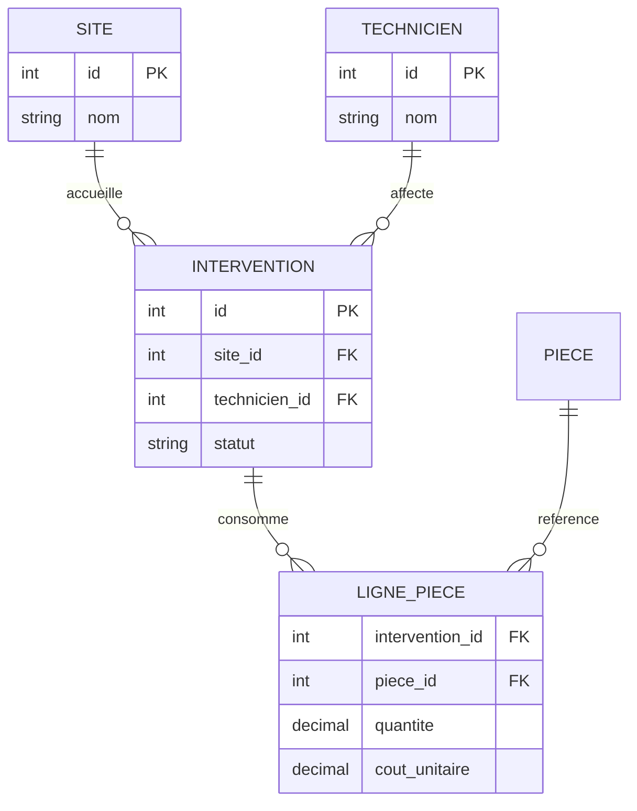
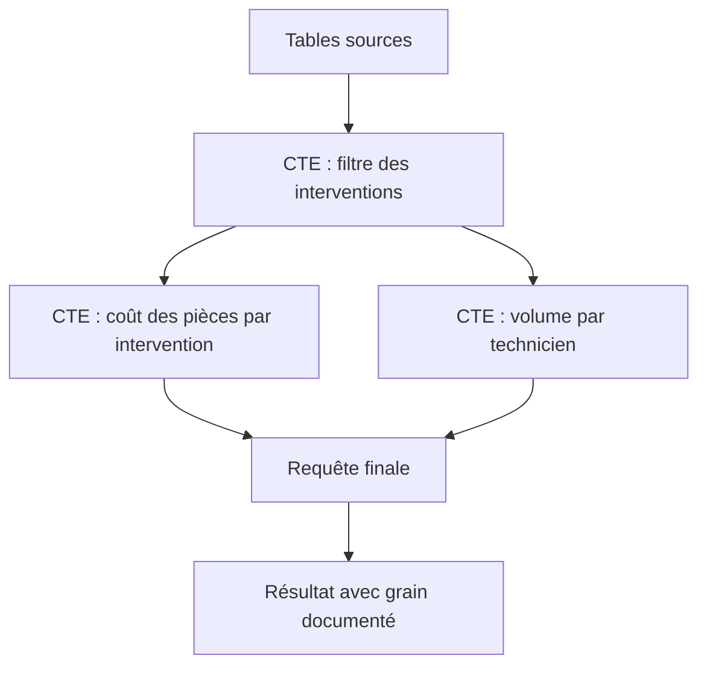
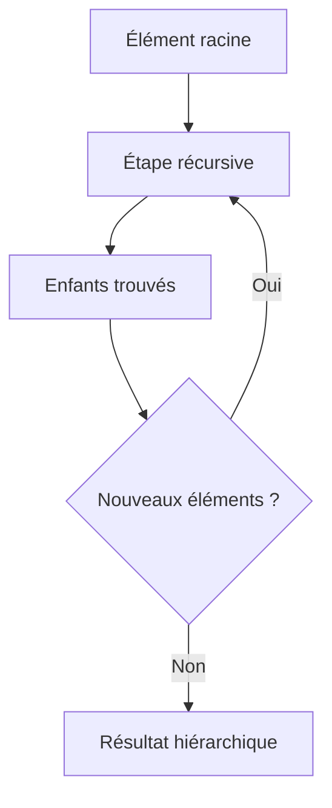
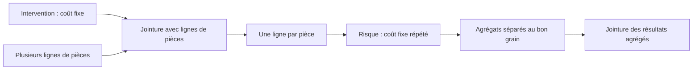

# Sous-requêtes, CTE et procédures stockées — Intermédiaire

> **Mise en contexte** — Une requête SQL peut donner le bon total aujourd'hui et devenir lente ou fausse après une croissance des données. Une sous-requête mal corrélée, une jointure qui multiplie les lignes, une agrégation au mauvais niveau ou une procédure stockée qui gère mal une erreur peut compromettre un rapport ou une transaction métier. Ce cours apprend à structurer les requêtes complexes, lire leur logique, utiliser les expressions de table communes (CTE), les fonctions de fenêtre et les routines stockées avec une attention particulière à la sécurité, la transaction et la portabilité.

## Introduction et objectifs

Une requête avancée n'est pas nécessairement une requête longue. Elle doit rendre la règle métier visible, exprimer précisément le niveau de détail attendu et permettre au moteur de choisir un plan efficace. La lisibilité est un outil de contrôle : un développeur ou un DBA doit pouvoir expliquer ce qu'une requête retourne, pourquoi chaque ligne est présente et comment les valeurs sont calculées.

À la fin, l'apprenant saura distinguer sous-requête scalaire, sous-requête de table et sous-requête corrélée ; choisir entre EXISTS, IN et jointure ; structurer une requête avec CTE ; employer les fonctions de fenêtre sans perdre les lignes détaillées ; gérer les cas NULL ; concevoir une procédure stockée avec paramètres, transactions et gestion d'erreurs ; et tester les comportements de sécurité et de performance.

Les exemples utilisent une syntaxe SQL courante. Les détails des procédures stockées, des CTE matérialisées, des fonctions de fenêtre, des types et de la gestion d'erreurs varient selon PostgreSQL, MySQL et les autres moteurs. Vérifier la version de production avant d'adopter une syntaxe particulière.

## 1. Établir le résultat attendu avant d'écrire le SQL

### 1.1 Définir le grain du résultat

Le grain répond à la question : « Une ligne du résultat représente quoi ? » Un rapport peut avoir une ligne par intervention, technicien, site, jour ou catégorie. Avant de joindre deux tables, préciser le grain de chacune. Une jointure entre une intervention et plusieurs pièces produit plusieurs lignes par intervention si celle-ci comporte plusieurs pièces. Additionner le coût de l'intervention après cette jointure peut donc compter le même coût plusieurs fois.

Un contrat de requête peut contenir :
- le grain des lignes ;
- les filtres d'inclusion et d'exclusion ;
- les règles d'arrondi et de valeur manquante ;
- la définition des agrégats ;
- les relations utilisées et leurs cardinalités ;
- le comportement attendu en l'absence de résultat ;
- les garanties de tri, d'unicité et de pagination.

Cette description est aussi utile pour écrire les tests. Un test qui vérifie uniquement le nombre de lignes peut manquer un double comptage si le total final paraît plausible.

### 1.2 Exemple de modèle

Considérons les tables suivantes : technicien, intervention, ligne_piece et site. Une intervention possède un identifiant, un site, un technicien, un statut et des dates. Une intervention peut avoir zéro ou plusieurs lignes de pièces. Une ligne de pièce possède une quantité et un coût unitaire. Cette relation de un-à-plusieurs impose de séparer le niveau intervention du niveau pièce quand on calcule des totaux.



Une requête correcte commence par sélectionner les interventions répondant à la règle, agrège les lignes de pièces au grain requis, puis joint les agrégats. Il peut être préférable de calculer séparément le coût des pièces par intervention et le nombre d'interventions par technicien, puis de les réunir. Cette démarche réduit le risque que les cardinalités modifient le sens du calcul.

## 2. Sous-requêtes : formes et cas d'usage

### 2.1 Sous-requête scalaire

Une sous-requête scalaire fournit une valeur unique à l'endroit où elle est utilisée. Par exemple, comparer une facture au coût moyen de toutes les factures. Il faut vérifier que l'expression retourne exactement une colonne et au plus une ligne. Une requête qui retourne plusieurs lignes provoque généralement une erreur dans ce contexte.

La moyenne doit être calculée sur la population correcte. Si l'on compare les factures d'un site à la moyenne de tous les sites, ce n'est pas le même indicateur que la moyenne du site. Le filtre doit être défini intentionnellement et le nom de l'agrégat doit décrire sa portée.

### 2.2 Sous-requête de table

Une sous-requête dans FROM produit une relation intermédiaire qui peut être jointe à d'autres relations. Elle est utile pour agréger des lignes de pièces avant de joindre le total à l'intervention. Nommer explicitement les colonnes et donner un alias lisible à la relation intermédiaire.

Exemple conceptuel :
```sql
SELECT intervention_id,
       SUM(quantite * cout_unitaire) AS cout_pieces
FROM ligne_piece
GROUP BY intervention_id;
```

Cette agrégation produit au maximum une ligne par intervention présente dans ligne_piece. Lorsqu'elle est jointe à intervention, une intervention sans pièce n'apparaît pas dans l'agrégat ; un LEFT JOIN et une règle de remplacement explicite peuvent être nécessaires si elle doit rester présente dans le résultat final.

### 2.3 Sous-requête corrélée

Une sous-requête corrélée utilise une valeur provenant de la ligne externe. Elle est exprimée naturellement pour des questions comme « trouver les interventions pour lesquelles il existe une ligne de pièce à coût élevé » ou « compter les événements de chaque technicien ». Le moteur peut la transformer en jointure ou en autre stratégie, mais la performance dépend du plan et des statistiques.

Il faut différencier le sens logique de la stratégie physique. Ne pas supposer que chaque sous-requête corrélée déclenche forcément une exécution complète pour chaque ligne ; inversement, ne pas supposer que l'optimiseur la réécrira toujours efficacement. Examiner le plan et les volumes réels lorsqu'elle se trouve sur un chemin critique.

### 2.4 EXISTS et NOT EXISTS

EXISTS vérifie si la sous-requête retourne au moins une ligne. Sa sémantique exprime directement la présence d'une relation. Elle convient pour rechercher les techniciens qui ont au moins une intervention ouverte, sans avoir besoin d'afficher toutes les interventions.

NOT EXISTS est souvent une forme robuste pour chercher les éléments sans correspondance. Elle évite certaines surprises de NOT IN lorsque la sous-requête contient NULL. Les règles de NULL restent à comprendre pour les autres filtres ; ne pas substituer mécaniquement les formes sans vérifier leur sémantique.

### 2.5 IN, ANY, ALL et pièges de NULL

IN exprime l'appartenance à un ensemble. NOT IN peut produire UNKNOWN si l'ensemble contient NULL ; la ligne peut alors être exclue par WHERE même lorsque le résultat humain attendu semblait être « pas égal à une valeur connue ». Examiner la possibilité de NULL dans la sous-requête et préférer une formulation dont la logique est explicitement correcte.

ANY et ALL expriment des comparaisons par rapport à un ensemble, si le moteur prend en charge la syntaxe et selon sa dialecte. Elles peuvent être pertinentes, mais leur lisibilité doit être évaluée face à une agrégation équivalente. Les valeurs NULL exigent de vérifier la logique à trois états : TRUE, FALSE et UNKNOWN. SQL ne traite pas NULL comme une chaîne vide ni comme zéro.

## 3. CTE : décomposer sans perdre le sens

### 3.1 À quoi sert une CTE ?

Une expression de table commune, ou CTE, est définie dans la clause WITH puis référencée dans une requête. Elle peut clarifier une séquence de calcul, nommer une relation intermédiaire et éviter de dupliquer une expression longue. Elle ne garantit pas à elle seule que le moteur matérialisera le résultat ni qu'elle sera plus rapide qu'une sous-requête.



Un bon nom de CTE exprime une étape métier, par exemple interventions_ouvertes, cout_par_intervention ou volume_par_technicien. Des noms génériques comme temp1 et temp2 rendent le raisonnement plus difficile. Chaque étape doit produire un résultat dont la granularité et les invariants sont connus.

### 3.2 Exemple de CTE non récursive

```sql
WITH interventions_ouvertes AS (
    SELECT id, technicien_id, site_id, date_ouverture
    FROM intervention
    WHERE statut = 'ouverte'
),
volume_par_technicien AS (
    SELECT technicien_id, COUNT(*) AS nombre
    FROM interventions_ouvertes
    GROUP BY technicien_id
)
SELECT technicien_id, nombre
FROM volume_par_technicien
WHERE nombre >= 5
ORDER BY nombre DESC, technicien_id;
```

Cette requête définit une population, agrège les lignes et filtre les résultats agrégés. Pour une base réelle, il faut vérifier les noms de champs, la règle de statut, la période et les index. Le tri secondaire par identifiant rend l'ordre déterministe lorsque plusieurs techniciens ont le même nombre. Sans cela, leur ordre relatif peut changer entre deux exécutions.

### 3.3 CTE matérialisée ou inline

Selon le moteur et sa version, une CTE peut être intégrée au plan, matérialisée ou fournir des options de matérialisation explicites. La matérialisation peut éviter un calcul répété dans certaines situations mais empêcher la poussée de filtres ou l'optimisation globale dans d'autres. Les règles ne sont pas uniformes.

Ne pas conclure qu'un WITH est forcément lent ni que le découpage améliore automatiquement la vitesse. Utiliser le plan, les temps et la mémoire. Si une étape intermédiaire est volumineuse, vérifier son coût, les possibilités de filtrer plus tôt et l'effet des références multiples. Choisir d'abord une structure lisible puis mesurer la stratégie du moteur.

### 3.4 CTE récursives

Une CTE récursive permet d'explorer une relation hiérarchique : arbre d'organisation, dépendances de tâches, catégories imbriquées ou nomenclature de pièces. Elle comporte généralement un membre de départ et un membre récursif qui se combine aux résultats déjà produits.



Une récursion doit terminer. Une relation cyclique, un mauvais prédicat ou l'absence de contrôle de profondeur peut entraîner un grand nombre de lignes ou atteindre les limites du moteur. Lorsque les données peuvent contenir des cycles, prévoir un mécanisme de détection ou de limitation et une procédure de correction. Vérifier les types des colonnes du membre d'ancrage et du membre récursif ainsi que la syntaxe propre au moteur.

## 4. Fonctions de fenêtre : calculer sans réduire les lignes

### 4.1 Différence entre agrégation et fenêtre

GROUP BY réduit plusieurs lignes à un groupe. Une fonction de fenêtre calcule une valeur en considérant un ensemble de lignes reliées tout en conservant les lignes détaillées. Cela permet d'afficher chaque intervention avec le rang de son coût dans le site, ou le cumul des heures d'un technicien par date.

Les éléments fondamentaux sont PARTITION BY, qui découpe les groupes de fenêtre, ORDER BY, qui définit l'ordre de calcul, et le cadre de fenêtre, qui spécifie quelles lignes participent à chaque résultat. Les fonctions disponibles et certaines options diffèrent selon les versions.

### 4.2 Rang et classement

ROW_NUMBER attribue un numéro distinct à chaque ligne selon l'ordre choisi. RANK attribue le même rang aux ex æquo et laisse un espace dans les rangs suivants ; DENSE_RANK partage aussi le rang mais ne laisse pas d'espace. Le choix dépend du sens métier du classement.

Pour trouver les trois interventions les plus coûteuses par site, écrire un calcul avec partition par site et tri décroissant sur le coût, puis filtrer dans une requête externe sur le rang. Il faut décider comment traiter les coûts égaux et les valeurs NULL avant d'implémenter le résultat.

### 4.3 Cumul et comparaison précédente

Une somme de fenêtre peut calculer un cumul chronologique sans éliminer les lignes par date. LAG et LEAD donnent accès à une valeur précédente ou suivante dans la fenêtre. Ces fonctions aident à détecter une variation de consommation, un changement de statut ou une rupture temporelle.

Le tri doit être déterministe. Si plusieurs événements ont le même horodatage, ajouter une clé unique ou définir la règle d'ordre secondaire. Sinon la valeur « précédente » n'est pas stable. Les données temporelles doivent aussi préciser le fuseau horaire, le traitement des dates manquantes et les événements arrivés en retard.

### 4.4 Cadres de fenêtre et erreurs de bord

Un cumul peut être défini par lignes précédentes ou par une plage de valeurs selon le moteur et la clause. Le cadre implicite peut surprendre, notamment quand des valeurs de tri sont égales. Spécifier explicitement le cadre lorsque la logique métier l'exige, et tester les ex æquo, les dates manquantes, les groupes d'une seule ligne et la première ligne de chaque partition.

Il faut également séparer les filtres appliqués avant calcul de fenêtre et ceux appliqués après. Si l'on retire les mois précédents avant de calculer un cumul annuel, le calcul commencera à zéro sur le premier mois restant. Le SQL peut être syntaxiquement correct tout en répondant à une autre question métier.

## 5. Agrégations conditionnelles et NULL

### 5.1 Agrégation avec CASE

Une agrégation conditionnelle permet de compter ou additionner uniquement les lignes correspondant à un critère. Par exemple, compter les interventions ouvertes et fermées dans un rapport par technicien. Il faut préciser si le dénominateur inclut tous les dossiers, les dossiers connus ou uniquement les dossiers possédant une date valide.

Le résultat de SUM sur aucun élément ou seulement des valeurs NULL peut être NULL selon le moteur et l'expression, tandis que COUNT possède d'autres règles. Utiliser COALESCE uniquement lorsque zéro correspond réellement au sens métier. Remplacer aveuglément un NULL par zéro peut faire croire qu'un coût est réellement nul alors qu'il n'a pas été calculé.

### 5.2 Double comptage dans les jointures



Le défaut classique consiste à joindre intervention, ligne_piece et technicien puis à sommer simultanément le coût fixe de l'intervention et le coût de chaque pièce. Si une intervention possède trois lignes de pièces, le coût fixe peut être compté trois fois. La bonne solution n'est pas un DISTINCT ajouté après coup sans compréhension : il faut agréger au grain correct, puis réunir les résultats.

### 5.3 Définir le traitement des NULL

Pour une valeur numérique, NULL peut signifier inconnue, non applicable ou non renseignée ; ces significations sont différentes. Le modèle doit préciser les règles et les rapports doivent éviter de masquer l'incertitude. En logique SQL, la comparaison à NULL ne suit pas les comparaisons normales : employer IS NULL ou IS NOT NULL.

Si l'on calcule une moyenne de durée, vérifier comment les lignes sans durée sont traitées et si l'exclusion est appropriée. Si l'on calcule un taux, distinguer le numérateur, le dénominateur et la population exclue. Dans les rapports opérationnels, afficher la couverture ou le nombre de valeurs manquantes peut être aussi important que le total.

## 6. Procédures stockées et fonctions

### 6.1 Pourquoi utiliser une routine stockée ?

Une procédure stockée exécute une suite d'opérations côté serveur. Elle peut réduire des aller-retours, encapsuler une règle, fournir une interface stable ou contrôler certaines permissions. Mais elle n'est pas automatiquement plus performante ou plus facile à maintenir. Elle crée du code à versionner, tester, surveiller et migrer comme le reste de l'application.

Avant de déplacer une règle métier dans la base, clarifier le propriétaire du code, le cycle de livraison, les outils de test, le modèle de droits, la portabilité et la façon dont les erreurs seront communiquées à l'application. Une routine cachée dans la base et modifiée manuellement peut devenir une source de divergence entre environnements.

### 6.2 Procédure, fonction et déclencheur

Les termes et possibilités varient selon les moteurs. Une procédure est souvent invoquée explicitement et peut gérer des opérations ; une fonction retourne une valeur ou une relation et peut être intégrée à une expression selon ses règles ; un trigger s'exécute en réaction à un événement sur une table ou autre objet. Les triggers peuvent apporter une protection utile mais rendre les effets secondaires moins visibles pour le développeur.

Documenter tout effet automatique : tables modifiées, ordre d'exécution, permissions, exceptions, interaction avec la réplication et effet sur la performance. Éviter d'accumuler les triggers pour des règles qui devraient être portées par une API ou une transaction explicitement testée. Lorsque plusieurs couches appliquent la même règle, définir quelle couche fait autorité.

### 6.3 Paramètres et requêtes sûres

Les valeurs fournies par l'utilisateur doivent être passées par les paramètres liés du pilote ou par le mécanisme sécurisé du moteur. Concaténer une chaîne de saisie dans le SQL ouvre la voie à l'injection. Les noms de tables ou de colonnes ne peuvent pas toujours être paramétrés comme une valeur ; si un identifiant doit varier, utiliser une liste d'autorisation codée et des mécanismes de citation documentés.

Les paramètres doivent être validés au niveau métier : plage, format, existence, droits et état attendu. Le fait qu'une valeur soit liée comme paramètre évite l'interprétation SQL mais ne la rend pas automatiquement correcte ou autorisée. Une procédure qui accepte un identifiant arbitraire doit contrôler si l'appelant a le droit d'agir sur cet objet.

### 6.4 Transactions et gestion d'erreurs

Une routine qui modifie plusieurs tables doit définir une politique transactionnelle et de reprise. Les moteurs diffèrent sur le contrôle des transactions à l'intérieur des routines. Éviter de supposer que la même procédure fonctionnera identiquement dans toutes les dialectes.

Le gestionnaire d'erreurs doit préserver le contexte utile, laisser la transaction dans un état connu et éviter d'avaler silencieusement l'échec. Ne pas retourner « succès » alors qu'une opération partielle a échoué. Les messages exposés au client doivent être sûrs et ne pas révéler de détails sensibles ; les traces internes doivent inclure un identifiant permettant d'identifier l'incident et les étapes suivies.

### 6.5 Exemple de conception conceptuelle

Une procédure de clôture d'intervention peut recevoir un identifiant et un acteur, vérifier l'état courant et les droits, contrôler la présence des champs obligatoires, enregistrer l'horodatage, changer le statut et ajouter une trace d'audit dans une transaction. Si une partie échoue, le système ne doit pas laisser le dossier marqué fermé sans l'historique requis.

La conception doit également gérer les appels répétés. Si le client réessaie après un timeout et que la clôture a déjà été validée, le système doit retourner un état cohérent plutôt que créer des effets en double. Le mécanisme d'idempotence dépend de la règle métier et des identifiants utilisés.

## 7. Portabilité entre PostgreSQL et MySQL

Les dialectes SQL partagent un noyau commun mais diffèrent sur les types, la syntaxe de procédures, le traitement des erreurs, les options de CTE, les index, les plans d'exécution, les opérations DDL et le comportement transactionnel de certaines commandes. Une requête validée dans un moteur n'est pas nécessairement portable sans adaptation.

Éviter de dépendre implicitement d'un ordre des lignes sans ORDER BY, d'une conversion de type tolérée par un moteur, ou d'un comportement spécifique de NULL. Documenter les extensions utilisées. Si la portabilité est un objectif, tester les migrations et les requêtes dans chaque moteur cible et ne pas se limiter à vérifier que le script crée les tables.

Les tests de compatibilité doivent couvrir les données limites : chaîne vide, accents et collation, fuseaux horaires, décimales, valeurs hors plage, nullabilité, identifiants, réservations concurrentes et rollback. Une base de test qui n'utilise pas les mêmes paramètres de collation ou la même version peut masquer des défauts.

## 8. Performance et validation de requêtes complexes

Une requête complexe doit être testée par étapes. D'abord vérifier sa sémantique sur un jeu réduit et conçu pour inclure les cas limites. Ensuite mesurer le volume, les cardinalités, les plans et les temps. Enfin évaluer la concurrence, la fréquence d'exécution, le volume retourné et la stabilité lors de changements de données.

Ne pas mesurer seulement le temps sur la machine du développeur. Un bon plan peut dépendre d'une distribution spécifique. Vérifier aussi le coût des CTE réutilisées, le nombre de lignes intermédiaires, les tris, les hash tables et l'impact sur les autres requêtes. Dans une routine stockée, contrôler les effets de bord, le contexte transactionnel et la gestion de paramètres atypiques.

Une mesure de performance doit conserver le contexte : version du moteur, données, statistiques, paramètres, environnement, cache chaud ou froid, concurrence et définition de la latence. Sans ce contexte, il est difficile de savoir si un résultat avant/après est comparatif.

## 9. Étude de cas — Rapport de charge et de coût de maintenance

Une entreprise veut afficher par site, mois et technicien le nombre d'interventions, le coût des pièces et la part des interventions résolues en moins de 24 heures. La première requête joint directement interventions, pièces et techniciens, puis utilise plusieurs sommes et comptes.

### Étape A — Préciser le grain

Le résultat visé est une ligne par site, mois et technicien. Une intervention peut avoir plusieurs pièces ; les pièces doivent être agrégées au niveau intervention avant l'agrégat mensuel. La durée doit être calculée entre des horodatages définis, avec une règle explicite pour les interventions ouvertes ou incomplètes.

### Étape B — Créer des étapes intermédiaires

Une première étape filtre les interventions selon la période et les statuts retenus. Une deuxième calcule le coût des pièces par intervention. Une troisième associe les coûts à une seule ligne par intervention. Une quatrième agrège par site, mois et technicien. Une CTE peut nommer chacune de ces étapes, mais le plan final doit être observé pour vérifier que la structure ne produit pas d'accès excessifs.

### Étape C — Vérifier les cas limites

Tester une intervention sans pièce, plusieurs pièces, coût unitaire manquant, intervention sans date de résolution, deux événements à la même date et technicien avec zéro intervention durant le mois. Vérifier le traitement de NULL dans le taux de résolution. Définir si les mois sans activité doivent apparaître et comment les générer.

### Étape D — Comparer le résultat attendu

Créer un petit jeu dont le total est calculable manuellement. Comparer au résultat de la requête initiale, puis ajouter des scénarios qui provoquent le double comptage. Conserver le SQL, les données du test, le résultat attendu et le résultat observé. Un total qui paraît raisonnable n'est pas preuve d'exactitude.

### Étape E — Industrialiser

Si le rapport est coûteux, analyser le plan, les index, la sélectivité des filtres et les agrégations. Envisager un résumé matérialisé ou une table de faits uniquement si la fraîcheur, le coût de rafraîchissement et les besoins du métier le justifient. Ajouter une routine stockée ne résout pas à elle seule un plan inefficace.

## 10. Pièges à éviter

- Écrire une requête avant de préciser le grain du résultat.
- Employer une sous-requête corrélée sans examiner le plan réel.
- Utiliser NOT IN sans analyser les valeurs NULL possibles.
- Supposer qu'une CTE est toujours matérialisée ou toujours inline.
- Oublier l'ordre secondaire nécessaire à un classement déterministe.
- Utiliser une fonction de fenêtre alors que le filtre intervient trop tôt.
- Sommer un attribut parent après une jointure un-à-plusieurs.
- Remplacer tous les NULL par zéro sans signification métier.
- Concaténer les valeurs utilisateur dans le SQL.
- Considérer qu'une procédure stockée est automatiquement plus rapide ou sûre.
- Avaler une exception et retourner un succès trompeur.
- Déployer une routine modifiée manuellement sans versionnement.
- Confondre une syntaxe acceptée par un moteur avec une syntaxe portable.
- Tester uniquement sur un petit volume représentatif de la structure mais pas de la distribution.

## 11. Checklist de revue SQL

- [ ] Le grain de sortie est formulé en une phrase.
- [ ] Les cardinalités de jointure sont connues ou contrôlées.
- [ ] Les filtres et règles métier sont documentés.
- [ ] Le traitement de NULL est explicite.
- [ ] Les agrégats ne comptent pas plusieurs fois la même entité.
- [ ] Les tris et fonctions de fenêtre sont déterministes quand nécessaire.
- [ ] Les CTE ont des noms qui reflètent leur rôle.
- [ ] Les paramètres utilisateurs sont liés ou validés par une liste d'autorisation.
- [ ] Les erreurs et les transactions laissent le système dans un état connu.
- [ ] Le plan et les performances ont été mesurés sur un volume adapté.
- [ ] La requête fonctionne avec les cas limites et les données vides.
- [ ] Les extensions spécifiques à un moteur sont identifiées.

## 12. Exercices corrigés

### Exercice 1 — Une intervention semble coûter trois fois plus

Le coût fixe d'une intervention apparaît multiplié par trois lorsqu'elle consomme trois types de pièces.

**Corrigé :** la jointure a multiplié la ligne parent par le nombre de lignes enfants. Agréger les pièces au niveau intervention puis joindre ce résultat, ou calculer les métriques séparément au bon grain. Ne pas se fier à DISTINCT comme pansement sans comprendre les relations.

### Exercice 2 — Résultats incomplets avec NOT IN

Une recherche exclut certaines lignes sans raison apparente. La sous-requête contient un NULL.

**Corrigé :** NOT IN peut produire UNKNOWN pour les comparaisons à un ensemble contenant NULL. Utiliser une formulation dont la logique est explicitement définie, par exemple NOT EXISTS avec le prédicat de correspondance correct, et tester la sémantique demandée.

### Exercice 3 — Un cumul varie d'une exécution à l'autre

Deux événements partagent le même horodatage et LAG retourne parfois un ordre différent.

**Corrigé :** ajouter un critère d'ordre stable, par exemple l'identifiant unique de l'événement, puis documenter la règle. Une fenêtre fondée sur un ordre incomplet ne définit pas un prédécesseur unique.

### Exercice 4 — Routine de clôture appelée deux fois

Un client réessaie après un timeout et la routine insère deux événements identiques.

**Corrigé :** définir l'idempotence métier, protéger l'insertion par une clé ou une contrainte appropriée et retourner l'état existant lors d'une répétition valide. La procédure doit gérer les erreurs et ne pas annoncer un succès avant l'issue connue de la transaction.

### Exercice 5 — SQL qui fonctionne seulement sur un moteur

Une procédure utilisant une syntaxe propriétaire fonctionne en test mais échoue sur le moteur cible.

**Corrigé :** inventorier les extensions, valider la version cible, réécrire selon la dialecte et inclure les tests de compatibilité. La portabilité doit être un critère explicite, pas une supposition faite parce que les requêtes utilisent le mot SQL.

## 13. Défi final — Construire un rapport fiable

Concevoir un rapport mensuel des coûts de maintenance par site et technicien à partir des interventions et des lignes de pièces. Livrer la définition du grain, le SQL structuré en étapes, les tests pour les cas limites, le plan d'exécution, la justification des index et, si utile, une procédure stockée paramétrée. Décrire les droits nécessaires et le comportement en cas d'erreur.

### Barème indicatif
- Définition du grain et intégrité des agrégats : 20 points.
- Choix raisonné des sous-requêtes et CTE : 15 points.
- Utilisation appropriée des fenêtres ou agrégations : 15 points.
- Gestion de NULL, des erreurs et de l'idempotence : 15 points.
- Sécurité et paramètres : 15 points.
- Tests, plan d'exécution et portabilité : 20 points.

Une solution n'est pas acceptée si elle calcule mal les coûts, concatène des valeurs utilisateur ou ignore les erreurs de transaction.

## 14. Méthode de livraison et de tests en équipe

Une requête avancée est du code de production. Elle doit être versionnée, examinée, testée et liée à une définition métier. Éviter de conserver la version supposée correcte uniquement dans un client SQL sur le poste d'un analyste. Un changement doit permettre de retrouver la requête précédemment déployée, les critères de validation et la décision qui autorise la modification.

Avant livraison, préparer des données de test qui représentent les cardinalités réelles. Inclure des groupes vides, des parents sans enfants, plusieurs enfants par parent, des montants égaux, des valeurs NULL, des dates identiques, des intervalles qui se chevauchent et des données hors plage. Ces cas ne sont pas des exceptions anecdotiques : ils révèlent souvent les erreurs de grain et de logique.

La revue de code doit poser des questions sémantiques avant de discuter de style : quel est le grain ? La jointure conserve-t-elle la population attendue ? Est-ce que les lignes sont éliminées ou dupliquées ? L'ordre est-il déterministe ? Les permissions permettent-elles de consulter toutes les données utilisées ? Les erreurs de routine sont-elles propagées ? Quelles garanties reposent sur une fonctionnalité spécifique à un moteur ?

### Jeu de tests minimal

- **Cas nominal** : données qui couvrent les parcours les plus fréquents.
- **Cas limite** : absence de correspondance, un seul élément, valeurs NULL et ex æquo.
- **Cas de volume** : cardinalités représentatives de la production.
- **Cas de droits** : appel autorisé, appel refusé et tentative d'accès à un autre périmètre.
- **Cas d'erreur** : interruption ou exception à une étape critique et vérification de l'état final.
- **Cas de répétition** : la même requête ou action est rejouée après un timeout.
- **Cas de compatibilité** : versions et moteurs réellement pris en charge.

Le test de performance doit être comparatif et reproductible. Noter la version, l'environnement, les paramètres, le volume, les statistiques, le nombre de répétitions, le cache et la concurrence. Ne pas présenter le meilleur temps d'une seule exécution comme une preuve. Regarder les percentiles et le coût consommé, ainsi que l'effet sur les autres requêtes du service.

### Contrôles après déploiement

Surveiller les latences, la fréquence d'exécution, les erreurs, le volume de lignes retournées et les ressources. Si la requête alimente un indicateur métier, prévoir une réconciliation avec une méthode indépendante ou un échantillon vérifiable. Les écarts doivent être attribués, expliqués et corrigés plutôt que masqués par un ajustement arbitraire de l'agrégat.

Une requête ne doit pas être rendue plus difficile à comprendre uniquement pour obtenir une optimisation hypothétique. Les index, vues, résumés ou routines doivent avoir un propriétaire et une justification. Si les besoins évoluent, revenir à la définition du résultat et réviser la requête avec le même processus de preuve.

## À retenir

La SQL avancée commence par une formulation précise de la question métier. Les sous-requêtes et CTE découpent un raisonnement, les fenêtres préservent le détail tout en calculant un classement ou un cumul, et les routines stockées peuvent encapsuler des opérations si elles restent versionnées, testées et sécurisées. Le grain, les cardinalités, NULL, les erreurs, les transactions et la performance doivent être étudiés ensemble.

## Ressources et références

- [PostgreSQL — SELECT et requêtes WITH](https://www.postgresql.org/docs/current/sql-select.html)
- [PostgreSQL — Fonctions de fenêtre](https://www.postgresql.org/docs/current/functions-window.html)
- [PostgreSQL — PL/pgSQL](https://www.postgresql.org/docs/current/plpgsql.html)
- [MySQL 8.4 — Common Table Expressions](https://dev.mysql.com/doc/refman/8.4/en/with.html)
- [MySQL 8.4 — Stored Objects](https://dev.mysql.com/doc/refman/8.4/en/stored-objects.html)

Les exemples pédagogiques doivent être adaptés et testés selon la version, le schéma et les règles de l'organisation.
