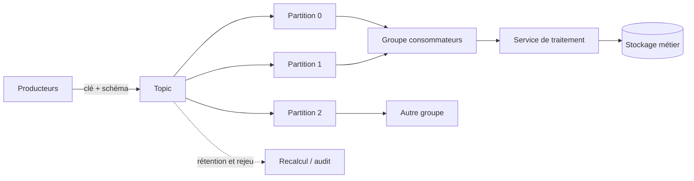

# Kafka et traitement en temps réel — Expert

> **Mise en contexte.** Une plateforme peut recevoir des milliers d'événements par seconde sans que les équipes puissent se permettre de perdre une commande, de compter deux fois un paiement ou de publier une alerte avec vingt minutes de retard. Le streaming n'est pas simplement un flux de messages plus rapide qu'un traitement par lots : c'est une architecture où l'ordre, la durée de conservation, les reprises, la concurrence, l'heure métier et la traçabilité deviennent des propriétés explicites du système. Ce cours apprend à concevoir, exploiter et dépanner une chaîne événementielle de bout en bout.

## Objectifs pédagogiques et prérequis

À la fin de ce parcours, vous saurez expliquer le rôle d'un broker, d'un topic, d'une partition, d'un producteur, d'un groupe de consommateurs et d'un processeur de flux. Vous saurez dimensionner un nombre initial de partitions, choisir une clé de partitionnement, interpréter les garanties de livraison, gérer les offsets, concevoir une stratégie de reprise, raisonner sur les événements tardifs et choisir les métriques qui décrivent réellement un service. Vous saurez également rédiger un contrat de données, protéger les identités de service, construire un test de rejeu et proposer une procédure opérationnelle avant une mise en production.

Il est utile de connaître les bases des files de messages, des API HTTP, de SQL, des formats JSON et Avro, ainsi que les notions de processus, de réseau et de journalisation. Les exemples utilisent Kafka et des interfaces CLI courantes ; ils sont transposables à d'autres systèmes événementiels, à condition de vérifier leurs garanties réelles. Une commande ou une option peut varier selon la version du client : avant de l'automatiser, contrôlez la sortie de l'aide de la version réellement installée.

## 1. Du lot au flux d'événements

Un traitement par lots collecte un ensemble de données, le traite à un instant ou selon un calendrier, puis publie un résultat. Il est approprié lorsqu'une latence de quelques minutes ou quelques heures est acceptable, par exemple pour produire une clôture quotidienne. Un traitement en flux traite les événements au fur et à mesure de leur arrivée, maintient éventuellement un état et met à jour des résultats continuellement. Les deux approches ne s'opposent pas : une architecture moderne utilise souvent le streaming pour les décisions rapides et le batch pour les recalculs, les rapprochements et les analyses historiques.

Un événement décrit un fait qui s'est produit : une commande a été validée, un capteur a émis une mesure, un utilisateur s'est authentifié ou un paiement a été accepté. Il devrait porter un identifiant stable, une date d'événement, une version de schéma, un contexte de corrélation et les données métier nécessaires. Il faut distinguer l'heure de l'événement, l'heure à laquelle le producteur l'a envoyé, celle à laquelle le broker l'a enregistré et celle à laquelle le consommateur l'a traité. Cette distinction est indispensable quand un terminal est hors ligne et transmet des mesures anciennes après son retour.

Un message n'est pas nécessairement une commande impérative. Un événement publié ne prouve pas, à lui seul, qu'un consommateur l'a traité, et une livraison au broker ne prouve pas qu'un résultat métier a été validé. Chaque frontière doit définir son accusé de réception : le producteur confirme l'enregistrement, le broker réplique, le consommateur traite, puis un système aval confirme ou rend le résultat consultable. Le contrat de service doit préciser la latence attendue, le débit, la tolérance aux doublons, la durée de conservation et le comportement de reprise.

## 2. Architecture Kafka et responsabilités

Kafka stocke un journal distribué de messages. Un topic est une catégorie logique de flux. Il est découpé en partitions afin de distribuer stockage et traitement entre plusieurs brokers. Chaque partition conserve un ordre total local, mais Kafka ne fournit pas un ordre global naturel entre toutes les partitions d'un topic. Une clé de message détermine généralement la partition, ce qui permet de conserver l'ordre relatif des événements portant la même clé. Cette propriété rend le choix de clé métier aussi important que le choix du nombre de partitions.

Un broker reçoit les écritures, conserve les segments du journal et sert les lectures. Les partitions répliquées ont un leader qui accepte les opérations courantes et des réplicas suiveurs qui maintiennent une copie du journal. Une réplication correctement configurée permet de continuer après la perte d'un broker, mais elle ne remplace ni une sauvegarde logique ni un plan de reprise du cluster. Il faut surveiller l'état des réplicas, la taille du retard, l'espace disque, les erreurs réseau et la capacité à élire un leader dans les conditions prévues.

Le plan de contrôle coordonne les métadonnées et l'état du cluster ; le plan de données transporte les messages. Les déploiements récents de Kafka utilisent le mode KRaft pour gérer les métadonnées sans dépendre de ZooKeeper. Lorsqu'un administrateur reprend un cluster ancien, il doit d'abord identifier le mode de fonctionnement et la version ; mélanger des procédures d'administration provenant de versions différentes est une cause fréquente d'incident. Un client ne devrait pas dépendre d'une adresse de broker isolée : il récupère les métadonnées de cluster à partir des adresses de bootstrap, puis ouvre les connexions adaptées.



Le schéma montre deux propriétés essentielles. Plusieurs groupes peuvent lire le même topic indépendamment, ce qui permet à un service d'alertes et à un entrepôt analytique de consommer les mêmes événements sans se partager leurs offsets. En revanche, à l'intérieur d'un même groupe, une partition est normalement affectée à un seul consommateur actif à un instant donné. Le parallélisme utile ne dépasse donc pas le nombre de partitions assignées, même si l'application démarre beaucoup de processus.

## 3. Topics, partitions, clés et ordre

Le nombre de partitions est un choix d'architecture, pas une valeur décorative. Davantage de partitions augmentent le parallélisme potentiel, mais elles consomment des fichiers, des handles, de la mémoire, des métadonnées et des opérations de coordination. Trop peu de partitions limitent le débit qu'un groupe peut absorber ; trop de partitions compliquent les redémarrages, les équilibrages et les opérations de maintenance. Estimez le débit par partition à partir de mesures réalistes, puis conservez une marge tenant compte des pointes, des transformations coûteuses et des rattrapages après incident.

Une clé doit correspondre à l'unité pour laquelle l'ordre compte. Si la séquence des événements d'une commande doit être conservée, l'identifiant de commande peut être une bonne clé. Si tous les événements utilisent une clé constante, une seule partition peut absorber presque tout le flux : le cluster est disponible, mais le parallélisme est fictif. À l'inverse, une clé très fréquente, par exemple un identifiant de région dominante, peut créer une partition chaude. La distribution de clés doit être mesurée sur les données réelles, pas uniquement sur un jeu d'essai uniforme.

L'ajout de partitions à un topic existant peut modifier le calcul de partition d'une clé si le producteur choisit sa partition à partir du nombre de partitions. Les anciens événements restent dans les partitions historiques tandis que les nouveaux peuvent aller ailleurs, ce qui peut casser l'ordre global attendu pour une même clé. Pour un flux sensible à l'ordre, planifiez l'augmentation des partitions, vérifiez la stratégie de partitionnement et envisagez un nouveau topic avec migration contrôlée. Documentez toujours la portée exacte de l'ordre garanti : par partition, par clé, par agrégat ou par séquence métier.

## 4. Producteurs fiables : accusés, retries et idempotence

Le producteur devrait distinguer une erreur temporaire, une erreur de configuration et un rejet métier. Une coupure réseau transitoire peut justifier une nouvelle tentative avec délai progressif et jitter. Un schéma invalide ne sera pas corrigé par dix répétitions immédiates. Un accès refusé ne doit pas déclencher un cycle infini qui surcharge le cluster. Les politiques de retry doivent avoir une durée maximale, un compteur visible et un canal d'échec permettant une alerte, une reprise manuelle ou une compensation.

Le paramètre d'accusé de réception détermine à quel niveau le producteur considère l'écriture réussie. Un réglage qui confirme avant réplication améliore parfois la latence mais augmente le risque de perte lors d'une panne. Les garanties dépendent également du nombre de réplicas, de la configuration du minimum de réplicas synchronisés, de l'état du cluster et du mode de livraison du client. Il faut raisonner sur l'ensemble de la configuration plutôt que de présenter une seule option comme une garantie absolue.

L'idempotence du producteur évite que les nouvelles tentatives d'une même écriture créent des doublons dans les situations prises en charge par le protocole. Elle ne rend pas toute application métier exactement-once. Si le producteur exécute un paiement dans une base SQL puis publie un événement, une panne entre les deux opérations peut laisser une écriture sans événement ou un événement sans écriture. Le pattern outbox transactionnel consiste à enregistrer la modification métier et l'événement dans la même transaction de base de données, puis à publier l'outbox avec un connecteur ou un worker fiable. Le consommateur doit aussi être idempotent.

Les transactions Kafka sont utiles pour regrouper des écritures et marquer atomiquement les messages produits et les offsets consommés dans certains pipelines Kafka-vers-Kafka. Elles n'étendent pas automatiquement la transaction à un système externe, tel qu'une base SQL ou un service de paiement. Une architecture doit déclarer sa frontière transactionnelle, puis traiter les systèmes extérieurs avec des identifiants d'opération, une table de déduplication ou une stratégie de compensation.

## 5. Consommateurs, groupes et offsets

Un consommateur lit une partition à partir d'une position appelée offset. Le groupe coordonne l'affectation des partitions ; lorsque le nombre de membres change ou qu'une instance tombe, un rééquilibrage réattribue le travail. Ce rééquilibrage peut interrompre brièvement le traitement, déplacer des états en mémoire et provoquer un pic de latence. Les applications doivent arrêter proprement leurs tâches, finaliser les opérations en cours et éviter de confirmer des offsets pour des messages dont les effets métier ne sont pas durables.

Confirmer un offset trop tôt peut perdre un message du point de vue métier : si le consommateur confirme, puis échoue avant l'écriture dans le système cible, le groupe reprendra après le message. Confirmer après l'écriture évite cette perte, mais une panne après l'écriture et avant la confirmation provoque une nouvelle livraison. C'est pourquoi l'approche pragmatique est souvent au moins une fois plus traitement idempotent. La déduplication peut utiliser un identifiant d'événement stocké avec une contrainte d'unicité.

Le parallélisme doit correspondre aux limites du système aval. Dix-huit consommateurs qui écrivent tous dans une base limitée à deux cents connexions peuvent déplacer le goulot d'étranglement au lieu de le supprimer. Dimensionnez le pool de connexions, le nombre de tâches simultanées, la taille des lots et le temps de traitement. Mesurez à la fois le retard en nombre de messages et le retard en temps : cinq mille événements datant de deux secondes n'ont pas la même gravité que cinq mille événements datant de deux heures.

L'offset automatique peut convenir aux traitements simples et tolérants à la relecture, mais il doit être choisi avec soin. Pour les traitements métier, la confirmation manuelle après transaction réussie facilite le raisonnement. La stratégie exacte dépend de l'API du client, du nombre de tâches en vol et du comportement de commit. Testez le scénario « écriture réussie puis arrêt brutal », le scénario « arrêt avant écriture » et le scénario « temps de traitement supérieur au délai de poll ». Un test qui ne simule que le chemin nominal ne valide pas la fiabilité.

## 6. Les garanties de livraison sans promesses trompeuses

« Au plus une fois » signifie qu'un message peut être perdu mais ne devrait pas être traité plusieurs fois dans la frontière considérée. « Au moins une fois » signifie que la reprise privilégie l'absence de perte et accepte que le message soit présenté de nouveau. « Exactement une fois » doit être attaché à un périmètre explicite : une transaction Kafka, une écriture SQL avec déduplication, un pipeline Kafka-vers-Kafka ou une opération métier entière. Dire seulement « Kafka est exactly-once » sans décrire la frontière donne une confiance injustifiée aux équipes.

Pour un flux qui déclenche une facture, définissez une clé d'idempotence indépendante de la tentative de livraison. L'application garde l'identifiant d'opération et le résultat de l'effet métier dans une transaction. Si le même événement arrive à nouveau, elle renvoie le résultat déjà enregistré au lieu de refacturer. Si les appels à l'extérieur ne sont pas transactionnels, il faut une machine d'état, une clé d'idempotence reconnue par le service distant, une vérification de statut ou un processus de rapprochement. L'observabilité doit permettre d'identifier une opération en attente plutôt que de recommencer aveuglément.

La déduplication a elle aussi une durée de vie. Si le système efface ses clés d'idempotence au bout de sept jours alors qu'un événement peut être rejoué après trente jours, un rejeu tardif risque de reproduire l'effet. La rétention des identifiants doit couvrir la fenêtre de rejeu autorisée, l'historique d'audit et les contraintes de confidentialité. Une alternative consiste à s'appuyer sur un identifiant métier permanent, un numéro de version ou une contrainte d'unicité sur la cible.

## 7. Contrats de données et évolution des schémas

Un flux partagé est une API durable. Son contrat précise le nom de l'événement, son propriétaire, la sémantique de chaque champ, la clé, le type, l'unité, la sensibilité, les règles de nullabilité et les conditions de dépréciation. Un champ « timestamp » sans préciser le fuseau, l'unité ni la sémantique est une source de défauts silencieux. Les équipes qui publient doivent être responsables de la qualité du contrat, et les consommateurs devraient détecter les changements incompatibles avant le déploiement en production.

Le JSON facilite l'inspection, mais sa souplesse ne remplace pas une validation. Avro et Protocol Buffers fournissent des contrats typés et peuvent s'appuyer sur un registre de schémas. Les règles de compatibilité déterminent quels consommateurs restent capables de lire des événements après une évolution. Ajouter un champ optionnel avec valeur par défaut est souvent plus sûr que changer le type d'un champ existant. Supprimer ou renommer directement un champ utilisé par un consommateur peut casser un pipeline plusieurs jours après le déploiement, car le consommateur ancien ne se met pas forcément à jour en même temps que le producteur.

Privilégiez la migration en plusieurs étapes : ajouter le nouveau champ, publier les deux champs pendant une période transitoire, migrer les consommateurs, mesurer l'absence d'usage de l'ancien champ puis le retirer selon le contrat. Testez la lecture d'événements historiques et la lecture de nouveaux événements par la version précédente du consommateur. Un test de compatibilité devrait être automatisé dans la livraison continue. Les événements invalides doivent être rejetés avec un motif exploitable sans exposer de données personnelles dans les logs.

## 8. Temps événementiel, fenêtres et événements tardifs

Dans un flux réel, l'ordre d'arrivée n'est pas nécessairement l'ordre de production. Un capteur peut rester hors ligne, un mobile peut retenir des données, un réseau peut retarder un paquet et deux régions peuvent avoir des horloges différentes. L'heure de traitement est facile à mesurer mais elle peut déformer l'analyse métier : une consommation électrique enregistrée à 10 h mais envoyée à 12 h devrait généralement être rattachée à la fenêtre de 10 h, pas à celle de midi.

Les fenêtres temporelles regroupent des événements pour calculer des agrégats. Une fenêtre fixe de cinq minutes aligne les événements sur des intervalles stables. Une fenêtre glissante fait se chevaucher les intervalles ; une fenêtre de session se ferme après une période d'inactivité. Le choix dépend de la question métier. Pour surveiller un taux d'erreur, des fenêtres fixes peuvent convenir. Pour analyser une session utilisateur, des fenêtres de session peuvent être plus pertinentes. Le résultat doit définir ce qui arrive aux événements reçus après fermeture d'une fenêtre.

Un watermark représente une hypothèse sur la complétude des événements reçus jusqu'à un point de temps événementiel. Il permet d'avancer la fermeture des fenêtres sans prétendre qu'aucun événement plus ancien ne pourra jamais arriver. Un watermark de dix minutes peut fournir un compromis acceptable pour des données IoT, mais il augmente la latence des résultats. Il faut ensuite définir la politique tardive : abandon, sortie secondaire, mise à jour du résultat précédent ou recalcul périodique. Cette politique peut varier selon la criticité de l'indicateur.

Les horloges des producteurs doivent être contrôlées, mais une synchronisation NTP ne garantit pas l'absence de retard applicatif. Le schéma d'événement devrait documenter l'heure source et l'heure d'ingestion. Les dashboards doivent rendre visible la proportion de données tardives. Une bonne architecture combine souvent un résultat rapide provisoire, un indicateur de correction tardive et une réconciliation périodique pour les résultats financiers ou réglementaires.

## 9. Traitement avec état, jointures et agrégations

Un processeur stateless transforme un événement isolé sans dépendre des précédents. Un processeur stateful conserve un état : compteur par client, dernier état d'une machine, panier courant ou fenêtre d'agrégation. Cet état doit être sauvegardé ou reconstructible après un redémarrage. L'équipe doit définir la clé, la durée de conservation, la taille maximale, les règles d'expiration et le comportement si l'état est perdu ou trop ancien.

Une jointure entre deux flux est plus complexe qu'une jointure SQL statique. Il faut déterminer quelle fenêtre temporelle relie les événements, combien de temps conserver l'événement en attente et comment traiter l'absence de correspondance. Une jointure entre les commandes et les paiements peut attendre le paiement quelques minutes, mais ne doit pas conserver éternellement les commandes incomplètes. Des événements arrivés dans le désordre, des corrections et des remboursements exigent un modèle d'état qui distingue « reçu », « confirmé », « expiré » et « annulé ». Une jointure mal spécifiée peut produire des doublons ou un résultat qui change sans explication.

Un stream-table join enrichit un événement de flux à partir d'une vue de référence. Si les métadonnées client changent dans le temps, il faut choisir entre l'état le plus récent et l'état valable au moment de l'événement. Le premier est plus simple ; le second demande une dimension historisée ou un journal de changements. Pour les analyses financières, la temporalité de la référence peut être déterminante. Le contrat doit expliciter si le résultat reflète l'état actuel ou historique.

Une taille d'état illimitée est un risque de disponibilité. Définissez des politiques TTL, surveillez les clés les plus actives et testez le comportement lors d'un changement de partitionnement. La sauvegarde de state stores, les checkpoints et les migrations de version doivent être validés avant d'augmenter le débit. Une application de streaming est un système distribué avec un état en mouvement, pas simplement une boucle qui traite des messages.

## 10. Reprises, files d'erreurs et rejeu contrôlé

Une dead-letter queue (DLQ) reçoit les événements que le consommateur ne peut pas traiter selon les règles normales. Elle ne doit pas devenir une poubelle silencieuse. Chaque entrée d'erreur doit conserver un identifiant de corrélation, le nom de l'événement, la version du schéma, le motif de rejet, l'étape fautive et l'horodatage. Les champs sensibles doivent être masqués. Une alerte doit être déclenchée selon un seuil adapté à l'impact métier et la DLQ doit avoir un propriétaire et une procédure de traitement.

Distinguez les erreurs temporaires, les données invalides et les erreurs de programmation. Une erreur réseau peut être relancée ; une valeur impossible doit généralement être mise en quarantaine ; une exception introduite par un nouveau déploiement peut nécessiter le rollback du consommateur. Rejouer automatiquement toutes les erreurs sans limite peut créer une boucle qui surcharge le système. Le rejeu devrait permettre de sélectionner une plage, un identifiant, une version de transformation et un environnement cible, puis de comparer le résultat attendu.

La rétention de Kafka permet de relire des événements dans la limite de la politique configurée. Elle n'est pas une archive éternelle. Avant un rejeu, vérifiez que les offsets et les données nécessaires sont encore disponibles, que les dépendances aval acceptent la charge et que l'effet métier peut être répété sans danger. Pour un recalcul historique, préférez souvent un groupe de consommateurs distinct, un environnement isolé et une sortie versionnée. Ne redirigez pas un flux de rejeu vers le système financier de production sans garde-fou explicite.

Documentez la procédure d'incident : identifier la cause, interrompre éventuellement la consommation, préserver les preuves, corriger ou transformer les données, calculer le volume, définir l'ordre de rejeu, annoncer l'impact, vérifier les résultats et fermer l'incident avec une action préventive. Une procédure qui se termine par « relancer le job » n'est pas une procédure d'exploitation suffisante.

## 11. Sécurité et isolation

Les connexions client doivent utiliser un transport chiffré et une authentification appropriée au mode de déploiement. Les autorisations doivent être accordées par topic et par groupe, au plus juste. Un consommateur d'alertes n'a pas nécessairement besoin de lire les topics de paie. Un producteur ne devrait pas pouvoir supprimer les données ou administrer l'ensemble du cluster. Les identités de service et leurs secrets doivent être renouvelables sans reconstruire l'application.

Les flux peuvent contenir des données personnelles, des secrets applicatifs ou des détails techniques permettant une reconnaissance du système. Évitez de placer des jetons ou mots de passe dans les payloads. Appliquez une classification et une durée de conservation justifiée. Les logs d'erreur devraient stocker des identifiants plutôt que reproduire la totalité du message. En cas d'incident, la capacité d'inspection doit être contrôlée et auditée. Les environnements de test doivent utiliser des données synthétiques ou anonymisées.

Les ACL de topic ne suffisent pas à assurer la conformité. Il faut aussi contrôler les exports, les connecteurs, les sauvegardes, les outils de diagnostic, les bases matérialisées et les environnements analytiques. Un événement supprimé d'un topic peut subsister dans une DLQ, un dump, une table ou un stockage d'objet. Le cycle de vie des données doit être conçu de bout en bout, avec suppression coordonnée, minimisation des champs et preuves d'exécution.

## 12. Observabilité, SLO et dimensionnement

Mesurez le débit d'entrée et de sortie, le retard des consommateurs, le temps de traitement, les erreurs de sérialisation, les rééquilibrages, les partitions sous-répliquées, l'espace disque, le temps d'attente du producteur et le taux de DLQ. Une métrique seule ne suffit pas : 0 erreur est rassurant, mais pas si aucun message n'est traité. Une latence moyenne est trompeuse si le percentile 99 dépasse l'objectif métier. Les alertes doivent reposer sur des symptômes utilisateur et une capacité d'action, plutôt que sur chaque variation technique.

Un SLO peut stipuler que 99,9 % des événements de paiement sont disponibles au consommateur en moins de trente secondes sur une période de trente jours. Le SLI doit définir précisément l'instant de départ, l'instant d'arrivée, les événements exclus et le mode de calcul. Une fenêtre de maintenance, un producteur défaillant ou un backlog massif doivent être représentés de manière explicite. Le budget d'erreur aide à arbitrer entre livraison de nouvelles fonctionnalités et réduction du risque.

Dimensionnez à partir d'un profil de charge : débit moyen, pic court, volume quotidien, taille moyenne des messages, facteur de réplication, rétention, compression et taux de consommation. Le stockage approximatif se calcule à partir du débit en octets par seconde, de la durée de rétention et du facteur de réplication, auquel il faut ajouter l'overhead et une marge. La compression réduit souvent le stockage et le trafic, mais demande du CPU. Elle doit être mesurée sur la vraie distribution des payloads.

Les pointes ne sont pas absorbées gratuitement. Un backlog croît si l'arrivée reste supérieure à la capacité de traitement ; il ne diminue que lorsque la capacité aval dépasse l'arrivée sur une période suffisamment longue. Calculez le temps de rattrapage attendu et assurez-vous que les dépendances peuvent soutenir ce débit de rattrapage. Un service peut fonctionner normalement et tout de même échouer après un redémarrage si le backlog accumulé se déverse trop vite dans une base de données.

## 13. Exploitation et mises à niveau

Avant une mise à niveau, identifiez les versions de brokers et clients, les dépendances de schéma, les connecteurs, les outils d'administration et les procédures de rollback. Lisez les notes de version, vérifiez les chemins de compatibilité et testez en préproduction sur un volume réaliste. Une mise à niveau progressive peut réduire le risque, mais uniquement si les versions intermédiaires sont officiellement compatibles. Ne supposez pas que le rollback est immédiat si les données ou formats ont changé.

Les opérations de réaffectation de partitions déplacent des réplicas et consomment réseau, disque et CPU. Exécutez-les avec une limite de débit et suivez le retard des réplicas. Un déplacement lancé pendant une pointe peut aggraver une panne. Gardez une capacité libre pour la reconstruction des réplicas et testez la perte d'un broker dans un environnement de préproduction. Le fait que les partitions soient répliquées n'aide que si les réplicas nécessaires sont en état de servir.

Une procédure d'urgence doit indiquer qui peut modifier une configuration, comment valider la modification, comment revenir à la valeur précédente et quelles métriques surveiller. Les changements manuels doivent être consignés et réintégrés dans l'Infrastructure as Code ou la configuration déclarative. Sinon, une réparation rapide devient une divergence persistante qui rend la prochaine intervention plus risquée.

## 14. Atelier pratique : construire, observer et rejouer un flux

Le TP consiste à créer un topic d'événements de commandes, à produire plusieurs événements, puis à les lire avec deux groupes indépendants. Commencez dans un environnement de développement isolé. Vérifiez la version des outils et les adresses de bootstrap. Créez un topic avec un nombre de partitions choisi selon le volume du TP, puis publiez des événements ayant un identifiant de commande stable et un horodatage métier. Ne publiez aucune donnée personnelle réelle.

```bash
# Vérifier la version et les options du client installé
kafka-topics.sh --help
kafka-console-producer.sh --help

# Les commandes exactes dépendent de la version et du mode de déploiement.
# Exemple de consultation d'un topic existant :
kafka-topics.sh --bootstrap-server localhost:9092 --list

# Lire les messages du début dans un groupe de TP isolé :
kafka-console-consumer.sh --bootstrap-server localhost:9092 \
  --topic commandes-demo --from-beginning \
  --group atelier-commandes
```

Publiez d'abord quelques événements avec des clés différentes, puis recommencez avec la même clé. Observez la distribution entre partitions. Lancez deux consommateurs avec le même identifiant de groupe : une partition ne devrait pas être traitée simultanément par deux membres actifs de ce groupe, et le travail est distribué selon l'affectation. Lancez un autre groupe : il doit pouvoir relire indépendamment le même journal. Notez la différence entre offset du groupe et position de lecture d'un nouvel outil de diagnostic.

Pour simuler une reprise, arrêtez le consommateur avant qu'il n'ait confirmé un message, puis redémarrez-le. Recommencez après une écriture dans la base cible mais avant confirmation. Le premier cas peut conduire à une nouvelle livraison sans effet ; le second montre pourquoi l'idempotence de l'écriture est obligatoire. Journalisez l'identifiant de l'événement et le résultat métier, puis comparez les effets et non le simple nombre de lectures.

Dans un environnement de production, ne réinitialisez pas un groupe partagé pour une démonstration. Créez un groupe de test distinct ou travaillez dans un cluster isolé. Un déplacement d'offset peut entraîner une relecture massive, une hausse de charge et des effets externes répétés. Toute commande destructive devrait être précédée d'une vérification de l'environnement et d'une confirmation humaine.

## 15. Étude de cas fil rouge : détection d'anomalies sur des capteurs

Une entreprise possède plusieurs milliers de capteurs de température et de vibration. Chaque capteur émet une mesure toutes les cinq secondes, mais certains sont sur des réseaux mobiles intermittents et peuvent rejouer des lots anciens. L'équipe souhaite alerter en moins de trente secondes lorsqu'une vibration reste anormale pendant une minute. Les données doivent aussi être conservées pour l'analyse historique, sans que les systèmes analytiques ralentissent les alertes.

Choisissez une clé de partition adaptée, par exemple l'identifiant du capteur, pour préserver l'ordre relatif de ses mesures. Définissez le format de l'événement avec l'identifiant, la version de schéma, l'heure source, l'heure d'ingestion, les unités et la qualité de mesure. Si une mesure ne contient pas d'unité, le consommateur doit la rejeter ou la convertir selon une règle explicite ; il ne doit pas supposer arbitrairement qu'elle est en degrés Celsius. Le pipeline doit compter les événements invalides et les publier dans une voie d'erreur contrôlée.

Un processeur de flux maintient une fenêtre temporelle par capteur, un nombre de mesures suffisant pour réduire le bruit et un état d'alarme. Il doit éviter d'émettre une alerte sur chaque événement si l'anomalie persiste. Un identifiant de cycle d'alarme permet de dédupliquer les alertes lorsque le message est rejoué. L'équipe choisit un watermark compatible avec le délai réseau attendu et publie les corrections tardives vers un stockage analytique distinct si elles arrivent après la fenêtre d'alerte.

La séparation entre alerting et analytique passe par des groupes distincts. Le consommateur d'alerte a un SLO strict et un traitement léger ; l'analytique peut subir une charge de rejeu sans retarder l'alerte. Les tableaux de bord affichent le retard par partition, la fraction d'événements tardifs, le taux de mesure rejetée et la durée entre heure source et alerte. Le plan de reprise fixe les actions possibles si le backlog dépasse dix minutes : limiter le débit de la voie non critique, augmenter la capacité testée ou utiliser un résultat provisoire accompagné d'un avertissement.

## 16. Scénarios de diagnostic approfondis

### Scénario A — Le débit stagne malgré l'ajout de consommateurs

L'équipe ajoute huit instances de traitement, mais le débit de sortie n'augmente presque pas. Vérifiez le nombre de partitions, puis le nombre de partitions affectées à chaque membre. Si le topic contient quatre partitions, les consommateurs supplémentaires ne créent pas quatre fois plus de parallélisme. Regardez ensuite si le traitement est limité par des appels HTTP, une transaction SQL lente ou une clé très dominante. La réponse peut être d'augmenter les partitions, de séparer les étapes de traitement ou de répartir la charge de manière plus équilibrée, mais il faut valider l'impact sur l'ordre.

### Scénario B — Des commandes sont traitées deux fois

Le producteur signale des timeouts et le système aval constate deux réservations pour la même commande. Le timeout ne prouve pas que le broker a rejeté le message : la réponse peut avoir été perdue après l'écriture. Contrôlez les identifiants d'événement, l'idempotence du producteur, la politique de retry et la transaction aval. Une contrainte d'unicité sur l'identifiant métier est plus solide qu'une déduplication en mémoire. Ajoutez un test qui coupe la connexion après l'accusé côté broker mais avant la réponse au producteur.

### Scénario C — Les résultats changent après plusieurs minutes

Un tableau de bord montre un total, puis le total évolue pour la même tranche horaire. Examinez si des événements arrivent tardivement, si le traitement utilise l'heure de traitement ou l'heure métier et si les fenêtres restent ouvertes assez longtemps. Définissez explicitement le traitement des événements tardifs : correction du résultat, sortie de correction ou mise en quarantaine. Expliquez aux consommateurs du tableau de bord qu'un résultat récent peut être provisoire et indiquez quand il devient définitif.

### Scénario D — Le groupe accumule du retard sans erreur visible

Un groupe a un backlog important, mais les logs ne montrent pas d'exception. Comparez le débit d'entrée et le débit de sortie par partition, puis cherchez une partition chaude et des opérations aval lentes. Regardez la durée de traitement au percentile 95 et 99 ; une moyenne basse peut masquer des messages qui attendent un service externe. Il faut estimer le temps de rattrapage et vérifier que la base cible accepte la charge accrue. Ajouter un grand nombre de consommateurs sans cette analyse peut empirer la saturation.

### Scénario E — Un redémarrage déclenche une avalanche de rééquilibrages

Les consommateurs démarrent, s'arrêtent et se réaffectent en boucle. Vérifiez le temps de traitement maximal, la fréquence des appels de poll, les pauses du ramasse-miettes, les limites mémoire et la connectivité. Un délai de poll trop court par rapport au travail réel peut faire exclure un membre sain. Réduisez la durée des lots, traitez les opérations longues de façon bornée et testez le déploiement progressif. N'augmentez pas un timeout sans mesurer le temps réel de reprise, car cela peut allonger la détection d'une vraie panne.

### Scénario F — Une évolution de schéma casse un consommateur ancien

Le producteur ajoute un champ puis un consommateur échoue sur des messages récents. Vérifiez la compatibilité annoncée, l'usage des champs obligatoires et le comportement du désérialiseur. Une migration correcte prévoit une phase où les anciens consommateurs peuvent lire le nouveau format. Déployez d'abord la compatibilité, publiez ensuite la nouvelle donnée, migrez tous les consommateurs et supprimez l'ancien champ seulement après mesure. Testez le chargement de messages historiques ainsi que les messages produits par la version précédente.

### Scénario G — Une DLQ croît après un déploiement

Ne relancez pas immédiatement la DLQ. Comparez le taux d'erreurs au moment du déploiement, regroupez les événements selon le motif et déterminez si la cause est systémique ou limitée à certaines données. Si le nouveau consommateur contient un défaut, stoppez sa propagation et revenez à une version connue. Si quelques événements ont un contrat invalide, corrigez leur source ou appliquez une transformation auditable. Toute reprise doit avoir une limite de débit et un compteur d'événements restants.

### Scénario H — Un rejeu fait monter la charge de base de données

Le groupe de recalcul lit une grande plage d'événements et la base ralentit pour les utilisateurs actifs. Séparez les objectifs de rattrapage et de trafic interactif, utilisez des limites de concurrence et, si possible, une cible de rejeu isolée. Mesurez l'impact sur les index, le journal transactionnel et les réplications de base. Préservez les opérations idempotentes et créez un plan de bascule pour arrêter le rejeu sans perdre sa progression. Le débit de recalcul doit être négocié comme une capacité partagée.

### Scénario I — Une partition perd sa réplication

Une partition devient sous-répliquée après l'arrêt d'un broker. Contrôlez l'espace disque, le réseau, la santé des brokers et l'état du réplica de remplacement. Ne supprimez pas de données et ne forcez pas une élection sans comprendre les garanties de durabilité et la procédure supportée par la version. Vérifiez la capacité libre pour reconstruire les réplicas, car un cluster déjà plein ne récupérera pas correctement. L'incident doit être clos après vérification de l'état stable, pas seulement parce que le leader accepte de nouveau les écritures.

### Scénario J — Une mesure ancienne déclenche une alerte actuelle

Un capteur se reconnecte et transmet une heure de source vieille de deux heures. Le traitement doit distinguer la fraîcheur à la réception de l'âge métier. Un événement trop tardif peut être orienté vers une voie de correction historique et ne pas déclencher d'alerte immédiate. Documentez la tolérance acceptable, contrôlez la synchronisation de l'horloge et surveillez la distribution des retards. Une transformation qui remplace systématiquement l'heure source par l'heure courante détruit une information essentielle au diagnostic.

### Scénario K — Le producteur fonctionne mais les événements sont invalides

Les messages sont écrits correctement, mais tous échouent au consommateur. Comparez la version du schéma, le nom du topic et la configuration du sérialiseur. Une livraison au broker valide uniquement le transport, pas le contenu métier. Les contrats doivent être testés en CI et les données rejetées doivent fournir une raison d'échec exploitable. Évitez de journaliser le payload complet si celui-ci peut contenir des données sensibles. Une alerte sur le taux d'invalidité doit être distinguée d'une panne de disponibilité.

### Scénario L — Une clé entraîne une partition chaude

Le retard augmente sur une partition alors que les autres sont peu chargées. Inspectez la distribution des clés et identifiez les valeurs dominantes. Un événement par compte très actif peut provoquer un hotspot, même avec un grand nombre de partitions. Avant de changer la clé, vérifiez l'exigence d'ordre métier ; une clé composite ou un découpage contrôlé peut améliorer le débit mais fragmenter la séquence. Les changements doivent faire l'objet d'une version de contrat et d'un plan de migration.

### Scénario M — Une panne aval provoque une accumulation trop importante

Une API externe ne répond plus et chaque consommateur conserve une grande file de messages en mémoire. Mettez en place une limite de concurrence, une stratégie de retry avec backoff et un circuit breaker lorsque l'architecture le permet. Préférez le stockage durable des offsets et des données à une accumulation non bornée en RAM. Décidez si les messages non critiques peuvent être différés et vérifiez le volume maximal supportable pendant la durée prévue de panne. La reprise doit être progressive pour ne pas provoquer une deuxième panne.

### Scénario N — Un événement est introuvable dans la sortie

Retracez l'identifiant de corrélation depuis la source, puis vérifiez l'accusé du producteur, la partition, les offsets consommés, les règles de filtrage, les logs de validation et la destination. La conservation du message dans Kafka ne prouve pas qu'il a été sélectionné ou transformé. Un compteur par étape permet de localiser la disparition : reçu, validé, filtré volontairement, rejeté ou publié. Sans cette observabilité, le diagnostic se réduit à une recherche de texte fragile.

### Scénario O — Un certificat expire pendant une pointe

Les clients échouent à ouvrir leurs connexions, puis les retries s'accumulent. Surveillez la date d'expiration des certificats, automatisez leur renouvellement et testez la rotation avant l'échéance. Un changement de certificat doit être accepté par les clients selon une procédure documentée. Ne désactivez pas la validation TLS pour rétablir le service : cela remplace un incident de disponibilité par un risque de sécurité. Prévoyez une procédure de restauration des certificats précédents et des métriques d'échec de connexion.

### Scénario P — Le cluster est proche de la limite disque

Calculez la consommation par topic, la durée de rétention réelle et le facteur de réplication. Cherchez les topics dont la rétention n'est plus adaptée ou les messages dont la taille a augmenté. Ne réduisez pas la rétention sans confirmer les besoins de rejeu, d'audit et de conformité. L'expiration ne libère pas toujours immédiatement les segments actifs. La réponse peut combiner ajout de capacité, réduction de payload, compression et révision des contrats de rétention, avec une mesure après chaque changement.

## 17. Exercices corrigés

### Exercice 1 — Ordre par commande

Une commande produit trois événements : créée, payée, expédiée. Deux événements de commandes différentes peuvent être traités en parallèle, mais les trois événements d'une même commande doivent garder leur ordre relatif. Quelle clé utiliser et quelle limite faut-il documenter ?

**Correction :** utiliser l'identifiant de commande comme clé de partitionnement. Les événements d'une commande sont alors dirigés vers la même partition avec le partitionneur prévu, ce qui permet un ordre local. Il faut préciser que cela ne crée pas d'ordre global entre toutes les commandes. Il faut également surveiller les clés très chaudes et vérifier l'impact d'une modification du nombre de partitions.

### Exercice 2 — Écriture puis crash

Le consommateur écrit le paiement en base, puis s'arrête avant de confirmer l'offset. Que doit-il se passer au redémarrage ?

**Correction :** le message peut être présenté une seconde fois. Le traitement aval doit utiliser une clé d'idempotence persistante ou une contrainte d'unicité, de sorte que l'effet métier ne se reproduise pas. Confirmer l'offset avant la transaction risquerait au contraire de perdre l'opération si le processus s'arrêtait avant l'écriture.

### Exercice 3 — Fenêtre tardive

Une mesure à 09:58 arrive à 10:14. L'indicateur du créneau 09:55–10:00 a déjà été affiché. Quelle politique proposer ?

**Correction :** il n'existe pas de réponse universelle. Pour une alerte temps réel, l'événement peut être tardif et ne plus déclencher l'alerte immédiate. Pour l'historique, on peut corriger l'agrégat, publier une correction séparée ou traiter la donnée dans un calcul batch. La tolérance temporelle doit être adaptée au métier et visible dans les résultats.

### Exercice 4 — Calculer une capacité initiale

Un flux reçoit 12 000 événements par seconde en pointe, et un consommateur testé traite 1 000 événements par seconde par partition avec la marge requise. Quelle capacité initiale faut-il envisager ?

**Correction :** douze partitions constituent une borne théorique minimale pour ce débit de traitement, mais elles ne laissent aucune marge pour un rattrapage ou une panne. Il faut tester le coût réel des événements, envisager davantage de partitions selon le parallélisme aval et vérifier la distribution des clés. Le nombre final doit être confirmé par un test de charge réaliste.

### Exercice 5 — Événements invalides

Un nouveau producteur publie un champ date dans un format incompatible. Faut-il augmenter le nombre de retries ?

**Correction :** non, une incompatibilité de contrat ne se résout généralement pas par répétition. Le consommateur doit rejeter l'événement avec une erreur catégorisée, limiter l'exposition des données dans les logs, l'orienter vers une voie de correction et alerter le propriétaire du producteur. La livraison du correctif doit être précédée d'un test de compatibilité.

### Exercice 6 — Retard en hausse

Le retard de groupe augmente pendant que le taux d'erreur reste nul. Citez trois hypothèses à vérifier avant d'ajouter des consommateurs.

**Correction :** comparer débit d'entrée et de sortie, inspecter le retard par partition pour découvrir une clé chaude, puis mesurer la latence du système aval et le temps de traitement des messages. Il faut également regarder les rééquilibrages et les limites de concurrence. Ajouter des consommateurs sans connaître le goulot d'étranglement peut saturer la base de données.

### Exercice 7 — Idempotence et transaction externe

Le producteur utilise l'idempotence Kafka. Cela suffit-il à garantir qu'un paiement externe n'est exécuté qu'une fois ?

**Correction :** non. L'idempotence du producteur porte sur les écritures dans la portée couverte par Kafka. Le paiement externe exige une clé d'idempotence comprise par le prestataire, une table d'opérations, une outbox ou un mécanisme de rapprochement et de compensation. La garantie doit toujours être décrite avec sa frontière transactionnelle.

### Exercice 8 — Rétention et rejeu

Le topic conserve trois jours de données, mais un incident ne sera détecté qu'au bout de sept jours. Le topic permet-il le rejeu complet ?

**Correction :** non, pas si les événements nécessaires ont expiré. La rétention doit correspondre aux délais de détection, d'analyse et de reprise, ou être complétée par une archive durable et gouvernée. La durée doit respecter le besoin métier et les obligations de minimisation des données.

## 18. Checklist de mise en production

Avant le lancement, vérifiez les contrats d'événement et leur compatibilité, la clé de partitionnement, le nombre de partitions, la réplication, les accusés de réception, l'idempotence, les offsets, la capacité du système aval, les limites de retry, la DLQ, le plan de rejeu, la sécurité des identités, le chiffrement, la rétention, les métriques et les seuils d'alerte. Faites relire par le propriétaire métier la règle qui détermine un effet irréversible.

Répétez un scénario de perte de broker, de redémarrage de consommateur, de double livraison, de message invalide, d'événement tardif, de ralentissement de la base et de rejeu de backlog. Pour chaque test, consignez l'état attendu, l'observation réelle, le délai de récupération et les preuves. Une démonstration qui réussit une fois ne remplace pas un test automatisé rejouable.

Gardez une procédure de rollback du code et de la configuration. Définissez qui peut lancer un rejeu en production, quel volume maximal est autorisé, comment il est arrêté et comment l'équipe vérifie la correction du résultat. Enfin, documentez les limites connues : ordre uniquement par partition, latence variable sous charge, fenêtre de données tardives, durée de rétention et dépendances externes. La transparence sur les garanties est une qualité d'ingénierie.

## 19. Défi final corrigé : pipeline de commandes fiable

Concevez un pipeline qui reçoit des événements de commandes, enrichit les informations de paiement et alimente un service d'expédition. Le système doit tolérer une livraison répétée, préserver l'ordre pour chaque commande, avertir lorsqu'un paiement reste absent et permettre un recalcul historique sans toucher aux expéditions déjà exécutées.

### Proposition de solution

Publiez chaque événement avec l'identifiant de commande comme clé et un identifiant d'événement unique. Validez le contrat de schéma à l'entrée. Le producteur doit utiliser les garanties de livraison cohérentes avec le niveau de durabilité attendu et conserver les erreurs définitives dans une voie contrôlée. Côté consommation, utilisez un groupe dédié à la logique de commande, une transaction cible idempotente et une table des événements déjà traités.

Modélisez l'état métier explicitement : commande créée, paiement en attente, paiement confirmé, expédition autorisée et expédiée. L'expiration d'une attente de paiement crée une alerte, pas une expédition automatique. Le message d'expédition déclenche un outbox enregistré dans la même transaction que le changement d'état. Le worker qui publie l'outbox utilise l'identifiant de commande et d'opération comme clé d'idempotence ; l'API d'expédition doit reconnaître la même clé si elle la supporte.

Un groupe analytique séparé lit le même journal et peut rejouer une plage dans une cible isolée. Le calcul historique ne produit pas d'effet d'expédition. Les résultats d'analyse sont versionnés et comparés aux agrégats de production avant remplacement. Les alertes surveillent le retard de groupe, les paiements en attente, la DLQ, le taux de rejeu et la proportion de messages invalides.

Le test d'acceptation comprend au minimum : arrêt après écriture SQL avant commit d'offset, double publication, paiement reçu après le délai attendu, message avec schéma invalide, panne temporaire d'expédition et rejeu complet d'une plage. La solution est acceptable lorsque l'effet métier reste unique, que les messages problématiques sont retrouvables, que le délai de rattrapage reste compatible avec le SLO et que le rejeu analytique n'envoie aucune expédition supplémentaire.

## À retenir

Kafka fournit un journal distribué et des mécanismes de distribution ; l'application doit encore définir la sémantique métier, la frontière transactionnelle, l'idempotence, la qualité du contrat, le traitement des retards et la procédure de reprise. Une architecture de streaming fiable est testée sur les pannes et les relectures, pas seulement sur le débit nominal. Le concepteur doit pouvoir expliquer ce que le système garantit exactement, ce qu'il ne garantit pas et comment l'équipe détectera qu'une de ces hypothèses n'est plus vraie.
