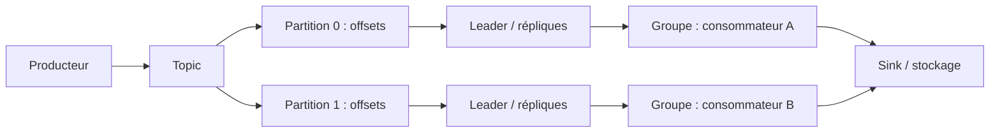

# Kafka et traitement en temps réel — Expert

> **Mise en contexte.** Un système événementiel transmet des faits entre composants qui ne sont pas toujours disponibles en même temps. Kafka est une plateforme distribuée de journal d’événements, tandis que le streaming est un style de traitement qui peut utiliser Kafka ou d’autres sources. Le défi ne se limite pas à publier et consommer des messages : il faut définir identité, ordre, livraison, rétention, schéma, partitionnement, reprise, cohérence du résultat et observabilité. Un pipeline peut être « actif » tout en accumulant du retard, en dupliquant les effets ou en rejetant silencieusement des événements. Ce cours aborde l’architecture Kafka, partitions, brokers, consommateurs, garanties de livraison, transactions, schémas, Streams, Connect, traitement événementiel, sécurité et exploitation. Les détails de configuration et les garanties exactes dépendent de la version et du connecteur employés.

## Objectifs pédagogiques

À la fin du cours, vous pourrez concevoir un topic et une stratégie de partitionnement, expliquer réplication et ISR, gérer producteurs et groupes de consommateurs, distinguer offset et identité métier, analyser les garanties de livraison, concevoir l’idempotence côté sink, choisir une politique de rétention, intégrer un registre de schémas, expliquer le rôle de Kafka Connect et Kafka Streams, maîtriser les retards et la backpressure, et établir un plan de sécurité, de reprise et d’observabilité.

Le niveau expert exige de distinguer garanties du broker et garanties de bout en bout. Une transaction Kafka peut couvrir certaines écritures Kafka, mais pas nécessairement l’écriture dans une base relationnelle ou un appel à une API externe. Un commit d’offset ne signifie pas automatiquement que la destination a conservé l’effet métier. La conception doit définir quelle combinaison de protocole, d’identifiant et de vérification rend les résultats corrects lors des crashs et des retries.

## Prérequis et environnement

Vous devez connaître les messages, API, transactions, JSON, SQL, clés métier et concepts distribués. Utilisez un environnement de test avec volumes limités et données synthétiques. Notez versions du broker, du client, du connecteur, du registre de schéma et du stockage de destination. Les commandes d’administration, propriétés des consommateurs et fonctionnalités transactionnelles changent selon les versions et les distributions ; vérifiez la documentation ciblée avant déploiement.

## 1. Kafka : journal distribué d’événements

Kafka organise les événements en topics. Un topic est composé de partitions ordonnées individuellement. Chaque partition est un journal où les records reçoivent un offset croissant. Un consommateur lit les records dans l’ordre de la partition, mais Kafka ne garantit pas un ordre total entre partitions. Le choix de clé influence la partition, le parallélisme et l’ordre métier.

Les brokers stockent les partitions et répliques. Dans une configuration avec réplication, une partition possède un leader qui traite normalement les lectures et écritures selon le protocole et des répliques qui suivent son journal. L’ensemble de répliques synchronisées (ISR, *in-sync replicas*) participe aux garanties définies par le broker. La disponibilité après panne dépend du facteur de réplication, de la politique d’acquittement, du nombre de répliques synchronisées et des conditions de réélection.

Kafka est souvent utilisé pour découpler services et conserver un historique rejouable. Il n’est pas une base de données universelle ni un remplacement automatique de tout stockage. Le journal est optimisé pour la séquence d’événements et la lecture par offset ; les requêtes métier complexes, les jointures et la mise à jour de l’état courant exigent d’autres composants ou des mécanismes de traitement appropriés.

Le diagramme simplifie une topologie. Chaque partition possède ses propres positions et peut être répartie sur les brokers. Le consommateur A et B ne sont pas nécessairement les seules instances ; le nombre de consommateurs actifs dans un groupe est limité par le nombre de partitions qu’ils peuvent se partager. Les répliques ne sont pas des consommateurs indépendants : elles soutiennent la disponibilité du journal.

## 2. Topics, partitions et clé d’événement

Le partitionnement permet de paralléliser le traitement et la distribution de stockage. Une clé stable comme order_id peut garantir que les événements d’une même commande sont normalement dirigés vers la même partition, selon le partitionneur et la configuration. Cela préserve un ordre local utile pour appliquer successivement création, mise à jour et annulation. Une clé absente ou une répartition aléatoire peut disperser les événements et rendre cette hypothèse fausse.

Choisir une clé revient à équilibrer ordre et parallélisme. Une clé très populaire concentre du trafic dans une seule partition : on parle de clé chaude ou de skew. Ajouter des partitions ne répartit pas nécessairement une même clé, car conserver son ordre peut justement exiger qu’elle reste sur une partition. Si une clé unique produit une part importante du volume, il faut revoir le modèle de traitement ou isoler les cas qui ne nécessitent pas un ordre strict.

Le nombre de partitions doit refléter le débit, l’ordre attendu, le nombre de consommateurs, la taille des messages, la distribution et les coûts d’exploitation. Trop peu de partitions limitent le parallélisme ; trop de partitions augmentent la charge de métadonnées, les fichiers et les opérations d’élection/rebalancing. L’augmentation du nombre de partitions peut modifier le mapping des clés avec certains partitionneurs, ce qui a un impact sur l’ordre inter-événements.

Une stratégie de clé doit être documentée dans le contrat d’événement. Pour chaque cas métier, précisez la clé, pourquoi l’ordre est requis, si plusieurs événements peuvent être traités en parallèle et comment gérer une clé manquante ou invalide. Testez la distribution des clés sur une période représentative ; un test uniforme peut masquer la concentration réelle d’une clé populaire.

## 3. Durabilité, réplication et acquittements

Le producteur peut demander différents niveaux d’acquittement, souvent présentés comme aucun, leader seulement ou réplication selon la politique définie. Les options précises changent selon les versions et les clients. Un réglage plus fort peut réduire le risque de perte mais augmenter la latence et rendre certaines écritures indisponibles quand le cluster n’a pas assez de répliques en état requis.

Le facteur de réplication est un compromis entre disponibilité, stockage et coût. Une réplication de trois copies ne signifie pas qu’aucune perte n’est possible quelles que soient les configurations : il faut considérer ISR, minimum de répliques synchronisées, réélection, stockage et erreurs d’exploitation. L’utilisation d’un producteur idempotent peut éviter certaines duplications causées par des retries dans le cadre pris en charge, mais elle ne déduplique pas automatiquement deux appels métier séparés qui expriment la même commande.

La durabilité suppose aussi que les disques, brokers et contrôles de sécurité fonctionnent. Surveillez répliques hors ISR, retard de réplication, erreurs de stockage, capacité disque, élections, perte de leader et disponibilité du contrôleur. Une partition sous-répliquée pendant une période prolongée indique une réduction des marges de récupération.

Les producteurs doivent être configurés selon le contrat. Les retries, timeouts et idempotence doivent être considérés ensemble. Une politique de retry trop agressive peut augmenter la charge en incident ; une politique trop courte peut faire échouer des publications légitimes. Les messages d’échec doivent être capturés, avec une stratégie de rejeu ou de compensation, plutôt que supprimés dans les logs.

## 4. Producteurs : fiabilité, batch et erreurs

Le producteur sérialise un événement puis l’envoie au broker. Le batching regroupe les records pour réduire les coûts de réseau et améliorer le débit. Compression peut réduire le transfert et le stockage au prix d’un travail CPU supplémentaire. L’optimisation doit être mesurée sur la taille des messages, le débit, la latence p95/p99 et le CPU. Une bonne moyenne peut masquer des pointes de latence incompatibles avec le SLA.

La clé, le timestamp, les headers et le schema doivent être définis de façon cohérente. Le timestamp peut représenter heure de création ou heure de production selon le client et la configuration ; ne le confondez pas avec l’heure de l’événement métier. Les headers peuvent véhiculer correlation ID, version de contrat ou trace, mais ne doivent pas contenir de secrets ni de payload sensible inutile.

Les erreurs de publication comprennent interruption réseau, indisponibilité du broker, refus d’autorisation, taille maximale dépassée, erreur de sérialisation et dépassement de timeout. Elles ne doivent pas être traitées de la même façon. Une erreur de sérialisation est souvent permanente tant que le code ou la donnée ne change pas ; une indisponibilité peut justifier une reprise bornée. Les logs et métriques doivent distinguer les catégories.

Ne considérez pas un timeout comme une preuve que le broker n’a pas reçu l’événement. Il peut l’avoir accepté alors que la réponse d’acquittement s’est perdue. L’application doit donc définir la stratégie de reprise, d’identification et de déduplication. Pour des actions métier, une clé de requête stable ou une contrainte dans le système destination est souvent nécessaire en plus des garanties de producteur.

## 5. Consommateurs, groupes et offsets

Un groupe de consommateurs coordonne plusieurs instances qui se partagent les partitions d’un topic. Les partitions d’un même groupe sont affectées à des consommateurs ; différents groupes peuvent relire le même topic indépendamment. Le groupe maintient des offsets qui indiquent la progression consommée selon les règles du client et du broker. Un offset est une position de lecture, pas automatiquement la preuve que l’effet métier a été appliqué de façon durable.

Les rebalances réattribuent les partitions lorsqu’un consommateur arrive, quitte, devient inaccessible ou lorsque la topologie change. Pendant un rebalance, les tâches peuvent être suspendues et l’ordre de traitement peut changer à la frontière de l’affectation. Les transactions longues, les pauses ou des timeouts mal calibrés peuvent déclencher des rebalances répétés. Surveillez durée, fréquence et cause avant de simplement augmenter les délais.

Le nombre de consommateurs actifs dans un groupe ne peut pas fournir plus de parallélisme que le nombre de partitions, sauf si l’architecture de traitement comporte une autre source de parallélisme à l’intérieur de chaque consommateur. Trop de consommateurs restent inactifs et ajoutent de la complexité. Pas assez de consommateurs peut créer un backlog. Le dimensionnement doit tenir compte du sink et de la durée réelle du traitement par record.

L’acquittement automatique des offsets peut être incorrect si le traitement prend plus de temps ou si le sink échoue. Un offset confirmé trop tôt peut faire sauter des événements après redémarrage. Un offset confirmé tardivement peut produire des répétitions. La politique doit lier le commit à la preuve qui importe : souvent, l’effet dans le sink doit être durable ou idempotent avant d’avancer la position.

## 6. Sémantique de livraison et transactions

At-most-once traite une fois au maximum mais peut perdre un événement selon le moment de commit. At-least-once retente pour éviter certaines pertes mais peut répéter un événement. Exactly-once est une propriété limitée à un ensemble de mécanismes et de transactions. Dans Kafka, certaines transactions peuvent coordonner l’écriture de records et l’avancement d’offsets au sein de Kafka ; cette garantie ne rend pas atomique un stockage externe non participant au protocole.

Pour un sink SQL, une option robuste consiste à écrire les effets métier et la clé de déduplication dans la même transaction locale. Si le consommateur échoue après le commit mais avant le commit de l’offset, le message peut être relivré ; la destination reconnaît alors la clé et n’applique pas de seconde fois l’effet. Si la destination externe ne possède pas de transaction ou de clé idempotente, il faut concevoir un mécanisme de réconciliation, une outbox/inbox ou une compensation.

La stratégie doit couvrir le cas ambigu : le client ne sait pas si le commit a eu lieu. Le système vérifie l’existence de l’événement ou de l’effet avant de le rejouer. Une procédure de replay contrôlée doit utiliser la même clé et préciser la version de traitement. Si la logique métier a changé, le rejeu peut vouloir recalculer l’état plutôt que produire la même opération ; ce choix doit être explicite.

Le terme exactly-once ne doit pas être employé sans périmètre : producteur vers topic, traitement Kafka Streams, ou chaîne complète jusqu’au sink. Documentez les garanties et les limites de chaque frontière. Les tests de panne doivent démontrer le comportement et vérifier le contenu de la destination, pas seulement l’offset.

## 7. Rétention, compaction et réutilisation du topic

Kafka conserve les records selon une politique de rétention basée généralement sur le temps, la taille ou une combinaison selon la configuration. La suppression des anciens segments rend une partie de l’historique non disponible. Un consommateur arrêté plus longtemps que la rétention peut perdre la capacité de reprendre son offset et nécessiter une reconstruction depuis une source ou un snapshot.

La compaction par clé conserve l’état le plus récent selon les règles du topic compacté et peut préserver des tombstones pendant une période configurée. Elle est utile pour des topics représentant un état courant, mais ne remplace pas un journal complet d’événements si l’historique de toutes les transitions est nécessaire. La compaction n’a pas lieu instantanément et les consommateurs doivent être prêts à voir des versions intermédiaires ou des tombstones selon les garanties.

Le choix de rétention vient du besoin métier, du retard maximal, de la capacité, des exigences de rejeu et des règles de données. Un topic d’événements immuables pour audit peut exiger une politique différente d’un topic de mise à jour d’état courant. Les messages sensibles doivent aussi respecter les règles de minimisation et de suppression applicables ; la rétention du broker et les copies downstream doivent être intégrées au plan.

Surveillez l’espace disque, segments, âge du plus ancien record, consommation et rétention effective. Une configuration trop courte peut casser une reprise, tandis qu’une rétention trop longue peut épuiser la capacité et conserver des données qui devraient expirer. Les décisions doivent être mesurées et révisées à mesure que les débits changent.

## 8. Registre de schémas et contrats d’événements

Le registre de schémas centralise des définitions et des règles de compatibilité pour les formats supportés par la plateforme, selon le produit utilisé. Il peut aider les producteurs et consommateurs à partager une structure versionnée. Il n’assure pas automatiquement que la sémantique métier est stable : deux champs peuvent conserver leur type tout en changeant de sens, et un schéma valide peut contenir une donnée fausse.

Définissez une politique de compatibilité : backward, forward, full ou mode spécifique au produit. Les termes exacts varient entre outils. Vérifiez si les anciens consommateurs peuvent lire le nouveau message, si les nouveaux consommateurs peuvent traiter les anciens messages et si les champs requis ont une valeur par défaut ou un traitement explicite. Un changement de type, de clé ou d’énumération exige une migration et une validation.

Un contrat d’événement décrit identifiant, source, version, timestamps, sémantique, cardinalités, champs sensibles, ordre, erreurs et stratégie de suppression. Le registre doit être intégré à la CI pour détecter les changements incompatibles avant le déploiement. Les jeux de test incluent messages historiques, champs absents, nouvelles valeurs d’enum et enregistrements invalides.

## 9. Kafka Connect : intégrer sources et destinations

Kafka Connect fournit un cadre pour faire entrer ou sortir des données via des connecteurs. Les connecteurs source publient des changements ou enregistrements dans des topics ; les connecteurs sink lisent les topics et écrivent vers des systèmes externes. Les garanties dépendent du connecteur, de l’API source/sink, de la configuration et de la version. Une fonctionnalité de connecteur ne doit pas être extrapolée à un autre.

Un connecteur peut gérer offsets, schéma, retries et parallélisme, mais les règles de déduplication et de publication restent liées au sink. Pour une destination SQL, vérifiez comment sont gérés clés primaires, upserts, deletes, transactions et interruptions. Pour une API externe, vérifiez limites de débit, idempotence et réponse aux codes d’erreur. Ne supposez pas qu’un offset Connect signifie que la donnée a été appliquée dans la destination si les journaux disent seulement que le record a été transmis au connecteur.

Les tâches de connecteur doivent être surveillées : état, erreurs, backlog, taux d’enregistrement, retries et configuration. Une tâche en état « running » peut échouer sur certains messages ou écrire lentement. Les mises à jour de plugin doivent être testées sur un environnement représentatif. Les secrets du connecteur et les logs ne doivent pas exposer credentials ni payload sensible.

## 10. Kafka Streams et traitement stateful

Kafka Streams permet de construire des applications de traitement qui lisent des topics, transforment, joignent, regroupent et écrivent de nouveaux topics. Les opérations stateless comme filtre et map sont conceptuellement simples ; les opérations stateful gardent un état local ou géré avec des changelogs et peuvent exiger des stores persistants, restauration et rééquilibrage. Les détails exacts dépendent de la version.

Une agrégation par fenêtre doit gérer event time, retard et mise à jour des résultats. Une jointure entre streams peut nécessiter des fenêtres et un état conservé. Une jointure stream-table associe un événement à un état de référence, mais le résultat dépend de la version de cette table au moment où le record est traité. L’ordre d’arrivée, le retard et les mises à jour du référentiel doivent être compris.

Le parallélisme est lié aux partitions des topics d’entrée et de sortie. Une opération de regroupement par clé peut changer la distribution et déclencher une redistribution. Un état volumineux nécessite de la capacité disque, du temps de restauration et une stratégie de rétention. La reprise d’une instance peut reconstruire l’état à partir du changelog ; cela doit être testé, surtout si le volume de l’état est important.

Les applications stateful doivent gérer évolution de store, changement de topologie et compatibilité des clés. Une nouvelle version peut nécessiter une migration ou un changement d’identifiant d’application. Les versions concurrentes doivent être déployées selon le protocole supporté, avec un plan d’arrêt et de rollback. Ne lancez pas deux instances incompatibles qui pensent gérer le même état sans comprendre les effets sur les offsets et les transactions.

## 11. Ordre, clés et événements tardifs

Kafka garantit l’ordre dans une partition. Pour une commande, utiliser order_id comme clé peut préserver l’ordre des transitions si les producteurs et le partitionneur restent compatibles. Mais ajouter des partitions peut changer le routage des clés. Si l’ordre doit traverser un changement de partitionnement, il faut un protocole de version, une période de migration ou une conception métier qui tolère la transition.

Le timestamp ne garantit pas l’ordre de commit. Deux producteurs peuvent produire des événements horodatés identiquement ou en désaccord avec l’ordre réellement accepté. Utilisez un numéro de séquence source ou une version métier si l’ordre des mises à jour importe. Le consommateur doit rejeter, mettre en attente ou réconcilier les événements plus anciens selon une règle explicite.

Les événements tardifs apparaissent quand un producteur est hors ligne, qu’une source rejoue des données ou que le réseau retarde certains records. Pour des agrégats temporels, définissez une période de correction. Pour un état courant, la version source peut empêcher un événement ancien d’écraser une mise à jour plus récente. Conservez temps d’événement et temps d’ingestion afin de diagnostiquer le retard et la chronologie.

## 12. Sécurité du cluster et gouvernance des accès

Séparez les identités producteurs, consommateurs, opérateurs, administrateurs et comptes de secours. Utilisez l’authentification et le chiffrement supportés par la distribution, avec vérification des certificats, rotation des secrets et permissions par topic lorsque la plateforme les permet. Un service qui publie dans un topic ne devrait pas automatiquement pouvoir le supprimer, modifier la configuration du cluster ou lire tous les autres topics.

Les ACL et permissions sont à vérifier par des tests effectifs. Validez accès autorisé et refusé à la lecture, écriture, création de topic, modification de configuration et groupe de consommateurs. Les règles d’accès doivent également couvrir les connecteurs, registres de schéma, UI d’administration et stockage de logs. Les chemins alternatifs sont souvent oubliés lorsqu’un seul composant central est protégé.

Les secrets ne doivent pas être dans les valeurs de configuration versionnées ni dans les logs. Injectez-les avec le système de secrets de la plateforme et limitez l’accès. Les topics contenant des données personnelles nécessitent une classification, une rétention et une politique de partage. La journalisation doit conserver les événements d’accès nécessaires sans enregistrer le payload complet lorsque cela n’est pas indispensable.

## 13. Observabilité, métriques et alertes

Mesurez débit entrant et sortant, latence de publication, latence de consommation, lag par groupe, âge du plus ancien record, erreurs du producteur, rebalances, répliques hors ISR, espace disque, temps de traitement par message et échecs de sink. Le lag seul peut être trompeur si la consommation est faible mais que les données sont déjà trop anciennes ; associez-le à l’âge et à la fraîcheur attendue.

Chaque alerte doit déclencher une action. Un lag qui dépasse le SLA implique de localiser source, partition, consommation et sink. Une réplique hors ISR implique d’examiner stockage, réseau et broker. Une DLQ qui augmente exige de caractériser les erreurs et d’identifier un changement de schéma ou de code. Les alertes doivent avoir un responsable et une gravité.

Les logs doivent corréler les messages via des IDs ou trace IDs, avec soin pour ne pas exposer les données. Les dashboards montrent distribution et tendance, pas seulement moyennes. Les exercices de panne doivent produire les signaux attendus et l’équipe doit connaître la procédure : pause, backpressure, retry, rejeu limité, restauration du sink ou escalade.

## 14. Atelier pratique : commande vers un topic et sink SQL

### Scénario

Une application publie des événements de commande vers Kafka. Un consommateur les écrit dans une table SQL. Des messages peuvent être relivrés après un timeout et certaines commandes sont mises à jour plusieurs fois. Le système doit préserver l’état final correct et ne pas créer de doublons.

### Étape A — Définir la clé et le contrat

Définissez event_id stable, order_id, version, event_time, type d’événement et payload. Choisissez order_id comme clé de partition si l’ordre des mises à jour de commande est nécessaire. Documentez la compatibilité de schéma et les champs obligatoires. Précisez la gestion d’une version ancienne reçue après une nouvelle.

### Étape B — Configurer la livraison

Utilisez les paramètres d’acquittement et d’idempotence pris en charge par le client et le broker, selon les garanties souhaitées. Définissez les retries et timeouts, puis testez une perte de réponse après publication. Une nouvelle tentative ne doit pas produire une seconde commande métier. Gardez la version source et la clé comme preuve.

### Étape C — Écrire de façon idempotente

La table de destination possède une clé qui identifie un événement ou un état métier. L’opération d’écriture doit détecter une version déjà appliquée ou une commande plus récente. Si le consommateur se plante après le commit SQL mais avant le commit de l’offset, la relecture doit être sans double effet. Testez le crash précisément à cette frontière.

### Étape D — Tester retard et ordre

Publiez les versions v1, v2 et ensuite une v1 tardive. Vérifiez que l’état final ne régresse pas. Testez également une commande sans clé, une version invalide et une erreur temporaire de SQL. Les erreurs permanentes vont en quarantaine ou DLQ selon le contrat et doivent être observables.

### Étape E — Mesurer et opérer

Suivez lag, débit, latence de sink, retries, DLQ et taux de doublons. Définissez les seuils, l’action de backpressure et la procédure de rejeu. Vérifiez les droits et les logs. Le rapport du labo doit expliquer quelles garanties sont obtenues entre producteur, broker et base SQL, ainsi que les limites restantes.

### Critères d’acceptation

Le labo réussit si les mises à jour finales sont correctes, les répétitions n’ajoutent pas de doublons, les versions obsolètes ne régressent pas l’état, les erreurs sont visibles, et la reprise a été testée après commit SQL mais avant commit d’offset.

## 15. Étude de cas : lag élevé et sortie SQL incohérente

### Symptôme

Le groupe de consommateurs semble actif mais son lag augmente. Certains événements sont visibles dans les logs, tandis que la base SQL n’affiche pas toutes les commandes attendues.

### Diagnostic

Mesurez le débit d’entrée, le débit de consommation, l’âge des messages, les erreurs de sink, les retries, la durée des transactions et le lag par partition. Suivez un event_id depuis le broker jusqu’à la base. Déterminez si le record n’a pas été lu, a été rejeté, reste dans une transaction non validée, a été écrit mais pas encore acké ou a été appliqué sous une clé différente.

### Hypothèses et correction

Une partition chaude peut limiter le parallélisme ; une requête SQL lente ou un index manquant peut ralentir le sink ; un rebalance peut provoquer des interruptions ; un schéma invalide peut envoyer des messages en DLQ ; une politique de retry peut occuper tous les workers. Corrigez la cause mesurée. Ajouter des consommateurs n’aide pas si les partitions sont déjà toutes affectées ou si la destination est le goulot.

### Validation

Après correction, comparez offsets, nombre d’événements acceptés, lignes de destination et clés métier. Rejouez un intervalle limité et vérifiez l’idempotence. Surveillez lag et fraîcheur jusqu’à retour dans la plage attendue. Documentez la cause, le changement, l’effet et le test qui prévient la récidive.

## 16. Exercices avec corrigés

### Exercice 1 — Que garantit un offset Kafka ?

**Correction.** Il indique une position dans une partition selon l’état du consommateur. Il ne prouve pas que l’effet métier a été appliqué durablement dans un sink externe. La relation entre commit d’offset, transaction et écriture doit être conçue explicitement.

### Exercice 2 — Pourquoi le partitionnement par commande peut-il être utile ?

**Correction.** Il place normalement les événements d’une même commande dans une même partition et peut préserver leur ordre relatif. En contrepartie, une clé chaude peut limiter le parallélisme et une modification de partitionnement peut changer le mapping. Il faut mesurer la distribution et définir l’ordre réellement nécessaire.

### Exercice 3 — Une transaction Kafka rend-elle atomique l’écriture SQL ?

**Correction.** Pas à elle seule si la base SQL n’est pas incluse dans le protocole transactionnel. Le sink peut avoir écrit puis perdre la réponse ou l’offset peut être rejoué. Une clé d’idempotence, une transaction SQL locale et une stratégie de commit/reprise sont nécessaires pour garantir le résultat de bout en bout.

### Exercice 4 — Pourquoi surveiller l’âge des messages en plus du lag ?

**Correction.** Le nombre de messages en retard ne révèle pas toujours leur âge. Un lag modéré peut représenter des événements trop anciens pour le SLA. L’âge et la latence de bout en bout mesurent directement la fraîcheur.

### Exercice 5 — À quoi sert un registre de schémas ?

**Correction.** Il partage des définitions et applique des règles de compatibilité supportées par la plateforme. Il n’assure pas que les valeurs sont correctes ni que le sens métier n’a pas changé. Les contrats et tests de données restent nécessaires.

### Exercice 6 — Pourquoi une clé chaude est-elle difficile à résoudre ?

**Correction.** L’ordre des événements pour cette clé peut imposer qu’ils restent dans une partition. Ajouter des partitions ne répartit pas automatiquement une même clé. Il faut examiner si l’ordre strict est nécessaire, traiter la clé séparément ou repenser la logique en conservant la sémantique.

## 17. Défi final : plateforme événementielle d’entreprise

Une organisation diffuse commandes, paiements et événements d’inventaire. Des consommateurs alimentent un service opérationnel, un data lake et des alertes. Les événements peuvent être rejoués, les consommateurs changent de version et certains flux contiennent des données sensibles.

### Corrigé attendu

Définissez des topics par domaine et contrat, avec identité, clé, version, rétention, classification et propriétaires. Choisissez les clés de partition selon l’ordre nécessaire et la distribution. Dimensionnez les partitions pour la capacité attendue, vérifiez réplication et politiques d’acquittement, puis testez les pannes couvertes.

Séparez groupes de consommateurs selon leurs usages et leurs besoins de reprise. Les offsets sont associés à des preuves de traitement durable. Les sinks externes sont idempotents ou fournissent une réconciliation. Le schéma est versionné et les changements incompatibles suivent un plan progressif. Les connecteurs sont observés selon leur propre contrat et leurs permissions.

Le plan d’exploitation suit lag, âge, débit, erreurs, retries, rebalances, DLQ, répliques hors ISR et coût. Les données sensibles ont des accès, une rétention et des logs adaptés. Les secrets sont gérés séparément. Un incident de sécurité ou de perte de partition doit avoir une procédure d’arrêt, de récupération et de validation.

Les tests incluent crash avant et après commit, consumer rebalance, perte d’un broker, retard de sink, rejeu de messages, changement de schéma et événement obsolète. Les résultats de destination sont vérifiés, pas seulement les états « running ». Le dossier de livraison documente les garanties exactes et les hypothèses non couvertes.

## 18. Checklist avant mise en production

- [ ] Le contrat d’événement définit identité, clé, schéma, temps et sémantique.
- [ ] Le nombre de partitions et la distribution de clés sont mesurés.
- [ ] Facteur de réplication et politiques d’acquittement répondent au besoin.
- [ ] Les producteurs gèrent erreurs, retries, idempotence et sérialisation.
- [ ] Les consommateurs lient commit d’offset et traitement selon un protocole sûr.
- [ ] Les sinks externes sont idempotents ou réconciliables.
- [ ] Les politiques de rétention permettent la reprise attendue.
- [ ] Le registre de schémas est testé avec messages historiques et nouveaux.
- [ ] Connecteurs, Streams et applications stateful sont surveillés.
- [ ] ACL, secrets, données sensibles et logs sont protégés.
- [ ] Lag, âge, erreurs et DLQ déclenchent des actions opérationnelles.
- [ ] Les scénarios de panne et de rejeu sont testés de bout en bout.

## Conclusion

Kafka distribue et conserve les événements dans un journal partitionné ; le traitement de streaming ajoute état, fenêtres, transformations et sinks. La fiabilité vient du contrat d’événement, des clés, offsets, retries, idempotence, transactions et contrôles de qualité. Le broker ne garantit pas à lui seul la justesse de la base destination. Une architecture experte sait précisément quelles garanties sont obtenues à chaque frontière, comment diagnostiquer un retard, et comment reprendre sans perdre ni compter deux fois les événements.

## Complément : migrations, capacité et gouvernance d’exploitation

### Changer un nombre de partitions ou une clé

Une augmentation de partitions peut modifier la distribution de certaines clés avec le partitionneur utilisé. Si la sémantique du système dépend de l’ordre d’événements par clé, cette modification doit être planifiée, testée et documentée. Une migration peut nécessiter un nouveau topic, une période de double publication contrôlée, un consommateur de transition et un point de coupure. Il faut prouver qu’aucun événement n’a été perdu ni traité deux fois au-delà du mécanisme prévu.

Changer la clé de partitionnement est encore plus important : les événements anciens et nouveaux d’une même entité peuvent se retrouver dans des partitions différentes. Si un consommateur suppose un ordre global par entité, il peut appliquer les changements dans le mauvais ordre. Versionnez le contrat et la clé, ou reconstruisez le flux dans une topologie contrôlée où le nouvel ordre peut être vérifié.

### Capacité et dimensionnement par SLA

Le dimensionnement s’appuie sur taille moyenne et maximale des messages, débit de pointe, durée de rétention, réplication, compression, nombre de groupes de consommateurs et capacité réseau. La rétention multiplie le coût du volume quotidien par le nombre de jours conservés et le nombre de répliques, avec une marge pour la croissance et les segments temporaires. Cette estimation doit être validée avec des métriques et pas seulement avec une moyenne de laboratoire.

Prévoyez une capacité de rattrapage après panne. Si le système reçoit 20 000 événements par seconde et ne consomme que 18 000 pendant une heure, le backlog augmente continuellement. Une fois la cause corrigée, la capacité disponible doit permettre de rattraper la file tout en absorbant le flux actuel. Si le cluster ne dispose d’aucune marge, le backlog peut ne jamais redescendre.

Définissez un budget de partitionnement et de rétention. Une rétention longue améliore le rejeu mais coûte plus de stockage ; une partition supplémentaire améliore potentiellement le parallélisme mais augmente métadonnées et opérations. Les décisions doivent être reliées au SLA, au coût et à la capacité d’équipe à maintenir le cluster.

### Gouvernance et suppression des événements

Les topics peuvent contenir des données personnelles ou des informations sensibles. Définissez classification, droits, rétention et usage autorisé à la création du topic. La suppression d’un événement dans une source peut devoir être propagée aux sinks, vues, caches et exports. La rétention du broker doit être cohérente avec les exigences applicables et le besoin de reprise.

Un topic compacté peut garder un dernier état par clé, mais cela ne signifie pas que l’événement est immédiatement effacé de toutes les répliques ou copies aval. Définissez comment les tombstones sont interprétés et combien de temps ils restent nécessaires pour que les consommateurs retardés appliquent la suppression. Les réplicas de stockage, backups et exports doivent être considérés dans le processus de suppression.

### Procédure de reprise après perte d’un broker

Une procédure de reprise identifie les partitions affectées, leurs leaders et répliques, la capacité disponible, les ISR et les signaux de corruption ou retard. Après rétablissement, vérifiez que les répliques suivent le journal et que les groupes consomment. Ne validez pas simplement parce que le broker est revenu : examinez les erreurs, les partitions non disponibles et la fraîcheur des résultats.

Si une partition reste indisponible, suivez la procédure du produit et les garanties du cluster avant de modifier les paramètres de réélection ou de perte de données. Les options agressives peuvent rétablir le service en sacrifiant des records qui n’étaient pas répliqués. La décision doit être alignée sur le RPO et approuvée par le responsable, puis les écarts doivent être réconciliés avec la source de vérité.

### Revue post-incident

Le compte-rendu précise heure de début, durée, partitions et groupes affectés, backlog maximal, données potentiellement perdues ou dupliquées, action de mitigation et preuve de retour à la normale. Comparez le résultat avec le SLA. Les actions de prévention doivent être testables : changer une alerte, ajouter une contrainte d’idempotence, ajuster le nombre de partitions, documenter la procédure de replay ou créer un test de panne.

Un incident est considéré comme résolu quand la destination est correcte et que le backlog/fraîcheur est revenu à la plage attendue, pas seulement quand les brokers répondent. Conservez les preuves sans capturer inutilement les payloads sensibles. Assignez les actions, dates et responsables ; sinon, l’apprentissage ne se traduit pas en amélioration durable.

### Critères de maturité

Une plateforme mature peut prouver les volumes reçus, validés, publiés et consommés ; elle connaît l’âge et le retard de chaque flux critique ; elle gère les schémas incompatibles ; elle permet un rejeu borné ; elle protège les données et secrets ; et elle sait expliquer la portée de ses garanties de livraison. Les opérateurs ont des procédures testées pour un crash de consommateur, une panne de sink, un broker indisponible, une clé compromise et une erreur de schéma.

Le but n’est pas d’éliminer toute panne, mais de la rendre détectable, circonscrite et récupérable. Une promesse qui n’est pas testée ne doit pas être traitée comme une garantie. La meilleure documentation relie une option de configuration à un scénario, une mesure et une action vérifiable.
