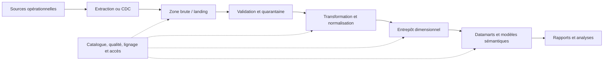
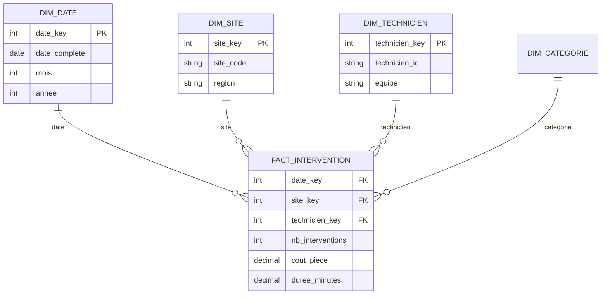
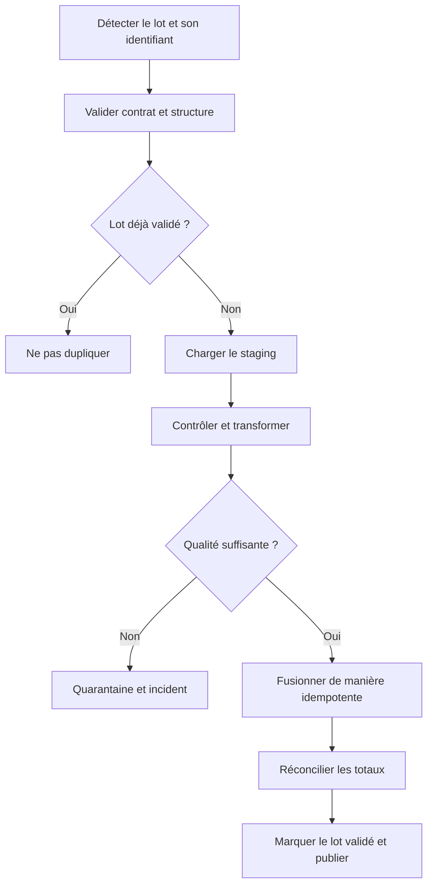
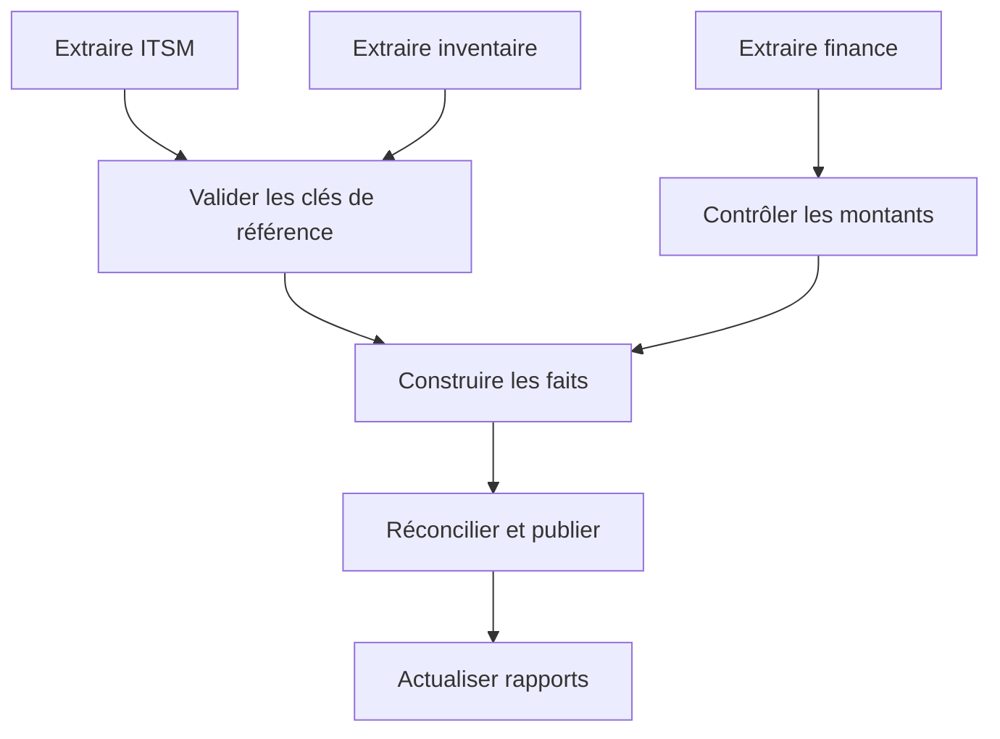

# Entrepôt de données et ETL — Intermédiaire

> **Mise en contexte** — Une direction demande un rapport hebdomadaire sur les interventions, les coûts, les stocks et les délais. Les données sont réparties entre l'ITSM, la facturation, l'inventaire et plusieurs feuilles de calcul. Une requête directe sur les systèmes de production est lente et les chiffres diffèrent d'un rapport à l'autre. Un entrepôt de données vise à fournir une vue analytique contrôlée et cohérente, mais il n'est pas simplement une copie des bases opérationnelles. Il faut sélectionner les données, définir leur sens, documenter leur origine, gérer les chargements et vérifier les résultats.

## Introduction et objectifs

Ce cours présente la différence entre systèmes transactionnels et analytiques, l'architecture d'un entrepôt, les processus ETL et ELT, la modélisation dimensionnelle, les tables de faits et dimensions, les chargements incrémentaux, la qualité, l'orchestration et la supervision. Les exemples s'appliquent aux contextes SQL et aux plateformes analytiques, mais les outils diffèrent selon l'organisation.

À la fin, l'apprenant pourra définir un objectif analytique, choisir des sources, concevoir une chaîne d'ingestion et de transformation, structurer un modèle en étoile, appliquer des contrôles de qualité, rendre les pipelines idempotents, gérer les mises à jour tardives, mesurer la fraîcheur et tester la réconciliation des rapports.

## 1. Systèmes opérationnels et systèmes analytiques

### 1.1 OLTP et OLAP

Les applications opérationnelles (OLTP) gèrent des transactions fréquentes et ciblées : créer une intervention, modifier un stock ou enregistrer un paiement. Les usages analytiques (OLAP) parcourent souvent davantage de lignes, agrègent des périodes, comparent des segments et combinent plusieurs sources. Les profils de requêtes, les exigences de fraîcheur et les schémas peuvent donc différer.

Interroger directement la production peut être approprié pour des indicateurs simples et peu coûteux, mais un rapport qui scanne des historiques volumineux peut concurrencer les transactions. L'entrepôt sépare les usages analytiques, permet d'historiser les états nécessaires et fournit un modèle stable pour les tableaux de bord. Il ne dispense pas de gouverner la donnée ni de vérifier la signification des mesures.

### 1.2 Définir la question métier

Avant de créer une table, préciser la décision à prendre : quel indicateur, pour quel rôle, selon quelle période, sur quelle population et avec quelle fréquence de rafraîchissement ? « Coût de maintenance » peut signifier coût des pièces, coût de main-d'œuvre, coût complet imputé ou dépense comptabilisée. Le terme doit avoir une définition unique et un propriétaire.

Documenter la granularité : une ligne par intervention, par ligne de facture, par mouvement de stock, par technicien et par jour, ou par autre événement. Une mesure doit être agrégée à un grain où son sens reste valide. Si on joint directement les interventions, pièces et factures, les relations un-à-plusieurs peuvent multiplier les montants et créer des totaux faux.

### 1.3 Les contrats de données

Un contrat de données définit les champs, types, unités, clés, contraintes, fréquence, fraîcheur attendue, propriétaire et comportement des changements. Il décrit aussi ce qui se passe si une source ajoute un champ, supprime une colonne, envoie une valeur inattendue ou retardait un lot.

Sans contrat, un pipeline peut continuer à fonctionner techniquement tout en produisant des chiffres erronés. La validation structurelle doit précéder la transformation métier. Les changements incompatibles nécessitent une stratégie de version et une communication vers les consommateurs.

## 2. Architecture d'un entrepôt

### 2.1 Chaîne de bout en bout

La zone brute conserve, selon la politique, les données au plus proche de la source pour permettre la relecture, l'audit ou le retraitement. La couche d'intégration applique les règles de qualité et d'harmonisation. L'entrepôt organisé par domaine ou processus fournit les données analytiques stabilisées. Les datamarts exposent un modèle adapté aux équipes consommatrices.

Il n'existe pas une architecture obligatoire en couches. Un petit projet peut se passer de certaines zones. Il faut éviter une complexité supérieure aux besoins, tout en préservant assez de traçabilité et de capacité de reprise pour l'importance du rapport.

### 2.2 ETL et ELT

ETL signifie Extract, Transform, Load : les données sont transformées avant le chargement de la cible. ELT signifie Extract, Load, Transform : les données arrivent dans la plateforme cible puis y sont transformées. Dans les architectures modernes, les pratiques peuvent se combiner.

Le choix dépend du moteur cible, du coût, de la sensibilité, des compétences, du volume, de la fenêtre de traitement et des besoins de traçabilité. ETL peut appliquer un filtrage ou une réduction avant le transfert. ELT peut profiter de la capacité de calcul analytique et conserver une copie brute, mais exige des contrôles sur les accès, les coûts et les transformations en cible.

### 2.3 Batch, micro-batch et changement de données

Le batch charge un ensemble de données à une cadence définie, par exemple chaque nuit. Le micro-batch rapproche la fréquence du temps réel sans nécessairement traiter chaque événement individuellement. Le Change Data Capture (CDC) suit les insertions, mises à jour et suppressions au moyen des mécanismes disponibles dans la source ou le connecteur.

La bonne cadence dépend du délai de décision requis, du coût et des capacités de reprise. Un tableau de bord journalier ne nécessite pas automatiquement un pipeline en continu. Un chargement fréquent peut augmenter la charge source, les coûts de calcul et la complexité des corrections. Définir la fraîcheur métier avant de sélectionner l'outil.

## 3. Modélisation dimensionnelle

### 3.1 Tables de faits et dimensions

Une table de faits représente un événement mesurable ou un état périodique à une granularité explicite. Elle contient souvent des clés vers des dimensions et des mesures numériques. Une dimension fournit le contexte descriptif : date, site, technicien, catégorie, type d'équipement ou fournisseur.

La conception en étoile privilégie des relations compréhensibles pour les requêtes analytiques. Il faut toutefois éviter de créer des clés artificielles sans raison, d'avoir des dimensions qui changent sans stratégie et de mélanger plusieurs grains dans la même table de faits. Un fait au niveau intervention n'a pas nécessairement les mêmes clés et mesures qu'un fait au niveau ligne de facture.

### 3.2 Mesures additives, semi-additives et non additives

Une mesure additive peut être sommée sur toutes les dimensions concernées, comme un coût associé à un événement. Une mesure semi-additive, comme un stock instantané, ne doit pas être sommée sur le temps comme s'il s'agissait de flux. Une mesure non additive, comme un ratio, doit être recalculée à partir de son numérateur et de son dénominateur plutôt que sommée.

Exemple : pour comparer le taux de résolution dans les délais entre deux sites, agréger le nombre résolu dans les délais et le nombre total éligible, puis diviser les agrégats. La moyenne des taux calculés pour chaque site peut produire un résultat différent si les volumes diffèrent. Documenter les formules et unités des mesures.

### 3.3 Dimensions à évolution lente

Une dimension peut évoluer : un site change de région, un technicien change d'équipe ou un équipement reçoit une nouvelle classification. Plusieurs stratégies existent. On peut écraser la valeur lorsqu'on ne cherche pas à connaître l'ancien état, conserver l'historique par versions, ou parfois stocker une valeur d'origine selon les besoins.

Dans une stratégie de type 2, chaque version reçoit une clé substitut distincte avec une période de validité et un indicateur d'état courant. Les faits historiques doivent pointer vers la version correcte à la date de l'événement. Si le pipeline utilise toujours la valeur actuelle, les rapports historiques peuvent réécrire silencieusement le passé.

### 3.4 Clés substituts et clés naturelles

Une clé naturelle provient de la source métier ; elle peut être significative mais parfois réutilisée, modifiée ou différente entre sources. Une clé substitut fournit un identifiant stable dans le modèle analytique. Les deux peuvent être conservées : l'une pour la relation interne, l'autre pour la traçabilité.

Le chargement doit résoudre les clés étrangères vers les dimensions. Si une source envoie un fait avant que sa dimension n'existe, définir une politique : rejeter en quarantaine, utiliser une clé inconnue temporaire, attendre la dimension ou résoudre plus tard. Ne pas créer silencieusement une dimension incorrecte qui fausse les analyses.

## 4. Ingestion et transformation

### 4.1 Extraction complète ou incrémentale

Une extraction complète relit toutes les données de la source. Elle peut être simple, mais devient coûteuse avec le volume et peut augmenter la charge de production. Une extraction incrémentale ne traite que les changements depuis un repère, à condition que la source permette de l'identifier correctement.

Les stratégies incrémentales utilisent parfois une colonne de modification, un identifiant croissant, des journaux de transactions ou un mécanisme CDC. Elles doivent gérer les horodatages identiques, les événements tardifs, les suppressions, les horloges incohérentes et la répétition des lots. Une simple condition « date_modification supérieure au dernier lot » peut manquer un changement lorsque la borne ou la précision temporelle est incorrecte.

### 4.2 Zone de staging et quarantaine

La zone de staging reçoit les données avant la transformation finale. Elle peut conserver les métadonnées du lot, la source, l'heure de collecte, l'identifiant d'extraction et la version du contrat. La quarantaine garde les lignes invalides ou ambiguës pour diagnostic, au lieu de les jeter ou de les mélanger avec les données fiables.

La politique de quarantaine doit être proportionnée au risque et à la sensibilité. Limiter l'accès, définir une durée de rétention, identifier le propriétaire de correction et éviter que les données invalides deviennent visibles comme valeurs analytiques approuvées.

### 4.3 Nettoyage sans effacer le sens

Les transformations courantes comprennent le typage, la normalisation des unités, l'harmonisation des valeurs catégorielles, la gestion des doublons, la conversion de date et l'enrichissement par dimensions de référence. Chaque transformation doit être documentée avec son but, les règles, les exclusions et la version.

Ne pas remplacer automatiquement les inconnues par zéro ou une chaîne vide. Un montant absent, une mesure réellement nulle et une donnée non applicable ont des significations différentes. Les règles de nettoyage doivent préserver ou signaler l'information nécessaire à l'analyse. Il faut également distinguer la correction d'une erreur de source de la création d'une valeur estimée.

### 4.4 Idempotence des pipelines

Un chargement idempotent peut être rejoué sans dupliquer le résultat ni laisser un état intermédiaire incorrect. Utiliser des identifiants de lot, des clés métier ou des mécanismes de fusion adaptés. Le pipeline doit savoir s'il a déjà appliqué une version de fichier ou un événement, et reprendre à partir d'un point sûr après une panne.

Ne pas marquer un lot comme terminé avant que ses données et métadonnées soient cohérentes. Une reprise partielle doit distinguer les étapes réussies, celles à répéter et celles qui nécessitent une compensation.

### 4.5 Suppressions et événements tardifs

Un pipeline qui ne traite que les insertions et modifications peut conserver indéfiniment des enregistrements supprimés dans la source. Définir comment les suppressions sont propagées : événement CDC, indicateur de suppression, liste différentielle, ou stratégie de rapprochement complet périodique.

Les événements tardifs peuvent modifier une période déjà chargée. Un changement de date, une clôture retardée ou une facture reçue après la fin du mois peut nécessiter une correction historique. Définir une fenêtre de réouverture, recalculer les agrégats dépendants et conserver une trace des corrections. La fraîcheur des données ne doit pas masquer la possibilité de révisions.

## 5. Qualité des données et réconciliation

### 5.1 Dimensions de qualité

La qualité peut être évaluée par complétude, validité, unicité, cohérence, fraîcheur, exactitude et traçabilité. Chaque règle doit avoir une définition et un seuil adapté au cas d'usage. Une qualité parfaite n'est pas une cible pratique si la donnée source est limitée ; l'objectif est de connaître le défaut, mesurer son impact et prendre une décision appropriée.

Exemples de contrôles :
- clés obligatoires présentes ;
- date de clôture postérieure ou égale à la date d'ouverture ;
- quantité et prix conformes aux domaines permis ;
- référence de site présente dans le référentiel ;
- identifiants uniques au grain attendu ;
- total de lignes et somme des montants réconciliés avec la source ;
- horodatage de dernière mise à jour compatible avec la fraîcheur attendue ;
- ratio de quarantaine mesuré par lot et par source.

### 5.2 Réconciliation financière et opérationnelle

Une agrégation analytique doit être comparée à une source de référence ou à une méthode de contrôle indépendante. Pour des montants, comparer le nombre de transactions, la somme, les devises, les arrondis, les dates d'imputation et les règles d'exclusion. Un total identique ne suffit pas à prouver l'absence de doublons : deux erreurs peuvent se compenser.

Conserver les résultats de contrôles au niveau du lot, les écarts, la méthode de calcul, les exclusions et la décision du propriétaire métier. Une différence peut être légitime si les définitions de période ou de statut diffèrent ; il faut l'expliquer et le documenter plutôt que la corriger arbitrairement.

### 5.3 Contrôles bloquants et avertissements

Les règles critiques doivent bloquer la publication d'un lot lorsque le risque dépasse la limite approuvée. D'autres anomalies peuvent produire un avertissement si elles sont connues et tolérées. Chaque règle dispose d'un propriétaire, d'un mécanisme d'escalade et d'une façon de vérifier sa résolution.

Un pipeline qui ignore toujours ses anomalies n'est pas gouverné. Inversement, bloquer un entrepôt complet pour une donnée non critique peut interrompre une fonction sans réduire un risque significatif. Définir la criticité, le mode dégradé et le périmètre de publication avec les consommateurs.

## 6. Orchestration et dépendances

### 6.1 DAG et ordonnancement

Un pipeline peut être décrit comme un graphe orienté de tâches, dans lequel une étape démarre lorsque ses prérequis sont achevés. L'orchestrateur gère les dépendances, les calendriers, les reprises, les délais et la visibilité des états. Il ne garantit pas à lui seul que les règles de données sont correctes.

Chaque tâche doit définir l'entrée, la sortie, les préconditions, l'idempotence, la limite de temps, la stratégie de reprise et les alertes. Ne pas relancer aveuglément une tâche qui a envoyé des notifications ou modifié un état externe non idempotent.

### 6.2 Reprises, dépendances et délais

Une dépendance lente peut retarder toute la chaîne. Décider si le rapport doit attendre toutes les sources, publier une version partielle avec avertissement, ou conserver la dernière version validée. Cette décision doit être visible aux utilisateurs : les chiffres présentés comme actuels ne doivent pas provenir d'une source qui n'a pas été mise à jour.

Les reprises automatiques doivent être limitées et adaptées à l'erreur. Un timeout réseau peut être transitoire ; un contrat de données invalide ne se résout pas en répétant immédiatement la même tâche. Mettre en quarantaine les lots invalides, notifier le propriétaire et éviter qu'une boucle de retry épuise les ressources.

### 6.3 Observabilité des pipelines

Surveiller la dernière exécution réussie, la durée, la quantité de lignes, la fraîcheur, le taux de rejet, les doublons, les écarts de réconciliation et le retard entre source et publication. Les alertes doivent avoir un responsable et une action. Une tâche « verte » peut tout de même produire zéro ligne inattendue ; les contrôles doivent inclure le résultat métier.

Conserver les identifiants de corrélation entre extraction, transformation et rapport. Cette traçabilité permet d'expliquer pourquoi un chiffre donné apparaît à une heure précise et quel lot l'a produit.

## 7. Étude de cas — Rapport des coûts de maintenance

Une organisation assemble les interventions de l'ITSM, les quantités de pièces de l'inventaire et les montants facturés. Le rapport mensuel donne parfois des totaux différents du système financier et les données sont actualisées sans heure de fraîcheur affichée.

### Étape A — Définir les mesures

Clarifier ce que signifie coût : facture reçue, coût estimé de pièce, temps de technicien valorisé, frais indirects ou coût complet. Définir la devise, la période, le statut, les annulations, la date d'imputation et les exclusions. Nommer les propriétaires qui valident les définitions.

### Étape B — Fixer le grain

Une ligne de fait peut représenter une ligne de facture ou une intervention ; il faut éviter de mélanger les deux. Agréger les pièces au niveau requis avant d'associer les totaux aux interventions. Définir si une intervention sans facture doit apparaître et si un montant estimé est distingué d'un montant confirmé.

### Étape C — Ingestion et qualité

Extraire les sources, conserver le lot brut et la date d'extraction, vérifier les identifiants, les doublons, les devises et la cohérence des dates. Placer en quarantaine les enregistrements incohérents avec une raison de rejet. Rejouer le lot doit produire le même résultat sans additionner deux fois les mêmes factures.

### Étape D — Modèle dimensionnel

Créer une table de faits avec le grain documenté et des clés de dimensions site, date, technicien et catégorie. Prévoir une gestion des valeurs inconnues et des changements d'attributs dans le temps. Ajouter les dimensions nécessaires aux questions analytiques, pas toutes les colonnes disponibles dans la source.

### Étape E — Réconciliation et publication

Comparer nombre de factures, total des montants et échantillons d'identifiants avec la source financière. Si les résultats diffèrent, ne pas publier silencieusement la nouvelle version. Décrire les règles de correction et la date de fraîcheur, puis publier lorsque le contrôle autorise le lot.

### Résultat attendu

Le rapport contient les définitions de mesure, l'heure de mise à jour, la provenance, les contrôles, les règles d'exclusion et la décision en cas de source en retard. Les consommateurs savent quelle version des données ils regardent et quelles limites s'appliquent.

## 8. Pièges fréquents

- Créer un entrepôt sans définir les décisions qu'il doit soutenir.
- Calculer des mesures à partir de relations dont les grains diffèrent.
- Confondre moyenne de ratios et ratio des sommes.
- Charger des données sans contrat ni version.
- Considérer une extraction réussie comme un lot valide.
- Rejouer un lot sans idempotence et doubler les montants.
- Ignorer les suppressions ou les événements tardifs.
- Remplacer les inconnues par zéro sans justification.
- Publier des données dont les contrôles critiques ont échoué.
- Laisser un pipeline en boucle de retry sur une erreur structurelle.
- Ne pas afficher la fraîcheur ou la provenance aux consommateurs.
- Comparer des totaux sans définir devise, période, arrondis et exclusions.
- Construire un modèle dimensionnel sans politique d'historique.
- Oublier l'accès, la rétention et les données sensibles dans les zones brutes.

## 9. Checklist d'un entrepôt fiable

### Conception
- [ ] Besoin métier, consommateur et fréquence de mise à jour sont définis.
- [ ] Les sources et leur propriété sont documentées.
- [ ] Le grain de chaque table de faits est explicite.
- [ ] Les dimensions et clés sont documentées.
- [ ] Les mesures additives, semi-additives et non additives sont distinguées.
- [ ] La stratégie d'évolution des dimensions est définie.

### Ingestion
- [ ] Les contrats, types et versions de schéma sont contrôlés.
- [ ] La stratégie complète ou incrémentale est justifiée.
- [ ] Les suppressions et événements tardifs ont un traitement.
- [ ] Le staging et la quarantaine sont bornés et protégés.
- [ ] Le chargement est idempotent et reprend après échec.

### Publication
- [ ] Les règles de qualité sont mesurées et classées par gravité.
- [ ] Les totaux et les clés sont réconciliés.
- [ ] Les rejets et les écarts ont un propriétaire.
- [ ] La fraîcheur est exposée aux consommateurs.
- [ ] La publication respecte les seuils et responsabilités approuvés.

## 10. Exercices corrigés

### Exercice 1 — Total de pièces multiplié

Après une jointure intervention et lignes de pièces, le coût total des interventions augmente.

**Corrigé :** le grain a été multiplié par la relation un-à-plusieurs. Agréger les pièces par intervention ou construire des faits distincts au grain correct, puis comparer à un jeu test calculable manuellement.

### Exercice 2 — Un lot a été chargé deux fois

Une tâche a été relancée après un timeout et les montants apparaissent en double.

**Corrigé :** utiliser un identifiant de lot ou une clé d'événement, appliquer la fusion de manière idempotente et ne marquer le lot validé qu'une fois les données et métadonnées cohérentes. Rejouer ensuite le test pour prouver l'absence de duplication.

### Exercice 3 — Les données du jour sont absentes

Le rapport paraît valide, mais une source n'a pas été chargée depuis deux jours.

**Corrigé :** surveiller la fraîcheur et la dernière exécution réussie, définir une politique de publication en cas de retard et afficher clairement l'heure des données. Un pipeline qui termine sans erreur n'est pas preuve que chaque source est à jour.

### Exercice 4 — Le taux moyen diverge

La moyenne de deux taux par site diffère du taux global attendu.

**Corrigé :** calculer le total des événements éligibles et le total des succès, puis diviser les agrégats. La moyenne simple des taux de sites donne le même poids à des sites de volumes différents et ne représente pas nécessairement le taux global.

### Exercice 5 — Suppression source non propagée

Un équipement supprimé dans la source demeure dans l'entrepôt.

**Corrigé :** la stratégie incrémentale ne suit que les insertions et modifications. Ajouter un mécanisme de capture de suppression, un indicateur de retrait ou un rapprochement périodique, puis définir la conservation historique appropriée.

## 11. Défi final — Concevoir un pipeline analytique

Produire le design d'un entrepôt pour analyser les coûts de maintenance par site et mois. Livrer la définition des mesures, le grain des faits, les dimensions, le contrat des sources, le mode d'ingestion, les contrôles de qualité, la stratégie de reprise, le graphe d'orchestration, les alertes et la méthode de réconciliation.

### Barème indicatif
- Besoin métier et définition des mesures : 15 points.
- Grain, faits et dimensions : 20 points.
- Ingestion, transformations et idempotence : 20 points.
- Qualité, lignage et réconciliation : 20 points.
- Orchestration et observabilité : 15 points.
- Sécurité et documentation : 10 points.

Une solution n'est pas acceptée si elle double les montants, masque la fraîcheur ou ignore les lots invalides.

## À retenir

Un entrepôt fournit un modèle analytique cohérent, pas une copie aveugle des systèmes opérationnels. La définition des mesures et du grain précède les jointures et agrégations. Les pipelines doivent contrôler contrats, qualité, fraîcheur, reprises et idempotence. La publication doit être réconciliée, traçable et accompagnée de limites compréhensibles par les consommateurs.

## Ressources et références

- [Kimball Group — Dimensional Modeling Techniques](https://www.kimballgroup.com/2008/11/dimensional-modeling-techniques/)
- [Microsoft Learn — Medallion architecture](https://learn.microsoft.com/en-us/azure/databricks/lakehouse/medallion)
- [PostgreSQL — COPY](https://www.postgresql.org/docs/current/sql-copy.html)
- [Apache Airflow Documentation](https://airflow.apache.org/docs/)

## 12. Catalogue, lignage et propriété des jeux de données

Chaque jeu analytique important doit avoir un nom stable, une description, un owner, un contact technique, la définition des colonnes, la fréquence de mise à jour, les sources, la transformation appliquée, la sensibilité et les règles d'accès. Le catalogue sert à répondre à deux questions simples : que signifie ce chiffre et d'où vient-il ? Un rapport sans source ni définition peut devenir un point d'arbitrage erroné entre équipes.

Le lignage relie source, extraction, transformation, table cible et rapport. Lorsqu'un champ change dans un système source, l'équipe peut identifier les consommateurs et évaluer le risque. Le lignage doit être maintenu automatiquement quand c'est possible, mais sa fiabilité doit être vérifiée. Un diagramme qui n'est jamais mis à jour n'est pas une preuve de dépendance complète.

### 12.1 Versionner les définitions métier

Les métriques doivent avoir des définitions versionnées, en particulier quand une formule ou une règle d'exclusion change. Si le coût « réel » inclut à partir de ce mois les coûts d'une nouvelle catégorie, il peut être incorrect de comparer directement la série historique sans indiquer la rupture. Conserver l'ancienne définition si la comparaison est importante, ou recalculer l'historique selon une politique approuvée.

### 12.2 Séparer données brutes et données publiées

La zone brute aide au retraitement mais ne doit pas être exposée sans contrôle aux utilisateurs finaux. La couche publiée doit contenir des données validées pour le cas d'usage. Un accès analytique doit suivre le besoin de connaître ; certaines sources brutes peuvent contenir des identifiants, secrets ou données personnelles non nécessaires à l'indicateur.

Définir les durées de conservation, la suppression, le masquage et le contrôle d'accès selon la classification et les règles locales. La facilité de conserver toutes les copies ne signifie pas qu'il est légitime de conserver toutes les données indéfiniment.

### 12.3 Gérer les écarts de qualité durablement

La quarantaine ne doit pas devenir un cimetière de lignes. Mesurer sa taille, sa composition, la durée de résolution et le propriétaire de chaque classe d'erreur. Certaines anomalies doivent remonter vers la source ; d'autres peuvent être corrigées à l'intégration sous une règle explicitement approuvée. Toute correction automatique doit être tracée afin de pouvoir expliquer comment la valeur publiée diffère de la valeur source.

La surveillance régulière des règles de qualité doit être associée à la revue du contrat de données. Si un champ devient presque toujours nul ou si un nouveau statut apparaît, le pipeline doit déclencher une analyse, pas réinterpréter silencieusement la valeur. Un changement de schéma et un changement de sens métier sont deux risques distincts et doivent être examinés tous les deux.

## 12. Catalogue, lignage et propriété des jeux de données

Chaque jeu analytique important doit avoir un nom stable, une description, un owner, un contact technique, la définition des colonnes, la fréquence de mise à jour, les sources, la transformation appliquée, la sensibilité et les règles d'accès. Le catalogue sert à répondre à deux questions simples : que signifie ce chiffre et d'où vient-il ? Un rapport sans source ni définition peut devenir un point d'arbitrage erroné entre équipes.

Le lignage relie source, extraction, transformation, table cible et rapport. Lorsqu'un champ change dans un système source, l'équipe peut identifier les consommateurs et évaluer le risque. Le lignage doit être maintenu automatiquement quand c'est possible, mais sa fiabilité doit être vérifiée. Un diagramme qui n'est jamais mis à jour n'est pas une preuve de dépendance complète.

### 12.1 Versionner les définitions métier

Les métriques doivent avoir des définitions versionnées, en particulier quand une formule ou une règle d'exclusion change. Si le coût « réel » inclut à partir de ce mois les coûts d'une nouvelle catégorie, il peut être incorrect de comparer directement la série historique sans indiquer la rupture. Conserver l'ancienne définition si la comparaison est importante, ou recalculer l'historique selon une politique approuvée.

### 12.2 Séparer données brutes et données publiées

La zone brute aide au retraitement mais ne doit pas être exposée sans contrôle aux utilisateurs finaux. La couche publiée doit contenir des données validées pour le cas d'usage. Un accès analytique doit suivre le besoin de connaître ; certaines sources brutes peuvent contenir des identifiants, secrets ou données personnelles non nécessaires à l'indicateur.

Définir les durées de conservation, la suppression, le masquage et le contrôle d'accès selon la classification et les règles locales. La facilité de conserver toutes les copies ne signifie pas qu'il est légitime de conserver toutes les données indéfiniment.

### 12.3 Gérer les écarts de qualité durablement

La quarantaine ne doit pas devenir un cimetière de lignes. Mesurer sa taille, sa composition, la durée de résolution et le propriétaire de chaque classe d'erreur. Certaines anomalies doivent remonter vers la source ; d'autres peuvent être corrigées à l'intégration sous une règle explicitement approuvée. Toute correction automatique doit être tracée afin de pouvoir expliquer comment la valeur publiée diffère de la valeur source.

La surveillance régulière des règles de qualité doit être associée à la revue du contrat de données. Si un champ devient presque toujours nul ou si un nouveau statut apparaît, le pipeline doit déclencher une analyse, pas réinterpréter silencieusement la valeur. Un changement de schéma et un changement de sens métier sont deux risques distincts et doivent être examinés tous les deux.

## 12. Catalogue, lignage et propriété des jeux de données

Chaque jeu analytique important doit avoir un nom stable, une description, un owner, un contact technique, la définition des colonnes, la fréquence de mise à jour, les sources, la transformation appliquée, la sensibilité et les règles d'accès. Le catalogue sert à répondre à deux questions simples : que signifie ce chiffre et d'où vient-il ? Un rapport sans source ni définition peut devenir un point d'arbitrage erroné entre équipes.

Le lignage relie source, extraction, transformation, table cible et rapport. Lorsqu'un champ change dans un système source, l'équipe peut identifier les consommateurs et évaluer le risque. Le lignage doit être maintenu automatiquement quand c'est possible, mais sa fiabilité doit être vérifiée. Un diagramme qui n'est jamais mis à jour n'est pas une preuve de dépendance complète.

### 12.1 Versionner les définitions métier

Les métriques doivent avoir des définitions versionnées, en particulier quand une formule ou une règle d'exclusion change. Si le coût « réel » inclut à partir de ce mois les coûts d'une nouvelle catégorie, il peut être incorrect de comparer directement la série historique sans indiquer la rupture. Conserver l'ancienne définition si la comparaison est importante, ou recalculer l'historique selon une politique approuvée.

### 12.2 Séparer données brutes et données publiées

La zone brute aide au retraitement mais ne doit pas être exposée sans contrôle aux utilisateurs finaux. La couche publiée doit contenir des données validées pour le cas d'usage. Un accès analytique doit suivre le besoin de connaître ; certaines sources brutes peuvent contenir des identifiants, secrets ou données personnelles non nécessaires à l'indicateur.

Définir les durées de conservation, la suppression, le masquage et le contrôle d'accès selon la classification et les règles locales. La facilité de conserver toutes les copies ne signifie pas qu'il est légitime de conserver toutes les données indéfiniment.

### 12.3 Gérer les écarts de qualité durablement

La quarantaine ne doit pas devenir un cimetière de lignes. Mesurer sa taille, sa composition, la durée de résolution et le propriétaire de chaque classe d'erreur. Certaines anomalies doivent remonter vers la source ; d'autres peuvent être corrigées à l'intégration sous une règle explicitement approuvée. Toute correction automatique doit être tracée afin de pouvoir expliquer comment la valeur publiée diffère de la valeur source.

La surveillance régulière des règles de qualité doit être associée à la revue du contrat de données. Si un champ devient presque toujours nul ou si un nouveau statut apparaît, le pipeline doit déclencher une analyse, pas réinterpréter silencieusement la valeur. Un changement de schéma et un changement de sens métier sont deux risques distincts et doivent être examinés tous les deux.

