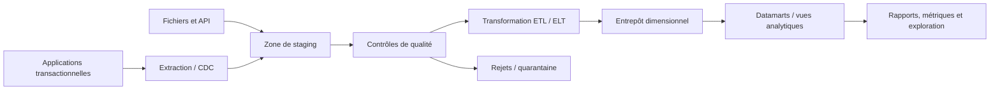
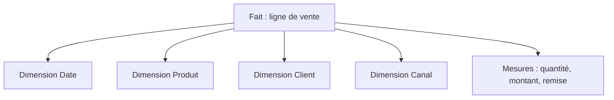

# Entrepôt de données et ETL — Intermédiaire

> **Mise en contexte.** Une application transactionnelle et un entrepôt analytique ne répondent pas au même type de question. Un système OLTP enregistre des opérations fines, souvent avec des transactions courtes et des contraintes strictes. Un entrepôt de données (data warehouse) organise l’historique pour mesurer l’activité, comparer des périodes, expliquer les tendances et produire des indicateurs cohérents. Les pipelines ETL ou ELT déplacent et transforment les données, mais une exécution « réussie » ne garantit pas que les résultats sont complets, exacts ou traçables. Ce cours explique modélisation dimensionnelle, zones de staging, faits et dimensions, chargements incrémentaux, qualité, idempotence et exploitation. Les exemples utilisent des données fictives et des concepts applicables à plusieurs plateformes.

## Objectifs pédagogiques

À la fin du cours, vous pourrez distinguer OLTP et OLAP, expliquer les modèles en étoile, définir une table de faits et ses dimensions, décrire les choix entre ETL et ELT, organiser un pipeline avec zone de staging, concevoir un chargement incrémental idempotent, gérer doublons et retards, effectuer des tests de qualité, maintenir le lignage et construire une procédure de reprise pour un chargement partiellement échoué.

L’objectif n’est pas de transformer toutes les sources en un gigantesque modèle universel. Un entrepôt utile possède un contrat de données : définition des mesures, population couverte, fenêtre temporelle, fuseau, fraîcheur, traitement des corrections et propriétaire de chaque élément. Sans ce contrat, deux tableaux de bord peuvent calculer des chiffres différents tout en semblant plausibles.

## Prérequis et environnement

Vous devez connaître les tables relationnelles, clés, jointures, agrégations SQL, fichiers CSV/JSON et les notions élémentaires d’API. Préparez une source de commandes synthétiques, un référentiel clients, un pipeline local simple et une destination isolée. Notez versions, formats, encodage, fuseaux horaires, droits et hypothèses de données. Ne copiez pas des données personnelles de production vers un environnement de test sans autorisation, minimisation et protection adaptées.

## 1. OLTP, OLAP et architecture analytique

OLTP (*Online Transaction Processing*) privilégie transactions opérationnelles : créer une commande, modifier un stock, enregistrer un paiement. Le système garde des contraintes et relations importantes pour l’état courant. OLAP (*Online Analytical Processing*) privilégie les analyses : ventes par région et mois, évolution d’une mesure, comparaison de catégories ou calcul de tendances. Ces systèmes peuvent partager un moteur, mais leurs patterns de requête, leur stockage et leur politique de charge diffèrent.

Exécuter une analyse massive directement sur la base transactionnelle peut ralentir des transactions critiques. Un entrepôt sépare souvent les charges, conserve un historique et prépare des structures adaptées aux regroupements. Cette séparation a cependant un coût : transfert, transformation, duplication, gouvernance et délai entre l’événement source et le rapport. Le système analytique ne doit pas être considéré comme instantanément synchrone avec la source.



L’architecture réelle peut comporter une zone raw, une zone nettoyée, un stockage objet, un moteur de transformation ou une couche sémantique. Le diagramme sépare les responsabilités conceptuelles, pas les produits obligatoires. Chaque frontière doit définir formats, schémas, contrôle d’accès, reprise et propriétaire.

## 2. ETL, ELT et zone de staging

ETL signifie extraire, transformer puis charger. Les transformations sont effectuées avant le chargement dans la destination. ELT signifie extraire, charger puis transformer dans la plateforme cible ; cette approche exploite le moteur analytique pour les transformations. Les deux sont valides selon volumes, capacités, coûts, confidentialité et contraintes de réseau.

Une zone de staging conserve les données récemment extraites dans un format identifiable avant de les publier dans les tables analytiques. Elle permet de contrôler les entrées, de reprendre un lot et de diagnostiquer un écart. Le staging doit avoir une rétention et des droits adaptés ; il ne devient pas un dépôt permanent non gouverné. Il peut contenir des données sensibles issues des sources et nécessite les mêmes protections.

Le chargement doit séparer extraction et publication. Une extraction partielle ne doit pas faire croire que toutes les données du jour sont présentes. Chaque lot doit recevoir un identifiant, une date ou période de référence, la source, le nombre d’enregistrements, une empreinte éventuelle, le statut et les contrôles. Les consommateurs ne doivent voir un lot que lorsqu’il atteint les critères de publication. Une table « en préparation » peut être remplacée atomiquement ou publiée par un marqueur de lot validé, selon le moteur.

## 3. Modélisation dimensionnelle : faits et dimensions

Une table de faits représente des événements ou des mesures à un grain précis. Le grain doit être formulé en une phrase : « une ligne par ligne de commande », « une ligne par paiement », « une ligne par photographie quotidienne du stock ». Le choix du grain influence toutes les agrégations. Si l’on stocke une ligne par commande et que plusieurs produits sont vendus dans la commande, on peut perdre le détail nécessaire pour analyser par produit ou dupliquer le montant de commande lors d’une jointure.

Les dimensions décrivent les axes d’analyse : date, client, produit, vendeur, région ou canal. Elles incluent souvent des attributs descriptifs et une clé de dimension. La table de faits stocke des clés vers les dimensions et les mesures. Une étoile est généralement facile à interroger : faits au centre, dimensions autour. Une dimension peut être dénormalisée pour simplifier les rapports, mais il faut assurer la qualité et les changements historiques.



Un modèle en étoile n’est pas la seule forme possible, mais il rend visibles le grain et les axes de mesure. Une table de faits ne devrait pas contenir des attributs descriptifs répétés sans raison si ces valeurs appartiennent à une dimension. À l’inverse, créer des dimensions extrêmement fines peut compliquer les requêtes et la gouvernance.

## 4. Mesures additives, semi-additives et non additives

Une mesure additive peut être sommée sur toutes les dimensions pertinentes : quantité vendue ou montant de ligne, si le contrat et la devise sont respectés. Une mesure semi-additive peut être sommée sur certaines dimensions mais pas sur le temps : solde de compte ou stock instantané. Une mesure non additive ne doit pas être additionnée directement, par exemple un ratio ou un pourcentage. Un pourcentage global se calcule souvent à partir du numérateur et du dénominateur agrégés, plutôt qu’en faisant la moyenne simple des pourcentages.

Documentez les unités, devises, taxes, arrondis et règles de signe. Deux montants dans des devises différentes ne doivent pas être additionnés sans conversion explicite et taux daté. Une quantité vendue et une quantité retournée doivent être distinguées ou avoir une convention de signe cohérente. La même mesure peut signifier quelque chose de différent selon qu’elle est calculée à la commande, à la ligne ou au paiement.

## 5. Clés de dimension et identité métier

Une clé technique de dimension peut isoler le modèle analytique des changements d’identifiants source. Une clé naturelle ou métier peut être utile pour rechercher et dédupliquer, mais elle peut changer de format ou de valeur. Il est fréquent de conserver les deux : clé de dimension pour les jointures analytiques et clé métier pour le rapprochement avec la source.

La gestion d’une dimension exige une politique quand l’attribut change. Si un client déménage, le rapport doit-il présenter son adresse actuelle ou celle au moment de la vente ? Si le nom d’un produit évolue, veut-on réécrire l’historique ou préserver l’ancienne description ? La réponse métier détermine la stratégie de dimension à changement lent (SCD).

Une SCD de type 1 écrase généralement l’attribut historique : les analyses utilisent la nouvelle valeur. Une SCD de type 2 crée une nouvelle version avec clé technique, date de début, date de fin et indicateur de version actuelle, afin de conserver l’historique. Le type 2 augmente la complexité : le chargement des faits doit sélectionner la version correcte de la dimension à la date de l’événement. Les variantes et conventions doivent être documentées par attribut.

## 6. Exemple de schéma en étoile

```sql
CREATE TABLE dim_date (
    date_key INTEGER PRIMARY KEY,
    calendar_date DATE NOT NULL UNIQUE,
    month_number INTEGER NOT NULL,
    year_number INTEGER NOT NULL
);

CREATE TABLE dim_product (
    product_key INTEGER PRIMARY KEY,
    product_id_source TEXT NOT NULL,
    product_name TEXT NOT NULL,
    category TEXT NOT NULL,
    valid_from DATE NOT NULL,
    valid_to DATE,
    is_current INTEGER NOT NULL
);

CREATE TABLE fact_sales_line (
    sale_line_id TEXT PRIMARY KEY,
    date_key INTEGER NOT NULL,
    product_key INTEGER NOT NULL,
    customer_key INTEGER NOT NULL,
    quantity INTEGER NOT NULL,
    net_amount DECIMAL(14,2) NOT NULL,
    source_batch_id TEXT NOT NULL,
    FOREIGN KEY (date_key) REFERENCES dim_date(date_key),
    FOREIGN KEY (product_key) REFERENCES dim_product(product_key)
);
```

Cet exemple est conceptuel. Le type de date, les clés, les conventions booléennes et les contraintes diffèrent entre moteurs. Une clé de date numérique peut être utile pour les périodes spéciales, mais il faut garder une date réelle pour les calculs de temps. La table de faits inclut un identifiant de source et un lot pour faciliter la déduplication et la traçabilité ; ces champs doivent répondre à une stratégie, pas simplement s’ajouter pour faire joli.

La clé cliente n’est pas détaillée dans le fragment. Dans une implémentation complète, toutes les relations dimensionnelles doivent être définies et vérifiées. Les références orphelines ne doivent pas être supprimées silencieusement : un client inconnu, un produit manquant ou un identifiant historique nécessite une règle métier, telle qu’une ligne « inconnu » contrôlée ou une mise en quarantaine.

## 7. Extraction complète et incrémentale

Une extraction complète relit le périmètre entier. Elle peut être simple mais coûteuse et nécessite souvent un instant de capture cohérent. Une extraction incrémentale ne traite que les changements depuis un point précédent. Elle peut utiliser un horodatage de modification, un identifiant croissant, une version ou un flux de capture de changements (CDC). Chaque approche possède des risques.

Un champ updated_at peut manquer des changements si l’application oublie de le mettre à jour, si la précision est faible ou si les horloges diffèrent. Une clé croissante ne capture pas forcément les modifications et suppressions d’anciennes lignes. Le CDC peut capturer insert/update/delete selon le moteur, mais son offset et sa rétention doivent être surveillés. Une extraction incrémentale doit gérer les enregistrements modifiés plusieurs fois, les suppressions, les retards et la reprise après un crash.

Utilisez souvent une fenêtre de recouvrement : réextraire une petite période antérieure et dédupliquer par identifiant/version. Cette méthode peut gérer certains retards, mais elle ne capture pas les changements au-delà de la fenêtre. Le recouvrement doit être choisi à partir d’une mesure de retard et accompagné d’un contrôle sur la complétude. Ne déclarez pas une extraction complète simplement parce que le watermark a avancé.

## 8. Idempotence, lot et publication atomique

Un pipeline est idempotent si rejouer le même lot ne crée pas de doubles effets. L’idempotence ne signifie pas nécessairement que toute transformation est une opération de remplacement ; elle signifie que la même entrée appliquée de nouveau mène à un état cohérent défini. Utilisez des clés source stables, une clé de lot, des upserts maîtrisés ou une table de staging puis une publication atomique.

La publication doit traiter l’échec entre deux étapes. Imaginez qu’un pipeline insère 80 % des lignes de ventes puis plante. Si le rapport lit immédiatement la table, il voit un total incomplet. Il faut une stratégie de transaction, d’assemblage dans une table temporaire ou de marqueur de lot pour qu’un seul lot complet soit publié. Le mécanisme dépend du volume et du moteur, mais la règle doit être explicite.

Un registre de lots peut contenir identifiant, source, début, fin, nombre d’entrée, nombre accepté, nombre rejeté, état, empreinte, watermark et erreur. Le statut « terminé » doit signifier que tous les contrôles obligatoires sont satisfaits. Une tâche qui a extrait les fichiers sans les charger ne doit pas avoir le même statut que le rapport final publié. L’ordonnanceur et la couche de données doivent partager un contrat d’état.

## 9. Qualité des données et quarantaines

La qualité couvre exactitude, complétude, validité, unicité, cohérence, fraîcheur et traçabilité. Les contrôles doivent être attachés à des règles observables. Par exemple, date de commande non future au-delà de la tolérance métier, quantité positive, montant cohérent, clé de produit reconnue et absence de doublon d’un événement source.

Toute ligne rejetée doit être comptée et avoir un motif. La quarantaine doit éviter que des enregistrements non conformes polluent l’entrepôt publié tout en conservant les preuves nécessaires à la correction. Elle doit elle-même avoir une rétention, un accès restreint et un propriétaire. Ne copiez pas tous les champs sensibles dans un log d’erreur sans nécessité.

Il faut définir des seuils. Une seule ligne invalide peut être acceptable pour une source connue comme bruyante si elle est mise en quarantaine et traitée rapidement ; dans un flux de paiements, même une ligne manquante peut être critique. Les seuils dépendent du contrat et du risque. Si un seuil est dépassé, le pipeline doit échouer ou publier un état explicitement dégradé, jamais masquer l’écart en supprimant silencieusement les lignes.

### Tests de qualité typiques

- comptage d’entrée rapproché avec comptage de sortie, en tenant compte des filtres documentés ;
- absence de clés dimensionnelles orphelines ;
- unicité de la clé métier ou de l’événement selon le contrat ;
- sommes de contrôle sur montants, quantités et devises ;
- intégrité de la séquence temporelle et fraîcheur attendue ;
- distribution anormale par rapport à une base de référence ;
- comparaison entre sources lorsqu’un total de contrôle fiable existe.

## 10. Doublons et déduplication

Les doublons apparaissent lors de retries, réimportations de fichiers, flux at-least-once, clés source ambiguës ou changements d’identifiant. Définissez l’identité d’un événement. Deux transactions ayant même montant et même date ne sont pas forcément des doublons : un identifiant unique de source est préférable. Si aucun identifiant fiable n’existe, une clé composite peut servir, mais ses collisions doivent être analysées.

La règle de déduplication doit préciser quel enregistrement est conservé lorsqu’une même clé apparaît plusieurs fois. Garder le plus récent selon un timestamp peut fonctionner si le timestamp est fiable et s’il existe une règle de départage. Garder le premier peut protéger un historique immuable. Le choix ne doit pas être laissé au hasard de l’ordre d’un fichier. Enregistrez le nombre de doublons et la décision pour pouvoir expliquer un écart analytique.

Les déduplications trop agressives effacent des événements légitimes ; les déduplications trop faibles gonflent les mesures. Testez avec paires volontairement semblables mais distinctes, événements réémis et corrections d’une même source. Faites valider la définition du doublon par le propriétaire métier avant de l’industrialiser.

## 11. Retards, corrections et événements tardifs

Les données arrivent parfois dans le désordre : export retardé, réseau indisponible, corrections comptables ou mise à jour d’un événement historique. Le pipeline doit distinguer temps d’événement, temps de réception et temps de traitement. Une seule colonne « date » ne suffit pas pour savoir si un lot couvre un jour métier ou s’il a été ingéré tardivement.

Un chargement incrémental qui ne relit que les dernières heures peut manquer une correction plus ancienne. Une fenêtre de recouvrement, un flux de changements ou une procédure de réconciliation peut la détecter. Le choix dépend du coût de recalcul et de la fréquence des corrections. L’entrepôt doit documenter si les indicateurs historiques sont recalculés et à quel moment.

Pour une dimension type 2, la date effective d’un attribut doit servir à choisir la version de dimension à associer à un fait historique. Les bornes temporelles doivent être définies pour éviter qu’un fait corresponde à deux versions ou à aucune. Utilisez un intervalle cohérent, par exemple début inclus et fin exclue, puis testez les instants exactement sur une frontière.

## 12. CDC et changements de source

La capture de changements (CDC) diffuse les opérations d’une source plutôt que de relire périodiquement l’ensemble de tables. Elle peut réduire la latence et la charge d’extraction mais ajoute une dépendance au journal, au connecteur, au format des événements et aux offsets. Les détails varient selon le moteur et la plateforme.

Un pipeline CDC doit gérer les insertions, mises à jour, suppressions, événements dupliqués, reprise à partir d’un offset et évolution de schéma. Si le consommateur s’arrête plus longtemps que la durée de rétention du journal, une reconstruction initiale peut être nécessaire. Surveillez le retard du consommateur et définissez une alerte avant que le point de reprise ne disparaisse.

Les événements doivent être appliqués dans l’ordre requis par le contrat. Plusieurs partitions peuvent produire un ordre partiel, et toutes les opérations ne sont pas indépendantes. N’assumez pas un ordre global sans mécanisme explicite. Si le modèle analytique dérive de multiples sources, précisez comment les données sont rapprochées et ce que signifie « cohérent à l’instant t ».

## 13. Orchestration, dépendances et reprise

Un workflow possède des dépendances : extraction, validation, chargement, transformation, publication et rafraîchissement des rapports. L’ordonnanceur doit distinguer tâche démarrée, tâche terminée, tâches échouées, tâches relancées et lot publié. Un statut vert d’un processus amont ne doit pas déclencher des rapports si le contrôle de qualité a échoué.

Les reprises doivent être sûres. Si une étape peut être rejouée, documentez comment elle évite les doublons. Si elle est irréversible, définissez une étape de compensation ou une procédure de correction. Les tentatives doivent être limitées, espacées et alertées. Une boucle de reprise infinie peut saturer la source ou la plateforme analytique.

La dépendance temporelle doit être explicitée : un rapport du lundi peut attendre la fermeture de la journée précédente, tandis qu’un tableau de bord quasi temps réel accepte une fraîcheur de quelques minutes. Définissez le délai maximal, la règle de publication et la communication lorsque les données sont en retard. « Le pipeline fonctionne » ne répond pas à « les indicateurs sont-ils suffisamment frais ? ».

## 14. Sécurité et gouvernance dans l’entrepôt

L’entrepôt agrège les données et peut être plus sensible que chacune des sources, car il facilite les jointures et la réidentification. Classification, minimisation, masquage, contrôle d’accès par rôle, séparation des environnements et suivi des exports sont essentiels. Les données personnelles doivent respecter les règles de rétention et d’usage validées par l’organisation et la réglementation applicable.

Les rôles doivent distinguer ingestion, transformation, administration et lecture analytique. Un outil de reporting ne doit pas pouvoir supprimer les tables d’atterrissage ou accéder aux secrets des connecteurs. Les secrets de source doivent être injectés de manière sécurisée, renouvelés et non présents dans les journaux. Les environnements de développement utilisent des données synthétiques ou masquées.

La traçabilité doit indiquer d’où viennent les données, quelles transformations ont été appliquées, quelle version de code les a produites et quels contrôles ont été exécutés. Le lignage facilite la correction d’un indicateur erroné et l’analyse d’impact lorsqu’un champ source évolue. Le document de lignage doit rester à jour avec le pipeline, pas être un diagramme oublié.

## 15. Atelier pratique guidé : créer un mini-entrepôt

### Scénario

Une source fournit des commandes, des clients et des produits. Vous devez produire les ventes par mois et catégorie, tout en évitant les doublons de fichiers réimportés et en conservant un journal de lot. Travaillez sur trois petits fichiers CSV synthétiques ou des tables locales équivalentes.

### Étape A — Définir le contrat

Documentez le grain : une ligne de fait par ligne de commande. Le montant est net de remise ou brut ? Les retours sont-ils des montants négatifs ou des événements distincts ? Quelle devise ? Que faire d’un produit inconnu ? Quelle date est utilisée : création de commande ou confirmation du paiement ? Ces questions doivent être résolues avant de calculer un indicateur.

### Étape B — Charger en staging

Chargez les données dans une zone de staging avec batch_id, source et horodatage d’ingestion. Conservez les fichiers originaux selon la politique de rétention et calculez des comptages d’entrée. Si un fichier est relancé, le pipeline doit reconnaître le lot ou dédupliquer à partir d’une clé stable.

### Étape C — Valider les entrées

Vérifiez formats, identifiants, montants, quantités, doublons et référentiels. Envoyez les lignes non conformes dans une zone de rejet avec motif et référence source. Ne jetez pas silencieusement les lignes qui échouent. Établissez des seuils et un statut de lot.

### Étape D — Charger les dimensions

Créez les dimensions date, produit et client. Définissez les clés et la stratégie de changement historique. Pour ce premier atelier, vous pouvez conserver le nom actuel en type 1, mais écrivez ce choix dans le contrat. Pour les historiques de produit, expliquez comment une SCD type 2 modifierait le rattachement des faits.

### Étape E — Charger les faits de façon idempotente

Utilisez une clé stable de ligne de commande pour éviter les doublons. Appliquez le lot dans une transaction ou une stratégie de publication contrôlée. Si le traitement s’arrête après la moitié, le lot ne doit pas être visible comme complet. Rejouez un lot identique et confirmez que les mesures ne doublent pas.

### Étape F — Construire un agrégat

```sql
SELECT
    d.year_number,
    d.month_number,
    p.category,
    SUM(f.quantity) AS units_sold,
    SUM(f.net_amount) AS net_sales
FROM fact_sales_line AS f
JOIN dim_date AS d ON d.date_key = f.date_key
JOIN dim_product AS p ON p.product_key = f.product_key
GROUP BY d.year_number, d.month_number, p.category
ORDER BY d.year_number, d.month_number, p.category;
```

Cette requête illustre une agrégation dimensionnelle. Vérifiez que chaque fait se joint à exactement une version de la dimension attendue. Si une ligne de fait se joint à deux versions d’une dimension type 2, le montant sera doublé. Le résultat analytique doit être validé avec un exemple calculé manuellement.

### Étape G — Contrôler et publier

Comparez compte de lignes, quantité et montant source avec destination en tenant compte des règles de filtre. Vérifiez les rejets et la fraîcheur. Marquez le lot publié uniquement après les tests requis. En cas d’échec, réparez le lot ou relancez-le de manière idempotente.

### Critères d’acceptation

Le laboratoire réussit si les entrées sont traçables, les doublons détectés, les rejets justifiés, les faits ont le bon grain, les mesures sont reproductibles et une relance ne gonfle pas les montants. Le rapport inclut schéma, règles, statistiques du lot, test de reprise et limites de validité.

## 16. Étude de cas : les ventes du mois ont doublé

### Situation

Un rapport affiche deux fois le montant de ventes du mois précédent. La tâche de chargement s’est terminée correctement et aucune erreur n’apparaît dans les logs.

### Hypothèses

Le lot a été rejoué sans clé idempotente ; une jointure vers une dimension produit renvoie plusieurs versions ; le grain de la table de faits est mal défini ; un fichier contient des événements réémis ; ou la transformation interprète mal retour et remboursement. Un pipeline vert peut avoir publié des données incorrectes si les contrôles ne mesurent que le succès technique.

### Diagnostic

Choisissez un petit groupe de commandes et suivez-les de la source jusqu’à la table de faits. Vérifiez identifiant de lot, clé de ligne, nombre de correspondances de dimensions, quantité, montant, statut de publication et version de transformation. Comparez les comptages à chaque étape. Établissez si le doublon existait dans la source ou a été introduit par le pipeline.

### Correction

Si le lot a été rejoué, corrigez l’idempotence et retirez les lignes en double avec un plan validé. Si une dimension duplique les faits, corrigez les bornes temporelles et la condition de jointure. Si le grain est erroné, redéfinissez le modèle et recalculer l’historique selon une migration traçable. Évitez de masquer l’écart en divisant le total par deux.

### Prévention

Ajoutez des tests de grain, d’unicité et de rapprochement. Comparez les totaux source/destination et vérifiez qu’un même fait correspond à une seule ligne de chaque dimension applicable. Conservez les identifiants de lot et rendez les reprises sûres. Définissez qui valide un correctif historique et comment les rapports seront recalculés.

## 17. Exercices avec corrigés

### Exercice 1 — Pourquoi un entrepôt ne doit-il pas reprendre chaque table OLTP à l’identique sans analyse ?

**Correction.** Les questions analytiques, l’historique, les volumes et les patterns d’accès diffèrent. Le modèle opérationnel peut être normalisé pour les écritures courtes, tandis que le modèle dimensionnel facilite agrégations et comparaisons. Il faut définir grain, dimensions, mesures et fraîcheur selon le besoin.

### Exercice 2 — Un pipeline est vert, mais le nombre de lignes est 30 % inférieur à la source. Que faire ?

**Correction.** Ne publiez pas sans contrôle. Vérifiez extraction, filtres, fenêtre temporelle, format, rejets, doublons et changements de schéma. Le statut de tâche ne prouve pas la complétude. Un seuil de rapprochement doit arrêter ou marquer la publication comme dégradée.

### Exercice 3 — Pourquoi définir le grain avant les mesures ?

**Correction.** Le grain détermine ce que représente une ligne. Si un montant de commande est répété sur chaque ligne de produit, une somme naïve peut le compter plusieurs fois. Une mesure n’est exacte que si son niveau et ses règles d’agrégation correspondent au modèle.

### Exercice 4 — Quand choisir une SCD type 2 ?

**Correction.** Lorsqu’il faut conserver l’historique des attributs et analyser un fait avec la valeur de dimension applicable au moment de l’événement. Elle exige versions, dates effectives, règle de chevauchement et rattachement correct des faits. Si seul l’état courant importe, type 1 peut suffire.

### Exercice 5 — Qu’est-ce qui rend un pipeline idempotent ?

**Correction.** Le rejeu d’une entrée identique ne crée pas de doublons ni d’effets non souhaités. Il faut une identité d’événement stable, une logique d’upsert ou de remplacement maîtrisée, un état de lot et une publication contrôlée. Le seul fait d’utiliser un identifiant d’exécution unique ne suffit pas si chaque rejeu insère de nouvelles lignes.

### Exercice 6 — Pourquoi mettre les lignes rejetées en quarantaine ?

**Correction.** Elles ne contaminent pas les tables publiées, mais leur motif et référence source restent disponibles pour corriger et auditer. La quarantaine a besoin d’un propriétaire, d’une rétention, de droits et de contrôles de confidentialité. Un rejet silencieux rend le rapport incomplet sans preuve visible.

## 18. Défi final : concevoir un pipeline de ventes robuste

Une source de commandes exporte chaque heure un fichier CSV. Des fichiers peuvent arriver en retard, être réémis, contenir des doublons ou modifier d’anciennes commandes. Le rapport de ventes doit être disponible avant 07 h 00 et les montants doivent correspondre au contrat métier.

### Corrigé attendu

Définissez le grain et les règles de montant, retour, annulation et devise. Conservez une référence stable à l’événement source et un identifiant de lot. Placez les fichiers dans une zone d’atterrissage protégée, contrôlez format, taille, date et empreinte puis chargez en staging. Les erreurs sont classées et envoyées en quarantaine ; le lot ne devient pas publié s’il manque des données critiques.

Pour gérer les retards, choisissez une fenêtre de recouvrement ou un mécanisme de changement et documentez sa limite. Dédupliquez selon une identité métier fiable, pas seulement montant et date. Utilisez une stratégie idempotente pour les rejoués. Pour les modifications, décidez si une ligne de fait est remplacée, historisée ou compensée. Les règles doivent être identiques à celles du rapport et être testées par exemples.

Modélisez les dimensions et les faits à partir des usages analytiques. Fixez le traitement des dimensions inconnues, des valeurs historiques et des bornes temporelles. Contrôlez qu’un fait rejoint une seule version de chaque dimension. Publiez atomiquement ou à l’aide d’un marqueur de lot uniquement après comptage, contrôles d’unicité, rapprochement de montants et mesure de fraîcheur.

Orchestrez les étapes avec statut indépendant : extrait, validé, transformé, testé, publié. Définissez timeout, retries et action manuelle. Si un lot échoue à 06 h 50, la procédure doit éviter de présenter un total partiel comme complet ; affichez le dernier état valide ou marquez explicitement le retard. Les métriques doivent mesurer la fraîcheur, le volume, les rejets, le temps et les écarts de rapprochement.

La remise comprend diagramme, modèle, règles de calcul, schéma des lots, stratégie de reprise, tests négatifs, tableau de qualité et procédure de déploiement. Elle désigne des propriétaires pour les données et les alertes et précise les risques résiduels. L’architecture est terminée lorsque l’équipe peut expliquer un total, remonter à la source et corriger une anomalie sans improviser.

## 19. Checklist de mise en production

- [ ] Le grain des faits et la définition de chaque mesure sont documentés.
- [ ] Les dimensions, clés et règles d’historique sont définies.
- [ ] Les sources, transformations, versions et lots sont traçables.
- [ ] Le chargement incrémental gère modifications, suppressions et retards.
- [ ] Une relance ne crée pas de doublon.
- [ ] Les rejets sont comptés, justifiés et protégés.
- [ ] La publication n’expose pas un lot incomplet.
- [ ] Les contrôles de qualité ont des seuils et des responsables.
- [ ] Les sommes de contrôle tiennent compte des filtres métier.
- [ ] Les droits d’accès et la rétention respectent les exigences.
- [ ] Les dépendances et les changements de schéma sont testés.
- [ ] Le pipeline possède une procédure de reprise et des alertes utiles.
- [ ] Les rapports signalent clairement la fraîcheur des données.

## Conclusion

Un entrepôt fiable repose sur des contrats précis entre source, transformation et consommation. Le grain et les mesures déterminent la justesse des chiffres ; staging, idempotence, qualité, lignage et publication contrôlée rendent les pipelines vérifiables. Les reprises, retards et corrections ne sont pas des cas exceptionnels : ils font partie de l’architecture. Un pipeline de qualité ne se contente pas de terminer ; il prouve que les données publiées sont complètes selon des règles connues et que les écarts peuvent être expliqués.


## Complément : gérer les changements de contrat et les déploiements analytiques

### Évolution d’une source

Une source peut renommer un champ, modifier un type, ajouter une valeur d’énumération, changer la précision d’une date ou supprimer une colonne. Le pipeline doit détecter cette évolution au point d’entrée et décider si elle est compatible. Un champ optionnel ajouté peut être accepté si le contrat le prévoit ; le changement de type d’un montant ou d’un identifiant doit être traité avec une validation, une conversion explicite et des tests de plage. Ne laissez pas une conversion silencieuse produire des NULL ou des valeurs tronquées.

Le contrat doit être versionné avec les transformations. En cas de schéma inconnu, une stratégie sûre consiste à arrêter le lot ou le placer en quarantaine et prévenir le propriétaire. Accepter aveuglément toutes les colonnes inconnues peut exposer des données sensibles et rendre les usages imprévisibles. Rejeter tous les changements peut aussi interrompre une évolution compatible : la règle doit préciser quelles extensions sont permises.

### Recalcul historique

Corriger une transformation peut exiger de recalculer des lots passés. Définissez le périmètre, les partitions à reconstruire, les tables impactées et la manière de ne pas exposer un mélange de versions. Un recalcul complet peut être coûteux ; les partitions temporelles ou les identifiants de lot peuvent réduire le travail. Il faut toutefois prouver que les partitions à recalculer couvrent toutes les dépendances de la correction.

Avant le recalcul, sauvegardez ou conservez la table publiée selon la politique et mesurez le volume. Exécutez dans un environnement de validation, comparez les totaux avant/après, et obtenez une approbation métier lorsque les indicateurs changent. Conservez la version du code, l’identifiant du recalcul et le motif de la modification. Une correction analytique doit être traçable comme un changement logiciel.

### Qualité statistique et dérive

Les contrôles de qualité ne doivent pas uniquement rechercher des valeurs impossibles. Surveillez aussi la dérive des distributions : baisse soudaine du nombre de commandes, hausse de montants nuls, changement inattendu du mix de catégories ou retard croissant d’une source. Un changement peut être réel, dû à une campagne ou une période saisonnière, plutôt qu’un défaut technique. Les règles automatiques doivent alerter et fournir un contexte, pas supprimer les données automatiquement sans analyse.

Pour rendre ces contrôles utiles, établissez une base de référence, une saisonnalité connue et une plage d’écart. Documentez les faux positifs, les exceptions métier et la façon de rétablir une publication après correction. Les tableaux de bord de qualité doivent présenter la fraîcheur, les rejets et les écarts de rapprochement avec la même importance que le statut du job.

### Séparer la réussite technique de la réussite métier

La réussite technique signifie qu’un processus a exécuté les instructions prévues sans erreur détectée. La réussite métier signifie que le jeu résultant répond au contrat : population attendue, mesures exactes, fraîcheur acceptable, absence de doublons et accès légitimes. Les deux statuts doivent être disponibles. Il est possible que l’extraction termine alors que les données sont trop incomplètes pour publier ; le système doit rendre cet état explicite.

Une architecture mature garde les preuves de ces statuts et peut remonter d’un chiffre agrégé à la liste de faits et à la source. Les personnes qui utilisent le rapport n’ont pas nécessairement accès aux données brutes ; les contrôles techniques doivent donc fournir une preuve vérifiable sans divulguer des détails sensibles.