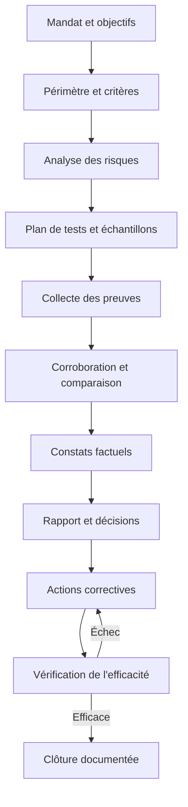
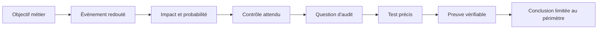
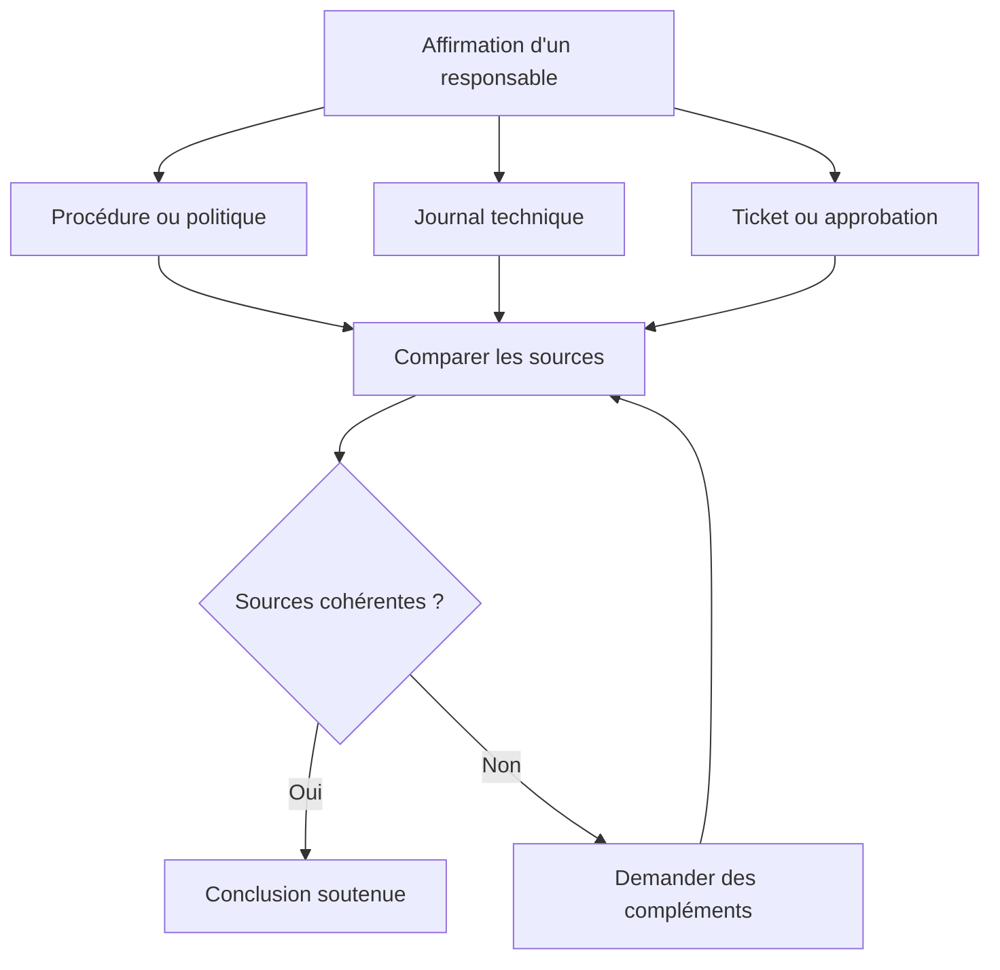
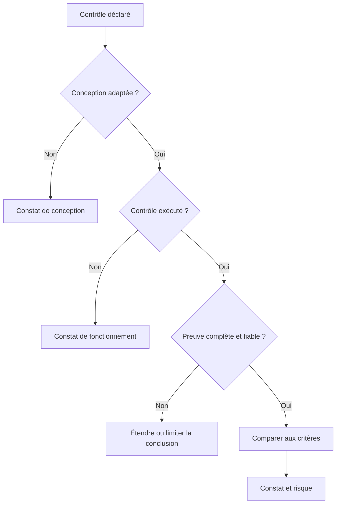
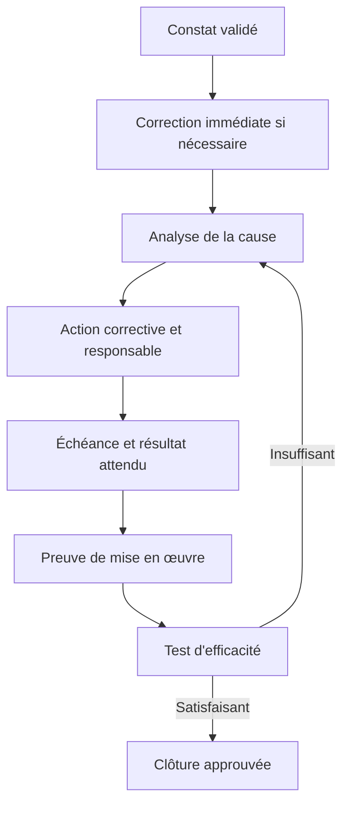
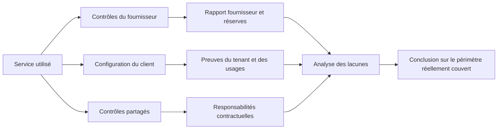

# Audits techniques et conformité — Expert

> **Mise en contexte**
>
> Tu es responsable de la fiabilité d’un parc informatique qui s’est développé au fil des années : postes de travail, serveurs, équipements réseau, comptes d’administration, sauvegardes, applications hébergées chez des fournisseurs et services cloud. À la suite d’un incident, la direction veut savoir si les pratiques de maintenance sont réellement maîtrisées, si les contrôles annoncés existent, si les preuves sont fiables et si les risques prioritaires sont traités. Ton rôle n’est pas de chercher un coupable ni de produire une liste impressionnante de défauts. Tu dois construire une conclusion défendable à partir de critères explicites et de preuves vérifiables, puis aider l’organisation à réduire ses risques.

## 1. Ce que tu sauras faire à la fin du cours

À la fin de ce cours, tu devras pouvoir préparer, conduire et documenter un audit technique de niveau expert, depuis la définition du périmètre jusqu’à la vérification des actions correctives. Tu apprendras à distinguer une exigence, un contrôle, une preuve et une conclusion ; à choisir des échantillons justifiés ; à tester la conception et le fonctionnement réel des contrôles ; à mesurer la gravité d’un constat ; et à présenter des résultats compréhensibles par les équipes techniques comme par la direction.

Tu sauras notamment :

- définir des objectifs d’audit, un périmètre, des critères et des exclusions explicites ;
- associer les risques métier aux contrôles techniques attendus ;
- choisir une méthode de collecte de preuves sans perturber la production ;
- examiner des configurations, des journaux, des tickets, des sauvegardes, des changements et des contrats de service ;
- rédiger des constats qui distinguent les faits, les critères, les causes probables, les risques et les actions proposées ;
- prioriser les écarts selon le risque plutôt que selon leur facilité de correction ;
- conduire une réunion de clôture et suivre les actions jusqu’à leur validation ;
- reconnaître les limites d’un audit et éviter de conclure au-delà des éléments disponibles.

Ce cours suppose que tu connais déjà les bases de la maintenance, de la documentation d’intervention, de la sécurité opérationnelle et des procédures. Il approfondit ces acquis : un technicien peut constater qu’un serveur n’a pas été redémarré depuis longtemps ; un auditeur doit établir si cette observation enfreint un critère, quel risque elle représente, quelles preuves complémentaires sont nécessaires et quelle mesure est proportionnée.

## 2. Comprendre ce qu’est un audit technique

Un audit est une démarche structurée, indépendante dans la mesure nécessaire, documentée et fondée sur des critères. Il collecte des informations vérifiables et les compare aux critères afin de formuler des constats et une conclusion dans le périmètre convenu.

Un audit n’est ni une inspection improvisée, ni une séance de dépannage, ni une tentative de pénétration, ni une simple collecte de captures d’écran. Sa valeur provient de la qualité du raisonnement qui relie les critères aux preuves et les preuves aux conclusions.

### 2.1 Audit, contrôle opérationnel, diagnostic et test d’intrusion

| Activité | Question principale | Exemple | Résultat attendu |
|---|---|---|---|
| Contrôle opérationnel | Le contrôle quotidien est-il exécuté ? | Vérifier chaque matin l’état des sauvegardes | Statut et réaction à l’alerte |
| Diagnostic | Pourquoi ce service ne répond-il pas ? | Analyser un incident DNS | Cause probable et rétablissement |
| Audit technique | Les pratiques répondent-elles aux critères définis ? | Vérifier la gestion des accès privilégiés | Constats appuyés par des preuves |
| Test d’intrusion | Une faiblesse peut-elle être exploitée dans un cadre autorisé ? | Tester un scénario convenu | Failles exploitables et impact démontré |
| Revue de conformité | Les exigences applicables sont-elles satisfaites ? | Comparer la conservation des journaux à une politique | Écarts vis-à-vis d’exigences identifiées |
| Évaluation de maturité | À quel niveau les pratiques sont-elles structurées ? | Comparer la gestion des changements à un modèle de maturité | Niveau estimé et pistes de progression |

Ces activités peuvent se compléter, mais elles ne sont pas interchangeables. Une commande qui affiche une version vulnérable ne suffit pas à prouver qu’un système est exploitable ; inversement, l’absence d’exploitation réussie ne prouve pas que la configuration est conforme. Un audit technique doit annoncer précisément ce qu’il a évalué et ce qu’il n’a pas testé.

### 2.2 Les trois notions à ne jamais confondre

- **Critère** : la référence utilisée pour juger la situation. Il peut s’agir d’une politique interne approuvée, d’une exigence contractuelle, d’une obligation légalement applicable, d’un standard adopté par l’organisation ou d’un objectif de contrôle documenté.
- **Preuve** : une information suffisamment pertinente, fiable et vérifiable pour soutenir un constat. Exemples : export horodaté d’une configuration, ticket relié à un changement, résultat d’un test de restauration, registre d’accès ou entretien corroboré par un document.
- **Constat** : le résultat de la comparaison entre les critères et les preuves. Il peut relever d’une conformité, d’une non-conformité, d’une observation ou d’une possibilité d’amélioration selon la méthode approuvée.

Schéma de raisonnement :

~~~text
Critère explicite
      |
      v
Question d'audit
      |
      v
Collecte de preuves pertinentes
      |
      v
Vérification et corroboration
      |
      v
Comparaison au critère
      |
      v
Constat factuel
      |
      v
Risque, décision et action
~~~

Une affirmation sans critère est une opinion. Un critère sans preuve ne permet pas de conclure. Une preuve sans interprétation peut n’être qu’un fichier sans signification. Une conclusion qui dépasse les preuves fragilise tout le rapport.

## 3. Les principes d’un audit crédible

Les lignes directrices ISO 19011:2026 fournissent un cadre actuel pour les audits de systèmes de management : principes, gestion d’un programme d’audit, conduite des audits et compétence des personnes qui les réalisent. Elles ne constituent pas à elles seules une certification, et ne remplacent pas les exigences précises de chaque référentiel. Il faut consulter l’édition officielle et les critères applicables au contexte audité.

### 3.1 Intégrité et présentation fidèle

L’auditeur décrit les faits sans manipulation et signale les limites de son travail. Il ne minimise pas une faiblesse pour éviter un conflit et ne l’exagère pas pour rendre son audit plus spectaculaire. Si les journaux n’étaient disponibles que sur trois jours alors que le critère porte sur un an, le rapport doit le dire. Il ne faut pas transformer une absence d’accès en preuve d’absence du contrôle.

### 3.2 Diligence et compétence professionnelle

Les tests doivent être adaptés au risque, à la technologie et à l’expérience de l’équipe. L’auditeur doit connaître assez bien le sujet pour reconnaître les limites des outils et demander une expertise complémentaire lorsque nécessaire. Une revue de règles de pare-feu, par exemple, nécessite de comprendre le sens des zones, l’ordre des règles, les objets, les exceptions, le routage et la traduction d’adresses. Lire une liste de règles sans comprendre l’architecture ne suffit pas.

### 3.3 Confidentialité et protection des preuves

Les configurations, exports de journaux, comptes, adresses, contrats et captures peuvent exposer des données sensibles. L’auditeur collecte uniquement ce qui est nécessaire, limite les accès, masque les secrets dans ses notes et définit une durée de conservation. Les clés privées, mots de passe, jetons API et données personnelles ne doivent pas être copiés dans un rapport général. Une preuve technique peut être identifiée par un numéro, un emplacement contrôlé, une empreinte et une date plutôt que reproduite en clair.

### 3.4 Indépendance et gestion des conflits d’intérêts

L’auditeur doit pouvoir examiner les éléments sans pression visant à imposer une conclusion. Une personne qui vient de configurer elle-même un équipement peut apporter son expertise, mais il faut gérer le risque d’auto-évaluation : une autre personne vérifie la configuration, ou la limitation est signalée. L’indépendance dépend aussi du contexte, de la taille de l’organisation et de la nature de l’audit. Une petite équipe ne peut pas toujours séparer totalement les rôles, mais elle peut documenter des contrôles compensatoires.

### 3.5 Approche fondée sur les risques

L’effort d’audit doit être proportionné aux conséquences d’une défaillance. Une erreur de format dans un document interne n’a pas le même enjeu qu’un compte administrateur partagé, une sauvegarde jamais restaurée ou une règle réseau exposant un service sensible. L’approche par les risques ne signifie pas ignorer les contrôles moins critiques ; elle aide à décider où approfondir, quelle taille d’échantillon utiliser et quels constats traiter en premier.

## 4. Concevoir un programme d’audit utile

Un audit isolé peut trouver des problèmes ; un programme d’audit aide à savoir où regarder sur la durée, comment couvrir les risques et comment contrôler la réalisation des actions. Un programme annuel n’est pas une liste figée : il évolue à la suite d’incidents, de changements d’architecture, d’acquisitions, de nouvelles menaces, d’exigences contractuelles ou de changements réglementaires.

### 4.1 De l’objectif métier au test technique

Commence par l’objectif de service, pas par l’outil que tu veux utiliser.

Exemple : « Le service de gestion des commandes doit rester disponible et les données doivent pouvoir être restaurées dans le délai convenu. » Cet objectif peut conduire à examiner les exigences RTO/RPO, le calendrier de sauvegarde, les alertes d’échec, les droits de suppression, les copies hors ligne ou immuables, les tests de restauration, le plan de reprise et les dépendances réseau.

~~~text
Objectif métier
      |
      v
Service et dépendances
      |
      v
Scénarios de défaillance
      |
      v
Risques à réduire
      |
      v
Contrôles attendus
      |
      v
Questions et tests d'audit
      |
      v
Preuves et conclusion
~~~

Cette chaîne évite une erreur fréquente : choisir une checklist standard, cocher toutes les lignes, puis affirmer que le service est sécurisé sans démontrer pourquoi les contrôles examinés sont importants.

### 4.2 Définir le périmètre

Le périmètre décrit ce qui est inclus et ce qui est exclu. Il doit nommer les sites, services, environnements, systèmes, équipes, périodes, interfaces et fournisseurs concernés. Il précise également les limites d’accès et les contraintes de sécurité.

Exemple de périmètre :

- inclus : serveurs de production d’un service, équipements réseau dédiés, annuaire d’identité, sauvegardes et processus de changement pendant les six derniers mois ;
- exclusions : environnement de test séparé et système d’un fournisseur auquel aucune preuve n’est accessible directement ;
- méthode complémentaire : pour le service fournisseur exclu des tests directs, examen de rapports indépendants et de clauses contractuelles, en signalant les limites ;
- contraintes : aucune modification de configuration, aucun test d’exploitation, aucun redémarrage non approuvé.

Le périmètre ne doit pas être implicitement élargi. Un audit de configuration ne devient pas un test d’intrusion simplement parce qu’un accès est techniquement possible. Toute action active doit être explicitement autorisée et compatible avec la continuité de service.

### 4.3 Définir des critères contrôlables

Un critère doit être assez clair pour que deux personnes compétentes puissent comprendre la même exigence. « Les serveurs doivent être sécurisés » n’est pas un critère vérifiable. « Chaque compte privilégié doit être nominatif, attribué à une personne identifiée, justifié et réexaminé selon la fréquence approuvée » est plus exploitable.

Les critères peuvent venir de plusieurs sources. Le rapport doit nommer la version ou la date de la source utilisée. Une politique interne approuvée peut être plus directement applicable à un système que le texte générique d’un référentiel. Un standard volontaire ne devient pas automatiquement une obligation légale dans chaque pays. Pour toute obligation juridique ou sectorielle, il faut vérifier la juridiction, le champ d’application, la date d’entrée en vigueur, les éventuelles exceptions et l’interprétation compétente.

### 4.4 Évaluer les risques avant de sélectionner les tests

Pour chaque scénario, identifie au minimum :
1. l’actif ou le service concerné ;
2. la menace ou l’événement redouté ;
3. la faiblesse ou la condition qui facilite l’événement ;
4. les conséquences métier ;
5. les contrôles existants ;
6. les preuves qui permettront d’évaluer ces contrôles.

Matrice qualitative illustrative :

| Probabilité | Impact faible | Impact moyen | Impact fort | Impact critique |
|---|---:|---:|---:|---:|
| Faible | Faible | Faible à moyen | Moyen | Élevé |
| Moyenne | Faible à moyen | Moyen | Élevé | Très élevé |
| Forte | Moyen | Élevé | Très élevé | Très élevé |

Cette matrice sert à trier, pas à produire une vérité mathématique. Deux équipes peuvent utiliser des échelles différentes. Il faut définir les niveaux, leurs exemples et la façon de les appliquer avant de noter les constats. Évite de multiplier des scores de 1 à 5 qui donnent une fausse précision sans données suffisantes.

## 5. Planifier la mission

Une mission correctement préparée commence par un mandat clair, des responsabilités identifiées, une analyse préliminaire et un plan de test. Le responsable de l’audit annonce les objectifs, les critères, les dates, les participants, les contraintes, les livrables et la méthode de traitement des preuves.

### 5.1 Les livrables de préparation

Le dossier de préparation devrait contenir :

- le mandat signé ou l’autorisation correspondante ;
- la définition des objectifs, du périmètre et des exclusions ;
- les critères et leurs versions ;
- les interlocuteurs et responsabilités ;
- les risques préliminaires ;
- le plan de collecte et les tests prévus ;
- les règles de sécurité : accès, plages horaires, actions interdites, masquage, stockage et suppression ;
- le plan de communication et d’escalade en cas de découverte urgente ;
- les limites connues et les dépendances vis-à-vis d’autres équipes ou fournisseurs.

### 5.2 Un exemple de calendrier

~~~text
J-10 à J-7     Mandat, objectifs, périmètre et disponibilité
J-6 à J-4      Revue documentaire et risques préliminaires
J-3 à J-1      Plan d'échantillonnage, accès et réunion d'ouverture
Jour 1         Entretiens, observations et collecte contrôlée
Jour 2         Tests de contrôles et corroboration des preuves
Jour 3         Analyse des constats et validation factuelle
J+3            Rapport provisoire et commentaires des responsables
J+5            Rapport final, décision et responsables des actions
J+30 / J+60    Vérification de l'avancement selon le risque
J+90           Contrôle de l'efficacité des actions importantes
~~~

Ce calendrier est un exemple, non une règle universelle. Un audit critique peut nécessiter une alerte immédiate ; un périmètre multi-sites complexe peut prendre plusieurs semaines. Les dates doivent s’adapter à la disponibilité des personnes et aux fenêtres de maintenance.

### 5.3 Réunion d’ouverture

La réunion d’ouverture doit confirmer que toutes les personnes partagent la même compréhension. Elle couvre :
- pourquoi l’audit est réalisé ;
- le périmètre et les exclusions ;
- les critères utilisés ;
- les activités prévues et les personnes sollicitées ;
- les règles d’accès et de protection des informations ;
- le processus de remontée d’un risque immédiat ;
- la façon de confirmer les faits avant le rapport ;
- les livrables et le calendrier.

L’auditeur doit expliquer que la mission évalue un dispositif, des pratiques et des preuves, pas la valeur des individus. Cela n’empêche pas de documenter un acte délibéré lorsqu’il est pertinent, mais le rapport doit distinguer les faits prouvés des hypothèses et laisser à la gouvernance compétente les décisions disciplinaires.

## 6. Construire une chaîne de preuve solide

La preuve doit répondre à une question précise. L’accumulation de fichiers n’améliore pas automatiquement la qualité de l’audit : un export volumineux peut être incomplet, modifiable ou sorti du bon contexte. Une preuve utile est pertinente, suffisamment fiable, traçable, protégée et reliée au critère évalué.

### 6.1 Les principales méthodes de collecte

| Méthode | Atout | Limite à prendre en compte |
|---|---|---|
| Revue documentaire | Comprendre les règles, rôles et engagements | Le document peut être ancien ou non appliqué |
| Entretien | Comprendre les pratiques réelles et exceptions | La mémoire ou la perception peut être inexacte |
| Observation | Voir l’activité telle qu’elle se déroule | Le comportement observé peut être inhabituel |
| Inspection de configuration | Vérifier un état technique à un instant donné | L’état peut varier et la configuration seule ne décrit pas l’usage |
| Reperformance | Rejouer un contrôle dans un environnement autorisé | Peut être coûteux ou perturbant s’il est mal préparé |
| Analyse d’échantillon | Tester un ensemble représentatif de cas | Ne garantit pas que tous les éléments sont conformes |
| Corrélation de sources | Relier tickets, journaux et changements | Les horloges, identifiants ou systèmes de collecte peuvent différer |

Il faut souvent combiner plusieurs méthodes. Si un responsable affirme que tous les comptes administrateurs sont revus tous les trois mois, demande la procédure, sélectionne des revues récentes, vérifie les comptes concernés, rapproche les décisions avec les changements d’accès et confirme la résolution des exceptions. Un entretien seul ne suffit pas à démontrer l’exécution.

### 6.2 Tester la conception et l’efficacité opérationnelle

Deux questions distinctes doivent être posées.

- **Conception** : si le contrôle était correctement appliqué, réduirait-il le risque visé ? Une revue trimestrielle des comptes qui exclut les comptes de service peut être mal conçue si ces comptes disposent de privilèges importants.
- **Fonctionnement opérationnel** : le contrôle a-t-il effectivement fonctionné pendant la période évaluée ? Une procédure bien rédigée n’est pas la preuve que la revue a eu lieu.

~~~text
Contrôle documenté
      |
      v
Est-il adapté au risque ?
   |           |
  NON         OUI
   |           |
Défaut de      v
conception   A-t-il été exécuté ?
               |          |
              NON        OUI
               |          |
          Défaut de       v
          fonctionnement La preuve est-elle fiable,
                         complète et dans la période ?
                             |
                             v
                        Conclusion limitée
                        aux preuves obtenues
~~~

### 6.3 Échantillonnage

L’échantillon doit être justifié par le risque, la population, la diversité des systèmes, la période et la confiance recherchée. Un choix de convenance — les premiers tickets affichés ou les serveurs les plus faciles à ouvrir — peut manquer les cas problématiques.

Exemple : la population comprend 800 tickets de changement en six mois. Pour une première vérification, tu peux stratifier les tickets par criticité, type de changement, équipe et résultat. Les changements d’urgence, les changements ayant provoqué un incident et ceux concernant des services critiques peuvent être examinés séparément. La taille finale dépend de la méthode d’audit, de la tolérance au risque et des ressources disponibles ; il ne faut pas présenter un échantillon pratique comme un échantillon statistiquement représentatif si ce n’est pas le cas.

Schéma d’une sélection stratifiée :

~~~text
Population : 800 changements
          |
          +--------------------+
          |         |          |
          v         v          v
      Standard   Urgence    Critique
       620         110         70
          |         |          |
          v         v          v
      Échantillon Échantillon Échantillon
       ciblé       renforcé   renforcé
                   |         /
                   |        /
            v       v       v
            Résultats par strate
                     |
                     v
          Limites et conclusion explicites
~~~

Le schéma présente une logique de travail, pas une taille imposée. Documente la population source, les critères de sélection, les exclusions et le résultat. Si des anomalies apparaissent dans un échantillon, ne généralise pas automatiquement à toute la population ; évalue l’extension des tests et les raisons possibles de l’anomalie.

### 6.4 Traçabilité et intégrité

Chaque élément utile doit recevoir un identifiant dans le dossier de travail : E-001, E-002, etc. Pour chaque preuve, consigne le critère associé, la source, le propriétaire, la date et l’heure, le fuseau horaire, l’outil ou la méthode, la période couverte, les manipulations effectuées, la personne qui l’a collectée, le lieu de stockage et le niveau de confidentialité.

Pour les exports importants, un mécanisme d’intégrité tel qu’une empreinte cryptographique peut aider à détecter une modification. Une empreinte ne prouve pas à elle seule que la donnée était vraie au départ ; elle sert à vérifier que l’artefact conservé n’a pas changé depuis son empreinte. Les preuves originales doivent être protégées ; les copies de travail peuvent être expurgées afin de supprimer les secrets ou données non nécessaires.

## 7. Conduire les entretiens sans biaiser le résultat

Un bon entretien demande des exemples précis. « Est-ce que les sauvegardes fonctionnent ? » appelle souvent une réponse affirmative. « Montre-moi le dernier échec, l’alerte reçue, le ticket créé et la preuve de la restauration réussie » permet de tester le fonctionnement du processus.

### 7.1 Les questions à privilégier

- Décris-moi le processus depuis le déclencheur jusqu’à la clôture.
- Qui prend la décision et qui peut la remplacer ?
- Montre-moi le dernier cas réel, y compris les exceptions.
- Que se passe-t-il quand le contrôle échoue ?
- Comment vérifie-t-on que la correction est efficace ?
- Quelle preuve permet de confirmer que l’action est terminée ?
- Dans quelles situations la procédure n’est-elle pas applicable ?
- Qui peut modifier le registre ou supprimer les journaux ?
- Qu’est-ce qui change si la personne responsable est absente ?

Évite les questions accusatoires comme « Pourquoi n’avez-vous pas fait votre travail ? ». Préfère : « Le ticket ne contient pas de validation dans la copie fournie ; quel autre enregistrement permettrait de confirmer la validation ? » La seconde question recherche des faits et laisse la possibilité d’une preuve manquante dans le dossier plutôt que d’une omission réelle.

### 7.2 Corroborer les déclarations

Un même fait peut être corroboré par plusieurs sources : entretien, procédure, journal système, ticket et observation. Les sources ne sont pas nécessairement indépendantes : un rapport généré à partir du même ticket n’est pas une seconde preuve indépendante. Lorsqu’elles se contredisent, ne choisis pas silencieusement la version qui paraît la plus convaincante. Consigne l’écart, demande un complément et conserve la trace de la résolution ou de la limite.

## 8. Domaines techniques à auditer

Cette section fournit des angles de contrôle réutilisables pour un parc informatique. Elle ne remplace ni le référentiel choisi ni la connaissance de l’architecture réelle. Tous les tests doivent rester dans le mandat, les permissions et les règles de continuité de service.

### 8.1 Inventaire des actifs et propriété

Questions :
- Existe-t-il un inventaire qui couvre les équipements physiques, virtuels, cloud et IoT pertinents ?
- Chaque actif a-t-il un identifiant stable, un propriétaire, une criticité, un environnement et un statut de cycle de vie ?
- Les entrées peuvent-elles être rapprochées de sources indépendantes : DHCP, contrôleur de domaine, outil de supervision, virtualisation ou facturation cloud ?
- Les actifs inconnus ou non autorisés sont-ils traités selon un processus documenté ?
- Les actifs retirés du service sont-ils effacés, désenregistrés et exclus des droits d’accès ?

Une liste d’achats n’est pas un inventaire opérationnel complet. Une découverte réseau n’établit pas à elle seule le propriétaire métier. Compare les sources, explique leurs écarts et teste un échantillon dans les deux sens : quelques actifs de l’inventaire retrouvés sur le terrain, puis quelques actifs découverts sur le terrain retrouvés dans l’inventaire.

~~~text
Inventaire CMDB ----+
                    |
DHCP / DNS ---------+----> Rapprochement ----> Écarts ----> Responsable / action
                    |
Supervision --------+
                    |
Cloud / virtualisation
~~~

### 8.2 Configuration et gestion des changements

Évalue l’existence d’une référence de configuration approuvée, la gestion des écarts, l’accès en écriture, la documentation des changements, l’approbation, les tests, la fenêtre de déploiement, le plan de retour arrière et la revue après changement. Examine les changements normaux, urgents et échoués ; un processus qui fonctionne uniquement pour les changements standards peut masquer les risques les plus élevés.

La question centrale n’est pas seulement « existe-t-il un ticket ? ». Il faut vérifier la cohérence entre le ticket, l’approbation, l’exécution réelle, l’horodatage, l’état final et le résultat. Un ticket créé après le changement peut être un contournement ; il peut aussi correspondre à une procédure d’urgence légitime, mais l’exception doit être permise, documentée et revue.

### 8.3 Gestion des correctifs et des vulnérabilités

Vérifie comment les actifs sont classés, comment les avis de sécurité sont reçus, comment la criticité est évaluée, comment les exceptions sont approuvées et comment la correction est vérifiée. Une politique exprimant « appliquer les correctifs rapidement » n’est pas suffisante sans délai cible, responsable, données d’inventaire et gestion des systèmes qui ne peuvent pas être corrigés immédiatement.

Ne fonde pas la priorité uniquement sur un score de vulnérabilité. Le risque dépend aussi de l’exposition, de l’exploitation connue, de la présence de contrôles compensatoires, de la sensibilité de l’actif et de la possibilité d’interruption. Les systèmes exposés à Internet, les identités privilégiées et les dépendances critiques nécessitent une attention adaptée.

Pour les exceptions, demande la justification, l’approbateur, la date d’expiration, les contrôles compensatoires et la prochaine revue. Une dérogation sans expiration devient facilement permanente.

### 8.4 Identités, accès privilégiés et séparation des tâches

Teste :
- l’existence de comptes nominatifs et de propriétaires identifiés ;
- le principe du moindre privilège ;
- les accès temporaires et leur suppression à échéance ;
- l’authentification multifacteur lorsqu’elle est requise par la politique ;
- la séparation des comptes bureautiques et administratifs si elle est prévue ;
- le traitement des départs et changements de poste ;
- les comptes de service, clés, jetons et secrets ;
- la revue périodique des droits, y compris les comptes d’urgence.

Une capture de l’interface d’administration ne prouve pas que tous les systèmes sont couverts. Sélectionne plusieurs sources et périodes : registre RH ou processus de départ, demande de création, annuaire d’identité, journaux de connexion et revue des privilèges. Les comptes de service méritent une revue spécifique : propriétaire, usage, privilèges, stockage du secret, rotation, dépendances et méthode de désactivation.

Ne collecte jamais de mot de passe pour démontrer un défaut de contrôle. Si un secret est exposé par erreur dans une preuve, protège l’artefact, signale l’exposition selon la procédure et fais traiter le secret par le propriétaire habilité.

### 8.5 Journaux, supervision et horodatage

Un dispositif de journalisation utile définit les événements à enregistrer, les sources, la collecte, les accès, la rétention, la protection contre l’altération, la revue, les alertes et les responsabilités. CIS Controls v8.1 traite la gestion des journaux d’audit dans son contrôle dédié et souligne l’importance d’un processus documenté, de la collecte, de la revue et de la conservation. Le NIST SP 800-53 comporte également une famille de contrôles relative à l’audit et à la responsabilisation.

Un service peut générer des journaux sans que quelqu’un les examine. Il peut également envoyer des logs à une plateforme centrale sans alerte sur les événements importants. Teste la chaîne complète : événement attendu, génération, transport, conservation, alerte, ticket ou investigation et clôture.

~~~text
Équipement / serveur
       |
       v
Génération du journal
       |
       v
Collecteur / SIEM
       |
       +----> Stockage protégé et rétention
       |
       v
Règle d'alerte
       |
       v
Équipe responsable
       |
       v
Ticket, analyse et traçabilité
~~~

Contrôle aussi la synchronisation horaire. Sans horloges suffisamment cohérentes, la chronologie d’un incident multi-systèmes peut devenir trompeuse. Toute comparaison de logs doit tenir compte du fuseau horaire, du décalage des horloges, des retards d’ingestion et de la période réellement couverte.

### 8.6 Sauvegarde, restauration et continuité

Une tâche indiquée « réussie » n’est pas la même chose qu’une restauration démontrée. Vérifie :
- le périmètre des données sauvegardées et les exclusions ;
- la fréquence et la rétention ;
- la séparation des identités de production et de sauvegarde ;
- la résistance à la suppression malveillante ;
- les alertes d’échec et le traitement des exceptions ;
- les objectifs de temps de reprise (RTO) et de perte de données admissible (RPO) lorsqu’ils sont définis ;
- les résultats datés de tests de restauration ;
- les dépendances d’application, d’identité, de réseau et de clés ;
- la capacité à récupérer dans un environnement propre.

~~~text
Besoin métier
     |
     v
RPO / RTO approuvés
     |
     v
Politique de sauvegarde
     |
     v
Jobs et alertes -----> Gestion des échecs
     |
     v
Test de restauration
     |
     v
Preuve de lisibilité et de cohérence
     |
     v
Validation métier et leçons apprises
~~~

Demande le résultat d’un test de restauration, pas seulement le tableau de bord des sauvegardes. Définis les critères de réussite : données présentes, cohérence applicative, intégrité, temps mesuré, dépendances opérationnelles et approbation du propriétaire. Un test réalisé par une personne différente de l’opérateur habituel peut aider à vérifier que la procédure est exploitable au-delà de son auteur.

### 8.7 Réseau et équipements d’infrastructure

Sur les équipements réseau, regarde la cohérence entre inventaire, sauvegardes de configuration, contrôle d’accès administratif, segmentation, règles de filtrage, versions logicielles, supervision, temps, journaux, redondance, capacité et modifications. Les éléments prioritaires varient selon le rôle : routeur de bordure, cœur de réseau, switch d’accès, contrôleur Wi-Fi, pare-feu ou équipement de téléphonie.

Exemples de commandes de consultation qui ne modifient pas intentionnellement la configuration :

~~~bash
# Linux : adresses, routes et sockets à l'écoute
ip address show
ip route show
ss -lntup

# Linux : état des services et espace disque
systemctl --failed
df -h

# Linux : extraits de journaux sur une période définie
journalctl --since "2026-10-01" --until "2026-10-02"

# Cisco IOS/IOS XE : état et historique général
show version
show clock
show logging
show interfaces counters errors
show ntp status
show running-config
~~~

Ces commandes sont des exemples, pas une checklist universelle. La syntaxe et les droits diffèrent selon les systèmes. L’accès à la configuration complète peut révéler des secrets ou des données sensibles : limite la collecte, masque les valeurs sensibles avant diffusion et conserve l’original sous contrôle. Ne lance pas une commande de modification dans une mission de consultation seule. Les commandes d’exécution, d’effacement, de redémarrage ou de modification d’accès ne sont pas des tests d’audit en lecture seule.

Un indicateur d’erreurs d’interface isolé ne prouve pas la cause d’une dégradation. Il peut justifier une analyse complémentaire sur la période, le type d’erreur, la capacité, le câblage, les événements et les changements. L’auditeur doit éviter de confondre une corrélation avec une cause.

### 8.8 Serveurs, postes et systèmes d’exploitation

Vérifie les images de référence, les droits locaux, les mises à jour, les services exposés, la protection des terminaux, le chiffrement lorsque requis, les sauvegardes, la supervision, les comptes locaux, la gestion des logiciels, l’accès distant et les configurations de sécurité. Les résultats dépendent du rôle du système ; un serveur de fichiers et un poste kiosque ne doivent pas nécessairement partager la même référence.

Pour un échantillon, compare le statut déclaré par l’outil de gestion avec l’état observé et les exceptions approuvées. Si un agent de sécurité est absent sur une machine, cherche si l’actif est réellement dans le périmètre, s’il existe une exclusion documentée, si l’agent a échoué ou si l’inventaire est en retard. La conclusion doit expliquer ce qui est démontré et ce qui reste incertain.

### 8.9 Services cloud et responsabilité partagée

Pour un service cloud, distingue ce que le fournisseur opère, ce que le client configure et ce qui est partagé. L’auditeur doit identifier les responsabilités dans le contrat, les paramètres de sécurité du tenant, les identités privilégiées, les journaux, la sauvegarde, l’exposition des services, les clés, les changements et les dépendances.

Un rapport de contrôle du fournisseur peut être utile, mais il a un périmètre, une période et des exclusions. Il ne prouve pas automatiquement que le client a configuré correctement son environnement. Vérifie les écarts entre le périmètre annoncé du rapport et les services réellement utilisés, la période couverte, les réserves, les actions correctives du fournisseur et les responsabilités qui restent au client.

### 8.10 Gestion des incidents et des problèmes

Sélectionne des incidents de criticité différente, notamment les incidents répétés, les interruptions prolongées et les événements ayant déclenché une escalade. Compare la chronologie, la priorité initiale, la communication, les décisions, les changements d’urgence, le diagnostic, la résolution, la validation de retour au service et la fermeture. Pour les incidents majeurs, recherche l’existence d’une analyse de cause et d’actions dont la réalisation a été vérifiée.

Un incident clôturé n’est pas nécessairement résolu durablement. Le rétablissement du service, l’élimination de la cause, la réduction du risque de répétition et la communication métier constituent des éléments distincts. Les délais doivent être calculés avec des définitions constantes : début, prise en charge, première réponse, rétablissement, résolution et clôture ne sont pas le même horodatage.

### 8.11 Maintenance préventive et surveillance

Examine les plans de maintenance, la justification des fréquences, les actifs couverts, les fenêtres d’intervention, les pièces et compétences nécessaires, les consignes de sécurité, les checklists, la preuve d’exécution, les exceptions et les effets de la maintenance. L’existence d’un calendrier ne prouve pas l’exécution. Une intervention marquée réalisée ne prouve pas que toutes les étapes obligatoires ont été suivies.

Un audit peut sélectionner des interventions planifiées et les rapprocher des tickets, des mesures avant et après, des changements, des alertes et des incidents ultérieurs. Si un équipement est exclu du plan, cherche une décision documentée et une analyse du risque. Les périodes de maintenance doivent aussi être compatibles avec la disponibilité et les engagements contractuels.

### 8.12 Fournisseurs et services tiers

L’audit d’un fournisseur IT doit examiner le service acheté, le périmètre contractuel, les responsabilités, les engagements, les indicateurs, la sécurité, la confidentialité, la continuité, la sous-traitance, la notification des incidents, la réversibilité et les preuves fournies. Un SLA n’est pas toujours une preuve complète de la qualité du service : un indicateur peut être calculé sur une période ou un périmètre différent de celui que l’organisation pense mesurer.

Vérifie comment les écarts sont calculés, comment les crédits de service sont appliqués, comment les incidents du fournisseur sont reliés aux incidents internes et comment le risque est suivi. Les clauses doivent être interprétées par les personnes compétentes en contrat et en conformité ; l’auditeur documente les écarts et ne donne pas une conclusion juridique hors de sa compétence.

## 9. Qualifier les constats

Un constat doit être compréhensible, reproductible et relié aux critères. La structure pratique suivante évite les formulations vagues :

1. **Critère** : ce qui était attendu, avec la référence et la version.
2. **Fait observé** : ce que les preuves montrent réellement, avec les dates et l’échantillon.
3. **Écart** : en quoi le fait s’écarte du critère.
4. **Risque ou impact potentiel** : pourquoi cet écart est important.
5. **Cause** : cause confirmée ou hypothèse à valider, clairement distinguée.
6. **Action attendue** : correction ou réduction du risque, responsable et échéance proposée.

Exemple faible : « Les sauvegardes sont mal gérées. »

Exemple mieux construit : « Le critère interne BACKUP-04 exige un test de restauration trimestriel pour les systèmes classés critiques. Dans l’échantillon de quatre services critiques, les dossiers de deux services ne contiennent aucun résultat de test pour le trimestre examiné. Les journaux fournis démontrent que les tâches de sauvegarde se sont exécutées, mais ils ne démontrent pas la restaurabilité des données. Le risque est qu’une récupération après corruption dépasse les objectifs approuvés. Le responsable de sauvegarde doit fournir une preuve de test de restauration pour ces services et traiter tout échec, selon une échéance acceptée par le propriétaire du risque. »

Le second exemple sépare ce qui est absent dans le dossier de ce qui est réellement impossible. Il reconnaît que les tâches de sauvegarde ont tourné, sans conclure que la restauration fonctionnera. Il lie le constat au périmètre, au critère et au risque.

### 9.1 Non-conformité, observation et opportunité d’amélioration

Les catégories et niveaux de gravité doivent être définis dans la méthode de l’organisation. Les mots « majeur » et « mineur » peuvent avoir des définitions formelles dans certains programmes d’audit ; ne les emploie pas comme si une définition universelle s’appliquait partout.

Un modèle de classification possible :

| Niveau interne | Exemple indicatif | Réaction typique |
|---|---|---|
| Critique | Risque immédiat et majeur pour un service vital, preuve de contrôle essentiel absent ou contournement grave confirmé | Escalade immédiate selon le mandat, mesure de protection, décision du propriétaire du risque |
| Élevé | Défaillance importante d’un contrôle pour un actif sensible ou une exposition importante | Plan d’action prioritaire, responsable nommé, suivi rapproché |
| Modéré | Écart réel avec portée limitée ou contrôle compensatoire efficace mais incomplet | Correction planifiée et preuve de clôture |
| Faible | Défaut de documentation ou amélioration dont l’impact immédiat est limité | Action intégrée au plan de progression |
| Observation | Fait pertinent qui ne constitue pas une non-conformité selon les critères appliqués | Surveillance ou analyse complémentaire si nécessaire |

Ne classe pas uniquement selon le nombre de lignes touchées. Un seul compte privilégié exposé peut être plus grave que dix défauts de documentation sans impact important. Inversement, une faiblesse apparemment mineure qui se répète sur toute la population peut révéler une défaillance systémique.

### 9.2 Évaluer l’impact sans dramatiser

Considère la confidentialité, l’intégrité, la disponibilité, la sécurité des personnes si applicable, la continuité, les coûts, les obligations contractuelles, la confiance et les effets en cascade. Documente les hypothèses. « Cela pourrait provoquer une catastrophe » n’est pas une analyse de risque. Explique le scénario plausible, les préconditions, les actifs concernés, les protections existantes et les conséquences.

Un score aide à comparer des risques, mais n’élimine pas le jugement. Il faut conserver le raisonnement qui a conduit à la notation. Les contrôles compensatoires peuvent réduire le risque sans supprimer la non-conformité : un écart par rapport à un critère reste un écart si le référentiel exige précisément ce contrôle.

## 10. Du rapport à l’amélioration réelle

Un rapport utile n’est pas une archive envoyée par courriel. Il permet à la direction de comprendre les risques, aux équipes de savoir quoi faire, et aux responsables de vérifier que le résultat attendu est atteint.

### 10.1 Structure recommandée d’un rapport

1. Page de titre, propriétaire, date et classification.
2. Résumé exécutif et décisions requises.
3. Objectifs, périmètre, période, critères et exclusions.
4. Méthode, échantillonnage, contraintes et limites.
5. Synthèse des points forts et des constats classés par priorité.
6. Fiches de constats avec références aux preuves.
7. Plan d’action : responsable, échéance, résultat attendu, preuve de fermeture.
8. Limites d’assurance et domaines non évalués.
9. Annexes utiles, glossaire et références.

Le résumé exécutif ne doit pas présenter uniquement le nombre d’écarts. Deux audits peuvent trouver le même nombre de constats avec des risques très différents. Présente les risques prioritaires, la portée, les progrès, les décisions à prendre et les limites de la mission. Les détails techniques doivent rester disponibles pour les équipes autorisées.

### 10.2 Écrire pour plusieurs lecteurs

La direction a besoin de comprendre l’impact, le niveau de risque, l’échéance et la décision requise. L’équipe technique doit retrouver le système concerné, le critère, la preuve, l’écart, le test de validation et les dépendances. Le rapport peut donc comporter un résumé exécutif concis et des fiches détaillées.

Évite les formulations telles que « l’infrastructure est non conforme » quand seuls trois équipements sur un échantillon ont été examinés. Préfère « dans l’échantillon de trois équipements, deux ne satisfont pas au contrôle X » et explique si la méthode permet ou non de généraliser. La précision du langage est une marque de rigueur.

### 10.3 Plan d’action correctif

Un plan d’action doit contenir un résultat vérifiable. « Sensibiliser les équipes » n’est pas suffisant si la cause est une procédure qui permet des comptes partagés. Une action peut inclure la suppression de comptes, la mise en place d’un propriétaire, une revue d’accès, une automatisation d’expiration, un test et une preuve de validation.

~~~text
Constat confirmé
      |
      v
Correction immédiate si nécessaire
      |
      v
Analyse de la cause
      |
      v
Action corrective durable
      |
      v
Responsable + échéance + résultat attendu
      |
      v
Preuve de réalisation
      |
      v
Test indépendant d'efficacité
      |
      +----> Échec : action complémentaire
      |
      v
Clôture justifiée
~~~

La correction résout l’état constaté ; l’action corrective s’attaque à la cause de la défaillance. Par exemple, supprimer un compte partagé est une correction. Modifier le processus de création et de revue des comptes, appliquer des comptes nominatifs, contrôler le résultat et vérifier que le défaut ne réapparaît pas est une action corrective plus durable.

### 10.4 Vérifier la fermeture

Une action ne doit pas être déclarée efficace parce qu’un ticket est passé à l’état « terminé ». La preuve doit démontrer le résultat. Si l’action consiste à imposer la revue trimestrielle des accès, le résultat peut nécessiter la nouvelle procédure, la preuve d’exécution sur plusieurs cycles, le traitement des exceptions et un contrôle de la population complète ou d’un échantillon adapté.

Il faut distinguer :
- action déclarée par le responsable ;
- action réalisée et preuve disponible ;
- correction vérifiée ;
- efficacité vérifiée dans la durée ;
- risque résiduel accepté par une personne habilitée, si l’action ne supprime pas totalement le risque.

L’auditeur ne doit pas accepter lui-même un risque qui relève de l’autorité du propriétaire métier. Il documente la limite et vérifie que l’acceptation suit le processus de gouvernance.

## 11. Mini-cas : audit d’un service de fichiers

Une organisation exploite un serveur de fichiers pour les documents de plusieurs équipes. L’inventaire mentionne le serveur, les sauvegardes affichent une réussite quotidienne et les administrateurs disent que les droits sont revus chaque trimestre. Un incident récent a bloqué l’accès pendant plusieurs heures.

### Étape A — Formuler les questions

- Le serveur est-il bien identifié, propriétaire et classé selon sa criticité ?
- Les droits d’accès sont-ils liés à des rôles métier approuvés ?
- Les comptes privilégiés sont-ils nominatifs et traçables ?
- Les sauvegardes couvrent-elles les données et la configuration nécessaires ?
- Des restaurations ont-elles été testées selon les objectifs de reprise ?
- Les journaux peuvent-ils reconstruire l’incident ?
- Les changements précédant la panne ont-ils été approuvés et documentés ?

### Étape B — Construire l’échantillon

Sélectionne le serveur, un échantillon de comptes issus de plusieurs équipes, les comptes privilégiés, les changements des trente jours précédant l’incident et les dernières preuves de restauration. Justifie la période : elle couvre l’incident et permet de comparer l’état avant et après. Si une preuve est absente, étends les tests selon le risque au lieu de déduire immédiatement que tous les contrôles sont absents.

### Étape C — Rapprocher les preuves

~~~text
Ticket d'incident --------+
                          |
Journaux système ----------+----> Chronologie commune
                          |
Journal de changement -----+
                          |
Résultat sauvegarde -------+
                          |
Test de restauration ------+
~~~

Avant de rapprocher les heures, vérifie le fuseau horaire, la synchronisation des horloges et la différence entre l’heure de création d’un événement et son ingestion dans la plateforme de logs. Conserve la source de chaque donnée.

### Étape D — Formuler un constat proportionné

Supposons que le critère interne exige une preuve trimestrielle de restauration, mais que le dossier ne contienne que les journaux de sauvegarde. Le constat ne sera pas « les sauvegardes ne fonctionnent pas ». Le fait démontré est que la restaurabilité n’est pas prouvée par les éléments disponibles. L’auditeur devra vérifier si un test existe ailleurs, puis conclure selon les preuves finales. Si aucun test n’a eu lieu, le risque de récupération non maîtrisée est documenté et une restauration contrôlée est planifiée.

### Étape E — Valider les actions

Une correction immédiate ne suffit pas à fermer le constat. Le responsable doit produire les preuves de test, documenter le temps de reprise, confirmer la cohérence des données et vérifier que les dépendances sont récupérables. Le suivi doit ensuite confirmer l’exécution des tests futurs selon la fréquence approuvée.

## 12. Checklist pratique d’un audit technique

Cette checklist est un point de départ. Elle doit être adaptée au périmètre et aux critères retenus.

### Gouvernance et périmètre
- [ ] Mandat, objectifs, périmètre, critères et exclusions approuvés.
- [ ] Propriétaires du risque, responsables techniques et contacts identifiés.
- [ ] Contradictions ou conflits d’intérêts déclarés et traités.
- [ ] Règles d’accès, de protection et de conservation des preuves définies.
- [ ] Procédure d’escalade en cas de risque immédiat connue de l’équipe.

### Actifs et configuration
- [ ] Inventaire rapproché à une source technique indépendante.
- [ ] Actifs critiques, propriétaire et cycle de vie identifiés.
- [ ] Références de configuration et exceptions approuvées.
- [ ] Changements testés, approuvés, tracés et vérifiés.
- [ ] Correctifs et vulnérabilités suivis par risque et échéance.

### Identités et sécurité
- [ ] Comptes privilégiés justifiés et attribués.
- [ ] Accès temporaires, comptes de service et secrets contrôlés.
- [ ] Départs et changements de poste traités.
- [ ] Journaux de sécurité collectés, horodatés, protégés et examinés.
- [ ] Expositions et règles de filtrage analysées avec le contexte d’architecture.

### Exploitation et continuité
- [ ] Alertes et événements critiques associés à un responsable.
- [ ] Sauvegardes et exclusions compris.
- [ ] Tests de restauration documentés et représentatifs.
- [ ] Objectifs de reprise cohérents avec les résultats mesurés.
- [ ] Maintenance préventive exécutée et écarts suivis.
- [ ] Procédures d’incident et de retour arrière testées ou exercées.

### Rapport et suivi
- [ ] Chaque constat renvoie à un critère précis et à des preuves identifiées.
- [ ] Les faits, les hypothèses et les limites sont séparés.
- [ ] Le risque est expliqué sans exagération.
- [ ] Les actions ont un responsable, une échéance et une preuve de réussite.
- [ ] La clôture vérifie l’efficacité, pas seulement la mise à jour d’un ticket.

## 13. Travaux pratiques guidés

### TP 1 — Vérifier la qualité d’une preuve

**Situation :** un rapport indique « 100 % des sauvegardes réussies ». Le tableau de bord affiche 30 jours de succès, mais aucun test de restauration n’est fourni. La politique interne exige un test de restauration trimestriel pour les services critiques.

**Travail demandé :**
1. Formule le critère d’audit.
2. Décris ce que le tableau de bord prouve réellement.
3. Décris ce qu’il ne prouve pas.
4. Demande les preuves complémentaires utiles.
5. Rédige un constat provisoire sans tirer de conclusion hâtive.

**Corrigé :**

Le critère est l’exigence interne de test de restauration trimestriel pour les services critiques. Le tableau de bord peut démontrer que les tâches signalées ont terminé selon les critères de l’outil pendant la période affichée ; il ne démontre pas que les données sont restaurables, cohérentes, complètes ou récupérables dans le délai visé. Il faut demander le plan de test, la liste des systèmes couverts, le résultat du dernier test, la durée mesurée, les erreurs, les dépendances et l’approbation du propriétaire du service.

Constat provisoire : « Les résultats de sauvegarde fournis indiquent des exécutions réussies pour la période affichée. Aucune preuve de test de restauration trimestriel n’a été fournie pour le service critique dans le dossier reçu. Le responsable doit confirmer si une preuve existe dans un autre emplacement ; à défaut, un test contrôlé devra être planifié. À ce stade, la restaurabilité n’est pas démontrée par les preuves examinées. » Cette formulation sépare la situation documentaire de la conclusion finale.

### TP 2 — Construire un plan d’échantillonnage

**Situation :** 240 changements ont été enregistrés en trois mois : 180 standards, 45 normaux à risque moyen et 15 urgents. Trois incidents ont suivi des changements. Le critère exige une approbation préalable pour les changements normaux et une revue postérieure pour les changements urgents.

**Travail demandé :**
1. Identifie les strates utiles.
2. Choisis les éléments à examiner en priorité.
3. Explique comment éviter un échantillon biaisé.
4. Distingue conclusion sur les éléments testés et conclusion sur toute la population.

**Corrigé :**

Créer au minimum trois strates : standards, normaux et urgents. Examiner les trois changements ayant précédé les incidents, les changements urgents, puis un échantillon de changements normaux et standards sélectionné selon une méthode documentée. Vérifier que tous les systèmes et équipes pertinents ne sont pas concentrés dans une seule strate. Documenter la population source, les dates, la règle de sélection et les exclusions. Si l’échantillonnage est ciblé, dire que les résultats concernent les éléments sélectionnés et étendre les tests en cas d’anomalie. Ne pas extrapoler un taux de conformité statistique à partir d’un petit échantillon de convenance.

### TP 3 — Évaluer un accès privilégié

**Situation :** un compte nommé admin-ops est utilisé par trois membres de l’équipe. Le responsable affirme que cette pratique est nécessaire pour les interventions urgentes. Les journaux indiquent des opérations, mais il est impossible d’identifier avec certitude la personne qui les a réalisées.

**Travail demandé :**
1. Identifie le risque démontré.
2. Demande les critères et preuves nécessaires.
3. Propose une action corrective.
4. Indique comment vérifier l’efficacité.

**Corrigé :**

Le fait important est que le compte partagé ne permet pas d’attribuer de façon fiable toutes les opérations à une personne. Le critère doit provenir de la politique d’accès, de traçabilité ou d’une exigence applicable. Il faut examiner l’approbation du compte, les privilèges, la journalisation, les comptes d’urgence, les solutions d’accès privilégié et les exceptions. Une action possible est de créer des accès nominatifs, de contrôler le groupe privilégié et de garder un compte d’urgence restreint, surveillé et révisé selon la procédure. L’efficacité se vérifie en examinant les nouveaux journaux, les groupes, l’attribution des opérations et l’absence de réapparition d’un compte partagé pendant une période suffisante.

### TP 4 — Lire un constat et repérer ses faiblesses

Constat proposé : « Le serveur est mal sécurisé et l’équipe n’applique pas les bonnes pratiques. Il faut le durcir immédiatement. »

**Corrigé :**

Ce constat n’identifie ni le critère, ni le fait, ni la preuve, ni la période, ni le risque concret. Il accuse l’équipe au lieu de décrire une situation vérifiable et ne permet pas de choisir une action mesurable. Reformule-le à partir d’un contrôle précis, par exemple une exigence de gestion des comptes locaux ou de correctifs. Ajoute le système, la version de la politique, le test effectué, les éléments observés, l’impact plausible et la preuve attendue pour fermer l’action. Si un risque immédiat est constaté, le signaler selon la procédure d’escalade séparément du rapport définitif.

## 14. Exercices avec solutions

### Exercice 1 — Critère absent

Tu trouves sur un serveur une version logicielle plus ancienne que sur les autres serveurs. Aucun inventaire des versions autorisées n’a été fourni. Peux-tu déclarer une non-conformité ?

**Solution :** pas sur la seule base de la différence. Il faut déterminer le critère applicable : référence approuvée, bulletin de sécurité, exigence fournisseur, politique de correctifs ou risque documenté. La différence peut être un indice qui justifie un approfondissement. Si aucun critère formel n’existe, tu peux constater une faiblesse de gouvernance ou recommander de définir une référence, mais il faut nommer le critère réellement utilisé.

### Exercice 2 — Preuves contradictoires

Le ticket indique qu’un changement a été approuvé à 10 h. Le journal de l’équipement montre une modification à 9 h 45. Les deux systèmes sont en fuseaux horaires différents et l’équipement accuse un retard d’horloge.

**Solution :** ne conclus pas automatiquement à un contournement. Vérifie les paramètres et la dérive horaires, les dates d’ingestion et de création, puis établis une chronologie normalisée avec l’incertitude restante. Si la chronologie ne peut être établie, note cette limite et son impact sur l’évaluation du contrôle d’approbation.

### Exercice 3 — Contrôle compensatoire

Une plateforme ne prend pas en charge une politique de mot de passe précise, mais l’accès distant est limité par une identité forte, un bastion et une approbation temporaire. Le critère adopté exige cependant explicitement la politique de mot de passe.

**Solution :** le contrôle compensatoire peut réduire le risque mais ne transforme pas automatiquement la situation en conformité au critère. Décris la non-conformité si le critère est applicable, évalue le risque résiduel et présente le contrôle compensatoire. La décision d’accepter une dérogation doit revenir au propriétaire habilité selon la gouvernance.

### Exercice 4 — Une action marquée terminée

Le responsable clôture un constat en joignant une capture d’écran de la nouvelle procédure. Le constat portait sur l’absence de revue réelle des accès.

**Solution :** la capture prouve éventuellement que le document a été modifié, pas que la revue est exécutée. Demande une preuve de revue sur la population et la période définies, les décisions prises, les droits retirés ou confirmés et une vérification après un ou plusieurs cycles selon le risque.

### Exercice 5 — Audit d’un fournisseur cloud

Le fournisseur remet un rapport d’assurance couvrant une période de douze mois, mais ton service a été activé deux mois après la fin de la période examinée.

**Solution :** le rapport ne démontre pas directement le fonctionnement du service pendant les deux derniers mois ni la configuration propre au client. Examine le périmètre du rapport, les réserves et les contrôles client, puis demande des preuves complémentaires : configurations, journaux, attestations ou contrôles postérieurs à la période. Indique clairement la limite temporelle.

### Exercice 6 — Score global

La direction demande « un seul score sur 100 » pour résumer l’audit.

**Solution :** un indicateur synthétique peut être fourni si sa méthode est définie et expliquée, mais il ne doit pas masquer les risques critiques, les limites de périmètre et la gravité des constats. Présente les catégories, le dénominateur, les critères d’inclusion, les exclusions et la manière de calculer le score. Une moyenne ne doit pas compenser un contrôle vital défaillant.

### Exercice 7 — Entretien sans preuve

Un responsable explique que les comptes de départs sont désactivés immédiatement, mais ne peut présenter aucun enregistrement.

**Solution :** l’entretien est une piste, pas une preuve suffisante du fonctionnement. Sélectionne des départs de la période, rapproche la date de départ, les demandes de désactivation, l’annuaire, les accès distants et les éventuels comptes locaux. Si l’accès aux preuves est impossible, précise l’impossibilité d’évaluer le contrôle, puis détermine selon les critères de l’audit si cela constitue une limite ou un constat.

### Exercice 8 — Urgence opérationnelle

Tu découvres pendant la mission qu’une règle de filtrage expose un service sensible à un réseau inattendu. Le mandat prévoit seulement un rapport final.

**Solution :** ne patiente pas silencieusement jusqu’au rapport final. Suis la procédure d’escalade prévue, préserve les preuves, informe les personnes autorisées et fais décider les mesures de protection par le responsable compétent. Ne modifie pas la règle toi-même si ce n’est pas autorisé. Documente l’heure, les preuves, les personnes informées, les décisions et la manière dont le risque a été traité.

## 15. Défi final — Audit ciblé d’un service critique

### Le scénario

Tu es chargé d’évaluer un service de gestion documentaire utilisé par plusieurs équipes. Le service est hébergé sur une machine virtuelle, derrière un pare-feu, avec une base de données et une sauvegarde quotidienne. Le fournisseur d’hébergement fournit un rapport de contrôle annuel. Le responsable du service affirme que tout est conforme.

La mission a un mandat de cinq jours, sans test d’intrusion ni modification de production. Les critères sont les politiques internes approuvées pour les accès, les changements, les sauvegardes et les journaux ; les engagements contractuels applicables ; et les références de sécurité adoptées par l’organisation. Le périmètre inclut la machine virtuelle, la base, le pare-feu lié au service, l’identité, les sauvegardes et la période des trois derniers mois.

Tu reçois les éléments suivants :

- l’inventaire contient l’adresse et le nom de la machine, mais aucun propriétaire métier ;
- trois comptes d’administration sont nominatifs, un compte générique est aussi présent et son propriétaire n’est pas identifié ;
- les sauvegardes quotidiennes affichent « succès », mais aucun test de restauration n’a été fourni pour les deux derniers trimestres ;
- deux modifications de règle de pare-feu disposent d’un ticket, mais l’une ne présente pas d’approbation dans le dossier ;
- les journaux de sécurité sont conservés sur l’équipement pendant sept jours alors que la politique interne exige une période plus longue ;
- le rapport du fournisseur couvre les contrôles de l’infrastructure du fournisseur, mais pas la configuration du tenant client ;
- le responsable affirme que les alertes sont surveillées, mais ne fournit qu’un tableau de bord sans exemple de traitement d’alerte.

### Travail demandé

1. Prépare les cinq questions prioritaires de la réunion d’ouverture.
2. Décris ton plan de collecte et les preuves à obtenir pour chaque domaine.
3. Classe les constats préliminaires par priorité, sans confondre manque de preuve et défaillance confirmée.
4. Rédige deux fiches de constats complètes.
5. Propose un plan d’action avec responsables, échéances indicatives et preuves de fermeture.
6. Écris un résumé exécutif de huit à douze lignes qui signale les limites et les décisions requises.

### Correction détaillée

**1. Questions d’ouverture**

- Qui est le propriétaire métier du service et qui accepte le risque résiduel ?
- Les critères internes et contractuels transmis sont-ils les versions approuvées qui s’appliquent à toute la période ?
- Quelles sont les personnes habilitées à fournir les preuves d’accès, de pare-feu, de sauvegarde et de journalisation ?
- Quelles contraintes d’exploitation, de confidentialité ou de fenêtre de maintenance doivent encadrer les tests ?
- Quelle procédure doit être suivie si l’audit confirme une exposition urgente ou un contrôle essentiel absent ?

Ces questions servent à confirmer le mandat et la gouvernance. Elles ne doivent pas devenir une négociation visant à écarter les critères difficiles à satisfaire.

**2. Plan de collecte**

| Domaine | Preuves principales | Tests envisagés |
|---|---|---|
| Inventaire et responsabilité | Registre des actifs, fiche de service, dépendances | Rapprocher la VM, le service, le propriétaire et le contrat |
| Accès privilégiés | Liste de comptes, groupes, demandes, journaux, politique | Identifier le compte générique, ses privilèges, son usage et sa justification |
| Sauvegarde | Politique, rapports de jobs, échecs, tests de restauration | Comparer le périmètre sauvegardé au besoin métier et au dernier test réel |
| Pare-feu et changements | Référence de règles, tickets, approbations, journaux | Rapprocher les deux changements, identifier la règle et vérifier l’état final |
| Journalisation | Paramètres, destination des logs, rétention, alertes, tickets | Vérifier la durée de conservation exigée, les événements et la réaction aux alertes |
| Fournisseur | Contrat, rapport, période, périmètre, réserves | Distinguer les contrôles du fournisseur de la responsabilité client |
| Gouvernance | Rôles, matrice de risque, plan d’action | Identifier les décideurs et la façon d’accepter ou de traiter le risque |

Les tests restent en lecture seule, sauf autorisation explicite supplémentaire. Si un test de restauration est nécessaire, il est préparé dans un environnement isolé et coordonné avec l’équipe opérationnelle. Les secrets sont expurgés des documents de travail diffusés.

**3. Priorité des constats préliminaires**

- **Priorité haute à confirmer : compte générique d’administration.** Le fait observé est sa présence et l’absence de propriétaire identifié dans les éléments reçus. Il faut établir ses privilèges et son usage, puis le comparer aux critères d’accès. Si le compte est actif et privilégié, le risque d’imputabilité ou d’accès excessif peut être élevé. Une action de sécurisation immédiate peut être nécessaire après confirmation par le responsable.
- **Priorité élevée : restauration non démontrée.** Le tableau des jobs ne remplace pas un test de restauration. Demander les preuves absentes et vérifier si les tests ont eu lieu ailleurs. Si aucun test n’existe pour les deux trimestres, le critère n’est pas satisfait.
- **Priorité élevée ou modérée : approbation de changement manquante.** La criticité dépend du contenu de la règle, de l’exposition créée et du fait qu’une preuve alternative existe. Ne conclure à une modification non autorisée qu’après rapprochement des traces.
- **Écart de journalisation : durée de conservation.** Si la mesure de sept jours est confirmée et que le critère exige une période plus longue, c’est une non-conformité claire vis-à-vis de la politique. Évaluer l’effet sur la capacité d’investigation et vérifier les éventuelles copies centralisées.
- **Limite de preuve sur la surveillance.** Un tableau de bord seul ne prouve pas qu’une alerte a été traitée. Demander un exemple complet d’événement à clôture.
- **Périmètre de l’assurance fournisseur.** Le rapport peut rester utile pour l’infrastructure fournisseur, mais ne conclut pas sur la configuration du client. Il s’agit au minimum d’une limite à signaler et d’un besoin de preuves client.

**4. Fiche de constat A — rétention des journaux**

- **Critère :** la politique interne de journalisation exige une période de conservation supérieure à celle observée. La version exacte et le délai exigé doivent être cités dans le dossier final.
- **Fait observé :** les paramètres et documents fournis indiquent une conservation locale de sept jours. Les preuves examinées ne montrent pas encore une copie centralisée qui permettrait de respecter la politique.
- **Écart :** à confirmer après vérification des autres destinations éventuelles ; si aucune autre rétention n’existe, la durée est insuffisante par rapport au critère.
- **Risque :** après la fenêtre de conservation, une enquête peut ne plus disposer des événements nécessaires pour reconstruire un incident, identifier un accès ou établir la chronologie d’un changement.
- **Action :** le responsable de la journalisation vérifie toutes les destinations, compare les paramètres au critère, propose une configuration et une rétention compatibles, documente les accès à la plateforme et teste la recherche sur la période attendue.
- **Preuve de fermeture :** paramétrage approuvé, démonstration de disponibilité des journaux sur la période cible, test de recherche, procédure de revue et résultat d’un contrôle indépendant.

**5. Fiche de constat B — restaurabilité**

- **Critère :** la politique interne exige un test périodique de restauration pour le service critique.
- **Fait observé :** les rapports indiquent des tâches quotidiennes avec statut « succès », mais aucun résultat de test de restauration des deux derniers trimestres n’a été fourni.
- **Écart :** le dossier ne démontre pas l’exécution du contrôle de restauration. Il reste à vérifier si des preuves existent dans un autre système.
- **Risque :** les données peuvent être inutilisables, incomplètes ou trop longues à restaurer après une panne, une corruption ou une suppression malveillante.
- **Action :** le responsable sauvegarde organise un test contrôlé avec l’équipe applicative, confirme le périmètre, mesure la durée, vérifie la cohérence, documente les échecs et fait approuver le résultat par le propriétaire métier.
- **Preuve de fermeture :** plan de test approuvé, journal d’exécution, inventaire des données restaurées, durée mesurée, validation métier, actions en cas d’échec et preuve que le calendrier futur est attribué à un responsable.

**6. Plan d’action indicatif**

| Action | Responsable proposé | Échéance indicative | Preuve de réussite |
|---|---|---|---|
| Identifier le propriétaire du service et les décideurs du risque | Responsable de service | 5 jours ouvrés | Fiche de service approuvée |
| Qualifier le compte générique et décider de sa désactivation, restriction ou exception | Responsable IAM / infrastructure | 48 h pour l’analyse initiale, selon criticité | Inventaire des privilèges, décision approuvée, preuve de test |
| Vérifier la destination complète des journaux et corriger la rétention | Responsable sécurité / exploitation | Plan sous 5 jours, réalisation selon risque | Résultat de recherche sur la période exigée |
| Reconstituer l’approbation de changement ou confirmer l’écart | Responsable réseau / gestion des changements | 5 jours | Ticket, approbation, traces et décision documentées |
| Exécuter un test de restauration dans un environnement contrôlé | Responsable sauvegardes et propriétaire applicatif | Plan sous 5 jours, test selon fenêtre approuvée | Preuve de restauration, durée, validation et actions |
| Vérifier le traitement d’une alerte de supervision de bout en bout | Responsable supervision | 10 jours | Événement, alerte, ticket, action et clôture corrélés |
| Cartographier les contrôles du fournisseur et ceux du client | Gestionnaire fournisseur et sécurité | 15 jours | Matrice de responsabilité et preuves client manquantes identifiées |

Les échéances sont indicatives. Elles doivent être validées en fonction du risque, des contraintes opérationnelles et des responsabilités formelles. La présence d’une échéance ne donne pas automatiquement le droit de laisser un risque grave sans mesure compensatoire.

**7. Exemple de résumé exécutif**

L’audit a examiné un service documentaire critique, ses accès, ses changements, sa journalisation, ses sauvegardes et certaines preuves du fournisseur. Le périmètre et les critères ont été définis, et les tests ont été réalisés en consultation, sans modification de production. Plusieurs points nécessitent une décision prioritaire : un compte générique d’administration dont le propriétaire n’est pas établi, une capacité de restauration qui n’est pas démontrée par les documents reçus et une rétention de journaux apparemment inférieure à la politique interne. Une approbation de changement reste à corroborer. Le tableau de bord des sauvegardes et le rapport du fournisseur sont utiles, mais ne démontrent pas à eux seuls la restaurabilité ni la configuration propre au client. Les faits et limites ont été présentés séparément des hypothèses. La direction doit nommer le propriétaire métier, valider les actions et accepter formellement tout risque résiduel qui ne peut être réduit immédiatement. La clôture des constats dépendra des preuves de mise en œuvre et d’efficacité, pas seulement de la fermeture des tickets.

## 16. Erreurs fréquentes à éviter

1. **Auditer sans critères définis.** Un auditeur ne peut pas conclure à une non-conformité uniquement parce qu’une configuration diffère de sa préférence personnelle.
2. **Se contenter des déclarations.** Les entretiens aident à comprendre le processus, mais les contrôles doivent être corroborés lorsque des preuves doivent exister.
3. **Confondre preuve d’exécution et preuve d’efficacité.** Un job réussi ne démontre pas à lui seul la restauration des données.
4. **Généraliser à partir d’un échantillon non représentatif.** Le rapport doit indiquer la population, la méthode et les limites.
5. **Négliger les exclusions.** Un périmètre limité doit être visible dans le résumé, surtout si un fournisseur ou un composant critique n’a pas été audité directement.
6. **Mélanger fait et hypothèse.** Une cause probable doit être signalée comme telle jusqu’à confirmation.
7. **Produire un score qui masque les risques.** Un indicateur agrégé ne doit jamais dissimuler une défaillance majeure.
8. **Collecter trop de données sensibles.** Une preuve doit être suffisante, pas maximaliste.
9. **Modifier la production pendant une mission de revue.** Une action active exige une autorisation spécifique et une analyse de risque.
10. **Fermer l’action sans test de résultat.** Un ticket clôturé ne prouve pas que le contrôle fonctionne.
11. **Oublier les horodatages.** Fuseau horaire, dérive d’horloge et retard d’ingestion peuvent inverser une chronologie.
12. **Confondre règle et pratique.** La procédure décrit ce qui devrait être fait ; les traces montrent ce qui a été fait pendant la période.
13. **Transformer une limite en accusation.** L’absence de preuve remise à l’auditeur n’établit pas automatiquement que la preuve ou le contrôle n’existe pas.
14. **Copier un référentiel sans l’adapter.** Les contrôles doivent tenir compte du contexte, des risques et des responsabilités réelles, sans ignorer les exigences applicables.
15. **Ne pas vérifier la correction à froid.** Une solution temporaire peut résoudre un symptôme sans traiter la cause.

## 17. Petit glossaire

- **Audit** : processus systématique et documenté de collecte et d’évaluation de preuves par rapport à des critères.
- **Critère d’audit** : référence utilisée pour comparer la situation observée.
- **Preuve objective** : information vérifiable qui soutient ou contredit une affirmation.
- **Constat** : résultat de l’évaluation d’une preuve au regard d’un critère.
- **Périmètre** : systèmes, services, équipes, sites, périodes et activités examinés.
- **Échantillonnage** : sélection d’une partie d’une population pour la tester selon une méthode documentée.
- **Contrôle préventif** : mesure destinée à réduire la probabilité qu’un événement se produise.
- **Contrôle détectif** : mesure qui identifie un événement ou une anomalie après ou pendant sa survenue.
- **Contrôle correctif** : mesure qui limite les conséquences ou rétablit une situation.
- **Risque résiduel** : risque restant après prise en compte des contrôles et mesures en place.
- **Cause racine** : facteur sous-jacent dont la correction peut empêcher la réapparition d’un problème.
- **Action corrective** : action qui traite la cause d’une non-conformité pour éviter qu’elle se reproduise.
- **RTO** : durée cible de rétablissement d’un service après interruption.
- **RPO** : perte de données maximale, exprimée en durée, que l’organisation accepte pour un scénario donné.
- **SLA** : engagement de niveau de service convenu entre les parties.
- **CMDB** : base de gestion des éléments de configuration, de leurs attributs et de leurs relations.
- **SIEM** : plateforme de collecte et d’analyse de journaux et d’événements de sécurité.
- **Contrôle compensatoire** : mesure alternative qui réduit le risque lorsque le contrôle initial n’est pas entièrement disponible.
- **Chaîne de preuve** : traçabilité des étapes de collecte, transfert, conservation et utilisation d’une preuve.
- **Risque d’audit** : risque que la mission n’identifie pas un problème significatif ou produise une conclusion inadaptée.

## 18. Références et approfondissement

Consulte toujours l’édition applicable à la date de la mission et vérifie les conditions d’utilisation des textes, souvent protégés par le droit d’auteur. Les résumés ci-dessous permettent d’orienter l’étude ; ils ne remplacent pas la lecture des documents officiels.

- **ISO 19011:2026 — Lignes directrices pour l’audit des systèmes de management.** Cadre de référence sur les principes d’audit, le programme d’audit, la conduite des missions et la compétence. Édition 4 publiée en mai 2026 : https://www.iso.org/standard/88984.html
- **CIS Critical Security Controls v8.1.** Mesures priorisées de cybersécurité, comprenant l’inventaire des actifs, la gestion des vulnérabilités, les journaux, la récupération des données et la gestion des fournisseurs : https://www.cisecurity.org/controls/v8-1
- **NIST Cybersecurity Framework 2.0.** Cadre de résultats pour organiser, évaluer, prioriser et communiquer les risques de cybersécurité : https://csrc.nist.gov/pubs/cswp/29/the-nist-cybersecurity-framework-csf-20/final
- **NIST SP 800-53 Rev. 5, avec mises à jour applicables.** Catalogue de contrôles de sécurité et de confidentialité, dont la famille Audit and Accountability : https://csrc.nist.gov/pubs/sp/800/53/r5/upd1/final
- **NIST SP 800-30 Rev. 1.** Guide de réalisation d’évaluations du risque : https://csrc.nist.gov/pubs/sp/800/30/r1/final

Pour une mission réelle, complète ces références par les politiques de l’organisation, les contrats, les exigences sectorielles et les obligations légales qui s’appliquent effectivement au service audité. Documente la version utilisée : une référence peut évoluer, et un audit reproductible doit pouvoir être relu avec les critères en vigueur au moment de la mission.

## 19. Schémas Mermaid de synthèse

Les schémas suivants sont des modèles à adapter au mandat. Ils résument le raisonnement d’audit sans remplacer le détail des tests, des critères et des preuves.

### 19.1 Cycle de vie d’une mission

### 19.2 Relier un risque à un test

### 19.3 Corroborer une preuve

### 19.4 Tester un contrôle

### 19.5 Suivre une action jusqu’au résultat

### 19.6 Distinguer la responsabilité du fournisseur et celle du client

Ces schémas doivent rester cohérents avec la mission réelle. Si le périmètre ne permet pas de tester une étape, note la limitation au lieu de la considérer comme validée.

## 20. Conclusion

Un audit technique expert n’est pas une chasse aux erreurs et ne se limite pas à une longue checklist. C’est une méthode pour savoir si les contrôles importants existent, s’ils sont bien conçus, s’ils fonctionnent dans la réalité et s’ils réduisent suffisamment les risques. Chaque conclusion doit être traçable jusqu’à des critères et à des preuves ; chaque limite doit être déclarée ; chaque action importante doit avoir un responsable, une échéance et une preuve de réussite.

La meilleure conclusion d’audit n’est pas nécessairement celle qui contient le plus de constats. C’est celle qui aide l’organisation à prendre des décisions proportionnées, à protéger ses services, à corriger les causes plutôt que les symptômes, et à démontrer dans le temps que l’amélioration est réelle.
