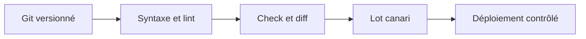
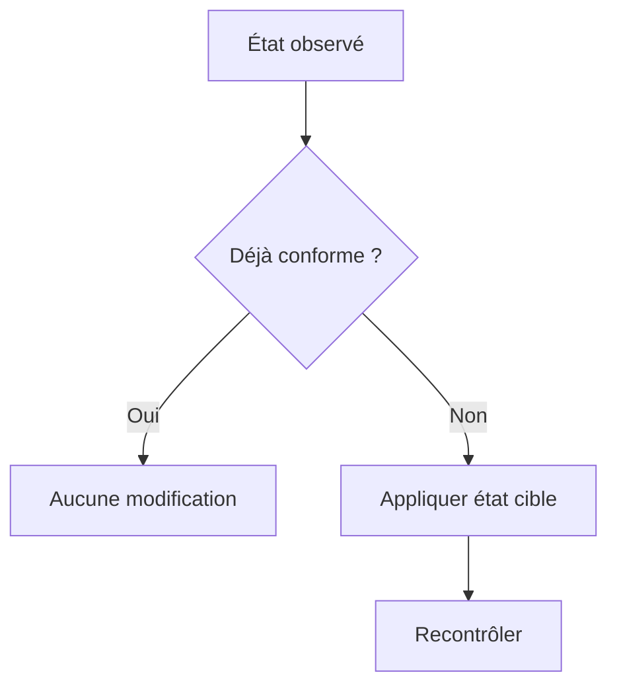
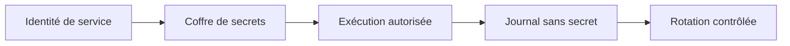
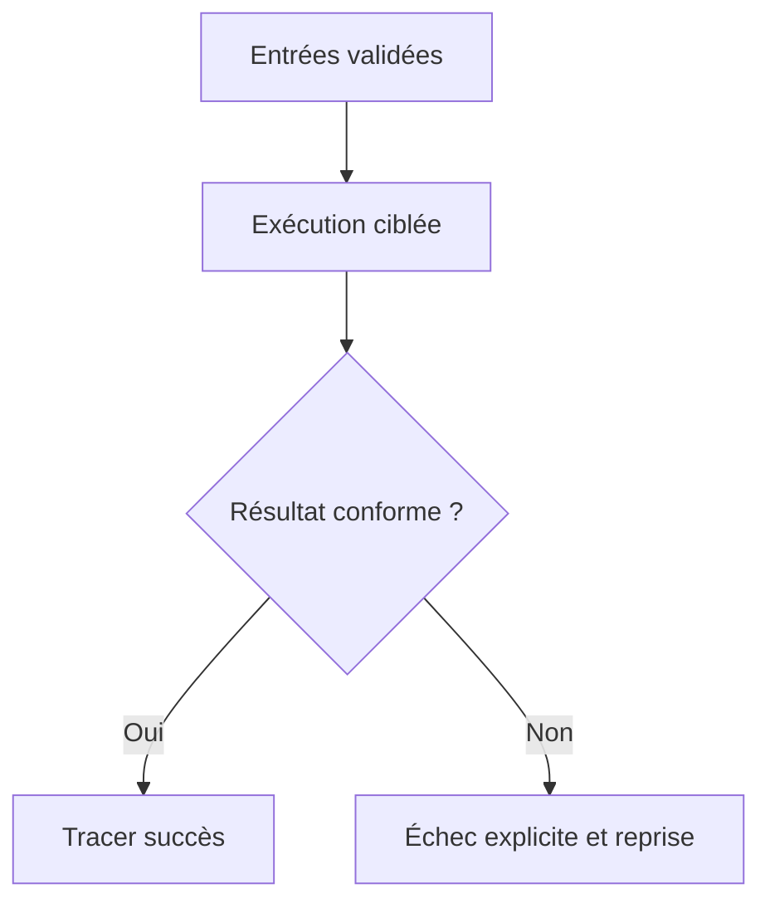
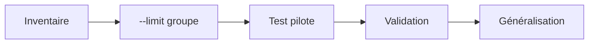
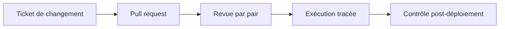

# Automatiser les tâches (scripts, Ansible)

> **Mise en contexte** — Ce cours s'adresse à un technicien intermédiaire qui doit agir dans un environnement réel, respecter les contraintes de service et laisser des preuves réutilisables. L'objectif n'est pas seulement de connaître les outils, mais de comprendre pourquoi une action est choisie, dans quelles conditions elle est sûre, comment vérifier son résultat et quand demander de l'aide.

## Présentation et enjeux

L'automatisation du support et de la maintenance doit réduire les tâches répétitives sans élargir le rayon d'impact d'une erreur. Un bon script est idempotent lorsque possible, valide ses entrées, journalise les résultats, limite ses privilèges et fournit un mode de simulation avant d'effectuer une modification. Cette discipline s'inscrit dans une démarche de qualité de service : chaque opération doit être reliée au besoin métier, au risque accepté et à un critère d'acceptation observable. L'intervenant doit pouvoir expliquer l'état initial, la décision prise, les résultats obtenus et les limites qui subsistent.

Dans une équipe de maintenance, les informations sont souvent réparties entre tickets, conversations, inventaires, systèmes de supervision et mémoire individuelle. Une méthode fiable les relie dans une trace commune et limite les décisions fondées sur une seule observation. Le cours met l'accent sur les preuves, les contrôles proportionnés, la reproductibilité et la communication utile.

Le niveau intermédiaire suppose que les gestes de base sont acquis. La difficulté consiste maintenant à traiter des environnements hétérogènes, des incidents ambigus, des changements qui touchent plusieurs composants et des situations où la donnée est imparfaite. Les règles présentées doivent être adaptées aux procédures approuvées de l'organisation et vérifiées dans un environnement de test avant toute action ayant un impact sur la production.

## Objectifs pédagogiques

À la fin du parcours, l'apprenant pourra :

- expliquer les principes et les limites des outils utilisés dans le domaine ;
- choisir un contrôle ou une méthode à partir de l'impact, de la criticité et des preuves disponibles ;
- effectuer une démarche reproductible et distinguer observation, hypothèse et décision ;
- interpréter les indicateurs sans confondre corrélation, résultat technique et expérience utilisateur ;
- rédiger une trace claire, traiter les exceptions et organiser une escalade ;
- vérifier l'effet d'une action, décrire le risque résiduel et proposer une amélioration mesurable.

## Prérequis et cadre de travail

Avant de commencer, savoir utiliser un terminal, lire les journaux, identifier un actif, comprendre les tickets et appliquer les règles locales de sécurité. Les commandes ci-dessous sont illustratives : adapter les noms d'hôte, les chemins et les versions, utiliser des cibles de test autorisées et ne jamais copier de secret dans un document. Une commande d'observation doit être préférée à une modification lorsqu'elle suffit à qualifier la situation.

Les principes directeurs sont les suivants : intervention autorisée, moindre privilège, sauvegarde ou retour arrière adaptés, fenêtre connue, communication compréhensible et preuve de validation. Si un contrôle critique échoue, ne pas continuer mécaniquement. Noter le constat, évaluer le risque et utiliser le point d'arrêt ou l'escalade défini par la procédure.

## Vocabulaire métier

| Terme | Utilisation opérationnelle |
|---|---|
| État initial | Description mesurée du système avant toute intervention. |
| Criticité | Conséquence potentielle de l'indisponibilité ou de la mauvaise configuration. |
| Preuve | Élément daté qui peut être vérifié par un autre intervenant. |
| Écart | Différence entre le résultat attendu et l'observation. |
| Exception | Situation où la procédure standard ne s'applique pas ou n'atteint pas son objectif. |
| Validation | Contrôle confirmant que le service ou l'opération satisfait les critères convenus. |
| Retour arrière | Séquence permettant de retrouver un état stable si les critères de réussite ne sont pas satisfaits. |
| Récurrence | Réapparition d'un problème similaire après un traitement précédent. |

## Schémas adaptés au sujet

### Schéma 1 — Cycle de livraison Ansible



Le code est revu, testé et déployé progressivement. Le contrôle de syntaxe ne prouve pas à lui seul que le changement est sûr.

### Schéma 2 — Idempotence



Un run doit converger vers l'état cible sans ajouter le même changement à chaque exécution.

### Schéma 3 — Gestion des secrets



Les secrets ne doivent pas apparaître dans le code, les sorties ou l'historique ; tout secret publié doit être révoqué.

### Schéma 4 — Traitement des erreurs



Les erreurs doivent remonter par cible sans annoncer un succès global trompeur.

### Schéma 5 — Limiter l'impact



Le lot pilote vérifie l'inventaire et les variables avant une généralisation à toute la flotte.

### Schéma 6 — Boucle de livraison



Relier ticket, commit, exécution et validation rend le changement explicable et reproductible.


### Schéma 7 — Décider quoi automatiser

~~~mermaid
flowchart TD
  A[Tâche répétée] --> B{Règles stables ?}
  B -->|Non| C[Clarifier la procédure]
  B -->|Oui| D{Résultat mesurable ?}
  D -->|Non| E[Définir le critère]
  D -->|Oui| F{Risque maîtrisable ?}
  F -->|Non| G[Réduire le périmètre ou reporter]
  F -->|Oui| H[Prototype testé]
~~~

La fréquence seule ne suffit pas. Si les règles sont ambiguës, l'automatisation rendra les erreurs plus rapides et plus nombreuses ; stabiliser la décision avant d'écrire le code.

### Schéma 8 — Pipeline d'un script de maintenance

~~~mermaid
flowchart LR
  A[Entrée versionnée] --> B[Validation]
  B -->|Valide| C[Calcul]
  B -->|Invalide| X[Échec explicite]
  C --> D[Simulation]
  D --> E{Approbation}
  E -->|Non| F[Rapport de simulation]
  E -->|Oui| G[Écriture contrôlée]
  G --> H[Contrôle final]
~~~

Séparer lecture, validation, calcul et écriture facilite les tests et empêche une donnée invalide d'atteindre directement une action.

### Schéma 9 — Validation d'une entrée tabulaire

~~~mermaid
flowchart TD
  A[Lire en-têtes] --> B{Colonnes requises ?}
  B -->|Non| X[Arrêt avec diagnostic]
  B -->|Oui| C[Valider chaque ligne]
  C --> D{Type et valeurs valides ?}
  D -->|Non| X
  D -->|Oui| E[Contrôler doublons]
  E --> F[Accepter les données]
~~~

Le validateur doit être strict sur les champs indispensables et explicite sur les lignes rejetées. Continuer avec des valeurs par défaut silencieuses peut produire des indicateurs trompeurs.

### Schéma 10 — Politique de reprise

~~~mermaid
flowchart TD
  A[Échec détecté] --> B{Erreur transitoire ?}
  B -->|Oui| C[Nombre limité de tentatives]
  C --> D{Toujours en échec ?}
  D -->|Non| E[Contrôler le résultat]
  D -->|Oui| F[Arrêt et escalade]
  B -->|Non| F
~~~

Ne relancer automatiquement que les erreurs transitoires et les opérations sûres à répéter. Une validation de données invalide n'est pas résolue par plusieurs nouvelles tentatives.

### Schéma 11 — Retour arrière et compensation

~~~mermaid
flowchart LR
  A[État initial vérifié] --> B[Changement limité]
  B --> C[Tests d'acceptation]
  C -->|Réussite| D[Clôture documentée]
  C -->|Échec| E[Arrêt des lots suivants]
  E --> F[Restaurer ou compenser]
  F --> G[Vérification indépendante]
~~~

Le retour arrière doit être planifié avant l'action. Il peut s'agir d'une restauration, d'une version antérieure ou d'une compensation ; une simple promesse de revenir en arrière n'est pas un plan exécutable.

### Schéma 12 — Mesurer les bénéfices sans cacher le risque

~~~mermaid
flowchart TD
  A[Temps économisé] --> D[Évaluation globale]
  B[Taux d'échec] --> D
  C[Incidents causés] --> D
  E[Données rejetées] --> D
  D --> F{Bénéfice net démontré ?}
  F -->|Oui| G[Maintenir et surveiller]
  F -->|Non| H[Corriger ou désactiver]
~~~

Une baisse du temps manuel doit être mise en regard des erreurs, des reprises et de la qualité des données. Un seul indicateur de vitesse peut pousser à masquer les exceptions.

## Fondements techniques du domaine

### 1. Sélection du candidat

Automatiser d'abord une tâche fréquente, stable, mesurable et avec des critères de sortie connus. Évaluer fréquence, temps humain, risque, exceptions, variabilité des environnements et coût de maintenance du script avant de coder.

**Mise en œuvre.** Prenons la vérification quotidienne d'un export de tickets : elle est répétitive, possède des champs attendus et peut produire un bilan contrôlable. Avant de coder, mesurer le temps manuel, le nombre de fichiers et les erreurs observées. Un processus qui exige une décision experte différente à chaque occurrence n'est pas prêt à être automatisé ; clarifier d'abord les règles et les exceptions.

**Preuves et interprétation.** La référence manuelle et le gain mesuré permettent de décider si l'automatisation vaut le coût. L'intervenant doit garder la source, l'heure, le résultat, le contexte et la limite éventuelle de l'observation. Une preuve isolée n'a parfois qu'une valeur indicative ; elle doit alors être croisée avec un autre signal indépendant. Les données manquantes ne doivent pas être remplacées par une supposition. Lorsqu'une mesure est indirecte, préciser ce qu'elle démontre réellement et ce qu'elle ne démontre pas.

**Pièges et décision.** Automatiser trop tôt une procédure mal comprise transforme les ambiguïtés en erreurs répétées à grande échelle. En cas d'écart, classer le résultat comme confirmé, probable ou inconnu et déterminer la prochaine action. Ne pas masquer un résultat défavorable par une moyenne, une fermeture de ticket ou un changement de catégorie. Si le risque dépasse l'autorité de l'intervenant, conserver les preuves et escalader plutôt que poursuivre sur la base d'une hypothèse fragile.

### 2. Idempotence

Une tâche idempotente conduit à l'état attendu même lorsqu'elle est exécutée plusieurs fois. Décrire un état cible, vérifier l'état initial et modifier uniquement lorsqu'une différence existe ; utiliser les modules Ansible plutôt que des commandes shell arbitraires quand c'est possible.

**Mise en œuvre.** Pour qu'un script de rapport soit idempotent, le même fichier source doit produire le même contenu sans ajouter une nouvelle ligne à chaque exécution. Préférer une sortie reconstruite à partir des données plutôt qu'un ajout aveugle. Dans Ansible, déclarer l'état voulu avec des modules comme file, copy ou package au lieu de lancer systématiquement une commande modificatrice.

**Preuves et interprétation.** Comparer la première et la seconde exécution aide à détecter les changements non idempotents. L'intervenant doit garder la source, l'heure, le résultat, le contexte et la limite éventuelle de l'observation. Une preuve isolée n'a parfois qu'une valeur indicative ; elle doit alors être croisée avec un autre signal indépendant. Les données manquantes ne doivent pas être remplacées par une supposition. Lorsqu'une mesure est indirecte, préciser ce qu'elle démontre réellement et ce qu'elle ne démontre pas.

**Pièges et décision.** Un script qui ajoute la même ligne à un fichier à chaque lancement n'est pas idempotent. En cas d'écart, classer le résultat comme confirmé, probable ou inconnu et déterminer la prochaine action. Ne pas masquer un résultat défavorable par une moyenne, une fermeture de ticket ou un changement de catégorie. Si le risque dépasse l'autorité de l'intervenant, conserver les preuves et escalader plutôt que poursuivre sur la base d'une hypothèse fragile.

### 3. Validation des entrées

Les cibles, chemins, noms de service et paramètres doivent être contrôlés avant toute exécution. Utiliser des listes d'hôtes autorisées, des types, des limites, des valeurs par défaut sûres et des contrôles qui échouent clairement.

**Mise en œuvre.** Un CSV peut contenir une colonne absente, un identifiant vide, un statut inconnu ou une durée écrite en lettres. Rejeter l'entrée invalide avant la première écriture et ne pas remplacer silencieusement une valeur inconnue par zéro. Valider les colonnes, les types, les valeurs autorisées et les doublons, puis mentionner le numéro de ligne pour permettre la correction à la source.

**Preuves et interprétation.** Les tests de validation et les messages d'erreur rendent les échecs compréhensibles. L'intervenant doit garder la source, l'heure, le résultat, le contexte et la limite éventuelle de l'observation. Une preuve isolée n'a parfois qu'une valeur indicative ; elle doit alors être croisée avec un autre signal indépendant. Les données manquantes ne doivent pas être remplacées par une supposition. Lorsqu'une mesure est indirecte, préciser ce qu'elle démontre réellement et ce qu'elle ne démontre pas.

**Pièges et décision.** L'injection de commande ou un motif d'hôte trop large peut transformer un utilitaire de maintenance en incident de production. En cas d'écart, classer le résultat comme confirmé, probable ou inconnu et déterminer la prochaine action. Ne pas masquer un résultat défavorable par une moyenne, une fermeture de ticket ou un changement de catégorie. Si le risque dépasse l'autorité de l'intervenant, conserver les preuves et escalader plutôt que poursuivre sur la base d'une hypothèse fragile.

### 4. Droits et secrets

Le processus doit utiliser le moindre privilège et ne jamais placer de mot de passe ou jeton directement dans le dépôt. Utiliser un coffre approuvé, des identités nominatives ou de service, des droits minimaux et une rotation documentée.

**Mise en œuvre.** Séparer l'identité qui lit l'inventaire de celle qui applique les changements, et n'utiliser become que sur les tâches qui en ont besoin. Dans Ansible, protéger les variables sensibles avec un mécanisme approuvé comme Ansible Vault et utiliser no_log sur les tâches dont la sortie pourrait exposer un secret. Cette option doit rester ciblée : masquer toutes les sorties rend le diagnostic plus difficile.

**Preuves et interprétation.** Le contrôle de l'historique Git, des journaux et des variables d'environnement fait partie de la revue de sécurité. L'intervenant doit garder la source, l'heure, le résultat, le contexte et la limite éventuelle de l'observation. Une preuve isolée n'a parfois qu'une valeur indicative ; elle doit alors être croisée avec un autre signal indépendant. Les données manquantes ne doivent pas être remplacées par une supposition. Lorsqu'une mesure est indirecte, préciser ce qu'elle démontre réellement et ce qu'elle ne démontre pas.

**Pièges et décision.** Retirer un secret du fichier courant ne le révoque pas s'il a déjà été publié dans l'historique. En cas d'écart, classer le résultat comme confirmé, probable ou inconnu et déterminer la prochaine action. Ne pas masquer un résultat défavorable par une moyenne, une fermeture de ticket ou un changement de catégorie. Si le risque dépasse l'autorité de l'intervenant, conserver les preuves et escalader plutôt que poursuivre sur la base d'une hypothèse fragile.

### 5. Simulation et tests

Un mode check/diff aide à voir les changements prévus avant de les appliquer, mais n'est pas une garantie absolue. Commencer en local ou dans une maquette, tester les cas normaux et les erreurs, puis exécuter sur un lot canari avant une généralisation.

**Mise en œuvre.** Le mode de simulation n'est utile que si l'équipe connaît ses limites. ansible-playbook --syntax-check valide la syntaxe, tandis que --check prévoit les changements pour les modules compatibles ; une commande arbitraire peut ne pas produire de simulation complète. Tester le succès, l'entrée erronée, l'hôte inaccessible et le délai dépassé dans une maquette avant le lot pilote.

**Preuves et interprétation.** Conserver la sortie de simulation, le résultat des tests et l'autorisation du déploiement renforce la traçabilité. L'intervenant doit garder la source, l'heure, le résultat, le contexte et la limite éventuelle de l'observation. Une preuve isolée n'a parfois qu'une valeur indicative ; elle doit alors être croisée avec un autre signal indépendant. Les données manquantes ne doivent pas être remplacées par une supposition. Lorsqu'une mesure est indirecte, préciser ce qu'elle démontre réellement et ce qu'elle ne démontre pas.

**Pièges et décision.** Les modules qui ne prennent pas en charge un mode check doivent être traités comme une limite connue, non comme un résultat validé. En cas d'écart, classer le résultat comme confirmé, probable ou inconnu et déterminer la prochaine action. Ne pas masquer un résultat défavorable par une moyenne, une fermeture de ticket ou un changement de catégorie. Si le risque dépasse l'autorité de l'intervenant, conserver les preuves et escalader plutôt que poursuivre sur la base d'une hypothèse fragile.

### 6. Journalisation et reprise

Un automate doit fournir un résultat par cible, un code de sortie correct et un identifiant d'exécution. Séparer les erreurs des messages ordinaires, masquer les secrets et prévoir une reprise idempotente ou une compensation documentée.

**Mise en œuvre.** Chaque exécution peut enregistrer l'heure, la version du script, le nombre de lignes lues et rejetées, la durée et le code de sortie. Les journaux ne doivent pas contenir de mots de passe, de jetons ni de lignes complètes sensibles. En cas d'échec partiel, fournir un résumé par cible plutôt qu'un message global de succès qui cacherait les hôtes en erreur.

**Preuves et interprétation.** Les logs structurés avec hôte, tâche, durée et statut facilitent la supervision. L'intervenant doit garder la source, l'heure, le résultat, le contexte et la limite éventuelle de l'observation. Une preuve isolée n'a parfois qu'une valeur indicative ; elle doit alors être croisée avec un autre signal indépendant. Les données manquantes ne doivent pas être remplacées par une supposition. Lorsqu'une mesure est indirecte, préciser ce qu'elle démontre réellement et ce qu'elle ne démontre pas.

**Pièges et décision.** Un script qui masque les exceptions peut annoncer un succès alors que certaines machines sont restées en échec. En cas d'écart, classer le résultat comme confirmé, probable ou inconnu et déterminer la prochaine action. Ne pas masquer un résultat défavorable par une moyenne, une fermeture de ticket ou un changement de catégorie. Si le risque dépasse l'autorité de l'intervenant, conserver les preuves et escalader plutôt que poursuivre sur la base d'une hypothèse fragile.

### 7. Ansible et inventaire

Ansible sépare inventaire, variables, playbooks, rôles et secrets ; cette séparation permet la réutilisation et la revue. Utiliser des groupes explicites, des variables par environnement, des handlers, des rôles limités et des commandes `--limit` contrôlées.

**Mise en œuvre.** Un inventaire Ansible doit distinguer les environnements et les groupes opérationnels. Examiner l'inventaire effectif avec ansible-inventory --graph, confirmer les membres du groupe et choisir un hôte pilote nommé explicitement. Préférer le module command avec des arguments séparés lorsque le shell n'est pas nécessaire ; employer shell seulement si ses opérateurs sont indispensables et que les valeurs sont maîtrisées.

**Preuves et interprétation.** Le diff, le check mode, la revue Git et l'exécution par lot servent de garde-fous successifs. L'intervenant doit garder la source, l'heure, le résultat, le contexte et la limite éventuelle de l'observation. Une preuve isolée n'a parfois qu'une valeur indicative ; elle doit alors être croisée avec un autre signal indépendant. Les données manquantes ne doivent pas être remplacées par une supposition. Lorsqu'une mesure est indirecte, préciser ce qu'elle démontre réellement et ce qu'elle ne démontre pas.

**Pièges et décision.** Une sélection d'hôtes trop large ou un groupe d'inventaire incorrect peut toucher toute la flotte. En cas d'écart, classer le résultat comme confirmé, probable ou inconnu et déterminer la prochaine action. Ne pas masquer un résultat défavorable par une moyenne, une fermeture de ticket ou un changement de catégorie. Si le risque dépasse l'autorité de l'intervenant, conserver les preuves et escalader plutôt que poursuivre sur la base d'une hypothèse fragile.

### 8. Déploiement et gouvernance

L'automatisation est un changement à part entière lorsqu'elle modifie des systèmes de production. Versionner le code, exiger une revue, utiliser un environnement de test, limiter le lot, prévoir une interruption et un retour arrière.

**Mise en œuvre.** Versionner scripts, inventaires non sensibles, playbooks et tests dans Git. La revue doit examiner les cibles, les privilèges, les chemins, les opérations destructives, les reprises et les preuves de validation. Pour une action à impact, relier le lancement à un ticket approuvé, une fenêtre et un point d'arrêt. Le droit technique de lancer le playbook ne remplace pas l'autorisation du changement.

**Preuves et interprétation.** Le lien entre commit, ticket, exécution et résultat permet de répondre à la question « qu'est-ce qui a changé, quand et pourquoi ? ». L'intervenant doit garder la source, l'heure, le résultat, le contexte et la limite éventuelle de l'observation. Une preuve isolée n'a parfois qu'une valeur indicative ; elle doit alors être croisée avec un autre signal indépendant. Les données manquantes ne doivent pas être remplacées par une supposition. Lorsqu'une mesure est indirecte, préciser ce qu'elle démontre réellement et ce qu'elle ne démontre pas.

**Pièges et décision.** Lancer manuellement une version non identifiée depuis un poste personnel rend difficile la reproduction et l'audit. En cas d'écart, classer le résultat comme confirmé, probable ou inconnu et déterminer la prochaine action. Ne pas masquer un résultat défavorable par une moyenne, une fermeture de ticket ou un changement de catégorie. Si le risque dépasse l'autorité de l'intervenant, conserver les preuves et escalader plutôt que poursuivre sur la base d'une hypothèse fragile.


## Construire un script Python de rapport contrôlé

Un script intermédiaire doit avoir un contrat simple et observable : quelles données il accepte, quelles règles il applique, ce qu'il produit, comment il signale un échec et dans quelles conditions il écrit un fichier. Le script suivant illustre un besoin fréquent après le reporting mensuel : transformer un export approuvé de tickets en synthèse exploitable, sans modifier les tickets ni se connecter aux équipements.

### 1. Définir le format d'entrée

Le fichier source, tickets.csv, contient les colonnes ticket_id, asset_id, environment, status et duration_min.

~~~csv
ticket_id,asset_id,environment,status,duration_min
INC-401,SRV-APP-01,prod,closed,35
INC-402,SW-EDGE-02,prod,in_progress,20
INC-403,LAP-023,test,closed,15
~~~

Dans cette démonstration, les statuts autorisés sont open, in_progress, resolved et closed, et les environnements autorisés sont prod, preprod et test. Dans un contexte réel, adapter ces règles au dictionnaire de données approuvé. Une nouvelle valeur ne doit pas être ignorée discrètement : elle doit déclencher un diagnostic permettant de corriger la source ou de faire évoluer la règle.

### 2. Implémenter lecture, validation et sortie

Le code standard de Python suffit ; aucune dépendance externe n'est nécessaire. Le comportement par défaut est une simulation : le rapport est calculé et affiché, mais aucun fichier n'est écrit. L'option --apply autorise l'écriture, et --overwrite est requis pour remplacer un rapport existant.

~~~python
from __future__ import annotations

import argparse
import csv
import json
import logging
import os
import tempfile
from collections import Counter
from pathlib import Path
from typing import Any

REQUIRED_COLUMNS = {
    "ticket_id", "asset_id", "environment", "status", "duration_min"
}
ALLOWED_ENVIRONMENTS = {"prod", "preprod", "test"}
ALLOWED_STATUSES = {"open", "in_progress", "resolved", "closed"}


def load_rows(source: Path) -> list[dict[str, Any]]:
    if not source.is_file():
        raise ValueError(f"Le fichier source n'existe pas : {source}")

    rows: list[dict[str, Any]] = []
    seen_tickets: set[str] = set()

    with source.open("r", encoding="utf-8-sig", newline="") as handle:
        reader = csv.DictReader(handle)
        if reader.fieldnames is None:
            raise ValueError("Le fichier CSV est vide ou sans en-tête.")

        missing = REQUIRED_COLUMNS - set(reader.fieldnames)
        if missing:
            raise ValueError("Colonnes manquantes : " + ", ".join(sorted(missing)))

        for line_number, raw in enumerate(reader, start=2):
            ticket_id = (raw.get("ticket_id") or "").strip()
            asset_id = (raw.get("asset_id") or "").strip()
            environment = (raw.get("environment") or "").strip().lower()
            status = (raw.get("status") or "").strip().lower()
            duration_text = (raw.get("duration_min") or "").strip()

            if not ticket_id or not asset_id:
                raise ValueError(
                    f"Ligne {line_number} : ticket_id et asset_id sont obligatoires."
                )
            if ticket_id in seen_tickets:
                raise ValueError(f"Ligne {line_number} : doublon {ticket_id!r}.")
            if environment not in ALLOWED_ENVIRONMENTS:
                raise ValueError(
                    f"Ligne {line_number} : environnement inconnu {environment!r}."
                )
            if status not in ALLOWED_STATUSES:
                raise ValueError(f"Ligne {line_number} : statut inconnu {status!r}.")

            try:
                duration = int(duration_text)
            except ValueError as exc:
                raise ValueError(
                    f"Ligne {line_number} : duration_min doit être un entier."
                ) from exc
            if duration < 0:
                raise ValueError(
                    f"Ligne {line_number} : duration_min ne peut pas être négatif."
                )

            seen_tickets.add(ticket_id)
            rows.append({
                "ticket_id": ticket_id,
                "asset_id": asset_id,
                "environment": environment,
                "status": status,
                "duration_min": duration,
            })

    if not rows:
        raise ValueError("Aucune ligne exploitable dans le fichier source.")
    return rows


def build_report(rows: list[dict[str, Any]]) -> dict[str, Any]:
    by_status = Counter(row["status"] for row in rows)
    by_environment = Counter(row["environment"] for row in rows)
    return {
        "schema_version": 1,
        "tickets_total": len(rows),
        "duration_total_min": sum(row["duration_min"] for row in rows),
        "by_status": dict(sorted(by_status.items())),
        "by_environment": dict(sorted(by_environment.items())),
    }


def write_atomically(destination: Path, payload: str) -> None:
    if not destination.parent.is_dir():
        raise ValueError(
            f"Le répertoire de sortie n'existe pas : {destination.parent}"
        )

    temporary_name: str | None = None
    try:
        with tempfile.NamedTemporaryFile(
            mode="w",
            encoding="utf-8",
            newline="\n",
            dir=destination.parent,
            prefix=f".{destination.name}.",
            suffix=".tmp",
            delete=False,
        ) as handle:
            temporary_name = handle.name
            handle.write(payload)
            handle.flush()
            os.fsync(handle.fileno())

        os.replace(temporary_name, destination)
        temporary_name = None
    finally:
        if temporary_name is not None:
            Path(temporary_name).unlink(missing_ok=True)


def main() -> int:
    parser = argparse.ArgumentParser(
        description="Valider un export de tickets et produire une synthèse."
    )
    parser.add_argument("source", type=Path, help="Chemin du CSV approuvé.")
    parser.add_argument(
        "--output", type=Path, default=Path("report.json"),
        help="Chemin du rapport JSON."
    )
    parser.add_argument(
        "--apply", action="store_true",
        help="Écrire le rapport ; sans cette option, le script simule."
    )
    parser.add_argument(
        "--overwrite", action="store_true",
        help="Autoriser le remplacement d'un rapport existant."
    )
    args = parser.parse_args()
    logging.basicConfig(
        level=logging.INFO,
        format="%(asctime)s %(levelname)s %(message)s",
    )

    try:
        source = args.source.resolve()
        destination = args.output.resolve()
        if source == destination:
            raise ValueError("La sortie ne peut pas remplacer le fichier source.")
        if args.overwrite and not args.apply:
            raise ValueError("--overwrite exige aussi --apply.")
        if args.apply and destination.exists() and not args.overwrite:
            raise ValueError(
                f"La sortie existe déjà : {destination}. "
                "Choisir un autre chemin ou confirmer --overwrite."
            )

        rows = load_rows(source)
        report = build_report(rows)
        payload = json.dumps(report, indent=2, ensure_ascii=False) + "\n"
        logging.info(
            "Validation terminée : %d tickets, %d minutes cumulées.",
            report["tickets_total"], report["duration_total_min"]
        )

        if not args.apply:
            print("SIMULATION : aucun fichier écrit.")
            print(payload)
            return 0

        write_atomically(destination, payload)
        logging.info("Rapport écrit : %s", destination)
        return 0

    except (OSError, ValueError) as exc:
        logging.error("Échec du traitement : %s", exc)
        return 2


if __name__ == "__main__":
    raise SystemExit(main())
~~~

### 3. Comprendre l'exécution

La simulation se lance ainsi :

~~~bash
python build_report.py tickets.csv --output report.json
~~~

Le rapport calculé est affiché, mais n'est pas enregistré. Après les contrôles et la revue, l'écriture est explicitement autorisée :

~~~bash
python build_report.py tickets.csv --output report.json --apply
~~~

Si report.json existe déjà, le script refuse de l'écraser. Pour tester explicitement ce comportement :

~~~bash
python build_report.py tickets.csv --output report.json --apply --overwrite
~~~

Tester dans un répertoire temporaire avec un export de démonstration. Ne pas versionner un export réel contenant des données personnelles. Le code est limité au traitement local : il ne se connecte à aucun serveur, n'exécute aucune commande distante et ne change aucun équipement.

### 4. Pourquoi ces choix importent

- **Validation avant calcul** : une durée négative, un statut inconnu ou un doublon arrête le traitement avec un numéro de ligne utile.
- **Simulation par défaut** : la première exécution montre ce qui serait produit. Le drapeau --apply rend l'intention d'écrire visible dans la commande.
- **Refus d'écraser la source** : la résolution des chemins permet de détecter une sortie qui pointe vers l'entrée.
- **Écriture atomique** : le contenu est écrit dans un fichier temporaire puis remplacé. Cela réduit le risque de laisser un JSON incomplet en cas d'interruption pendant l'écriture.
- **Codes de sortie** : le code 0 indique un traitement terminé et le code 2 une erreur d'entrée ou d'écriture. Un ordonnanceur peut s'appuyer sur cette valeur.
- **Journalisation utile** : les journaux donnent des agrégats et le résultat, pas les lignes entières ni les secrets.
- **Sortie déterministe** : le rapport ne dépend pas de l'heure d'exécution ; à données égales, les agrégats sont identiques.

Ce script reste pédagogique. Avant son adoption, vérifier les droits du répertoire de sortie, le volume maximal, la politique de conservation, l'encodage de la source et la définition des statuts. Avec un ordonnanceur, surveiller le code de sortie, signaler les échecs et nommer un responsable pour les exceptions.

### 5. Tests ciblés

Tester les cas normaux et les erreurs qui pourraient fausser un rapport : export valide, statut inconnu, doublon, durée non numérique, fichier vide et tentative de remplacer la source. Vérifier le contenu produit, pas seulement que le script ne lève aucune exception.

~~~python
import unittest

from build_report import build_report


class BuildReportTests(unittest.TestCase):
    def test_aggregates_statuses_and_durations(self):
        rows = [
            {"ticket_id": "INC-1", "asset_id": "SRV-1",
             "environment": "prod", "status": "closed", "duration_min": 30},
            {"ticket_id": "INC-2", "asset_id": "SW-2",
             "environment": "test", "status": "open", "duration_min": 10},
        ]
        report = build_report(rows)
        self.assertEqual(report["tickets_total"], 2)
        self.assertEqual(report["duration_total_min"], 40)
        self.assertEqual(report["by_status"], {"closed": 1, "open": 1})
        self.assertEqual(report["by_environment"], {"prod": 1, "test": 1})


if __name__ == "__main__":
    unittest.main()
~~~

Lancer avec python -m unittest -v. Pour tester load_rows, créer des fichiers temporaires pendant les tests afin de simuler les colonnes manquantes et les valeurs erronées sans toucher aux exports réels. Dans la CI, toute assertion échouée doit conduire à un code de sortie non nul.

## Déployer un état cible avec Ansible

Python convient bien à la transformation et à la validation des données ; Ansible est souvent mieux adapté à l'application d'un état déclaré sur un ensemble d'hôtes. Préférer les modules qui décrivent le résultat souhaité, séparer les variables d'environnement et restreindre le premier déploiement à un hôte pilote.

L'exemple suivant ne démarre aucun service et ne supprime aucun contenu. Il prépare un répertoire de dépôt et une configuration sur des hôtes Linux de test. Ne l'utiliser que dans une maquette ou sur des hôtes explicitement autorisés.

~~~yaml
- name: Préparer le dépôt des rapports de maintenance
  hosts: groupe_pilote
  become: true
  gather_facts: false

  vars:
    report_dir: /var/lib/skilltree-maintenance
    report_owner: root

  tasks:
    - name: Vérifier que la cible appartient au groupe pilote
      ansible.builtin.assert:
        that:
          - inventory_hostname in groups["groupe_pilote"]
        fail_msg: "Cette cible n'appartient pas au groupe pilote."

    - name: Créer le répertoire de rapports
      ansible.builtin.file:
        path: "{{ report_dir }}"
        state: directory
        owner: "{{ report_owner }}"
        group: "{{ report_owner }}"
        mode: "0750"

    - name: Déployer la configuration de rapport
      ansible.builtin.copy:
        dest: "{{ report_dir }}/automation.yml"
        content: |
          schema_version: 1
          report_format: json
          reporting_enabled: true
        owner: "{{ report_owner }}"
        group: "{{ report_owner }}"
        mode: "0640"
~~~

Le module file maintient un répertoire à l'état souhaité et copy gère le contenu du fichier. Une deuxième exécution ne doit pas réécrire le contenu lorsque l'état est conforme. Cette convergence est un signe d'idempotence, pas une raison d'ignorer les contrôles du service.

Une séquence de validation possible, dans le répertoire contenant maintenance.yml et inventory.ini :

~~~bash
ansible-inventory -i inventory.ini --graph
ansible-playbook --syntax-check -i inventory.ini maintenance.yml
ansible-playbook --check --diff -i inventory.ini --limit hote-pilote maintenance.yml
ansible-playbook -i inventory.ini --limit hote-pilote maintenance.yml
ansible-playbook --check --diff -i inventory.ini --limit hote-pilote maintenance.yml
~~~

Avant le lancement réel, confirmer que hote-pilote est le nom exact d'une cible autorisée et que groupe_pilote existe dans l'inventaire. Si le résultat ne correspond pas au critère attendu, ne pas étendre le lot. Le mode diff peut révéler des données de configuration ; limiter sa sortie et éviter les contenus sensibles.

### Liste de contrôle de revue

1. **Contrat** : entrées, valeurs acceptées, sorties, erreurs et effets de bord documentés.
2. **Périmètre** : chemins, hôtes et environnements explicites ; une valeur vide ne signifie jamais « toute la flotte ».
3. **Validation** : une donnée absente ou inconnue échoue clairement avant l'action.
4. **Privilèges** : seuls les droits nécessaires sont demandés.
5. **Secrets** : aucun secret en clair dans Git, les paramètres ou les journaux.
6. **Tests** : cas normal, cas limite et erreurs simulés ; résultats archivés avec la version.
7. **Reprise** : relance sûre, limites de tentatives, point d'arrêt et retour arrière définis.
8. **Validation** : contrôle post-exécution indépendant, résultats par cible et restitution compréhensible.

## Méthode transversale pour une opération maîtrisée

### 1. Gouvernance

L'intervention doit être reliée à un objectif de service, un propriétaire et une décision explicite. Le contrôle de gouvernance n'a de valeur que s'il aide à identifier qui peut accepter le risque et qui doit être informé. Pour la gouvernance, tenir un registre qui indique le propriétaire, l'objectif, les permissions, les dépôts, les cibles autorisées et la procédure d'arrêt. Le propriétaire doit pouvoir suspendre l'exécution, expliquer les dépendances et démontrer que le gain de temps ne compromet pas la qualité de service.

### 2. Cycle de vie

La solution doit être pensée depuis la préparation jusqu'à la sortie, y compris le maintien des compétences et le retrait des anciennes données. Une étape oubliée en fin de cycle transforme souvent une réussite ponctuelle en risque latent. Le cycle de vie commence par une procédure manuelle comprise, continue par un prototype, des tests et une revue, puis se poursuit avec un pilote et une surveillance. Si la source, l'API ou le format d'entrée évolue, requalifier le script : un succès passé ne prouve pas que la règle traite les champs actuels.

### 3. Qualité de données

Toute mesure dépend de la qualité de son périmètre, de l'horodatage, de l'unité et de la provenance. Il faut identifier les champs manquants et les conventions contradictoires avant de tirer une conclusion. Pour un export CSV, vérifier la provenance, le séparateur, l'encodage, les champs obligatoires, les doublons, la période et les lignes incomplètes. Compter les entrées acceptées et rejetées. Un rapport calculé sur une partie des tickets ne doit pas être présenté comme exhaustif sans préciser son taux de couverture.

### 4. Gestion du risque

Le risque se juge par probabilité, impact, capacité de détection et marge de récupération. Les éléments critiques doivent recevoir plus de contrôles, sans imposer la même lourdeur aux opérations réversibles et aux changements irréversibles. Classer les opérations selon l'impact et la réversibilité. La lecture seule peut être largement testée avant exécution ; la suppression, la rotation de secrets ou le redémarrage d'un service exige un contrôle renforcé, un petit lot et une reprise documentée. Une simulation n'est pas une garantie lorsque des modules ne prennent pas complètement en charge le mode check.

### 5. Communication

Une communication utile indique ce qui est connu, ce qui reste à vérifier, qui agit ensuite et quand une nouvelle information sera fournie. Les formulations doivent éviter les promesses non vérifiées. Le message d'exploitation précise le changement prévu, le lot, la durée, le comportement attendu et le canal d'escalade. Après exécution, annoncer le nombre de cibles réussies, en échec et ignorées, puis fixer la prochaine mise à jour. Ne pas déclarer le service rétabli tant que le contrôle métier n'a pas été réalisé.

### 6. Sécurité

Le périmètre technique doit rester limité aux systèmes autorisés, avec une identité traçable et les droits minimaux nécessaires. Les secrets doivent être protégés dans les fichiers, les journaux, les captures et les exports. La sécurité se vérifie dans le code et l'environnement : entrées contrôlées, permissions minimales, secrets injectés depuis un coffre, dépendances surveillées et journaux filtrés. Si une valeur peut atteindre une commande système, ne pas construire une chaîne shell avec cette valeur ; préférer des arguments séparés et validés.

### 7. Traçabilité

Une action exploitable doit laisser un résultat vérifiable, un horodatage, un propriétaire et un lien avec le ticket ou le changement. La trace doit permettre à un autre technicien de comprendre ce qui a été fait. Une trace utile relie la version du code, le commit, l'identifiant d'exécution, le périmètre effectif, les paramètres non sensibles, les horaires, les résultats par cible et la validation. Conserver la trace selon les règles internes et vérifier qu'elle reste accessible aux personnes autorisées sans devenir un dépôt de secrets.

### 8. Gestion des exceptions

Les cas hors procédure doivent être visibles et conduire à un point d'arrêt, une décision ou une escalade. Une exception récurrente est souvent le signal qu'il faut faire évoluer la procédure plutôt que la répéter. Définir à l'avance le comportement lorsqu'un hôte est inaccessible, qu'un fichier est illisible ou que le format n'est pas reconnu. Une donnée critique absente doit bloquer le rapport plutôt que produire un résultat incomplet présenté comme fiable. Distinguer échec global et échec partiel puis attribuer une suite à chaque exception.

### 9. Amélioration continue

Les incidents, les retours utilisateurs et les contrôles qualité doivent transformer les règles et procédures. Il faut vérifier si les modifications réduisent réellement le risque, et pas seulement si les documents ont été mis à jour. Une amélioration part d'un incident ou d'une mesure : classifier les erreurs fréquentes, écrire un test qui reproduit le cas, corriger le script, faire relire le diff et comparer le taux d'échec avant/après. Un jeu de données représentatif permet de détecter les régressions lorsque l'outil ou la règle évolue.

### 10. Capacité

Les ressources, compétences, fenêtres et dépendances limitent le volume d'opérations réalisables. Une planification crédible tient compte de la charge, des temps de contrôle et des imprévus. Surveiller le temps de traitement, les délais d'attente, la taille des lots, la mémoire et la charge lorsque ces facteurs affectent le service. Trop de tâches parallèles peuvent dégrader le système ou provoquer des limites d'API ; ajuster les forks et les lots selon les résultats d'essais contrôlés.

### 11. Contrôle du changement

Une modification nécessite un état initial connu, un périmètre, des critères de réussite et une solution de repli adaptée au risque. L'urgence ne supprime pas le besoin de garder une trace des décisions. Un changement de script suit le processus de changement : demande, analyse, revue, tests, fenêtre, approbation, exécution et vérification. Les corrections urgentes doivent également laisser une trace et être revues après coup. Un commit prouve qu'un fichier a changé, pas que son exécution en production est autorisée.

### 12. Mesure d'efficacité

Un indicateur ne vaut que si sa définition reste constante et si sa variation peut conduire à une décision. Les chiffres doivent être accompagnés d'une période, d'un périmètre et des limites de mesure. Mesurer un indicateur d'efficacité et un indicateur de risque. Le temps économisé peut être comparé au taux d'échec, au volume de données rejetées et aux incidents après exécution. Un script plus rapide n'est pas meilleur s'il ignore plus de lignes invalides ou crée davantage de reprises.

### 13. Passation

Une tâche doit pouvoir être reprise par une autre personne sans dépendre des souvenirs du technicien présent. La transmission contient contexte, preuves, étapes déjà tentées et prochaine action. Une passation doit fournir le dépôt et la version exacte, la commande, le périmètre, les résultats, les erreurs pertinentes, les limites connues, la procédure d'arrêt et le propriétaire. Ne jamais passer un mot de passe ou un jeton dans le ticket ; utiliser le mécanisme sécurisé prévu pour accorder l'accès.

### 14. Validation métier

Le résultat technique doit être confirmé du point de vue du service. Un équipement joignable ou un script qui termine sans erreur ne suffit pas si l'utilisateur ne peut pas accomplir son opération. La validation métier confirme que l'automatisation sert le processus. Pour un rapport de maintenance, vérifier la période, les totaux par statut, la règle des durées et la possibilité d'exploiter les résultats. Une exécution techniquement réussie ne prouve ni que le rapport est complet ni que le service est satisfaisant.

## Indicateurs : définition, lecture et limites

Les indicateurs les plus utiles pour ce domaine sont : **taux de réussite, durée économisée, échecs récupérables, changements non prévus, taux de simulation positive, dérive de configuration, incidents causés par l'automatisation**. Chaque indicateur doit avoir une définition écrite. Il faut préciser l'unité, la source, le périmètre, la fréquence, la période et les exclusions. Lorsque les données ne couvrent qu'une partie de l'environnement, le rapport doit le signaler au lieu d'extrapoler silencieusement. Un indicateur doit permettre une décision : prioriser, déclencher une vérification, ajuster une capacité, revoir une procédure ou accepter explicitement un risque.

Un bon tableau de bord met en évidence la tendance et les écarts significatifs, sans supprimer la donnée de départ. Il distingue les valeurs brutes, les seuils, les anomalies confirmées et les périodes sans mesure. Une moyenne peut cacher des situations extrêmes ; il est donc souvent nécessaire d'observer la distribution, les percentiles, les valeurs maximales et la répartition par service ou par criticité. Les changements de définition doivent être versionnés pour éviter de comparer des séries qui ne signifient plus la même chose.

Les indicateurs ne doivent pas devenir des objectifs isolés. Par exemple, réduire le délai moyen n'est pas une amélioration si les tickets sont fermés avant validation et immédiatement rouverts. De même, atteindre un taux de conformité en excluant les actifs inconnus peut donner une image artificiellement favorable. Associer un KPI à un contrôle de qualité et à un résultat métier permet de repérer ces effets indésirables.

## Procédure opérationnelle recommandée

1. **Préparer.** Confirmer la demande, le périmètre, le propriétaire, l'autorisation et la fenêtre. Vérifier les dépendances, les sauvegardes et les accès nécessaires.
2. **Établir l'état initial.** Recueillir les mesures, l'état des services, les alertes, la dernière intervention et les écarts connus. Noter les éléments non vérifiables.
3. **Évaluer les risques.** Déterminer impact, probabilité, détectabilité, réversibilité et critère de report. Définir un point d'arrêt compréhensible.
4. **Exécuter par étapes.** Utiliser les outils approuvés, limiter le périmètre et vérifier les résultats intermédiaires avant de passer à l'étape suivante.
5. **Contrôler.** Comparer l'état final à l'état attendu et tester le service selon un scénario réaliste, pas uniquement le composant technique.
6. **Tracer.** Enregistrer les horaires, commandes ou actions, résultats, décisions et écarts dans le ticket ou le référentiel prévu.
7. **Communiquer.** Annoncer le résultat en termes compréhensibles, préciser les limites et indiquer qui gère les actions ouvertes.
8. **Améliorer.** Rechercher les étapes ambiguës ou les contrôles inefficaces et proposer une modification versionnée, testée et approuvée.

## Outils et contrôles pratiques

Les outils doivent être sélectionnés selon l'objectif, les droits et le type de preuve recherché. L'usage d'un outil connu ne dispense pas de contrôler son contexte : version, paramètres, cible, unité, état de connexion et limite de la mesure. Python, shell, Ansible, inventaire versionné, Git, linting, environnement de test, coffre de secrets, journaux et ordonnanceur constituent des exemples de technologies possibles ; leur choix exact dépend de l'environnement et des politiques internes.

| Contrôle | Question à poser | Trace à conserver |
|---|---|---|
| Identité de la cible | Est-ce bien l'actif ou le service autorisé ? | Identifiant, inventaire et horodatage. |
| État initial | Quelle condition de départ a été mesurée ? | Valeur, source, capture ou sortie. |
| Autorisation | Qui a approuvé l'action et pour quelle fenêtre ? | Ticket, validation et périmètre. |
| Résultat | Qu'est-ce qui démontre que le résultat est correct ? | Test de contrôle et résultat observé. |
| Écart | Que faire si le résultat attendu n'est pas obtenu ? | Point d'arrêt, escalade et action attribuée. |

### Commandes et exemples

Les commandes de cette section servent à illustrer la collecte de preuves. Remplacer les valeurs de test par des cibles autorisées et vérifier localement les options selon la distribution et la version de l'outil.

#### Exemple 1 — Vérifier la syntaxe d'un playbook

```bash
ansible-playbook --syntax-check -i inventory.ini maintenance.yml
```

Cette vérification détecte notamment les erreurs de syntaxe et certains problèmes de chargement, mais elle n'exécute pas les tâches et ne prouve pas que les hôtes sont joignables. Conserver la version d'Ansible et le résultat du contrôle, puis poursuivre par les tests dans l'environnement approprié.

#### Exemple 2 — Simuler les changements, si les modules concernés prennent en charge le mode check

```bash
ansible-playbook --check --diff -i inventory.ini --limit groupe-pilote maintenance.yml
```

Lire le résultat de simulation hôte par hôte. Le mode check est partiel pour certaines tâches et le diff peut révéler des lignes confidentielles ; ne partager la sortie qu'avec les personnes autorisées. Si le résultat dépend de conditions exécutées plus tôt dans le playbook, vérifier ce parcours dans une maquette.

#### Exemple 3 — Limiter explicitement l'exécution à un groupe pilote

```bash
ansible-playbook -i inventory.ini --limit groupe-pilote maintenance.yml
```

Avant le lancement, confirmer que le groupe pilote existe et que ses membres sont ceux attendus. --limit réduit le nombre de cibles, mais ne corrige ni un inventaire erroné ni des variables dangereuses. Relire le plan et le code immédiatement avant toute exécution réelle.

#### Exemple 4 — Analyser les modifications d'un script avant de le publier

```bash
git diff --check && git diff -- script.py
```

git diff --check signale des problèmes d'espacement et git diff permet de revoir le changement avant validation. Contrôler aussi les tests, les fichiers générés et la présence éventuelle de secrets. Une revue efficace cherche les conséquences du diff, pas seulement sa propreté visuelle.

## Atelier pratique guidé

### Situation de départ

À la fin du mois, l'équipe maintenance produit une synthèse depuis un export de tickets. La collecte manuelle prend du temps et les totaux ne concordent pas toujours, car certaines lignes sont dupliquées, des statuts varient selon les équipes et des durées sont saisies en texte. L'objectif est d'automatiser le calcul sans automatiser aveuglément l'interprétation métier.

Le CSV utilisé est une copie de données de test. Le résultat attendu est un rapport JSON dont les totaux peuvent être comparés à la source. Aucun ticket ni équipement ne sera modifié.

### Phase A — Écrire le contrat avant le code

Définir les champs obligatoires, les statuts autorisés, les environnements attendus, la règle de traitement des doublons et la signification de duration_min. Préciser le propriétaire de l'export et la période couverte. Pour cet atelier, un ticket doit avoir un identifiant unique, un actif, un environnement reconnu, un statut autorisé et une durée entière non négative.

Le critère de réussite est double : le rapport contient le nombre exact de tickets valides, la somme des durées correspond aux lignes reconnues et le programme retourne un code d'échec en présence d'une donnée obligatoire invalide. La vitesse d'exécution est secondaire tant que la qualité n'est pas démontrée.

### Phase B — Préparer des données de test

Créer une copie du CSV avec quelques lignes normales puis des erreurs volontaires : colonne absente, statut pending inconnu, durée abc, valeur négative et identifiant dupliqué. Tester chaque cas séparément. Il faut identifier quelle règle arrête le programme et vérifier qu'aucun fichier final partiel n'est écrit.

Ne pas corriger automatiquement une valeur inconnue sauf si une règle métier approuvée précise exactement la transformation. Une conversion arbitraire peut réduire les erreurs apparentes tout en faussant les indicateurs.

### Phase C — Exécuter en simulation puis écrire

Lancer d'abord python build_report.py tickets.csv --output report.json. Examiner les agrégats et comparer les totaux à la source. Essayer ensuite une écriture dans un dossier temporaire avec --apply, vérifier le JSON et relancer vers le même fichier sans --overwrite : le programme doit refuser de remplacer le rapport. Ajouter explicitement --overwrite seulement pour tester ce cas.

Exécuter les tests unitaires avant la publication. Si les tests sont automatisés en CI, faire échouer le pipeline en cas de résultat inattendu. Conserver le résultat de test, le commit et la version des règles métier.

### Phase D — Préparer la livraison par Ansible

Dans une maquette distincte, examiner l'inventaire avec ansible-inventory --graph, vérifier la syntaxe, simuler avec --check --diff sur un hôte pilote puis exécuter seulement après approbation. Comparer le résultat réel au diff prédit et relancer un contrôle pour vérifier que la seconde passe ne propose plus de changement inattendu.

Ne pas généraliser parce que le playbook fonctionne sur une seule machine. Confirmer que le système d'exploitation, les chemins et les permissions sont comparables dans le lot suivant et vérifier les exceptions propres à certains hôtes.

### Phase E — Restituer le résultat

La restitution précise le nombre de lignes source, les enregistrements acceptés, les erreurs rejetées, la période, les totaux et la version du script. Une ligne rejetée ne doit pas disparaître du suivi : indiquer à qui elle est attribuée et quand elle sera corrigée. Si l'export est incomplet, le bilan doit le signaler et éviter de prétendre couvrir tout le mois.

### Résultat attendu et critères de notation

L'atelier est réussi si le script n'écrit rien par défaut, refuse les valeurs invalides, produit des agrégats reproductibles, détecte les doublons, protège la source et retourne un code exploitable. Le déploiement Ansible est réussi si l'inventaire est compris, le changement est limité, le diff est relu, les permissions sont conformes et une seconde exécution ne révèle pas de modification inattendue.

Une solution qui produit le bon total mais ignore silencieusement les lignes incorrectes n'est pas validée. Une solution qui effectue un changement sur une cible non prévue ne l'est pas non plus, même si la commande se termine sans erreur.

## Études de cas

### Cas 1 — Rotation d'un service

**Situation.** Une équipe veut vérifier et relancer un service sur plusieurs serveurs Linux. Le service doit être préservé et les actions doivent rester explicables. La première réaction ne doit pas consister à redémarrer ou modifier au hasard : il faut d'abord vérifier le périmètre, l'heure, l'état initial et les changements concomitants.

**Analyse.** Créer un playbook utilisant le module `service`, limiter le groupe pilote, contrôler l'état avant/après et signaler les hôtes injoignables. Consigner les observations qui distinguent les hypothèses, puis rechercher les dépendances susceptibles de produire le même symptôme. Si une source de donnée est absente, l'indiquer et prévoir un moyen de la récupérer pour une prochaine occurrence. Vérifier aussi l'effet sur les autres services et le risque que l'action proposée crée une interruption plus large que le problème initial.

**Décision et preuve.** Exécuter d'abord `--syntax-check`, puis `--check` si les modules le supportent, et lancer en production uniquement après approbation. La conclusion doit préciser le niveau de confiance et les contrôles qui ont été effectués après l'action. Si la cause n'est pas démontrée, préférer une formule prudente et assigner l'investigation complémentaire plutôt que fermer le dossier sur une supposition.

### Cas 2 — Nettoyage trop large

**Situation.** Un script de nettoyage doit supprimer de vieux fichiers temporaires. Le service doit être préservé et les actions doivent rester explicables. La première réaction ne doit pas consister à redémarrer ou modifier au hasard : il faut d'abord vérifier le périmètre, l'heure, l'état initial et les changements concomitants.

**Analyse.** Définir un répertoire fixe, une limite d'âge, un mode liste seule, des exclusions et une trace des fichiers concernés avant suppression. Consigner les observations qui distinguent les hypothèses, puis rechercher les dépendances susceptibles de produire le même symptôme. Si une source de donnée est absente, l'indiquer et prévoir un moyen de la récupérer pour une prochaine occurrence. Vérifier aussi l'effet sur les autres services et le risque que l'action proposée crée une interruption plus large que le problème initial.

**Décision et preuve.** Tester sur un dossier factice et comparer le lot attendu au lot ciblé avant toute action destructive. La conclusion doit préciser le niveau de confiance et les contrôles qui ont été effectués après l'action. Si la cause n'est pas démontrée, préférer une formule prudente et assigner l'investigation complémentaire plutôt que fermer le dossier sur une supposition.

### Cas 3 — Secret exposé

**Situation.** Une clé d'API a été incluse dans un script versionné. Le service doit être préservé et les actions doivent rester explicables. La première réaction ne doit pas consister à redémarrer ou modifier au hasard : il faut d'abord vérifier le périmètre, l'heure, l'état initial et les changements concomitants.

**Analyse.** Révoquer ou faire tourner la clé auprès du fournisseur, déplacer le secret dans un mécanisme adapté, nettoyer le code courant et examiner l'historique ainsi que les journaux d'utilisation. Consigner les observations qui distinguent les hypothèses, puis rechercher les dépendances susceptibles de produire le même symptôme. Si une source de donnée est absente, l'indiquer et prévoir un moyen de la récupérer pour une prochaine occurrence. Vérifier aussi l'effet sur les autres services et le risque que l'action proposée crée une interruption plus large que le problème initial.

**Décision et preuve.** Ne jamais compter sur la suppression d'une ligne Git comme seule réponse ; le secret publié doit être considéré comme compromis. La conclusion doit préciser le niveau de confiance et les contrôles qui ont été effectués après l'action. Si la cause n'est pas démontrée, préférer une formule prudente et assigner l'investigation complémentaire plutôt que fermer le dossier sur une supposition.

## Exercices d'application avec corrigés

### Exercice 1 — Définir le périmètre

**Question.** Une demande décrit un problème sans identifier clairement l'actif concerné. Quelles informations obtenir avant de lancer un contrôle ?

**Corrigé expliqué.** Identifier le service, la cible, l'utilisateur, la période, l'impact, l'autorisation, les dépendances et le résultat attendu. Aucun changement ne doit précéder la confirmation de la cible. Dans un pipeline Python/Ansible, le périmètre doit venir d'une liste explicite de cibles autorisées. Un paramètre vide ou un groupe trop large doit provoquer un arrêt, jamais déclencher l'opération sur toute une flotte.

### Exercice 2 — Distinguer fait et hypothèse

**Question.** Une alerte apparaît juste après une modification. Peut-on écrire que la modification est la cause ?

**Corrigé expliqué.** Non. La proximité temporelle est un indice. Il faut comparer l'état avant/après, tester le mécanisme supposé et évaluer les autres facteurs possibles. Dans un script de maintenance, le témoignage d'un utilisateur est un signal à examiner, pas une preuve de cause racine. Comparer la chronologie aux journaux, au statut de la tâche et aux changements récents avant d'ajouter une règle automatique.

### Exercice 3 — Choisir la mesure

**Question.** Un indicateur semble bon mais les utilisateurs signalent un problème. Quelle démarche appliquer ?

**Corrigé expliqué.** Vérifier que le point de mesure représente le service, examiner le périmètre et la fraîcheur des données, puis croiser avec un test de bout en bout et le retour utilisateur. Choisir un indicateur qui permet de décider : taux de lignes valides, durée d'exécution, proportion de cibles en échec ou nombre de changements inattendus. Définir numérateur, dénominateur et période pour rendre les mesures comparables.

### Exercice 4 — Protéger la production

**Question.** Une opération comporte un risque de perte de données ou d'indisponibilité. Quelles garanties vérifier ?

**Corrigé expliqué.** Autorisation, fenêtre, état initial, sauvegarde ou retour arrière adapté, prérequis, lot limité, critères de réussite, point d'arrêt et responsable du rétablissement. En production, la sécurité combine simulation, limitation des cibles, privilèges minimaux, point d'arrêt et contrôle après action. Aucun mécanisme ne remplace les autres ; définir aussi la conduite à tenir si le contrôle échoue.

### Exercice 5 — Rédiger la passation

**Question.** Un autre technicien reprend l'incident en milieu d'investigation. Quelles informations minimales transmettre ?

**Corrigé expliqué.** Résumé, impact, heure, cible, faits, hypothèses testées, preuves, actions déjà effectuées, changements récents, risques, propriétaire et prochaine action proposée. Une passation d'automatisation fournit la version du script, la commande, le périmètre exact, les résultats par lot, les erreurs pertinentes et la prochaine action. Les secrets sont transmis via un coffre, jamais dans le ticket.

### Exercice 6 — Vérifier l'efficacité

**Question.** Comment démontrer qu'une action corrective a amélioré la situation ?

**Corrigé expliqué.** Définir une référence, un indicateur, une fenêtre d'observation et un critère de réussite avant l'action ; mesurer ensuite le résultat et documenter les limites. Comparer une période de référence et une période après mise en œuvre avec le même périmètre et la même définition. Rechercher les effets négatifs, comme un taux de rejet supérieur ou des incidents après exécution, avant de conclure que l'automatisation est efficace.

## Glossaire opérationnel

| Terme | Définition et usage |
|---|---|
| Idempotence | Propriété selon laquelle une répétition de l'opération conduit au même état cible sans effets cumulatifs indésirables. |
| Playbook | Fichier YAML définissant les tâches Ansible appliquées à des hôtes ou groupes. |
| Inventaire | Liste structurée des hôtes et groupes cibles d'une automatisation. |
| Mode check | Mode de simulation disponible pour certains modules Ansible qui estime les changements sans les appliquer. |
| Lot canari | Petit ensemble représentatif utilisé pour valider un changement avant généralisation. |
| Coffre de secrets | Système conçu pour stocker et fournir des secrets avec contrôle d'accès et rotation. |
| Idempotence opérationnelle | Capacité d'un runbook à être relancé sans introduire de doublons ou d'état incohérent. |
| Retour arrière | Procédure éprouvée permettant de rétablir un état stable si le déploiement ne respecte pas les critères. |

## Checklist de qualité avant clôture

- [ ] Le périmètre et le propriétaire de l'opération sont clairs.
- [ ] Les autorisations, prérequis et limites de la procédure ont été vérifiés.
- [ ] L'état initial et les données utiles sont datés et traçables.
- [ ] Les hypothèses sont séparées des faits et les tests sont reproductibles.
- [ ] Les modifications sont limitées au périmètre autorisé et liées à un ticket ou changement.
- [ ] Le contrôle post-action confirme le résultat technique et le service réel.
- [ ] Les écarts et incertitudes restent visibles, avec un propriétaire de suivi.
- [ ] Les informations sensibles ne figurent pas dans les copies diffusées sans nécessité.
- [ ] Le compte rendu précise la prochaine action et la date de revue si le dossier reste ouvert.
- [ ] Les apprentissages sont intégrés à la procédure lorsque l'écart peut se reproduire.

## Défi final — traiter un cas de bout en bout

Le reporting mensuel est encore assemblé manuellement depuis plusieurs exports. La responsable constate des doublons, un statut inconnu et un total de durées différent du tableau de bord. Vous devez proposer un script de validation et de calcul, puis un déploiement contrôlé de sa configuration sur un hôte pilote. Les données sont des copies de test ; aucune modification distante ni généralisation n'est autorisée tant que les critères d'acceptation ne sont pas satisfaits.

**Travail demandé.** Définir le schéma CSV, les règles de validation, les erreurs qui arrêtent le script, le rapport JSON attendu, les tests unitaires et les codes de sortie. Décrire ensuite le pipeline Git, la syntaxe Ansible, la simulation, le choix du pilote, le contrôle après déploiement et le critère qui autorise le lot suivant. Expliquer comment gérer les lignes invalides, protéger les données et revenir à une version stable.

**Correction attendue.** Le contrat de données précède le code. Les champs, statuts et durées sont validés avant la création du rapport ; doublons et valeurs inconnues provoquent un échec explicite. La simulation est le comportement par défaut et l'écriture exige une option explicite. Ansible est validé par inventaire, syntaxe et simulation sur un pilote, puis contrôlé après exécution. La généralisation reste bloquée tant que les totaux, permissions, résultats par cible et conditions de reprise ne sont pas vérifiés.


## Ressources techniques et références

Les options exactes peuvent évoluer avec les versions ; consulter les pages de référence lors de la préparation d'une automatisation.

- [Documentation Ansible — Introduction aux playbooks et idempotence](https://docs.ansible.com/projects/ansible/latest/playbook_guide/playbooks_intro.html) : état souhaité, exécution et mode check.
- [Documentation Ansible — Check mode et diff mode](https://docs.ansible.com/projects/ansible-core/devel/playbook_guide/playbooks_checkmode.html) : limites de la simulation et précautions sur les différences affichées.
- [Documentation Ansible — Module ansible.builtin.command](https://docs.ansible.com/projects/ansible/latest/collections/ansible/builtin/command_module.html) : arguments séparés et différences avec le shell.
- [Documentation Python — subprocess](https://docs.python.org/3/library/subprocess.html) : codes de retour, délais d'attente et sécurité liée à l'exécution shell.
- [Documentation Python — Logging HOWTO](https://docs.python.org/3/howto/logging.html) : niveaux de journalisation et choix entre journal et exception.

Ces ressources servent à vérifier les options et les comportements actuels. Une commande copiée depuis une documentation doit être testée dans la version et l'environnement réellement utilisés ; elle ne remplace pas l'analyse du risque ni l'autorisation opérationnelle.

## Synthèse

Une pratique intermédiaire de qualité associe connaissance technique, gestion du risque, mesure, communication et apprentissage. L'outil n'est pas la méthode : il fournit des observations ou exécute des actions, tandis que le technicien définit le périmètre, vérifie les prérequis, interprète les résultats et prend une décision proportionnée. Pour automatiser les tâches (scripts, ansible), la réussite se mesure à la fois par le résultat obtenu et par la capacité à expliquer comment ce résultat a été atteint, quelles limites subsistent et comment prévenir la récidive.
