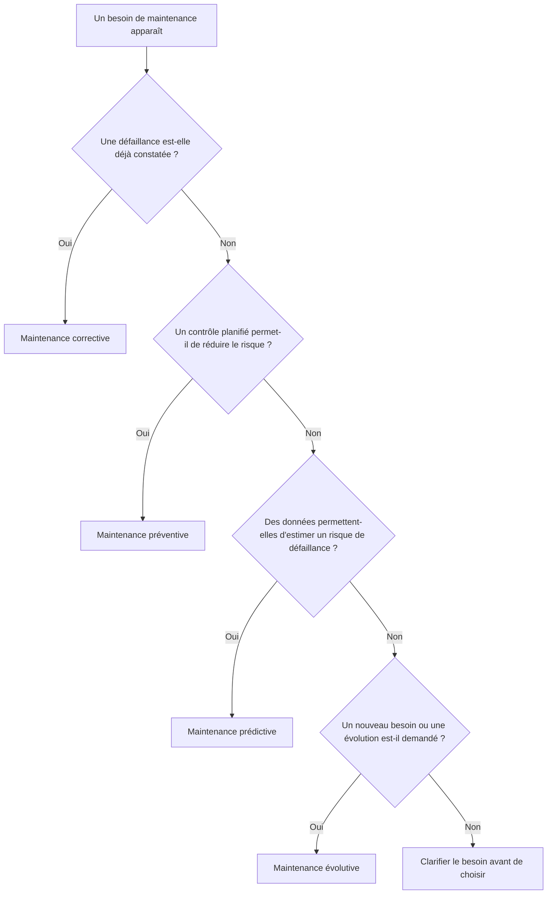
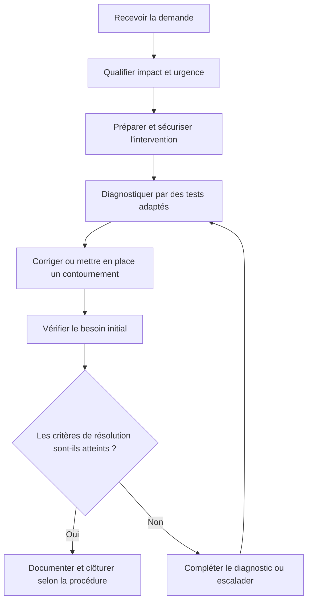
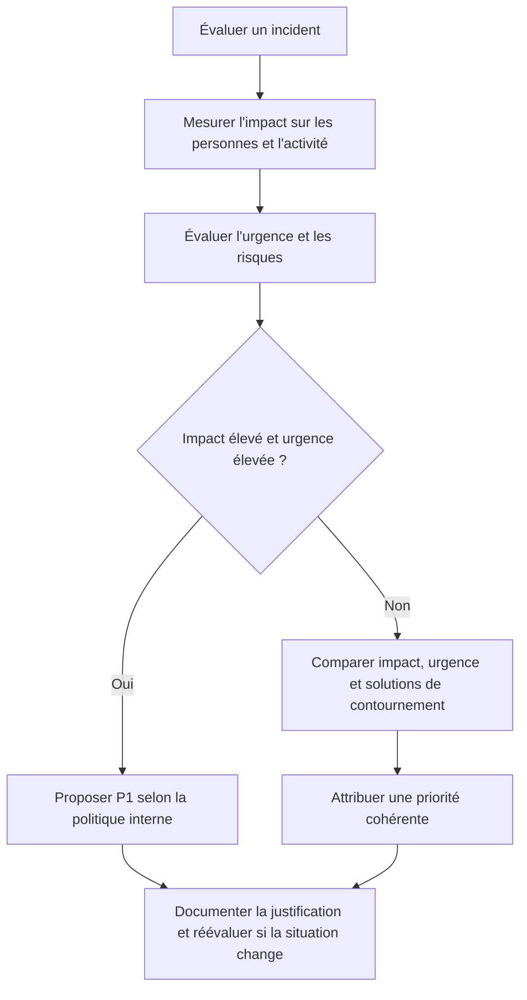

# Les fondamentaux de la maintenance

> **Mise en contexte**
>
> Tu viens d'intégrer le service informatique d'une entreprise. Dès le début de la journée, plusieurs demandes arrivent : un ordinateur est devenu très lent, une imprimante refuse les travaux d'impression, un utilisateur n'arrive plus à ouvrir un dossier partagé et un serveur affiche une alerte inhabituelle.
>
> Tu pourrais tenter quelques manipulations rapides, redémarrer les équipements et espérer que les problèmes disparaissent. Pourtant, cette méthode comporte des risques : tu pourrais interrompre un service utilisé par plusieurs personnes, perdre des données, masquer la cause réelle d'une panne ou créer un problème supplémentaire.
>
> Le travail d'un technicien de maintenance consiste à comprendre la situation, établir un diagnostic raisonnable, agir dans les limites de ses autorisations, vérifier les résultats et transmettre une information exploitable. La rapidité est importante, mais elle ne doit jamais remplacer la méthode.
>
> Ce cours présente les fondations du métier. Tu apprendras à différencier les types de maintenance, à analyser un incident, à organiser une intervention, à protéger les données et à communiquer avec les utilisateurs. Ces connaissances serviront de base aux cours suivants sur les outils de diagnostic, la maintenance matérielle, les systèmes d'exploitation, la gestion du support et le reporting.

## 1. Objectifs pédagogiques

À la fin de ce cours, tu seras capable de :

- expliquer le rôle de la maintenance informatique dans une organisation ;
- distinguer maintenance corrective, préventive, prédictive et évolutive ;
- différencier un incident, une panne, un symptôme, une cause et une solution de contournement ;
- identifier les informations à recueillir avant une intervention ;
- évaluer l'impact et l'urgence d'un incident ;
- construire un diagnostic fondé sur des hypothèses vérifiables ;
- choisir des contrôles adaptés au problème observé ;
- éviter les manipulations inutiles ou dangereuses ;
- respecter les règles de sécurité physique, numérique et organisationnelle ;
- tenir compte des sauvegardes et des risques de perte de données ;
- communiquer clairement avec un utilisateur et une équipe technique ;
- documenter une intervention de manière exploitable ;
- vérifier qu'une réparation répond effectivement au besoin ;
- reconnaître les situations qui nécessitent une escalade ;
- proposer les premières actions d'une maintenance préventive ;
- comprendre les indicateurs de base permettant d'évaluer la qualité de la maintenance.

## 2. Comprendre le rôle de la maintenance informatique

### 2.1. Définition

La maintenance informatique regroupe les activités destinées à préserver, surveiller, améliorer ou rétablir le fonctionnement des équipements, logiciels et services numériques.

Elle concerne par exemple :

- les ordinateurs fixes et portables ;
- les serveurs ;
- les imprimantes et autres périphériques ;
- les systèmes d'exploitation ;
- les applications professionnelles ;
- les équipements réseau ;
- les solutions de stockage ;
- les systèmes de sauvegarde ;
- les comptes utilisateurs et les accès ;
- les outils de supervision ;
- les services hébergés dans le cloud ;
- les infrastructures physiques qui hébergent ces services.

La maintenance ne consiste donc pas uniquement à ouvrir un ordinateur pour remplacer un composant. Elle comprend aussi la préparation, la surveillance, le diagnostic, la documentation, les vérifications et la communication.

### 2.2. Pourquoi une entreprise a-t-elle besoin de maintenance ?

Les activités quotidiennes d'une entreprise dépendent souvent de ses systèmes informatiques. Une interruption peut empêcher les salariés de travailler, retarder une livraison, interrompre une transaction ou rendre un service inaccessible à ses clients.

Prenons l'exemple d'une entreprise qui utilise un serveur de fichiers pour partager les documents de travail.

Si ce serveur devient inaccessible, plusieurs conséquences sont possibles :

- les collaborateurs ne peuvent plus consulter leurs documents ;
- certains processus métier sont retardés ;
- les fichiers en cours de modification deviennent temporairement indisponibles ;
- l'équipe informatique reçoit plusieurs demandes ;
- les responsables ont besoin d'une estimation de la durée de l'interruption ;
- une mauvaise intervention peut aggraver l'incident.

La maintenance cherche à limiter la fréquence de tels événements, à réduire leurs conséquences et à rétablir un fonctionnement acceptable lorsqu'ils surviennent.

### 2.3. Les objectifs principaux

**Disponibilité.** Les utilisateurs doivent pouvoir accéder aux services lorsque leur activité le nécessite.

**Fiabilité.** Les équipements et applications doivent fonctionner de manière suffisamment stable et prévisible.

**Sécurité.** Les interventions ne doivent pas introduire de vulnérabilités ni exposer des données.

**Intégrité.** Les informations doivent rester exactes, cohérentes et accessibles aux personnes autorisées.

**Performance.** Les ressources informatiques doivent être suffisamment disponibles pour les tâches prévues.

**Maîtrise des coûts.** Une organisation cherche à réduire les dépenses dues aux pannes, aux remplacements d'urgence et aux interruptions.

**Continuité d'activité.** Les services importants doivent pouvoir être maintenus ou rétablis dans des délais acceptables.

**Traçabilité.** Les actions réalisées doivent pouvoir être comprises, vérifiées et reprises par une autre personne.

Ces objectifs sont liés. Par exemple, une modification qui améliore temporairement les performances mais expose les données n'est pas une bonne opération de maintenance.

### 2.4. Maintenance, support et exploitation

Ces notions se recoupent, mais elles ne désignent pas exactement le même travail.

Le **support informatique** reçoit les demandes, aide les utilisateurs et organise le traitement des difficultés.

La **maintenance** cherche à conserver ou à rétablir le fonctionnement des équipements et services.

L'**exploitation informatique** assure le fonctionnement courant des systèmes : surveillance, exécution des traitements, gestion des opérations planifiées et suivi de l'infrastructure.

Dans une petite entreprise, une personne peut assurer les trois rôles. Dans une grande organisation, des équipes spécialisées peuvent se partager les responsabilités.

Exemple : une collaboratrice ne peut plus ouvrir une application.

Le support recueille la demande et vérifie les symptômes. Le technicien examine le poste et l'état de l'application. Si le problème vient d'un service central arrêté, l'équipe d'exploitation peut intervenir. Si l'incident révèle un défaut logiciel, une équipe spécialisée peut devoir analyser la cause.

L'objectif commun reste le rétablissement du service, avec des responsabilités adaptées à chaque équipe.

## 3. Les différents types de maintenance

Il faut savoir pourquoi une intervention est réalisée, et pas seulement quelle opération technique elle contient.

### 3.1. Maintenance corrective

La maintenance corrective est engagée après la détection d'une défaillance afin de rétablir le fonctionnement attendu.

Exemples :

- remplacer un câble endommagé ;
- réparer un service qui ne démarre plus ;
- corriger une configuration incorrecte ;
- remplacer un composant défectueux ;
- restaurer un fichier supprimé ;
- corriger une erreur de configuration empêchant l'accès à une application.

La maintenance corrective peut être immédiate ou différée. La décision dépend de la gravité de l'incident, des risques, des ressources disponibles et des procédures internes.

Un incident mineur sur un poste non critique peut parfois être planifié. Une panne qui bloque un service essentiel exige généralement une prise en charge plus rapide.

La correction ne doit pas être confondue avec une action improvisée. Même sous pression, il faut évaluer le risque et choisir une intervention adaptée.

**Exemple :** un câble réseau est coupé. Après avoir vérifié que le câble est bien à l'origine de la perte de connexion, le technicien le remplace et contrôle le rétablissement de la communication.

Il s'agit d'une maintenance corrective, car la défaillance existe déjà et l'intervention vise à la corriger.

### 3.2. Maintenance préventive

La maintenance préventive est organisée avant une panne, selon un calendrier, une fréquence ou des critères définis.

Elle cherche à réduire la probabilité de défaillance ou à détecter suffisamment tôt une anomalie.

Exemples :

- contrôler l'état des équipements ;
- vérifier les résultats des sauvegardes ;
- surveiller l'espace disponible sur les disques ;
- examiner les journaux système ;
- planifier les mises à jour approuvées ;
- vérifier la ventilation d'une salle informatique ;
- contrôler les batteries d'un onduleur selon les recommandations applicables ;
- réviser l'inventaire matériel ;
- rechercher les équipements qui ne sont plus supportés ;
- contrôler les comptes et les droits conformément aux règles de l'organisation.

La maintenance préventive dépend du contexte. Une vérification quotidienne peut être nécessaire pour un service critique, tandis qu'un contrôle périodique suffit pour certains équipements secondaires.

La fréquence ne doit pas être décidée au hasard. Elle peut être déterminée en fonction des recommandations du constructeur, des risques, de l'historique des incidents et des exigences métier.

**Exemple :** chaque mois, l'équipe informatique examine les rapports de sauvegarde, contrôle l'espace disponible sur les serveurs et vérifie les alertes matérielles. Les anomalies sont transformées en actions de suivi avant qu'elles ne provoquent une interruption.

### 3.3. Maintenance prédictive

La maintenance prédictive exploite des données sur l'état d'un équipement pour repérer une évolution anormale et estimer le risque d'une défaillance.

Les données peuvent provenir :

- de températures ;
- de compteurs d'usure ;
- d'erreurs matérielles ;
- de mesures de performance ;
- de tendances de consommation ;
- de journaux d'événements ;
- d'alertes de supervision ;
- de l'historique des incidents.

**Exemple :** un système de stockage signale une augmentation des erreurs associées à un disque. Le technicien vérifie l'alerte et applique la procédure prévue pour évaluer le risque et organiser, si nécessaire, le remplacement du composant.

Une alerte prédictive n'est pas une certitude. Elle constitue un indice à interpréter. Il faut tenir compte de la qualité des mesures, du contexte, du matériel et des recommandations du fabricant.

La maintenance prédictive nécessite généralement des outils, des données suffisamment fiables et des règles permettant de transformer les alertes en actions concrètes.

### 3.4. Maintenance évolutive

La maintenance évolutive permet d'adapter un système à un besoin nouveau ou à une évolution de l'organisation.

Exemples :

- augmenter la capacité d'un serveur ;
- adapter une application à un nouveau processus métier ;
- étendre un réseau à un nouveau bureau ;
- remplacer une solution devenue insuffisante ;
- ajouter une fonctionnalité à un outil interne ;
- faire évoluer un service pour répondre à une nouvelle exigence de sécurité.

Le système peut fonctionner correctement avant l'évolution. Le besoin a simplement changé.

Une évolution doit être préparée : compatibilité, risques, coût, tests, disponibilité, procédure de retour arrière et information des utilisateurs.

### 3.5. Maintenance et amélioration continue

Les opérations de maintenance peuvent également faire apparaître des possibilités d'amélioration.

Par exemple, si une imprimante tombe régulièrement en panne parce qu'elle est utilisée au-delà de sa capacité, remplacer ponctuellement une pièce ne suffira peut-être pas à résoudre le problème sur le long terme. L'organisation peut devoir revoir l'équipement, sa répartition ou ses usages.

L'amélioration continue consiste à tirer des enseignements des incidents et des opérations pour diminuer les problèmes récurrents.

### 3.6. Tableau comparatif

| Type de maintenance | Moment principal | Objectif | Exemple |
|---|---|---|---|
| Corrective | Après une défaillance | Rétablir le fonctionnement | Remplacer un câble cassé |
| Préventive | Avant une panne, selon un programme | Réduire le risque de défaillance | Contrôler périodiquement les sauvegardes |
| Prédictive | À partir de données d'état | Anticiper un risque probable | Examiner une alerte d'usure |
| Évolutive | Lorsqu'un besoin change | Adapter le système | Augmenter la capacité d'un serveur |


### Schéma de choix du type de maintenance



Ce schéma est un guide de première orientation. Dans la pratique, plusieurs formes de maintenance peuvent se combiner : il faut retenir celle qui décrit l'objectif principal de l'action, puis documenter les activités complémentaires.Ces catégories peuvent être complémentaires. Une organisation peut surveiller un équipement, réaliser des inspections planifiées, corriger les incidents et faire évoluer l'infrastructure.

## 4. Les notions indispensables pour comprendre un incident

### 4.1. La demande

Une demande est une sollicitation adressée à l'équipe informatique.

Elle peut concerner :

- un incident ;
- une demande d'accès ;
- une installation ;
- une information ;
- un changement planifié ;
- une demande de matériel ;
- une assistance à l'utilisation.

Toutes les demandes ne correspondent donc pas à une panne.

### 4.2. L'incident

Un incident est une perturbation du fonctionnement normal d'un service, ou une dégradation de sa qualité.

Exemples :

- une application devient indisponible ;
- un utilisateur ne peut plus se connecter ;
- un serveur ne répond plus ;
- l'impression échoue pour plusieurs personnes ;
- les sauvegardes prévues ne s'exécutent plus ;
- une connexion est anormalement lente.

Un incident décrit la perturbation constatée. Il n'identifie pas automatiquement son origine.

### 4.3. La panne

Une panne correspond à une défaillance d'un composant, d'un système ou d'un service.

Elle peut être matérielle, logicielle ou liée à une infrastructure.

Cependant, une difficulté d'accès ne signifie pas nécessairement que l'équipement est en panne. Un utilisateur peut être empêché d'ouvrir un dossier parce que ses autorisations ont changé, alors que le serveur fonctionne correctement.

### 4.4. Le symptôme

Le symptôme est un signe observable du problème.

Exemples :

- un message d'erreur apparaît ;
- un voyant change d'état ;
- un service ne répond pas ;
- une commande retourne une erreur ;
- un utilisateur reçoit un refus d'accès ;
- un disque signale une anomalie.

Le symptôme doit être décrit avec précision.

« Le réseau est cassé » est vague.

« Le poste ne parvient pas à atteindre la passerelle configurée » est plus précis, à condition que le test ait réellement été effectué.

### 4.5. L'hypothèse

Une hypothèse est une explication possible qui reste à vérifier.

Exemple : une application ne s'ouvre pas. Les hypothèses peuvent être les suivantes :

- un composant local est défectueux ;
- le compte ne possède pas les droits nécessaires ;
- un service distant est indisponible ;
- un problème réseau empêche l'accès ;
- une mise à jour a introduit une incompatibilité.

Une hypothèse doit pouvoir être évaluée par des contrôles pertinents.

### 4.6. La cause

La cause est le facteur qui explique la perturbation.

Il faut distinguer la cause supposée de la cause confirmée. Une intervention peut rétablir le service sans que la cause profonde soit totalement comprise.

Exemple :

- **Symptôme :** l'application ne démarre plus.
- **Hypothèse :** un service dont dépend l'application est arrêté.
- **Vérification :** le journal indique que le service ne démarre pas à cause d'une erreur de configuration.
- **Cause identifiée :** la configuration est invalide.
- **Action :** corriger la configuration selon la procédure autorisée.
- **Vérification :** le service démarre et l'application fonctionne.

Si les éléments disponibles ne suffisent pas, il faut écrire « cause non confirmée » plutôt que présenter une supposition comme une certitude.

### 4.7. La solution de contournement

Une solution de contournement permet de limiter les conséquences d'un incident sans nécessairement supprimer sa cause.

Exemple : lorsqu'une application est indisponible, une équipe peut utiliser temporairement un processus manuel autorisé.

Le service peut ainsi continuer à fonctionner partiellement, mais l'incident technique peut rester ouvert.

Le contournement doit être évalué : il doit rester sûr, conforme aux règles et suffisamment fiable.

### 4.8. La résolution

Une résolution est l'ensemble des actions qui rétablissent le fonctionnement attendu ou qui répondent aux critères définis pour traiter l'incident.

La résolution doit être vérifiée. Le simple fait d'avoir exécuté une commande ne constitue pas une preuve de réussite.

## 5. Le cycle complet d'une intervention

Une intervention de qualité suit une démarche structurée. L'ordre exact peut varier selon l'urgence, mais les étapes suivantes constituent une base solide.

### Étape 1 : recevoir et comprendre la demande

Il faut identifier :

- ce qui ne fonctionne pas ;
- l'équipement ou le service concerné ;
- la date et l'heure d'apparition ;
- le message d'erreur exact ;
- le nombre d'utilisateurs concernés ;
- les conséquences sur l'activité ;
- les changements récents connus ;
- les actions déjà réalisées.

Cette collecte évite de partir sur une mauvaise piste.

### Étape 2 : qualifier l'incident

Déterminer son impact, son urgence et les risques associés.

Un problème qui touche plusieurs personnes sur un service essentiel peut nécessiter une prise en charge prioritaire. Un incident concernant une seule fonction non critique peut parfois être planifié.

La sécurité et les risques de perte de données peuvent toutefois rendre urgente une situation qui ne bloque pas immédiatement les utilisateurs.

### Étape 3 : préparer l'action

Avant de modifier un système, vérifier :

- son périmètre et ses dépendances ;
- l'autorisation d'intervenir ;
- les outils disponibles ;
- les procédures applicables ;
- les conséquences possibles ;
- les protections des données ;
- la possibilité de revenir à l'état précédent ;
- les personnes à informer.

La préparation est particulièrement importante pour les serveurs, les équipements réseau et les applications partagées.

### Étape 4 : diagnostiquer

Formuler les hypothèses, choisir les tests qui apportent le plus d'informations et enregistrer les résultats.

Il faut éviter d'enchaîner des manipulations sans raison. Chaque test devrait aider à distinguer plusieurs possibilités ou confirmer une condition importante.

### Étape 5 : corriger ou mettre en place un contournement

Appliquer une action proportionnée à la cause identifiée, aux risques et aux autorisations.

Si la cause n'est pas suffisamment connue, une action temporaire peut être préférable à une modification risquée, à condition qu'elle soit autorisée et clairement documentée.

### Étape 6 : vérifier le résultat

Contrôler le besoin initial. Si le problème concernait l'accès à un dossier partagé, il faut tester cet accès avec un compte autorisé. Un simple test de connectivité ne suffit pas.

### Étape 7 : documenter l'intervention

Enregistrer les symptômes, les contrôles, les résultats, les actions et les vérifications finales.

La documentation doit distinguer les observations, les hypothèses et les conclusions.

### Étape 8 : clôturer ou escalader

Clôturer lorsque les critères de résolution sont satisfaits et que les informations nécessaires sont enregistrées.

Si le problème persiste, dépasse les compétences disponibles ou présente un risque élevé, transmettre le dossier à l'équipe appropriée.

### Schéma récapitulatif du cycle d'intervention



Le cycle n'est pas toujours strictement linéaire. Une nouvelle information peut obliger à revenir au diagnostic ou à modifier la priorité. L'important est de documenter ce qui a été fait et de ne pas clôturer sans vérification.

## 6. Qualifier et prioriser les incidents

Le technicien doit aider l'organisation à traiter en premier les problèmes qui ont les conséquences les plus importantes.

### 6.1. L'impact

L'impact décrit les effets d'un incident sur les utilisateurs, les services et l'activité.

Il peut dépendre :

- du nombre d'utilisateurs concernés ;
- de l'importance du service ;
- des tâches impossibles à réaliser ;
- de la présence d'une solution de contournement ;
- des données menacées ;
- des obligations opérationnelles de l'organisation.

Il ne dépend pas uniquement du nombre de personnes.

Un problème qui touche une seule personne peut être critique si cette personne réalise une opération indispensable et qu'aucune alternative n'existe.

### 6.2. L'urgence

L'urgence décrit le délai dans lequel une action est nécessaire pour limiter les conséquences.

Un incident peut nécessiter une intervention rapide si un risque de perte de données augmente, si une activité essentielle est bloquée ou si une échéance importante est proche.

### 6.3. Exemple de matrice de priorité

| Impact | Urgence | Priorité indicative |
|---|---|---|
| Élevé | Élevée | P1 — Critique |
| Élevé | Moyenne | P2 — Haute |
| Moyen | Élevée | P2 — Haute |
| Moyen | Moyenne | P3 — Normale |
| Faible | Faible | P4 — Basse |

Cette matrice est illustrative. Les niveaux, délais et règles de priorité doivent être définis par l'organisation.

Le technicien ne doit pas se contenter de choisir un niveau : il doit pouvoir expliquer la décision à partir des informations disponibles.

### Schéma de décision pour la priorité



Le classement doit respecter les règles de l'organisation. Les niveaux de priorité servent à organiser le travail ; ils ne remplacent pas le jugement fondé sur les risques et les conséquences réelles.

### 6.4. Exemples de priorisation

**Situation A :** une souris est défectueuse sur un poste secondaire, mais l'utilisateur dispose d'un autre poste fonctionnel.

L'impact est faible et une solution temporaire existe. L'intervention peut généralement être planifiée.

**Situation B :** un dossier partagé indispensable est inaccessible à tout un département.

L'impact peut être élevé. Il faut préciser le nombre de personnes touchées, l'importance des documents et les possibilités de contournement.

**Situation C :** le système de sauvegarde signale un échec alors que les serveurs continuent de fonctionner.

L'activité semble encore normale, mais le risque peut être important si aucune autre sauvegarde exploitable n'existe. Il faut examiner rapidement la situation et évaluer la protection réelle des données.

### 6.5. Ne pas confondre priorité et ordre d'arrivée

Le fait qu'une demande soit ancienne ne signifie pas nécessairement qu'elle est plus urgente qu'un nouvel incident critique.

Inversement, l'insistance d'un utilisateur ne suffit pas à justifier une priorité maximale.

La priorité doit être cohérente, documentée et ajustée lorsque de nouvelles informations apparaissent.

## 7. Construire un diagnostic fiable

### 7.1. Décrire le problème de façon vérifiable

Une bonne description précise le symptôme, le périmètre et le moment d'apparition.

Exemple vague :

« Le système ne fonctionne plus. »

Exemple exploitable :

« Depuis 10 h 20, trois postes du bureau B ne peuvent plus ouvrir le dossier partagé du service comptabilité. Les applications locales restent accessibles. »

La seconde description permet de choisir des tests plus pertinents.

### 7.2. Recueillir des preuves

Selon le problème, les preuves peuvent inclure :

- le texte d'une erreur ;
- un résultat de commande ;
- un événement système ;
- une alerte de supervision ;
- un état de service ;
- un résultat de test ;
- une comparaison avec un système fonctionnel ;
- un historique de modification ;
- une mesure de performance.

Une preuve doit être associée à son contexte : date, équipement, environnement et méthode de collecte.

Si un test n'a pas été réalisé, il ne faut pas l'inclure comme s'il avait réussi.

### 7.3. Formuler les hypothèses

Une bonne hypothèse explique un ensemble de symptômes et peut être mise à l'épreuve.

Pour une application inaccessible, on peut envisager :

1. un problème sur le poste utilisateur ;
2. un problème de réseau ;
3. une indisponibilité du service distant ;
4. un défaut de résolution de nom ;
5. un problème d'authentification ;
6. une autorisation insuffisante ;
7. une erreur de configuration.

Ces possibilités ne sont pas toutes également probables. Les premiers résultats doivent servir à réduire progressivement la liste.

### 7.4. Choisir des tests utiles

Un test est intéressant lorsqu'il permet de distinguer plusieurs hypothèses, ou de confirmer une condition nécessaire au fonctionnement.

Exemple : vérifier si un autre utilisateur autorisé accède à la même ressource aide à savoir si le problème est limité à un compte.

Comparer deux postes similaires peut faire apparaître une différence de configuration. Mais une différence ne prouve pas automatiquement qu'elle est responsable de l'incident.

### 7.5. Commencer par les contrôles les moins risqués

Dans la mesure du possible, privilégier d'abord :

- la collecte des messages d'erreur ;
- l'observation de l'état des équipements ;
- les comparaisons ;
- les tests non intrusifs ;
- la consultation des journaux accessibles ;
- la vérification de la configuration ;
- la confirmation du périmètre.

Les opérations destructives, les redémarrages de services critiques et les changements de configuration doivent être préparés.

### 7.6. Modifier un élément à la fois

Si plusieurs paramètres sont modifiés simultanément, il devient difficile de savoir quelle modification a produit le résultat.

Une méthode plus fiable consiste à :

1. noter l'état initial ;
2. définir une hypothèse ;
3. choisir une action ou un test ;
4. prévoir le résultat attendu ;
5. réaliser l'opération autorisée ;
6. enregistrer le résultat ;
7. décider de la suite.

Dans certains incidents majeurs, plusieurs actions coordonnées peuvent être nécessaires. Elles doivent alors être définies et suivies dans un plan d'intervention plutôt qu'improvisées.

### 7.7. Confirmer sans exagérer

Une cause est mieux établie lorsque plusieurs indices concordent et que le test réalisé permet de distinguer l'explication retenue des autres possibilités.

Si le service fonctionne après un redémarrage, le redémarrage a peut-être rétabli le service. Cela ne démontre pas nécessairement pourquoi le service s'est arrêté.

La documentation doit conserver cette nuance.

### 7.8. Rechercher les effets secondaires

Une correction peut résoudre un symptôme et en créer un autre.

Exemple : modifier une configuration réseau peut rétablir une connexion tout en empêchant l'accès à une autre ressource. Il faut donc vérifier les fonctions concernées par la modification et les dépendances importantes.

## 8. Les outils de base du technicien

Les outils servent à observer, mesurer, diagnostiquer et intervenir. Ils doivent être appropriés au problème et utilisés dans le respect des autorisations.

### 8.1. Outils physiques

Un technicien peut avoir besoin de :

- tournevis adaptés ;
- lampe d'inspection ;
- outils antistatiques ;
- testeur de câbles ;
- câble réseau de référence ;
- adaptateurs connus comme fonctionnels ;
- étiquettes pour identifier les équipements ;
- outils de nettoyage compatibles avec le matériel.

Les appareils de mesure électrique ne doivent être utilisés que par une personne formée, dans les limites prévues par les procédures de sécurité.

Un technicien débutant ne doit pas ouvrir un bloc d'alimentation ni intervenir sur des parties électriques dangereuses sans formation et autorisation appropriées.

### 8.2. Outils logiciels

Selon l'environnement, les outils peuvent comprendre :

- les gestionnaires de tâches ;
- les outils de diagnostic réseau ;
- les journaux d'événements ;
- les consoles de gestion des services ;
- les outils de supervision ;
- les logiciels d'inventaire ;
- les systèmes de sauvegarde ;
- les outils de contrôle du stockage ;
- les systèmes de gestion des tickets ;
- les consoles d'administration autorisées.

Il est préférable d'utiliser les outils approuvés par l'organisation plutôt que d'installer un logiciel inconnu pour un dépannage ponctuel.

### 8.3. Commandes de base sous Windows

Les commandes ci-dessous permettent d'obtenir des informations. Elles n'identifient pas automatiquement toutes les causes et les résultats doivent être interprétés dans leur contexte.

Afficher la configuration réseau :

```powershell
ipconfig /all
```

Cette commande permet notamment d'observer les adresses IP, la passerelle et les serveurs DNS configurés lorsqu'ils sont présents.

Tester une destination :

```powershell
ping 192.168.1.1
```

L'adresse est un exemple. Il faut choisir une destination pertinente pour le réseau réellement examiné.

Examiner la table de routage :

```powershell
route print
```

Afficher les connexions réseau et les ports à l'écoute :

```powershell
netstat -ano
```

Afficher les services connus de Windows :

```powershell
Get-Service
```

Examiner les événements récents du journal système :

```powershell
Get-WinEvent -LogName System -MaxEvents 20
```

Ces commandes sont principalement des outils d'observation. Il faut éviter de partager publiquement leurs résultats sans avoir vérifié qu'ils ne contiennent aucune information confidentielle.

### 8.4. Commandes de base sous Linux

Afficher les interfaces et leurs adresses :

```bash
ip address
```

Consulter la table de routage :

```bash
ip route
```

Tester une destination quatre fois :

```bash
ping -c 4 192.168.1.1
```

Examiner l'état d'un service sur un système utilisant systemd :

```bash
systemctl status nom-du-service
```

Consulter les journaux récents d'un service :

```bash
journalctl -u nom-du-service --since "30 minutes ago"
```

Le nom du service doit être remplacé par le nom réel. Certaines commandes nécessitent des droits supplémentaires ou peuvent afficher des informations réservées à l'administration.

Ne redémarre pas un service de production sans évaluer son impact et sans l'autorisation nécessaire.

### 8.5. Comprendre les limites d'un outil

Une commande fournit une information limitée à ce qu'elle mesure.

Un ping qui échoue peut indiquer une difficulté de connectivité, mais aussi un filtrage ICMP. Il ne prouve pas à lui seul qu'un serveur est définitivement indisponible.

De même, un service qui apparaît comme démarré peut rencontrer une erreur lorsqu'il traite une requête. Son état général et son comportement fonctionnel sont deux informations différentes.

Un outil est utile lorsque le technicien comprend ce qu'il mesure, ce qu'il ne mesure pas et dans quelles conditions son résultat peut être trompeur.

## 9. La sécurité au cours d'une intervention

La sécurité doit être prise en compte depuis la préparation jusqu'à la clôture.

### 9.1. Sécurité électrique et physique

Avant une intervention matérielle :

- consulter les instructions du constructeur ;
- identifier les sources d'alimentation ;
- respecter les procédures de mise hors tension ;
- utiliser un espace de travail approprié ;
- éviter les liquides à proximité des équipements ;
- empêcher les trébuchements liés aux câbles ;
- utiliser des outils compatibles ;
- ne pas manipuler de composants dangereux sans formation.

Un équipement éteint n'est pas nécessairement dépourvu de tout risque électrique. Certains composants peuvent conserver une charge dangereuse. Il ne faut pas ouvrir une alimentation électrique pour une réparation improvisée.

### 9.2. Protection contre les décharges électrostatiques

Les composants électroniques peuvent être endommagés par une décharge électrostatique, même lorsqu'elle n'est pas perceptible.

Les précautions peuvent inclure :

- l'utilisation d'un poste de travail adapté ;
- le respect des consignes antistatiques ;
- la manipulation des composants par leurs bords ;
- l'utilisation d'emballages adaptés ;
- la limitation du contact avec les broches et contacts ;
- le respect des instructions du constructeur.

Ces gestes doivent s'intégrer à une procédure correcte de manipulation du matériel.

### 9.3. Protection des données

Une opération peut affecter des fichiers, des paramètres, des comptes ou des journaux.

Avant une opération potentiellement destructive, il faut déterminer :

- quelles données sont concernées ;
- quelles conséquences sont possibles ;
- si une sauvegarde existe ;
- si sa restauration a été vérifiée selon les procédures ;
- qui est autorisé à effectuer l'opération ;
- quelle procédure permet de revenir à un état acceptable.

Une tâche de sauvegarde marquée comme terminée ne prouve pas toujours que toutes les données nécessaires sont récupérables.

Il est important de distinguer le fait d'avoir créé une sauvegarde de la capacité réelle à restaurer les données dans les conditions prévues.

### 9.4. Gestion des accès

Le technicien doit respecter les règles d'identité et d'autorisation.

Il doit notamment :

- utiliser les comptes qui lui sont attribués ;
- limiter ses actions aux droits nécessaires ;
- ne pas demander un mot de passe en clair à un utilisateur ;
- ne pas partager de compte personnel ;
- suivre la procédure approuvée de réinitialisation des accès ;
- protéger les informations contenues dans les journaux ;
- ne pas désactiver une protection de sécurité pour gagner du temps sans validation.

Posséder des droits administratifs ne signifie pas que toutes les actions sont autorisées.

### 9.5. Sécurité des changements

Un changement technique peut avoir des conséquences au-delà de l'équipement directement modifié.

Avant un changement important, préparer :

- son objectif ;
- le périmètre concerné ;
- les dépendances ;
- les risques ;
- les étapes d'exécution ;
- les tests de validation ;
- la fenêtre d'intervention ;
- le retour arrière ;
- les autorisations nécessaires ;
- les personnes à prévenir.

Pour une opération simple et réversible, une procédure légère peut être suffisante si les règles internes le permettent. Une modification sur un système critique exige généralement une démarche plus formelle.

### 9.6. Quand faut-il s'arrêter ?

Le technicien doit interrompre une opération et demander de l'aide lorsqu'un risque important apparaît ou que les limites de son autorisation sont atteintes.

Par exemple :

- l'état d'un disque laisse craindre une perte de données ;
- une opération menace un service critique ;
- une suspicion d'incident de sécurité apparaît ;
- l'action nécessite une autorisation absente ;
- les procédures ne couvrent pas la situation ;
- le matériel présente un danger physique.

S'arrêter au bon moment fait partie de la compétence professionnelle.

## 10. Sauvegarde, restauration et continuité

### 10.1. Définition de la sauvegarde

Une sauvegarde est une copie de données destinée à permettre leur récupération après un incident, une erreur ou une perte.

Elle peut concerner des fichiers, des bases de données, des configurations, des machines virtuelles ou d'autres éléments nécessaires au fonctionnement d'un service.

### 10.2. Pourquoi une sauvegarde doit être vérifiée

Une sauvegarde peut sembler correcte tout en étant incomplète ou inutilisable.

Par exemple :

- certaines données peuvent avoir été exclues ;
- la tâche peut s'être arrêtée avant sa fin ;
- le support peut être défectueux ;
- les clés ou informations nécessaires à la récupération peuvent manquer ;
- la procédure de restauration peut ne pas être connue ;
- les données restaurées peuvent ne pas être cohérentes avec les dépendances applicatives.

La vérification doit donc porter sur les résultats attendus et, selon la politique interne, comprendre des tests de restauration.

### 10.3. Sauvegarde et restauration ne sont pas identiques

La sauvegarde crée ou met à jour une copie. La restauration récupère des données à partir de cette copie.

La restauration doit être préparée, notamment lorsqu'elle concerne un système en production. Restaurer une ancienne version peut écraser des données récentes ou modifier l'état d'une application.

Il faut savoir exactement ce qui sera remplacé, quelles validations sont requises et comment vérifier le résultat.

### 10.4. Continuité de service

La continuité de service désigne la capacité à maintenir ou à rétablir une activité dans des conditions acceptables.

Elle dépend de plusieurs éléments :

- la disponibilité des équipements ;
- les sauvegardes ;
- les procédures ;
- les compétences ;
- les accès de secours ;
- la documentation ;
- les systèmes de remplacement ;
- les plans de reprise lorsqu'ils sont nécessaires.

La maintenance contribue à cette continuité, mais ne la garantit pas à elle seule.

## 11. Communiquer avec les utilisateurs

### 11.1. Poser des questions utiles

Le technicien doit recueillir les informations nécessaires sans transformer l'échange en interrogatoire.

Questions possibles :

- Que faisiez-vous lorsque le problème est apparu ?
- Quel message exact s'affiche ?
- Depuis quand le problème se produit-il ?
- Le problème concerne-t-il uniquement cet équipement ?
- Est-ce que cela fonctionnait auparavant ?
- Une modification récente est-elle connue ?
- Existe-t-il une solution temporaire permettant de poursuivre l'activité ?

Il ne faut pas demander un secret ou un mot de passe pour un diagnostic ordinaire.

### 11.2. Écouter avant de conclure

Les utilisateurs ne connaissent pas nécessairement le vocabulaire technique, mais ils peuvent fournir des informations précieuses : heure d'apparition, changement récent, fréquence du problème et opérations affectées.

Le technicien doit reformuler ce qu'il a compris et distinguer les observations des interprétations.

Exemple :

L'utilisateur dit : « Internet est cassé. »

Le technicien peut demander si les sites sont inaccessibles, si les applications internes fonctionnent et si le problème touche d'autres personnes.

Cette approche permet de transformer une description générale en observations exploitables.

### 11.3. Expliquer sans jargon excessif

Une explication simple est souvent plus utile à un utilisateur qu'une accumulation de termes techniques.

Au lieu de dire :

« Le service de résolution de noms rencontre probablement une anomalie. »

On peut dire :

« Le poste semble rencontrer une difficulté pour retrouver l'adresse du serveur à partir de son nom. Je vérifie ce point avant de modifier la configuration. »

Dans le ticket technique, le vocabulaire peut être plus précis. La communication doit s'adapter à son destinataire.

### 11.4. Informer sans faire de promesses non vérifiées

Il faut éviter les annonces telles que « ce sera réparé dans cinq minutes » lorsque le diagnostic n'est pas suffisamment avancé.

Une formulation plus fiable est :

« J'ai identifié le périmètre du problème. Je poursuis les vérifications et je communiquerai une estimation dès que les éléments disponibles permettront de la justifier. »

La communication doit rester honnête même lorsque la résolution prend plus de temps que prévu.

## 12. Documenter une intervention

### 12.1. Pourquoi documenter ?

La documentation permet :

- de transmettre le dossier à un autre technicien ;
- de conserver les résultats des tests ;
- d'éviter de répéter des actions inutiles ;
- de repérer les incidents récurrents ;
- de justifier les opérations réalisées ;
- de suivre les délais de traitement ;
- de préparer des audits ;
- d'améliorer les procédures.

Une intervention non documentée peut être difficile à comprendre le lendemain, en particulier si plusieurs personnes travaillent sur le même incident.

### 12.2. Les éléments d'une fiche d'intervention

Selon les outils utilisés par l'organisation, la fiche peut contenir :

- une référence de ticket ;
- la date et l'heure ;
- le service demandeur ;
- l'équipement ou le service concerné ;
- la description du symptôme ;
- l'impact ;
- les priorités attribuées ;
- les hypothèses examinées ;
- les contrôles réalisés ;
- les résultats ;
- la cause identifiée, ou la mention qu'elle reste inconnue ;
- les actions appliquées ;
- les tests finaux ;
- le statut ;
- les recommandations et suites à donner.

Il faut éviter d'enregistrer inutilement des informations confidentielles. La documentation doit suivre les règles de l'organisation concernant les données personnelles, les identifiants et les journaux.

### 12.3. Exemple d'une fiche factuelle

**Référence :** INC-2026-0042

**Objet :** accès impossible au dossier partagé.

**Symptôme :** depuis 10 h 05, trois utilisateurs du même bureau ne parviennent plus à ouvrir le dossier partagé. Les applications locales restent disponibles.

**Impact :** l'accès aux documents communs est interrompu pour les trois utilisateurs.

**Contrôles réalisés :** à compléter avec les résultats réellement obtenus.

**Hypothèses :** problème de connectivité, disponibilité du service, résolution de nom ou autorisations.

**Cause :** non confirmée au moment de la création de la fiche.

**Action réalisée :** à compléter après l'intervention autorisée.

**Vérification finale :** les utilisateurs autorisés peuvent ouvrir le dossier et réaliser les opérations prévues.

**Statut :** en cours, résolu après vérification ou escaladé selon les résultats.

Cet exemple est un modèle pédagogique, pas le compte rendu d'une intervention réelle. Il montre qu'il vaut mieux indiquer explicitement les informations manquantes que fabriquer une conclusion.

### 12.4. Une conclusion utile

Une bonne conclusion résume le résultat et les limites restantes.

Exemple :

« L'accès a été rétabli après correction de la configuration de la ressource. L'accès en lecture et en écriture a été vérifié avec un compte autorisé. Une surveillance complémentaire est prévue, car le problème s'était déjà produit la semaine précédente. »

Cette formulation est utile parce qu'elle précise l'action, la vérification et le suivi.

## 13. Vérifier le résultat avant de clôturer

### 13.1. Définir les critères de réussite

Avant de corriger un problème, il est utile de définir comment le succès sera vérifié.

Exemples :

- l'utilisateur peut ouvrir l'application ;
- le fichier peut être lu et enregistré ;
- l'imprimante produit une page de test ;
- un service répond à une requête représentative ;
- la configuration correspond au plan attendu ;
- l'alerte a disparu et ne réapparaît pas immédiatement ;
- les fonctions importantes n'ont pas été dégradées.

Ces critères évitent de déclarer un incident résolu sur la seule base d'une impression.

### 13.2. Vérifier le besoin initial

Si le problème concerne l'accès à un dossier, il faut tester cet accès. Si le problème concerne l'impression, il faut vérifier la chaîne d'impression prévue.

Un test partiel peut confirmer une étape sans prouver que le service complet fonctionne.

Par exemple, la présence d'une adresse IP correcte ne garantit pas qu'une application distante est accessible.

### 13.3. Vérifier les conséquences de la correction

Après une modification, vérifier les fonctions directement concernées et les éventuelles dépendances.

Une modification d'accès peut rétablir le service pour un utilisateur tout en supprimant par erreur les droits d'un autre groupe. La réussite individuelle ne suffit alors pas à confirmer la conformité du changement.

### 13.4. Distinguer rétablissement et résolution durable

Un service peut redevenir disponible temporairement après un redémarrage, alors que la cause profonde n'est pas encore identifiée.

Dans ce cas, il peut être justifié de déclarer le service rétabli tout en conservant un suivi de l'incident ou une action d'analyse.

Le statut doit refléter la réalité : ne pas annoncer une résolution définitive lorsque seuls des résultats temporaires ont été observés.

## 14. Quand escalader un incident ?

L'escalade consiste à transmettre un incident à une personne ou à une équipe disposant des compétences, des autorisations ou des moyens nécessaires.

Elle n'est pas un échec. Elle protège le service lorsque la situation dépasse le périmètre du technicien.

### 14.1. Les motifs fréquents

Une escalade peut être nécessaire lorsque :

- le diagnostic dépasse les compétences disponibles ;
- les tests autorisés n'ont pas permis de réduire suffisamment les hypothèses ;
- le service est critique ;
- des données sont menacées ;
- un incident de sécurité est suspecté ;
- les changements nécessaires exigent une validation ;
- le problème touche plusieurs systèmes dépendants ;
- une réparation spécialisée est requise ;
- les délais définis sont dépassés ;
- une procédure interne impose la prise en charge par une autre équipe.

### 14.2. Préparer le transfert

Un transfert de qualité contient :

1. une description factuelle ;
2. l'impact observé ;
3. l'heure d'apparition ;
4. le périmètre ;
5. les contrôles effectués ;
6. les résultats des contrôles ;
7. les changements déjà réalisés ;
8. les risques connus ;
9. les informations nécessaires à la reprise ;
10. la priorité et les raisons de cette priorité.

L'équipe suivante doit pouvoir comprendre ce qui a été observé et savoir ce qui reste à vérifier.

### 14.3. Ne pas transmettre un dossier vide

Écrire simplement « problème compliqué, voir avec le niveau supérieur » est rarement suffisant.

Même si la cause est inconnue, les informations recueillies peuvent faire gagner du temps à la personne qui reprend le dossier.

Une bonne escalade ne prétend pas avoir résolu le problème. Elle facilite la poursuite du diagnostic.

## 15. Les erreurs fréquentes et leurs conséquences

### 15.1. Agir avant d'avoir compris

Réinstaller une application, réinitialiser un équipement ou supprimer un répertoire peut détruire des informations utiles.

**Bonne pratique :** commencer par décrire le problème et collecter les preuves disponibles.

### 15.2. Confondre hypothèse et fait

Dire « le serveur est en panne » après un seul test incomplet peut orienter toute l'équipe dans la mauvaise direction.

**Bonne pratique :** documenter le résultat exact et préciser ce qu'il permet réellement de conclure.

### 15.3. Changer plusieurs paramètres simultanément

Il devient difficile d'identifier l'action qui a résolu ou aggravé le problème.

**Bonne pratique :** procéder par étapes et conserver un historique des modifications.

### 15.4. Oublier la protection des données

Une opération apparemment simple peut supprimer des fichiers ou altérer une configuration nécessaire à la récupération.

**Bonne pratique :** évaluer les risques et vérifier les mesures de protection avant l'intervention.

### 15.5. Utiliser une commande sans comprendre son effet

Une commande administrative peut modifier un service ou un composant important.

**Bonne pratique :** comprendre ce que fait la commande, ses prérequis et ses risques. Si le fonctionnement est incertain, s'abstenir et demander une validation.

### 15.6. Ne pas vérifier avec l'utilisateur

Un système peut sembler fonctionner dans la session du technicien tout en restant inutilisable pour la personne concernée.

**Bonne pratique :** vérifier les opérations réellement nécessaires, dans le respect des autorisations et de la confidentialité.

### 15.7. Clôturer trop tôt

La disparition d'une alerte ne signifie pas toujours que le problème est résolu.

**Bonne pratique :** vérifier les critères de réussite et indiquer les limites restantes.

### 15.8. Ne pas documenter

Une autre personne risque de recommencer les tests, de répéter des changements ou de perdre du temps à comprendre le dossier.

**Bonne pratique :** documenter au fur et à mesure, sans attendre la fin de la journée.

### 15.9. Dépasser son niveau d'autorisation

Un technicien peut disposer d'un accès technique sans être autorisé à effectuer toutes les opérations possibles.

**Bonne pratique :** respecter les rôles, les validations et les procédures.

## 16. Parcours pratique du débutant

Ce parcours est conçu pour être suivi progressivement dans un environnement personnel ou de laboratoire. Il ne faut pas appliquer des modifications sur un système professionnel sans autorisation.

### Atelier 1 : observer la configuration d'un poste

**Objectif :** apprendre à collecter des informations sans modifier la configuration.

1. Ouvre PowerShell sur un poste Windows autorisé.
2. Exécute `ipconfig /all`.
3. Identifie l'interface réseau active.
4. Repère l'adresse IP, le masque, la passerelle et les serveurs DNS lorsqu'ils sont configurés.
5. Exécute `Get-Service`.
6. Observe les informations sans arrêter ni modifier de service.
7. Consigne les résultats utiles dans une fiche.

**Résultat attendu :** une fiche qui sépare les observations des interprétations.

Ne considère pas une configuration comme incorrecte sans disposer des informations nécessaires sur le réseau.

### Atelier 2 : construire un arbre de diagnostic

**Situation :** un utilisateur ne parvient plus à accéder à une application interne.

**Mission :** déterminer les contrôles utiles.

Propose au moins quatre hypothèses :

- problème limité au poste ;
- problème de connectivité ;
- service distant indisponible ;
- erreur d'authentification ou d'autorisation.

Pour chaque hypothèse, note :

- le test prévu ;
- le résultat attendu ;
- l'interprétation possible ;
- les limites du test ;
- la prochaine action si le résultat est négatif.

L'objectif est d'apprendre à raisonner, pas de trouver immédiatement une cause unique.

### Atelier 3 : rédiger une fiche d'intervention

À partir d'un incident simulé, crée une fiche contenant :

- la référence ;
- la date et l'heure ;
- le demandeur ou le service ;
- l'équipement concerné ;
- le symptôme ;
- l'impact ;
- les hypothèses ;
- les tests et leurs résultats ;
- la cause confirmée ou non ;
- les actions réalisées ;
- les vérifications ;
- le statut ;
- le suivi recommandé.

Si la cause reste inconnue, écris-le clairement.

### Atelier 4 : prioriser trois incidents

Classe les situations suivantes en justifiant ton raisonnement :

- une souris ne fonctionne plus sur un poste secondaire ;
- une application métier essentielle est indisponible pour un service entier ;
- le serveur de sauvegarde signale un échec.

La priorité finale dépend du contexte. Le troisième incident peut être critique s'il laisse l'organisation sans copie exploitable. Il faut donc connaître l'état réel des sauvegardes et les conséquences d'un nouvel incident.

### Atelier 5 : distinguer observation et interprétation

Lis les phrases suivantes et sépare les faits observables des conclusions possibles :

- « Le serveur est mort. »
- « La commande de test n'a reçu aucune réponse. »
- « L'utilisateur a changé son mot de passe hier. »
- « L'application est forcément corrompue. »
- « Trois postes du même bureau présentent le même problème. »

Une bonne démarche conserve les faits, puis utilise les interprétations comme hypothèses à vérifier.

## 17. Travaux pratiques guidés

### TP 1 — Diagnostic d'un problème réseau

**Contexte**

Un poste ne peut plus accéder à une ressource interne alors que l'utilisateur affirme qu'Internet fonctionne.

**Mission**

Établir un diagnostic initial sans modifier le réseau au hasard.

**Étape A : recueillir les informations**

Demande le message d'erreur exact, le nom de la ressource, l'heure d'apparition, le nombre d'utilisateurs concernés et les actions déjà tentées.

**Étape B : examiner la configuration**

Sur un poste Windows autorisé, exécute :

```powershell
ipconfig /all
```

Vérifie la présence et la cohérence apparente des paramètres réseau. Pour déterminer ce qui est correct, il faut connaître le plan d'adressage réel.

**Étape C : comparer**

Si cela est autorisé, compare les informations avec celles d'un poste fonctionnel du même environnement.

Ne copie pas automatiquement la configuration de l'autre poste. Les adresses peuvent être attribuées différemment et certaines différences sont normales.

**Étape D : tester la destination**

Effectue un contrôle adapté à la ressource. Un ping peut fournir un indice, mais certains systèmes bloquent les requêtes ICMP.

**Étape E : conclure**

Rédige une conclusion proportionnée aux preuves. Si le problème touche l'infrastructure partagée ou si les autorisations nécessaires manquent, escalade l'incident.

**Critères de réussite**

- description claire du symptôme ;
- tests adaptés ;
- absence de modification non autorisée ;
- résultats consignés ;
- prochaine action justifiée.

### TP 2 — Préparer une maintenance préventive

**Contexte**

Une petite entreprise dispose de dix postes de travail, d'un serveur de fichiers, d'une imprimante réseau et d'un dispositif de sauvegarde.

**Mission**

Préparer une checklist de maintenance mensuelle qui pourra être adaptée après validation par le responsable informatique.

| Élément | Contrôle proposé | Preuve à conserver |
|---|---|---|
| Postes de travail | Alertes et mises à jour selon la politique | Résultat du contrôle |
| Serveur | État des services et journaux pertinents | Anomalies relevées |
| Stockage | Espace disponible et alertes | Mesures et incidents |
| Sauvegardes | Résultats des tâches et contrôles prévus | Rapport de sauvegarde |
| Réseau | Alertes de disponibilité | Rapport de supervision |
| Imprimante | État et tests autorisés | Résultat des tests |
| Inventaire | Concordance du matériel | Liste mise à jour |
| Documentation | Changements et interventions | Historique complété |

Une checklist ne doit pas devenir une liste de cases cochées sans preuve. Si une anomalie est trouvée, elle doit être enregistrée et faire l'objet d'une décision.

### TP 3 — Vérifier la clôture d'un incident

**Contexte**

Un service applicatif a été redémarré après une interruption.

**Mission**

Déterminer si le ticket peut être clôturé.

Contrôle les points suivants :

1. le service est-il démarré ?
2. les journaux indiquent-ils une répétition immédiate de la même erreur ?
3. l'application répond-elle ?
4. une opération métier représentative fonctionne-t-elle ?
5. les utilisateurs concernés peuvent-ils reprendre leur activité ?
6. un suivi supplémentaire est-il nécessaire ?

Si le service retombe en panne quelques minutes après le redémarrage, il ne doit pas être présenté comme définitivement rétabli. Une mesure temporaire peut être utile, mais l'incident nécessite encore un suivi.

### TP 4 — Préparer une escalade technique

**Contexte**

Le technicien de premier niveau constate qu'une application centrale est indisponible. Il n'a pas l'autorisation d'examiner tous les journaux du serveur.

**Mission**

Préparer le transfert à l'équipe responsable.

Le dossier doit contenir :

- les symptômes ;
- les utilisateurs concernés ;
- l'heure d'apparition ;
- les tests autorisés ;
- leurs résultats ;
- les éventuels changements récents connus ;
- les risques identifiés ;
- les informations qui restent à obtenir.

Le technicien ne doit pas chercher à contourner les restrictions d'accès pour compléter le dossier. Il doit indiquer ce qui lui manque et expliquer pourquoi cette information est nécessaire.

## 18. Exercices avec corrections détaillées

### Exercice 1 — Reconnaître les types de maintenance

Pour chaque situation, indique le type de maintenance le plus adapté.

1. Un câble réseau cassé est remplacé après une panne.
2. L'équipe contrôle chaque mois l'état des sauvegardes.
3. Une alerte d'usure conduit à planifier le remplacement d'un composant avant sa défaillance.
4. Un serveur reçoit davantage de mémoire pour accueillir une nouvelle application.
5. Une application fonctionne, mais une nouvelle version est préparée pour répondre à un besoin métier.

**Correction**

1. **Corrective.** La défaillance a eu lieu et l'action vise à rétablir le fonctionnement.
2. **Préventive.** Le contrôle est planifié pour détecter les problèmes en amont.
3. **Prédictive.** Une information sur l'état du composant est utilisée pour anticiper un risque.
4. **Évolutive.** Les capacités du système sont adaptées à un nouveau besoin.
5. **Évolutive.** Le système est modifié pour répondre à une nouvelle exigence.

### Exercice 2 — Symptôme ou cause ?

Un utilisateur déclare : « Mon ordinateur est cassé parce que l'application ne s'ouvre plus. »

Quelles informations dois-tu recueillir ?

**Correction**

Il faut demander le message exact, le moment d'apparition, les changements récents, le nombre d'utilisateurs concernés et l'état des autres fonctions du poste.

La difficulté à ouvrir l'application est un symptôme. L'affirmation selon laquelle l'ordinateur est cassé est une interprétation non démontrée.

La cause peut se trouver dans l'application, les droits, le réseau, un service distant ou le poste lui-même. Il faut tester ces possibilités avant de choisir une correction.

### Exercice 3 — Choisir la première action

Un utilisateur ne peut plus accéder à un dossier partagé. Quelle est la meilleure première démarche ?

A. Réinstaller immédiatement le système d'exploitation.

B. Supprimer les fichiers de synchronisation sans vérifier leur contenu.

C. Recueillir le message d'erreur, le périmètre et les résultats de contrôles non intrusifs.

D. Désactiver le pare-feu de l'entreprise.

**Correction : C.**

La collecte d'informations permet de comprendre le problème sans provoquer de modification inutile. Les autres options sont disproportionnées ou risquées en l'absence de diagnostic et d'autorisation.

### Exercice 4 — Interpréter un ping qui échoue

Le technicien exécute un ping vers un serveur et n'obtient aucune réponse. Il écrit : « Le serveur est définitivement hors service. »

Cette conclusion est-elle justifiée ?

**Correction : non.**

L'échec peut être causé par un filtrage ICMP, une route manquante, une règle de sécurité ou un problème de connectivité. Il faut des vérifications complémentaires pour déterminer si le service est réellement indisponible.

Le compte rendu doit décrire le résultat observé, et non affirmer une cause que le test ne démontre pas.

### Exercice 5 — Décider d'une escalade

Tu dois remplacer un composant sur un serveur critique. La procédure impose une validation, mais aucun responsable habilité n'est disponible. Le serveur fonctionne encore partiellement.

Que dois-tu faire ?

**Correction**

Ne contourne pas la procédure. Documente l'état du serveur, les risques et les contrôles déjà réalisés. Contacte le responsable ou l'équipe habilitée selon le processus d'escalade.

Une intervention non autorisée pourrait transformer un incident partiel en interruption complète.

### Exercice 6 — Vérifier une résolution

Une imprimante répond à un test réseau, mais les utilisateurs ne peuvent toujours pas imprimer.

Peut-on clôturer l'incident ?

**Correction : non.**

Le test confirme uniquement une partie de la connectivité. Il ne prouve pas que le pilote, la file d'attente, les droits, le serveur d'impression et l'ensemble de la chaîne fonctionnent.

Il faut poursuivre le diagnostic et vérifier le besoin initial.

### Exercice 7 — Améliorer une fiche d'intervention

La fiche indique : « Problème réglé. Redémarrage effectué. »

Quelles informations manquent ?

**Correction**

La fiche doit préciser le symptôme, le périmètre, l'impact, les contrôles effectués, leurs résultats, la raison du redémarrage, les vérifications finales et le suivi nécessaire.

Il faut aussi déterminer si le redémarrage a réellement résolu le problème ou simplement rétabli temporairement le service.

### Exercice 8 — Protéger des données

Un disque présente des erreurs. Un collègue propose de lancer immédiatement une réparation logicielle.

Quelle démarche est la plus prudente ?

**Correction**

Il faut évaluer l'état du disque, le risque de perte de données et la procédure appropriée. La disponibilité d'une sauvegarde exploitable doit être vérifiée selon les règles de l'organisation.

Une opération de réparation peut être inadaptée à un support dont la défaillance progresse. En cas de doute, il faut éviter les actions risquées et solliciter une personne compétente.

### Exercice 9 — Distinguer rétablissement et résolution durable

Un serveur redémarre après une interruption. Le service fonctionne pendant quelques minutes puis s'arrête à nouveau.

Comment documenter la situation ?

**Correction**

Il faut indiquer que le redémarrage a rétabli temporairement le service, mais que la panne se reproduit. La cause reste à analyser et le ticket ne doit pas être présenté comme définitivement résolu.

Le dossier doit inclure les heures, les symptômes, les journaux accessibles et les contrôles effectués.

### Exercice 10 — Prioriser une erreur de sauvegarde

Le service informatique reçoit une alerte indiquant que la dernière sauvegarde a échoué. Aucun utilisateur ne signale de difficulté.

Pourquoi cet événement peut-il être important ?

**Correction**

L'absence de perturbation visible ne garantit pas la sécurité des données. Si aucune autre sauvegarde exploitable n'existe, l'entreprise peut être exposée à une perte de données en cas de panne ultérieure.

Il faut vérifier le périmètre de la sauvegarde, l'échec observé, l'existence d'autres copies et les risques, puis déterminer la priorité selon les règles de l'organisation.

## 19. Défi final — Prendre en charge un incident de bout en bout

### Situation professionnelle

Tu es technicien dans une entreprise de 35 personnes.

À 8 h 45, plusieurs utilisateurs signalent qu'ils ne peuvent plus accéder à un dossier partagé contenant des documents de travail.

Les premières informations sont les suivantes :

- le problème est apparu le matin ;
- plusieurs utilisateurs sont concernés ;
- les applications locales fonctionnent ;
- un utilisateur affirme qu'un changement a été effectué la veille, sans pouvoir préciser lequel ;
- aucune cause n'est confirmée ;
- l'impact exact sur l'activité reste à déterminer.

Tu dois organiser la prise en charge sans inventer de résultat.

### Travail demandé

1. Reformule le problème de manière factuelle.
2. Identifie les informations manquantes.
3. Propose une priorité provisoire et explique ton raisonnement.
4. Énonce au moins cinq hypothèses.
5. Propose un contrôle sûr pour chaque hypothèse.
6. Indique les précautions à prendre avant toute modification.
7. Définis les critères de réussite.
8. Rédige un exemple de fiche d'intervention.
9. Détermine les situations qui justifieraient une escalade.
10. Explique pourquoi il est incorrect d'affirmer immédiatement que le serveur est en panne.

### Correction détaillée

**1. Reformulation factuelle**

« Depuis environ 8 h 45, plusieurs utilisateurs ne peuvent plus accéder à un dossier partagé utilisé pour leur travail. Les applications locales restent accessibles. L'impact métier précis et la cause ne sont pas encore confirmés. »

Cette formulation décrit la situation sans accuser prématurément le serveur, le réseau ou une personne.

**2. Informations manquantes**

Il faut recueillir :

- le nombre exact d'utilisateurs concernés ;
- leur emplacement ;
- le nom de la ressource ;
- le message d'erreur exact ;
- la possibilité de lire ou d'écrire des fichiers ;
- le résultat depuis un poste autorisé qui fonctionne habituellement ;
- les autres services qui restent disponibles ;
- la nature du changement de la veille ;
- les solutions de contournement éventuelles ;
- l'importance des documents pour l'activité.

Il faut également établir si les accès échouent de la même manière pour tous les utilisateurs.

**3. Priorité provisoire**

Une priorité élevée peut être justifiée si plusieurs personnes sont bloquées sur une activité essentielle et qu'aucune solution temporaire fiable n'existe.

La priorité définitive doit s'appuyer sur les règles de l'entreprise, l'impact réel, les risques et le délai acceptable de rétablissement.

**4. Hypothèses**

- le serveur hébergeant la ressource est indisponible ;
- le service de partage est arrêté ou dégradé ;
- une modification réseau empêche de joindre la ressource ;
- la résolution du nom du serveur échoue ;
- les droits d'accès ont changé ;
- le stockage rencontre un problème ;
- un changement de configuration effectué la veille est lié à l'incident.

Ces hypothèses sont des pistes. Aucune ne doit être présentée comme une cause confirmée au départ.

**5. Contrôles possibles**

- comparer les symptômes de plusieurs utilisateurs ;
- tester l'accès à une autre ressource connue du même environnement ;
- examiner la connectivité avec les outils autorisés ;
- consulter les journaux accessibles ;
- vérifier l'historique des changements ;
- examiner l'état du service depuis une console autorisée ;
- vérifier les autorisations à l'aide des outils prévus.

Le choix des contrôles dépend de l'architecture réelle. Un résultat isolé doit être interprété avec prudence.

**6. Précautions**

Il faut éviter les réinitialisations, les changements de droits en masse et les restaurations sans diagnostic. Les résultats doivent être conservés et les modifications doivent respecter les procédures.

Si une opération nécessite un accès ou une validation qui n'est pas disponible, il faut escalader plutôt que contourner les règles.

**7. Critères de réussite**

- les utilisateurs autorisés accèdent au dossier ;
- les opérations métier nécessaires fonctionnent ;
- les droits d'accès restent conformes ;
- aucune autre fonction importante n'a été dégradée ;
- les résultats sont documentés ;
- le suivi est défini si la cause profonde reste à confirmer.

**8. Exemple de fiche**

**Référence :** INC-2026-0043

**Heure du signalement :** 8 h 45.

**Objet :** accès impossible à un dossier partagé.

**Impact initial :** plusieurs utilisateurs touchés ; impact métier à confirmer.

**Symptômes :** accès à la ressource impossible ; message précis à recueillir.

**Changements récents :** changement signalé la veille ; détail à confirmer.

**Hypothèses :** disponibilité du serveur, service de partage, réseau, résolution de nom, autorisations ou stockage.

**Contrôles réalisés :** à renseigner après exécution avec les résultats exacts.

**Cause :** non confirmée au moment du signalement.

**Action :** aucune modification avant les contrôles et validations nécessaires.

**Critères de rétablissement :** accès vérifié par les utilisateurs autorisés et fonctionnement des opérations attendues.

**Statut :** en cours d'analyse, à mettre à jour selon les résultats.

**9. Conditions d'escalade**

L'escalade est nécessaire si l'incident touche une infrastructure partagée critique, si les données sont menacées, si les contrôles autorisés ne suffisent pas, si les compétences ou droits requis manquent ou si le délai défini par l'organisation est dépassé.

**10. Pourquoi ne pas conclure immédiatement à une panne du serveur ?**

Parce que les symptômes sont compatibles avec plusieurs causes. Le serveur peut être opérationnel alors que le réseau, la résolution de nom, les droits ou le service de partage présentent une anomalie.

Il faut des contrôles adaptés pour réduire les hypothèses et confirmer une cause.

### Barème indicatif

| Critère | Points |
|---|---:|
| Reformulation factuelle | 2 |
| Collecte des informations | 2 |
| Priorisation argumentée | 2 |
| Hypothèses et contrôles pertinents | 4 |
| Sécurité et gestion des risques | 3 |
| Critères de vérification | 2 |
| Documentation exploitable | 3 |
| Escalade et limites de responsabilité | 2 |
| **Total** | **20** |

Une bonne réponse doit être structurée, justifiée et honnête sur les inconnues. L'objectif n'est pas de deviner une panne, mais de montrer qu'on sait organiser un diagnostic professionnel.

## 20. Les premiers indicateurs de maintenance

Il n'est pas nécessaire de maîtriser des tableaux de bord complexes pour comprendre comment une équipe peut évaluer son travail. Il faut déjà savoir ce que mesurent les indicateurs les plus simples.

### 20.1. Nombre d'incidents

Le nombre d'incidents sur une période permet d'observer l'évolution des perturbations signalées.

Une hausse ne signifie pas automatiquement que le travail de l'équipe est moins bon. Elle peut venir d'une meilleure détection, d'une augmentation du parc informatique ou d'un changement dans la manière d'enregistrer les demandes.

Il faut donc interpréter l'indicateur dans son contexte.

### 20.2. Temps de résolution

Le temps de résolution représente la durée nécessaire pour parvenir au résultat attendu selon les règles de mesure définies.

Il peut varier selon la complexité, la disponibilité des pièces, les autorisations ou l'intervention d'une autre équipe.

Un temps court n'est pas toujours synonyme de qualité : une correction rapide qui entraîne la répétition de l'incident peut être moins efficace qu'une intervention plus longue qui règle durablement le problème.

### 20.3. Incidents récurrents

Le suivi des incidents récurrents permet d'identifier les problèmes qui reviennent sur un même équipement, service ou processus.

Une répétition peut indiquer :

- une cause profonde non traitée ;
- une maintenance préventive insuffisante ;
- un équipement vieillissant ;
- une configuration fragile ;
- une procédure inadaptée ;
- un manque de documentation ou de formation.

Il faut analyser les récurrences plutôt que multiplier uniquement les interventions correctives.

### 20.4. Taux de résolution au premier contact

Cet indicateur mesure la part des demandes résolues dès le premier échange, selon une définition précise.

Il peut aider à évaluer le support, mais ne doit pas inciter à clôturer trop vite les tickets. Une résolution doit rester correcte, vérifiée et documentée.

### 20.5. Qualité des données

Les indicateurs sont utiles seulement si les données sont suffisamment fiables.

Un ticket sans date, sans catégorie ou sans statut correct peut fausser les rapports. Une équipe doit donc adopter des règles cohérentes pour enregistrer les demandes et clôturer les interventions.

Les cours ultérieurs aborderont ces sujets de façon plus approfondie.

## 21. Récapitulatif et habitudes professionnelles à retenir

Les fondations de la maintenance reposent sur plusieurs principes.

**Comprendre avant d'agir.** Il faut décrire le symptôme, évaluer son périmètre et recueillir les informations utiles.

**Distinguer les concepts.** Un incident, une panne, un symptôme, une hypothèse et une cause ne désignent pas la même chose.

**Choisir le bon type de maintenance.** La maintenance corrective rétablit un service après une défaillance, la maintenance préventive réduit les risques en amont, la maintenance prédictive exploite les données d'état et la maintenance évolutive adapte le système à un nouveau besoin.

**Diagnostiquer de manière structurée.** Les tests doivent fournir des informations utiles et être adaptés au risque.

**Protéger les systèmes et les données.** Les autorisations, les sauvegardes, la sécurité physique et les procédures ne sont pas facultatives.

**Vérifier le résultat.** Une intervention n'est pas terminée uniquement parce qu'une commande s'est exécutée ou qu'une alerte a disparu.

**Documenter.** Les faits, les contrôles, les actions et les résultats doivent permettre à une autre personne de comprendre le dossier.

**Communiquer honnêtement.** Il faut éviter les promesses non vérifiées et les conclusions plus fortes que les preuves disponibles.

**Escalader à temps.** Les limites de compétences, d'autorisation et de sécurité doivent être respectées.

La méthode à mémoriser est la suivante :

**Observer → comprendre → qualifier → préparer → tester → corriger → vérifier → documenter → clôturer ou escalader.**

Ce cycle constitue la base de la progression en maintenance informatique. Les cours suivants approfondiront les outils de diagnostic, la maintenance matérielle et celle des systèmes d'exploitation en s'appuyant sur ces principes.
