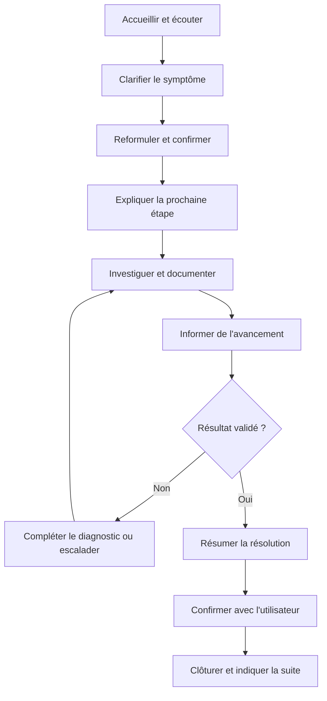
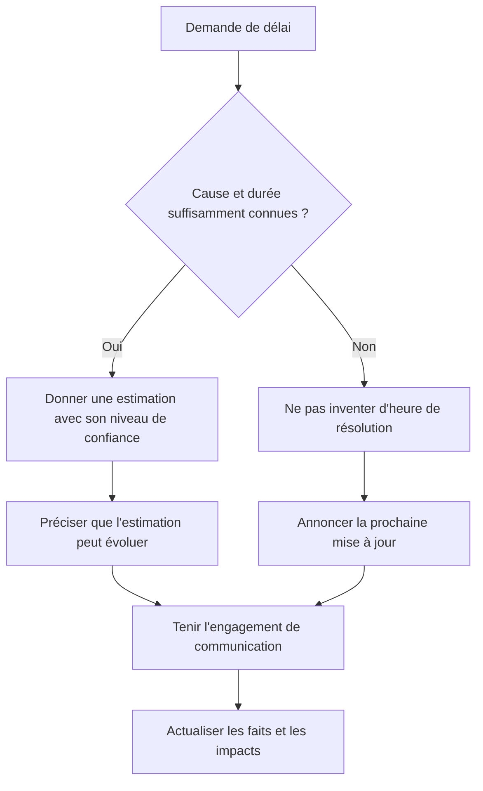
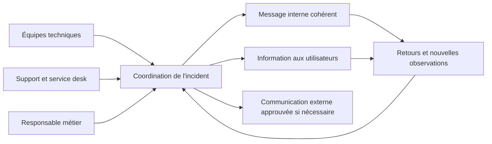
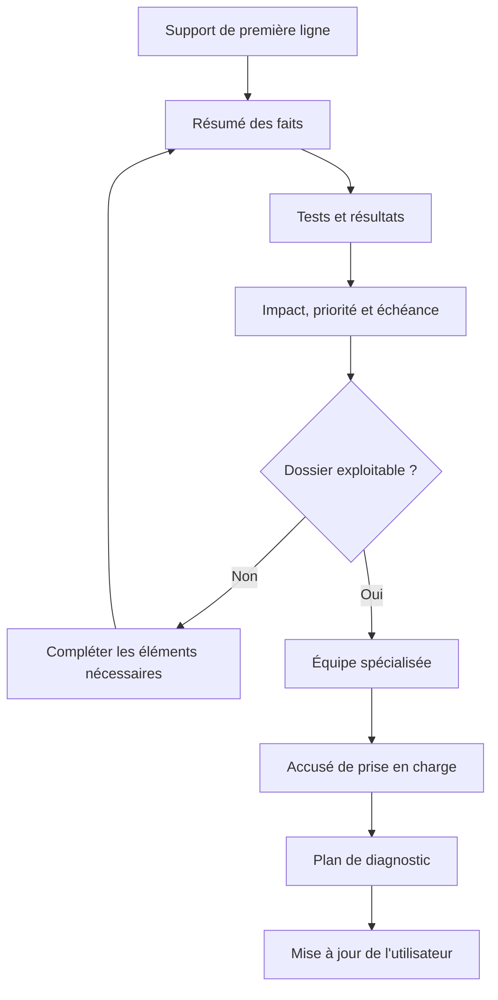

# Communication technique avec les utilisateurs — Débutant

> **Mise en contexte**
>
> Tu viens de rejoindre une équipe de support informatique. À 8 h 20, une employée t'appelle : « Tout est bloqué, je ne peux plus travailler. » Elle est pressée, décrit plusieurs symptômes à la fois et ne connaît pas les termes techniques. Un collègue écrit en parallèle que « le réseau est cassé », tandis qu'un responsable demande une heure précise de rétablissement. Tu dois écouter sans juger, recueillir des informations fiables, expliquer ce que tu sais sans inventer, coordonner le diagnostic et garder les personnes concernées informées. Ta compétence technique compte, mais ta manière de communiquer détermine aussi la qualité du diagnostic, la confiance de l'utilisateur et la traçabilité de l'intervention.

## 1. Objectifs pédagogiques

À la fin de ce cours, tu devras pouvoir conduire un échange de support clair et respectueux, même lorsque l'utilisateur est stressé ou que le problème n'est pas encore compris. Tu sauras poser des questions utiles, reformuler un besoin, distinguer les faits des suppositions, expliquer une action en langage simple, communiquer un délai avec prudence, transférer un dossier sans perdre le contexte et clôturer l'échange en vérifiant que le résultat attendu est atteint.

Les compétences recherchées sont concrètes :

- écouter l'utilisateur sans l'interrompre inutilement et repérer l'impact métier ;
- poser des questions ouvertes puis des questions précises, une à la fois ;
- reformuler les symptômes, le contexte et le résultat attendu ;
- adapter le niveau de détail à l'utilisateur, au technicien, au responsable ou au fournisseur ;
- expliquer une investigation sans jargon inutile, sans promesse irréaliste et sans accuser ;
- garder un ton professionnel face à la frustration et poser des limites en cas de comportement inacceptable ;
- fournir des mises à jour utiles pendant une interruption ;
- protéger les données personnelles, les identifiants, les secrets et les informations sensibles ;
- documenter l'échange dans un ticket exploitable par un autre technicien ;
- clôturer avec un résultat validé, des précautions éventuelles et une possibilité de reprise.

Le but n'est pas de rendre toutes les conversations « chaleureuses » au détriment de la précision. Une communication professionnelle doit être à la fois humaine, honnête, compréhensible, utile et compatible avec les règles du support.

## 2. Pourquoi la communication fait partie du dépannage

Un diagnostic commence souvent par une phrase approximative : « Internet ne marche pas », « l'ordinateur est mort », « l'application a disparu » ou « le serveur est lent ». Ces phrases décrivent une expérience, pas encore une cause technique. Le rôle du support est de transformer cette expérience en informations observables et en prochaines étapes.

Un utilisateur peut se tromper sur le composant responsable sans mentir. Si une page web ne s'ouvre pas, le problème peut venir du navigateur, du poste, du DNS, d'un proxy, de l'application distante, d'une authentification expirée ou d'une connexion réseau. Répondre immédiatement « c'est le réseau » crée une hypothèse prématurée et peut orienter l'investigation dans la mauvaise direction.

Une communication efficace apporte quatre bénéfices :

1. **Un diagnostic plus précis.** Les questions clarifient le symptôme, l'heure de début, les personnes affectées et les changements récents.
2. **Une meilleure coopération.** L'utilisateur comprend ce que tu lui demandes et pourquoi tu le demandes.
3. **Une attente maîtrisée.** Les personnes savent ce qui est confirmé, ce qui est en cours et quand elles recevront une nouvelle information.
4. **Une trace réutilisable.** Le ticket décrit les faits, les vérifications, les résultats et les décisions, ce qui facilite un transfert ou une analyse ultérieure.

La documentation officielle britannique sur la rédaction pour les interfaces recommande d'utiliser les mots des utilisateurs, de réduire la charge cognitive et de viser la clarté plutôt que le langage technique inutile. Ces principes s'appliquent aussi à la communication orale et aux tickets de support : un spécialiste a besoin de détails techniques, mais l'utilisateur doit comprendre ce qu'il doit faire et ce qui va se passer.

## 3. La boucle de communication d'une intervention

La communication ne se limite pas à une phrase d'accueil. Elle accompagne tout le cycle d'une demande, depuis le signalement jusqu'à la clôture.



Cette boucle peut être rapide pour une demande simple et durer plusieurs jours pour un incident majeur. Même quand la résolution est immédiate, il faut vérifier que l'utilisateur peut effectivement reprendre son travail.

### 3.1 Les quatre questions à garder en tête

À chaque étape, demande-toi :

- **Qu'est-ce que la personne vit ?** Comprends le symptôme tel qu'il est observé.
- **Qu'est-ce qui est important pour elle ?** Distingue le défaut technique de son impact sur le travail.
- **Qu'est-ce qui est confirmé ?** Sépare les faits, les hypothèses et les informations manquantes.
- **Que doit-elle savoir maintenant ?** Donne une prochaine étape utile, pas une explication trop longue ni une promesse sans fondement.

## 4. Accueillir sans juger

Le premier échange définit souvent le ton de l'intervention. Il faut montrer que le signalement est entendu, cadrer la demande et éviter de conclure avant le diagnostic.

Une entrée simple suffit :

« Bonjour, support informatique, je m'appelle Nadia. Je vais vous aider à clarifier le problème. Pouvez-vous me décrire ce que vous essayez de faire et ce que vous observez à l'écran ? »

Cette phrase présente le rôle, invite à décrire les faits et ne promet pas une résolution immédiate. Il n'est pas nécessaire d'utiliser un script rigide, mais une structure commune aide l'équipe à rester cohérente.

### 4.1 Ce qu'il vaut mieux éviter

| Formulation à éviter | Pourquoi elle pose problème | Formulation plus utile |
|---|---|---|
| « Vous avez mal fait la manipulation. » | Accuse sans démontrer la cause. | « Reprenons les étapes pour identifier où le résultat change. » |
| « Ce n'est pas le réseau. » | Conclut avant les tests. | « Les premiers tests ne pointent pas encore vers le réseau ; je vais vérifier la connexion et le service. » |
| « C'est facile, vous n'avez qu'à… » | Peut faire sentir à la personne qu'elle est incompétente. | « Je vous guide étape par étape. Dites-moi ce que vous voyez après cette action. » |
| « Ça va être réparé dans dix minutes. » | Peut créer une promesse non maîtrisée. | « Je n'ai pas encore d'heure fiable. Je vous donne un nouveau point de situation à 9 h 30. » |
| « Calmez-vous. » | Peut être perçu comme une injonction qui invalide l'émotion. | « Je comprends que l'interruption vous bloque. Regardons ce qui est le plus urgent à rétablir. » |
| « J'ai déjà expliqué. » | Ferme la discussion sans vérifier la compréhension. | « Je vais le reformuler autrement et nous vérifierons ensemble la prochaine étape. » |
| « C'est encore un problème utilisateur. » | Généralise et manque de respect. | « Le symptôme est réapparu ; comparons les conditions d'aujourd'hui avec celles du dernier ticket. » |

Le support doit rester factuel, mais factuel ne signifie pas froid ou méprisant. Une reconnaissance simple de l'impact est souvent suffisante : « Je comprends que vous ne puissiez pas envoyer les commandes et que cela bloque la livraison. » Tu reconnais la conséquence signalée sans confirmer encore la cause technique.

## 5. Écoute active : recueillir les bons éléments

L'écoute active consiste à porter attention au contenu, à la chronologie, à l'impact et aux incertitudes, puis à vérifier que tu as compris. Cela ne signifie pas rester silencieux sans orienter l'échange. Tu dois aider l'utilisateur à passer d'un récit parfois désordonné à une description exploitable.

### 5.1 Laisser une première description

Commence par une question ouverte :

- « Pouvez-vous me décrire ce qui se passe ? »
- « Que tentiez-vous de faire juste avant l'apparition du problème ? »
- « Qu'est-ce qui fonctionne encore et qu'est-ce qui ne fonctionne plus ? »

Laisse la personne terminer une première description, puis identifie les informations manquantes. Interrompre rapidement avec une série de questions techniques risque de faire perdre des détails pertinents ou de pousser l'utilisateur à répondre au hasard.

### 5.2 Aller du général au précis

Utilise une progression, au lieu d'envoyer dix questions à la fois.

```text
Description libre
      |
      v
Quel résultat était attendu ?
      |
      v
Que s'est-il produit à la place ?
      |
      v
Quand et dans quelles conditions ?
      |
      v
Une seule personne ou plusieurs ?
      |
      v
Message d'erreur et exemples observables
      |
      v
Reformulation et confirmation
```

Commence par comprendre l'activité. Tu peux ensuite demander un message d'erreur exact, l'heure de début, le nom de l'application, le réseau utilisé, le type de poste ou le résultat d'un test simple. Chaque question doit avoir une raison. Si tu demandes une information technique, explique brièvement ce qu'elle permettra de distinguer.

### 5.3 Questions ouvertes et questions fermées

Une question ouverte permet à l'utilisateur de décrire : « Que se passe-t-il lorsque vous ouvrez l'application ? » Une question fermée vérifie un point précis : « Voyez-vous le message “session expirée” ? » Les deux sont utiles, mais pas au même moment.

| Situation | Question utile | Ce qu'elle permet d'apprendre |
|---|---|---|
| Le problème est vague | « Pouvez-vous me montrer ou décrire la dernière étape qui fonctionne ? » | Limite de la zone en échec |
| La chronologie est incertaine | « À quelle heure avez-vous constaté le premier échec ? » | Début de l'incident |
| Le périmètre est inconnu | « Un collègue rencontre-t-il la même difficulté avec le même service ? » | Étendue probable |
| Une hypothèse doit être vérifiée | « Le message apparaît-il encore après une nouvelle connexion ? » | Résultat d'un test autorisé |
| L'utilisateur ne sait pas quoi faire | « Préférez-vous que je vous guide par téléphone ou que je vous envoie les étapes ? » | Canal adapté |
| Une restauration est envisagée | « Les dernières modifications ont-elles été enregistrées ailleurs ? » | Risque de perte de travail |

Ne pose pas de question orientée qui impose une réponse : « Vous avez installé quelque chose hier, n'est-ce pas ? » Préfère : « Des changements ont-ils eu lieu récemment sur le poste ou dans l'application ? » La seconde formulation laisse l'utilisateur fournir sa propre observation.

### 5.4 Les détails essentiels d'un signalement

Selon le type d'incident, recueille progressivement :

- la tâche que la personne essayait de réaliser ;
- le symptôme exact, avec le message affiché si disponible ;
- la date, l'heure et le fuseau horaire lorsqu'ils importent ;
- le nombre de personnes, sites ou équipements touchés ;
- le caractère permanent, intermittent ou lié à une action ;
- le dernier moment où le service fonctionnait ;
- les changements récents connus ;
- les vérifications déjà réalisées et leurs résultats ;
- l'impact sur l'activité et l'échéance métier ;
- les coordonnées de suivi adaptées au processus de l'équipe.

N'exige pas toutes ces informations dans chaque cas. Pour une demande de création d'accès, le besoin, le destinataire, l'approbateur et la date peuvent être plus importants qu'un message d'erreur. Pour un incident réseau, le lieu, le réseau utilisé, l'heure et le nombre d'utilisateurs affectés peuvent être déterminants.

### 5.5 Reformuler sans transformer les faits

Une bonne reformulation résume le besoin, le symptôme et l'impact :

« Si je comprends bien, depuis environ 8 h 10, vous pouvez ouvrir le portail, mais l'envoi du formulaire échoue avec le message affiché. Deux collègues de votre équipe rencontrent le même problème. Vous devez terminer cette opération avant 10 h. Est-ce exact ? »

Tu ne dis pas que le portail est en panne pour tout le monde ou que le serveur a échoué : ces causes ne sont pas établies. La reformulation permet à l'utilisateur de corriger une erreur de compréhension avant que tu ne l'enregistres dans le ticket.

### 5.6 Respecter le silence et les différences de communication

Certaines personnes ont besoin de quelques secondes pour se souvenir d'une étape, lire un message ou trouver un document. Évite de compléter leurs phrases ou de répondre à leur place. Si une personne rencontre une difficulté à communiquer à l'oral, propose un autre moyen : chat, courriel, description écrite, capture expurgée ou contact adapté. Ne suppose pas qu'une personne est peu compétente parce qu'elle ne connaît pas le vocabulaire informatique.

## 6. Adapter son langage au destinataire

Le même incident peut nécessiter plusieurs niveaux de formulation. Le contenu factuel doit rester cohérent ; seuls le vocabulaire, la profondeur technique et les actions attendues changent.

Exemple technique : les requêtes DNS échouent sur un résolveur interne. Le technicien réseau peut avoir besoin des résultats de résolution, du serveur interrogé, de l'horodatage, de la zone et des tests de connectivité. L'utilisateur métier a surtout besoin de savoir quel service est touché, quelles tâches sont bloquées, quelle solution temporaire est autorisée et quand il recevra une mise à jour.

| Destinataire | Ce qui lui est généralement utile | Exemple |
|---|---|---|
| Utilisateur final | Impact, action demandée, prochaine mise à jour | « L'accès au portail échoue actuellement. L'équipe vérifie le service ; vous n'avez pas besoin de réinitialiser votre mot de passe. » |
| Technicien de niveau 2 | Symptômes détaillés, périmètre, tests et résultats | « Échec reproductible depuis deux postes du VLAN utilisateurs à 8 h 12 ; résolution du nom en timeout vers le résolveur interne ; les adresses IP restent joignables. » |
| Responsable métier | Impact, continuité, priorité, décision | « Trois personnes sont bloquées sur la validation des commandes. Une saisie différée est possible selon la procédure métier ; prochaine mise à jour à 9 h 30. » |
| Responsable informatique | Risque, portée, dépendances, ressources et tendance | « L'incident affecte l'application de validation sur le site A. Cause non confirmée ; l'investigation porte sur la résolution de noms et le service applicatif. » |
| Fournisseur | Identifiants utiles, preuves horodatées, résultats reproductibles | « Merci d'examiner les erreurs observées entre 08:10 et 08:20 UTC+1 pour le service X ; les identifiants de requête expurgés sont joints. » |

Évite de créer des versions contradictoires. Si la cause n'est pas connue, ne dis pas à l'utilisateur « le service fournisseur est en panne » alors que tu écris au responsable « cause inconnue ». Tu peux adapter le niveau de détail sans changer le degré de certitude.

### 6.1 Traduire le jargon en langage simple

| Terme technique | Version compréhensible pour un utilisateur |
|---|---|
| « Le DNS ne résout pas le FQDN » | « Le poste n'arrive pas à trouver l'adresse du service à partir de son nom. » |
| « Le délai TCP expire » | « La connexion avec le service n'obtient pas de réponse dans le délai prévu. » |
| « Le cache est incohérent » | « Le poste utilise peut-être encore une ancienne information enregistrée. » |
| « On va redémarrer le service » | « Nous allons relancer le composant qui traite les demandes. Pendant cette action, l'accès peut être interrompu. » |
| « Le ticket est en attente d'un tiers » | « Nous avons transmis les éléments au fournisseur et attendons sa réponse. Nous vous informerons au prochain point prévu. » |
| « Le contournement est appliqué » | « Une solution temporaire permet de reprendre l'activité, mais la cause n'est pas encore corrigée. » |
| « La résolution est déployée » | « La correction a été installée ; nous vérifions maintenant que le service fonctionne normalement. » |

Ne simplifie pas au point de rendre le message faux. Par exemple, dire « nous avons réparé le problème » après avoir seulement redémarré un processus peut être trompeur si la cause est inconnue. Tu peux dire « le service répond à nouveau après le redémarrage ; nous surveillons sa stabilité et poursuivons l'analyse si le défaut réapparaît ».

## 7. Empathie, neutralité et professionnalisme

L'empathie signifie prendre au sérieux l'expérience de l'utilisateur. Elle ne signifie pas accepter une accusation comme un fait, reconnaître une cause non démontrée ou contourner les règles. Tu peux comprendre la frustration sans dire que le système est défectueux avant les tests.

Une structure utile est :

1. **Reconnaître l'impact.** « Je comprends que vous ne puissiez pas accéder aux dossiers nécessaires. »
2. **Préciser le besoin.** « Est-ce le dossier partagé de l'équipe Finance ou un autre emplacement ? »
3. **Annoncer la prochaine étape.** « Je vais vérifier la disponibilité du service et les accès, puis je vous donne un point de situation. »
4. **Tenir le suivi.** Reviens à l'heure annoncée, même si tu n'as pas encore la cause.

### 7.1 Décrire les faits, pas juger la personne

Au lieu de dire « l'utilisateur a cassé la configuration », écris : « après l'installation signalée à 14 h, le service ne démarre plus ; la relation causale reste à confirmer ». Au lieu de « le collègue n'a rien fait », note : « aucun résultat de test n'est présent dans le ticket transmis ; demande de complément envoyée à 15 h 20 ».

Cette discipline protège la qualité du diagnostic et évite de transformer un incident en conflit personnel. Elle aide également un autre technicien à reprendre le dossier sans hériter d'un jugement qui pourrait biaiser son analyse.

### 7.2 Faire face à une personne mécontente

Si l'utilisateur hausse le ton :
- garde une voix stable et un débit mesuré ;
- laisse la personne exprimer le problème sans répondre à l'agressivité par l'agressivité ;
- reconnais l'impact, pas une cause que tu n'as pas vérifiée ;
- recentre sur une question ou une prochaine action concrète ;
- propose un autre canal ou la présence d'un responsable si nécessaire ;
- applique les règles de l'organisation en cas d'insultes, de menaces ou de comportement dangereux.

Exemple : « Je vois que la situation vous empêche de terminer votre travail et je comprends que ce soit frustrant. Je veux vous aider à rétablir l'accès. Pour choisir le bon test, pouvez-vous me dire si les autres applications fonctionnent encore ? »

Si la personne continue à insulter ou menace quelqu'un, pose une limite calme : « Je souhaite poursuivre l'assistance, mais nous devons échanger sans menaces. Je vais solliciter le responsable prévu par notre procédure pour organiser la suite. » Ne te mets pas en danger pour terminer un échange.

### 7.3 Reconnaître une erreur du support

Si tu as transmis une information incorrecte ou manqué une mise à jour, reconnais précisément le fait, corrige-le et annonce la suite :

« Je vous avais indiqué que la vérification serait terminée à 11 h. Elle est toujours en cours, et je n'aurais pas dû présenter cette heure comme certaine. Le prochain point que je peux garantir est à 11 h 30 ; je vous dirai alors ce qui est confirmé et ce qui reste à faire. »

Ne cache pas l'erreur et ne rejette pas automatiquement la responsabilité sur une autre équipe. La transparence doit rester compatible avec les règles de confidentialité et les responsabilités de communication de l'organisation.

## 8. Promesses, délais et mises à jour

Dans un incident technique, l'incertitude est normale. La communication professionnelle consiste à rendre cette incertitude compréhensible, pas à inventer une heure de résolution.

### 8.1 Distinguer les horaires

- **Délai de prise en charge** : temps avant qu'une personne ou une équipe commence le traitement.
- **Délai de première réponse** : temps avant le premier retour au demandeur.
- **Délai de prochaine mise à jour** : moment où une information d'avancement sera communiquée.
- **Estimation de rétablissement** : heure prévue à partir d'informations disponibles, qui peut évoluer.
- **Heure de résolution confirmée** : moment où le résultat attendu a été vérifié selon le processus.

Ces notions ne sont pas interchangeables. Si tu ne maîtrises pas la durée du diagnostic, tu peux t'engager sur la prochaine mise à jour plutôt que sur une heure de rétablissement.

### 8.2 Message d'avancement en cinq éléments

Un message utile indique :
1. le statut confirmé ;
2. l'impact compris ;
3. l'action en cours ;
4. l'information qui manque ou l'incertitude, si elle est pertinente ;
5. la prochaine mise à jour et son canal.

Exemple :

« À 9 h 10, l'accès au portail reste indisponible pour les utilisateurs du site A. L'équipe vérifie la connexion entre le portail et le service d'identité ; la cause n'est pas encore confirmée. La saisie locale reste disponible pour les opérations autorisées par la procédure métier. Prochaine mise à jour à 9 h 30 sur le canal d'incident. »

### 8.3 Schéma de décision pour communiquer un délai



Ne promets pas un délai qui dépend d'une décision ou d'un fournisseur sans base vérifiable. S'il existe un engagement de service formel, cite-le correctement et distingue cet engagement de la prévision du technicien.

### 8.4 Fréquence des mises à jour

La cadence dépend de la criticité, de l'évolution du problème, du nombre de personnes touchées et du plan de communication. Une panne majeure peut nécessiter des points fréquents même si la cause n'a pas changé. Une demande simple peut n'exiger qu'un retour à la prise en charge puis un message de résolution.

Le plus important est d'établir une attente claire : « prochaine mise à jour à 14 h » signifie que tu dois communiquer à 14 h, même si l'information reste : « l'équipe poursuit les tests, aucun rétablissement confirmé ». Ne laisse pas les personnes deviner si le ticket a été oublié.

## 9. Communiquer pendant un incident majeur

Quand plusieurs équipes sont touchées, le volume de messages peut augmenter, les informations se contredire et les suppositions circuler. La préparation avant incident aide à maintenir une communication cohérente. Les recommandations publiées en 2026 par des agences de cybersécurité, dont l'Australian Cyber Security Centre et des partenaires internationaux, insistent sur des communications exactes, opportunes et adaptées aux destinataires pendant les interruptions de services IT et OT.

### 9.1 Désigner le canal et les rôles

Un incident important devrait disposer d'un canal de référence, d'un responsable de coordination et d'un processus pour approuver les messages externes lorsque nécessaire. Les techniciens doivent partager les faits utiles avec la coordination, et les personnes chargées de la communication doivent éviter de diffuser une hypothèse comme une cause confirmée.



Les canaux alternatifs doivent être définis à l'avance. Si la messagerie d'entreprise est indisponible, une procédure de secours peut prévoir un autre canal autorisé. N'invente pas une nouvelle plateforme en pleine crise sans évaluer la confidentialité et la validation prévues par l'organisation.

### 9.2 Ce qu'un premier message doit contenir

Un premier avis peut comprendre :
- le service concerné et l'heure approximative de début si elle est connue ;
- l'impact actuellement observé ;
- ce que l'équipe fait pour comprendre ou limiter la situation ;
- les actions à éviter, si elles sont clairement justifiées ;
- le canal et l'heure du prochain point ;
- un identifiant d'incident ou un lien vers le canal officiel.

N'ajoute pas de données qui aggravent l'exposition : mots de passe, clés, informations personnelles inutiles, détails exploitables par un adversaire ou informations non confirmées sur l'origine d'une attaque. Quand la sécurité ou le droit imposent des règles de divulgation spécifiques, elles doivent être suivies par les responsables compétents.

### 9.3 Exemple : interruption du service de fichiers

**Premier avis**

« Depuis 10 h 05, plusieurs utilisateurs signalent un échec d'accès au partage de fichiers du site B. L'équipe informatique analyse la disponibilité du service. La cause n'est pas encore confirmée. Évitez de multiplier les essais de connexion et ne déplacez pas les fichiers vers un espace non approuvé. Une nouvelle mise à jour sera publiée à 10 h 30 dans le canal d'incident. »

**Mise à jour**

« À 10 h 30, l'accès reste dégradé. Les premiers contrôles indiquent que le serveur répond, mais que certaines connexions échouent. L'équipe poursuit les vérifications des accès et des dépendances. Aucune perte de données n'est confirmée à ce stade. Prochain point à 10 h 50. »

**Avis de rétablissement**

« À 10 h 48, le test de validation depuis deux postes du site B a réussi et les utilisateurs pilotes confirment l'accès aux dossiers attendus. L'accès normal est rétabli selon les vérifications effectuées. L'équipe surveille encore le service et prépare un bilan. Signalez tout nouvel échec avec l'heure et le nom du dossier concerné via le ticket d'incident. »

Ces exemples ne doivent pas être copiés sans vérifier les faits. Le message de rétablissement n'est approprié que si les tests indiqués ont réellement eu lieu. Ne dis pas « aucune donnée n'a été perdue » si cela n'a pas été vérifié.

### 9.4 Distinguer incident technique et suspicion de sécurité

Si un signalement peut révéler une compromission, applique la procédure de sécurité et limite les détails partagés aux personnes habilitées. Ne demande pas à l'utilisateur de supprimer des traces, d'installer un outil non autorisé ou de transmettre un mot de passe. Le service desk recueille les informations nécessaires et les transmet au processus compétent ; il ne mène pas une investigation non autorisée.

Une communication de sécurité doit protéger les personnes et les systèmes tout en donnant des consignes concrètes. Si la cause n'est pas confirmée, utilise « événement suspect en cours d'analyse » plutôt que « nous avons été piratés ». La précision n'est pas une minimisation : elle évite d'ajouter de la confusion à une situation incertaine.

## 10. Communication écrite : tickets, courriels et chats

Un message écrit doit rester compréhensible lorsqu'il est relu plusieurs heures plus tard par une autre personne. Les expressions vagues comme « ça ne marche pas », « problème réglé » ou « voir avec réseau » ne fournissent pas assez de contexte.

### 10.1 Un modèle de message de prise en charge

```text
Objet : [Service] — [symptôme principal] — [identifiant du ticket]

Bonjour [prénom],

J'ai bien reçu votre signalement concernant [symptôme observé].
J'ai noté que cela affecte [activité ou périmètre connu].

Je vais vérifier [prochaine action concrète].
À ce stade, [fait confirmé / cause non encore confirmée].

Je vous ferai un nouveau point [date/heure ou délai prévu]
via [canal choisi].

Pour compléter le diagnostic, pouvez-vous [question précise] ?

Cordialement,
[Nom / équipe]
```

Utilise uniquement les champs nécessaires. Si la personne a déjà fourni une information dans le ticket, ne lui demande pas de la répéter : commence par montrer que tu as lu le dossier.

### 10.2 Un modèle de mise à jour

```text
Objet : Mise à jour — [identifiant du ticket]

Statut : [en cours / contournement disponible / rétabli à confirmer]
Impact connu : [personnes, site ou fonction affectée]
Vérifications réalisées : [tests et résultats observés]
Action en cours : [prochaine étape]
Incertitude restante : [si utile, ce qui n'est pas encore établi]
Prochaine mise à jour : [date/heure et canal]
```

N'affiche pas chaque détail technique dans les messages envoyés à une large liste de destinataires. Place les éléments techniques approfondis dans le ticket, à accès adapté, puis résume l'impact et les actions nécessaires pour les autres lecteurs.

### 10.3 Un modèle de clôture

```text
Bonjour [prénom],

Le problème signalé concernant [symptôme] a été traité.
Action réalisée : [description compréhensible et vérifiable].
Contrôle de validation : [test et résultat réel].
Résultat : [service / fonction que l'utilisateur peut maintenant utiliser].
À noter : [limite, précaution ou suivi éventuel].

Pouvez-vous confirmer que vous pouvez reprendre [tâche attendue] ?
Si le problème réapparaît, répondez à ce ticket en indiquant
l'heure, le message observé et l'action en cours au moment de l'échec.

Cordialement,
[Nom / équipe]
```

La clôture administrative et la validation technique ne sont pas toujours le même événement. Respecte le processus de ton équipe : un ticket peut devoir rester en observation ou attendre la confirmation utilisateur. Ne ferme pas un incident uniquement parce que le délai est dépassé ou parce que la file d'attente doit diminuer.

### 10.4 Chat : messages courts, mais complets

Dans le chat, envoie une question à la fois et confirme quand tu as reçu une information importante. Évite un bloc de douze consignes. Si plusieurs actions sont nécessaires, numérote-les, indique ce qu'il faut observer et attends le résultat avant de passer à une étape risquée.

Exemple :

« Nous allons commencer par une vérification sans changement de configuration. Étape 1 : ouvrez le portail et copiez le texte exact du message d'erreur. Ne partagez pas votre mot de passe. Une fois le message reçu, je vous indique l'étape suivante. »

Si tu donnes une procédure, précise les préconditions, les droits nécessaires, le résultat attendu et les conditions d'arrêt. Pour une manipulation qui peut fermer une session, interrompre une activité ou altérer des données, vérifie d'abord qu'elle est autorisée et que l'utilisateur comprend les conséquences.

## 11. Sécurité et confidentialité pendant l'échange

Le support peut recevoir involontairement des informations sensibles : mot de passe dans une capture, fichier contenant des données personnelles, clé API dans un journal, pièce jointe confidentielle ou détail d'une faille. La politesse ne dispense pas de protéger ces informations.

### 11.1 Ne jamais demander un secret

Ne demande pas à l'utilisateur de transmettre son mot de passe, son code MFA, une clé privée ou un jeton de session. Si une procédure exige une réinitialisation, utilise le mécanisme sécurisé et approuvé. Demande uniquement les informations nécessaires au diagnostic et à l'identification du dossier.

Si un secret est communiqué par erreur :
- n'en fais pas une copie supplémentaire ;
- limite l'accès à la preuve déjà reçue ;
- avertis l'équipe compétente selon la procédure ;
- fais renouveler ou révoquer le secret par le responsable autorisé si nécessaire ;
- documente l'événement sans réinsérer le secret dans un rapport ordinaire.

### 11.2 Captures d'écran et journaux

Avant de demander une capture, explique ce qu'elle doit montrer et ce qui doit être masqué. Les captures peuvent révéler un nom complet, des courriels, un numéro de téléphone, des données clients, des identifiants, une URL interne ou un code temporaire. Une capture expurgée peut suffire au diagnostic.

Ne demande pas l'envoi d'un dossier entier lorsqu'un extrait précis est suffisant. Pour les journaux, demande la période utile, le nom du service, le message concerné et un identifiant qui permet de corréler les événements, en suivant les règles de conservation et d'accès de l'organisation.

### 11.3 Vérifier l'identité avant une action sensible

Une demande d'accès, de réinitialisation, de transfert de données ou de changement de privilège doit suivre le processus d'authentification et d'approbation. La personne qui appelle en urgence n'est pas automatiquement autorisée à faire l'action demandée. La communication peut rester courtoise :

« Je comprends que vous ayez besoin de cet accès rapidement. Pour protéger le compte et suivre la procédure, je dois vérifier la demande par le circuit prévu. Je peux vous indiquer l'étape suivante et l'équipe qui peut l'approuver. »

Ne contourne pas une validation parce que le demandeur connaît le nom d'un responsable ou utilise un ton pressant. Les procédures de vérification sont une protection pour l'utilisateur et pour l'organisation.

### 11.4 Partager les informations selon le besoin

Chaque destinataire doit recevoir l'information nécessaire à son rôle. Un courriel envoyé à toute l'entreprise ne doit pas contenir les résultats détaillés de l'investigation d'un compte nominatif. Un fournisseur ne doit pas recevoir des données d'autres clients ou des secrets qui ne sont pas nécessaires à son diagnostic.

Le principe n'est pas de cacher systématiquement les problèmes. Il consiste à choisir la bonne audience et le canal autorisé, tout en assurant que les personnes concernées reçoivent assez d'information pour agir.

## 12. Accessibilité et communication inclusive

Une communication claire doit être utilisable par des personnes qui n'ont pas les mêmes connaissances, les mêmes capacités, le même matériel ou le même canal préféré. Évite de supposer que tous les utilisateurs peuvent lire une capture, suivre un appel vocal, accéder à la messagerie ou exécuter une commande.

Quelques principes pratiques :
- utilise des phrases relativement courtes et des mots concrets ;
- explique les acronymes lors de leur première utilisation ;
- donne les instructions dans l'ordre où elles doivent être exécutées ;
- évite de transmettre une information uniquement par la couleur ;
- propose une alternative raisonnable au téléphone si l'échange vocal n'est pas adapté ;
- décris le résultat attendu, et pas seulement le bouton à cliquer ;
- laisse un temps de réponse adapté et vérifie la compréhension ;
- vérifie que les liens, documents et formulaires sont accessibles avec les outils autorisés.

Ne parle pas à l'accompagnant comme si l'utilisateur était absent. Adresse-toi directement à la personne, demande la préférence de communication et respecte sa confidentialité. Si une adaptation dépasse ton rôle, sollicite le canal de support adapté au lieu d'improviser.

## 13. Transfert à une autre équipe

Escalader n'est pas « se débarrasser » d'un ticket. Un transfert réussi permet à l'équipe suivante de poursuivre le diagnostic sans recommencer les questions déjà traitées et sans perdre le contexte utilisateur.

### 13.1 Le paquet de transfert

Avant le transfert, vérifie qu'il contient :
- le service et le symptôme observé ;
- la date et l'heure de début, si elles sont connues ;
- le périmètre et l'impact métier ;
- la priorité attribuée et sa justification ;
- les tests exécutés avec leurs résultats exacts ;
- les changements récents connus ;
- les journaux ou preuves utiles, stockés dans l'emplacement autorisé ;
- les hypothèses, clairement étiquetées comme hypothèses ;
- les informations qui manquent et la prochaine action recommandée ;
- la prochaine mise à jour promise à l'utilisateur ;
- le responsable du suivi et le canal de communication.

Schéma du transfert :



### 13.2 Ne pas renvoyer l'utilisateur d'une équipe à l'autre

Lorsque plusieurs équipes interviennent, l'utilisateur ne devrait pas avoir à répéter toute l'histoire à chaque transfert. Si le processus le permet, le service desk conserve la responsabilité de la communication et coordonne les mises à jour, même si le diagnostic est réalisé par un autre groupe.

Une bonne phrase de transfert est : « Je transmets le dossier à l'équipe réseau avec les tests déjà réalisés. Je reste votre point de suivi ; je vous donnerai une mise à jour à 15 h, même si l'analyse est toujours en cours. » Ne promets pas de rester responsable si la procédure attribue explicitement le suivi à un autre rôle ; précise alors qui reprend la communication.

## 14. Communiquer les limites et les erreurs

Le support ne connaît pas toujours la cause lors du premier échange. Dire « je ne sais pas encore » est acceptable si tu expliques ce qui sera fait pour avancer. Une formule complète comprend le niveau de certitude, l'étape suivante et le prochain point.

Exemples :
- « Je n'ai pas encore assez d'éléments pour identifier la cause. Je vais comparer le message d'erreur avec les journaux du service et revenir vers vous à 14 h. »
- « Le service répond à nouveau après le test, mais nous n'avons pas encore confirmé pourquoi il a échoué. Nous allons surveiller le résultat et documenter la cause si elle peut être établie. »
- « Cette demande nécessite une approbation que je ne peux pas donner moi-même. Je vous aide à la soumettre au bon responsable. »
- « Je ne peux pas confirmer l'intégrité du fichier sur la seule base de cette capture. Nous allons vérifier le fichier source par le moyen approuvé. »

### 14.1 Corriger une information déjà diffusée

Si une première mise à jour était fausse ou incomplète, envoie une correction visible dans le même canal, indique ce qui change et qui doit agir. Ne modifie pas silencieusement un message déjà lu lorsque cela risque de laisser les utilisateurs avec une information obsolète.

Exemple :

« Correction de la mise à jour de 11 h 00 : l'accès au portail n'est pas encore rétabli pour tous les utilisateurs. Le test réussi concernait uniquement le groupe pilote. L'équipe poursuit les vérifications ; prochain point à 11 h 30. »

## 15. Construire une relation de service professionnelle

La relation de confiance se construit par les actes répétés : écouter, respecter les engagements de communication, expliquer les limites, protéger les informations et vérifier le résultat. Elle ne dépend pas d'un ton artificiellement enthousiaste ou d'une promesse de résolution immédiate.

### 15.1 Définir le résultat attendu

L'utilisateur demande parfois « réparer Outlook », « accélérer le PC » ou « rétablir le VPN ». Transforme la demande en résultat observable : envoyer un courriel test, ouvrir un dossier déterminé, accéder à une application, établir une connexion vers une ressource autorisée ou exécuter une tâche métier.

Demande : « Quel test vous permettrait de confirmer que vous pouvez reprendre le travail ? » Le résultat doit rester compatible avec la sécurité et les autorisations. Ne demande pas à l'utilisateur de partager une information confidentielle juste pour confirmer qu'un service fonctionne.

### 15.2 Ne pas confondre satisfaction et conformité

Un utilisateur peut être satisfait d'une solution temporaire qui contourne une règle de sécurité ; inversement, il peut être frustré par une étape de vérification pourtant nécessaire. Le support doit prendre en compte l'expérience utilisateur tout en respectant les procédures, les privilèges et les risques. Explique le motif de la règle et propose une voie autorisée pour atteindre l'objectif.

### 15.3 Apprendre des retours

Les retours des utilisateurs peuvent révéler une documentation incompréhensible, une interface trompeuse, un formulaire trop complexe, une notification tardive ou une procédure qui exige des informations introuvables. Classe ces retours et cherche les tendances. Un commentaire isolé n'établit pas automatiquement un défaut généralisé, mais il peut être le signal d'une amélioration.

## 16. Parcours pratique du débutant

Voici une routine de communication que tu peux utiliser pendant les premières semaines. Elle ne remplace pas les procédures du service desk ; elle t'aide à structurer ton raisonnement.

### Étape 1 — Avant de contacter l'utilisateur

Lis le ticket existant, vérifie les informations déjà fournies, repère le service et l'impact annoncé, puis prépare deux ou trois questions utiles. Vérifie le canal autorisé et le niveau de confidentialité. Ne contacte pas l'utilisateur pour demander une information déjà présente dans le dossier.

### Étape 2 — Au début de l'échange

Présente-toi, confirme le sujet et invite la personne à décrire le symptôme. Écoute la première description avant de multiplier les questions. N'énonce pas une cause tant que tu n'as pas de preuve suffisante.

### Étape 3 — Pendant le diagnostic

Reformule les faits, explique chaque test, recueille le résultat exact et consigne-le. Si une action peut interrompre le travail ou modifier les données, vérifie l'autorisation et les conséquences. Si tu dois demander une capture ou un journal, explique ce qu'il faut inclure et masquer.

### Étape 4 — Quand le diagnostic prend du temps

Donne un point de situation au moment annoncé. Si les circonstances changent, dis ce qui est nouveau, l'impact et le prochain jalon. Si une autre équipe prend la main, explique le transfert et le rôle de chacun.

### Étape 5 — À la résolution

Explique l'action réalisée et le test de validation. Demande à l'utilisateur de confirmer le résultat métier si cela est nécessaire et autorisé. Documente les précautions restantes, les actions de suivi et la décision de clôture.

### Étape 6 — Après la clôture

Repère les informations qui auraient facilité l'intervention et complète la documentation utile. Ne conserve pas de copies personnelles de données de support. Si le problème est récurrent, relie le ticket au dossier de problème ou au processus d'amélioration prévu.

## 17. Travaux pratiques guidés

### TP 1 — Transformer un signalement vague en ticket exploitable

**Situation**

Une utilisatrice écrit : « Le réseau ne marche pas. Rien ne fonctionne depuis ce matin. C'est urgent. »

**Travail demandé**

1. Écris une première réponse professionnelle.
2. Choisis cinq questions maximum pour comprendre le symptôme.
3. Distingue les faits actuellement connus des informations manquantes.
4. Rédige une reformulation que tu feras confirmer.
5. Indique ce que tu ne dois pas conclure trop tôt.

**Corrigé possible**

Première réponse : « Bonjour, j'ai bien reçu votre signalement. Pour comprendre ce qui est bloqué, pouvez-vous me dire quelle tâche vous essayez d'effectuer et ce qui apparaît à l'écran ? Je vais également vérifier si d'autres utilisateurs sont touchés. »

Questions :
1. « Quel service essayez-vous d'utiliser : Internet, un dossier partagé, le VPN ou une application interne ? »
2. « Quel message exact voyez-vous, s'il y en a un ? »
3. « À quelle heure avez-vous constaté le premier échec ? »
4. « Les collègues proches de vous rencontrent-ils le même problème ? »
5. « Que pouvez-vous encore utiliser normalement ? »

Fait connu : l'utilisatrice signale une difficulté qu'elle décrit comme réseau, observée « depuis ce matin ». Manque : heure exacte, service concerné, message, impact et périmètre. Reformulation : « Vous rencontrez depuis ce matin un problème d'accès, mais nous n'avons pas encore identifié le service concerné. Nous allons préciser ce qui échoue et vérifier si d'autres personnes sont affectées. Est-ce exact ? »

Il ne faut pas conclure à une panne générale, à une erreur utilisateur ou à une cause réseau avant d'avoir des éléments de diagnostic.

### TP 2 — Répondre à un utilisateur mécontent

**Situation**

Un responsable écrit : « C'est la troisième fois cette semaine. Votre équipe est incapable de maintenir l'application. Je veux une solution tout de suite. »

**Travail demandé**

Prépare une réponse qui reconnaît l'impact, ne reprend pas l'accusation, vérifie les éléments disponibles et précise un prochain point.

**Corrigé possible**

« Je comprends que les interruptions répétées perturbent votre équipe, et je vais tenir compte des incidents précédents. Je vais relier ce signalement aux tickets antérieurs pour comparer les symptômes et les horaires. Je ne peux pas encore confirmer la cause ni garantir une heure de résolution. Je vous donne un point de situation à 14 h 30, avec les faits établis et la prochaine action. »

Cette réponse ne se défend pas, ne promet pas l'impossible et ne banalise pas le problème. Elle annonce une action vérifiable : comparer les incidents précédents.

### TP 3 — Expliquer une vérification technique sans jargon

**Situation**

Le technicien réseau voit un délai d'attente lors d'une résolution DNS. L'utilisateur dit que « le serveur est mort » et veut redémarrer son ordinateur.

**Travail demandé**

1. Explique le résultat dans un langage simple.
2. Dis ce que tu vas vérifier.
3. Précise si le redémarrage est justifié à ce stade.

**Corrigé possible**

« Pour le moment, le poste n'arrive pas à retrouver l'adresse du service à partir de son nom. Cela ne prouve pas que le serveur est arrêté. Je vais vérifier si le problème concerne ce poste ou plusieurs utilisateurs et comparer les réponses du service de noms. Nous ne redémarrerons pas le poste sans raison : cela pourrait fermer des travaux en cours sans résoudre la cause. »

### TP 4 — Écrire une mise à jour après un retard

**Situation**

Tu avais annoncé une mise à jour à 10 h. À 9 h 55, tu apprends que le fournisseur n'a pas encore répondu. La cause reste inconnue, mais le service est toujours affecté.

**Corrigé possible**

« À 10 h, le service reste affecté. Nous attendons encore le retour du fournisseur et poursuivons en parallèle les contrôles internes. La cause n'est pas confirmée et aucune heure de rétablissement fiable n'est disponible. Prochaine mise à jour à 10 h 30 sur le canal habituel. »

La mise à jour est utile même sans solution. Elle tient l'engagement de communication et indique que l'équipe continue d'agir.

## 18. Exercices avec solutions

### Exercice 1 — Symptôme ou cause ?

Un utilisateur dit : « Le VPN est cassé : je ne peux pas ouvrir le dossier de l'équipe. »

**Question :** quels sont le symptôme, la cause supposée et la première question à poser ?

**Solution :** le symptôme est l'impossibilité d'ouvrir le dossier. « Le VPN est cassé » est une cause supposée par l'utilisateur. Une première question utile est : « Êtes-vous connecté au VPN et voyez-vous un message d'erreur lorsque vous ouvrez ce dossier ? » Il faudra ensuite examiner les accès, la résolution de nom, le routage et les autorisations selon les résultats.

### Exercice 2 — Peut-on promettre une résolution à 11 h ?

Le fournisseur a accusé réception du ticket et indique qu'une équipe analyse le problème. Aucun diagnostic n'est disponible.

**Solution :** non, l'accusé de réception ne donne pas une base fiable pour annoncer une résolution à 11 h. Annonce un point de situation à une heure que tu peux tenir, mentionne que l'analyse est en cours et précise que l'heure de rétablissement n'est pas confirmée.

### Exercice 3 — Donnée sensible dans une capture

Une personne t'envoie une capture qui montre le message d'erreur, son adresse électronique et un code à usage unique.

**Solution :** ne retransmets pas la capture dans des canaux plus larges. Applique la procédure de protection des preuves et d'incident de sécurité, retire ou masque les éléments sensibles des copies de travail, et demande si nécessaire une capture expurgée. Si le code peut encore être utilisable, fais intervenir l'équipe autorisée pour en évaluer le risque. Ne demande jamais ce type de code à l'utilisateur.

### Exercice 4 — Transfert incomplet

Le ticket contient uniquement « Internet lent, voir réseau ». L'équipe réseau refuse le transfert.

**Solution :** complète le ticket avec l'heure, les utilisateurs ou sites affectés, les services touchés, des tests autorisés et leurs résultats, les changements connus, l'impact métier et l'attente précise. Si un résultat de test n'est pas disponible, indique-le comme information manquante plutôt que de l'inventer. Le transfert est utile lorsque la prochaine équipe peut comprendre ce qui a été observé et ce qu'elle doit vérifier.

### Exercice 5 — Une action sensible urgente

Une personne qui se présente comme directrice demande par téléphone d'ajouter immédiatement un compte à un groupe administrateur et affirme que « la validation suivra ».

**Solution :** l'urgence ne remplace pas la vérification d'identité et d'approbation. Explique la procédure, dirige la demande vers le canal autorisé et contacte le responsable habilité si le processus d'urgence le prévoit. N'ajoute pas le compte et ne prête pas un compte privilégié avant autorisation conforme.

### Exercice 6 — Clôture sans confirmation

Tu as redémarré un service et ton test technique répond correctement, mais l'utilisateur n'a pas encore confirmé qu'il peut reprendre la tâche.

**Solution :** note le test et son résultat. Selon le processus, conserve le ticket en attente de validation ou indique que le rétablissement technique est observé mais que la reprise métier reste à confirmer. Ne prétends pas que toute la demande est satisfaite si le résultat attendu n'a pas été vérifié.

### Exercice 7 — Deux publics, deux messages

Une panne de résolution de noms affecte trois bureaux. Tu dois informer les utilisateurs et l'équipe réseau.

**Solution :** aux utilisateurs, indique le service touché, l'impact connu, la consigne utile et la prochaine mise à jour. À l'équipe réseau, fournis les horodatages, les résolveurs concernés, les requêtes tests, les résultats, le périmètre et les traces autorisées. Le niveau de détail diffère, mais la cause reste « en cours de vérification » tant qu'elle n'est pas confirmée.

### Exercice 8 — L'utilisateur accuse un collègue

Le demandeur insiste pour que le ticket indique qu'un technicien précis est responsable de la panne.

**Solution :** enregistre les faits vérifiables, les changements connus et les éléments pertinents ; évite d'attribuer une faute sans preuve. Si l'analyse établit une relation avec un changement, décris la chronologie et les faits, puis laisse les responsabilités individuelles au processus compétent. Le but du ticket est de soutenir le diagnostic et l'amélioration.

### Exercice 9 — Le canal habituel est indisponible

La messagerie d'entreprise tombe en panne pendant un incident touchant plusieurs sites.

**Solution :** utilise le canal alternatif défini par la procédure, informe les personnes selon leur rôle et évite de créer un nouveau canal non approuvé qui exposerait des informations. Si aucun mécanisme n'est défini, sollicite immédiatement le responsable de coordination pour choisir une solution compatible avec la sécurité et la continuité.

### Exercice 10 — Corriger une mise à jour erronée

Tu as annoncé que le service était rétabli sur tout le site, puis tu découvres que seul un poste pilote a été testé.

**Solution :** envoie une correction claire sur le même canal. Précise le test réellement effectué, indique que le rétablissement général n'est pas confirmé, annonce les vérifications restantes et donne le prochain point. Ne supprime pas simplement l'ancien message sans expliquer le changement aux personnes qui ont pu le lire.

## 19. Défi final — Gérer la communication d'un incident

### Scénario

Tu es technicien de support dans une entreprise de 120 personnes. À 9 h 05, plusieurs salariés signalent qu'ils ne peuvent plus ouvrir un outil de gestion des commandes. Certains décrivent une page blanche, d'autres un message de délai dépassé. La responsable commerciale dit que les expéditions risquent d'être retardées et demande une heure précise de rétablissement. Un collègue affirme dans le chat « c'est forcément le serveur ». Tu n'as pas encore de preuve sur la cause. Le service desk a reçu cinq tickets, mais ils ne sont pas encore reliés à un incident commun.

À 9 h 12, tu vérifies que deux utilisateurs du même site et une personne d'un autre site rencontrent le problème. D'autres applications internes fonctionnent. À 9 h 17, l'équipe applicative confirme qu'elle examine les journaux, mais aucun diagnostic n'est établi. La procédure impose une mise à jour toutes les 30 minutes pendant une interruption de ce niveau. Aucune heure de rétablissement fiable n'est disponible.

### Travail demandé

1. Rédige le message de prise en charge destiné aux utilisateurs.
2. Identifie les faits confirmés et les hypothèses.
3. Propose un résumé pour l'équipe technique.
4. Rédige le message destiné à la responsable commerciale.
5. À 9 h 35, rien n'a changé : prépare la mise à jour.
6. À 10 h 05, l'équipe applicative a appliqué une correction mais n'a testé que son environnement de validation. Rédige l'avis à ce stade.
7. À 10 h 20, deux utilisateurs pilotes confirment que le service fonctionne ; prépare un message de rétablissement prudent et liste les preuves à documenter avant la clôture.

### Correction détaillée

**1. Message initial aux utilisateurs**

« Bonjour, nous avons reçu plusieurs signalements d'échec d'accès à l'outil de gestion des commandes depuis environ 9 h 05. Le service desk regroupe les tickets pour coordonner l'analyse. La cause n'est pas encore confirmée. L'équipe technique vérifie le service et ses dépendances. Prochaine mise à jour à 9 h 35 sur le canal habituel. Si vous êtes affecté, ajoutez au ticket l'heure, le message affiché et l'action que vous tentiez d'effectuer ; ne transmettez aucun mot de passe ni donnée client inutile. »

Ce message décrit le problème observé, n'attribue pas une cause et annonce un prochain point de situation. Les utilisateurs reçoivent une consigne utile, pas une tâche de dépannage risquée.

**2. Faits et hypothèses**

Faits confirmés : plusieurs tickets ; symptômes d'accès similaires ; observations sur deux utilisateurs d'un site et un utilisateur d'un autre site ; autres applications internes fonctionnelles pour les personnes vérifiées ; équipe applicative en investigation ; aucune cause confirmée et aucune heure fiable.

Hypothèses à tester : composant applicatif, dépendance d'identité, connexion vers un service amont, changement récent ou comportement lié à une partie de la population. « C'est le serveur » demeure une hypothèse. Il faut éviter de transformer le fonctionnement d'autres applications en preuve que tout le réseau est sain.

**3. Résumé technique**

« Incident à partir d'environ 09:05, outil de gestion des commandes inaccessible pour plusieurs utilisateurs sur au moins deux sites. Symptômes rapportés : page blanche et délais dépassés. D'autres applications internes répondent pour les utilisateurs vérifiés. Cinq tickets à relier à l'incident principal. L'équipe applicative examine les journaux ; aucune cause confirmée à 09:17. À poursuivre : corréler les horodatages, identifier les requêtes échouées, vérifier les changements récents et les dépendances, puis tester avec un utilisateur pilote. Prochaine mise à jour à 09:35. »

Ce résumé est utile parce qu'il précise les faits, l'incertitude et les prochaines étapes sans charger le ticket d'une conclusion non vérifiée.

**4. Message à la responsable commerciale**

« L'outil de gestion des commandes est actuellement inaccessible pour plusieurs utilisateurs sur au moins deux sites. L'équipe applicative examine le service, mais la cause et l'heure de rétablissement ne sont pas confirmées. Nous regroupons les signalements et cherchons un test de validation avec un utilisateur pilote. Nous vous communiquerons une nouvelle situation à 9 h 35. Si une procédure de continuité autorisée permet de traiter les commandes, nous vous confirmerons le canal à utiliser avec le propriétaire métier. »

Le message reconnaît l'impact, n'invente pas d'heure et ne propose pas une solution temporaire non approuvée. La procédure de continuité doit être confirmée avant d'être recommandée.

**5. Mise à jour à 9 h 35**

« À 9 h 35, l'outil de gestion des commandes reste inaccessible pour les utilisateurs signalés. L'équipe applicative poursuit l'examen des journaux ; aucune cause n'est confirmée et aucune heure de rétablissement fiable n'est disponible. Les tickets sont regroupés sous l'incident commun. Nous poursuivons la vérification des symptômes et des dépendances. Prochaine mise à jour à 10 h 05. »

L'absence de progrès technique ne justifie pas le silence. La mise à jour fait ce qui a été promis.

**6. Correction appliquée en validation à 10 h 05**

« À 10 h 05, l'équipe applicative a appliqué une correction dans son environnement de validation. Ce test ne confirme pas encore le rétablissement en production ; les vérifications de production restent nécessaires. L'heure de résolution ne peut donc pas être confirmée. Nous vous donnerons un nouveau point après le test contrôlé, au plus tard à 10 h 35. »

Le message distingue l'environnement de validation de la production. Annoncer « c'est réparé » à ce stade ferait croire à tort que les utilisateurs peuvent reprendre le travail.

**7. Message après les tests pilotes à 10 h 20**

« À 10 h 20, deux utilisateurs pilotes confirment que l'outil fonctionne à nouveau pour leurs tests. Le rétablissement semble effectif pour ces utilisateurs, mais la validation du périmètre complet et la surveillance restent en cours. Si vous rencontrez encore un échec, répondez au ticket avec l'heure et le message observé. Prochaine mise à jour à 10 h 35, ou plus tôt si le statut change. »

Avant la clôture, documente : la correction appliquée et le changement associé ; les tests en validation ; les tests de production, l'heure et le périmètre ; la confirmation des utilisateurs pilotes ; le nombre de tickets liés et leur statut ; les éventuelles limites restantes ; la période de surveillance ; la communication envoyée ; la cause si elle est confirmée, ou le fait qu'elle reste inconnue. Le rétablissement du service et l'analyse de cause peuvent être deux étapes distinctes.

## 20. Erreurs fréquentes à éviter

1. **Conclure avant d'écouter.** La première explication de l'utilisateur peut être une hypothèse, pas la cause.
2. **Utiliser trop de jargon.** Un message n'est utile que si son destinataire peut le comprendre et agir.
3. **Poser toutes les questions en une fois.** Une série trop longue augmente la charge cognitive et mélange les étapes.
4. **Promettre une heure sans base fiable.** Donne une prochaine mise à jour lorsque la durée de résolution est inconnue.
5. **Ne plus communiquer lorsque l'analyse stagne.** Un point de situation peut être utile même si aucun fait nouveau n'a été découvert.
6. **Confondre empathie et admission de responsabilité.** Reconnais l'impact sans confirmer une cause non démontrée.
7. **Blâmer une personne.** Décris des faits, une chronologie et des résultats vérifiables.
8. **Transmettre un ticket sans résultats de tests.** L'équipe suivante doit savoir ce qui a déjà été examiné.
9. **Partager des secrets ou trop de données.** Limite la collecte au nécessaire et utilise le canal approuvé.
10. **Clore sans vérifier le résultat attendu.** Un test technique réussi ne prouve pas toujours que l'activité métier peut reprendre.
11. **Confondre correction et résolution durable.** Le service peut répondre sans que la cause soit établie.
12. **Oublier de corriger une annonce erronée.** Une correction visible évite que des personnes agissent sur une information périmée.
13. **Traiter le canal comme une preuve.** Un message dit qu'une action est annoncée ; le ticket et les journaux doivent montrer ce qui a réellement été fait.
14. **Ignorer l'accessibilité.** Propose un canal adapté lorsque l'oral, une capture ou une procédure complexe ne convient pas.
15. **Transférer sans annoncer le suivi.** L'utilisateur doit comprendre qui coordonne la suite et quand il aura une nouvelle information.

## 21. Glossaire pratique

- **Écoute active** : manière d'écouter, de clarifier et de reformuler pour confirmer la compréhension.
- **Question ouverte** : question qui invite à décrire librement une situation.
- **Question fermée** : question qui vérifie un point précis, souvent par oui/non ou un choix limité.
- **Reformulation** : résumé des informations comprises, présenté à l'utilisateur pour confirmation.
- **Symptôme** : manifestation observable d'un problème, sans présumer de sa cause.
- **Hypothèse** : explication possible qui reste à vérifier.
- **Fait confirmé** : information soutenue par une observation ou une preuve suffisamment fiable.
- **Impact métier** : conséquence du problème sur une activité, un service, un délai ou une décision.
- **Prochaine mise à jour** : moment convenu pour transmettre un nouvel état, même si la résolution est inconnue.
- **Contournement** : moyen temporaire et autorisé de limiter l'impact sans nécessairement corriger la cause.
- **Escalade** : transfert ou sollicitation d'une équipe ou d'un responsable disposant des compétences ou de l'autorité nécessaires.
- **Ticket** : enregistrement structuré d'une demande, d'un incident ou d'une intervention.
- **Incident majeur** : incident répondant aux critères internes d'escalade importante, définis par l'organisation.
- **Canal de référence** : endroit convenu pour retrouver l'information et les mises à jour officielles.
- **Confidentialité** : protection des informations contre les personnes qui ne sont pas autorisées à y accéder.
- **Rétablissement** : retour du service à un niveau convenu, vérifié par des tests adaptés.
- **Résolution** : action ou résultat considéré comme répondant à la demande ou au symptôme selon le processus défini.
- **Cause racine** : facteur sous-jacent dont le traitement peut éviter une répétition, lorsque l'analyse permet de l'établir.
- **RTO** : délai cible de rétablissement d'un service après interruption.
- **RPO** : durée maximale de perte de données acceptable pour un scénario donné.

## 22. Références et approfondissement

Les ressources suivantes complètent les exercices du cours. Elles donnent des principes de clarté, d'accessibilité et de communication en situation d'incident. Les procédures internes, les contrats et les exigences applicables restent prioritaires pour organiser les communications d'une entreprise.

- **GOV.UK Service Manual — Writing for user interfaces.** Conseils pour utiliser le vocabulaire des utilisateurs, réduire la charge cognitive et rendre les instructions compréhensibles : https://www.gov.uk/service-manual/design/writing-for-user-interfaces
- **National Cyber Security Centre (NCSC, Royaume-Uni) — Guidance on effective communications in a cyber incident.** Préparer une stratégie de communication, adapter les messages aux publics, préparer des canaux alternatifs et gérer les suites d'un incident : https://www.ncsc.gov.uk/guidance/effective-communications-in-a-cyber-incident
- **Australian Cyber Security Centre et partenaires — Communicating under pressure: Best practices for service providers (septembre 2026).** Communication claire, exacte, opportune et adaptée aux publics pendant les interruptions IT et OT : https://www.cyber.gov.au/publication/communicating-under-pressure-best-practices-for-service-providers
- **Department for Education — Universal design principles.** Principes de simplicité, de flexibilité et d'accessibilité des services : https://accessibility.education.gov.uk/guidelines/universal-design

N'applique pas automatiquement un guide destiné aux services gouvernementaux à tout contexte comme s'il s'agissait d'une obligation juridique. Utilise-le comme source de bonnes pratiques, puis respecte les règles approuvées de ton organisation, les contraintes de confidentialité et les besoins réels des personnes concernées.

## 23. Conclusion

La communication du support est une compétence opérationnelle. Elle transforme une plainte vague en observations vérifiables, une investigation incertaine en prochaines étapes compréhensibles et une intervention technique en résultat que l'utilisateur peut confirmer. Elle protège également les équipes : les faits sont séparés des hypothèses, les transferts conservent le contexte, les secrets sont protégés et les promesses restent réalistes.

Souviens-toi de cette règle simple : **écouter, clarifier, reformuler, agir, informer et vérifier**. Tu n'as pas besoin de connaître immédiatement la cause pour bien communiquer. Tu dois plutôt être honnête sur ce qui est connu, expliquer ce qui sera fait ensuite, protéger les informations et tenir les engagements de suivi. C'est cette discipline qui construit une relation de confiance et améliore la qualité du support au fil du temps.
