# Rédiger une fiche d'intervention

> **Mise en contexte**
>
> Un technicien passe une heure à diagnostiquer un poste, modifie un paramètre, rétablit l'accès à une application et confirme que l'utilisateur peut reprendre son travail. Le lendemain, le même problème revient. Un autre technicien reprend le ticket, mais il ne sait pas quelle configuration a été modifiée, quels tests ont été effectués ni si la correction était temporaire. Il doit recommencer une partie du diagnostic et risque de répéter une action inutile.
>
> Une fiche d'intervention évite cette perte de mémoire. Elle conserve les faits, les étapes, les résultats, les décisions et les vérifications. Ce document n'est pas un récit personnel ni une simple case « problème réglé ». Il doit permettre à une autre personne de comprendre ce qui s'est passé, de reprendre le dossier et de vérifier que les critères de résolution ont été contrôlés.
>
> Dans ce cours, tu apprendras à structurer une fiche, distinguer faits et hypothèses, rédiger une chronologie, choisir les informations utiles, protéger les éléments sensibles et produire un compte rendu complet. Tu verras également comment adapter le niveau de détail à un dépannage simple, à une maintenance planifiée ou à un incident qui exige une escalade.

## 1. Objectifs pédagogiques

À la fin du cours, tu devras être capable de :

- expliquer les rôles d'une fiche d'intervention ;
- distinguer une fiche d'intervention, un ticket, une procédure et un rapport ;
- recueillir les informations initiales utiles ;
- consigner chronologiquement les contrôles et les actions ;
- séparer observations, hypothèses, décisions et conclusions ;
- décrire une action technique de manière compréhensible et reproductible ;
- mentionner les outils et résultats sans copier inutilement des données ;
- documenter les composants ou paramètres modifiés ;
- définir les critères de vérification après intervention ;
- rédiger une conclusion honnête lorsque la cause reste inconnue ;
- protéger les mots de passe, données personnelles et autres informations sensibles ;
- préparer une transmission à un autre technicien ;
- produire une fiche adaptée au niveau de risque de l'intervention.

## 2. À quoi sert une fiche d'intervention ?

### 2.1 Mémoire opérationnelle

Une intervention comporte plusieurs petites décisions : observation d'un voyant, test d'une connexion, consultation d'un journal, comparaison avec un poste fonctionnel ou remplacement d'un composant. Sans trace, il devient difficile de se souvenir de l'ordre et des résultats.

Une fiche permet de retrouver ce qui a été signalé, ce qui a été observé, les tests réalisés, les résultats obtenus, les actions appliquées, la vérification finale et ce qui reste à faire.

### 2.2 Continuité entre techniciens

La personne qui reprend un dossier n'a pas nécessairement participé à l'intervention. Elle doit pouvoir comprendre les faits sans dépendre d'une conversation privée ou de la mémoire de son collègue.

Un bon compte rendu précise les tests utiles et leurs limites. Par exemple, écrire « le test de connectivité n'a reçu aucune réponse » est plus utile que « le réseau est cassé », car le premier décrit un résultat et le second invente une conclusion plus large.

### 2.3 Justification et traçabilité

Dans certaines organisations, les fiches servent également aux audits, à la gestion du parc, à la facturation, au suivi des garanties, à la conformité et à l'analyse des récurrences.

Il faut conserver les informations nécessaires, les rendre fiables et respecter les règles de conservation. Ajouter des données sensibles sans utilité peut créer un risque plutôt qu'améliorer la qualité du compte rendu.

### 2.4 Amélioration continue

Les fiches permettent d'identifier des incidents récurrents, des équipements vieillissants, des procédures incompréhensibles, des causes qui reviennent, des besoins de formation et des risques insuffisamment maîtrisés.

Une bonne documentation aide à résoudre le problème présent et à réduire la probabilité de répétition.

### Schéma — choisir le bon document de support

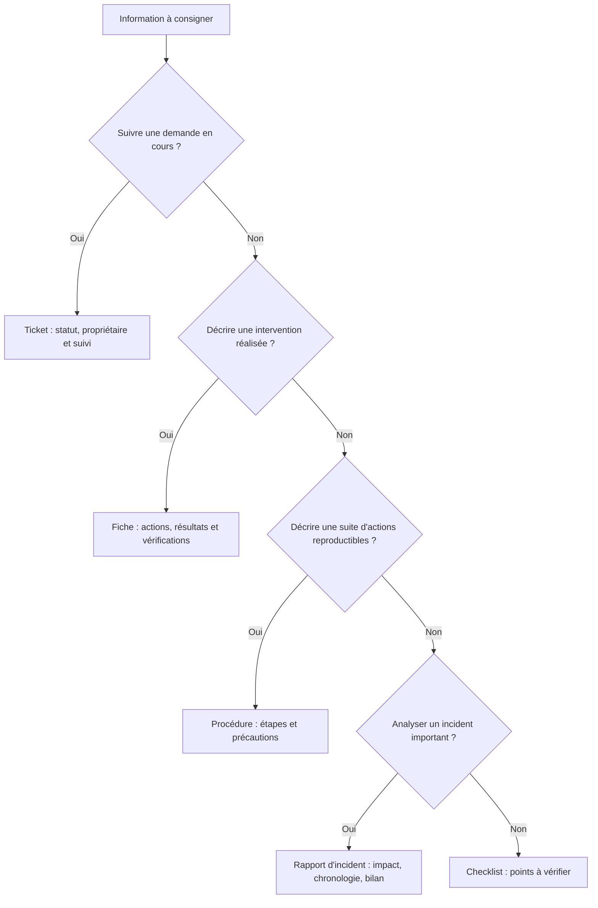

Ces documents se complètent. Un ticket assure le suivi, la fiche décrit le travail réellement effectué, la procédure guide une action reproductible, le rapport analyse un incident et la checklist aide à éviter les oublis.

## 3. Distinguer les documents courants

### 3.1 Ticket

Le ticket est l'enregistrement central d'une demande ou d'un incident. Il conserve l'identifiant, le statut, les priorités, l'affectation, les échanges et la résolution.

Une fiche d'intervention peut être contenue dans le ticket ou lui être associée, selon l'outil utilisé.

### 3.2 Fiche d'intervention

La fiche décrit une intervention déterminée : contexte, contrôles, opérations, résultats et validation. Elle se concentre sur le travail réellement effectué.

### 3.3 Procédure

Une procédure décrit comment effectuer une tâche de manière répétable. Elle est préparée à l'avance et ne raconte pas un incident particulier.

Exemple : une procédure explique comment contrôler un poste avant son retour à l'utilisateur. La fiche d'intervention indique quelles étapes ont été suivies sur ce poste précis et quels résultats ont été observés.

### 3.4 Rapport d'incident

Le rapport d'incident peut être plus large qu'une fiche. Il peut inclure l'impact, la chronologie, les décisions, la cause identifiée, les actions correctives et les mesures visant à éviter une répétition. Il est particulièrement pertinent pour les incidents importants ou récurrents.

### 3.5 Checklist

Une checklist est une liste de contrôles à réaliser. Elle aide à éviter les oublis, mais elle ne remplace pas la consignation des résultats. Une case cochée sans preuve peut être insuffisante pour comprendre l'état réel d'un système.

### Schéma — les composants d'une fiche complète

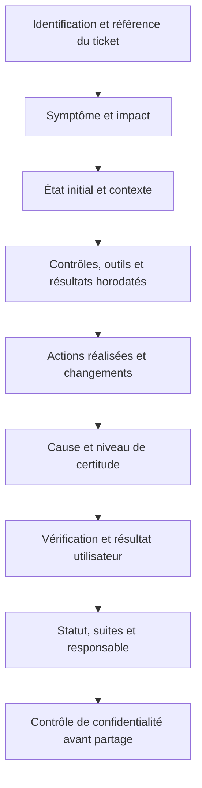

Une fiche n'est pas complète parce que tous les champs sont remplis : elle est complète si les informations nécessaires à la compréhension, à la reprise et à la vérification sont disponibles. Un champ inconnu doit rester explicitement inconnu.

## 4. Les informations indispensables

Le contenu exact dépend de l'outil et de la procédure interne, mais une fiche utile comporte généralement les éléments ci-dessous.

### 4.1 Identification

- référence du ticket ou de l'intervention ;
- date de l'intervention ;
- technicien ou équipe responsable ;
- équipement, service ou application concerné ;
- utilisateur ou service demandeur selon les règles ;
- emplacement si cela aide à retrouver l'actif.

Utilise l'identifiant officiel de l'équipement lorsque cela existe. Le nom informel « PC de Paul » peut être ambigu si plusieurs machines sont utilisées.

### 4.2 Symptôme initial

Décris ce qui a été signalé sans présumer de la cause. Note le message exact lorsque cela est utile, l'heure, la fréquence et les fonctions affectées.

Mauvais exemple : « Le disque est mort. »

Meilleur exemple : « Le poste affiche un message d'erreur au démarrage et le volume de données n'apparaît plus dans l'explorateur. La cause n'est pas encore confirmée. »

### 4.3 Impact

Indique qui est affecté et quelles activités sont perturbées. Le nombre d'utilisateurs, l'importance du service, les risques pour les données et la disponibilité d'une solution de contournement peuvent influencer la priorité.

Évite d'exagérer l'impact. « Tout le réseau est arrêté » n'est pas acceptable si un seul poste a été testé.

### 4.4 État initial et contexte

Selon le cas, consigne la version du système, l'état du service, les messages observés, la configuration utile, les changements récents connus, l'état apparent des équipements et les alertes pertinentes.

N'enregistre que les éléments qui ont une utilité pour le diagnostic ou la traçabilité.

### 4.5 Actions et tests

Pour chaque étape importante, note :
- l'objectif du contrôle ;
- l'outil ou la procédure utilisé ;
- la date et l'heure si utiles ;
- le résultat réel ;
- l'interprétation provisoire ;
- la décision suivante.

La fiche ne doit pas devenir un journal interminable de chaque clic. Sélectionne les étapes importantes, mais garde suffisamment de détails pour comprendre la logique de l'intervention.

### 4.6 Cause et niveau de certitude

Distingue trois situations :
- cause confirmée par des éléments suffisants ;
- cause probable, mais non complètement confirmée ;
- cause inconnue à ce stade.

Si plusieurs facteurs contribuent au problème, précise-les lorsque les preuves le permettent. Ne choisis pas une cause uniquement pour remplir un champ obligatoire.

### 4.7 Action corrective ou contournement

Indique ce qui a réellement été fait : remplacement d'un composant, correction d'un paramètre, rétablissement d'un accès, application d'un correctif ou mise en place d'une mesure temporaire.

Mentionne les modifications significatives, mais évite de copier un secret ou une donnée confidentielle dans la fiche.

### 4.8 Vérification et statut

La conclusion doit décrire les tests effectués après l'action. Indique si le besoin initial est rétabli, si des fonctions restent affectées ou si une observation complémentaire est nécessaire.

Le statut doit refléter le résultat réel : en cours, temporairement rétabli, résolu selon les critères, escaladé ou en attente selon les états disponibles dans l'outil.

### Schéma — de la prise en charge à la clôture documentée

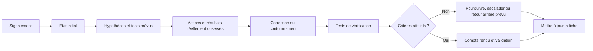

Cette chronologie distingue ce qui était prévu de ce qui a réellement été fait. Elle permet à un autre technicien de comprendre pourquoi une décision a été prise, quelles tentatives ont échoué et quels tests restent nécessaires.

## 5. Construire une fiche étape par étape

### Étape 1 : enregistrer le signalement

Crée ou actualise le ticket dans l'outil officiel. Attribue un titre compréhensible et une catégorie cohérente.

### Étape 2 : décrire les faits

Recueille le message, l'heure, le périmètre et l'impact. Si l'utilisateur fournit une interprétation, par exemple « le serveur est cassé », reformule la situation sous forme de symptôme.

### Étape 3 : préparer les contrôles

Sélectionne les vérifications autorisées. Note les hypothèses et la question à laquelle chaque test doit répondre.

### Étape 4 : conserver les résultats importants

Enregistre les résultats utiles au fur et à mesure. Ne compte pas sur la mémoire pour rédiger tout le compte rendu à la fin.

### Étape 5 : décrire la correction

Explique l'action appliquée et pourquoi elle a été choisie. Si une action n'a pas fonctionné, note-le lorsque cela aide à éviter sa répétition.

### Étape 6 : vérifier la fonction

Exécute les tests prévus et compare les résultats aux critères de réussite. Si la correction est temporaire, précise les limites.

### Étape 7 : conclure et transmettre

Rédige un résumé clair, renseigne le statut et prépare les suites nécessaires. Si l'incident n'est pas résolu, indique l'équipe ou la personne attendue et la prochaine action.

### Schéma 1 — Cycle de rédaction d'une fiche

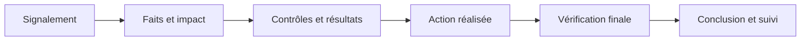

Le document est construit au fil de l'intervention. Il ne faut pas attendre la fin pour noter les résultats critiques, notamment lors d'une intervention complexe ou d'un incident majeur.

### Schéma — transformer une impression en observation vérifiable

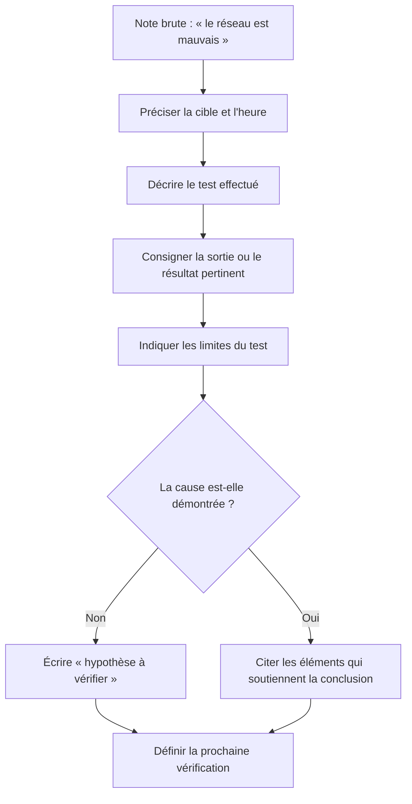

Une bonne observation doit pouvoir être comprise et, lorsque c'est possible, reproduite par un collègue. Évite les qualificatifs vagues tels que « lent », « cassé » ou « bizarre » sans mesure, message, heure ou description du comportement.

## 6. Rédiger des observations factuelles

### 6.1 Utiliser un vocabulaire observable

Préférer :
- « le service est indiqué comme arrêté » ;
- « le test de connexion n'a reçu aucune réponse » ;
- « l'application affiche un code d'erreur » ;
- « le volume dispose de 2 Go libres au moment du contrôle ».

Éviter :
- « le service est cassé » ;
- « le réseau est mort » ;
- « le disque est forcément défectueux » ;
- « tout fonctionne parfaitement » sans critères de test.

### 6.2 Préciser la source de l'information

Distingue ce qui est rapporté par l'utilisateur de ce que tu as directement observé.

Exemple :
- « L'utilisateur signale un arrêt depuis 9 h 30. »
- « À 10 h 05, le technicien a observé le même message d'erreur. »

Cette distinction évite de transformer une déclaration initiale en résultat de test.

### 6.3 Utiliser une chronologie

Une chronologie est utile lorsque plusieurs événements ou actions sont liés. Elle peut contenir l'heure de signalement, les tests, les changements, les redémarrages et les résultats.

Elle doit rester exacte. Si l'heure n'est qu'une estimation, précise-le. Pour les incidents impliquant plusieurs sites, le fuseau horaire peut être nécessaire.

### 6.4 Éviter les conclusions excessives

Un test qui échoue donne un résultat limité. Il ne faut pas conclure au-delà de ce que l'outil mesure.

Exemple : un test de connectivité sans réponse peut justifier d'examiner le réseau, mais ne prouve pas à lui seul que le serveur est hors service.

### 6.5 Documenter également les échecs

Un test qui ne confirme pas l'hypothèse reste utile. Il peut éliminer une piste, réduire le périmètre ou aider l'équipe suivante.

Note le test et son résultat sans présenter l'échec de la recherche comme une faute. Le diagnostic est souvent une succession d'hypothèses examinées.

### Schéma — documenter une commande de façon reproductible

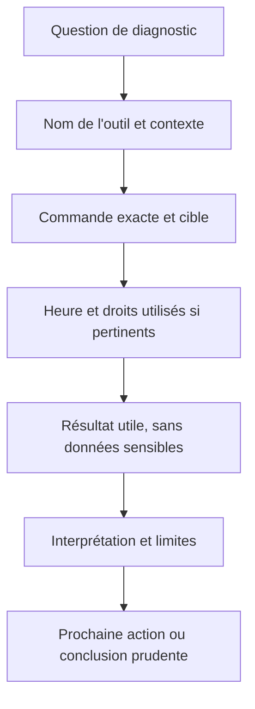

Ne note pas seulement « ping effectué » ou « commande exécutée ». Consigne la cible, le résultat utile et la signification limitée du test. Ne copie pas des sorties massives ou des secrets qui ne sont pas nécessaires à la reprise du diagnostic.

## 7. Décrire les commandes et outils

### 7.1 Une commande n'est pas une conclusion

Lorsqu'une commande est utile, indique son objectif et le résultat pertinent. Évite de copier des sorties volumineuses sans expliquer leur portée.

Exemple :
« La commande de configuration réseau montre une adresse IPv4 attribuée et une passerelle configurée. La communication vers l'application n'a pas encore été testée. »

Cette note ne conclut pas que l'ensemble du réseau fonctionne.

### 7.2 Résultats sous forme de tableau

Pour un diagnostic avec plusieurs contrôles, un tableau aide à garder une lecture claire.

| Heure | Contrôle | Résultat observé | Interprétation |
|---|---|---|---|
| 09 h 15 | Vérification du message | Erreur affichée lors de l'accès | Symptôme reproduit |
| 09 h 22 | Test depuis un second poste autorisé | Accès possible depuis ce poste | Périmètre potentiellement local |
| 09 h 28 | Consultation d'un journal pertinent | Aucun événement concluant trouvé | Cause encore inconnue |

Ce tableau est un exemple fictif. Dans une fiche réelle, chaque résultat doit correspondre au contrôle réellement exécuté.

### 7.3 Captures et pièces jointes

Une capture peut prouver la présence d'un message. Avant de la joindre, vérifie qu'elle ne révèle pas de mots de passe, de données métier, d'informations personnelles ou de détails sensibles non nécessaires.

Utilise le dépôt ou le ticketing prévu. Évite les copies dans des espaces personnels ou publics.

### Schéma — garder la trace d'une modification et de son retour arrière

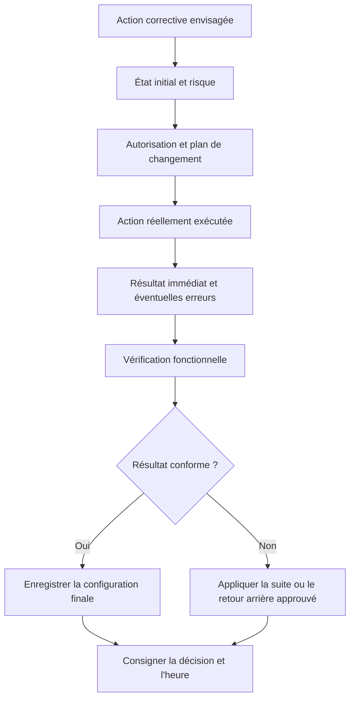

La fiche doit permettre de savoir ce qui a changé et comment revenir à un état sûr lorsque le plan le prévoit. Ne consigne jamais une opération envisagée comme si elle avait été exécutée.

## 8. Rédiger une action corrective claire

### 8.1 Décrire ce qui a changé

Une formulation comme « configuration corrigée » est souvent insuffisante. Indique le paramètre ou le composant concerné, à un niveau de détail adapté à la confidentialité et au risque.

Exemple :
« Le chemin de l'imprimante partagée a été corrigé selon la configuration approuvée. Une page de test a ensuite été imprimée depuis le poste concerné. »

### 8.2 Distinguer correction et contournement

Une correction vise à traiter le défaut identifié. Un contournement permet de poursuivre l'activité en attendant une correction ou une analyse complémentaire.

Si un utilisateur utilise temporairement une application secondaire, la fiche doit préciser que la cause initiale reste à traiter.

### 8.3 Noter l'action qui n'a pas fonctionné

Un test ou une action infructueuse peut être important. Il faut indiquer brièvement le résultat et la raison pour laquelle on ne poursuit pas dans cette direction, si celle-ci est connue.

Évite d'enregistrer des jugements personnels comme « solution absurde ». Décris plutôt le comportement observé et la décision de poursuivre autrement.

### 8.4 Enregistrer les changements de configuration

Les changements significatifs doivent être associés aux procédures et tickets appropriés. La fiche doit permettre de retrouver l'action, mais les secrets ne doivent pas y être exposés.

Sur un système critique, l'intervention doit également conserver la validation, le plan de test et le retour arrière conformément aux règles internes.

### Schéma — définir les preuves avant de déclarer l'intervention terminée

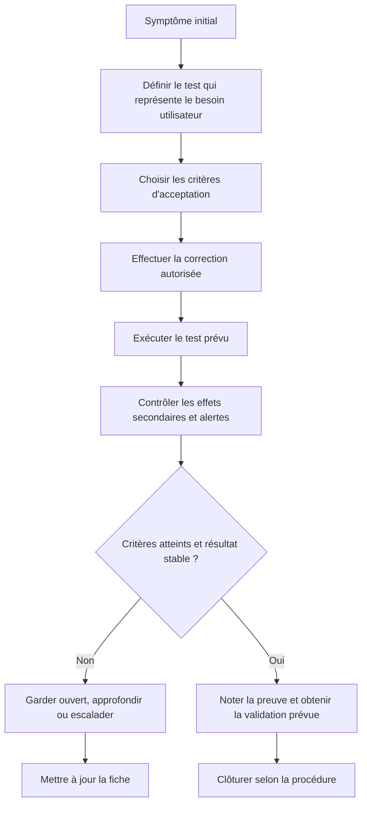

La validation doit répondre au besoin initial. Par exemple, un poste qui démarre n'est pas nécessairement un poste sur lequel l'application est redevenue utilisable. Mentionne les tests non réalisés et la durée d'observation si la stabilité doit être confirmée.

## 9. Vérification après intervention

### 9.1 Définir des critères avant d'agir

Un critère de réussite précise ce qui doit être vrai après intervention.

Exemples :
- l'utilisateur peut ouvrir l'application ;
- le fichier peut être lu et enregistré ;
- un service répond à une requête représentative ;
- une imprimante produit une page de test ;
- la configuration correspond à la valeur attendue ;
- aucune nouvelle alerte critique n'apparaît durant la période de contrôle prévue.

Un critère vague comme « tout marche » est difficile à vérifier.

### 9.2 Tester le besoin initial

Si le problème concernait l'accès à un dossier partagé, vérifie cet accès. Un test de connectivité général ne prouve pas que les droits, le service de partage et les opérations de lecture/écriture fonctionnent.

### 9.3 Vérifier les effets secondaires

Une correction peut perturber d'autres fonctions. Après une modification de droits, par exemple, vérifie que l'accès requis est accordé sans ouvrir la ressource à des personnes non autorisées.

Le périmètre de vérification doit être proportionné au changement et à la criticité du service.

### 9.4 Réponse utilisateur

Lorsque c'est approprié, demande à l'utilisateur de confirmer le rétablissement de son besoin. Cette confirmation complète les contrôles techniques, mais ne remplace pas les tests obligatoires.

### 9.5 Incident temporairement rétabli

Si le service fonctionne après un redémarrage mais retombe en panne régulièrement, consigne le rétablissement temporaire et le suivi nécessaire. Le statut ne doit pas donner l'impression que la cause racine a été supprimée si ce n'est pas le cas.

### Schéma — protéger les informations pendant toute la documentation

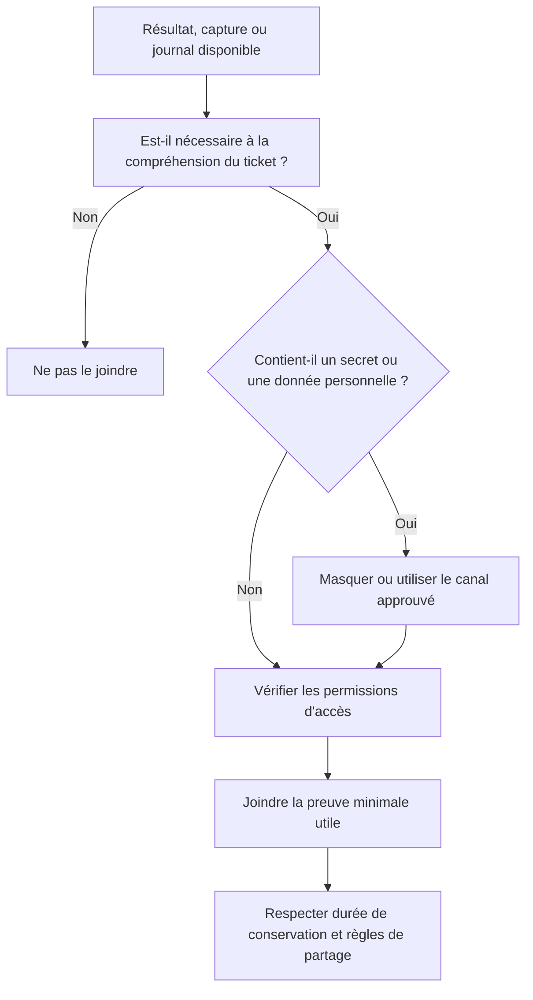

Une fiche doit contenir assez d'information pour expliquer l'intervention, pas toutes les informations auxquelles le technicien a accès. Les mots de passe, jetons, clés privées et données personnelles inutiles ne doivent pas être copiés dans les notes.

## 10. Confidentialité et qualité des informations

### 10.1 Principe de minimisation

Une fiche doit contenir les informations utiles au traitement et à la traçabilité. Elle ne doit pas devenir un dépôt de données personnelles ou de secrets.

Ne copie pas :
- mots de passe ;
- jetons de session ou d'accès ;
- clés privées ;
- codes de récupération ;
- données personnelles sans nécessité ;
- contenus complets de dossiers métier quand un extrait suffit.

### 10.2 Partage et permissions

Vérifie qui peut consulter le ticket, le compte rendu et les pièces jointes. Un incident de sécurité peut nécessiter un canal restreint. Ne diffuse pas les informations à toute l'entreprise simplement parce que le ticket a été créé.

### 10.3 Conserver les traces utiles

La politique de conservation dépend de l'organisation et des obligations applicables. Il faut respecter les durées prévues, éviter les copies personnelles et ne pas supprimer les traces d'un incident dans le seul but de nettoyer le dossier.

### 10.4 Erreur dans un compte rendu

Si une information importante est incorrecte, corrige-la de façon traçable selon le fonctionnement de l'outil. Ne modifie pas l'historique de manière à effacer la réalité d'une décision ou d'une action.

### Schéma — utiliser un modèle sans inventer les résultats

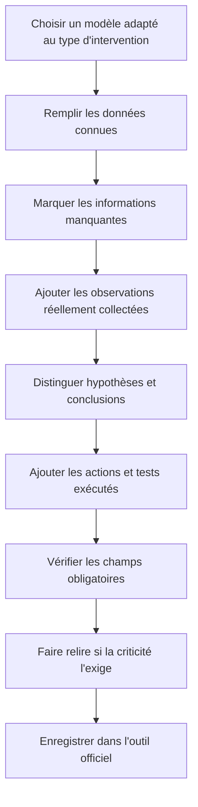

Un modèle donne une structure, mais ne remplace pas le jugement. Il faut adapter le niveau de détail au risque, et conserver explicitement les inconnues au lieu de combler les champs par des suppositions.

## 11. Modèles de fiches

### 11.1 Fiche de dépannage simple

**Référence :** à renseigner.

**Équipement :** identifiant de l'inventaire.

**Signalement :** description courte et factuelle.

**Impact :** utilisateur ou service concerné et conséquence opérationnelle.

**Contrôles :** contrôles effectués et résultats significatifs.

**Action :** modification ou correction réellement appliquée.

**Vérification :** test représentatif du besoin initial et résultat.

**Statut :** résolu selon les critères, temporairement rétabli, en cours ou escaladé.

**Suivi :** prochaine action si nécessaire.

### 11.2 Fiche d'intervention matérielle

**Référence :** à renseigner.

**Équipement et référence :** selon l'inventaire.

**Symptôme initial :** message, comportement et moment d'apparition.

**Précautions :** autorisation, protection des données, conditions de garantie et règles de sécurité.

**Composant :** référence retirée et référence installée, si applicable.

**Actions :** étapes réalisées selon la procédure.

**Tests :** démarrage, détection du composant, fonction attendue et alertes.

**Résultat :** critères atteints ou anomalies restantes.

**Suivi :** mise à jour de l'inventaire, garantie, remplacement ou escalade.

### 11.3 Fiche de maintenance préventive

**Période :** date et fenêtre de contrôle.

**Périmètre :** machines, services ou équipements concernés.

**Contrôles prévus :** checklist approuvée.

**Résultats :** conforme, anomalie ou contrôle non réalisé avec justification.

**Actions associées :** tickets créés, modifications approuvées ou opérations planifiées.

**Conclusion :** état du périmètre contrôlé et risques restant à traiter.

Une case cochée n'est pas une preuve suffisante à elle seule. Il faut conserver les résultats significatifs selon la procédure prévue.

### 11.4 Rapport après incident important

Un incident important peut nécessiter :
- résumé exécutif ;
- impact et durée ;
- chronologie ;
- services et utilisateurs affectés ;
- décisions prises ;
- action de rétablissement ;
- cause confirmée ou état de l'analyse ;
- mesures correctives ;
- actions préventives ;
- responsables et échéances ;
- éléments restant à surveiller.

Le degré de détail doit correspondre à la criticité et aux exigences de l'organisation.

## 12. Exemple complet de fiche d'intervention

### Situation fictive

Une utilisatrice ne peut plus imprimer depuis son poste. Les autres collaborateurs peuvent imprimer sur la même imprimante.

**Référence :** INC-2026-0318.

**Équipement :** poste identifié dans l'inventaire ; imprimante partagée associée au service.

**Signalement :** à 10 h 05, l'utilisatrice indique que les travaux d'impression restent en attente depuis le matin. Les autres utilisateurs peuvent imprimer. Le message exact doit être recueilli.

**Impact :** fonction d'impression indisponible pour une utilisatrice. Une solution alternative existe à proximité, sous réserve des règles de confidentialité des documents.

**Hypothèses initiales :** file d'impression locale, configuration de l'imprimante, pilote ou problème propre au profil.

**Contrôle 1 :** comparaison avec un poste autorisé fonctionnel. Résultat : l'imprimante répond depuis le poste de référence.

**Contrôle 2 :** observation de la file d'impression sur le poste concerné. Résultat : à renseigner après le contrôle réel.

**Action :** à renseigner selon la cause confirmée et la procédure autorisée.

**Vérification :** impression d'un document de test non sensible depuis le poste concerné, puis confirmation que l'utilisatrice peut reprendre l'opération nécessaire.

**Conclusion :** la cause et l'action doivent être complétées avec les résultats réels. Le présent exemple reste volontairement un modèle et ne doit pas être copié comme compte rendu d'un incident réellement résolu.

Cet exemple montre comment organiser une fiche même lorsque certains champs restent à compléter. Il vaut mieux conserver un champ « cause à confirmer » que fabriquer une explication.

## 13. Checklist qualité avant clôture

Avant de terminer une fiche, vérifie les points suivants :

- l'équipement ou le service est identifiable ;
- le symptôme initial est compréhensible ;
- l'impact est indiqué ;
- les contrôles importants sont documentés ;
- les résultats correspondent à ce qui a réellement été observé ;
- les actions et modifications sont décrites ;
- les faits sont séparés des hypothèses ;
- les informations sensibles sont protégées ;
- la vérification correspond au besoin initial ;
- la cause non confirmée n'est pas présentée comme certaine ;
- le statut correspond à la réalité ;
- les suites et responsabilités sont définies ;
- l'inventaire ou la documentation associée a été mise à jour si nécessaire.

### Schéma 2 — Contrôle avant clôture

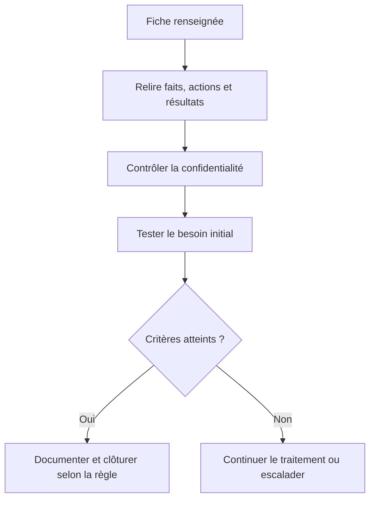

Ce contrôle prévient la clôture prématurée et les comptes rendus qui ne permettent pas de comprendre le résultat.

### Schéma — assurer la reprise d'un dossier sans recommencer le diagnostic

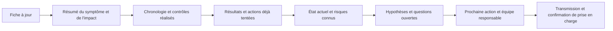

Une transmission efficace indique clairement où le travail s'est arrêté et quelle décision est attendue. Le prochain technicien doit pouvoir distinguer les tests exécutés des tests proposés et ne pas croire qu'une action a réussi si son résultat n'a pas été vérifié.

## 14. Transmission à un autre technicien

### 14.1 Pourquoi une transmission peut être nécessaire

Une intervention peut dépasser la durée d'un service, changer d'équipe ou nécessiter un niveau de compétence différent. Le nouveau technicien doit reprendre le dossier sans perdre le contexte.

### 14.2 Contenu du transfert

Prépare un résumé qui indique :
- le besoin et l'impact ;
- les symptômes et leur chronologie ;
- les tests effectués ;
- les résultats ;
- les modifications déjà appliquées ;
- les risques ;
- les hypothèses encore ouvertes ;
- l'action attendue ;
- les conditions de reprise.

### 14.3 Éviter de recommencer les mêmes actions

La fiche doit indiquer les actions infructueuses qui sont importantes et pourquoi elles n'ont pas permis de conclure. Le technicien suivant pourra choisir un test plus discriminant au lieu de répéter la même opération.

### Schéma 3 — Fiche et reprise de dossier

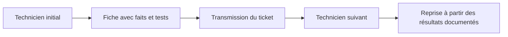

Le schéma montre l'objectif principal de la traçabilité : conserver une continuité entre les personnes, pas multiplier les documents pour eux-mêmes.

### Schéma — améliorer la qualité de la documentation à partir de retours

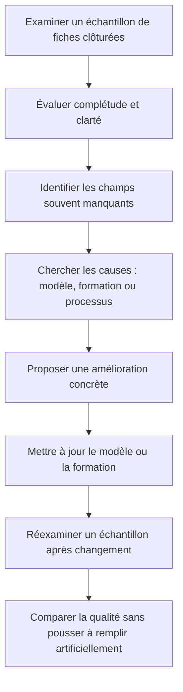

L'objectif est que la fiche serve réellement au diagnostic, à la continuité et à l'audit. Une métrique de complétude ne doit pas encourager des réponses inventées ni des clôtures hâtives : la qualité du contenu compte plus que le nombre de champs remplis.

## 15. Indicateurs et amélioration des fiches

### 15.1 Taux de tickets réouverts

Un volume élevé de réouvertures peut signaler des critères de résolution imprécis, un suivi incomplet ou un problème qui réapparaît. Il faut examiner les causes avant d'en tirer une conclusion sur la performance individuelle.

### 15.2 Complétude des fiches

Une organisation peut vérifier la présence des champs essentiels, mais la complétude ne se réduit pas au fait que chaque champ contient du texte. Les informations doivent être utiles, exactes et compréhensibles.

### 15.3 Délai de reprise

Une fiche claire permet à un autre technicien de comprendre le dossier plus rapidement. Une documentation de qualité réduit les reprises et les erreurs de transmission.

### 15.4 Analyse des récurrences

En associant les tickets similaires, l'équipe peut identifier des problèmes récurrents et proposer une action préventive. La qualité des catégories, des identifiants d'équipements et des descriptions conditionne la fiabilité de cette analyse.

### 15.5 Ne pas transformer la mesure en objectif aveugle

Réduire le temps passé à documenter peut faire baisser un indicateur à court terme, mais augmenter les reprises et les risques. Le but est de produire le niveau de documentation adapté à l'importance du travail.

## Parcours pratique du débutant

Prévois 45 à 60 minutes dans un environnement de formation, avec un scénario fictif. Tu vas apprendre à documenter des faits ; tu ne dois pas prétendre qu'une intervention a été réellement réalisée ni inclure de vraies données sensibles.

### Étape 1 — Définir le contexte

Scénario : un utilisateur indique qu'une application métier ne s'ouvre plus sur son poste. Écris la référence fictive du ticket, le symptôme exact disponible, l'heure approximative et l'impact connu. Marque explicitement les informations absentes : message d'erreur, autres utilisateurs concernés, changement récent ou résultat réseau.

### Étape 2 — Formuler le test avant son exécution

Choisis une hypothèse raisonnable, puis indique quel test autorisé pourrait l'évaluer. Précise l'outil, la cible et le résultat attendu. Comme tu travailles à partir d'un cas fictif, indique « test proposé » au lieu d'inventer une sortie de commande.

### Étape 3 — Distinguer les faits des hypothèses

Crée deux colonnes dans ta fiche. Dans « faits », inscris uniquement ce que le scénario confirme. Dans « hypothèses », indique les explications possibles et les éléments qui permettraient de les vérifier. Une cause inconnue doit rester « à confirmer ».

### Étape 4 — Enregistrer les actions

Utilise une chronologie simple : heure, action, résultat, décision. Si une tentative échoue ou n'est pas autorisée, note-le également. Ne déclare jamais qu'un service a été redémarré, qu'un pilote a été remplacé ou qu'une application fonctionne si le scénario ne fournit pas cette information.

### Étape 5 — Définir le contrôle après intervention

Décris comment tu vérifierais que le besoin initial est satisfait : reproduire le scénario utilisateur, vérifier le service concerné et observer les erreurs pertinentes. Définis ce qui permettrait de conclure et ce qui obligerait à garder le ticket ouvert.

### Étape 6 — Contrôler les informations jointes

Prépare la liste minimale de preuves nécessaires, par exemple un message d'erreur assaini et le résultat d'un test. Ne joins ni mot de passe, ni jeton, ni données personnelles inutiles. Choisis un canal et un emplacement de stockage autorisés.

### Étape 7 — Rédiger le résumé transmissible

Écris un résumé d'une dizaine de lignes destiné à un autre technicien : symptôme, impact, faits, contrôles effectués ou proposés, résultats connus, risques, statut et prochaine action. Le lecteur doit comprendre exactement où en est le dossier.

**Critère de réussite :** une personne qui n'a pas assisté à l'intervention peut comprendre le contexte, différencier les faits des suppositions, identifier ce qui a été réellement fait et poursuivre le travail sans devoir reconstruire tout l'historique.

## 16. Travaux pratiques

### TP 1 — Rédiger une fiche à partir d'une situation

**Situation :** un poste refuse de se connecter à une application depuis 9 h. Les autres applications fonctionnent. Le message exact n'a pas encore été recueilli.

**Mission :**
1. rédige le titre du ticket ;
2. formule le symptôme sans annoncer de cause ;
3. indique les informations manquantes ;
4. propose trois hypothèses ;
5. décris les contrôles envisagés ;
6. laisse explicitement les résultats non connus en attente ;
7. définis les critères de clôture.

**Livrable :** une fiche initiale qui ne contient aucune conclusion inventée.

### TP 2 — Convertir un journal de notes en compte rendu

Notes brutes :
- 9 h 10 : appel reçu ;
- application inaccessible ;
- deux collègues disent que cela fonctionne pour eux ;
- test de résolution du nom réalisé, résultat à compléter ;
- aucun changement de configuration appliqué ;
- équipe applicative à contacter si les tests locaux n'expliquent pas l'écart.

Transforme ces notes en un compte rendu structuré. Tu dois conserver les faits, indiquer le contrôle dont le résultat manque et expliquer la prochaine action.

### TP 3 — Documenter une maintenance préventive

Prépare une fiche pour un contrôle mensuel d'un petit parc : postes, serveur de fichiers, sauvegarde et imprimante. Pour chaque élément, indique le contrôle, la preuve attendue, l'anomalie éventuelle et l'action de suivi.

Le livrable doit distinguer un contrôle réellement exécuté d'un contrôle planifié ou non réalisable.

### TP 4 — Corriger une fiche de mauvaise qualité

Fiche initiale :
« Le réseau était cassé. J'ai redémarré tout le matériel et tout remarche. »

Identifie les ambiguïtés, risques et informations manquantes. Réécris la fiche sous forme factuelle, sans inventer le résultat des tests.

### TP 5 — Préparer la reprise du dossier

Imagine que tu quittes ton poste alors qu'un incident est encore en cours. Rédige une transmission à un collègue avec les résultats obtenus, les contrôles non effectués, la priorité, les risques et l'action attendue.

## 17. Exercices avec corrections

### Exercice 1 — Faits ou hypothèses

Classe chaque phrase :
1. « L'utilisateur signale une erreur à 9 h 20. »
2. « Le serveur est probablement indisponible. »
3. « Le test de connexion vers le port attendu a échoué. »
4. « La panne provient du serveur. »

**Correction :**
1. Fait rapporté par l'utilisateur.
2. Hypothèse.
3. Résultat de test si l'opération a bien été réalisée.
4. Conclusion qui exige des preuves suffisantes avant d'être confirmée.

### Exercice 2 — Documenter une commande

Pourquoi la phrase « commande exécutée, OK » est-elle insuffisante ?

**Correction :** elle ne dit pas quelle commande, sur quel système, pour quel objectif ni quel résultat a été obtenu. Il faut préciser les éléments utiles pour comprendre et reproduire le contrôle.

### Exercice 3 — Contrôle et clôture

Le technicien redémarre un service et le ticket passe automatiquement à « résolu ». Est-ce suffisant ?

**Correction : non.** Le statut automatique ne prouve pas le rétablissement fonctionnel. Il faut effectuer le test correspondant au besoin initial et mettre à jour le compte rendu.

### Exercice 4 — Cause inconnue

Le problème disparaît après une modification, mais aucune preuve ne montre pourquoi. Quelle formulation est la plus correcte ?

**Correction :** indiquer que le fonctionnement a été rétabli après l'action, mais que la cause reste à confirmer si les éléments ne suffisent pas. Ne pas présenter la relation temporelle comme une preuve de causalité.

### Exercice 5 — Informations sensibles

Une fiche contient un mot de passe temporaire utilisé pendant l'intervention. Quelle mesure faut-il prendre ?

**Correction :** ne pas conserver le secret dans le compte rendu. Suivre la procédure pour supprimer ou protéger la donnée exposée, et utiliser les mécanismes approuvés de transmission ou de gestion des secrets.

### Exercice 6 — Pièce remplacée

Pourquoi faut-il identifier le composant retiré et le composant installé ?

**Correction :** cette information permet de mettre à jour l'inventaire, de suivre la garantie, de comprendre les changements et de faciliter une intervention future. Elle doit être conservée dans l'espace autorisé.

### Exercice 7 — Résolution temporaire

Un utilisateur peut reprendre le travail grâce à une solution alternative, mais le service initial reste indisponible.

**Correction :** documenter le contournement et son périmètre. Ne pas déclarer le service initial rétabli ; préciser le suivi et le responsable de la suite.

### Exercice 8 — Transmission technique

Un nouveau technicien reprend un ticket sans connaître les tests déjà réalisés. Quelles informations lui sont les plus utiles ?

**Correction :** le symptôme, l'impact, la chronologie, les contrôles, leurs résultats, les actions appliquées, les hypothèses restantes, les risques et l'action attendue.

### Exercice 9 — Checklist préventive

Une checklist indique uniquement « serveur vérifié ». Pourquoi est-elle insuffisante ?

**Correction :** elle ne dit pas quels contrôles ont été exécutés ni leurs résultats. Il faut préciser les éléments vérifiés, les anomalies et les actions à suivre.

### Exercice 10 — Récurrence

Trois tickets similaires concernent le même poste en une semaine. Pourquoi faut-il relier les dossiers ou signaler cette récurrence ?

**Correction :** elle peut révéler un problème commun, un composant qui se dégrade ou une solution initiale insuffisante. Le lien facilite l'analyse et la planification d'une action préventive.

## 18. Défi final — Compte rendu d'une intervention complète

### Situation

Un utilisateur ne parvient plus à accéder à un dossier partagé. Le problème est signalé à 10 h. Le technicien effectue des contrôles autorisés, constate que l'accès échoue depuis le poste concerné et fonctionne depuis un poste de référence. Il ne dispose pas des permissions nécessaires pour examiner la configuration du serveur. Aucune modification n'est appliquée.

### Travail demandé

1. Rédige le titre et le symptôme.
2. Distingue les faits des hypothèses.
3. Note les tests réellement effectués.
4. Explique ce que les résultats permettent de conclure.
5. Liste les informations à transmettre à l'équipe responsable.
6. Rédige une conclusion provisoire.
7. Définis l'action suivante.
8. Explique pourquoi la fiche ne doit pas indiquer « problème résolu ».

### Correction détaillée

**Titre :** « Accès au dossier partagé impossible depuis un poste ».

**Symptôme :** « Depuis 10 h, l'accès au dossier partagé échoue depuis le poste concerné. Un test depuis un poste de référence autorisé réussit. La cause n'est pas confirmée. »

**Faits :** échec depuis le poste concerné et réussite depuis le poste de référence, si les contrôles ont effectivement été exécutés et consignés.

**Hypothèses :** différence locale de configuration, de compte, de résolution ou autre facteur. Les hypothèses doivent être examinées dans le respect des autorisations.

**Limites :** l'équipe de premier niveau ne dispose pas des droits nécessaires pour examiner tous les éléments du serveur. Le test ne prouve pas à lui seul la cause.

**Transmission :** symptôme, heure, postes comparés, résultats, message exact s'il est disponible, droits manquants et question adressée à l'équipe responsable.

**Conclusion provisoire :** « Le dossier est accessible depuis le poste de référence mais pas depuis le poste concerné. La cause n'est pas identifiée ; une analyse complémentaire est nécessaire. »

**Action suivante :** escalader le dossier avec les résultats et demander un contrôle ciblé à l'équipe habilitée.

**Pourquoi ne pas clôturer ?** Le besoin initial de l'utilisateur n'est pas rétabli. Aucun test ne confirme que le poste concerné accède au dossier. La fiche doit refléter le statut réel.

### Barème indicatif

| Critère | Points |
|---|---:|
| Symptôme et titre factuels | 3 |
| Distinction entre faits et hypothèses | 3 |
| Résultats correctement documentés | 3 |
| Limites des contrôles identifiées | 3 |
| Transmission exploitable | 3 |
| Conclusion et prochaine action | 3 |
| Statut approprié | 2 |
| **Total** | **20** |

## 19. Synthèse du cours

Une fiche d'intervention est un document opérationnel qui conserve la mémoire d'une action technique. Sa valeur repose sur la qualité des faits, des résultats et des vérifications.

Les principes à retenir :

1. identifier précisément l'équipement, le service et le ticket ;
2. décrire le symptôme sans présumer de sa cause ;
3. noter les contrôles importants au fur et à mesure ;
4. distinguer observation, hypothèse et conclusion ;
5. décrire les actions et modifications réellement réalisées ;
6. protéger les secrets et informations sensibles ;
7. définir des critères de réussite correspondant au besoin initial ;
8. conserver les causes inconnues comme telles ;
9. transmettre les résultats et limites à l'équipe suivante ;
10. clôturer uniquement selon les critères définis.

La méthode à mémoriser est : **identifier → observer → tester → consigner → agir → vérifier → conclure → transmettre.**

Une bonne fiche n'est ni un texte interminable ni un simple « problème réglé ». C'est une trace précise, proportionnée et compréhensible qui permet de poursuivre le travail en toute sécurité.
