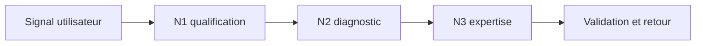
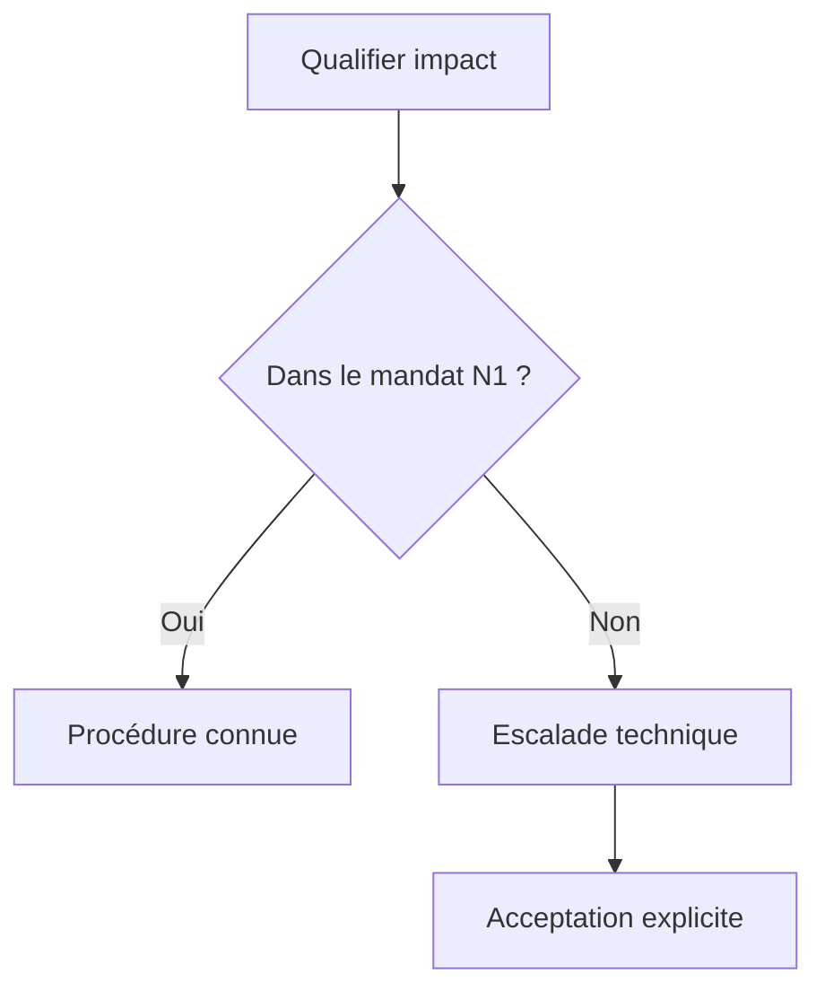
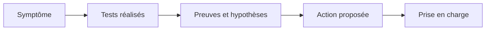
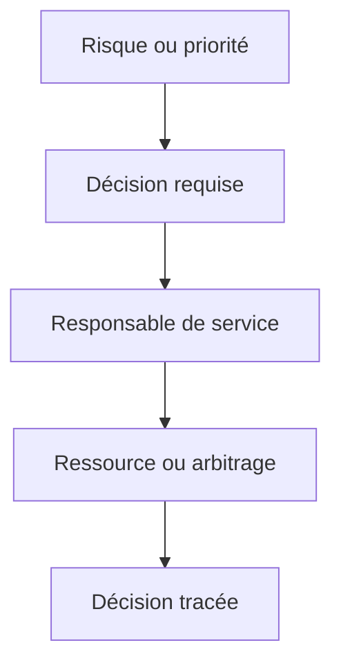
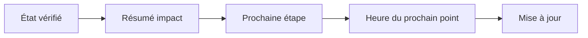
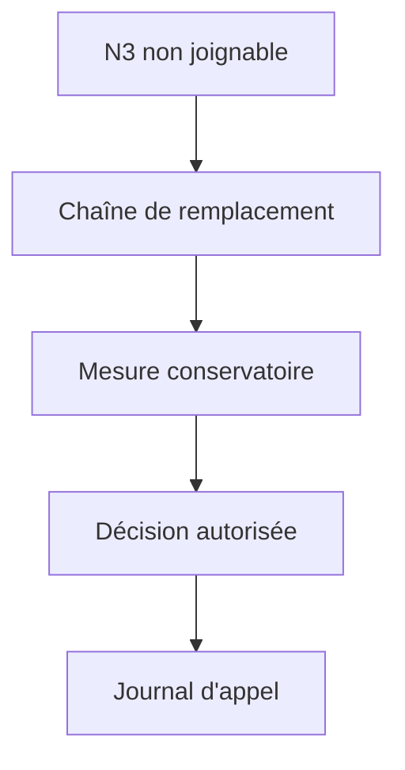

# Gestion de l'escalade (N1/N2/N3)

> **Mise en contexte** — Ce cours s'adresse à un technicien intermédiaire qui doit agir dans un environnement réel, respecter les contraintes de service et laisser des preuves réutilisables. L'objectif n'est pas seulement de connaître les outils, mais de comprendre pourquoi une action est choisie, dans quelles conditions elle est sûre, comment vérifier son résultat et quand demander de l'aide.

## Présentation et enjeux

L'escalade permet de faire passer un incident au niveau de compétence et d'autorité approprié, sans perdre le contexte ni retarder la résolution. Elle ne doit pas être vécue comme un transfert de responsabilité : le service reste suivi jusqu'à une prise en charge explicite et une communication cohérente. Cette discipline s'inscrit dans une démarche de qualité de service : chaque opération doit être reliée au besoin métier, au risque accepté et à un critère d'acceptation observable. L'intervenant doit pouvoir expliquer l'état initial, la décision prise, les résultats obtenus et les limites qui subsistent.

Dans une équipe de maintenance, les informations sont souvent réparties entre tickets, conversations, inventaires, systèmes de supervision et mémoire individuelle. Une méthode fiable les relie dans une trace commune et limite les décisions fondées sur une seule observation. Le cours met l'accent sur les preuves, les contrôles proportionnés, la reproductibilité et la communication utile.

Le niveau intermédiaire suppose que les gestes de base sont acquis. La difficulté consiste maintenant à traiter des environnements hétérogènes, des incidents ambigus, des changements qui touchent plusieurs composants et des situations où la donnée est imparfaite. Les règles présentées doivent être adaptées aux procédures approuvées de l'organisation et vérifiées dans un environnement de test avant toute action ayant un impact sur la production.

## Objectifs pédagogiques

À la fin du parcours, l'apprenant pourra :

- expliquer les principes et les limites des outils utilisés dans le domaine ;
- choisir un contrôle ou une méthode à partir de l'impact, de la criticité et des preuves disponibles ;
- effectuer une démarche reproductible et distinguer observation, hypothèse et décision ;
- interpréter les indicateurs sans confondre corrélation, résultat technique et expérience utilisateur ;
- rédiger une trace claire, traiter les exceptions et organiser une escalade ;
- vérifier l'effet d'une action, décrire le risque résiduel et proposer une amélioration mesurable.

## Prérequis et cadre de travail

Avant de commencer, savoir utiliser un terminal, lire les journaux, identifier un actif, comprendre les tickets et appliquer les règles locales de sécurité. Les commandes ci-dessous sont illustratives : adapter les noms d'hôte, les chemins et les versions, utiliser des cibles de test autorisées et ne jamais copier de secret dans un document. Une commande d'observation doit être préférée à une modification lorsqu'elle suffit à qualifier la situation.

Les principes directeurs sont les suivants : intervention autorisée, moindre privilège, sauvegarde ou retour arrière adaptés, fenêtre connue, communication compréhensible et preuve de validation. Si un contrôle critique échoue, ne pas continuer mécaniquement. Noter le constat, évaluer le risque et utiliser le point d'arrêt ou l'escalade défini par la procédure.

## Vocabulaire métier

| Terme | Utilisation opérationnelle |
|---|---|
| État initial | Description mesurée du système avant toute intervention. |
| Criticité | Conséquence potentielle de l'indisponibilité ou de la mauvaise configuration. |
| Preuve | Élément daté qui peut être vérifié par un autre intervenant. |
| Écart | Différence entre le résultat attendu et l'observation. |
| Exception | Situation où la procédure standard ne s'applique pas ou n'atteint pas son objectif. |
| Validation | Contrôle confirmant que le service ou l'opération satisfait les critères convenus. |
| Retour arrière | Séquence permettant de retrouver un état stable si les critères de réussite ne sont pas satisfaits. |
| Récurrence | Réapparition d'un problème similaire après un traitement précédent. |

## Schémas adaptés au sujet

### Schéma 1 — Parcours N1 N2 N3



Le parcours dépend des critères de compétence, d'impact et de risque ; l'incident conserve un propriétaire pendant les transferts.

### Schéma 2 — Décision d'escalade



L'escalade doit reposer sur un seuil défini et être prise en charge par un destinataire identifié.

### Schéma 3 — Transfert de contexte



Le résumé, les tests et la prochaine action évitent de recommencer l'enquête et de perdre les informations du niveau précédent.

### Schéma 4 — Escalade hiérarchique



L'escalade hiérarchique vise les ressources et décisions au-delà du mandat technique, pas le remplacement de toute qualification.

### Schéma 5 — Communication incident



Une cadence de communication précise maintient la confiance même si l'heure exacte de résolution demeure inconnue.

### Schéma 6 — Disponibilité astreinte



L'absence d'un expert doit déclencher une chaîne de remplacement prévue, sans partage improvisé de comptes privilégiés.

## Fondements techniques du domaine

### 1. Frontière de niveau

Les niveaux décrivent une distribution des capacités, non une hiérarchie universelle de mérite. Le N1 qualifie, traite les demandes connues et exécute les procédures standard autorisées. Le N2 approfondit un problème qui exige une analyse des dépendances, une connaissance du service ou un test non couvert par la procédure de base. Le N3 apporte une expertise produit ou architecture, étudie les défauts complexes et propose des corrections avancées. Les limites réelles dépendent des droits, de l'organisation et du risque; un niveau ne doit jamais dépasser son autorité simplement parce que le niveau supérieur ne répond pas.

Séparer trois responsabilités : propriétaire du ticket, personne chargée de la prochaine action technique et rôle autorisé à accepter le risque ou à approuver un changement. Elles peuvent appartenir à des personnes différentes. Le transfert ne doit donc pas laisser le ticket sans propriétaire. Définir, pour chaque catégorie, les actions permises, les critères de blocage, les tests minimaux et le remplaçant en cas d'absence.

Un incident critique peut nécessiter une mobilisation directe du N2 ou du N3 sans traverser artificiellement chaque palier. À l'inverse, un cas connu doit rester au N1 lorsqu'il peut être résolu selon la procédure et que les critères de réussite sont démontrés.
### 2. Qualification initiale

Qualifier l'expérience de l'utilisateur avant d'affirmer une cause. Noter le service touché, les utilisateurs ou sites concernés, le début estimé, les symptômes observables, les erreurs exactes, les changements récents et l'existence d'un contournement. « Depuis 10 h 20, le site B ne peut plus ouvrir l'application RH » est plus utile que « le réseau est en panne ». Séparer les déclarations du demandeur des observations de supervision.

Rechercher les tickets similaires sur la même fenêtre et relier les dossiers qui semblent partager un incident, sans effacer l'impact individuel de chaque demandeur. Le ticket parent conserve la chronologie et les décisions; les tickets liés permettent de vérifier le rétablissement par site ou groupe. Réaliser uniquement les contrôles autorisés et consigner leur cible, l'heure, la méthode et le résultat. Une vérification réussie vers la passerelle ne démontre pas que l'application est disponible.

Si une donnée manque, signaler cette lacune et son importance au lieu de la remplacer par une supposition. Une suspicion de compromission, une perte de données ou un risque de sécurité doit activer immédiatement la procédure spécialisée, sans attendre une qualification complète. Le résultat du N1 est un dossier qui distingue les faits confirmés, les hypothèses, les inconnues, l'impact et la prochaine décision attendue.
### 3. Escalade fonctionnelle

Diriger l'incident vers l'équipe qui possède la compétence ou le service, en utilisant la matrice de responsabilités et les dépendances documentées. Un échec d'ouverture de session peut provenir du DNS, de l'identité, du réseau ou de l'application; envoyer tout incident à une file générique favorise les transferts répétés. Le propriétaire actuel suit le ticket jusqu'à ce que le destinataire confirme la prise en charge.

Éviter les transferts en aveugle. Joindre les faits, les tests et leurs résultats, le changement récent éventuel, les contraintes d'accès, les limites de l'analyse et la question précise posée au destinataire. « DNS en échec » doit nommer le résolveur, le nom interrogé, l'heure et l'erreur; « réseau OK » doit préciser quels chemins et services ont été testés. Signaler aussi les tests non effectués et pourquoi.

Une demande d'escalade utile sollicite une action identifiable : corréler les journaux d'authentification, confirmer le périmètre d'un défaut, examiner une trace, autoriser un test contrôlé ou prendre une décision sur le retour arrière. Si le mauvais groupe a été choisi, corriger l'orientation sans supprimer la chronologie ni masquer les temps d'attente.
### 4. Escalade hiérarchique

Escalader l'autorité lorsqu'une décision dépasse le mandat technique : accepter une interruption, prolonger une fenêtre, mobiliser un fournisseur, engager une autre équipe ou communiquer sur un incident majeur. La demande au responsable expose le risque, les conséquences, les options, la recommandation et l'heure limite de décision. Informer un responsable n'est pas la même chose qu'obtenir son approbation.

Définir des seuils organisationnels : service critique indisponible, périmètre qui augmente, objectif de restauration menacé, données potentiellement exposées, astreinte indisponible ou mesure de mitigation nécessitant une autorisation supplémentaire. Les seuils exacts doivent provenir des règles locales et des engagements de service, pas d'un chiffre universel inventé pour le cours.

Tracer qui a été contacté, à quel moment, par quel canal, quelle décision a été demandée, la réponse reçue et ses conditions. Une absence de réponse ne vaut jamais approbation. À l'échéance prévue, utiliser la chaîne de remplacement ou les mesures conservatoires approuvées. L'escalade hiérarchique ne doit pas servir à contourner les vérifications techniques ni les règles de sécurité.
### 5. Priorité et impact

Distinguer impact, urgence et gravité technique. L'impact concerne les utilisateurs, les sites, les transactions ou les fonctions métier affectées. L'urgence décrit le délai avant que la situation ne devienne inacceptable. La gravité technique ou sécurité qualifie la nature du risque. Une erreur visible par une seule personne peut être critique si elle touche une fonction vitale; une alerte technique élevée peut être maîtrisée si le service reste disponible et que les protections sont en place.

Utiliser une matrice de priorité approuvée plutôt que la pression du demandeur ou l'intitulé de l'alerte. Réévaluer la priorité lorsque le périmètre s'élargit, qu'un contournement échoue, que la fenêtre de restauration se réduit ou qu'une donnée sensible est impliquée. Toute baisse de priorité doit avoir une justification vérifiable et ne doit pas servir à améliorer artificiellement les indicateurs.

Distinguer les délais d'accusé de réception, d'acceptation du ticket, de mise à jour et de restauration. Un système peut avoir envoyé une notification sans qu'une personne se soit engagée. Le dossier doit exposer les horodatages, le propriétaire actuel, le délai restant et l'heure du prochain point. Les délais applicables sont ceux du contrat et des procédures locales.
### 6. Transfert de contexte

Transmettre une histoire exploitable plutôt qu'un amas de journaux. Le résumé indique le symptôme, la portée, le début estimé, l'état actuel, l'impact et la décision attendue. La chronologie sépare les faits horodatés des hypothèses. Les tests précisent la cible, la méthode, le résultat et la limite de la mesure. Un test impossible à reproduire apporte peu de valeur au prochain niveau.

Inclure les identifiants d'actifs et tickets liés, la version des composants, le site, les dépendances, les changements récents, les restrictions d'accès et les étapes déjà effectuées. Fournir les extraits utiles et l'emplacement autorisé des journaux; ne pas diffuser des secrets, des jetons, des données personnelles non nécessaires ou des captures excessives.

Le changement d'assignation dans l'outil ne signifie pas qu'une personne a accepté le dossier. Obtenir un accusé de prise en charge selon la priorité. Jusqu'à cette confirmation, le propriétaire actuel surveille le délai, reste joignable et applique la chaîne de secours si nécessaire. À une passation entre rotations, préciser l'action en cours, le prochain jalon, les risques, les contacts mobilisés et l'heure de mise à jour suivante.
### 7. Communication avec l'utilisateur

Une mise à jour utile décrit ce qui est connu, ce qui est en cours, les conséquences pratiques, le contournement vérifié s'il existe, l'heure du prochain point et le canal à utiliser. Éviter d'affirmer une cause avant confirmation ou de promettre une heure de rétablissement qui ne repose sur aucune estimation crédible.

Adapter le niveau de détail au public. L'utilisateur a besoin des effets sur son travail; l'équipe métier peut devoir choisir entre plusieurs options; le support technique requiert les résultats précis; le responsable de service doit comprendre l'impact, les risques et les décisions attendues. Les informations doivent rester cohérentes et s'appuyer sur un journal de référence. Lors d'un incident majeur, désigner la personne qui publie les mises à jour et centraliser les messages.

Respecter la cadence définie même si l'analyse n'a pas changé. Une communication peut signaler qu'un expert a accepté l'incident, que le périmètre reste identique et qu'une prochaine mise à jour est planifiée. Pour une suspicion de fuite, un incident de sécurité ou des données sensibles, utiliser le canal autorisé et coordonner le message avec les responsables concernés.
### 8. Boucle d'apprentissage

La rapidité d'escalade ne suffit pas à mesurer la qualité. Un ticket transféré rapidement mais renvoyé trois fois, incomplet ou sans responsable actif constitue un coût pour le service. Mesurer le temps avant accusé de réception, l'acceptation effective, les transferts successifs, les demandes d'informations évitables, les décisions bloquées et le délai de restauration. Segmenter les résultats par priorité, catégorie, complexité et période de couverture.

Après un incident significatif, reconstruire la chronologie à partir des preuves, puis examiner la détection, les contrôles réalisés, les temps d'attente, la qualité de la passation et les communications. Distinguer la correction immédiate des actions structurelles telles que l'amélioration d'une alerte, la mise à jour d'une procédure, l'ajout d'un accès de diagnostic ou la clarification de la matrice de routage.

Chaque action d'amélioration doit avoir un responsable, une échéance, un critère de fin et, si possible, une mesure de résultat. Chercher les conditions qui ont favorisé l'erreur plutôt que de réduire la revue à une faute individuelle. Une nouvelle procédure n'est fiable qu'après relecture, test adapté et publication contrôlée; la connaissance utile doit ensuite être intégrée à la base de solutions et à la formation des équipes.
## Méthode transversale pour une opération maîtrisée

### 1. Gouvernance

L'intervention doit être reliée à un objectif de service, un propriétaire et une décision explicite. Le contrôle de gouvernance n'a de valeur que s'il aide à identifier qui peut accepter le risque et qui doit être informé. Pour gestion de l'escalade (n1/n2/n3), cela signifie que la personne qui agit doit relier la règle à un élément concret : temps avant escalade, dossiers retournés pour manque d'informations, délai de prise en charge N2/N3, nombre de transferts, délai de résolution, satisfaction après incident. Avant l'opération, noter l'état de départ et ce qui fera considérer le résultat comme acceptable. Pendant l'action, conserver le contexte des changements et indiquer immédiatement les écarts. Après l'action, exécuter le contrôle correspondant au risque, enregistrer le résultat et affecter les suites restantes. Cette discipline augmente la qualité de la passation et réduit la dépendance à une personne unique.

### 2. Cycle de vie

La solution doit être pensée depuis la préparation jusqu'à la sortie, y compris le maintien des compétences et le retrait des anciennes données. Une étape oubliée en fin de cycle transforme souvent une réussite ponctuelle en risque latent. Pour gestion de l'escalade (n1/n2/n3), cela signifie que la personne qui agit doit relier la règle à un élément concret : temps avant escalade, dossiers retournés pour manque d'informations, délai de prise en charge N2/N3, nombre de transferts, délai de résolution, satisfaction après incident. Avant l'opération, noter l'état de départ et ce qui fera considérer le résultat comme acceptable. Pendant l'action, conserver le contexte des changements et indiquer immédiatement les écarts. Après l'action, exécuter le contrôle correspondant au risque, enregistrer le résultat et affecter les suites restantes. Cette discipline augmente la qualité de la passation et réduit la dépendance à une personne unique.

### 3. Qualité de données

Toute mesure dépend de la qualité de son périmètre, de l'horodatage, de l'unité et de la provenance. Il faut identifier les champs manquants et les conventions contradictoires avant de tirer une conclusion. Pour gestion de l'escalade (n1/n2/n3), cela signifie que la personne qui agit doit relier la règle à un élément concret : temps avant escalade, dossiers retournés pour manque d'informations, délai de prise en charge N2/N3, nombre de transferts, délai de résolution, satisfaction après incident. Avant l'opération, noter l'état de départ et ce qui fera considérer le résultat comme acceptable. Pendant l'action, conserver le contexte des changements et indiquer immédiatement les écarts. Après l'action, exécuter le contrôle correspondant au risque, enregistrer le résultat et affecter les suites restantes. Cette discipline augmente la qualité de la passation et réduit la dépendance à une personne unique.

### 4. Gestion du risque

Le risque se juge par probabilité, impact, capacité de détection et marge de récupération. Les éléments critiques doivent recevoir plus de contrôles, sans imposer la même lourdeur aux opérations réversibles et aux changements irréversibles. Pour gestion de l'escalade (n1/n2/n3), cela signifie que la personne qui agit doit relier la règle à un élément concret : temps avant escalade, dossiers retournés pour manque d'informations, délai de prise en charge N2/N3, nombre de transferts, délai de résolution, satisfaction après incident. Avant l'opération, noter l'état de départ et ce qui fera considérer le résultat comme acceptable. Pendant l'action, conserver le contexte des changements et indiquer immédiatement les écarts. Après l'action, exécuter le contrôle correspondant au risque, enregistrer le résultat et affecter les suites restantes. Cette discipline augmente la qualité de la passation et réduit la dépendance à une personne unique.

### 5. Communication

Une communication utile indique ce qui est connu, ce qui reste à vérifier, qui agit ensuite et quand une nouvelle information sera fournie. Les formulations doivent éviter les promesses non vérifiées. Pour gestion de l'escalade (n1/n2/n3), cela signifie que la personne qui agit doit relier la règle à un élément concret : temps avant escalade, dossiers retournés pour manque d'informations, délai de prise en charge N2/N3, nombre de transferts, délai de résolution, satisfaction après incident. Avant l'opération, noter l'état de départ et ce qui fera considérer le résultat comme acceptable. Pendant l'action, conserver le contexte des changements et indiquer immédiatement les écarts. Après l'action, exécuter le contrôle correspondant au risque, enregistrer le résultat et affecter les suites restantes. Cette discipline augmente la qualité de la passation et réduit la dépendance à une personne unique.

### 6. Sécurité

Le périmètre technique doit rester limité aux systèmes autorisés, avec une identité traçable et les droits minimaux nécessaires. Les secrets doivent être protégés dans les fichiers, les journaux, les captures et les exports. Pour gestion de l'escalade (n1/n2/n3), cela signifie que la personne qui agit doit relier la règle à un élément concret : temps avant escalade, dossiers retournés pour manque d'informations, délai de prise en charge N2/N3, nombre de transferts, délai de résolution, satisfaction après incident. Avant l'opération, noter l'état de départ et ce qui fera considérer le résultat comme acceptable. Pendant l'action, conserver le contexte des changements et indiquer immédiatement les écarts. Après l'action, exécuter le contrôle correspondant au risque, enregistrer le résultat et affecter les suites restantes. Cette discipline augmente la qualité de la passation et réduit la dépendance à une personne unique.

### 7. Traçabilité

Une action exploitable doit laisser un résultat vérifiable, un horodatage, un propriétaire et un lien avec le ticket ou le changement. La trace doit permettre à un autre technicien de comprendre ce qui a été fait. Pour gestion de l'escalade (n1/n2/n3), cela signifie que la personne qui agit doit relier la règle à un élément concret : temps avant escalade, dossiers retournés pour manque d'informations, délai de prise en charge N2/N3, nombre de transferts, délai de résolution, satisfaction après incident. Avant l'opération, noter l'état de départ et ce qui fera considérer le résultat comme acceptable. Pendant l'action, conserver le contexte des changements et indiquer immédiatement les écarts. Après l'action, exécuter le contrôle correspondant au risque, enregistrer le résultat et affecter les suites restantes. Cette discipline augmente la qualité de la passation et réduit la dépendance à une personne unique.

### 8. Gestion des exceptions

Les cas hors procédure doivent être visibles et conduire à un point d'arrêt, une décision ou une escalade. Une exception récurrente est souvent le signal qu'il faut faire évoluer la procédure plutôt que la répéter. Pour gestion de l'escalade (n1/n2/n3), cela signifie que la personne qui agit doit relier la règle à un élément concret : temps avant escalade, dossiers retournés pour manque d'informations, délai de prise en charge N2/N3, nombre de transferts, délai de résolution, satisfaction après incident. Avant l'opération, noter l'état de départ et ce qui fera considérer le résultat comme acceptable. Pendant l'action, conserver le contexte des changements et indiquer immédiatement les écarts. Après l'action, exécuter le contrôle correspondant au risque, enregistrer le résultat et affecter les suites restantes. Cette discipline augmente la qualité de la passation et réduit la dépendance à une personne unique.

### 9. Amélioration continue

Les incidents, les retours utilisateurs et les contrôles qualité doivent transformer les règles et procédures. Il faut vérifier si les modifications réduisent réellement le risque, et pas seulement si les documents ont été mis à jour. Pour gestion de l'escalade (n1/n2/n3), cela signifie que la personne qui agit doit relier la règle à un élément concret : temps avant escalade, dossiers retournés pour manque d'informations, délai de prise en charge N2/N3, nombre de transferts, délai de résolution, satisfaction après incident. Avant l'opération, noter l'état de départ et ce qui fera considérer le résultat comme acceptable. Pendant l'action, conserver le contexte des changements et indiquer immédiatement les écarts. Après l'action, exécuter le contrôle correspondant au risque, enregistrer le résultat et affecter les suites restantes. Cette discipline augmente la qualité de la passation et réduit la dépendance à une personne unique.

### 10. Capacité

Les ressources, compétences, fenêtres et dépendances limitent le volume d'opérations réalisables. Une planification crédible tient compte de la charge, des temps de contrôle et des imprévus. Pour gestion de l'escalade (n1/n2/n3), cela signifie que la personne qui agit doit relier la règle à un élément concret : temps avant escalade, dossiers retournés pour manque d'informations, délai de prise en charge N2/N3, nombre de transferts, délai de résolution, satisfaction après incident. Avant l'opération, noter l'état de départ et ce qui fera considérer le résultat comme acceptable. Pendant l'action, conserver le contexte des changements et indiquer immédiatement les écarts. Après l'action, exécuter le contrôle correspondant au risque, enregistrer le résultat et affecter les suites restantes. Cette discipline augmente la qualité de la passation et réduit la dépendance à une personne unique.

### 11. Contrôle du changement

Une modification nécessite un état initial connu, un périmètre, des critères de réussite et une solution de repli adaptée au risque. L'urgence ne supprime pas le besoin de garder une trace des décisions. Pour gestion de l'escalade (n1/n2/n3), cela signifie que la personne qui agit doit relier la règle à un élément concret : temps avant escalade, dossiers retournés pour manque d'informations, délai de prise en charge N2/N3, nombre de transferts, délai de résolution, satisfaction après incident. Avant l'opération, noter l'état de départ et ce qui fera considérer le résultat comme acceptable. Pendant l'action, conserver le contexte des changements et indiquer immédiatement les écarts. Après l'action, exécuter le contrôle correspondant au risque, enregistrer le résultat et affecter les suites restantes. Cette discipline augmente la qualité de la passation et réduit la dépendance à une personne unique.

### 12. Mesure d'efficacité

Un indicateur ne vaut que si sa définition reste constante et si sa variation peut conduire à une décision. Les chiffres doivent être accompagnés d'une période, d'un périmètre et des limites de mesure. Pour gestion de l'escalade (n1/n2/n3), cela signifie que la personne qui agit doit relier la règle à un élément concret : temps avant escalade, dossiers retournés pour manque d'informations, délai de prise en charge N2/N3, nombre de transferts, délai de résolution, satisfaction après incident. Avant l'opération, noter l'état de départ et ce qui fera considérer le résultat comme acceptable. Pendant l'action, conserver le contexte des changements et indiquer immédiatement les écarts. Après l'action, exécuter le contrôle correspondant au risque, enregistrer le résultat et affecter les suites restantes. Cette discipline augmente la qualité de la passation et réduit la dépendance à une personne unique.

### 13. Passation

Une tâche doit pouvoir être reprise par une autre personne sans dépendre des souvenirs du technicien présent. La transmission contient contexte, preuves, étapes déjà tentées et prochaine action. Pour gestion de l'escalade (n1/n2/n3), cela signifie que la personne qui agit doit relier la règle à un élément concret : temps avant escalade, dossiers retournés pour manque d'informations, délai de prise en charge N2/N3, nombre de transferts, délai de résolution, satisfaction après incident. Avant l'opération, noter l'état de départ et ce qui fera considérer le résultat comme acceptable. Pendant l'action, conserver le contexte des changements et indiquer immédiatement les écarts. Après l'action, exécuter le contrôle correspondant au risque, enregistrer le résultat et affecter les suites restantes. Cette discipline augmente la qualité de la passation et réduit la dépendance à une personne unique.

### 14. Validation métier

Le résultat technique doit être confirmé du point de vue du service. Un équipement joignable ou un script qui termine sans erreur ne suffit pas si l'utilisateur ne peut pas accomplir son opération. Pour gestion de l'escalade (n1/n2/n3), cela signifie que la personne qui agit doit relier la règle à un élément concret : temps avant escalade, dossiers retournés pour manque d'informations, délai de prise en charge N2/N3, nombre de transferts, délai de résolution, satisfaction après incident. Avant l'opération, noter l'état de départ et ce qui fera considérer le résultat comme acceptable. Pendant l'action, conserver le contexte des changements et indiquer immédiatement les écarts. Après l'action, exécuter le contrôle correspondant au risque, enregistrer le résultat et affecter les suites restantes. Cette discipline augmente la qualité de la passation et réduit la dépendance à une personne unique.

## Indicateurs : définition, lecture et limites

Les indicateurs les plus utiles pour ce domaine sont : **temps avant escalade, dossiers retournés pour manque d'informations, délai de prise en charge N2/N3, nombre de transferts, délai de résolution, satisfaction après incident**. Chaque indicateur doit avoir une définition écrite. Il faut préciser l'unité, la source, le périmètre, la fréquence, la période et les exclusions. Lorsque les données ne couvrent qu'une partie de l'environnement, le rapport doit le signaler au lieu d'extrapoler silencieusement. Un indicateur doit permettre une décision : prioriser, déclencher une vérification, ajuster une capacité, revoir une procédure ou accepter explicitement un risque.

Un bon tableau de bord met en évidence la tendance et les écarts significatifs, sans supprimer la donnée de départ. Il distingue les valeurs brutes, les seuils, les anomalies confirmées et les périodes sans mesure. Une moyenne peut cacher des situations extrêmes ; il est donc souvent nécessaire d'observer la distribution, les percentiles, les valeurs maximales et la répartition par service ou par criticité. Les changements de définition doivent être versionnés pour éviter de comparer des séries qui ne signifient plus la même chose.

Les indicateurs ne doivent pas devenir des objectifs isolés. Par exemple, réduire le délai moyen n'est pas une amélioration si les tickets sont fermés avant validation et immédiatement rouverts. De même, atteindre un taux de conformité en excluant les actifs inconnus peut donner une image artificiellement favorable. Associer un KPI à un contrôle de qualité et à un résultat métier permet de repérer ces effets indésirables.

## Procédure opérationnelle recommandée

1. **Préparer.** Confirmer la demande, le périmètre, le propriétaire, l'autorisation et la fenêtre. Vérifier les dépendances, les sauvegardes et les accès nécessaires.
2. **Établir l'état initial.** Recueillir les mesures, l'état des services, les alertes, la dernière intervention et les écarts connus. Noter les éléments non vérifiables.
3. **Évaluer les risques.** Déterminer impact, probabilité, détectabilité, réversibilité et critère de report. Définir un point d'arrêt compréhensible.
4. **Exécuter par étapes.** Utiliser les outils approuvés, limiter le périmètre et vérifier les résultats intermédiaires avant de passer à l'étape suivante.
5. **Contrôler.** Comparer l'état final à l'état attendu et tester le service selon un scénario réaliste, pas uniquement le composant technique.
6. **Tracer.** Enregistrer les horaires, commandes ou actions, résultats, décisions et écarts dans le ticket ou le référentiel prévu.
7. **Communiquer.** Annoncer le résultat en termes compréhensibles, préciser les limites et indiquer qui gère les actions ouvertes.
8. **Améliorer.** Rechercher les étapes ambiguës ou les contrôles inefficaces et proposer une modification versionnée, testée et approuvée.

## Outils et contrôles pratiques

Les outils doivent être sélectionnés selon l'objectif, les droits et le type de preuve recherché. L'usage d'un outil connu ne dispense pas de contrôler son contexte : version, paramètres, cible, unité, état de connexion et limite de la mesure. ITSM, matrice de compétences, base de connaissances, supervision, annuaire d'astreinte, chat opérationnel, procédures de communication constituent des exemples de technologies possibles ; leur choix exact dépend de l'environnement et des politiques internes.

| Contrôle | Question à poser | Trace à conserver |
|---|---|---|
| Identité de la cible | Est-ce bien l'actif ou le service autorisé ? | Identifiant, inventaire et horodatage. |
| État initial | Quelle condition de départ a été mesurée ? | Valeur, source, capture ou sortie. |
| Autorisation | Qui a approuvé l'action et pour quelle fenêtre ? | Ticket, validation et périmètre. |
| Résultat | Qu'est-ce qui démontre que le résultat est correct ? | Test de contrôle et résultat observé. |
| Écart | Que faire si le résultat attendu n'est pas obtenu ? | Point d'arrêt, escalade et action attribuée. |

### Commandes et exemples

Les commandes de cette section servent à illustrer la collecte de preuves. Remplacer les valeurs de test par des cibles autorisées et vérifier localement les options selon la distribution et la version de l'outil.

#### Exemple 1 — Vérifier l'état d'un service avant escalade

```bash
systemctl status nom-du-service --no-pager
```

Interpréter la sortie avec le contexte de l'intervention. Un retour nul ne démontre pas toujours que la fonction métier est opérationnelle. Relever les erreurs, vérifier l'heure des journaux et comparer les observations avec une seconde source lorsque l'impact le justifie. Ne pas intégrer un résultat de terminal dans un rapport sans préciser la machine, la période et la commande effectivement exécutée.

#### Exemple 2 — Capturer les dernières erreurs d'un service Linux

```bash
journalctl -u nom-du-service --since '30 minutes ago' --no-pager
```

Interpréter la sortie avec le contexte de l'intervention. Un retour nul ne démontre pas toujours que la fonction métier est opérationnelle. Relever les erreurs, vérifier l'heure des journaux et comparer les observations avec une seconde source lorsque l'impact le justifie. Ne pas intégrer un résultat de terminal dans un rapport sans préciser la machine, la période et la commande effectivement exécutée.

#### Exemple 3 — Résumer l'état réseau local

```bash
ip -brief address && ip route
```

Interpréter la sortie avec le contexte de l'intervention. Un retour nul ne démontre pas toujours que la fonction métier est opérationnelle. Relever les erreurs, vérifier l'heure des journaux et comparer les observations avec une seconde source lorsque l'impact le justifie. Ne pas intégrer un résultat de terminal dans un rapport sans préciser la machine, la période et la commande effectivement exécutée.

#### Exemple 4 — Produire un horodatage UTC pour le dossier

```bash
date -u '+%Y-%m-%dT%H:%M:%SZ'
```

Interpréter la sortie avec le contexte de l'intervention. Un retour nul ne démontre pas toujours que la fonction métier est opérationnelle. Relever les erreurs, vérifier l'heure des journaux et comparer les observations avec une seconde source lorsque l'impact le justifie. Ne pas intégrer un résultat de terminal dans un rapport sans préciser la machine, la période et la commande effectivement exécutée.


## Outils concrets pour organiser une escalade

### Matrice de responsabilités N1/N2/N3

Les niveaux décrivent une distribution des capacités, non une hiérarchie universelle de mérite. Chaque organisation doit préciser qui diagnostique, qui peut modifier la production, qui approuve le risque et qui assure la communication. Ce tableau est un modèle à adapter avec les équipes de support, les propriétaires de services et les responsables sécurité.

| Activité | N1 — support initial | N2 — expertise de service | N3 — expertise avancée |
|---|---|---|---|
| Prise en charge | Enregistrer, qualifier, traiter les cas connus | Reprendre et approfondir le diagnostic | Accepter les problèmes spécialisés |
| Collecte | Symptômes, heure, portée, contrôles standards | Journaux ciblés, corrélations, dépendances | Traces avancées, défauts complexes |
| Actions | Procédures documentées et autorisées | Actions de service prévues par les règles locales | Corrections spécialisées selon gouvernance |
| Décisions risquées | Suspendre et transmettre | Recommander et demander l'autorisation | Fournir l'expertise; l'approbation dépend toujours du mandat |
| Sortie | Résolution vérifiée ou transfert accepté | Diagnostic documenté, résolution ou escalade | Correction, mitigation, explication et retour d'expérience |

Un incident critique peut mobiliser immédiatement le N2 ou le N3 sans traverser chaque niveau artificiellement. À l'inverse, un incident standard connu doit pouvoir être résolu par le N1 si les critères de réussite sont démontrés. Les autorisations, les risques et les règles de sécurité priment sur cette matrice simplifiée.

### Arbre de décision selon impact, risque et compétence

~~~mermaid
flowchart TD
    A[Incident signalé] --> B[Évaluer impact et urgence]
    B --> C{Risque critique ou périmètre majeur ?}
    C -- Oui --> D[Activer réponse prioritaire et notifier]
    C -- Non --> E[Contrôles standards autorisés]
    E --> F{Cas connu et résultat validé ?}
    F -- Oui --> G[Résoudre, prouver et informer]
    F -- Non --> H{Compétence et autorité disponibles ?}
    H -- Oui --> I[Continuer le diagnostic autorisé]
    H -- Non --> J[Escalade fonctionnelle]
    D --> K[Nommer le responsable d'incident]
    J --> L{Prise en charge acceptée ?}
    L -- Non --> M[Relance et chaîne de secours]
    L -- Oui --> N[Transmettre le contexte]
    I --> O{Seuil de blocage atteint ?}
    O -- Oui --> J
    O -- Non --> F
~~~

### Fiche de transfert prête à copier

Le transfert doit rester compréhensible même quand le destinataire n'a pas accès à la conversation initiale. Utiliser le ticket comme source de référence et ne pas copier de mot de passe, jeton, clé privée, donnée personnelle inutile ou information confidentielle dans un canal non maîtrisé.

~~~text
IDENTIFIANT DU TICKET / INCIDENT :
SERVICE, SITE ET ACTIFS TOUCHÉS :
PRIORITÉ ET JUSTIFICATION :
SYMPTÔME OBSERVABLE :
DÉBUT ESTIMÉ / PREMIÈRE DÉTECTION :
IMPACT MÉTIER ET PÉRIMÈTRE CONFIRMÉ :
ÉTAT ACTUEL ET CONTOURNEMENT :
CHRONOLOGIE DES ÉVÉNEMENTS :
FAITS CONFIRMÉS :
HYPOTHÈSES (NON CONFIRMÉES) :
TESTS RÉALISÉS / CIBLE / RÉSULTAT :
TESTS NON RÉALISÉS ET RAISON :
CHANGEMENTS RÉCENTS CONNUS :
PREUVES ET EMPLACEMENTS CONTRÔLÉS :
RISQUES / ACTIONS À NE PAS EFFECTUER :
DÉCISION OU EXPERTISE DEMANDÉE :
PROCHAINE ACTION ET HEURE LIMITE :
PROPRIÉTAIRE ACTUEL / DESTINATAIRE :
ACCEPTATION DU TRANSFERT / HEURE :
PROCHAIN POINT DE COMMUNICATION :
~~~

**Exemple rédigé.** « Depuis 10 h 20, environ 30 utilisateurs du bâtiment B ne peuvent plus ouvrir l'application RH. La résolution du nom fonctionne depuis deux postes de test; l'établissement de la session échoue ensuite avec le message joint au ticket. Aucun changement applicatif n'est confirmé à ce stade. Le N1 a reproduit le défaut depuis deux postes du même site et vérifié que les utilisateurs du site A accèdent encore au service. Les utilisateurs du bâtiment B sont bloqués; aucune donnée perdue n'est confirmée. Le N2 identité est sollicité pour corréler l'authentification et examiner les journaux entre 10 h 15 et 10 h 30. Ne pas réinitialiser massivement les comptes sans validation. Merci de confirmer la prise en charge et le prochain point de situation avant 10 h 45. » Les heures sont fictives et illustrent seulement la structure d'un transfert.

### Routage, accusé de réception et escalade automatique

Le routage choisit un destinataire; l'acceptation confirme qu'une personne prend effectivement le dossier. Une règle d'assignation correcte n'aide pas si l'équipe est indisponible, si l'alerte a été noyée ou si le système ne connaît aucun remplaçant. Pour chaque file critique, documenter le canal principal, le contact d'astreinte, les conditions de relance, le délai d'attente et la solution de secours.

~~~mermaid
sequenceDiagram
    participant N1
    participant ITSM as Outil de tickets
    participant N2
    participant Backup as Astreinte de secours
    N1->>ITSM: Transfert avec preuves et question
    ITSM->>N2: Notification et horodatage
    alt Prise en charge dans le délai
        N2-->>ITSM: Acceptation et prochaine action
        ITSM-->>N1: Propriétaire confirmé
    else Pas d'accusé
        ITSM->>N2: Relance selon la règle
        ITSM->>Backup: Activation de la chaîne de secours
        Backup-->>ITSM: Acceptation ou escalade suivante
        ITSM-->>N1: État de la prise en charge
    end
~~~

Les délais de relance doivent être définis selon la priorité, les heures de couverture et les engagements du service. Ne pas inventer une règle générale telle que « toujours attendre quinze minutes » : certains événements exigent une notification immédiate, d'autres peuvent attendre la file standard. Tester les automatismes et s'assurer qu'ils n'envoient pas d'informations sensibles dans des canaux non autorisés.

### Escalade pendant un incident majeur

Lorsque plusieurs équipes travaillent en parallèle, un simple échange N1/N2/N3 ne suffit plus. Désigner un responsable de coordination, un pilote technique, une personne chargée des communications et, si nécessaire, un rédacteur de chronologie. Lors d'un incident limité, une personne peut cumuler certains rôles; lors d'un incident majeur, les séparer permet à l'expert de se concentrer sur l'analyse au lieu de traiter toutes les demandes de statut.

~~~mermaid
flowchart LR
    A[Qualification et confirmation d'impact] --> B[Responsable de coordination]
    B --> C[Plan d'actions et ordre de priorité]
    C --> D[Équipes techniques en parallèle]
    D --> E[Journal commun des décisions]
    E --> F[Communications vers les publics concernés]
    D --> G[Contrôles de restauration]
    G --> H{Service stable selon les critères ?}
    H -- Non --> C
    H -- Oui --> I[Confirmer la reprise et surveiller]
    I --> J[Revue et actions suivies]
~~~

Chaque action parallèle doit avoir un objectif, un propriétaire, un délai, un risque et un résultat observé. Coordonner les modifications qui peuvent se contredire. Une restauration ne doit pas être annoncée après un seul test positif si la supervision reste dégradée ou si un groupe d'utilisateurs est encore affecté.

### Arbre de secours si le N2 ou le N3 ne répond pas

Une absence de réponse peut venir d'une panne de canal, d'un mauvais routage, d'une surcharge ou d'une indisponibilité réelle. Vérifier le canal et le destinataire prévus, effectuer la relance autorisée, puis suivre la chaîne de remplacement correspondant à la priorité.

~~~mermaid
flowchart TD
    A[Escalade envoyée] --> B{Accusé reçu dans le délai ?}
    B -- Oui --> C[Transfert accepté]
    B -- Non --> D[Confirmer le canal et le contact]
    D --> E[Relance prévue]
    E --> F{Réponse après relance ?}
    F -- Oui --> C
    F -- Non --> G[Contacter l'astreinte de remplacement]
    G --> H{Expert disponible ?}
    H -- Oui --> I[Transmettre le dossier et le risque]
    H -- Non --> J[Appliquer les mesures conservatoires autorisées]
    J --> K[Notifier le responsable d'incident]
    I --> L[Enregistrer l'acceptation et le prochain jalon]
    K --> L
~~~

Les mesures conservatoires ne sont pas des diagnostics improvisés. Elles peuvent être la suspension d'un déploiement, l'isolation d'un actif selon la procédure sécurité, la préservation des journaux ou la communication d'un contournement approuvé. L'action exacte doit être documentée pour le service. Si aucune mesure n'est autorisée, maintenir l'arrêt, protéger les preuves et signaler l'absence d'expertise au responsable prévu.

### Mesures de performance de l'escalade

Définir les métriques avant de les comparer. Le temps avant accusé de réception, le délai jusqu'à acceptation effective et le délai de résolution ne mesurent pas la même chose. Le temps de résolution ne doit pas être attribué exclusivement au niveau qui ferme le ticket lorsque plusieurs équipes sont intervenues.

| Indicateur | Ce qu'il révèle | Piège à éviter |
|---|---|---|
| Temps avant prise en charge | Disponibilité réelle du niveau cible | Confondre assignation automatique et acceptation |
| Taux de retour au niveau précédent | Qualité du contexte et adéquation du routage | Blâmer le N1 si la matrice est obsolète |
| Nombre de transferts | Friction ou diagnostic incertain | Assimiler tout transfert à un échec |
| Tickets incomplets | Besoin de formation ou de formulaires mieux conçus | Ajouter des champs sans améliorer leur utilité |
| Délai entre mises à jour | Qualité de communication pendant l'attente | Compter un message vide comme une information utile |
| Récurrence | Besoin d'une correction structurelle | Clore l'action sans mesurer son effet |

Analyser les résultats par priorité, catégorie, complexité et période de couverture. Une équipe qui reçoit des incidents complexes peut avoir un délai moyen plus long tout en fournissant des transferts de meilleure qualité. Examiner les distributions, les cas extrêmes et les dépendances fournisseurs. Les métriques servent à améliorer le processus, pas à décourager une escalade justifiée ou à pousser une équipe à accepter un ticket qu'elle ne peut pas traiter.

### Du ticket à l'amélioration vérifiable

La clôture du ticket ne clôt pas nécessairement le travail de prévention. Pour les incidents significatifs ou récurrents, décider si une revue est nécessaire, rassembler la chronologie, distinguer les causes confirmées des hypothèses et créer des actions qui ont un responsable. Le compte rendu doit porter sur les événements, les décisions, les contraintes et les possibilités d'amélioration, non sur la recherche d'un coupable.

~~~mermaid
flowchart TD
    A[Incident stabilisé] --> B[Réunir chronologie et preuves]
    B --> C[Identifier retards et décisions utiles]
    C --> D[Choisir les améliorations prioritaires]
    D --> E[Attribuer responsable et échéance]
    E --> F[Mettre à jour procédure, alerte ou formation]
    F --> G[Test de l'amélioration]
    G --> H{Effet mesurable ?}
    H -- Non --> C
    H -- Oui --> I[Partager le retour d'expérience]
~~~

Une action telle que « mieux communiquer » n'est pas assez précise. Une action plus utile pourrait être « ajouter au modèle de ticket un champ de prochaine mise à jour et vérifier sa présence pendant l'audit mensuel ». Le critère de fin permet de confirmer que la correction a été publiée et utilisée. Les incidents similaires doivent ensuite être comparés pour voir si les retards ou les transferts évitables diminuent.

### Références de pratique et approfondissement

- **Google SRE — Incident Management Guide.** Présente une organisation autour de la coordination, de la communication et du contrôle, avec des rôles explicites et une revue qui cherche à améliorer les systèmes et processus. [Guide officiel](https://sre.google/resources/practices-and-processes/incident-management-guide/).
- **Google SRE — Being On-Call.** Souligne l'utilité de chemins d'escalade clairs, de procédures connues et d'une revue après incident centrée sur les événements et les conditions de travail. [Chapitre officiel](https://sre.google/sre-book/being-on-call/).
- **Microsoft Learn — Incident management practice.** Décrit la préparation, les rôles, la sévérité, les voies d'escalade et l'amélioration après incident. [Documentation officielle](https://learn.microsoft.com/en-us/azure/well-architected/design-guides/incident-management).
- **ITIL 4 — Incident Management.** Présente la pratique de gestion des incidents et sa place dans le management des services. [PeopleCert](https://www.peoplecert.org/browse-certifications/it-governance-and-service-management/ITIL-1/itil4-practices-incident-management-3684).

Ces références ne fixent pas automatiquement les délais ou les rôles de votre service. Il faut les adapter à la taille de l'équipe, aux heures de couverture, aux contrats, aux exigences de sécurité et aux contraintes opérationnelles.

## Atelier pratique guidé

### Situation de départ

L'équipe reçoit une demande concernant gestion de l'escalade (n1/n2/n3). Le contexte est incomplet : l'utilisateur décrit un symptôme, une mesure semble inhabituelle et une intervention antérieure est mentionnée sans détail. Le travail consiste à produire une réponse reproductible, sans prendre de risque inutile et sans annoncer une conclusion que les preuves ne soutiennent pas.

### Phase A — Qualification

Créer ou mettre à jour le ticket ; identifier le service, les utilisateurs concernés, le propriétaire technique, la période et les changements récents. Réunir les journaux et les mesures disponibles. Séparer les faits confirmés des déclarations de l'utilisateur. Déterminer si le problème est en cours, intermittent ou résolu, et préciser ce qui manque encore. Définir l'impact selon les critères de service et la priorité de traitement. Si la cible n'est pas certaine, valider son identité par l'inventaire avant d'exécuter la moindre action.

### Phase B — Hypothèses et tests

Formuler au moins deux hypothèses concurrentes. Pour chacune, préciser le signal qui devrait être observé si elle est vraie, le signal qui permettrait de la rejeter et le coût du test. Commencer par les contrôles en lecture seule, puis ne réaliser une modification que si elle est autorisée et nécessaire. Garder les résultats qui contredisent l'hypothèse initiale ; ils évitent de persister sur la mauvaise piste. Si les tests se contredisent, vérifier l'horloge, la version des données, la portée du contrôle et la possibilité d'une panne intermittente.

### Phase C — Action contrôlée

Choisir une action proportionnée au risque et limitée au périmètre identifié. Avant de modifier, noter l'état initial, confirmer la sauvegarde ou le retour arrière adapté et prévenir les personnes concernées. Exécuter une seule modification majeure à la fois lorsque cela permet d'isoler son effet. Si un point d'arrêt est atteint, conserver les preuves et contacter le niveau compétent plutôt que contourner la règle. Après l'action, répéter le test initial et vérifier le service par une transaction ou un parcours représentatif.

### Phase D — Validation et restitution

Comparer le résultat aux critères d'acceptation. Décrire ce qui a changé, ce qui a été vérifié, ce qui reste incertain et les actions ouvertes. La restitution doit être compréhensible pour un utilisateur non spécialiste et suffisamment technique pour un collègue qui reprendrait le dossier. Associer chaque action à un responsable et une échéance. Lorsque la procédure a été difficile à appliquer, signaler précisément la phrase, le champ ou le contrôle à améliorer.

## Études de cas

### Cas 1 — Incident réseau critique

**Situation.** Plusieurs agences perdent l'accès à une application indispensable et la supervision confirme une panne d'un lien central. Le service doit être préservé et les actions doivent rester explicables. La première réaction ne doit pas consister à redémarrer ou modifier au hasard : il faut d'abord vérifier le périmètre, l'heure, l'état initial et les changements concomitants.

**Analyse.** Le N1 qualifie le périmètre et applique les tests autorisés, puis déclenche l'escalade prévue ; le N2 confirme les chemins et le routage, le N3 intervient si une modification spécialisée est nécessaire. Consigner les observations qui distinguent les hypothèses, puis rechercher les dépendances susceptibles de produire le même symptôme. Si une source de donnée est absente, l'indiquer et prévoir un moyen de la récupérer pour une prochaine occurrence. Vérifier aussi l'effet sur les autres services et le risque que l'action proposée crée une interruption plus large que le problème initial.

**Décision et preuve.** L'incident garde un propriétaire, une priorité justifiée, un canal de communication et un prochain point de situation. La conclusion doit préciser le niveau de confiance et les contrôles qui ont été effectués après l'action. Si la cause n'est pas démontrée, préférer une formule prudente et assigner l'investigation complémentaire plutôt que fermer le dossier sur une supposition.

### Cas 2 — Informations insuffisantes

**Situation.** N2 reçoit un ticket sans heure de début, équipement identifié ni commande testée. Le service doit être préservé et les actions doivent rester explicables. La première réaction ne doit pas consister à redémarrer ou modifier au hasard : il faut d'abord vérifier le périmètre, l'heure, l'état initial et les changements concomitants.

**Analyse.** Demander les informations minimales manquantes tout en conservant le suivi ; améliorer ensuite la checklist de qualification du N1. Consigner les observations qui distinguent les hypothèses, puis rechercher les dépendances susceptibles de produire le même symptôme. Si une source de donnée est absente, l'indiquer et prévoir un moyen de la récupérer pour une prochaine occurrence. Vérifier aussi l'effet sur les autres services et le risque que l'action proposée crée une interruption plus large que le problème initial.

**Décision et preuve.** Éviter un rejet automatique si l'incident est critique : déclencher d'abord la réponse d'urgence et enrichir le dossier en parallèle. La conclusion doit préciser le niveau de confiance et les contrôles qui ont été effectués après l'action. Si la cause n'est pas démontrée, préférer une formule prudente et assigner l'investigation complémentaire plutôt que fermer le dossier sur une supposition.

### Cas 3 — Astreinte N3 indisponible

**Situation.** Un incident dépasse le niveau local pendant une période non ouvrée. Le service doit être préservé et les actions doivent rester explicables. La première réaction ne doit pas consister à redémarrer ou modifier au hasard : il faut d'abord vérifier le périmètre, l'heure, l'état initial et les changements concomitants.

**Analyse.** Appliquer la chaîne de remplacement, le responsable de décision et les mesures conservatoires documentées ; ne pas partager de compte privilégié pour accélérer la prise en charge. Consigner les observations qui distinguent les hypothèses, puis rechercher les dépendances susceptibles de produire le même symptôme. Si une source de donnée est absente, l'indiquer et prévoir un moyen de la récupérer pour une prochaine occurrence. Vérifier aussi l'effet sur les autres services et le risque que l'action proposée crée une interruption plus large que le problème initial.

**Décision et preuve.** Tracer les appels, les décisions, le risque accepté et la résolution de l'indisponibilité d'astreinte. La conclusion doit préciser le niveau de confiance et les contrôles qui ont été effectués après l'action. Si la cause n'est pas démontrée, préférer une formule prudente et assigner l'investigation complémentaire plutôt que fermer le dossier sur une supposition.

## Exercices d'application avec corrigés

### Exercice 1 — Définir le périmètre

**Question.** Une demande décrit un problème sans identifier clairement l'actif concerné. Quelles informations obtenir avant de lancer un contrôle ?

**Corrigé expliqué.** Identifier le service, la cible, l'utilisateur, la période, l'impact, l'autorisation, les dépendances et le résultat attendu. Aucun changement ne doit précéder la confirmation de la cible. Dans le contexte de gestion de l'escalade (n1/n2/n3), appliquer cette réponse en reliant le raisonnement à une preuve disponible, au risque et au service concerné. L'objectif n'est pas de remplir un formulaire, mais de rendre la décision reproductible et d'éviter qu'un résultat ambigu soit transformé en certitude.

### Exercice 2 — Distinguer fait et hypothèse

**Question.** Une alerte apparaît juste après une modification. Peut-on écrire que la modification est la cause ?

**Corrigé expliqué.** Non. La proximité temporelle est un indice. Il faut comparer l'état avant/après, tester le mécanisme supposé et évaluer les autres facteurs possibles. Dans le contexte de gestion de l'escalade (n1/n2/n3), appliquer cette réponse en reliant le raisonnement à une preuve disponible, au risque et au service concerné. L'objectif n'est pas de remplir un formulaire, mais de rendre la décision reproductible et d'éviter qu'un résultat ambigu soit transformé en certitude.

### Exercice 3 — Choisir la mesure

**Question.** Un indicateur semble bon mais les utilisateurs signalent un problème. Quelle démarche appliquer ?

**Corrigé expliqué.** Vérifier que le point de mesure représente le service, examiner le périmètre et la fraîcheur des données, puis croiser avec un test de bout en bout et le retour utilisateur. Dans le contexte de gestion de l'escalade (n1/n2/n3), appliquer cette réponse en reliant le raisonnement à une preuve disponible, au risque et au service concerné. L'objectif n'est pas de remplir un formulaire, mais de rendre la décision reproductible et d'éviter qu'un résultat ambigu soit transformé en certitude.

### Exercice 4 — Protéger la production

**Question.** Une opération comporte un risque de perte de données ou d'indisponibilité. Quelles garanties vérifier ?

**Corrigé expliqué.** Autorisation, fenêtre, état initial, sauvegarde ou retour arrière adapté, prérequis, lot limité, critères de réussite, point d'arrêt et responsable du rétablissement. Dans le contexte de gestion de l'escalade (n1/n2/n3), appliquer cette réponse en reliant le raisonnement à une preuve disponible, au risque et au service concerné. L'objectif n'est pas de remplir un formulaire, mais de rendre la décision reproductible et d'éviter qu'un résultat ambigu soit transformé en certitude.

### Exercice 5 — Rédiger la passation

**Question.** Un autre technicien reprend l'incident en milieu d'investigation. Quelles informations minimales transmettre ?

**Corrigé expliqué.** Résumé, impact, heure, cible, faits, hypothèses testées, preuves, actions déjà effectuées, changements récents, risques, propriétaire et prochaine action proposée. Dans le contexte de gestion de l'escalade (n1/n2/n3), appliquer cette réponse en reliant le raisonnement à une preuve disponible, au risque et au service concerné. L'objectif n'est pas de remplir un formulaire, mais de rendre la décision reproductible et d'éviter qu'un résultat ambigu soit transformé en certitude.

### Exercice 6 — Vérifier l'efficacité

**Question.** Comment démontrer qu'une action corrective a amélioré la situation ?

**Corrigé expliqué.** Définir une référence, un indicateur, une fenêtre d'observation et un critère de réussite avant l'action ; mesurer ensuite le résultat et documenter les limites. Dans le contexte de gestion de l'escalade (n1/n2/n3), appliquer cette réponse en reliant le raisonnement à une preuve disponible, au risque et au service concerné. L'objectif n'est pas de remplir un formulaire, mais de rendre la décision reproductible et d'éviter qu'un résultat ambigu soit transformé en certitude.

## Glossaire opérationnel

| Terme | Définition et usage |
|---|---|
| N1 | Premier niveau chargé de l'accueil, de la qualification et des procédures connues. |
| N2 | Niveau de support qui conduit une investigation technique approfondie dans un périmètre défini. |
| N3 | Niveau expert ou ingénierie responsable de problèmes complexes, de défauts ou de changements spécialisés. |
| Escalade fonctionnelle | Transfert d'un dossier vers la compétence technique ou métier appropriée. |
| Escalade hiérarchique | Sollicitation d'une autorité de décision lorsque risque, priorité ou ressources dépassent le mandat local. |
| Prise en charge | Acceptation explicite par un destinataire qui devient responsable des prochaines actions convenues. |
| Impact métier | Conséquence de l'incident sur les opérations ou utilisateurs concernés. |
| Transfert de contexte | Transmission des faits, tests, décisions et incertitudes nécessaires pour poursuivre efficacement. |

## Checklist de qualité avant clôture

- [ ] Le périmètre et le propriétaire de l'opération sont clairs.
- [ ] Les autorisations, prérequis et limites de la procédure ont été vérifiés.
- [ ] L'état initial et les données utiles sont datés et traçables.
- [ ] Les hypothèses sont séparées des faits et les tests sont reproductibles.
- [ ] Les modifications sont limitées au périmètre autorisé et liées à un ticket ou changement.
- [ ] Le contrôle post-action confirme le résultat technique et le service réel.
- [ ] Les écarts et incertitudes restent visibles, avec un propriétaire de suivi.
- [ ] Les informations sensibles ne figurent pas dans les copies diffusées sans nécessité.
- [ ] Le compte rendu précise la prochaine action et la date de revue si le dossier reste ouvert.
- [ ] Les apprentissages sont intégrés à la procédure lorsque l'écart peut se reproduire.

## Défi final — traiter un cas de bout en bout

Le service responsable vous signale une dégradation après plusieurs changements récents. Les données sont partielles, une mesure contredit un témoignage et la prochaine fenêtre d'intervention est limitée. Vous devez livrer un dossier que pourrait reprendre un collègue, sans multiplier les manipulations et sans promettre une résolution avant preuve.

**Travail demandé.** Rédiger le périmètre, la chronologie, trois hypothèses, les preuves associées, le test le moins risqué, la décision d'escalade éventuelle, le plan de validation, les actions de suivi et le message destiné au demandeur. Pour chaque étape, préciser les conditions qui vous feraient arrêter ou changer de stratégie.

**Correction attendue.** Le dossier commence par l'impact et les faits confirmés, puis présente les hypothèses avec des tests discriminants. Les contrôles en lecture seule précèdent les modifications. L'action choisie est autorisée, limitée et réversible dans la mesure du possible. Le résultat est vérifié par une mesure indépendante et une validation du service. Les éléments manquants restent explicitement notés. Les conclusions sont prudentes, les preuves sont accessibles et les actions restantes possèdent un propriétaire, une échéance et un indicateur d'efficacité.

## Synthèse

Une pratique intermédiaire de qualité associe connaissance technique, gestion du risque, mesure, communication et apprentissage. L'outil n'est pas la méthode : il fournit des observations ou exécute des actions, tandis que le technicien définit le périmètre, vérifie les prérequis, interprète les résultats et prend une décision proportionnée. Pour gestion de l'escalade (n1/n2/n3), la réussite se mesure à la fois par le résultat obtenu et par la capacité à expliquer comment ce résultat a été atteint, quelles limites subsistent et comment prévenir la récidive.
