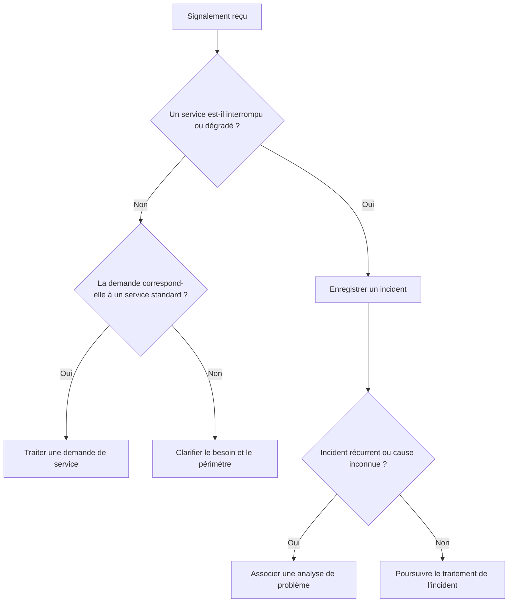
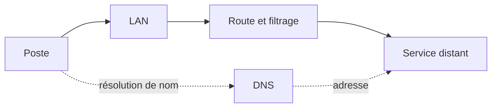
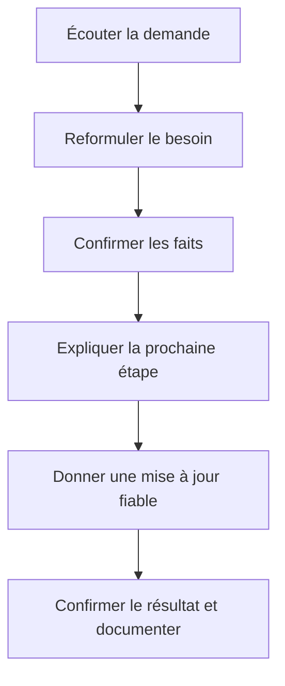

# Vocabulaire technique et communication

> **Mise en contexte**
>
> Tu rejoins une équipe informatique qui échange avec des utilisateurs, des techniciens réseau, des administrateurs système et des responsables métier. Pendant une même matinée, tu entends parler d'incident, de ticket, de service, de latence, de DNS, de sauvegarde, de priorité et de SLA. Tu sais parfois ce que les personnes veulent dire, mais tu hésites sur certains termes. Au même moment, tu dois expliquer à un collaborateur non technicien pourquoi son application ne répond plus, sans l'inonder de jargon.
>
> Le vocabulaire technique permet aux équipes de décrire les mêmes situations avec précision. La communication transforme ce vocabulaire en informations utiles pour la personne qui reçoit le message. Un terme employé à tort peut entraîner un mauvais diagnostic, une priorité injustifiée ou une intervention risquée. Une explication exacte mais incompréhensible peut aussi rendre le support inefficace.
>
> Ce cours réunit un glossaire opérationnel, des méthodes pour poser les bonnes questions, des exemples de reformulation et des modèles de communication. Il vise un technicien débutant qui doit apprendre à parler clairement aux utilisateurs tout en transmettant des informations techniques précises à ses collègues.

## 1. Objectifs pédagogiques

À la fin de ce cours, tu devras pouvoir :

- employer correctement le vocabulaire de base du support informatique ;
- différencier les mots proches qui ont des significations distinctes ;
- comprendre les termes courants du système, du réseau, de la sécurité et de la maintenance ;
- poser des questions neutres et utiles ;
- transformer une description vague en symptôme vérifiable ;
- adapter ton niveau de langage au destinataire ;
- rédiger un message professionnel sans ambiguïté ;
- distinguer une observation, une hypothèse, une conclusion et une recommandation ;
- communiquer l'état d'un ticket sans annoncer de résultat non confirmé ;
- réaliser une transmission technique compréhensible par une autre équipe ;
- éviter les formulations culpabilisantes et les promesses impossibles ;
- respecter la confidentialité dans les messages et les documents.

## 2. Pourquoi le vocabulaire technique est important

### 2.1 Un vocabulaire partagé réduit les malentendus

Imagine que deux personnes utilisent le mot « serveur » pour parler de choses différentes. L'une désigne une machine physique, l'autre une application qui écoute sur un port, et une troisième un service hébergé dans le cloud. L'équipe risque de chercher au mauvais endroit.

Un vocabulaire précis ne sert pas à impressionner. Il sert à décrire le problème de manière exploitable et à réduire les interprétations contradictoires.

### 2.2 Précision ne signifie pas complexité

Une bonne description n'est pas nécessairement longue. Elle donne le détail qui aide à comprendre la situation.

Description vague : « Le système est cassé. »

Description utile : « Depuis 9 h 10, l'application de facturation affiche une erreur lors de l'ouverture d'un dossier ; deux utilisateurs sont concernés et les autres applications restent accessibles. »

La seconde description précise le moment, le service, l'action et le périmètre sans inventer de cause.

### 2.3 Un même message peut avoir deux versions

Le compte rendu technique doit fournir des informations reproductibles aux collègues. Le message utilisateur doit aider la personne à comprendre la situation et la prochaine étape.

Exemple technique : « La connexion TCP vers le port attendu échoue depuis le poste A ; le test a été effectué à 10 h 15. La cause reste à confirmer. »

Exemple utilisateur : « Votre poste ne parvient pas encore à établir la connexion nécessaire à l'application. Nous vérifions si le problème vient de votre poste ou du service distant. »

Les deux messages peuvent être exacts tout en utilisant des niveaux de détail différents.

## 3. Vocabulaire de la maintenance et du support

### 3.1 Demande

Une demande est une sollicitation adressée à l'équipe informatique. Elle peut concerner une panne, un accès, une installation, une information ou une modification.

Le mot est général. La catégorie précise ce qui est attendu.

### 3.2 Incident

Un incident est une interruption ou une dégradation inattendue d'un service. Il décrit une perturbation, pas nécessairement sa cause.

Exemple : une application utilisée quotidiennement ne répond plus.

### 3.3 Demande de service

Une demande de service correspond généralement à une action standard prévue par les procédures, comme demander un équipement ou un accès. Elle peut exiger une approbation.

Une demande d'accès n'est pas automatiquement autorisée parce qu'elle est techniquement facile à exécuter.

### 3.4 Problème

Un problème désigne la cause réelle ou potentielle d'un ou plusieurs incidents, ou le dossier de travail visant à comprendre cette cause selon les pratiques de l'organisation.

Un incident récurrent peut conduire à une analyse de problème. Il faut éviter d'utiliser le mot « problème » comme simple synonyme d'incident lorsque la distinction est importante dans l'outil de gestion.

### 3.5 Panne

Une panne est la défaillance d'un composant, d'un équipement ou d'un service. L'indisponibilité d'une application ne prouve pas toujours une panne matérielle : les droits, le réseau ou une dépendance peuvent aussi être responsables.

### 3.6 Symptôme

Un symptôme est un signe observable : message d'erreur, temps de réponse élevé, voyant inhabituel, refus d'accès ou arrêt inattendu.

Le symptôme est ce que l'on observe, et non l'explication supposée.

### 3.7 Cause

La cause est le facteur qui explique l'incident. Elle peut être confirmée, probable ou encore inconnue selon les preuves disponibles.

Dans un ticket, il est préférable d'écrire « cause non confirmée » que d'inventer une explication pour remplir le champ.

### 3.8 Cause racine

La cause racine est l'origine fondamentale identifiée par une analyse suffisamment approfondie, dans le contexte étudié. Plusieurs facteurs peuvent contribuer à un même incident. Une cause racine ne se résume pas toujours à un composant unique.

### 3.9 Contournement

Un contournement limite temporairement les conséquences sans supprimer nécessairement la cause. Par exemple, utiliser un service secondaire autorisé peut permettre de poursuivre l'activité pendant l'analyse.

Le caractère temporaire doit être communiqué et documenté.

### 3.10 Résolution

La résolution est l'action ou l'ensemble d'actions qui satisfait les critères définis pour rétablir le service ou répondre à la demande. Elle doit être vérifiée, et non seulement déclarée.

### 3.11 Escalade

L'escalade est le transfert d'un dossier vers une personne ou une équipe disposant des compétences, des autorisations ou des responsabilités nécessaires. Ce n'est pas un échec du technicien : c'est une pratique de maîtrise du risque.

### 3.12 Ticket

Un ticket est l'enregistrement structuré d'une demande ou d'un incident. Il conserve le symptôme, les informations, l'affectation, les actions, les résultats, le statut et la suite prévue.

### 3.13 Changement

Un changement modifie un service, une configuration, un système ou une infrastructure. Les changements à risque doivent être préparés, approuvés et vérifiés selon la procédure applicable.

### 3.14 Procédure

Une procédure décrit une méthode approuvée pour effectuer une tâche ou gérer une situation. Elle doit être suffisamment claire pour être appliquée de façon cohérente dans son périmètre.

### 3.15 Documentation

La documentation rassemble les informations permettant de comprendre et de suivre le système, la demande ou l'intervention. Une bonne documentation distingue les faits, les hypothèses, les actions et les résultats.

### 3.16 Distinguer incident, demande de service et problème

Ces termes sont proches, mais ils ne décrivent pas la même chose. Un **incident** correspond à une interruption ou à une dégradation imprévue d'un service. Une **demande de service** porte sur une prestation standard prévue par l'organisation, par exemple l'accès à un outil ou l'installation d'un logiciel autorisé. Un **problème** désigne la cause — connue ou encore à identifier — d'un ou de plusieurs incidents. Un **changement** est une modification susceptible d'affecter un service et qui doit être préparée selon les règles de l'équipe.

Ce schéma sert de repère initial, pas de remplacement à la procédure de catégorisation de l'organisation. Les catégories peuvent coexister dans un même dossier : plusieurs incidents peuvent être rattachés à un problème, et une correction peut ensuite nécessiter un changement autorisé. La fiche doit conserver les faits observés et ne pas présenter une cause comme certaine avant qu'elle soit vérifiée.

## 4. Vocabulaire du système d'exploitation et du matériel

### 4.1 Système d'exploitation (OS)

Logiciel de base qui gère les ressources d'un ordinateur et fournit des fonctions aux applications. Exemples : Windows et les distributions Linux.

### 4.2 Application

Programme qui fournit une fonction à l'utilisateur ou à un autre système. Une application peut dépendre du système d'exploitation, d'une base de données, du réseau ou d'un service distant.

### 4.3 Processus

Instance d'un programme en cours d'exécution. Un processus consomme des ressources et peut créer d'autres processus. Terminer un processus sans comprendre son rôle peut interrompre une fonction importante.

### 4.4 Service

Composant logiciel qui fournit une fonction en arrière-plan. Un service peut être démarré sans que toutes ses fonctions soient nécessairement opérationnelles.

### 4.5 Pilote

Composant logiciel permettant au système d'exploitation de communiquer avec un matériel ou un périphérique. Un pilote incompatible peut perturber une fonction sans impliquer automatiquement une panne physique.

### 4.6 Firmware ou micrologiciel

Logiciel intégré à un composant ou à un équipement. Le BIOS/UEFI, certains contrôleurs et équipements réseau possèdent un micrologiciel. Une mise à jour de firmware nécessite des précautions particulières.

### 4.7 CPU ou processeur

Composant qui exécute les instructions. L'utilisation CPU indique une activité, mais une valeur élevée ponctuelle ne signifie pas automatiquement que le processeur est défectueux.

### 4.8 RAM ou mémoire vive

Mémoire de travail utilisée par les programmes et le système. Elle est volatile. Une utilisation élevée peut contribuer à des ralentissements, mais il faut examiner le contexte et les processus.

### 4.9 Stockage

Support qui conserve les données, par exemple HDD ou SSD. Il faut distinguer la capacité disponible, l'état logique du système de fichiers et l'état physique du support.

### 4.10 Pilote, composant et périphérique

Un composant peut être interne à l'ordinateur ; un périphérique est généralement un équipement connecté au système. Le vocabulaire varie selon le contexte, mais il est utile de préciser l'objet exact plutôt que de parler seulement de « matériel ».

### 4.11 BIOS et UEFI

Mécanismes de micrologiciel qui initialisent le matériel et participent au démarrage. Les menus et options exacts dépendent du fabricant et du modèle. Modifier ces paramètres sans connaître leur effet peut empêcher le démarrage.

### 4.12 Redémarrage

Action qui relance le système ou un service selon le contexte. Un redémarrage peut rétablir temporairement un fonctionnement sans traiter la cause racine. Le mot doit préciser ce qui a été redémarré : poste, service, serveur ou équipement réseau.

### 4.13 Réinstallation

Installation de nouveau d'un système ou d'une application. Elle peut effacer des configurations et des données. Elle exige une préparation, des sauvegardes adaptées, des licences et des critères de validation.

### 4.14 Restauration

Retour à un état sauvegardé ou à une configuration antérieure. La restauration peut remplacer des données récentes ; elle ne doit pas être confondue avec une simple réparation.

## 5. Vocabulaire réseau

### 5.1 Réseau local (LAN)

Réseau qui relie des équipements dans un espace géographique limité, comme un bureau ou un bâtiment. Le terme décrit le périmètre, pas nécessairement la qualité de la connexion.

### 5.2 Adresse IP

Adresse logique utilisée pour identifier une interface ou une destination dans un réseau IP. Une adresse correcte dans un contexte n'est pas automatiquement correcte dans un autre réseau.

### 5.3 Masque ou préfixe réseau

Indique quelle partie d'une adresse IPv4 ou IPv6 correspond au réseau, selon la notation utilisée. Une erreur de masque ou de préfixe peut perturber la communication.

### 5.4 Passerelle

Équipement ou adresse vers laquelle un système envoie certains paquets destinés à d'autres réseaux. La présence d'une passerelle dans la configuration ne prouve pas qu'elle est joignable.

### 5.5 DNS

Le système de noms de domaine associe des noms à des informations, dont des adresses IP dans les usages courants. Un échec de résolution peut rendre un service inaccessible par son nom, même si d'autres formes de connectivité fonctionnent.

### 5.6 DHCP

Protocole qui permet d'attribuer automatiquement une configuration IP. Un problème DHCP peut conduire à l'absence de configuration attendue, mais il faut vérifier la configuration et l'environnement avant de conclure.

### 5.7 VLAN

Réseau local virtuel qui segmente logiquement certains domaines de communication. Une mauvaise affectation de VLAN peut modifier les communications disponibles. Ne change pas une affectation sans connaître la conception et obtenir l'autorisation requise.

### 5.8 VPN

Réseau privé virtuel qui établit une connexion logique protégée selon une technologie et une configuration données. Un VPN n'est pas une garantie absolue de sécurité et ne remplace pas les contrôles d'accès.

### 5.9 Latence

Temps nécessaire à un échange ou à une transmission selon la mesure retenue. Une latence élevée peut dégrader une application interactive. Il faut préciser ce qui est mesuré, entre quelles destinations et sur quelle période.

### 5.10 Perte de paquets

Part des paquets envoyés qui n'arrivent pas à destination ou ne sont pas reçus comme prévu par le test. Une perte observée lors d'un test doit être interprétée selon le protocole, la charge et les équipements du chemin.

### 5.11 Bande passante et débit

La bande passante décrit une capacité théorique ou disponible d'un canal selon le contexte. Le débit mesure la quantité de données réellement transférée par unité de temps dans une mesure donnée. Les deux notions sont liées, mais ne sont pas identiques.

### 5.12 Port réseau

Identifiant logique utilisé par certains protocoles de transport pour associer une communication à un service ou un processus. Tester un port ne garantit pas que toutes les fonctions de l'application soient disponibles.

### 5.13 Pare-feu

Mécanisme de filtrage des communications selon des règles. Un accès bloqué peut être dû à un filtrage, mais aussi à une route, un service indisponible ou une configuration incorrecte. Désactiver un pare-feu ne constitue pas un premier réflexe acceptable.

### 5.14 Switch et routeur

Un switch relie des équipements dans un réseau local, généralement en transférant des trames selon leurs adresses MAC et sa configuration. Un routeur achemine des paquets entre réseaux. Les équipements modernes peuvent réunir plusieurs fonctions : il faut se référer à leur rôle dans l'architecture.

### 5.15 Schéma de lecture d'un incident réseau

Ce schéma est volontairement compact. Il montre quelques dépendances possibles, pas toutes les étapes du réseau réel. Un incident réseau doit être analysé avec des tests adaptés au symptôme.

## 6. Vocabulaire de sécurité et des accès

### 6.1 Authentification

Processus qui permet de vérifier l'identité présentée par un utilisateur ou un système.

### 6.2 Autorisation

Détermination des actions permises à une identité dans un contexte précis. Un utilisateur peut être authentifié et ne pas posséder le droit d'accéder à une ressource.

### 6.3 Privilège

Droit permettant d'effectuer certaines opérations. Les privilèges élevés doivent être limités, attribués selon les règles et utilisés de manière traçable.

### 6.4 Moindre privilège

Principe qui consiste à accorder uniquement les permissions nécessaires à la tâche. Il limite les conséquences possibles d'une erreur ou d'une compromission.

### 6.5 MFA

Authentification multifacteur : utilisation de plusieurs facteurs indépendants pour renforcer la vérification d'identité. Les modalités dépendent de la solution adoptée.

### 6.6 Vulnérabilité

Faiblesse pouvant être exploitée dans certaines conditions. La présence d'une vulnérabilité ne signifie pas automatiquement qu'un système a été compromis, mais elle peut nécessiter une action de réduction du risque.

### 6.7 Correctif de sécurité

Mise à jour qui corrige une faiblesse de sécurité ou réduit un risque identifié. Son déploiement doit tenir compte de l'urgence, de la compatibilité et de la criticité du système.

### 6.8 Malware

Terme général désignant un logiciel malveillant. Un symptôme inhabituel ne prouve pas à lui seul qu'une machine est infectée ; il faut suivre la procédure d'analyse.

### 6.9 Phishing ou hameçonnage

Tentative de tromper une personne pour obtenir des informations ou lui faire exécuter une action. Les signalements de phishing doivent être traités conformément aux règles de sécurité de l'organisation.

### 6.10 Journal d'événements

Enregistrement d'actions, d'états ou d'erreurs produits par un système ou une application. Les journaux peuvent contenir des données sensibles et doivent être protégés.

### 6.11 Secret

Information d'accès à protéger, par exemple un mot de passe, un jeton, une clé privée ou un secret applicatif. Un secret ne doit pas être copié dans un ticket ou un message ordinaire.

### 6.12 Données personnelles

Informations liées à une personne identifiée ou identifiable selon la définition applicable. La collecte, le partage et la conservation doivent respecter les règles de l'organisation et les obligations pertinentes.

## 7. Vocabulaire de gestion des services

### 7.1 SLA

*Service Level Agreement*, ou accord de niveau de service. Il définit des engagements de service entre parties, par exemple des objectifs de disponibilité ou de délai, selon le périmètre contractuel ou organisationnel.

### 7.2 OLA

*Operational Level Agreement*. Accord interne entre équipes qui contribue à tenir les engagements de service. Son usage et sa forme dépendent de l'organisation.

### 7.3 KPI

*Key Performance Indicator*, ou indicateur clé de performance. Un KPI mesure un aspect défini du service. Il doit avoir une formule claire, une source de données et une interprétation adaptée.

### 7.4 MTTR

Acronyme utilisé pour désigner différents temps moyens liés à la réparation ou au rétablissement selon le contexte de mesure. Le terme exact et la formule doivent être définis avant de comparer des chiffres entre équipes.

### 7.5 MTBF

*Mean Time Between Failures*, ou temps moyen entre défaillances dans un contexte de mesure défini. Son calcul et son interprétation dépendent du type de système et des données utilisées.

### 7.6 Disponibilité

Mesure de la proportion de temps pendant laquelle un service est accessible selon une définition et une période données. Il faut préciser les exclusions, les fenêtres prévues et la méthode de mesure.

### 7.7 Maintenance préventive

Interventions planifiées pour réduire le risque de panne ou détecter des anomalies en amont.

### 7.8 Maintenance corrective

Intervention après une défaillance pour rétablir le fonctionnement.

### 7.9 Maintenance prédictive

Utilisation de données d'état et de leur évolution pour estimer des risques de défaillance et planifier une action. Une prédiction est une estimation, pas une certitude.

### 7.10 Maintenance évolutive

Adaptation d'un système à un besoin nouveau ou à une évolution de l'organisation.

### 7.11 Fenêtre de maintenance

Période planifiée pendant laquelle une opération est autorisée. Elle doit tenir compte de l'impact, de la communication aux utilisateurs et du retour arrière.

### 7.12 Groupe pilote

Petit ensemble de systèmes ou d'utilisateurs représentatifs servant à tester une mise à jour ou un changement avant une extension plus large.

## 8. Glossaire complémentaire : autres termes utiles

| Terme | Définition pratique |
|---|---|
| Actif informatique | Équipement, logiciel ou ressource gérée par l'organisation |
| Inventaire | Liste structurée des actifs et de leurs propriétés utiles |
| Endpoint | Poste, serveur ou autre terminal géré ou connecté |
| Environnement de production | Environnement utilisé pour fournir le service réel |
| Environnement de test | Environnement destiné à vérifier un comportement sans exposer directement les utilisateurs de production |
| Dépendance | Composant ou service dont un autre élément a besoin pour fonctionner |
| Journalisation | Production et conservation de traces d'événements |
| Sauvegarde | Copie destinée à permettre la récupération de données |
| Restauration | Récupération de données ou d'un état à partir d'une copie ou d'un point antérieur |
| Retour arrière | Procédure visant à revenir à un état antérieur acceptable après un changement |
| Maintenance | Activités de prévention, de diagnostic, de correction ou d'évolution |
| Incident majeur | Incident dont l'impact justifie un processus de coordination renforcé selon les règles internes |
| Résolution temporaire | Rétablissement qui laisse subsister une cause ou un suivi |
| Réouverture | Reprise du traitement d'un ticket considéré résolu, lorsque les critères ne sont plus satisfaits ou que le problème revient |
| Escalade fonctionnelle | Transmission pour décision ou approbation métier |
| Escalade technique | Transmission vers une équipe ayant les compétences ou les accès nécessaires |
| Traçabilité | Capacité à reconstruire les faits, actions et décisions à partir des informations conservées |
| Confidentialité | Limitation de l'accès à l'information aux personnes ou systèmes autorisés |
| Intégrité | Protection contre une modification non autorisée ou une altération incorrecte |
| Disponibilité | Capacité d'un système ou d'une donnée à être accessible selon les besoins définis |

Ce glossaire n'épuise pas tous les termes informatiques. Il fournit une base commune que tu pourras compléter au fil des cours et des interventions.

## 9. Communiquer avec un utilisateur non technicien

### 9.1 Écouter avant de diagnostiquer

La première description de l'utilisateur constitue un point de départ. Il n'est pas nécessaire de corriger immédiatement son vocabulaire. Il faut d'abord comprendre ce qu'il essaie de faire, ce qu'il observe et ce qui a changé.

Questions utiles :
- Que tentiez-vous de faire ?
- Qu'est-ce qui s'est passé exactement ?
- Quel message avez-vous vu ?
- Depuis quand le problème apparaît-il ?
- Est-ce arrivé une seule fois ou plusieurs fois ?
- D'autres fonctions sont-elles affectées ?
- Un changement récent est-il connu ?

Évite les questions qui accusent ou présument la cause, comme « Qu'avez-vous cassé ? ». Une formulation neutre facilite l'échange.

### 9.2 Reformuler pour confirmer

Après avoir écouté, reformule en une ou deux phrases.

Exemple :
« Si je comprends bien, tu peux ouvrir les autres applications, mais l'application de facturation affiche une erreur lorsque tu ouvres un dossier. Le problème est apparu ce matin. C'est bien cela ? »

La reformulation réduit le risque de partir d'une mauvaise compréhension. L'utilisateur peut corriger un détail ou ajouter une information.

### 9.3 Utiliser le jargon au bon endroit

Les notes techniques peuvent contenir des termes précis pour faciliter le travail des collègues. Le message utilisateur doit expliquer ce que cela signifie pour son activité.

Au lieu de dire « le DNS ne résout pas le FQDN », tu peux expliquer : « Le poste ne parvient pas à retrouver l'adresse associée au nom du serveur. Nous vérifions ce point avant de modifier la configuration. »

Il ne faut pas simplifier au point de devenir faux. Si tu n'es pas certain de la cause, parle de la difficulté observée et des contrôles en cours.

### 9.4 Annoncer ce qui est connu et inconnu

Une communication professionnelle distingue les faits confirmés des hypothèses. Elle indique la prochaine étape, sans inventer un délai ou une solution.

Mauvais exemple : « C'est forcément le serveur, nous allons le réparer rapidement. »

Meilleur exemple : « Plusieurs utilisateurs rencontrent le même échec. Nous vérifions les composants partagés et transmettrons le dossier à l'équipe appropriée si les contrôles locaux ne suffisent pas. »

### 9.5 Gérer la frustration

L'utilisateur peut être stressé parce que son travail est bloqué. Le technicien doit reconnaître l'impact sans promettre un résultat non vérifié.

Exemple : « Je comprends que cette interruption bloque votre activité. Le ticket est enregistré et je vérifie maintenant les éléments qui permettront de déterminer la prochaine action. »

Reste factuel, calme et respectueux. Évite les remarques personnelles, les reproches et les discussions sur la faute.

## 10. Communication écrite professionnelle

### 10.1 Structure d'un message

Un message opérationnel peut contenir :

1. le contexte ou la référence ;
2. les faits utiles ;
3. l'action ou l'information demandée ;
4. la prochaine étape ;
5. une formule de clôture appropriée.

La structure doit rester adaptée à la situation. Un ticket technique n'a pas besoin d'un courriel cérémonieux, mais il doit être compréhensible.

### 10.2 Éviter les formulations ambiguës

Les mots « ça », « il » ou « ça marche » peuvent avoir plusieurs référents dans un dossier. Nomme le service ou l'équipement et décris le résultat.

Au lieu de « J'ai relancé et ça marche », écris : « Le service d'impression a été redémarré selon la procédure autorisée. Une page de test a ensuite été imprimée depuis le poste concerné. »

### 10.3 Distinguer le fait de l'opinion

Fait : « Le test de connexion a échoué à 10 h 15. »

Opinion ou hypothèse : « Le réseau est probablement en cause. »

Conclusion vérifiée : « La connexion fonctionne depuis le poste de référence, mais échoue depuis le poste concerné. Les paramètres locaux restent à examiner. »

Les hypothèses ont leur place dans le diagnostic, à condition d'être identifiées comme telles.

### 10.4 Employer des dates et heures précises

Pour un incident, « ce matin » peut devenir ambigu lorsque le ticket est relu plusieurs jours plus tard. Utilise une date et une heure lorsque cela apporte de la valeur, et indique le fuseau horaire si plusieurs régions sont concernées.

### 10.5 Relire avant d'envoyer

Vérifie le destinataire, la référence du ticket, les faits, les pièces jointes et les informations confidentielles. Une capture peut révéler des données non nécessaires. Une réponse envoyée au mauvais groupe peut exposer le dossier.

## 11. Modèles de communication à réutiliser

### 11.1 Accusé de réception

« Bonjour, votre demande est enregistrée sous la référence [référence]. Nous allons vérifier les informations disponibles et vous communiquer la prochaine étape dès que possible selon les priorités de traitement. »

Adapte le message à la politique interne. N'utilise pas de promesse automatique de délai si le service ne s'y est pas engagé.

### 11.2 Demande d'informations complémentaires

« Bonjour, pour poursuivre le diagnostic, pouvez-vous préciser le message exact affiché et l'heure approximative à laquelle le problème est apparu ? Si vous transmettez une capture, veuillez masquer les informations confidentielles qui ne sont pas nécessaires. Merci. »

### 11.3 Mise à jour en cours de traitement

« Le ticket reste en cours d'analyse. Les premiers contrôles ont permis de préciser le périmètre, mais la cause n'est pas encore confirmée. La prochaine étape consiste à vérifier [élément], puis nous actualiserons le ticket avec le résultat. »

### 11.4 Escalade

« Les contrôles autorisés au premier niveau sont documentés dans le ticket. Ils n'ont pas permis de confirmer la cause. Le dossier est transmis à l'équipe [équipe] pour examiner [question précise]. Les utilisateurs touchés et les résultats obtenus sont renseignés dans l'historique. »

### 11.5 Résolution confirmée

« Le service est de nouveau accessible. Nous avons vérifié [test concret] et consigné l'action dans le ticket. Merci de nous signaler si le problème réapparaît, en indiquant l'heure et le message éventuel. »

N'emploie ce modèle que si le résultat a réellement été vérifié.

### 11.6 Résolution temporaire

« Une solution de contournement permet de reprendre l'activité, mais la cause n'est pas encore confirmée. Le ticket reste suivi selon la procédure afin que l'analyse complémentaire puisse être terminée. »

### 11.7 Schéma du cycle de communication

Le cycle peut être répété lorsqu'une nouvelle information apparaît. Une mise à jour doit apporter un élément utile, même si la cause n'est pas encore connue.

## 12. Communication entre techniciens

La communication interne vise la reproductibilité et la continuité. Une autre personne doit pouvoir comprendre le dossier sans interpréter des phrases vagues.

### 12.1 Transmission structurée

Pour transmettre un incident, indique :
- le service et le périmètre ;
- la date et l'heure d'apparition ;
- les symptômes ;
- les tests réalisés ;
- leurs résultats ;
- les actions effectuées ;
- les changements récents connus ;
- les risques ;
- l'action attendue.

### 12.2 Éviter les messages personnels comme seule trace

Une conversation informelle peut aider à coordonner l'intervention, mais les résultats utiles doivent être inscrits dans le système officiel. Sinon, le reste de l'équipe peut ignorer la décision ou répéter les tests.

### 12.3 Donner le contexte d'une commande

Ne copie pas uniquement une ligne de commande et sa sortie. Mentionne la machine, l'heure, l'objectif et les éléments à retenir. Les identifiants, adresses et résultats sensibles doivent être partagés uniquement avec les personnes autorisées.

### 12.4 Être explicite sur les limites

Exemple :
« Le ping vers la destination n'a reçu aucune réponse. Ce test ne permet pas de conclure à une panne du serveur ; la connectivité TCP et l'état du service ne sont pas encore vérifiés. »

Cette formulation prévient les interprétations excessives.

## 13. Erreurs de communication fréquentes

### Erreur 1 : affirmer une cause trop tôt

Dire « le serveur est en panne » avant vérification peut orienter l'équipe dans la mauvaise direction.

**Bonne pratique :** décrire le symptôme et préciser le statut des hypothèses.

### Erreur 2 : employer des acronymes sans explication

Un utilisateur non technique peut ne pas comprendre DNS, DHCP, VPN ou SLA.

**Bonne pratique :** expliquer la fonction en mots simples lorsqu'elle est pertinente, sans ajouter une longue définition inutile.

### Erreur 3 : promettre un résultat

Une estimation non fondée fragilise la confiance et peut créer de fausses attentes.

**Bonne pratique :** communiquer la prochaine étape et indiquer quand une estimation plus fiable sera disponible si les règles du service le permettent.

### Erreur 4 : accuser l'utilisateur

Les reproches n'aident pas le diagnostic et peuvent empêcher une personne de signaler honnêtement les actions déjà réalisées.

**Bonne pratique :** poser des questions neutres et expliquer les conséquences techniques sans jugement.

### Erreur 5 : transmettre des secrets

Un mot de passe ou un jeton dans un ticket peut être conservé, diffusé ou indexé à tort.

**Bonne pratique :** utiliser les mécanismes approuvés pour la gestion des secrets et éviter de les collecter dans la conversation ordinaire.

### Erreur 6 : clore sans confirmer

« C'est bon » peut désigner un redémarrage, un test partiel ou une réelle résolution.

**Bonne pratique :** nommer le test de validation et son résultat.

## 14. Travaux pratiques

### TP 1 — Reformuler dix phrases vagues

Transforme les phrases suivantes en descriptions utiles et neutres :

- « Le réseau est mort. »
- « Mon PC est cassé. »
- « Le serveur est lent. »
- « Ça ne marche pas. »
- « J'ai tout essayé. »
- « Il y a un virus. »
- « L'imprimante est foutue. »
- « Les droits sont mauvais. »
- « La mise à jour a tout détruit. »
- « Le problème est réglé. »

Pour chacune, indique les informations qui manquent et une question permettant d'avancer.

### TP 2 — Adapter le message au destinataire

Choisis un incident d'accès à une application. Rédige :
1. une note technique à destination d'un administrateur ;
2. un message utilisateur non technique ;
3. une mise à jour au responsable de service.

Les trois textes doivent rester cohérents tout en adaptant leur niveau de détail.

### TP 3 — Créer un mini-glossaire d'équipe

Choisis quinze termes utilisés dans tes activités. Pour chacun, rédige une définition d'une phrase, un exemple et un piège de vocabulaire à éviter.

Le glossaire doit être compréhensible par un débutant et assez précis pour éviter les confusions.

### TP 4 — Préparer une escalade

À partir d'un incident réseau simulé, rédige un transfert contenant les symptômes, les tests, les résultats, les limites et la question précise adressée à l'équipe suivante.

Le destinataire doit pouvoir décider du prochain test sans te demander de recommencer toute l'analyse.

### TP 5 — Écrire une mise à jour honnête

Un ticket est toujours en cours. Les premiers tests ont exclu une partie des hypothèses, mais l'origine reste inconnue. Rédige une mise à jour de trois à cinq phrases qui informe l'utilisateur sans prétendre que la cause a été trouvée.

## 15. Exercices avec corrections

### Exercice 1 — Incident ou cause ?

Un utilisateur ne peut plus ouvrir une application. Le technicien écrit : « L'incident est causé par le serveur. » Aucun contrôle n'a été réalisé.

**Correction :** la phrase présente une hypothèse comme un fait. Il faut d'abord décrire le symptôme, puis noter que le serveur est une cause possible à vérifier.

### Exercice 2 — Authentification et autorisation

Un utilisateur ouvre sa session, mais reçoit un refus lorsqu'il tente de modifier un dossier.

**Correction :** l'authentification a apparemment réussi. Le refus peut concerner les autorisations, mais d'autres causes restent possibles. Il faut vérifier les droits attendus et le message exact.

### Exercice 3 — Latence

Un utilisateur dit que « le débit est mauvais » parce qu'une application répond lentement.

**Correction :** le symptôme peut correspondre à une latence élevée, à une saturation, à une lenteur applicative ou à une autre cause. Il faut préciser quelle opération est lente et réaliser des mesures adaptées avant de choisir le terme exact.

### Exercice 4 — Demande de service

Un collaborateur demande un nouveau compte et l'approbation requise n'a pas été fournie.

**Correction :** la demande doit suivre le processus d'approbation. Le technicien ne doit pas créer le compte simplement parce que la demande est enregistrée.

### Exercice 5 — SLA

Un utilisateur demande une réparation immédiate et affirme que le SLA l'exige. Le technicien n'a pas consulté le contrat ou les règles de service.

**Correction :** il faut consulter l'engagement applicable, qualifier la priorité et communiquer selon les règles. Le technicien ne doit pas confirmer un délai contractuel qu'il n'a pas vérifié.

### Exercice 6 — Résolution temporaire

Une solution de contournement permet à l'utilisateur de continuer son travail. Peut-on affirmer que la cause est éliminée ?

**Correction : non.** Le contournement limite l'impact mais peut laisser la cause présente. Il faut le documenter et préciser le suivi restant.

### Exercice 7 — Bonne transmission

La note « voir avec le réseau » est-elle suffisante pour transmettre un incident à l'équipe réseau ?

**Correction : non.** La transmission doit donner le symptôme, le périmètre, les tests, les résultats et la question précise que l'équipe réseau doit examiner.

### Exercice 8 — Message utilisateur

Quel message est le plus professionnel ?

A. « C'est votre faute, vous avez dû mal configurer quelque chose. »  
B. « Le serveur est définitivement cassé », sans preuve.  
C. « Le problème est en cours d'analyse ; nous vérifions les éléments qui permettent de localiser l'échec. »  
D. « Tout sera réparé dans cinq minutes », sans estimation fiable.

**Correction : C.** Il informe l'utilisateur sans accuser ni promettre une issue non vérifiée.

### Exercice 9 — Confidentialité

Un ticket contient un jeton d'accès dans une capture. Que faire ?

**Correction :** limiter immédiatement sa diffusion et suivre la procédure de traitement des secrets exposés, qui peut inclure la suppression ou le remplacement de la pièce jointe et la révocation du secret. Il ne faut pas recopier le jeton dans d'autres messages.

### Exercice 10 — Fait, hypothèse ou conclusion

Classe les phrases suivantes :
- « Le message d'erreur est apparu à 10 h 15. »
- « Le problème vient probablement du DNS. »
- « Le test de résolution du nom a échoué depuis ce poste. »
- « Le DNS est la cause confirmée. »

**Correction :**
- L'heure du message est une observation si elle a été constatée.
- L'origine DNS est une hypothèse.
- L'échec du test est un résultat observé.
- La cause confirmée est une conclusion qui nécessite suffisamment de preuves indépendantes et cohérentes.

## 16. Défi final — Communication autour d'un incident majeur

### Situation

Plusieurs utilisateurs ne peuvent plus accéder à une application métier depuis 9 h 20. Les applications locales fonctionnent. Les tests initiaux n'ont pas permis de localiser la cause. Une équipe spécialisée a été sollicitée, mais elle n'a pas encore confirmé le diagnostic.

Tu dois préparer :
1. le titre et le résumé du ticket ;
2. une mise à jour destinée aux utilisateurs ;
3. un transfert technique ;
4. un point de situation destiné au responsable de service ;
5. une liste des informations encore nécessaires.

### Correction détaillée

**Titre du ticket :** « Application métier inaccessible pour plusieurs utilisateurs depuis 9 h 20 ».

**Résumé :** « Depuis 9 h 20, plusieurs utilisateurs n'arrivent plus à accéder à l'application métier. Les applications locales restent disponibles. Les contrôles initiaux n'ont pas permis de confirmer la cause. Le dossier est transmis à l'équipe spécialisée pour poursuivre le diagnostic. »

**Message utilisateur :** « L'application métier rencontre actuellement une difficulté d'accès pour plusieurs utilisateurs. Les premiers contrôles n'ont pas encore permis d'identifier l'origine. L'équipe spécialisée poursuit l'analyse et nous communiquerons une nouvelle information lorsque les résultats permettront de préciser la suite. »

**Transfert technique :** inclure le nombre d'utilisateurs, les messages exacts, les heures, les tests réellement effectués, leurs résultats et les hypothèses restant à examiner. Ne pas affirmer que le serveur est en panne sans preuve.

**Point au responsable :** préciser l'impact confirmé, la priorité retenue, la dépendance à l'équipe spécialisée, les solutions de contournement connues et le prochain point de suivi selon le processus de l'organisation.

**Informations manquantes :** message exact, portée, changements récents, état du service distant, résultats des contrôles complémentaires et existence d'une solution de contournement.

Le résultat professionnel est un ensemble de communications cohérentes : le vocabulaire varie selon le destinataire, mais les faits ne changent pas.

### Barème indicatif

| Critère | Points |
|---|---:|
| Titre et résumé factuels | 4 |
| Message utilisateur clair | 3 |
| Transfert technique exploitable | 4 |
| Point de situation au responsable | 3 |
| Gestion des inconnues et des risques | 3 |
| Confidentialité et cohérence | 3 |
| **Total** | **20** |

## 17. Synthèse du cours

Le vocabulaire technique est un outil de diagnostic et de collaboration. La communication professionnelle permet de partager ce vocabulaire sans compliquer inutilement les échanges.

Les habitudes essentielles sont :

1. décrire les faits avant d'interpréter ;
2. distinguer incident, demande, problème, cause et résolution ;
3. choisir les termes adaptés au système ou au service concerné ;
4. expliquer le jargon lorsque le destinataire n'est pas technique ;
5. adapter le niveau de détail sans modifier les faits ;
6. documenter la date, le contexte et le résultat des vérifications ;
7. annoncer clairement les inconnues ;
8. ne jamais promettre un résultat ou un délai non vérifié ;
9. protéger les secrets et les données personnelles ;
10. transmettre un dossier avec les informations nécessaires à la reprise.

La règle à retenir est : **précis pour les techniciens, compréhensible pour les utilisateurs, honnête pour tous.**
