# Maintenance matérielle (PC, serveurs, baies)

> **Mise en contexte**
>
> Dans une entreprise, plusieurs postes de travail deviennent instables. L'un ne démarre plus, un autre s'éteint pendant une tâche exigeante et un serveur signale une alerte de stockage. Un collègue propose de remplacer immédiatement les pièces qui semblent suspectes. Pourtant, sans diagnostic, il est possible de remplacer un composant fonctionnel, d'endommager le matériel ou de compromettre les données.
>
> La maintenance matérielle consiste à examiner, entretenir et remettre en état les équipements physiques dans un cadre maîtrisé. Elle ne se résume pas à ouvrir un boîtier : elle exige de reconnaître les composants, d'observer les symptômes, de comprendre les compatibilités, de respecter les règles de sécurité, de protéger les données et de vérifier le résultat. Le cours progresse du poste individuel vers le serveur et la baie informatique, avec des exemples adaptés à un technicien débutant.

## 1. Objectifs pédagogiques

À la fin de ce cours, tu devras pouvoir :

- reconnaître les principaux composants d'un ordinateur et expliquer leur rôle ;
- différencier un problème d'alimentation, de mémoire, de stockage, de refroidissement et de périphérique ;
- recueillir des symptômes avant d'ouvrir un équipement ;
- appliquer les précautions de sécurité électrique et antistatique ;
- utiliser une méthode de diagnostic qui évite le remplacement de pièces au hasard ;
- vérifier les compatibilités avant de remplacer un composant ;
- comprendre les différences importantes entre un poste de travail et un serveur ;
- effectuer une inspection visuelle non intrusive d'une baie informatique ;
- identifier les risques liés au stockage, à l'alimentation, à la chaleur et au câblage ;
- préparer et documenter une intervention matérielle ;
- tester l'équipement après réparation et savoir quand escalader.

## 2. Ce que recouvre la maintenance matérielle

La maintenance matérielle concerne les composants physiques et les conditions qui leur permettent de fonctionner correctement. Elle comprend l'observation, le nettoyage autorisé, les contrôles, le remplacement de composants compatibles, le suivi des alertes et la vérification après intervention.

Elle concerne notamment les ordinateurs fixes et portables, les stations de travail, les écrans, les périphériques, les serveurs, les supports de stockage, les onduleurs, les équipements réseau, les baies et les accessoires de câblage.

La maintenance matérielle est liée à la maintenance logicielle. Un disque défaillant peut produire des erreurs système, une température excessive peut provoquer une baisse de performance, et un problème de pilote peut ressembler à une panne matérielle. Il faut donc établir les faits avant de décider qu'un composant doit être remplacé.

### 2.1 Les objectifs

**Disponibilité :** limiter les interruptions et rétablir le fonctionnement d'un équipement.

**Fiabilité :** réduire les pannes récurrentes et identifier les composants qui présentent des signes d'usure.

**Protection des données :** éviter qu'une intervention endommage un support ou rende les données inaccessibles.

**Sécurité :** prévenir les chocs électriques, les blessures, les décharges électrostatiques et les dommages aux équipements.

**Traçabilité :** savoir quel composant a été retiré ou installé, à quelle date, par qui et avec quel résultat.

**Maîtrise des coûts :** remplacer ce qui est réellement nécessaire et planifier les évolutions plutôt que multiplier les achats d'urgence.

### 2.2 Maintenance matérielle et garantie

Avant d'ouvrir un équipement, vérifie les conditions de garantie, les restrictions du fabricant et les règles de l'entreprise. Certains remplacements sont prévus pour l'utilisateur ou le technicien interne ; d'autres doivent être effectués par un prestataire agréé.

Ne retire jamais un scellé ou un élément de protection en supposant que cela est sans conséquence. Si le matériel est sous garantie et que l'opération peut l'affecter, demande une validation. Un technicien compétent ne se contente pas de savoir démonter un composant : il sait aussi déterminer s'il est autorisé à le faire.

## 3. Comprendre l'architecture d'un ordinateur

Un ordinateur est un ensemble de composants qui travaillent ensemble. Une panne visible par l'utilisateur ne permet pas, à elle seule, de déterminer lequel est en cause.

### 3.1 Carte mère

La carte mère relie les principaux composants : processeur, mémoire, stockage, cartes d'extension et périphériques. Elle contient notamment des circuits de communication, des connecteurs et des contrôleurs.

Un défaut de carte mère peut provoquer des symptômes variés : impossibilité de démarrer, ports inactifs, détection incohérente de composants ou instabilité. Toutefois, ces symptômes peuvent également être causés par l'alimentation, la mémoire ou un périphérique. La carte mère ne doit pas être déclarée défectueuse uniquement parce que le démarrage échoue.

### 3.2 Processeur

Le processeur, ou CPU, exécute les instructions du système et des applications. Sa performance et sa compatibilité dépendent de nombreux facteurs : modèle, architecture, carte mère, micrologiciel, alimentation et refroidissement.

Un processeur trop chaud peut réduire automatiquement sa fréquence ou déclencher une protection. Cela peut se manifester par un ralentissement ou un arrêt, sans que le processeur soit nécessairement endommagé. Le diagnostic doit examiner la température, la ventilation, la charge et les événements associés.

Le remplacement d'un processeur exige de vérifier le socket, la compatibilité de la carte mère, la version du micrologiciel, les limites thermiques et le refroidisseur. Ne force jamais un processeur dans son emplacement.

### 3.3 Mémoire vive (RAM)

La RAM conserve temporairement les données et instructions utilisées par les programmes. Elle est volatile : son contenu normal disparaît lorsque l'alimentation est coupée.

Une mémoire défectueuse ou mal installée peut produire des erreurs, des redémarrages, des écrans bleus ou des échecs de démarrage. Ces symptômes ne sont pas spécifiques à la RAM ; ils imposent des tests adaptés.

Les barrettes doivent être compatibles avec la plateforme : génération, format, capacité supportée, vitesse, organisation et règles de population des emplacements. Un module qui entre physiquement dans un emplacement n'est pas nécessairement compatible. Sur les serveurs, certaines plateformes exigent des modules précis, notamment de mémoire ECC, et imposent des règles de placement.

### 3.4 Stockage : HDD, SSD SATA et NVMe

Le stockage conserve les données même lorsque l'ordinateur est éteint.

Un **HDD** utilise des éléments mécaniques et des plateaux. Il peut être sensible aux chocs lorsqu'il fonctionne. Certains signes, comme des bruits inhabituels, des erreurs de lecture ou des lenteurs répétées, justifient une attention particulière.

Un **SSD SATA** utilise de la mémoire flash et communique via une interface SATA. Il n'a pas les mêmes pièces mécaniques qu'un HDD, mais il peut tout de même tomber en panne.

Un **SSD NVMe** utilise généralement une liaison PCI Express et le protocole NVMe. Le format physique peut varier, par exemple M.2 ou une carte d'extension. Le fait qu'un support soit au format M.2 ne signifie pas automatiquement qu'il est NVMe : le format mécanique et le protocole sont deux notions différentes.

En présence de signes de défaillance, la priorité est d'évaluer le risque pour les données, de vérifier les sauvegardes et de suivre les procédures de récupération. Ne multiplie pas les tests intensifs sur un disque qui semble en train de tomber en panne.

### 3.5 Bloc d'alimentation

Le bloc d'alimentation fournit aux composants les tensions électriques dont ils ont besoin. Une alimentation insuffisante ou défaillante peut entraîner des démarrages impossibles, des arrêts soudains ou une instabilité.

Les symptômes d'alimentation peuvent ressembler à ceux d'une carte mère ou d'un autre composant. Un diagnostic sérieux vérifie le contexte, les connexions et les indications disponibles avant de remplacer quoi que ce soit.

N'ouvre jamais un bloc d'alimentation pour tenter une réparation non autorisée. Il peut contenir des composants dangereux même après déconnexion. Si l'alimentation doit être remplacée, utilise un modèle compatible et adapté à la puissance et aux connecteurs requis.

### 3.6 Refroidissement

Le système de refroidissement évacue la chaleur produite par le processeur, la carte graphique, les disques et d'autres composants. Il peut comporter des ventilateurs, des dissipateurs et, sur certains équipements, un circuit de refroidissement liquide.

Une ventilation obstruée, un ventilateur défaillant ou un refroidisseur mal installé peut augmenter la température. Des signes possibles sont des ralentissements, du bruit, des alertes thermiques ou des arrêts de protection.

La température doit être interprétée selon le modèle, la charge et les recommandations du fabricant. Il n'existe pas un seuil unique applicable à tous les composants. Une hausse temporaire en pleine charge n'a pas la même signification qu'une température élevée persistante au repos.

### 3.7 Carte graphique

La carte graphique peut être intégrée au processeur ou installée séparément. Elle traite l'affichage et, selon le modèle, des calculs spécifiques.

Un écran noir, des artefacts ou des redémarrages peuvent provenir de la carte graphique, mais aussi de l'écran, du câble, du pilote, de l'alimentation ou du système. Commence par vérifier les éléments accessibles et compare les symptômes avant d'envisager un remplacement.

### 3.8 Carte réseau et connecteurs

La carte réseau permet de connecter l'équipement au réseau filaire ou sans fil. Un port endommagé, un câble défectueux, une mauvaise configuration ou un pilote inadapté peuvent produire des problèmes similaires.

Avant de conclure à une panne de carte réseau, vérifie l'état du lien, le câble ou le point d'accès, la configuration et, si possible, une comparaison avec une connexion connue comme fonctionnelle.

### 3.9 BIOS et UEFI

Le BIOS ou UEFI est le micrologiciel qui initialise une partie du matériel et prépare le démarrage du système d'exploitation. Les réglages peuvent concerner l'ordre de démarrage, la détection des supports, certains paramètres de sécurité et des fonctions matérielles.

Une modification incorrecte peut empêcher le démarrage. Ne modifie pas ces réglages sans comprendre l'objectif et sans autorisation. Une mise à jour de micrologiciel exige une procédure fiable, une source officielle et une alimentation stable. Une interruption pendant une mise à jour peut rendre l'équipement inutilisable.

### 3.10 Schéma simplifié des composants

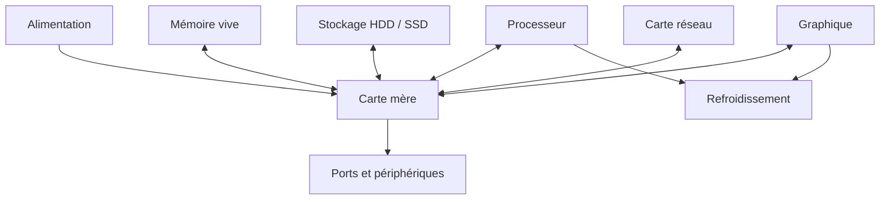

Ce schéma illustre des relations générales. Les connexions exactes et la répartition des fonctions varient selon les appareils. Il ne représente pas tous les circuits électriques ni toutes les lignes de communication.

## 4. Reconnaître les symptômes de démarrage

Le premier démarrage fournit des indices. Il faut noter précisément ce qui se passe au lieu de dire simplement « le PC est mort ».

### Schéma — diagnostiquer un problème de démarrage sans conclure trop tôt

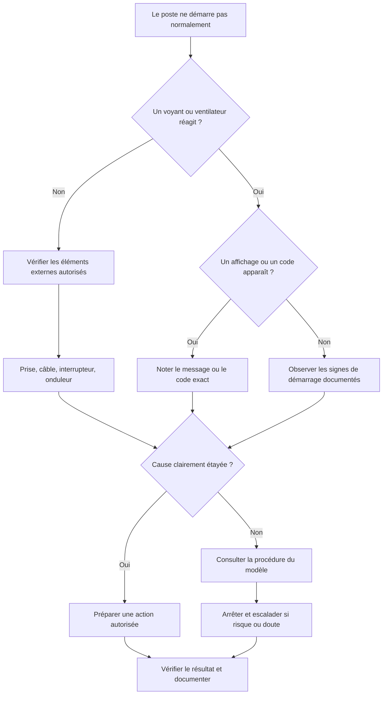

Le but de cet arbre est de séparer les symptômes observés des causes possibles. L'absence de voyant ne prouve pas à elle seule la panne du bloc d'alimentation ; un code de démarrage doit être interprété avec la documentation du modèle exact.

### 4.1 Aucun signe d'alimentation

Si aucun voyant ne s'allume, aucun ventilateur ne tourne et aucun signe de démarrage n'apparaît, vérifie d'abord les éléments externes autorisés : prise, câble d'alimentation, interrupteur, multiprise ou onduleur. Sur un portable, l'état du chargeur et les indicateurs de charge peuvent aider.

Ces vérifications doivent rester sûres. N'ouvre pas une alimentation et ne manipule pas un câble électrique endommagé. Si l'alimentation externe semble défectueuse, retire l'équipement du service selon les procédures et demande une vérification compétente.

L'absence de signe visible ne prouve pas que le bloc d'alimentation est la seule cause. La carte mère, le bouton, une protection ou d'autres éléments peuvent être concernés.

### 4.2 Voyants présents, mais pas de démarrage

Un poste peut recevoir de l'alimentation sans effectuer son démarrage normal. Observe si les voyants changent, si les ventilateurs démarrent, si des codes d'erreur apparaissent et si l'écran affiche un message.

Certaines cartes mères ou certains serveurs ont des voyants de diagnostic ou des codes sonores. Leur interprétation dépend du constructeur et du modèle. Utilise la documentation appropriée plutôt que d'appliquer une liste générique trouvée pour un autre matériel.

### 4.3 Démarrage interrompu

Un équipement peut démarrer puis s'arrêter, redémarrer en boucle ou afficher un écran d'erreur. Les causes possibles incluent alimentation instable, température, mémoire, stockage, micrologiciel ou système d'exploitation.

Il faut déterminer jusqu'à quelle étape le démarrage progresse. Le logo du constructeur, un message UEFI, le chargeur de démarrage et l'ouverture de session indiquent des étapes différentes. Ce repérage aide à choisir les contrôles suivants.

### 4.4 Démarrage mais aucun affichage

Vérifie d'abord les éléments externes : écran sous tension, source d'entrée correcte, câble adapté et connexion sur le bon port. Sur un PC équipé d'une carte graphique dédiée, les sorties de la carte mère ne sont pas nécessairement actives selon le processeur et la configuration.

Un écran noir ne prouve pas que le poste ne démarre pas. Il faut distinguer l'absence d'affichage d'un véritable échec d'initialisation. Si le problème dépasse les vérifications autorisées, escalade avant d'ouvrir ou de remplacer des composants.

## 5. Diagnostic méthodique avant ouverture

### Schéma — démarche de diagnostic avant ouverture

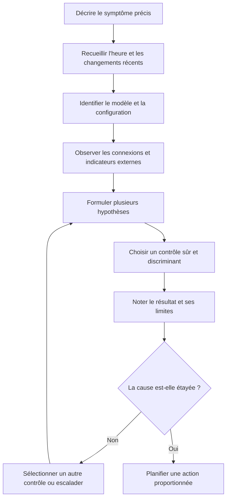

Un diagnostic solide utilise les résultats pour réduire l'incertitude. Il évite de remplacer des pièces au hasard ou d'attribuer la panne au dernier événement survenu sans autre preuve.

### 5.1 Recueillir l'historique

Demande ce qui a changé : déplacement, choc, installation, mise à jour, ajout d'un périphérique, coupure électrique, bruit inhabituel ou intervention précédente. L'historique peut orienter les vérifications, mais la proximité temporelle ne prouve pas automatiquement la cause.

Note l'heure, la fréquence et les conditions de reproduction. Un arrêt survenant uniquement lors d'une charge élevée peut orienter vers une piste différente d'un arrêt avant même l'initialisation.

### 5.2 Identifier le modèle exact

Relève le fabricant et la référence du système, en utilisant les informations de l'inventaire ou les étiquettes accessibles. Les procédures de démontage, les pièces et les limites de compatibilité sont souvent propres au modèle.

Ne te fie pas seulement à l'apparence. Deux machines similaires peuvent avoir des cartes mères, des connecteurs ou des alimentations différents.

### 5.3 Vérifier les éléments externes

Avant d'ouvrir un boîtier, vérifie les câbles accessibles, les prises, l'écran, les périphériques, l'état des voyants et les messages affichés. Déconnecte un périphérique uniquement si cela est sûr et autorisé, puis note le résultat.

Un périphérique externe défectueux peut empêcher un démarrage ou perturber un système. N'enlève pas plusieurs accessoires simultanément si tu ne peux pas identifier lequel modifie le comportement.

### 5.4 Définir une hypothèse et un test

Chaque étape doit répondre à une question. Par exemple : « Le problème est-il lié à l'écran ? » peut être vérifié par une source d'entrée et un câble connus comme fonctionnels, sans modifier le PC. « Le support de démarrage est-il détecté ? » demande une observation dans le micrologiciel, si l'accès est autorisé.

Note le résultat et les limites. Si le test ne permet pas de trancher, passe à une vérification plus informative ou escalade.

## 6. Sécurité avant intervention matérielle

La sécurité est prioritaire sur la rapidité. Le travail matériel peut comporter des risques électriques, mécaniques et liés aux données.

### Schéma — points d'arrêt de sécurité avant une intervention

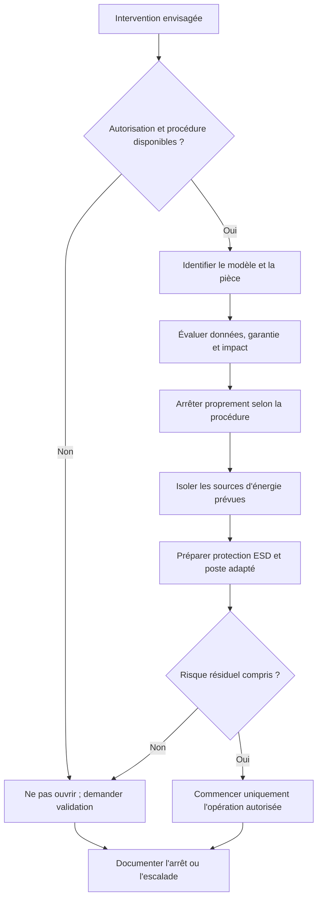

Ce parcours n'autorise pas à intervenir sur des composants électriques dangereux. Les alimentations internes, batteries et dispositifs à haute énergie doivent être traités selon les instructions du fabricant et par du personnel qualifié.

### 6.1 Autorisation et préparation

Avant de démonter un appareil, vérifie :

- que l'intervention est autorisée ;
- que le modèle et le composant sont identifiés ;
- que les instructions du fabricant sont disponibles ;
- que les données et les risques ont été évalués ;
- que la sauvegarde nécessaire a été contrôlée selon les règles ;
- que le matériel de remplacement est compatible ;
- que l'environnement de travail est approprié ;
- que les conditions de garantie et de contrat sont respectées.

Si un élément n'est pas connu et que l'incertitude concerne un risque important, arrête la préparation et demande une validation.

### 6.2 Mise hors tension

Pour une intervention interne, suis la procédure du fabricant. En règle générale, il faut fermer proprement le système lorsqu'il fonctionne, couper l'alimentation et déconnecter les sources d'énergie prévues par la procédure avant de manipuler les composants concernés.

Les portables peuvent contenir une batterie interne. Certains matériels ont des procédures spécifiques d'isolement ou de retrait de batterie. Ne considère pas qu'un équipement est sans énergie simplement parce que son écran est éteint.

Ne débranche pas à la hâte un serveur redondant, un onduleur ou un équipement de baie : la perte d'une alimentation ou d'un lien peut affecter le service. Vérifie le plan d'intervention et les autorisations.

### 6.3 Décharges électrostatiques

Prépare un espace propre et adapté, applique la méthode antistatique recommandée et manipule les pièces par les zones prévues. Évite les contacts inutiles avec les broches, les circuits et les connecteurs.

Un bracelet antistatique ne doit être utilisé que correctement et selon les règles de sécurité de l'environnement. Il ne remplace pas les procédures de mise hors tension ou les consignes spécifiques au matériel.

### 6.4 Protection des données

Le remplacement d'un disque, une réinstallation ou une manipulation de contrôleur peut affecter l'accès aux données. Avant toute opération, détermine les données concernées, la sauvegarde disponible et la procédure de restauration ou de récupération.

Si le support présente des signes de défaillance et contient des données critiques, évite les tests intensifs, les réparations improvisées et les manipulations répétées. Une équipe spécialisée peut être nécessaire.

### 6.5 Organisation des pièces

Range les vis et accessoires de manière à éviter les mélanges. Note les câbles et emplacements avant de les déconnecter. Utilise des contenants ou étiquettes adaptés, notamment lorsque plusieurs appareils sont traités à la fois.

Un poste de travail désordonné augmente le risque de perdre une vis, de connecter un câble au mauvais endroit ou de laisser un outil dans le boîtier.

## 7. Remplacer un composant : compatibilité et méthode

### Schéma — valider un composant de remplacement

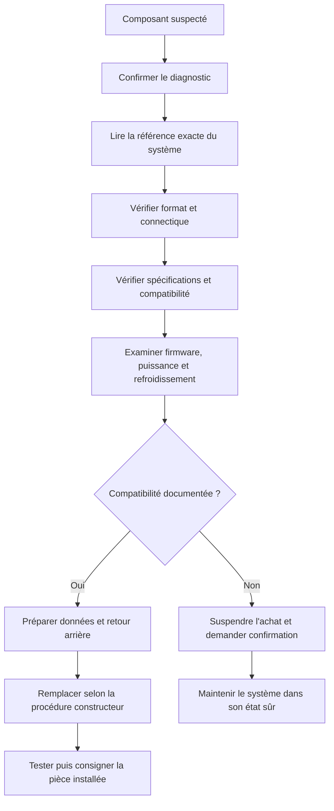

La compatibilité doit être confirmée dans la documentation du fabricant ou les références validées de l'organisation. Une pièce qui entre physiquement dans un emplacement n'est pas nécessairement compatible électriquement ou fonctionnellement.

### 7.1 Ne pas acheter sur la seule apparence

La compatibilité dépend du type de connecteur, du format, des spécifications, du micrologiciel, de la consommation électrique, du refroidissement et parfois de la configuration du fabricant.

Pour une mémoire, vérifie la génération et les caractéristiques requises. Pour un disque, vérifie l'interface, le format, la capacité acceptée et les besoins du système. Pour une alimentation, vérifie les dimensions, les connecteurs, la puissance appropriée et la compatibilité avec le boîtier.

La documentation du fabricant et l'inventaire doivent primer sur une simple ressemblance visuelle.

### 7.2 Préparer le remplacement

Avant de retirer une pièce :

1. confirme le diagnostic autant que possible ;
2. relève la référence exacte du composant ;
3. vérifie le composant de remplacement ;
4. note la configuration initiale et les câbles utiles ;
5. protège les données si l'opération peut les affecter ;
6. organise une méthode de retour arrière ;
7. informe les personnes concernées si le service est partagé.

Dans un environnement critique, le changement doit être associé à une validation et à une fenêtre d'intervention lorsque les règles l'exigent.

### 7.3 Retirer et installer

Suis les étapes prévues par le fabricant. Ne force jamais un connecteur, une barrette ou une carte. Une résistance inhabituelle peut indiquer un mauvais alignement, une incompatibilité ou une fixation encore en place.

Ne touche pas les contacts inutilement. Vérifie que les éléments mécaniques sont correctement fixés et qu'aucun câble n'est pincé. Si tu constates une détérioration, arrête au lieu d'essayer de la corriger par la force.

### 7.4 Contrôle après remplacement

Après remontage, vérifie le raccordement, les fixations et l'absence d'outil oublié. Suis la procédure de remise sous tension, puis observe le démarrage et les messages éventuels.

Le remplacement n'est validé que lorsque le système détecte le composant et que les tests adaptés confirment le fonctionnement attendu. Il faut aussi vérifier les fonctions qui pourraient avoir été touchées indirectement.

## 8. Mémoire : symptômes et contrôle

### Schéma — investigation d'une suspicion de défaut mémoire

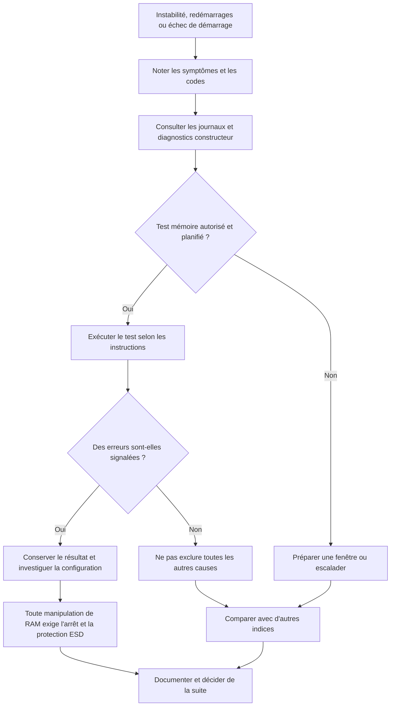

Un test réussi sur une période donnée ne garantit pas l'absence de toute panne intermittente. Les codes, règles de population des barrettes et combinaisons prises en charge dépendent du système.

### 8.1 Signes possibles

Les problèmes de RAM peuvent se manifester par des erreurs intermittentes, des redémarrages, des plantages, des échecs de démarrage ou des résultats anormaux lors de tests mémoire. Ces signes peuvent aussi provenir d'autres composants ou de logiciels.

Avant de retirer une barrette, note le message exact, la fréquence, les conditions d'apparition et le modèle du système. Vérifie également les événements disponibles et les outils de diagnostic prévus par le constructeur.

### 8.2 Utiliser un test mémoire

Un outil de diagnostic mémoire peut aider à détecter certaines erreurs. Il faut suivre les consignes de l'outil et prévoir le temps d'indisponibilité lorsque le test exige un redémarrage.

Un test réussi ne garantit pas que toute instabilité est exclue ; un test échoué mérite une investigation selon la procédure. Sur un équipement critique, ne lance pas un test intrusif en pleine production sans validation.

### 8.3 Réinstaller ou déplacer une barrette

Cette opération ne doit être réalisée qu'après préparation, mise hors tension selon les règles et vérification de compatibilité. Sur certains systèmes, l'ordre des emplacements et les règles de population des canaux sont importants.

Sur un serveur, ne déplace pas les modules au hasard. Consulte la documentation du constructeur afin de respecter les règles de population et de conserver les informations nécessaires à l'équipe de maintenance.

## 9. Stockage : diagnostic et protection des données

### Schéma — protéger les données en cas d'alerte de stockage

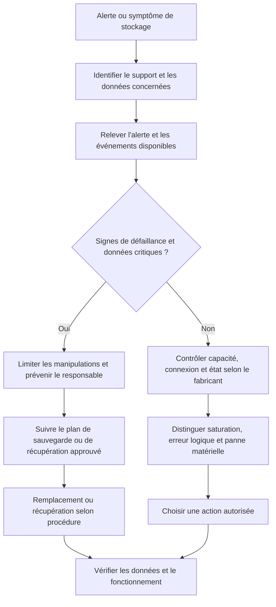

Si le support semble physiquement défaillant, multiplier les redémarrages ou les tests lourds peut aggraver la situation. La stratégie doit tenir compte de la criticité des données et des procédures de récupération.

### 9.1 Reconnaître les symptômes

Un stockage défaillant peut se traduire par des erreurs de lecture, des lenteurs, des messages d'alerte, des fichiers inaccessibles ou l'absence du disque dans le micrologiciel. Aucun de ces signes ne suffit isolément à conclure sur l'état exact du support.

Un disque presque plein peut aussi provoquer des difficultés sans être physiquement défectueux. Il faut distinguer capacité insuffisante, erreurs logiques, problèmes de connexion et défaillance matérielle.

### 9.2 Examiner les alertes et les journaux

Utilise les outils intégrés et ceux recommandés par le constructeur pour consulter les alertes et les paramètres d'état disponibles. Note la date, la référence du support et le message exact.

N'interprète pas une valeur isolée comme une prédiction certaine. Les indicateurs varient selon le modèle, et leur signification doit être vérifiée dans la documentation correspondante.

### 9.3 Prioriser les données

Si le disque contient des données critiques et semble défaillant, la priorité est d'éviter toute action qui pourrait réduire les chances de récupération. Vérifie les sauvegardes selon les règles, préviens les responsables et escalade si nécessaire.

Ne lance pas une série de réparations, de tests intensifs ou de tentatives de récupération non approuvées. Les interventions de récupération peuvent demander des compétences et des outils spécialisés.

### 9.4 Remplacement d'un support

Avant de remplacer un disque, confirme la compatibilité, le rôle du support, la stratégie de migration et la procédure de restauration. Sur un poste, il peut être nécessaire de réinstaller le système ou de restaurer une image. Sur un serveur, le support peut faire partie d'un ensemble RAID ou d'une solution de stockage partagée.

Un disque neuf ne rétablit pas automatiquement les données ou les applications. Le remplacement doit s'inscrire dans une procédure complète : préparation, installation, restauration ou reconstruction, validation, documentation et mise à jour de l'inventaire.

## 10. Refroidissement, bruit et alimentation

### Schéma — relier chaleur, charge et symptômes

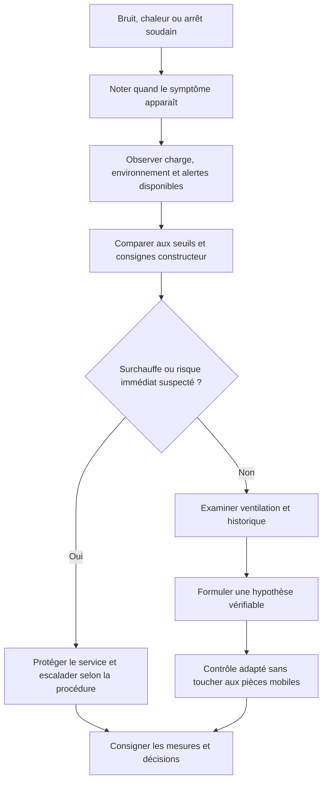

N'ouvre pas un équipement en fonctionnement pour toucher un ventilateur ou une pièce mobile. Une température ne doit être jugée qu'en référence au modèle, à la charge et aux mesures disponibles.

### 10.1 Bruits inhabituels

Un bruit nouveau peut provenir d'un ventilateur, d'une pièce mécanique ou d'un autre élément. Il faut noter quand il apparaît et s'il évolue avec la charge. Un bruit répétitif provenant d'un disque mécanique peut justifier une intervention rapide, notamment si les données sont importantes.

N'ouvre pas un appareil en marche pour approcher tes doigts d'un ventilateur ou d'une pièce mobile. Utilise des contrôles non intrusifs et respecte les règles de sécurité.

### 10.2 Température et performance

Une température élevée peut entraîner une réduction automatique des performances ou un arrêt de protection. Examine la charge, la ventilation, l'environnement et les alertes disponibles.

La mesure doit être comparée aux spécifications du fabricant. Une valeur qui serait inhabituelle sur un modèle peut être normale sur un autre. Ne modifie pas les limites thermiques pour faire disparaître une alerte.

### 10.3 Arrêts soudains

Des arrêts peuvent être liés à l'alimentation, à la température, à des paramètres, à un défaut matériel ou à d'autres causes. Note s'ils surviennent au démarrage, au repos ou pendant une charge particulière.

Vérifie les événements disponibles et les connexions externes lorsque c'est sûr. N'ouvre pas le bloc d'alimentation et n'effectue pas de mesure électrique risquée sans qualification.

## 11. Les particularités des serveurs

Un serveur peut héberger plusieurs services utilisés par de nombreux collaborateurs. Une action sur un seul composant peut donc avoir des conséquences importantes.

### Schéma — comprendre la portée de la redondance d'un serveur

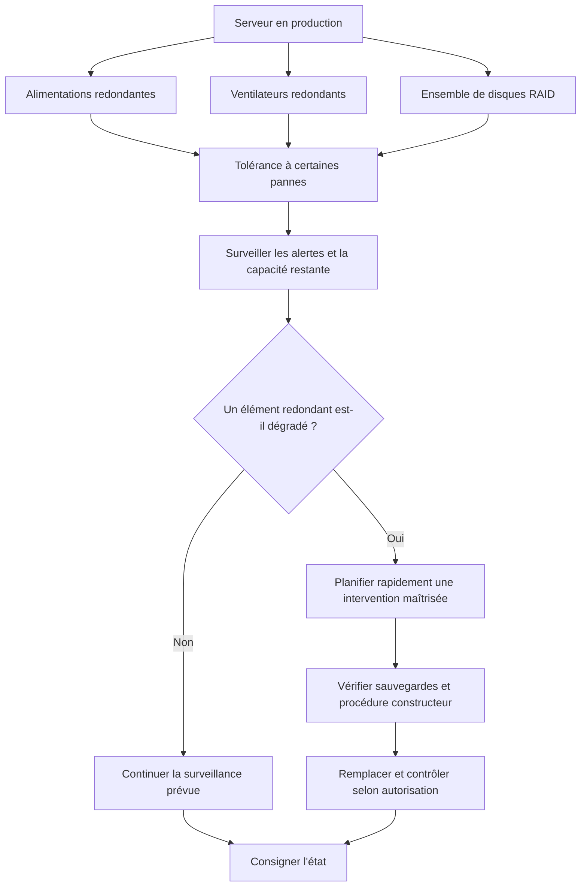

La redondance ne protège que contre certains scénarios définis par la conception. Un RAID ne remplace pas une sauvegarde restaurable, et une alimentation de secours défaillante peut rester invisible jusqu'à une seconde panne.

### 11.1 Redondance et disponibilité

Certains serveurs disposent d'alimentations redondantes, de plusieurs ventilateurs, de disques configurés en RAID et de composants remplaçables à chaud. La présence de redondance réduit certains risques, mais ne rend pas le système invulnérable.

Un composant de secours peut déjà être indisponible sans que le serveur ait cessé de fonctionner. Une alerte doit donc être traitée avant qu'une seconde défaillance ne supprime la redondance.

### 11.2 RAID ne signifie pas sauvegarde

Le RAID peut améliorer la disponibilité ou la tolérance à certaines défaillances de disques selon le niveau utilisé. Il ne protège pas à lui seul contre toutes les suppressions, corruptions, erreurs humaines, sinistres ou compromissions.

La stratégie de sauvegarde doit rester indépendante de la seule redondance du stockage. Avant une intervention sur un ensemble RAID, identifie le niveau, l'état de santé, le disque concerné, la procédure de remplacement et les risques de reconstruction.

Ne retire jamais un disque d'un ensemble sans avoir identifié précisément son emplacement et son état. Une erreur peut dégrader davantage l'ensemble ou rendre les données inaccessibles.

### 11.3 Mémoire ECC

Certains serveurs utilisent de la mémoire ECC, capable de détecter et de corriger certains types d'erreurs mémoire selon la plateforme. Cela ne signifie pas qu'elle corrige toutes les erreurs ni qu'un serveur ne peut jamais subir de problème mémoire.

Les modules compatibles, les règles de population et les alertes doivent être contrôlés avec la documentation du constructeur. Les messages de gestion matérielle peuvent aider à distinguer une alerte mémoire d'un autre incident.

### 11.4 Interface de gestion distante

De nombreux serveurs possèdent une interface de gestion hors bande. Elle peut fournir des informations sur la température, l'alimentation, les ventilateurs, les alertes et l'inventaire matériel même lorsque le système d'exploitation n'est pas disponible.

L'accès à cette interface doit rester protégé. Les identifiants, les adresses de gestion et les sorties de console ne doivent pas être partagés sans autorisation. Une commande distante de redémarrage ou de mise hors tension peut avoir un impact important : elle nécessite une validation et une procédure adaptée.

### 11.5 Remplacement à chaud

Certains composants sont conçus pour être remplacés sans arrêter le système, mais cela dépend du matériel, de la configuration et des instructions du constructeur. Le terme « remplaçable à chaud » n'autorise pas à retirer n'importe quel composant pendant que l'équipement fonctionne.

Avant l'opération, vérifie la procédure, l'état de redondance, l'identification du composant et l'autorisation. Si la procédure n'est pas disponible ou si l'état du système est incertain, escalade.

## 12. Baies informatiques et câblage

### Schéma — principes d'organisation d'une baie

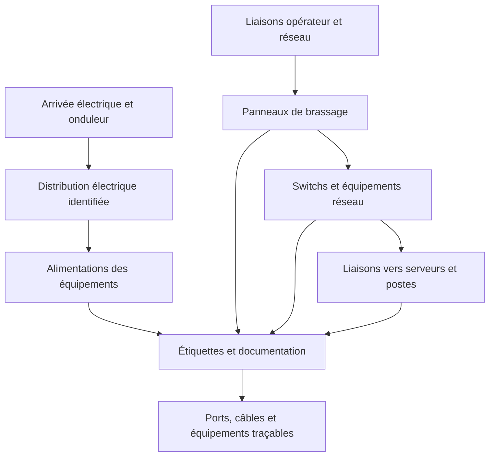

Ce schéma représente les relations fonctionnelles, pas un plan de câblage à appliquer aveuglément. Les circuits électriques et les chemins réseau doivent respecter le plan réel de la salle et les règles de sécurité de l'organisation.

### 12.1 Rôle d'une baie

Une baie permet d'organiser les serveurs, équipements réseau, panneaux de brassage, alimentations et accessoires dans un espace prévu à cet effet. L'organisation facilite l'accès, la circulation de l'air et la maintenance.

Une baie mal organisée rend les interventions plus difficiles. Un câble non identifié peut être débranché par erreur, et une ventilation obstruée peut augmenter la température des équipements.

### 12.2 Inspection visuelle non intrusive

Avant toute action, observe l'état général sans toucher aux connexions critiques. Vérifie les alertes visibles, l'état apparent des câbles, la présence d'obstructions et le repérage des équipements.

Une inspection visuelle ne remplace pas les mesures ni les outils de supervision. Elle permet cependant de relever des anomalies évidentes qui méritent un contrôle.

### 12.3 Câblage et étiquetage

Chaque câble important devrait être identifiable conformément aux conventions de l'organisation. L'étiquetage aux deux extrémités réduit le risque de déconnexion accidentelle et facilite les changements.

Avant de déplacer ou de débrancher un câble, identifie sa fonction et ses extrémités. Ne considère pas un câble comme inutilisé uniquement parce qu'il n'est pas évident à suivre visuellement.

### 12.4 Circulation de l'air

Les serveurs et les équipements réseau dégagent de la chaleur. Les chemins d'entrée et de sortie d'air doivent rester conformes à la conception de l'installation. Une accumulation d'objets ou une porte mal adaptée peut perturber le refroidissement.

Ne déplace pas un équipement lourd ou une baie sans matériel, autorisation et personnel adaptés. Les opérations en salle informatique peuvent comporter des risques mécaniques et électriques.

### 12.5 Alimentation et onduleurs

Les serveurs peuvent être reliés à des unités de distribution électrique et à des onduleurs. Avant tout changement, vérifie le chemin d'alimentation et les conséquences d'une coupure. Certains équipements disposent de deux alimentations reliées à des circuits différents, mais il faut confirmer cette architecture plutôt que la supposer.

Ne débranche pas une alimentation pour tester la redondance sans procédure approuvée. Un test inapproprié peut provoquer une interruption.

### 12.6 Schéma simplifié d'une baie

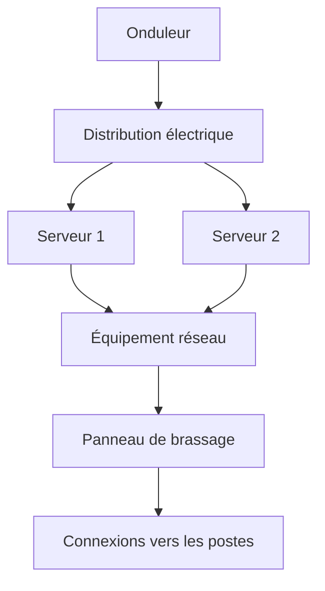

Le dessin est fonctionnel et volontairement simplifié. Le câblage réel peut intégrer plusieurs commutateurs, des chemins réseau redondants, des alimentations séparées et des dispositifs de stockage. Toute intervention doit s'appuyer sur la documentation de la baie concernée.

## 13. Maintenance préventive matérielle

### Schéma — construire un cycle de maintenance préventive

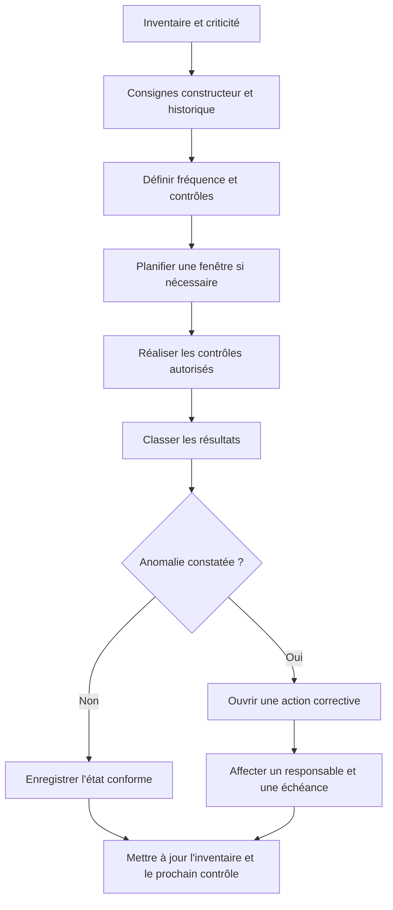

Une maintenance préventive doit laisser une trace et déboucher sur une décision. La fréquence dépend notamment de la criticité, de l'environnement, des recommandations du fabricant et des tendances observées.

### 13.1 Définir un programme

Un programme de maintenance préventive doit être adapté à la criticité, aux recommandations du fabricant, à l'environnement et à l'historique des incidents. Une fréquence uniforme pour tous les équipements n'est pas toujours pertinente.

Les contrôles peuvent porter sur l'état physique, la ventilation, les alertes, le stockage, l'alimentation, l'inventaire et les sauvegardes associées.

### 13.2 Contrôles possibles

- vérifier les voyants et les alertes connues ;
- examiner les journaux et les rapports de supervision ;
- observer les températures selon les outils disponibles ;
- vérifier l'espace de stockage ;
- inspecter visuellement les câbles et les connecteurs accessibles ;
- confirmer que les sauvegardes s'exécutent selon le programme ;
- vérifier l'état apparent des onduleurs selon la procédure ;
- mettre à jour l'inventaire après tout changement ;
- repérer les pièces en fin de garantie ou de support.

Un contrôle doit générer un résultat : conforme, anomalie à surveiller, intervention planifiée ou escalade. Une checklist vide de détails ne permet pas d'assurer le suivi.

### 13.3 Nettoyage périodique

Le nettoyage doit suivre les instructions du fabricant, les règles de sécurité et les conditions de garantie. Il faut éviter les outils ou produits non adaptés. L'ouverture et le nettoyage interne doivent être effectués par une personne autorisée.

Dans une salle serveur, ne modifie pas les flux d'air et ne déplace pas les équipements en improvisant. Les interventions doivent préserver les conditions de fonctionnement et la sécurité du site.

### 13.4 Gestion du cycle de vie

Un matériel peut fonctionner tout en devenant inadapté : capacité insuffisante, consommation élevée, pièces difficiles à trouver ou fin du support constructeur. La décision de remplacement doit intégrer le risque, le coût, la compatibilité, les besoins et la stratégie de l'organisation.

L'inventaire et l'historique des incidents permettent de préparer ce renouvellement au lieu d'attendre une panne complète.

## 14. Procédure type d'intervention matérielle

Une procédure écrite aide à réduire les oublis et à transférer le travail entre techniciens.

### Schéma — cycle complet d'une intervention matérielle

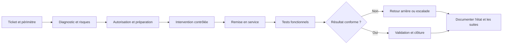

La clôture doit s'appuyer sur des résultats réellement observés. Si le système n'est pas suffisamment testé ou si le symptôme persiste, il faut conserver le ticket ouvert ou transmettre le dossier plutôt que déclarer la réparation terminée.

### Avant l'intervention

1. Ouvrir ou mettre à jour le ticket.
2. Identifier l'équipement et le demandeur.
3. Recueillir les symptômes et les circonstances.
4. Évaluer l'impact et la priorité.
5. Vérifier les autorisations et la garantie.
6. Examiner les données et les sauvegardes si elles peuvent être affectées.
7. Préparer les outils et la pièce compatible.
8. Prévoir la fenêtre d'intervention si nécessaire.

### Pendant l'intervention

1. Respecter les procédures de sécurité.
2. Noter l'état initial et les éléments démontés.
3. Effectuer seulement les opérations prévues ou autorisées.
4. Garder les pièces et câbles identifiés.
5. Arrêter en cas de risque inattendu ou d'incompatibilité.
6. Enregistrer les résultats importants.

### Après l'intervention

1. Vérifier le remontage et les connexions.
2. Remettre sous tension selon la procédure.
3. Contrôler les messages de démarrage.
4. Vérifier le composant et les fonctions nécessaires.
5. Confirmer le besoin initial avec l'utilisateur ou le système de test prévu.
6. Mettre à jour l'inventaire et le ticket.
7. Documenter les limites restantes et le suivi.

## 15. Documentation d'une intervention matérielle

Une fiche doit permettre de savoir ce qui était en panne, ce qui a été observé et ce qui a changé.

### 15.1 Exemple de fiche

**Référence :** INC-2026-0108

**Équipement :** poste de travail, référence à compléter depuis l'inventaire.

**Symptôme :** arrêt soudain signalé pendant l'utilisation ; fréquence et contexte à confirmer.

**Contrôles initiaux :** inspection externe, vérification des connexions accessibles, consultation des journaux selon les droits.

**Hypothèses :** alimentation, température, mémoire ou autre défaut ; aucune cause retenue avant les vérifications.

**Action réalisée :** à compléter uniquement après intervention réelle.

**Vérification :** démarrage, stabilité pendant un test adapté et confirmation de l'usage attendu.

**Statut :** en cours, résolu après preuve suffisante, ou escaladé.

Cet exemple est un modèle. Il ne décrit pas une intervention réellement réalisée. Les champs doivent contenir les résultats observés, et non des résultats supposés.

### 15.2 Pièces retirées et installées

Lorsqu'un composant est remplacé, note sa référence, la référence du nouveau composant, la date, le technicien et le sort de la pièce retirée selon la procédure de l'organisation. Si la pièce contient des données ou des paramètres, applique les règles de conservation ou d'effacement sécurisé.

Le suivi des numéros de série et des garanties peut être important pour l'inventaire, la maintenance, les contrats et les audits.

## 16. Parcours pratique du débutant

Ce parcours se réalise sur un équipement personnel ou un laboratoire de formation. Les opérations d'ouverture ou de remplacement doivent respecter les conditions de sécurité, la garantie et les instructions du constructeur.

### Atelier 1 — Identifier un poste sans l'ouvrir

**Objectif :** apprendre à reconnaître le matériel et son contexte.

1. Consulte l'inventaire ou l'étiquette autorisée.
2. Note le fabricant et la référence exacte.
3. Observe les connexions externes, l'alimentation et les périphériques.
4. Observe les messages et voyants lors d'un démarrage normal.
5. Repère dans la documentation du constructeur les consignes de sécurité.
6. Rédige une fiche qui distingue les informations connues des éléments à vérifier.

**Résultat attendu :** un inventaire de base sans démontage ni modification.

### Atelier 2 — Analyser un arrêt soudain simulé

**Objectif :** préparer le diagnostic avant de toucher au matériel.

À partir d'un scénario fictif, note si l'arrêt se produit au démarrage, au repos ou sous forte charge. Énumère les hypothèses, les informations manquantes et les contrôles non intrusifs possibles.

N'attribue pas immédiatement le problème au bloc d'alimentation. Considère aussi la température, la configuration, les événements système et les autres symptômes.

### Atelier 3 — Préparer le remplacement d'un SSD

**Objectif :** comprendre les contrôles préalables.

Sans démonter de matériel réel, imagine qu'un SSD doit être remplacé. Identifie la référence actuelle, l'interface, le format, la compatibilité du remplacement, la protection des données, la procédure d'installation et les critères de validation.

**Résultat attendu :** un plan écrit qui précise les risques, les étapes et le retour arrière possible.

### Atelier 4 — Inspecter visuellement une baie

**Objectif :** apprendre à faire une inspection non intrusive.

Dans une baie de laboratoire autorisée, observe l'étiquetage, l'organisation, les chemins de câbles, les entrées et sorties d'air ainsi que les alertes visibles. Ne débranche rien.

Documente les problèmes potentiels et propose une action ou une escalade pour chacun. Toute manipulation d'alimentation, d'équipement lourd ou de câblage critique nécessite une procédure adaptée.

### Atelier 5 — Créer une checklist préventive

**Objectif :** préparer des contrôles périodiques traçables.

Crée une checklist pour un poste, un serveur et une baie. Pour chaque élément, indique la fréquence proposée, le responsable, l'outil, la preuve attendue et l'action en cas d'anomalie. Justifie les fréquences avec le contexte et les consignes applicables plutôt qu'avec une règle universelle.

## 17. Travaux pratiques guidés

### TP 1 — Diagnostiquer un poste qui ne démarre pas

**Contexte :** un ordinateur ne démarre plus correctement depuis ce matin.

**Mission :** établir un premier diagnostic sans ouvrir immédiatement le boîtier.

**Étape A : recueillir le symptôme**

Demande ce qui se produit exactement : aucun voyant, ventilateurs actifs sans affichage, message d'erreur, redémarrage en boucle ou chargement du système interrompu.

**Étape B : examiner les éléments externes**

Vérifie les connexions accessibles, l'écran et la source d'entrée, ainsi que l'état de l'alimentation conformément aux règles de sécurité. Ne manipule pas de câble endommagé.

**Étape C : consigner les signes**

Note les voyants, les sons, les messages et le moment où le démarrage s'arrête. Si le fabricant documente des codes d'erreur, consulte la documentation correspondant au modèle exact.

**Étape D : proposer les hypothèses**

Établis une liste de causes possibles et indique quel contrôle autorisé pourrait les distinguer. Ne remplace aucune pièce sans éléments suffisants.

**Critères de réussite :** description précise, contrôle externe sûr, hypothèses raisonnables, respect des limites et fiche documentée.

### TP 2 — Examiner un problème de température

**Contexte :** un poste devient lent après plusieurs minutes de travail intense et son ventilateur est plus bruyant que d'habitude.

**Mission :** proposer un diagnostic.

1. Recueille les conditions dans lesquelles le phénomène apparaît.
2. Observe la charge du processeur et les informations thermiques accessibles.
3. Vérifie les alertes et les journaux pertinents.
4. Examine visuellement l'environnement de ventilation sans ouvrir le boîtier.
5. Compare les mesures aux spécifications du fabricant.
6. Définis les critères d'escalade si le problème persiste.

Une charge élevée et un ventilateur audible ne suffisent pas à établir une panne. L'objectif est de croiser les signes et de ne pas manipuler l'équipement au hasard.

### TP 3 — Préparer un remplacement de stockage

**Contexte :** un ordinateur signale des erreurs de stockage. Les données sont importantes.

**Mission :** rédiger un plan avant intervention.

Le plan doit préciser l'identité du support, le message exact, le risque pour les données, l'état de la sauvegarde, le composant compatible, la personne autorisée à intervenir, le processus de remplacement ou de restauration, les tests finaux et la mise à jour de l'inventaire.

Ne lance pas de réparation intensive ou de restauration non préparée. Si les données sont critiques et que le support semble défaillant, l'escalade doit être envisagée rapidement.

### TP 4 — Vérifier un serveur après une intervention autorisée

**Contexte :** un composant a été remplacé par une équipe habilitée. Tu dois participer à la validation sans improviser une opération matérielle.

**Mission :** élaborer une checklist de vérification.

Elle peut comprendre l'absence de nouvelles alertes, la détection du composant, l'état des alimentations et ventilateurs, le fonctionnement du système, les services attendus, les contrôles de performance adaptés et l'observation de la supervision.

Les critères exacts doivent venir de la procédure de maintenance du serveur et des exigences métier. Ne déclare pas l'intervention réussie uniquement parce que le serveur redémarre.

### TP 5 — Organiser une intervention dans une baie

**Contexte :** un câble doit être remplacé dans une baie qui héberge des services partagés.

**Mission :** préparer l'intervention.

1. Identifier le câble et ses deux extrémités.
2. Vérifier le service auquel il est associé.
3. Déterminer l'impact d'une interruption.
4. Obtenir la validation nécessaire.
5. Préparer l'étiquetage et le câble compatible.
6. Définir une fenêtre et les critères de test si nécessaire.
7. Documenter le résultat et remettre à jour le schéma de câblage.

Ne débranche pas un câble en supposant qu'il est inutilisé parce qu'il semble libre ou mal rangé.

## 18. Exercices avec corrections

### Exercice 1 — Associer un composant à sa fonction

Associe chaque composant à son rôle principal : RAM, stockage, alimentation, refroidissement et carte mère.

1. Conserve temporairement les données utilisées par les programmes.
2. Conserve les données après l'arrêt normal de l'équipement.
3. Fournit l'énergie électrique nécessaire aux composants.
4. Évacue la chaleur produite par les composants.
5. Relie les principaux composants et permet leur communication.

**Correction :**

1. RAM : mémoire de travail volatile.
2. Stockage : HDD, SSD SATA ou SSD NVMe selon l'équipement.
3. Alimentation : convertit et fournit l'énergie attendue par le système.
4. Refroidissement : ventilateurs, dissipateurs et autres dispositifs prévus par le matériel.
5. Carte mère : plateforme qui accueille et relie les composants.

### Exercice 2 — Un poste s'éteint sous charge

Un poste s'arrête pendant un calcul exigeant. Quelle conclusion est la plus raisonnable ?

A. Le processeur est forcément détruit.

B. Le problème peut être lié à la température, à l'alimentation ou à d'autres causes ; il faut collecter des indices.

C. Il faut désactiver les protections thermiques.

D. Il faut remplacer immédiatement la carte mère.

**Correction : B.** Le symptôme ne désigne pas une cause unique. Il faut examiner les conditions d'apparition, les journaux, la température et l'alimentation dans les limites des procédures.

### Exercice 3 — Disque présentant une alerte

Un disque contenant des données importantes signale des erreurs répétées. Quelle priorité est la plus appropriée ?

A. Effectuer de nombreux tests intensifs avant de vérifier les sauvegardes.

B. Formater immédiatement le disque.

C. Évaluer le risque pour les données, vérifier la procédure de sauvegarde et solliciter une aide adaptée.

D. Ignorer l'alerte tant que le système démarre.

**Correction : C.** Il faut protéger les données et éviter les actions susceptibles de réduire les possibilités de récupération. Un système qui démarre peut quand même utiliser un support en cours de défaillance.

### Exercice 4 — Compatibilité d'une mémoire

Une barrette entre physiquement dans un emplacement. Peut-on en conclure qu'elle est compatible ?

**Correction : non.** Il faut vérifier la génération, le format, la capacité, les spécifications de la plateforme, les règles de population et les exigences du constructeur. L'ajustement mécanique ne garantit pas le fonctionnement.

### Exercice 5 — RAID et sauvegarde

Un serveur possède un ensemble RAID redondant. L'équipe décide que les sauvegardes ne sont plus nécessaires. Cette décision est-elle justifiée ?

**Correction : non.** Le RAID peut tolérer certaines défaillances de disque selon sa configuration, mais ne remplace pas une sauvegarde contre la suppression, la corruption, l'erreur humaine, le sinistre ou d'autres incidents.

### Exercice 6 — Remplacement à chaud

Un serveur possède des disques remplaçables à chaud. Peut-on retirer n'importe quel disque en fonctionnement ?

**Correction : non.** Il faut identifier l'emplacement exact, vérifier l'état du RAID ou du stockage, suivre la procédure du constructeur et obtenir l'autorisation. Retirer le mauvais disque peut dégrader ou rendre indisponibles les données.

### Exercice 7 — Écran noir

Le PC semble allumé, mais l'écran reste noir. Quel ensemble de contrôles externes est pertinent en premier ?

**Correction :** vérifier l'alimentation de l'écran, la source d'entrée, le câble et les connexions, puis observer les signes de démarrage du poste. Le problème peut venir de l'affichage, d'un câble, de la carte graphique ou d'une étape d'initialisation. Aucun de ces éléments n'est confirmé avant les tests.

### Exercice 8 — Ventilation obstruée

Une inspection montre que les entrées d'air d'un équipement sont obstruées. Que faut-il faire ?

**Correction :** documenter l'observation, évaluer le risque, puis appliquer la procédure de nettoyage ou demander une intervention autorisée. Il ne faut pas improviser un nettoyage sous tension ou déplacer un équipement de baie sans préparation.

### Exercice 9 — Traçabilité d'une pièce

Pourquoi faut-il enregistrer la référence d'un composant installé et celle du composant retiré ?

**Correction :** la traçabilité permet de mettre à jour l'inventaire, suivre la garantie, identifier les pièces, expliquer les changements et faciliter les interventions futures. Elle contribue également à la gestion du cycle de vie.

### Exercice 10 — Définir la réussite après réparation

Un poste redémarre après le remplacement d'une barrette mémoire. Peut-on considérer automatiquement l'intervention terminée ?

**Correction : non.** Il faut vérifier la détection de la mémoire, exécuter les tests prévus, observer la stabilité et contrôler l'usage initial. Il faut aussi enregistrer le composant utilisé et les résultats obtenus.

### Schéma — organiser le diagnostic du défi final

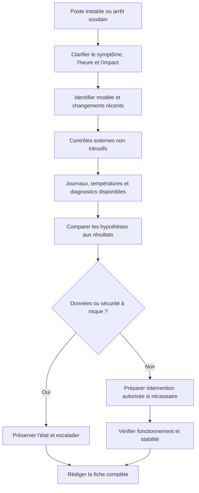

La bonne réponse au défi n'est pas de choisir immédiatement une pièce à remplacer : c'est de produire un diagnostic traçable, de respecter les limites de compétence et d'expliquer la vérification nécessaire pour démontrer que le problème est résolu.

## 19. Défi final — Diagnostiquer un poste et préparer l'intervention

### Situation

Dans une petite entreprise, un ordinateur s'éteint sans avertissement lorsque l'utilisateur travaille sur une application exigeante. Après redémarrage, le poste fonctionne de nouveau. Le phénomène s'est produit trois fois cette semaine.

Tu disposes des outils d'observation locaux et des informations de l'inventaire. Tu n'as pas encore l'autorisation d'ouvrir le boîtier. Le poste contient des documents professionnels et l'utilisateur n'est pas certain que tous les fichiers soient synchronisés.

### Travail demandé

1. Reformule le symptôme sans accuser un composant.
2. Liste les informations manquantes.
3. Propose au moins cinq hypothèses.
4. Associe les premières vérifications à des outils adaptés.
5. Explique les risques liés à une ouverture immédiate du poste.
6. Prépare une procédure d'intervention à faire valider.
7. Définis les critères de réussite après réparation.
8. Rédige un modèle de fiche d'intervention.
9. Indique les raisons possibles d'une escalade.
10. Propose une action de suivi pour éviter la répétition de l'incident.

### Correction détaillée

**1. Reformulation**

« Le poste s'éteint sans avertissement pendant l'utilisation d'une application exigeante. Trois occurrences ont été signalées durant la semaine. La cause n'est pas identifiée. »

**2. Informations manquantes**

Il faut connaître les heures, la durée de fonctionnement avant l'arrêt, l'application utilisée, les modifications récentes, les messages précédant l'arrêt, les températures disponibles, les événements système et l'état des données. Il faut également vérifier le modèle exact et les conditions de garantie.

**3. Hypothèses**

- température excessive ;
- alimentation instable ou insuffisante ;
- défaut de mémoire ;
- problème de carte graphique ou de pilote ;
- défaut de carte mère ;
- problème logiciel déclenchant un redémarrage ou un arrêt ;
- autre anomalie liée à l'environnement électrique.

Ces possibilités doivent être hiérarchisées avec des éléments concrets. Elles ne sont pas toutes également probables.

**4. Vérifications initiales**

- recueillir le contexte auprès de l'utilisateur ;
- consulter les événements disponibles à l'heure des arrêts ;
- observer la charge et les informations thermiques accessibles ;
- examiner l'inventaire et l'historique des incidents ;
- vérifier les connexions externes qui peuvent l'être en sécurité ;
- confirmer l'état des sauvegardes avant toute opération risquée.

**5. Risques d'une ouverture immédiate**

Une ouverture non autorisée peut affecter la garantie, endommager des composants, introduire des décharges électrostatiques ou exposer les données à un risque si une mauvaise manipulation est effectuée. Le diagnostic externe peut apporter des informations utiles avant toute intervention interne.

**6. Procédure à faire valider**

Le plan devrait identifier l'équipement, le symptôme, l'impact, les contrôles préalables, le risque pour les données, les pièces éventuellement nécessaires, l'autorisation d'ouverture, les précautions antistatiques, la méthode de diagnostic et le retour arrière. Toute opération doit suivre les instructions du fabricant.

**7. Critères de réussite**

Le poste doit démarrer normalement, détecter correctement ses composants et rester stable dans un test adapté à son usage. Les événements et alertes pertinentes doivent être revus. Les données doivent rester accessibles et l'utilisateur doit confirmer que l'activité initialement affectée est rétablie.

**8. Fiche d'intervention**

- **Référence :** INC-2026-0124
- **Équipement :** référence à compléter depuis l'inventaire
- **Symptôme :** arrêt soudain sous charge, trois occurrences signalées
- **Impact :** interruption du travail ; impact sur les données à évaluer
- **Contrôles initiaux :** à compléter avec les résultats observés
- **Hypothèses :** température, alimentation, mémoire, graphique, logiciel ou autre cause
- **Cause :** non confirmée
- **Action :** à compléter après validation et intervention réelle
- **Vérification :** démarrage, stabilité, tests adaptés et accès aux données
- **Statut :** en analyse jusqu'à obtention de preuves suffisantes

**9. Escalade**

Escalade si le risque pour les données est élevé, si les outils disponibles ne permettent pas de distinguer les causes, si l'ouverture nécessite une autorisation, si un défaut électrique est suspecté ou si le poste est encore sous garantie avec un processus imposé.

**10. Suivi**

Documenter les incidents récurrents, associer le poste à son historique de maintenance et planifier un suivi après réparation. Si le problème provient de conditions thermiques, électriques ou d'une application particulière, proposer une action ciblée au lieu de se limiter au remplacement d'une pièce.

### Barème indicatif

| Critère | Points |
|---|---:|
| Description factuelle | 2 |
| Collecte des informations | 2 |
| Hypothèses et tests | 4 |
| Sécurité et protection des données | 3 |
| Préparation de l'intervention | 3 |
| Vérifications après réparation | 2 |
| Documentation et suivi | 2 |
| Escalade appropriée | 2 |
| **Total** | **20** |

## 20. Synthèse du cours

La maintenance matérielle exige de comprendre le rôle des composants, mais également de reconnaître les limites d'un diagnostic à distance ou d'un symptôme isolé.

Les bonnes pratiques à retenir sont les suivantes :

1. Identifier précisément l'équipement et ses composants avant toute intervention.
2. Commencer par l'historique, les symptômes et les vérifications externes sûres.
3. Choisir des tests capables de distinguer les hypothèses.
4. Respecter les procédures électriques, antistatiques, de garantie et d'autorisation.
5. Protéger les données avant les opérations susceptibles de les affecter.
6. Vérifier la compatibilité de chaque pièce avant son installation.
7. Prendre les serveurs, le RAID et les baies comme des environnements à risque accru.
8. Ne jamais confondre redondance de stockage et sauvegarde.
9. Vérifier le fonctionnement réel après réparation.
10. Documenter les composants et résultats pour garantir la traçabilité.
11. Escalader en cas de danger, d'incertitude importante ou de limite de compétence.

La méthode à retenir est : **identifier, observer, sécuriser, diagnostiquer, préparer, intervenir, tester et documenter.** La capacité à remplacer une pièce est utile ; la capacité à décider quand, pourquoi et selon quelle procédure la remplacer est ce qui rend l'intervention professionnelle.
