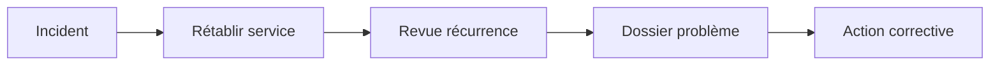
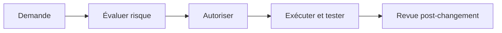
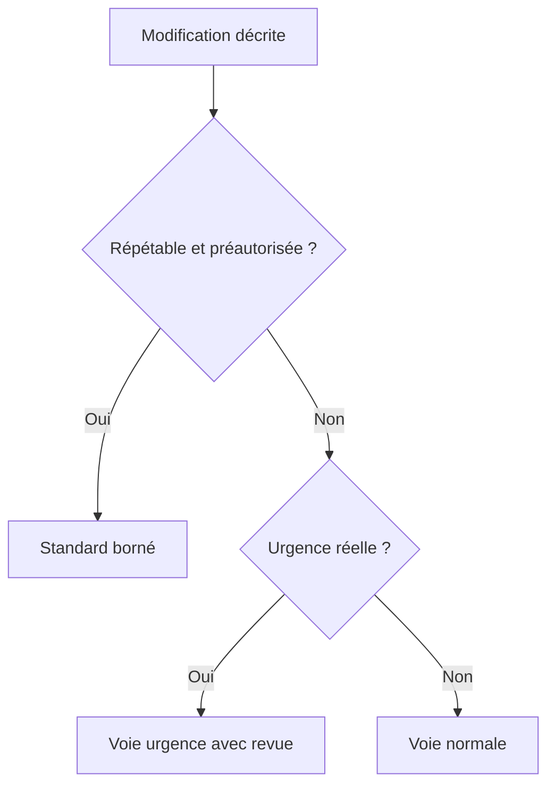
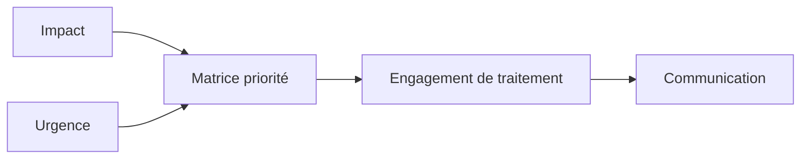
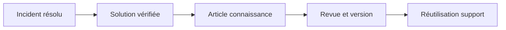
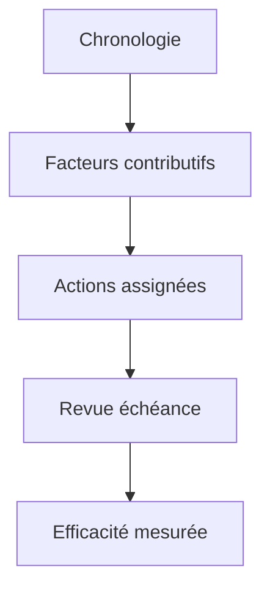

# Frameworks ITIL (incidents, changements)

> **Mise en contexte** — Ce cours s'adresse à un technicien intermédiaire qui doit agir dans un environnement réel, respecter les contraintes de service et laisser des preuves réutilisables. L'objectif n'est pas seulement de connaître les outils, mais de comprendre pourquoi une action est choisie, dans quelles conditions elle est sûre, comment vérifier son résultat et quand demander de l'aide.

## Présentation et enjeux

ITIL fournit un vocabulaire et des pratiques de gestion des services ; il ne s'agit pas de reproduire des formulaires sans réfléchir. La gestion des incidents vise à rétablir rapidement un service, tandis que la gestion des changements évalue les modifications susceptibles d'avoir un impact et organise leur mise en œuvre contrôlée. Cette discipline s'inscrit dans une démarche de qualité de service : chaque opération doit être reliée au besoin métier, au risque accepté et à un critère d'acceptation observable. L'intervenant doit pouvoir expliquer l'état initial, la décision prise, les résultats obtenus et les limites qui subsistent.

Dans une équipe de maintenance, les informations sont souvent réparties entre tickets, conversations, inventaires, systèmes de supervision et mémoire individuelle. Une méthode fiable les relie dans une trace commune et limite les décisions fondées sur une seule observation. Le cours met l'accent sur les preuves, les contrôles proportionnés, la reproductibilité et la communication utile.

Le niveau intermédiaire suppose que les gestes de base sont acquis. La difficulté consiste maintenant à traiter des environnements hétérogènes, des incidents ambigus, des changements qui touchent plusieurs composants et des situations où la donnée est imparfaite. Les règles présentées doivent être adaptées aux procédures approuvées de l'organisation et vérifiées dans un environnement de test avant toute action ayant un impact sur la production.

## Objectifs pédagogiques

À la fin du parcours, l'apprenant pourra :

- expliquer les principes et les limites des outils utilisés dans le domaine ;
- choisir un contrôle ou une méthode à partir de l'impact, de la criticité et des preuves disponibles ;
- effectuer une démarche reproductible et distinguer observation, hypothèse et décision ;
- interpréter les indicateurs sans confondre corrélation, résultat technique et expérience utilisateur ;
- rédiger une trace claire, traiter les exceptions et organiser une escalade ;
- vérifier l'effet d'une action, décrire le risque résiduel et proposer une amélioration mesurable.

## Prérequis et cadre de travail

Avant de commencer, savoir utiliser un terminal, lire les journaux, identifier un actif, comprendre les tickets et appliquer les règles locales de sécurité. Les commandes ci-dessous sont illustratives : adapter les noms d'hôte, les chemins et les versions, utiliser des cibles de test autorisées et ne jamais copier de secret dans un document. Une commande d'observation doit être préférée à une modification lorsqu'elle suffit à qualifier la situation.

Les principes directeurs sont les suivants : intervention autorisée, moindre privilège, sauvegarde ou retour arrière adaptés, fenêtre connue, communication compréhensible et preuve de validation. Si un contrôle critique échoue, ne pas continuer mécaniquement. Noter le constat, évaluer le risque et utiliser le point d'arrêt ou l'escalade défini par la procédure.

## Vocabulaire métier

| Terme | Utilisation opérationnelle |
|---|---|
| État initial | Description mesurée du système avant toute intervention. |
| Criticité | Conséquence potentielle de l'indisponibilité ou de la mauvaise configuration. |
| Preuve | Élément daté qui peut être vérifié par un autre intervenant. |
| Écart | Différence entre le résultat attendu et l'observation. |
| Exception | Situation où la procédure standard ne s'applique pas ou n'atteint pas son objectif. |
| Validation | Contrôle confirmant que le service ou l'opération satisfait les critères convenus. |
| Retour arrière | Séquence permettant de retrouver un état stable si les critères de réussite ne sont pas satisfaits. |
| Récurrence | Réapparition d'un problème similaire après un traitement précédent. |

## Schémas adaptés au sujet

### Schéma 1 — Traitement incident problème



L'incident vise le rétablissement rapide ; le problème analyse les causes et les récurrences pour une amélioration durable.

### Schéma 2 — Flux de changement



Le contrôle doit être proportionné au risque et conserver la décision, le test et le résultat.

### Schéma 3 — Choix du type de changement



La voie d'urgence doit rester justifiée ; l'étiquette 'urgent' ne doit pas contourner les contrôles courants.

### Schéma 4 — Gestion de la priorité



Une matrice commune rend le traitement plus prévisible et permet d'expliquer les écarts.

### Schéma 5 — Connaissance et erreur connue



Les connaissances doivent être vérifiées, bornées par leur contexte et révisées lorsque les versions changent.

### Schéma 6 — Revue d'incident



Une revue n'est utile que si elle produit des actions avec responsable, échéance et critère de réussite.

## Fondements techniques du domaine

### 1. Incident et demande

Un incident est une interruption non planifiée d'un service ou une dégradation de sa qualité. L'objectif immédiat consiste à réduire l'impact et à rétablir un service utilisable dans les limites des procédures approuvées. Une demande de service correspond plutôt à une prestation attendue et cadrée, comme l'attribution d'un accès, la fourniture d'un équipement ou l'installation d'un logiciel autorisé. Les deux peuvent arriver au même centre de services, mais ils n'ont pas le même objectif ni le même flux d'approbation.

Le dossier initial doit indiquer le service, l'heure de détection, le périmètre, l'impact métier, les symptômes, les changements récents et les tests déjà réalisés. Distinguer ce que déclare le demandeur des faits confirmés par une mesure. Plusieurs tickets semblables peuvent être rattachés à un incident commun, mais les personnes, actifs et besoins de communication restent traçables. Une fermeture prématurée masque les récurrences; un ticket laissé ouvert sans prochaine action fausse également le suivi.

La résolution se termine par des contrôles convenus et, lorsque cela s'applique, une confirmation de l'utilisateur ou du propriétaire métier. Enregistrer le contournement temporaire, les limites connues, le propriétaire actuel et les liens vers un éventuel problème ou changement. Ne pas assimiler une commande exécutée à un service rétabli.
### 2. Gestion de problème

La gestion des incidents et la gestion des problèmes sont complémentaires, mais distinctes. L'incident cherche à restaurer un service; le problème vise à comprendre et, si possible, éliminer les causes d'un ou plusieurs incidents, ou à documenter un contournement quand une correction définitive n'est pas disponible. Une équipe peut résoudre un incident sans disposer d'une cause racine confirmée et ne doit pas retarder une restauration sûre dans l'attente d'une analyse exhaustive.

Ouvrir une investigation lorsque la répétition, l'impact, l'incertitude ou le risque résiduel le justifie. Comparer les chronologies, les changements récents, les journaux et les conditions de reproduction. Séparer les faits, les hypothèses et les conclusions; une corrélation temporelle ne prouve pas une causalité. Si une cause ou un contournement est vérifié, le consigner dans une base de connaissances avec son périmètre, les risques, les exclusions, les tests et une date de revue.

Une erreur connue décrit une situation dont la cause est comprise ou suffisamment caractérisée pour être documentée, même si aucune correction définitive n'est encore disponible. Son contournement doit préciser les conditions d'application et les limites. Les articles de connaissance ne doivent pas devenir des recettes dangereuses copiées sans vérifier la version, la cible, les autorisations et le résultat attendu.
### 3. Changement standard, normal et urgence

Un changement standard est répétable, à risque limité dans un périmètre défini, documenté et préautorisé selon des critères précis. Il n'est pas simplement « une petite modification » que l'exécutant décide d'appeler standard. Si le contexte sort du modèle approuvé, si les dépendances ont changé ou si un contrôle échoue, il faut arrêter l'exécution et réévaluer la voie.

Un changement normal suit une évaluation adaptée au risque, aux dépendances, au calendrier, aux tests et au plan de retour. L'autorité d'approbation doit être définie; elle peut varier selon le service et le modèle de gouvernance. Un changement d'urgence répond à une nécessité exceptionnelle, par exemple atténuer une panne critique ou une vulnérabilité activement exploitée. L'urgence accélère les décisions prévues par la gouvernance, mais ne supprime pas la nécessité de contrôler le périmètre, les risques, les preuves et la validation.

Documenter le motif, les actifs affectés, l'état initial, les dépendances, les tests, l'autorisation, la fenêtre, le responsable d'exécution et les critères de succès. Le retour arrière doit être réaliste : condition de déclenchement, heure limite de décision, étapes de restauration et tests post-retour. Les changements d'urgence doivent faire l'objet d'une revue a posteriori selon les règles applicables, afin de comprendre les écarts sans banaliser l'usage de la voie urgente.
### 4. Évaluation d'impact

L'impact ne se réduit pas au nombre d'appels reçus. Évaluer les utilisateurs, les sites, les transactions, les fonctions métier, les obligations de sécurité, les dépendances et l'existence d'un contournement. Une application utilisée par dix personnes peut être essentielle au traitement des salaires, tandis qu'une alerte technique bruyante peut ne pas interrompre l'activité. Le propriétaire du service et les règles de criticité aident à distinguer ces situations.

L'analyse d'impact d'un changement doit regarder les effets directs et indirects : accès d'administration, sauvegardes, supervision, authentification, intégrations, fenêtres de traitement et capacité de retour. L'absence d'incident historique ne prouve pas l'absence de risque. Noter les hypothèses, le niveau de confiance et les dépendances qui n'ont pas pu être vérifiées.

Réviser la priorité si le périmètre évolue, si une mitigation échoue, si l'objectif de rétablissement est menacé ou si des indices de sécurité apparaissent. La justification doit rester lisible dans le ticket. Ne pas réduire une priorité pour améliorer artificiellement les indicateurs, ni augmenter toutes les demandes pour obtenir plus vite une réponse. Les seuils concrets appartiennent à la politique de service locale et doivent être connus avant une situation critique.
### 5. Priorisation et flux

La priorité combine généralement impact et urgence selon une matrice définie par l'organisation. L'impact décrit les fonctions ou publics touchés; l'urgence traduit le délai avant que la conséquence devienne inacceptable. La gravité technique, la sécurité et les obligations de continuité peuvent également imposer une voie particulière. Appliquer la matrice approuvée plutôt que décider selon le titre du ticket ou la personne qui réclame le plus fort.

Le flux d'un incident peut comprendre l'enregistrement, la qualification, la classification, la priorisation, l'investigation, le diagnostic, la mitigation, la restauration, la validation et la clôture. Tous les incidents ne suivent pas une séquence rigide identique : une alerte critique peut déclencher une coordination immédiate pendant que le dossier est complété. La trace doit toutefois préserver les faits, les décisions et les contrôles qui justifient les actions.

Séparer les délais d'accusé de réception, de prise en charge, de mise à jour, de rétablissement et de résolution définitive. Ils décrivent des événements distincts. Un contournement peut rétablir l'usage pendant que l'analyse du problème continue. Communiquer le statut réel, la prochaine action, le propriétaire et l'heure du prochain point. Si une équipe est indisponible, suivre la chaîne d'escalade prévue au lieu de laisser le ticket dans une file sans responsable effectif.
### 6. Base de connaissances

Une base de connaissance transforme l'expérience en informations réutilisables, mais chaque article doit être exploitable dans un contexte précis. Décrire le symptôme ou le besoin, les environnements applicables, les prérequis, les étapes autorisées, les résultats attendus, les risques, les exclusions, les références, le propriétaire et la date de revue. Éviter les solutions qui disent seulement « redémarrer le service » sans préciser les conditions, les conséquences, l'approbation et la validation.

Distinguer guide de diagnostic, procédure approuvée, contournement temporaire, erreur connue et solution définitive. Afficher clairement le statut et la version. Un article copié dans un ticket doit conserver son lien vers la source de référence; une copie locale peut rapidement devenir obsolète. Les secrets, les données personnelles non indispensables et les détails de sécurité restreints n'ont pas leur place dans un article ouvert.

Les retours des techniciens révèlent les défauts de qualité : recherches sans résultat, étapes ambiguës, procédure trop longue, taux d'échec, articles jamais consultés ou recours fréquent à une personne experte. Toute modification à risque doit être relue et testée. Archiver les articles obsolètes tout en conservant un historique suffisant pour expliquer quelle procédure était en vigueur au moment d'un incident.
### 7. Revue post-incident

La revue après incident vise l'apprentissage et les actions concrètes, pas la recherche d'un coupable. Elle reconstruit l'impact, les événements, la détection, les décisions, les temps d'attente, les mesures de mitigation, la restauration et la communication à partir des traces disponibles. Distinguer ce qui a été confirmé pendant l'incident de ce qui a été compris après coup. Préciser les limites de la chronologie lorsque des données manquent.

La revue examine les mécanismes qui ont bien fonctionné : une alerte précoce, un transfert clair, une sauvegarde vérifiée, un contournement validé ou une communication régulière. Documenter les difficultés sans confondre l'erreur humaine et les conditions qui l'ont rendue probable, comme des droits insuffisants, une procédure ambiguë, une alerte bruyante ou un modèle de service incorrect.

Chaque action proposée doit avoir un responsable, une échéance, un résultat observable et une priorité cohérente avec le risque. « Améliorer la supervision » est trop vague; « créer une alerte sur le taux d'échec de connexion, tester son seuil et désigner un propriétaire » est vérifiable. Fermer l'action après validation du changement, puis surveiller son effet. Répéter des recommandations sans vérifier leur mise en œuvre ne constitue pas une amélioration continue.
### 8. Gouvernance proportionnée

La gouvernance doit rendre les décisions plus sûres sans transformer toute opération en comité lourd. Le niveau de contrôle se choisit en fonction de l'impact potentiel, de l'incertitude, de la réversibilité, des dépendances et des obligations de service. Un changement standard préautorisé n'a pas besoin de repasser par toutes les étapes d'un changement risqué, mais il doit respecter son périmètre et ses critères de validation. Sortir du modèle annule le bénéfice de la préautorisation.

Définir qui peut proposer, évaluer, approuver, mettre en œuvre et valider un changement; quelles preuves sont attendues; qui peut accepter le risque résiduel; comment déclarer une urgence; et comment éviter les conflits de responsabilité. Séparer les rôles lorsque nécessaire et possible. Dans une petite équipe, compenser le cumul de rôles par une revue a posteriori, une trace forte ou un contrôle indépendant lorsque le risque l'exige.

La conformité ne se mesure pas au nombre de champs remplis. Elle se vérifie par la qualité des décisions : périmètre correct, autorisation appropriée, test adapté, résultat confirmé, utilisateurs informés et restauration possible. Un processus doit être ajusté lorsque ses règles génèrent des contournements récurrents. Les exceptions, retours arrière et changements d'urgence sont des signaux utiles pour améliorer le flux.
## Méthode transversale pour une opération maîtrisée

### 1. Gouvernance

L'intervention doit être reliée à un objectif de service, un propriétaire et une décision explicite. Le contrôle de gouvernance n'a de valeur que s'il aide à identifier qui peut accepter le risque et qui doit être informé. Pour frameworks itil (incidents, changements), cela signifie que la personne qui agit doit relier la règle à un élément concret : temps de rétablissement, respect des priorités, changements réussis, changements d'urgence, incidents liés à un changement, tickets réouverts, satisfaction. Avant l'opération, noter l'état de départ et ce qui fera considérer le résultat comme acceptable. Pendant l'action, conserver le contexte des changements et indiquer immédiatement les écarts. Après l'action, exécuter le contrôle correspondant au risque, enregistrer le résultat et affecter les suites restantes. Cette discipline augmente la qualité de la passation et réduit la dépendance à une personne unique.

### 2. Cycle de vie

La solution doit être pensée depuis la préparation jusqu'à la sortie, y compris le maintien des compétences et le retrait des anciennes données. Une étape oubliée en fin de cycle transforme souvent une réussite ponctuelle en risque latent. Pour frameworks itil (incidents, changements), cela signifie que la personne qui agit doit relier la règle à un élément concret : temps de rétablissement, respect des priorités, changements réussis, changements d'urgence, incidents liés à un changement, tickets réouverts, satisfaction. Avant l'opération, noter l'état de départ et ce qui fera considérer le résultat comme acceptable. Pendant l'action, conserver le contexte des changements et indiquer immédiatement les écarts. Après l'action, exécuter le contrôle correspondant au risque, enregistrer le résultat et affecter les suites restantes. Cette discipline augmente la qualité de la passation et réduit la dépendance à une personne unique.

### 3. Qualité de données

Toute mesure dépend de la qualité de son périmètre, de l'horodatage, de l'unité et de la provenance. Il faut identifier les champs manquants et les conventions contradictoires avant de tirer une conclusion. Pour frameworks itil (incidents, changements), cela signifie que la personne qui agit doit relier la règle à un élément concret : temps de rétablissement, respect des priorités, changements réussis, changements d'urgence, incidents liés à un changement, tickets réouverts, satisfaction. Avant l'opération, noter l'état de départ et ce qui fera considérer le résultat comme acceptable. Pendant l'action, conserver le contexte des changements et indiquer immédiatement les écarts. Après l'action, exécuter le contrôle correspondant au risque, enregistrer le résultat et affecter les suites restantes. Cette discipline augmente la qualité de la passation et réduit la dépendance à une personne unique.

### 4. Gestion du risque

Le risque se juge par probabilité, impact, capacité de détection et marge de récupération. Les éléments critiques doivent recevoir plus de contrôles, sans imposer la même lourdeur aux opérations réversibles et aux changements irréversibles. Pour frameworks itil (incidents, changements), cela signifie que la personne qui agit doit relier la règle à un élément concret : temps de rétablissement, respect des priorités, changements réussis, changements d'urgence, incidents liés à un changement, tickets réouverts, satisfaction. Avant l'opération, noter l'état de départ et ce qui fera considérer le résultat comme acceptable. Pendant l'action, conserver le contexte des changements et indiquer immédiatement les écarts. Après l'action, exécuter le contrôle correspondant au risque, enregistrer le résultat et affecter les suites restantes. Cette discipline augmente la qualité de la passation et réduit la dépendance à une personne unique.

### 5. Communication

Une communication utile indique ce qui est connu, ce qui reste à vérifier, qui agit ensuite et quand une nouvelle information sera fournie. Les formulations doivent éviter les promesses non vérifiées. Pour frameworks itil (incidents, changements), cela signifie que la personne qui agit doit relier la règle à un élément concret : temps de rétablissement, respect des priorités, changements réussis, changements d'urgence, incidents liés à un changement, tickets réouverts, satisfaction. Avant l'opération, noter l'état de départ et ce qui fera considérer le résultat comme acceptable. Pendant l'action, conserver le contexte des changements et indiquer immédiatement les écarts. Après l'action, exécuter le contrôle correspondant au risque, enregistrer le résultat et affecter les suites restantes. Cette discipline augmente la qualité de la passation et réduit la dépendance à une personne unique.

### 6. Sécurité

Le périmètre technique doit rester limité aux systèmes autorisés, avec une identité traçable et les droits minimaux nécessaires. Les secrets doivent être protégés dans les fichiers, les journaux, les captures et les exports. Pour frameworks itil (incidents, changements), cela signifie que la personne qui agit doit relier la règle à un élément concret : temps de rétablissement, respect des priorités, changements réussis, changements d'urgence, incidents liés à un changement, tickets réouverts, satisfaction. Avant l'opération, noter l'état de départ et ce qui fera considérer le résultat comme acceptable. Pendant l'action, conserver le contexte des changements et indiquer immédiatement les écarts. Après l'action, exécuter le contrôle correspondant au risque, enregistrer le résultat et affecter les suites restantes. Cette discipline augmente la qualité de la passation et réduit la dépendance à une personne unique.

### 7. Traçabilité

Une action exploitable doit laisser un résultat vérifiable, un horodatage, un propriétaire et un lien avec le ticket ou le changement. La trace doit permettre à un autre technicien de comprendre ce qui a été fait. Pour frameworks itil (incidents, changements), cela signifie que la personne qui agit doit relier la règle à un élément concret : temps de rétablissement, respect des priorités, changements réussis, changements d'urgence, incidents liés à un changement, tickets réouverts, satisfaction. Avant l'opération, noter l'état de départ et ce qui fera considérer le résultat comme acceptable. Pendant l'action, conserver le contexte des changements et indiquer immédiatement les écarts. Après l'action, exécuter le contrôle correspondant au risque, enregistrer le résultat et affecter les suites restantes. Cette discipline augmente la qualité de la passation et réduit la dépendance à une personne unique.

### 8. Gestion des exceptions

Les cas hors procédure doivent être visibles et conduire à un point d'arrêt, une décision ou une escalade. Une exception récurrente est souvent le signal qu'il faut faire évoluer la procédure plutôt que la répéter. Pour frameworks itil (incidents, changements), cela signifie que la personne qui agit doit relier la règle à un élément concret : temps de rétablissement, respect des priorités, changements réussis, changements d'urgence, incidents liés à un changement, tickets réouverts, satisfaction. Avant l'opération, noter l'état de départ et ce qui fera considérer le résultat comme acceptable. Pendant l'action, conserver le contexte des changements et indiquer immédiatement les écarts. Après l'action, exécuter le contrôle correspondant au risque, enregistrer le résultat et affecter les suites restantes. Cette discipline augmente la qualité de la passation et réduit la dépendance à une personne unique.

### 9. Amélioration continue

Les incidents, les retours utilisateurs et les contrôles qualité doivent transformer les règles et procédures. Il faut vérifier si les modifications réduisent réellement le risque, et pas seulement si les documents ont été mis à jour. Pour frameworks itil (incidents, changements), cela signifie que la personne qui agit doit relier la règle à un élément concret : temps de rétablissement, respect des priorités, changements réussis, changements d'urgence, incidents liés à un changement, tickets réouverts, satisfaction. Avant l'opération, noter l'état de départ et ce qui fera considérer le résultat comme acceptable. Pendant l'action, conserver le contexte des changements et indiquer immédiatement les écarts. Après l'action, exécuter le contrôle correspondant au risque, enregistrer le résultat et affecter les suites restantes. Cette discipline augmente la qualité de la passation et réduit la dépendance à une personne unique.

### 10. Capacité

Les ressources, compétences, fenêtres et dépendances limitent le volume d'opérations réalisables. Une planification crédible tient compte de la charge, des temps de contrôle et des imprévus. Pour frameworks itil (incidents, changements), cela signifie que la personne qui agit doit relier la règle à un élément concret : temps de rétablissement, respect des priorités, changements réussis, changements d'urgence, incidents liés à un changement, tickets réouverts, satisfaction. Avant l'opération, noter l'état de départ et ce qui fera considérer le résultat comme acceptable. Pendant l'action, conserver le contexte des changements et indiquer immédiatement les écarts. Après l'action, exécuter le contrôle correspondant au risque, enregistrer le résultat et affecter les suites restantes. Cette discipline augmente la qualité de la passation et réduit la dépendance à une personne unique.

### 11. Contrôle du changement

Une modification nécessite un état initial connu, un périmètre, des critères de réussite et une solution de repli adaptée au risque. L'urgence ne supprime pas le besoin de garder une trace des décisions. Pour frameworks itil (incidents, changements), cela signifie que la personne qui agit doit relier la règle à un élément concret : temps de rétablissement, respect des priorités, changements réussis, changements d'urgence, incidents liés à un changement, tickets réouverts, satisfaction. Avant l'opération, noter l'état de départ et ce qui fera considérer le résultat comme acceptable. Pendant l'action, conserver le contexte des changements et indiquer immédiatement les écarts. Après l'action, exécuter le contrôle correspondant au risque, enregistrer le résultat et affecter les suites restantes. Cette discipline augmente la qualité de la passation et réduit la dépendance à une personne unique.

### 12. Mesure d'efficacité

Un indicateur ne vaut que si sa définition reste constante et si sa variation peut conduire à une décision. Les chiffres doivent être accompagnés d'une période, d'un périmètre et des limites de mesure. Pour frameworks itil (incidents, changements), cela signifie que la personne qui agit doit relier la règle à un élément concret : temps de rétablissement, respect des priorités, changements réussis, changements d'urgence, incidents liés à un changement, tickets réouverts, satisfaction. Avant l'opération, noter l'état de départ et ce qui fera considérer le résultat comme acceptable. Pendant l'action, conserver le contexte des changements et indiquer immédiatement les écarts. Après l'action, exécuter le contrôle correspondant au risque, enregistrer le résultat et affecter les suites restantes. Cette discipline augmente la qualité de la passation et réduit la dépendance à une personne unique.

### 13. Passation

Une tâche doit pouvoir être reprise par une autre personne sans dépendre des souvenirs du technicien présent. La transmission contient contexte, preuves, étapes déjà tentées et prochaine action. Pour frameworks itil (incidents, changements), cela signifie que la personne qui agit doit relier la règle à un élément concret : temps de rétablissement, respect des priorités, changements réussis, changements d'urgence, incidents liés à un changement, tickets réouverts, satisfaction. Avant l'opération, noter l'état de départ et ce qui fera considérer le résultat comme acceptable. Pendant l'action, conserver le contexte des changements et indiquer immédiatement les écarts. Après l'action, exécuter le contrôle correspondant au risque, enregistrer le résultat et affecter les suites restantes. Cette discipline augmente la qualité de la passation et réduit la dépendance à une personne unique.

### 14. Validation métier

Le résultat technique doit être confirmé du point de vue du service. Un équipement joignable ou un script qui termine sans erreur ne suffit pas si l'utilisateur ne peut pas accomplir son opération. Pour frameworks itil (incidents, changements), cela signifie que la personne qui agit doit relier la règle à un élément concret : temps de rétablissement, respect des priorités, changements réussis, changements d'urgence, incidents liés à un changement, tickets réouverts, satisfaction. Avant l'opération, noter l'état de départ et ce qui fera considérer le résultat comme acceptable. Pendant l'action, conserver le contexte des changements et indiquer immédiatement les écarts. Après l'action, exécuter le contrôle correspondant au risque, enregistrer le résultat et affecter les suites restantes. Cette discipline augmente la qualité de la passation et réduit la dépendance à une personne unique.

## Indicateurs : définition, lecture et limites

Les indicateurs les plus utiles pour ce domaine sont : **temps de rétablissement, respect des priorités, changements réussis, changements d'urgence, incidents liés à un changement, tickets réouverts, satisfaction**. Chaque indicateur doit avoir une définition écrite. Il faut préciser l'unité, la source, le périmètre, la fréquence, la période et les exclusions. Lorsque les données ne couvrent qu'une partie de l'environnement, le rapport doit le signaler au lieu d'extrapoler silencieusement. Un indicateur doit permettre une décision : prioriser, déclencher une vérification, ajuster une capacité, revoir une procédure ou accepter explicitement un risque.

Un bon tableau de bord met en évidence la tendance et les écarts significatifs, sans supprimer la donnée de départ. Il distingue les valeurs brutes, les seuils, les anomalies confirmées et les périodes sans mesure. Une moyenne peut cacher des situations extrêmes ; il est donc souvent nécessaire d'observer la distribution, les percentiles, les valeurs maximales et la répartition par service ou par criticité. Les changements de définition doivent être versionnés pour éviter de comparer des séries qui ne signifient plus la même chose.

Les indicateurs ne doivent pas devenir des objectifs isolés. Par exemple, réduire le délai moyen n'est pas une amélioration si les tickets sont fermés avant validation et immédiatement rouverts. De même, atteindre un taux de conformité en excluant les actifs inconnus peut donner une image artificiellement favorable. Associer un KPI à un contrôle de qualité et à un résultat métier permet de repérer ces effets indésirables.

## Procédure opérationnelle recommandée

1. **Préparer.** Confirmer la demande, le périmètre, le propriétaire, l'autorisation et la fenêtre. Vérifier les dépendances, les sauvegardes et les accès nécessaires.
2. **Établir l'état initial.** Recueillir les mesures, l'état des services, les alertes, la dernière intervention et les écarts connus. Noter les éléments non vérifiables.
3. **Évaluer les risques.** Déterminer impact, probabilité, détectabilité, réversibilité et critère de report. Définir un point d'arrêt compréhensible.
4. **Exécuter par étapes.** Utiliser les outils approuvés, limiter le périmètre et vérifier les résultats intermédiaires avant de passer à l'étape suivante.
5. **Contrôler.** Comparer l'état final à l'état attendu et tester le service selon un scénario réaliste, pas uniquement le composant technique.
6. **Tracer.** Enregistrer les horaires, commandes ou actions, résultats, décisions et écarts dans le ticket ou le référentiel prévu.
7. **Communiquer.** Annoncer le résultat en termes compréhensibles, préciser les limites et indiquer qui gère les actions ouvertes.
8. **Améliorer.** Rechercher les étapes ambiguës ou les contrôles inefficaces et proposer une modification versionnée, testée et approuvée.

## Outils et contrôles pratiques

Les outils doivent être sélectionnés selon l'objectif, les droits et le type de preuve recherché. L'usage d'un outil connu ne dispense pas de contrôler son contexte : version, paramètres, cible, unité, état de connexion et limite de la mesure. outil ITSM, catalogue de services, catégories de tickets, gestion des changements, calendrier, base de connaissances, processus de communication constituent des exemples de technologies possibles ; leur choix exact dépend de l'environnement et des politiques internes.

| Contrôle | Question à poser | Trace à conserver |
|---|---|---|
| Identité de la cible | Est-ce bien l'actif ou le service autorisé ? | Identifiant, inventaire et horodatage. |
| État initial | Quelle condition de départ a été mesurée ? | Valeur, source, capture ou sortie. |
| Autorisation | Qui a approuvé l'action et pour quelle fenêtre ? | Ticket, validation et périmètre. |
| Résultat | Qu'est-ce qui démontre que le résultat est correct ? | Test de contrôle et résultat observé. |
| Écart | Que faire si le résultat attendu n'est pas obtenu ? | Point d'arrêt, escalade et action attribuée. |

### Commandes et exemples

Les commandes de cette section servent à illustrer la collecte de preuves. Remplacer les valeurs de test par des cibles autorisées et vérifier localement les options selon la distribution et la version de l'outil.

#### Exemple 1 — Vérifier l'heure et la séquence d'événements lors d'un incident

```bash
date -u '+%Y-%m-%dT%H:%M:%SZ'
```

Interpréter la sortie avec le contexte de l'intervention. Un retour nul ne démontre pas toujours que la fonction métier est opérationnelle. Relever les erreurs, vérifier l'heure des journaux et comparer les observations avec une seconde source lorsque l'impact le justifie. Ne pas intégrer un résultat de terminal dans un rapport sans préciser la machine, la période et la commande effectivement exécutée.

#### Exemple 2 — Consulter les erreurs récentes d'un service

```bash
journalctl -u nom-du-service --since '1 hour ago' --no-pager
```

Interpréter la sortie avec le contexte de l'intervention. Un retour nul ne démontre pas toujours que la fonction métier est opérationnelle. Relever les erreurs, vérifier l'heure des journaux et comparer les observations avec une seconde source lorsque l'impact le justifie. Ne pas intégrer un résultat de terminal dans un rapport sans préciser la machine, la période et la commande effectivement exécutée.

#### Exemple 3 — Comparer les modifications d'un dépôt de configuration

```bash
git diff --check && git diff
```

Interpréter la sortie avec le contexte de l'intervention. Un retour nul ne démontre pas toujours que la fonction métier est opérationnelle. Relever les erreurs, vérifier l'heure des journaux et comparer les observations avec une seconde source lorsque l'impact le justifie. Ne pas intégrer un résultat de terminal dans un rapport sans préciser la machine, la période et la commande effectivement exécutée.

#### Exemple 4 — Lister les unités système en échec pour étayer le ticket

```bash
systemctl --failed
```

Interpréter la sortie avec le contexte de l'intervention. Un retour nul ne démontre pas toujours que la fonction métier est opérationnelle. Relever les erreurs, vérifier l'heure des journaux et comparer les observations avec une seconde source lorsque l'impact le justifie. Ne pas intégrer un résultat de terminal dans un rapport sans préciser la machine, la période et la commande effectivement exécutée.


## Frameworks ITIL (incidents) : appliquer la pratique au quotidien

Ce module se concentre sur le traitement des incidents en support, en reliant les pratiques ITIL à des décisions observables. ITIL fournit un cadre de gestion des services et un langage commun; il ne prescrit pas une suite unique de clics applicable à toutes les organisations. Il faut adapter la mise en œuvre à la taille de l'équipe, aux outils, aux engagements de service, aux règles de sécurité et aux responsabilités réelles. La pratique de gestion des incidents vise à minimiser l'impact négatif en rétablissant le fonctionnement normal du service aussi rapidement que possible. Cette finalité ne signifie pas qu'il faut sacrifier la sécurité, les preuves ou la stabilité à une mesure de vitesse.

### Relier incident, problème, changement et demande

Ces pratiques sont liées, mais leurs finalités diffèrent :

| Objet | Question principale | Résultat attendu | Exemple |
|---|---|---|---|
| Incident | Comment rétablir le service ? | Service restauré, impact contrôlé et communication effectuée | Une application métier devient inaccessible |
| Problème | Pourquoi les incidents se produisent-ils ? | Cause analysée, erreur connue ou action préventive | Plusieurs interruptions partagent une même cause |
| Changement | Comment modifier le service avec un risque maîtrisé ? | Modification autorisée, testée et validée | Déployer un correctif ou changer une configuration |
| Demande de service | Comment livrer une prestation standard ? | Demande satisfaite selon le catalogue et les critères | Donner un accès validé ou fournir un équipement |
| Événement ou alerte | Quel signal mérite une réaction ? | Signal évalué et corrélé à une action | Une sonde détecte un taux d'erreur inhabituel |

Ne pas transformer un incident en changement simplement parce qu'une modification semble pouvoir le résoudre. Le ticket d'incident suit le rétablissement et l'impact utilisateur; le changement suit l'autorisation et la mise en œuvre; le problème suit l'investigation de la cause et de la récurrence. Ces dossiers peuvent être reliés par des identifiants, propriétaires et chronologies cohérents.

~~~mermaid
flowchart TD
    A[Signal utilisateur ou supervision] --> B[Enregistrer et qualifier l'incident]
    B --> C[Prioriser selon impact et urgence]
    C --> D[Diagnostiquer et réduire l'impact]
    D --> E{Service rétabli ?}
    E -- Non --> F[Escalader ou mobiliser une expertise]
    F --> D
    E -- Oui --> G[Valider et communiquer]
    G --> H{Récurrence ou cause incertaine ?}
    H -- Oui --> I[Créer ou relier un problème]
    H -- Non --> J[Clôture contrôlée]
    I --> K{Modification nécessaire ?}
    K -- Oui --> L[Enregistrer un changement contrôlé]
    K -- Non --> M[Documenter diagnostic ou contournement]
    L --> M
    M --> J
~~~

### Le flux incident : de la détection à la clôture

Un flux opérationnel doit couvrir la vie complète du ticket, sans dépendre de la mémoire d'un technicien.

1. **Détecter et enregistrer.** Collecter le signal initial, l'heure, la source, le service et le demandeur. Pour une alerte de supervision, conserver la première occurrence.
2. **Qualifier.** Définir le symptôme, les actifs, les utilisateurs ou sites affectés, les impacts, les changements récents et le statut du contournement.
3. **Classifier et prioriser.** Utiliser une taxonomie claire et appliquer la matrice locale d'impact et d'urgence.
4. **Investiger dans les limites autorisées.** Choisir des tests qui distinguent les hypothèses, noter le résultat et éviter les actions risquées sans autorisation.
5. **Escalader si nécessaire.** Transférer la question, les preuves, les actions déjà réalisées et le risque résiduel; obtenir l'acceptation réelle du destinataire.
6. **Rétablir et vérifier.** Appliquer une solution temporaire ou permanente autorisée, puis tester les fonctions et les publics concernés.
7. **Communiquer et clôturer.** Indiquer ce qui a été rétabli, les limites restantes, le besoin de suivi et le prochain point convenu.
8. **Apprendre.** Relier au problème, au changement ou à une action d'amélioration lorsqu'un motif le justifie.

~~~mermaid
flowchart LR
    A[Détection] --> B[Enregistrement]
    B --> C[Qualification]
    C --> D[Priorisation]
    D --> E[Diagnostic]
    E --> F{Solution sûre disponible ?}
    F -- Non --> G[Escalade et coordination]
    G --> E
    F -- Oui --> H[Mitigation ou restauration]
    H --> I[Tests et preuves]
    I --> J{Critères validés ?}
    J -- Non --> E
    J -- Oui --> K[Communication et clôture]
    K --> L[Amélioration si nécessaire]
~~~

### Choisir la priorité et préserver le sens des indicateurs

Les catégories de priorité doivent aider à choisir l'ordre de traitement, les délais de mise à jour et l'escalade requise. Une matrice locale peut associer impact et urgence, tout en définissant des déclencheurs particuliers pour la sécurité, l'intégrité des données ou les services critiques.

| Impact / urgence | Faible urgence | Urgence moyenne | Urgence élevée |
|---|---|---|---|
| Faible impact | File standard selon la politique locale | Traitement planifié et suivi | Analyse rapide si une échéance métier approche |
| Impact moyen | Planifier et désigner un responsable | Priorité intermédiaire et communication | Escalade ciblée si le contournement est menacé |
| Impact élevé | Surveillance et plan explicites | Coordination et points réguliers | Réponse prioritaire selon la procédure |

Ce tableau est illustratif : les seuils, objectifs et règles d'escalade doivent venir du contrat, du catalogue de service et des décisions de l'organisation. Ne pas le recopier dans un outil de production sans définir les critères et les propriétaires. Réévaluer la priorité lorsque les faits changent et garder une justification traçable.

~~~mermaid
flowchart TD
    A[Impact confirmé] --> C[Appliquer la matrice locale]
    B[Urgence et délai métier] --> C
    C --> D[Définir priorité et cible de prise en charge]
    D --> E[Informer propriétaire et équipe]
    E --> F[Réévaluer sur nouveaux faits]
    F --> G{Périmètre ou risque modifié ?}
    G -- Oui --> C
    G -- Non --> H[Conserver décision et justification]
~~~

Mesurer séparément le temps de réponse, la prise en charge, la restauration et la résolution définitive. Un incident peut être rétabli par contournement pendant que l'équipe analyse encore la cause. Les moyennes seules cachent parfois les cas extrêmes; compléter les chiffres par un échantillon qualitatif de dossiers, la récurrence et le retour des utilisateurs.

### Pratiques associées : événements, connaissances et amélioration

La gestion des incidents ne fonctionne pas isolément. Le centre de services recueille le contexte et maintient le contact utilisateur; la supervision détecte les symptômes; la gestion des configurations relie l'incident aux actifs et dépendances; les changements expliquent les modifications récentes; la gestion des problèmes réduit la récurrence; la base de connaissances facilite les diagnostics répétés; les fournisseurs interviennent lorsqu'une dépendance externe est en cause. L'objectif est de relier ces informations sans multiplier les transferts inutiles.

Un cas répétitif peut justifier une meilleure alerte, une connaissance validée, un diagnostic automatisé, une mise à jour de procédure ou un investissement dans la fiabilité. Le choix doit s'appuyer sur les preuves. N'automatisez pas un contournement avant d'avoir compris ses effets et ses critères d'arrêt : l'automatisation accélère aussi les erreurs si elle manque de garde-fous.

~~~mermaid
flowchart TD
    A[Incident] --> B[Centre de services]
    B --> C[Événements et supervision]
    B --> D[Connaissance et procédures]
    C --> E[Actifs et dépendances]
    D --> F[Diagnostic reproductible]
    E --> F
    F --> G{Cause récurrente ?}
    G -- Oui --> H[Gestion de problème]
    H --> I[Correction via changement contrôlé]
    I --> J[Mesurer la récurrence]
    G -- Non --> K[Clôture et documentation utile]
~~~

### Préparer un changement normal ou d'urgence

Le changement doit être défini par son périmètre, son risque, sa justification, ses dépendances et son mode de retour, pas seulement par sa date ou l'équipe qui l'exécute. Un changement normal suit le circuit de décision requis par le risque; un changement d'urgence utilise la voie accélérée prévue et doit préserver une trace permettant une revue. Les autorisations détaillées sont définies par la gouvernance locale.

~~~mermaid
flowchart TD
    A[Demande de changement] --> B[Décrire cible et objectif]
    B --> C[Évaluer impact, dépendances et risque]
    C --> D{Voie appropriée ?}
    D -- Standard, critères respectés --> E[Procédure préautorisée]
    D -- Normal --> F[Évaluer et approuver selon le risque]
    D -- Urgence justifiée --> G[Autorisation accélérée documentée]
    F --> H[Planifier fenêtre et communication]
    G --> H
    H --> I[Préparer tests et retour arrière]
    I --> J[Exécuter et enregistrer]
    E --> J
    J --> K{Critères satisfaits ?}
    K -- Oui --> L[Valider et clôturer]
    K -- Non --> M[Retour arrière ou gestion d'incident]
    M --> N[Revue et actions correctives]
    L --> N
~~~

Avant de lancer l'opération, vérifier la cible exacte, l'autorisation, la fenêtre, les accès, l'état initial, le moyen de retour et les signaux de supervision. Si une condition obligatoire est inconnue ou invalide, arrêter ou utiliser la voie de décision explicitement prévue. Après le changement, comparer le résultat aux critères définis et conserver aussi les écarts et les éléments non testés.

### Coordination d'un incident majeur

Un incident majeur exige souvent que plusieurs équipes travaillent en parallèle. La priorité reste la restauration sûre, mais il faut aussi contrôler la coordination, tenir une chronologie et communiquer régulièrement. Selon la taille de l'incident, attribuer un responsable de coordination, un responsable des actions techniques et une personne chargée de la communication. Les rôles peuvent être cumulés dans un incident limité, mais doivent rester explicites.

~~~mermaid
flowchart TD
    A[Incident déclaré majeur] --> B[Nommer le responsable de coordination]
    B --> C[Confirmer impact et objectifs immédiats]
    C --> D[Attribuer les actions et propriétaires]
    D --> E[Exécuter les mitigations autorisées]
    E --> F[Mettre à jour chronologie et statut]
    F --> G{Service stable selon les tests ?}
    G -- Non --> D
    G -- Oui --> H[Confirmer reprise et surveiller]
    H --> I[Informer les parties concernées]
    I --> J[Revue après incident et actions suivies]
~~~

Ne pas laisser les messages de statut interrompre continuellement le diagnostic : désigner un canal et un rythme de mise à jour. Une équipe peut enquêter pendant qu'une autre prépare des options, mais les changements qui peuvent se contredire doivent être coordonnés. N'annoncer pas un rétablissement total si des groupes d'utilisateurs restent affectés ou si la supervision indique encore une dégradation.

### Modèles réutilisables pour les dossiers incident et changement

Ces modèles peuvent être adaptés à un outil ITSM, un formulaire interne ou une fiche de laboratoire. Éviter de copier manuellement la même information dans plusieurs systèmes si des liens stables peuvent relier les dossiers.

~~~text
DOSSIER INCIDENT
Identifiant / date / canal de détection :
Service et actifs concernés :
Symptôme et impact métier :
Priorité et justification :
Chronologie et changements récents :
Faits confirmés / hypothèses :
Tests, cibles, résultats et limites :
Propriétaire actuel / équipe cible :
Mitigation et risque résiduel :
Résultat de restauration et preuve :
Communication / prochaine mise à jour :
Lien vers problème, changement ou connaissance :
Critère de clôture / suivi restant :

DOSSIER DE CHANGEMENT
Motif, objectifs et périmètre :
Actifs, dépendances et services métier :
Type et justification de la voie retenue :
Évaluation du risque et approbation :
État initial et preuves :
Fenêtre / plan de communication :
Étapes / résultats attendus / responsable :
Tests d'acceptation et de non-régression :
Critères et heure limite de retour arrière :
Résultat observé / écarts / décision :
Revue de clôture et actions d'amélioration :
~~~

### Cas pratique — incident récurrent d'accès à une application

Un service d'authentification semble fonctionner, mais certains utilisateurs ne peuvent plus accéder à l'application RH après une modification de configuration. Plusieurs tickets similaires existent; l'équipe ne sait pas encore si le changement est la cause. Le bon traitement consiste à maintenir un incident principal pour coordonner le rétablissement, relier les tickets individuels et collecter les preuves avant de conclure.

**Étape 1 — qualification.** Définir les sites et groupes touchés, l'heure de début, la méthode de reproduction et le message précis. Comparer un poste affecté avec un poste non affecté dans les limites autorisées. Relever l'identifiant du changement récent et les événements pertinents; ne pas ajouter de secrets d'authentification au ticket.

**Étape 2 — impact et priorité.** Confirmer auprès du propriétaire métier les fonctions bloquées, les échéances et un éventuel contournement approuvé. Appliquer la matrice locale. Si le périmètre augmente ou si le service devient critique, déclencher l'escalade prévue plutôt que conserver la priorité antérieure par inertie.

**Étape 3 — rétablissement.** L'équipe évalue les options autorisées : corriger le paramètre, utiliser un contournement temporaire ou revenir à un état stable. Une option n'est retenue qu'après examen du risque et des dépendances. Le changement est tracé dans le dossier approprié. Si la cause n'est pas confirmée, la communication doit préserver cette incertitude.

**Étape 4 — validation.** Vérifier l'accès de plusieurs profils représentatifs, confirmer les fonctions métier, contrôler la supervision et demander le retour du propriétaire métier selon la procédure. Une seule connexion réussie ne garantit pas que tous les utilisateurs sont rétablis. Conserver les cas non résolus et le prochain point de suivi.

**Étape 5 — apprentissage.** Relier les incidents à un problème si la récurrence ou l'incertitude le justifie. Construire une chronologie, analyser les causes candidates, examiner si les tests préalables au changement étaient suffisants et créer une action d'amélioration avec responsable et échéance. Ne déclarer une cause racine que si les éléments la soutiennent.

### Erreurs de pratique à éviter

- **Fermer après un test isolé.** Le test doit représenter le service et les utilisateurs touchés.
- **Confondre incident et problème.** Le premier cherche le rétablissement; le second étudie la cause et la récurrence.
- **Qualifier toute modification d'urgence.** La voie d'urgence reste exceptionnelle et documentée.
- **Imposer le même formulaire à tous les risques.** Les preuves doivent être proportionnées sans omettre les contrôles essentiels.
- **Mesurer uniquement le nombre de tickets fermés.** Compléter le volume par le rétablissement, la récurrence, le retour des utilisateurs et la qualité des dossiers.
- **Garder les connaissances dans des conversations privées.** Valider et publier les solutions réutilisables dans un espace contrôlé.
- **Clore les actions post-incident sans vérifier l'effet.** Une action doit modifier effectivement un comportement ou une mesure de service.

### Références officielles pour approfondir

- **PeopleCert — ITIL 4 Practitioner: Incident Management.** Présente la pratique, ses activités et ses rôles au sein de la chaîne de valeur des services. [Fiche officielle](https://www.peoplecert.org/browse-certifications/it-governance-and-service-management/ITIL-1/itil4-practices-incident-management-3684).
- **Google SRE — Incident Management Guide.** Décrit la préparation, la coordination, la communication, le contrôle et l'apprentissage après incident. [Guide officiel](https://sre.google/resources/practices-and-processes/incident-management-guide/).
- **Google SRE — Incident Response.** Explique l'intérêt de rôles distincts, d'une chronologie partagée et des objectifs de coordination, de communication et de contrôle lors d'un incident complexe. [Chapitre officiel](https://sre.google/workbook/incident-response/).

Ces ressources complètent le support pédagogique mais ne remplacent ni les guides applicables ni la politique ITSM interne. Les catégories, seuils, délais, rôles d'approbation et exigences de preuve doivent être adaptés au service réellement exploité.

## Atelier pratique guidé

### Situation de départ

L'équipe reçoit une demande concernant frameworks itil (incidents, changements). Le contexte est incomplet : l'utilisateur décrit un symptôme, une mesure semble inhabituelle et une intervention antérieure est mentionnée sans détail. Le travail consiste à produire une réponse reproductible, sans prendre de risque inutile et sans annoncer une conclusion que les preuves ne soutiennent pas.

### Phase A — Qualification

Créer ou mettre à jour le ticket ; identifier le service, les utilisateurs concernés, le propriétaire technique, la période et les changements récents. Réunir les journaux et les mesures disponibles. Séparer les faits confirmés des déclarations de l'utilisateur. Déterminer si le problème est en cours, intermittent ou résolu, et préciser ce qui manque encore. Définir l'impact selon les critères de service et la priorité de traitement. Si la cible n'est pas certaine, valider son identité par l'inventaire avant d'exécuter la moindre action.

### Phase B — Hypothèses et tests

Formuler au moins deux hypothèses concurrentes. Pour chacune, préciser le signal qui devrait être observé si elle est vraie, le signal qui permettrait de la rejeter et le coût du test. Commencer par les contrôles en lecture seule, puis ne réaliser une modification que si elle est autorisée et nécessaire. Garder les résultats qui contredisent l'hypothèse initiale ; ils évitent de persister sur la mauvaise piste. Si les tests se contredisent, vérifier l'horloge, la version des données, la portée du contrôle et la possibilité d'une panne intermittente.

### Phase C — Action contrôlée

Choisir une action proportionnée au risque et limitée au périmètre identifié. Avant de modifier, noter l'état initial, confirmer la sauvegarde ou le retour arrière adapté et prévenir les personnes concernées. Exécuter une seule modification majeure à la fois lorsque cela permet d'isoler son effet. Si un point d'arrêt est atteint, conserver les preuves et contacter le niveau compétent plutôt que contourner la règle. Après l'action, répéter le test initial et vérifier le service par une transaction ou un parcours représentatif.

### Phase D — Validation et restitution

Comparer le résultat aux critères d'acceptation. Décrire ce qui a changé, ce qui a été vérifié, ce qui reste incertain et les actions ouvertes. La restitution doit être compréhensible pour un utilisateur non spécialiste et suffisamment technique pour un collègue qui reprendrait le dossier. Associer chaque action à un responsable et une échéance. Lorsque la procédure a été difficile à appliquer, signaler précisément la phrase, le champ ou le contrôle à améliorer.

## Études de cas

### Cas 1 — Changement réseau à risque

**Situation.** Une modification de routage doit être faite sur un équipement central durant une fenêtre limitée. Le service doit être préservé et les actions doivent rester explicables. La première réaction ne doit pas consister à redémarrer ou modifier au hasard : il faut d'abord vérifier le périmètre, l'heure, l'état initial et les changements concomitants.

**Analyse.** Documenter état initial, dépendances, validation, approbation, séquence de modification, critères de retour arrière et communication. Consigner les observations qui distinguent les hypothèses, puis rechercher les dépendances susceptibles de produire le même symptôme. Si une source de donnée est absente, l'indiquer et prévoir un moyen de la récupérer pour une prochaine occurrence. Vérifier aussi l'effet sur les autres services et le risque que l'action proposée crée une interruption plus large que le problème initial.

**Décision et preuve.** Après l'opération, comparer routes, disponibilité et transactions métier ; enregistrer l'écart réel par rapport au plan. La conclusion doit préciser le niveau de confiance et les contrôles qui ont été effectués après l'action. Si la cause n'est pas démontrée, préférer une formule prudente et assigner l'investigation complémentaire plutôt que fermer le dossier sur une supposition.

### Cas 2 — Incident répétitif

**Situation.** Un service subit trois interruptions similaires en deux semaines. Le service doit être préservé et les actions doivent rester explicables. La première réaction ne doit pas consister à redémarrer ou modifier au hasard : il faut d'abord vérifier le périmètre, l'heure, l'état initial et les changements concomitants.

**Analyse.** Rétablir l'incident présent, ouvrir un problème, corréler les événements et assigner une analyse de cause racine avec échéance. Consigner les observations qui distinguent les hypothèses, puis rechercher les dépendances susceptibles de produire le même symptôme. Si une source de donnée est absente, l'indiquer et prévoir un moyen de la récupérer pour une prochaine occurrence. Vérifier aussi l'effet sur les autres services et le risque que l'action proposée crée une interruption plus large que le problème initial.

**Décision et preuve.** Ne pas fermer le problème simplement parce qu'un contournement a rendu le service disponible. La conclusion doit préciser le niveau de confiance et les contrôles qui ont été effectués après l'action. Si la cause n'est pas démontrée, préférer une formule prudente et assigner l'investigation complémentaire plutôt que fermer le dossier sur une supposition.

### Cas 3 — Changement urgent réussi mais non documenté

**Situation.** Une équipe a corrigé une panne sans passer par la voie normale. Le service doit être préservé et les actions doivent rester explicables. La première réaction ne doit pas consister à redémarrer ou modifier au hasard : il faut d'abord vérifier le périmètre, l'heure, l'état initial et les changements concomitants.

**Analyse.** Conserver immédiatement le détail de la modification, le risque, les tests et les approbations d'urgence disponibles, puis organiser la revue après action. Consigner les observations qui distinguent les hypothèses, puis rechercher les dépendances susceptibles de produire le même symptôme. Si une source de donnée est absente, l'indiquer et prévoir un moyen de la récupérer pour une prochaine occurrence. Vérifier aussi l'effet sur les autres services et le risque que l'action proposée crée une interruption plus large que le problème initial.

**Décision et preuve.** Le but de la revue n'est pas de punir la rapidité, mais de vérifier que le contournement reste sûr et que la procédure d'urgence est maîtrisée. La conclusion doit préciser le niveau de confiance et les contrôles qui ont été effectués après l'action. Si la cause n'est pas démontrée, préférer une formule prudente et assigner l'investigation complémentaire plutôt que fermer le dossier sur une supposition.

## Exercices d'application avec corrigés

### Exercice 1 — Définir le périmètre

**Question.** Une demande décrit un problème sans identifier clairement l'actif concerné. Quelles informations obtenir avant de lancer un contrôle ?

**Corrigé expliqué.** Identifier le service, la cible, l'utilisateur, la période, l'impact, l'autorisation, les dépendances et le résultat attendu. Aucun changement ne doit précéder la confirmation de la cible. Dans le contexte de frameworks itil (incidents, changements), appliquer cette réponse en reliant le raisonnement à une preuve disponible, au risque et au service concerné. L'objectif n'est pas de remplir un formulaire, mais de rendre la décision reproductible et d'éviter qu'un résultat ambigu soit transformé en certitude.

### Exercice 2 — Distinguer fait et hypothèse

**Question.** Une alerte apparaît juste après une modification. Peut-on écrire que la modification est la cause ?

**Corrigé expliqué.** Non. La proximité temporelle est un indice. Il faut comparer l'état avant/après, tester le mécanisme supposé et évaluer les autres facteurs possibles. Dans le contexte de frameworks itil (incidents, changements), appliquer cette réponse en reliant le raisonnement à une preuve disponible, au risque et au service concerné. L'objectif n'est pas de remplir un formulaire, mais de rendre la décision reproductible et d'éviter qu'un résultat ambigu soit transformé en certitude.

### Exercice 3 — Choisir la mesure

**Question.** Un indicateur semble bon mais les utilisateurs signalent un problème. Quelle démarche appliquer ?

**Corrigé expliqué.** Vérifier que le point de mesure représente le service, examiner le périmètre et la fraîcheur des données, puis croiser avec un test de bout en bout et le retour utilisateur. Dans le contexte de frameworks itil (incidents, changements), appliquer cette réponse en reliant le raisonnement à une preuve disponible, au risque et au service concerné. L'objectif n'est pas de remplir un formulaire, mais de rendre la décision reproductible et d'éviter qu'un résultat ambigu soit transformé en certitude.

### Exercice 4 — Protéger la production

**Question.** Une opération comporte un risque de perte de données ou d'indisponibilité. Quelles garanties vérifier ?

**Corrigé expliqué.** Autorisation, fenêtre, état initial, sauvegarde ou retour arrière adapté, prérequis, lot limité, critères de réussite, point d'arrêt et responsable du rétablissement. Dans le contexte de frameworks itil (incidents, changements), appliquer cette réponse en reliant le raisonnement à une preuve disponible, au risque et au service concerné. L'objectif n'est pas de remplir un formulaire, mais de rendre la décision reproductible et d'éviter qu'un résultat ambigu soit transformé en certitude.

### Exercice 5 — Rédiger la passation

**Question.** Un autre technicien reprend l'incident en milieu d'investigation. Quelles informations minimales transmettre ?

**Corrigé expliqué.** Résumé, impact, heure, cible, faits, hypothèses testées, preuves, actions déjà effectuées, changements récents, risques, propriétaire et prochaine action proposée. Dans le contexte de frameworks itil (incidents, changements), appliquer cette réponse en reliant le raisonnement à une preuve disponible, au risque et au service concerné. L'objectif n'est pas de remplir un formulaire, mais de rendre la décision reproductible et d'éviter qu'un résultat ambigu soit transformé en certitude.

### Exercice 6 — Vérifier l'efficacité

**Question.** Comment démontrer qu'une action corrective a amélioré la situation ?

**Corrigé expliqué.** Définir une référence, un indicateur, une fenêtre d'observation et un critère de réussite avant l'action ; mesurer ensuite le résultat et documenter les limites. Dans le contexte de frameworks itil (incidents, changements), appliquer cette réponse en reliant le raisonnement à une preuve disponible, au risque et au service concerné. L'objectif n'est pas de remplir un formulaire, mais de rendre la décision reproductible et d'éviter qu'un résultat ambigu soit transformé en certitude.

## Glossaire opérationnel

| Terme | Définition et usage |
|---|---|
| Incident | Événement non planifié qui interrompt ou dégrade un service. |
| Demande de service | Demande standard prévue au catalogue et traitée selon un flux défini. |
| Problème | Cause réelle ou potentielle d'un ou plusieurs incidents. |
| Changement | Ajout, modification ou retrait susceptible d'affecter un service. |
| Changement standard | Changement à faible risque, répétable, documenté et préautorisé selon des critères précis. |
| Erreur connue | Problème analysé dont la cause ou un contournement est documenté. |
| CAB | Instance ou groupe consultatif aidant à évaluer certains changements, selon la gouvernance de l'organisation. |
| KPI | Indicateur quantifié dont la définition, le périmètre et la période doivent être explicites. |

## Checklist de qualité avant clôture

- [ ] Le périmètre et le propriétaire de l'opération sont clairs.
- [ ] Les autorisations, prérequis et limites de la procédure ont été vérifiés.
- [ ] L'état initial et les données utiles sont datés et traçables.
- [ ] Les hypothèses sont séparées des faits et les tests sont reproductibles.
- [ ] Les modifications sont limitées au périmètre autorisé et liées à un ticket ou changement.
- [ ] Le contrôle post-action confirme le résultat technique et le service réel.
- [ ] Les écarts et incertitudes restent visibles, avec un propriétaire de suivi.
- [ ] Les informations sensibles ne figurent pas dans les copies diffusées sans nécessité.
- [ ] Le compte rendu précise la prochaine action et la date de revue si le dossier reste ouvert.
- [ ] Les apprentissages sont intégrés à la procédure lorsque l'écart peut se reproduire.

## Défi final — traiter un cas de bout en bout

Le service responsable vous signale une dégradation après plusieurs changements récents. Les données sont partielles, une mesure contredit un témoignage et la prochaine fenêtre d'intervention est limitée. Vous devez livrer un dossier que pourrait reprendre un collègue, sans multiplier les manipulations et sans promettre une résolution avant preuve.

**Travail demandé.** Rédiger le périmètre, la chronologie, trois hypothèses, les preuves associées, le test le moins risqué, la décision d'escalade éventuelle, le plan de validation, les actions de suivi et le message destiné au demandeur. Pour chaque étape, préciser les conditions qui vous feraient arrêter ou changer de stratégie.

**Correction attendue.** Le dossier commence par l'impact et les faits confirmés, puis présente les hypothèses avec des tests discriminants. Les contrôles en lecture seule précèdent les modifications. L'action choisie est autorisée, limitée et réversible dans la mesure du possible. Le résultat est vérifié par une mesure indépendante et une validation du service. Les éléments manquants restent explicitement notés. Les conclusions sont prudentes, les preuves sont accessibles et les actions restantes possèdent un propriétaire, une échéance et un indicateur d'efficacité.

## Synthèse

Une pratique intermédiaire de qualité associe connaissance technique, gestion du risque, mesure, communication et apprentissage. L'outil n'est pas la méthode : il fournit des observations ou exécute des actions, tandis que le technicien définit le périmètre, vérifie les prérequis, interprète les résultats et prend une décision proportionnée. Pour frameworks itil (incidents, changements), la réussite se mesure à la fois par le résultat obtenu et par la capacité à expliquer comment ce résultat a été atteint, quelles limites subsistent et comment prévenir la récidive.
