# Planifier la maintenance préventive

> **Mise en contexte** — Ce cours s'adresse à un technicien intermédiaire qui doit agir dans un environnement réel, respecter les contraintes de service et laisser des preuves réutilisables. L'objectif n'est pas seulement de connaître les outils, mais de comprendre pourquoi une action est choisie, dans quelles conditions elle est sûre, comment vérifier son résultat et quand demander de l'aide.

## Présentation et enjeux

La maintenance préventive vise à réduire la probabilité de panne et à limiter l'impact des dégradations avant qu'elles ne perturbent les utilisateurs. Elle combine calendrier, criticité, données d'exploitation, ressources, fenêtres de changement, pièces de rechange et preuves de remise en service. Cette discipline s'inscrit dans une démarche de qualité de service : chaque opération doit être reliée au besoin métier, au risque accepté et à un critère d'acceptation observable. L'intervenant doit pouvoir expliquer l'état initial, la décision prise, les résultats obtenus et les limites qui subsistent.

Dans une équipe de maintenance, les informations sont souvent réparties entre tickets, conversations, inventaires, systèmes de supervision et mémoire individuelle. Une méthode fiable les relie dans une trace commune et limite les décisions fondées sur une seule observation. Le cours met l'accent sur les preuves, les contrôles proportionnés, la reproductibilité et la communication utile.

Le niveau intermédiaire suppose que les gestes de base sont acquis. La difficulté consiste maintenant à traiter des environnements hétérogènes, des incidents ambigus, des changements qui touchent plusieurs composants et des situations où la donnée est imparfaite. Les règles présentées doivent être adaptées aux procédures approuvées de l'organisation et vérifiées dans un environnement de test avant toute action ayant un impact sur la production.

## Objectifs pédagogiques

À la fin du parcours, l'apprenant pourra :

- expliquer les principes et les limites des outils utilisés dans le domaine ;
- choisir un contrôle ou une méthode à partir de l'impact, de la criticité et des preuves disponibles ;
- effectuer une démarche reproductible et distinguer observation, hypothèse et décision ;
- interpréter les indicateurs sans confondre corrélation, résultat technique et expérience utilisateur ;
- rédiger une trace claire, traiter les exceptions et organiser une escalade ;
- vérifier l'effet d'une action, décrire le risque résiduel et proposer une amélioration mesurable.

## Prérequis et cadre de travail

Avant de commencer, savoir utiliser un terminal, lire les journaux, identifier un actif, comprendre les tickets et appliquer les règles locales de sécurité. Les commandes ci-dessous sont illustratives : adapter les noms d'hôte, les chemins et les versions, utiliser des cibles de test autorisées et ne jamais copier de secret dans un document. Une commande d'observation doit être préférée à une modification lorsqu'elle suffit à qualifier la situation.

Les principes directeurs sont les suivants : intervention autorisée, moindre privilège, sauvegarde ou retour arrière adaptés, fenêtre connue, communication compréhensible et preuve de validation. Si un contrôle critique échoue, ne pas continuer mécaniquement. Noter le constat, évaluer le risque et utiliser le point d'arrêt ou l'escalade défini par la procédure.

## Vocabulaire métier

| Terme | Utilisation opérationnelle |
|---|---|
| État initial | Description mesurée du système avant toute intervention. |
| Criticité | Conséquence potentielle de l'indisponibilité ou de la mauvaise configuration. |
| Preuve | Élément daté qui peut être vérifié par un autre intervenant. |
| Écart | Différence entre le résultat attendu et l'observation. |
| Exception | Situation où la procédure standard ne s'applique pas ou n'atteint pas son objectif. |
| Validation | Contrôle confirmant que le service ou l'opération satisfait les critères convenus. |
| Retour arrière | Séquence permettant de retrouver un état stable si les critères de réussite ne sont pas satisfaits. |
| Récurrence | Réapparition d'un problème similaire après un traitement précédent. |

## Schémas adaptés au sujet

### Schéma 1 — Plan préventif

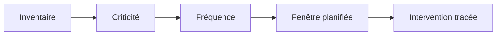

La criticité détermine la priorité et le niveau de contrôle ; la fréquence doit s'appuyer sur risque et données d'exploitation.

### Schéma 2 — Cycle d'intervention

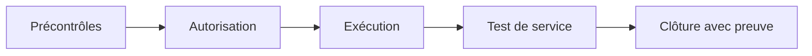

Une intervention n'est pas terminée lorsqu'une commande s'exécute : le service doit être vérifié avant la clôture.

### Schéma 3 — Point d'arrêt

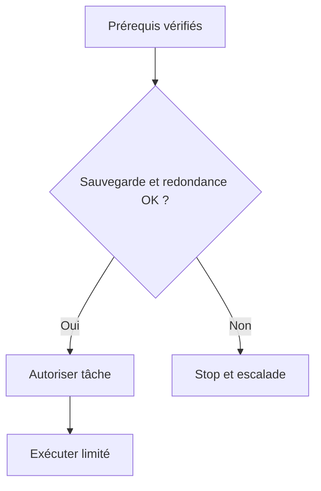

Un point d'arrêt empêche une opération risquée lorsque les garanties de reprise ou les prérequis ne sont pas présents.

### Schéma 4 — Maintenance matérielle

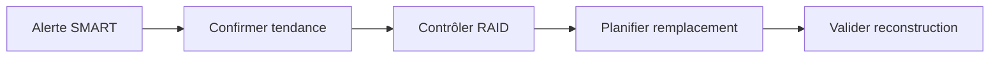

Un défaut disque doit être relié à la santé de la redondance et à l'état des sauvegardes avant l'intervention physique.

### Schéma 5 — Firmware contrôlé

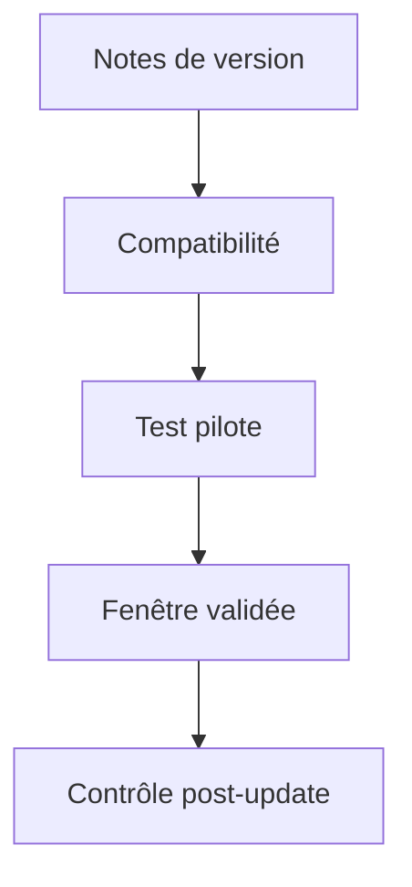

La préparation et le pilote réduisent le risque d'une mise à jour irréversible ou incompatible.

### Schéma 6 — Revue du plan

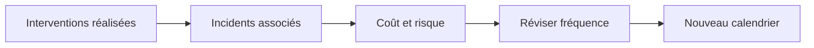

Le plan doit évoluer avec la réalité : une tâche répétée sans bénéfice mesurable peut être ajustée, tandis qu'un mode de panne récurrent mérite un contrôle renforcé.

## Fondements techniques du domaine

### 1. Criticité et risque

La fréquence d'entretien doit être déterminée par le risque et non par une règle uniforme appliquée à tout le parc. Classer les actifs selon impact métier, redondance, exposition, âge, facilité de remplacement, contraintes constructeur et conséquences d'une panne.

**Mise en œuvre — classer les actifs.** Crée une matrice avec, au minimum, l'impact métier d'une panne, le nombre d'utilisateurs ou services dépendants, le niveau de redondance, l'exposition, les incidents historiques, la durée de réparation et les contraintes du fournisseur. Utilise une échelle définie par l'organisation, puis vérifie les cas particuliers : un actif rarement en panne peut rester critique si son indisponibilité bloque une fonction vitale. Documente qui valide la classe de criticité et à quelle date elle sera réexaminée.

**Preuves et interprétation.** Conserve la matrice, les sources de données et la justification de la fréquence retenue. Croise les historiques d'incidents avec les observations de supervision et le retour des équipes. Une note de risque n'est pas une prédiction exacte de panne ; elle sert à expliquer les priorités et à rendre les arbitrages cohérents.

### Schéma — déterminer la criticité pour prioriser la maintenance

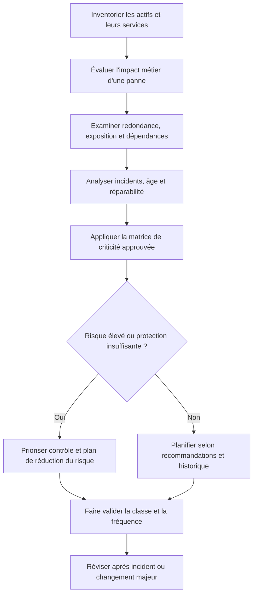

### 2. Calendrier et fenêtres

Le plan doit tenir compte des heures de pointe, clôtures comptables, périodes d'examen, sauvegardes et dépendances techniques. Définir fenêtre, durée estimée, responsable, autorisations, prérequis, critères de report et plan de retour arrière.

**Mise en œuvre — construire un calendrier réalisable.** Part des fenêtres autorisées, puis remonte le temps pour prévoir l'approbation, l'information des utilisateurs, la vérification des sauvegardes, la disponibilité des intervenants et des pièces. Place les opérations dépendantes dans un ordre explicite. Évite les périodes de clôture, les pics d'activité et les sauvegardes qui pourraient entrer en conflit avec la maintenance. Ajoute une marge réaliste et un critère de report : par exemple, redondance déjà dégradée ou équipe de reprise indisponible.

**Preuves et interprétation.** La fenêtre acceptée, les personnes averties, la durée réelle, les conflits identifiés et la décision de maintien ou de report doivent être traçables. Un créneau libre dans un agenda n'est pas une approbation opérationnelle. Après un report, recalcule les dépendances et confirme la nouvelle date au lieu de déplacer seulement le rendez-vous.

### Schéma — planifier une fenêtre sans compromettre la production

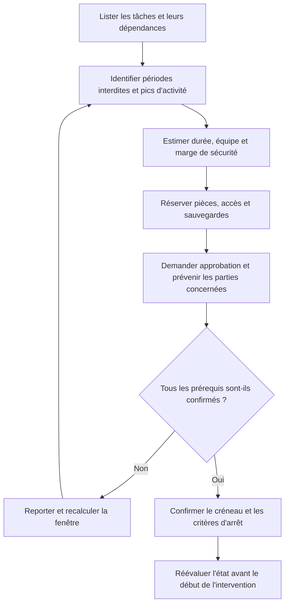

### 3. Précontrôles

Avant une maintenance, il faut connaître l'état initial, les alertes ouvertes, la sauvegarde disponible et l'état de redondance. Capturer santé matérielle, version logicielle, capacité, services, chemins réseau et résultat du dernier test de restauration pertinent.

**Mise en œuvre — établir une référence avant l'opération.** Selon l'actif, relève l'état de santé, les alarmes actives, la version de firmware ou de logiciel, la capacité, les services, la connectivité, la redondance, les dépendances et la dernière restauration testée. Note l'heure, la source et les valeurs attendues. Si un contrôle important n'est pas disponible, indique-le et demande une décision plutôt que de considérer tacitement l'état comme sain.

**Preuves et interprétation.** Les relevés avant intervention doivent être comparables aux mesures après intervention : mêmes unités, périmètre et conditions autant que possible. Une capture non horodatée ou un état de supervision ancien ne garantit pas que le système est sain au début de la fenêtre. Fixe des points d'arrêt clairs lorsque l'état initial est déjà dégradé.

### Schéma — vérifier les prérequis avant d'autoriser le démarrage

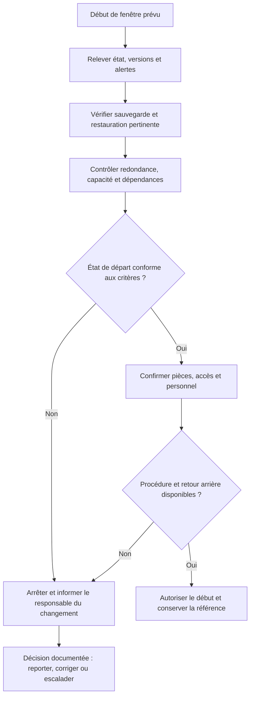

### 4. Procédures répétables

La maintenance préventive doit être reproductible même lorsque le technicien habituel est absent. Décomposer l'intervention en prérequis, gestes contrôlés, valeurs attendues, points d'arrêt, validation et retour arrière.

**Mise en œuvre — rendre la procédure exécutable.** Organise chaque tâche autour de prérequis, étapes numérotées, résultat attendu après chaque étape, points d'arrêt, critères de réussite et retour arrière. Fais référence à la version du document et identifie la personne habilitée à prendre une décision en cas d'écart. Une instruction telle que « vérifier que tout va bien » doit être remplacée par des contrôles observables adaptés au matériel ou au service.

**Preuves et interprétation.** Utilise une checklist horodatée et conserve la version de procédure appliquée, les écarts, les décisions et les résultats des contrôles. Lorsqu'un technicien découvre une étape manquante, il doit documenter l'écart et proposer une revue de la procédure plutôt que modifier silencieusement l'ordre des opérations pendant une intervention critique.

### Schéma — structurer une procédure préventive reproductible

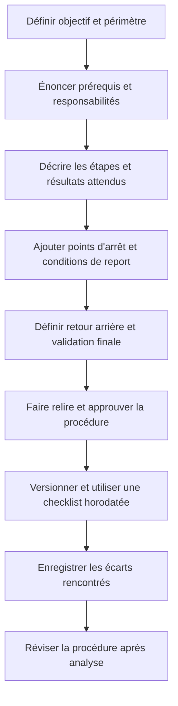

### 5. Pièces et compétences

Une maintenance planifiée peut échouer si le bon module, le câble, le firmware, les accès ou les compétences ne sont pas disponibles. Réserver les pièces, confirmer la compatibilité, vérifier les droits d'accès et identifier une personne de remplacement avant la fenêtre.

**Mise en œuvre — confirmer la capacité avant de réserver le créneau.** Vérifie les références exactes, la compatibilité, la disponibilité et le délai de livraison des pièces, les outils spécifiques, les licences ou accès, ainsi que les compétences nécessaires. Identifie un remplaçant si l'intervention dépend d'une seule personne. Pour un firmware ou une pièce critique, confirme la procédure constructeur, la version cible et la méthode de retour arrière.

**Preuves et interprétation.** Associe au ticket l'inventaire des pièces, les validations de compatibilité, les intervenants confirmés et les éléments manquants. Une pièce en stock n'est pas nécessairement adaptée à l'actif ; une compétence disponible en théorie n'est pas une couverture suffisante si personne n'est planifié pendant toute la fenêtre.

### Schéma — valider les ressources et compétences avant la maintenance

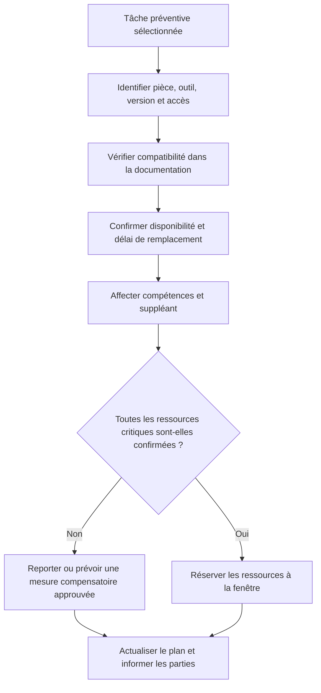

### 6. Gestion des changements

Une maintenance planifiée doit être évaluée comme un changement lorsqu'elle peut affecter la production. Évaluer impact, probabilité, approbation, communication, plan de tests et conditions d'annulation selon le niveau de risque.

**Mise en œuvre — appliquer un contrôle de changement proportionné au risque.** Décris le but, les actifs touchés, la justification, l'impact, l'approbateur, la fenêtre, les tests, les communications et les conditions de retour arrière. Décompose les travaux importants en étapes vérifiables. Définis à l'avance qui a le pouvoir d'arrêter l'intervention et qui autorise la remise en service.

**Preuves et interprétation.** Le ticket de changement doit contenir l'approbation, les heures réelles, la version ou configuration avant/après, les résultats des tests et chaque écart au plan. Une maintenance dite « standard » ne doit pas être dispensée de contrôle si sa portée réelle a changé ou si les conditions observées rendent le risque plus élevé.

### Schéma — gouverner un changement préventif à risque

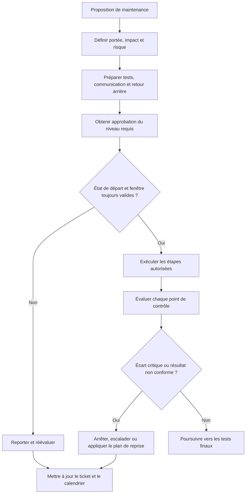

### 7. Validation post-intervention

La fin d'une opération matérielle ou logicielle ne signifie pas que le service métier est rétabli. Contrôler alarmes, redondance, journaux, performance, connectivité et transaction représentative ; faire confirmer le service par son propriétaire.

**Mise en œuvre — tester de l'équipement jusqu'au service métier.** Rejoue les contrôles de référence : alertes, redondance, capacité, versions, connectivité et performance selon le type d'actif. Exécute une transaction représentative ou demande au propriétaire métier de confirmer le parcours utilisateur. Pour une tâche qui exige une période d'observation, planifie le contrôle différé et nomme son responsable.

**Preuves et interprétation.** Compare les mesures avant/après dans les mêmes conditions et note les tests non exécutés. Un composant « en ligne » n'est pas une preuve suffisante si le service dépend aussi de son routage, de son authentification ou d'une application. La clôture doit refléter la stabilité observée ; les écarts persistants restent des actions assignées.

### Schéma — valider la maintenance au-delà du composant

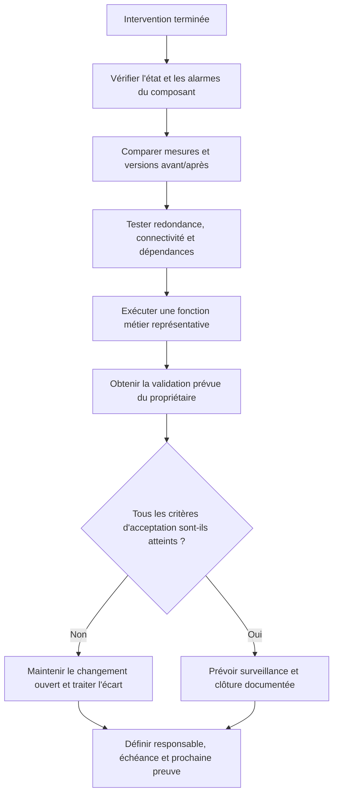

### 8. Amélioration du plan

Le plan préventif doit évoluer à partir des pannes évitées, incidents répétés, coûts et retours des techniciens. Comparer les tâches planifiées aux incidents réels, supprimer les contrôles inutiles et renforcer ceux qui interceptent des modes de panne fréquents.

**Mise en œuvre — réviser le plan à partir des résultats mesurés.** Chaque revue doit rapprocher les tâches prévues, celles réellement réalisées, les pannes récurrentes, les arrêts causés par la maintenance, le coût des pièces et les observations terrain. Pour les incidents qui reviennent après une visite préventive, vérifie si la tâche contrôle réellement le mode de défaillance. Ajuste la fréquence ou le contenu avec l'accord du propriétaire de l'actif.

**Preuves et interprétation.** Enregistre la modification, les données qui la justifient, le responsable et la date de réévaluation. Une baisse des pannes sur une courte période ne prouve pas automatiquement que le plan est efficace ; tiens compte de la taille de l'échantillon, des changements de charge et des tâches reportées. Évalue aussi les faux positifs et le coût des interventions inutiles.

### Schéma — améliorer le programme préventif en boucle fermée

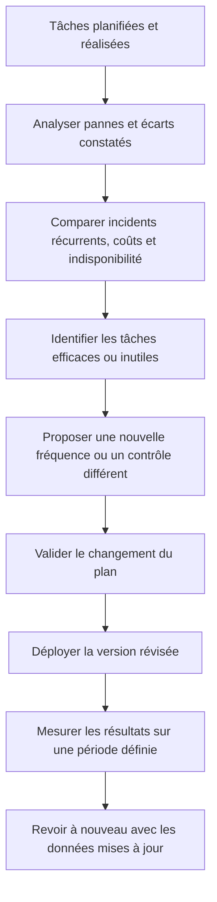

## Méthode transversale pour une opération maîtrisée

### 1. Gouvernance

L'intervention doit être reliée à un objectif de service, un propriétaire et une décision explicite. Le contrôle de gouvernance n'a de valeur que s'il aide à identifier qui peut accepter le risque et qui doit être informé. Pour planifier la maintenance préventive, cela signifie que la personne qui agit doit relier la règle à un élément concret : interventions planifiées réalisées, maintenance en retard, récurrence des incidents après intervention, indisponibilité causée par la maintenance, MTBF, coût préventif, incidents évités documentés. Avant l'opération, noter l'état de départ et ce qui fera considérer le résultat comme acceptable. Pendant l'action, conserver le contexte des changements et indiquer immédiatement les écarts. Après l'action, exécuter le contrôle correspondant au risque, enregistrer le résultat et affecter les suites restantes. Cette discipline augmente la qualité de la passation et réduit la dépendance à une personne unique.

### 2. Cycle de vie

La solution doit être pensée depuis la préparation jusqu'à la sortie, y compris le maintien des compétences et le retrait des anciennes données. Une étape oubliée en fin de cycle transforme souvent une réussite ponctuelle en risque latent. Pour planifier la maintenance préventive, cela signifie que la personne qui agit doit relier la règle à un élément concret : interventions planifiées réalisées, maintenance en retard, récurrence des incidents après intervention, indisponibilité causée par la maintenance, MTBF, coût préventif, incidents évités documentés. Avant l'opération, noter l'état de départ et ce qui fera considérer le résultat comme acceptable. Pendant l'action, conserver le contexte des changements et indiquer immédiatement les écarts. Après l'action, exécuter le contrôle correspondant au risque, enregistrer le résultat et affecter les suites restantes. Cette discipline augmente la qualité de la passation et réduit la dépendance à une personne unique.

### 3. Qualité de données

Toute mesure dépend de la qualité de son périmètre, de l'horodatage, de l'unité et de la provenance. Il faut identifier les champs manquants et les conventions contradictoires avant de tirer une conclusion. Pour planifier la maintenance préventive, cela signifie que la personne qui agit doit relier la règle à un élément concret : interventions planifiées réalisées, maintenance en retard, récurrence des incidents après intervention, indisponibilité causée par la maintenance, MTBF, coût préventif, incidents évités documentés. Avant l'opération, noter l'état de départ et ce qui fera considérer le résultat comme acceptable. Pendant l'action, conserver le contexte des changements et indiquer immédiatement les écarts. Après l'action, exécuter le contrôle correspondant au risque, enregistrer le résultat et affecter les suites restantes. Cette discipline augmente la qualité de la passation et réduit la dépendance à une personne unique.

### 4. Gestion du risque

Le risque se juge par probabilité, impact, capacité de détection et marge de récupération. Les éléments critiques doivent recevoir plus de contrôles, sans imposer la même lourdeur aux opérations réversibles et aux changements irréversibles. Pour planifier la maintenance préventive, cela signifie que la personne qui agit doit relier la règle à un élément concret : interventions planifiées réalisées, maintenance en retard, récurrence des incidents après intervention, indisponibilité causée par la maintenance, MTBF, coût préventif, incidents évités documentés. Avant l'opération, noter l'état de départ et ce qui fera considérer le résultat comme acceptable. Pendant l'action, conserver le contexte des changements et indiquer immédiatement les écarts. Après l'action, exécuter le contrôle correspondant au risque, enregistrer le résultat et affecter les suites restantes. Cette discipline augmente la qualité de la passation et réduit la dépendance à une personne unique.

### 5. Communication

Une communication utile indique ce qui est connu, ce qui reste à vérifier, qui agit ensuite et quand une nouvelle information sera fournie. Les formulations doivent éviter les promesses non vérifiées. Pour planifier la maintenance préventive, cela signifie que la personne qui agit doit relier la règle à un élément concret : interventions planifiées réalisées, maintenance en retard, récurrence des incidents après intervention, indisponibilité causée par la maintenance, MTBF, coût préventif, incidents évités documentés. Avant l'opération, noter l'état de départ et ce qui fera considérer le résultat comme acceptable. Pendant l'action, conserver le contexte des changements et indiquer immédiatement les écarts. Après l'action, exécuter le contrôle correspondant au risque, enregistrer le résultat et affecter les suites restantes. Cette discipline augmente la qualité de la passation et réduit la dépendance à une personne unique.

### 6. Sécurité

Le périmètre technique doit rester limité aux systèmes autorisés, avec une identité traçable et les droits minimaux nécessaires. Les secrets doivent être protégés dans les fichiers, les journaux, les captures et les exports. Pour planifier la maintenance préventive, cela signifie que la personne qui agit doit relier la règle à un élément concret : interventions planifiées réalisées, maintenance en retard, récurrence des incidents après intervention, indisponibilité causée par la maintenance, MTBF, coût préventif, incidents évités documentés. Avant l'opération, noter l'état de départ et ce qui fera considérer le résultat comme acceptable. Pendant l'action, conserver le contexte des changements et indiquer immédiatement les écarts. Après l'action, exécuter le contrôle correspondant au risque, enregistrer le résultat et affecter les suites restantes. Cette discipline augmente la qualité de la passation et réduit la dépendance à une personne unique.

### 7. Traçabilité

Une action exploitable doit laisser un résultat vérifiable, un horodatage, un propriétaire et un lien avec le ticket ou le changement. La trace doit permettre à un autre technicien de comprendre ce qui a été fait. Pour planifier la maintenance préventive, cela signifie que la personne qui agit doit relier la règle à un élément concret : interventions planifiées réalisées, maintenance en retard, récurrence des incidents après intervention, indisponibilité causée par la maintenance, MTBF, coût préventif, incidents évités documentés. Avant l'opération, noter l'état de départ et ce qui fera considérer le résultat comme acceptable. Pendant l'action, conserver le contexte des changements et indiquer immédiatement les écarts. Après l'action, exécuter le contrôle correspondant au risque, enregistrer le résultat et affecter les suites restantes. Cette discipline augmente la qualité de la passation et réduit la dépendance à une personne unique.

### 8. Gestion des exceptions

Les cas hors procédure doivent être visibles et conduire à un point d'arrêt, une décision ou une escalade. Une exception récurrente est souvent le signal qu'il faut faire évoluer la procédure plutôt que la répéter. Pour planifier la maintenance préventive, cela signifie que la personne qui agit doit relier la règle à un élément concret : interventions planifiées réalisées, maintenance en retard, récurrence des incidents après intervention, indisponibilité causée par la maintenance, MTBF, coût préventif, incidents évités documentés. Avant l'opération, noter l'état de départ et ce qui fera considérer le résultat comme acceptable. Pendant l'action, conserver le contexte des changements et indiquer immédiatement les écarts. Après l'action, exécuter le contrôle correspondant au risque, enregistrer le résultat et affecter les suites restantes. Cette discipline augmente la qualité de la passation et réduit la dépendance à une personne unique.

### 9. Amélioration continue

Les incidents, les retours utilisateurs et les contrôles qualité doivent transformer les règles et procédures. Il faut vérifier si les modifications réduisent réellement le risque, et pas seulement si les documents ont été mis à jour. Pour planifier la maintenance préventive, cela signifie que la personne qui agit doit relier la règle à un élément concret : interventions planifiées réalisées, maintenance en retard, récurrence des incidents après intervention, indisponibilité causée par la maintenance, MTBF, coût préventif, incidents évités documentés. Avant l'opération, noter l'état de départ et ce qui fera considérer le résultat comme acceptable. Pendant l'action, conserver le contexte des changements et indiquer immédiatement les écarts. Après l'action, exécuter le contrôle correspondant au risque, enregistrer le résultat et affecter les suites restantes. Cette discipline augmente la qualité de la passation et réduit la dépendance à une personne unique.

### 10. Capacité

Les ressources, compétences, fenêtres et dépendances limitent le volume d'opérations réalisables. Une planification crédible tient compte de la charge, des temps de contrôle et des imprévus. Pour planifier la maintenance préventive, cela signifie que la personne qui agit doit relier la règle à un élément concret : interventions planifiées réalisées, maintenance en retard, récurrence des incidents après intervention, indisponibilité causée par la maintenance, MTBF, coût préventif, incidents évités documentés. Avant l'opération, noter l'état de départ et ce qui fera considérer le résultat comme acceptable. Pendant l'action, conserver le contexte des changements et indiquer immédiatement les écarts. Après l'action, exécuter le contrôle correspondant au risque, enregistrer le résultat et affecter les suites restantes. Cette discipline augmente la qualité de la passation et réduit la dépendance à une personne unique.

### 11. Contrôle du changement

Une modification nécessite un état initial connu, un périmètre, des critères de réussite et une solution de repli adaptée au risque. L'urgence ne supprime pas le besoin de garder une trace des décisions. Pour planifier la maintenance préventive, cela signifie que la personne qui agit doit relier la règle à un élément concret : interventions planifiées réalisées, maintenance en retard, récurrence des incidents après intervention, indisponibilité causée par la maintenance, MTBF, coût préventif, incidents évités documentés. Avant l'opération, noter l'état de départ et ce qui fera considérer le résultat comme acceptable. Pendant l'action, conserver le contexte des changements et indiquer immédiatement les écarts. Après l'action, exécuter le contrôle correspondant au risque, enregistrer le résultat et affecter les suites restantes. Cette discipline augmente la qualité de la passation et réduit la dépendance à une personne unique.

### 12. Mesure d'efficacité

Un indicateur ne vaut que si sa définition reste constante et si sa variation peut conduire à une décision. Les chiffres doivent être accompagnés d'une période, d'un périmètre et des limites de mesure. Pour planifier la maintenance préventive, cela signifie que la personne qui agit doit relier la règle à un élément concret : interventions planifiées réalisées, maintenance en retard, récurrence des incidents après intervention, indisponibilité causée par la maintenance, MTBF, coût préventif, incidents évités documentés. Avant l'opération, noter l'état de départ et ce qui fera considérer le résultat comme acceptable. Pendant l'action, conserver le contexte des changements et indiquer immédiatement les écarts. Après l'action, exécuter le contrôle correspondant au risque, enregistrer le résultat et affecter les suites restantes. Cette discipline augmente la qualité de la passation et réduit la dépendance à une personne unique.

### 13. Passation

Une tâche doit pouvoir être reprise par une autre personne sans dépendre des souvenirs du technicien présent. La transmission contient contexte, preuves, étapes déjà tentées et prochaine action. Pour planifier la maintenance préventive, cela signifie que la personne qui agit doit relier la règle à un élément concret : interventions planifiées réalisées, maintenance en retard, récurrence des incidents après intervention, indisponibilité causée par la maintenance, MTBF, coût préventif, incidents évités documentés. Avant l'opération, noter l'état de départ et ce qui fera considérer le résultat comme acceptable. Pendant l'action, conserver le contexte des changements et indiquer immédiatement les écarts. Après l'action, exécuter le contrôle correspondant au risque, enregistrer le résultat et affecter les suites restantes. Cette discipline augmente la qualité de la passation et réduit la dépendance à une personne unique.

### 14. Validation métier

Le résultat technique doit être confirmé du point de vue du service. Un équipement joignable ou un script qui termine sans erreur ne suffit pas si l'utilisateur ne peut pas accomplir son opération. Pour planifier la maintenance préventive, cela signifie que la personne qui agit doit relier la règle à un élément concret : interventions planifiées réalisées, maintenance en retard, récurrence des incidents après intervention, indisponibilité causée par la maintenance, MTBF, coût préventif, incidents évités documentés. Avant l'opération, noter l'état de départ et ce qui fera considérer le résultat comme acceptable. Pendant l'action, conserver le contexte des changements et indiquer immédiatement les écarts. Après l'action, exécuter le contrôle correspondant au risque, enregistrer le résultat et affecter les suites restantes. Cette discipline augmente la qualité de la passation et réduit la dépendance à une personne unique.

## Indicateurs : définition, lecture et limites

Les indicateurs les plus utiles pour ce domaine sont : **interventions planifiées réalisées, maintenance en retard, récurrence des incidents après intervention, indisponibilité causée par la maintenance, MTBF, coût préventif, incidents évités documentés**. Chaque indicateur doit avoir une définition écrite. Il faut préciser l'unité, la source, le périmètre, la fréquence, la période et les exclusions. Lorsque les données ne couvrent qu'une partie de l'environnement, le rapport doit le signaler au lieu d'extrapoler silencieusement. Un indicateur doit permettre une décision : prioriser, déclencher une vérification, ajuster une capacité, revoir une procédure ou accepter explicitement un risque.

Un bon tableau de bord met en évidence la tendance et les écarts significatifs, sans supprimer la donnée de départ. Il distingue les valeurs brutes, les seuils, les anomalies confirmées et les périodes sans mesure. Une moyenne peut cacher des situations extrêmes ; il est donc souvent nécessaire d'observer la distribution, les percentiles, les valeurs maximales et la répartition par service ou par criticité. Les changements de définition doivent être versionnés pour éviter de comparer des séries qui ne signifient plus la même chose.

Les indicateurs ne doivent pas devenir des objectifs isolés. Par exemple, réduire le délai moyen n'est pas une amélioration si les tickets sont fermés avant validation et immédiatement rouverts. De même, atteindre un taux de conformité en excluant les actifs inconnus peut donner une image artificiellement favorable. Associer un KPI à un contrôle de qualité et à un résultat métier permet de repérer ces effets indésirables.

### Schéma — déclencher une action à partir des indicateurs préventifs

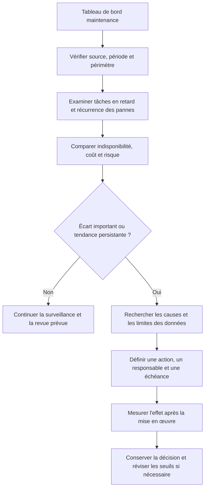

Un indicateur n'est utile que s'il déclenche une décision ou une investigation. Il faut définir son mode de calcul, sa source, son périmètre, les exclusions et la fréquence de revue avant de comparer les tendances.

## Procédure opérationnelle recommandée

1. **Préparer.** Confirmer la demande, le périmètre, le propriétaire, l'autorisation et la fenêtre. Vérifier les dépendances, les sauvegardes et les accès nécessaires.
2. **Établir l'état initial.** Recueillir les mesures, l'état des services, les alertes, la dernière intervention et les écarts connus. Noter les éléments non vérifiables.
3. **Évaluer les risques.** Déterminer impact, probabilité, détectabilité, réversibilité et critère de report. Définir un point d'arrêt compréhensible.
4. **Exécuter par étapes.** Utiliser les outils approuvés, limiter le périmètre et vérifier les résultats intermédiaires avant de passer à l'étape suivante.
5. **Contrôler.** Comparer l'état final à l'état attendu et tester le service selon un scénario réaliste, pas uniquement le composant technique.
6. **Tracer.** Enregistrer les horaires, commandes ou actions, résultats, décisions et écarts dans le ticket ou le référentiel prévu.
7. **Communiquer.** Annoncer le résultat en termes compréhensibles, préciser les limites et indiquer qui gère les actions ouvertes.
8. **Améliorer.** Rechercher les étapes ambiguës ou les contrôles inefficaces et proposer une modification versionnée, testée et approuvée.

### Schéma — exécuter une maintenance planifiée de façon contrôlée

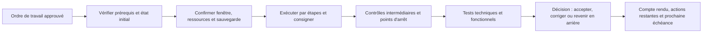

L'outil de ticketing ou de gestion de parc ne remplace pas la décision technique. Il sert à relier l'actif, la procédure, l'autorisation, les valeurs avant/après et la preuve de clôture.

## Outils et contrôles pratiques

Les outils doivent être sélectionnés selon l'objectif, les droits et le type de preuve recherché. L'usage d'un outil connu ne dispense pas de contrôler son contexte : version, paramètres, cible, unité, état de connexion et limite de la mesure. inventaire de parc, GLPI ou ITSM, calendrier de maintenance, journaux, SMART, outils constructeur, scripts de contrôle, gestion du changement, tableaux de bord MTBF/MTTR constituent des exemples de technologies possibles ; leur choix exact dépend de l'environnement et des politiques internes.

| Contrôle | Question à poser | Trace à conserver |
|---|---|---|
| Identité de la cible | Est-ce bien l'actif ou le service autorisé ? | Identifiant, inventaire et horodatage. |
| État initial | Quelle condition de départ a été mesurée ? | Valeur, source, capture ou sortie. |
| Autorisation | Qui a approuvé l'action et pour quelle fenêtre ? | Ticket, validation et périmètre. |
| Résultat | Qu'est-ce qui démontre que le résultat est correct ? | Test de contrôle et résultat observé. |
| Écart | Que faire si le résultat attendu n'est pas obtenu ? | Point d'arrêt, escalade et action attribuée. |

### Commandes et exemples

Les commandes de cette section servent à illustrer la collecte de preuves. Remplacer les valeurs de test par des cibles autorisées et vérifier localement les options selon la distribution et la version de l'outil.

#### Exemple 1 — Lister les unités système en échec avant intervention

```bash
systemctl --failed
```

Interpréter la sortie avec le contexte de l'intervention. Un retour nul ne démontre pas toujours que la fonction métier est opérationnelle. Relever les erreurs, vérifier l'heure des journaux et comparer les observations avec une seconde source lorsque l'impact le justifie. Ne pas intégrer un résultat de terminal dans un rapport sans préciser la machine, la période et la commande effectivement exécutée.

#### Exemple 2 — Vérifier l'espace disque avant un changement

```bash
df -h
```

Interpréter la sortie avec le contexte de l'intervention. Un retour nul ne démontre pas toujours que la fonction métier est opérationnelle. Relever les erreurs, vérifier l'heure des journaux et comparer les observations avec une seconde source lorsque l'impact le justifie. Ne pas intégrer un résultat de terminal dans un rapport sans préciser la machine, la période et la commande effectivement exécutée.

#### Exemple 3 — Consulter la charge et les tâches actives

```bash
uptime && ps -eo pid,comm,%cpu,%mem --sort=-%cpu | head
```

Interpréter la sortie avec le contexte de l'intervention. Un retour nul ne démontre pas toujours que la fonction métier est opérationnelle. Relever les erreurs, vérifier l'heure des journaux et comparer les observations avec une seconde source lorsque l'impact le justifie. Ne pas intégrer un résultat de terminal dans un rapport sans préciser la machine, la période et la commande effectivement exécutée.

#### Exemple 4 — Consulter les erreurs noyau récentes après maintenance

```bash
journalctl -k -p warning --since '30 minutes ago' --no-pager
```

Interpréter la sortie avec le contexte de l'intervention. Un retour nul ne démontre pas toujours que la fonction métier est opérationnelle. Relever les erreurs, vérifier l'heure des journaux et comparer les observations avec une seconde source lorsque l'impact le justifie. Ne pas intégrer un résultat de terminal dans un rapport sans préciser la machine, la période et la commande effectivement exécutée.

## Parcours pratique intermédiaire — construire un plan préventif exploitable

Cet atelier dure environ 60 à 90 minutes. Utilise un parc fictif ou un environnement de test. N'applique pas de changement sur un équipement de production sans autorisation, procédure de changement et coordination avec son propriétaire.

### Scénario de départ

Une petite entreprise possède un cluster de virtualisation, deux commutateurs cœur de réseau, un serveur de fichiers, un système de sauvegarde, des postes utilisateurs et un onduleur. L'équipe a enregistré deux alertes de disque, un incident de température et plusieurs tâches préventives reportées. La fenêtre principale disponible est le dimanche matin, mais la sauvegarde complète s'exécute habituellement à cette période.

### Étape 1 — Inventorier et classer les actifs

Construis un tableau avec identifiant, service hébergé, propriétaire, criticité, redondance, historique, recommandation constructeur et durée maximale d'interruption acceptable. Justifie les actifs qui exigent une surveillance ou une fréquence renforcée. Ne classe pas un équipement uniquement selon son prix ou son âge.

### Étape 2 — Définir tâches, fréquences et preuves

Pour chaque actif, sélectionne des tâches adaptées : revue d'alertes, capacité, état des disques, températures, versions, état des alimentations, tests de restauration ou inspection de câblage. Indique la fréquence, le responsable, le temps estimé, les outils, le résultat attendu et la preuve à conserver. Les mesures non disponibles doivent être marquées comme prérequis à obtenir.

### Étape 3 — Construire le calendrier

Repère la collision entre la sauvegarde complète et la fenêtre du dimanche. Propose une autre heure ou une séquence approuvée qui évite de dégrader la protection des données. Vérifie aussi les périodes critiques de l'entreprise, la disponibilité des pièces, les intervenants, les droits et l'équipe de secours. Prévois une marge et une condition de report explicite.

### Étape 4 — Préparer les précontrôles

Pour les deux alertes de disque, vérifie quelles données seront nécessaires pour décider : tendance des alertes, état de la redondance, sauvegarde pertinente, capacité de remplacement, pièce compatible et délai de livraison. Pour le serveur qui a connu une température élevée, prévois d'examiner la charge, les alertes, la circulation d'air et les mesures avant toute intervention. Ne considère pas une ancienne capture de supervision comme un état initial actuel.

### Étape 5 — Préparer un ordre de travail

Rédige les prérequis, les étapes, les points d'arrêt, les critères d'acceptation et le retour arrière. Identifie la personne qui peut autoriser le début, celle qui peut décider d'arrêter et le propriétaire qui validera le fonctionnement. Sépare les tâches d'observation des changements qui peuvent affecter la production.

### Étape 6 — Définir les contrôles après maintenance

Établis les valeurs ou comportements attendus après intervention : absence d'alertes nouvelles, état de redondance normal, température acceptable pour le modèle, fonctions réseau, accès aux fichiers, résultat de sauvegarde et validation du service. Pour chaque contrôle, précise la source et la preuve à conserver. Si la stabilité nécessite plusieurs heures ou un cycle de charge, affecte le suivi à un responsable.

### Étape 7 — Réviser le programme après exécution

Simule ou analyse un retour d'intervention : une tâche a été réalisée, une autre a été reportée faute de pièce, et une alerte persiste. Mets à jour le statut, nomme le responsable, fixe l'échéance et explique le risque résiduel. Lors de la prochaine revue, compare les incidents récurrents, les tâches en retard et les indisponibilités causées par la maintenance avant de changer la fréquence.

### Livrables attendus

- inventaire avec criticité et justification ;
- calendrier de maintenance avec dépendances et fenêtre ;
- checklist de précontrôle ;
- ordre de travail avec points d'arrêt et retour arrière ;
- matrice de validation après intervention ;
- registre des tâches reportées et des risques résiduels ;
- proposition d'amélioration fondée sur les résultats observés.

**Critère de réussite :** une autre équipe doit pouvoir exécuter le plan, savoir quand ne pas commencer, vérifier la remise en service et comprendre pourquoi la fréquence de chaque tâche a été retenue.

## Atelier pratique guidé

### Situation de départ

L'équipe reçoit une demande concernant planifier la maintenance préventive. Le contexte est incomplet : l'utilisateur décrit un symptôme, une mesure semble inhabituelle et une intervention antérieure est mentionnée sans détail. Le travail consiste à produire une réponse reproductible, sans prendre de risque inutile et sans annoncer une conclusion que les preuves ne soutiennent pas.

### Phase A — Qualification

Créer ou mettre à jour le ticket ; identifier le service, les utilisateurs concernés, le propriétaire technique, la période et les changements récents. Réunir les journaux et les mesures disponibles. Séparer les faits confirmés des déclarations de l'utilisateur. Déterminer si le problème est en cours, intermittent ou résolu, et préciser ce qui manque encore. Définir l'impact selon les critères de service et la priorité de traitement. Si la cible n'est pas certaine, valider son identité par l'inventaire avant d'exécuter la moindre action.

### Phase B — Hypothèses et tests

Formuler au moins deux hypothèses concurrentes. Pour chacune, préciser le signal qui devrait être observé si elle est vraie, le signal qui permettrait de la rejeter et le coût du test. Commencer par les contrôles en lecture seule, puis ne réaliser une modification que si elle est autorisée et nécessaire. Garder les résultats qui contredisent l'hypothèse initiale ; ils évitent de persister sur la mauvaise piste. Si les tests se contredisent, vérifier l'horloge, la version des données, la portée du contrôle et la possibilité d'une panne intermittente.

### Phase C — Action contrôlée

Choisir une action proportionnée au risque et limitée au périmètre identifié. Avant de modifier, noter l'état initial, confirmer la sauvegarde ou le retour arrière adapté et prévenir les personnes concernées. Exécuter une seule modification majeure à la fois lorsque cela permet d'isoler son effet. Si un point d'arrêt est atteint, conserver les preuves et contacter le niveau compétent plutôt que contourner la règle. Après l'action, répéter le test initial et vérifier le service par une transaction ou un parcours représentatif.

### Phase D — Validation et restitution

Comparer le résultat aux critères d'acceptation. Décrire ce qui a changé, ce qui a été vérifié, ce qui reste incertain et les actions ouvertes. La restitution doit être compréhensible pour un utilisateur non spécialiste et suffisamment technique pour un collègue qui reprendrait le dossier. Associer chaque action à un responsable et une échéance. Lorsque la procédure a été difficile à appliquer, signaler précisément la phrase, le champ ou le contrôle à améliorer.

## Études de cas

### Cas 1 — Défaut disque latent

**Situation.** Un contrôle SMART signale une hausse des secteurs réalloués sur un serveur redondant. Le service doit être préservé et les actions doivent rester explicables. La première réaction ne doit pas consister à redémarrer ou modifier au hasard : il faut d'abord vérifier le périmètre, l'heure, l'état initial et les changements concomitants.

**Analyse.** Vérifier la tendance et la charge, confirmer l'état du RAID et les copies disponibles, puis planifier le remplacement selon criticité. Consigner les observations qui distinguent les hypothèses, puis rechercher les dépendances susceptibles de produire le même symptôme. Si une source de donnée est absente, l'indiquer et prévoir un moyen de la récupérer pour une prochaine occurrence. Vérifier aussi l'effet sur les autres services et le risque que l'action proposée crée une interruption plus large que le problème initial.

**Décision et preuve.** Après remplacement, contrôler reconstruction, journaux, redondance et sauvegarde ; ne pas considérer le changement physique comme la fin de l'intervention. La conclusion doit préciser le niveau de confiance et les contrôles qui ont été effectués après l'action. Si la cause n'est pas démontrée, préférer une formule prudente et assigner l'investigation complémentaire plutôt que fermer le dossier sur une supposition.

### Cas 2 — Mise à jour firmware avant période critique

**Situation.** Un équipement réseau nécessite une mise à jour de sécurité avant une période d'activité importante. Le service doit être préservé et les actions doivent rester explicables. La première réaction ne doit pas consister à redémarrer ou modifier au hasard : il faut d'abord vérifier le périmètre, l'heure, l'état initial et les changements concomitants.

**Analyse.** Lire les notes de version, confirmer les chemins de mise à niveau, vérifier compatibilité et redondance, puis choisir une fenêtre testée. Consigner les observations qui distinguent les hypothèses, puis rechercher les dépendances susceptibles de produire le même symptôme. Si une source de donnée est absente, l'indiquer et prévoir un moyen de la récupérer pour une prochaine occurrence. Vérifier aussi l'effet sur les autres services et le risque que l'action proposée crée une interruption plus large que le problème initial.

**Décision et preuve.** Conserver la version avant/après, la validation du service, les alarmes et un plan de retour arrière réaliste. La conclusion doit préciser le niveau de confiance et les contrôles qui ont été effectués après l'action. Si la cause n'est pas démontrée, préférer une formule prudente et assigner l'investigation complémentaire plutôt que fermer le dossier sur une supposition.

### Cas 3 — Maintenance en retard

**Situation.** Plusieurs tâches préventives sont dépassées parce que les techniciens sont absorbés par le support réactif. Le service doit être préservé et les actions doivent rester explicables. La première réaction ne doit pas consister à redémarrer ou modifier au hasard : il faut d'abord vérifier le périmètre, l'heure, l'état initial et les changements concomitants.

**Analyse.** Classer les tâches par exposition au risque, criticité et coût d'un incident ; reporter avec accord uniquement les tâches à risque accepté. Consigner les observations qui distinguent les hypothèses, puis rechercher les dépendances susceptibles de produire le même symptôme. Si une source de donnée est absente, l'indiquer et prévoir un moyen de la récupérer pour une prochaine occurrence. Vérifier aussi l'effet sur les autres services et le risque que l'action proposée crée une interruption plus large que le problème initial.

**Décision et preuve.** Utiliser la charge réelle, le retard et les incidents associés pour ajuster l'effectif ou la fréquence plutôt que masquer les retards. La conclusion doit préciser le niveau de confiance et les contrôles qui ont été effectués après l'action. Si la cause n'est pas démontrée, préférer une formule prudente et assigner l'investigation complémentaire plutôt que fermer le dossier sur une supposition.

## Exercices d'application avec corrigés

### Exercice 1 — Définir le périmètre

**Question.** Une demande décrit un problème sans identifier clairement l'actif concerné. Quelles informations obtenir avant de lancer un contrôle ?

**Corrigé expliqué.** Identifier le service, la cible, l'utilisateur, la période, l'impact, l'autorisation, les dépendances et le résultat attendu. Aucun changement ne doit précéder la confirmation de la cible. Dans le contexte de planifier la maintenance préventive, appliquer cette réponse en reliant le raisonnement à une preuve disponible, au risque et au service concerné. L'objectif n'est pas de remplir un formulaire, mais de rendre la décision reproductible et d'éviter qu'un résultat ambigu soit transformé en certitude.

### Exercice 2 — Distinguer fait et hypothèse

**Question.** Une alerte apparaît juste après une modification. Peut-on écrire que la modification est la cause ?

**Corrigé expliqué.** Non. La proximité temporelle est un indice. Il faut comparer l'état avant/après, tester le mécanisme supposé et évaluer les autres facteurs possibles. Dans le contexte de planifier la maintenance préventive, appliquer cette réponse en reliant le raisonnement à une preuve disponible, au risque et au service concerné. L'objectif n'est pas de remplir un formulaire, mais de rendre la décision reproductible et d'éviter qu'un résultat ambigu soit transformé en certitude.

### Exercice 3 — Choisir la mesure

**Question.** Un indicateur semble bon mais les utilisateurs signalent un problème. Quelle démarche appliquer ?

**Corrigé expliqué.** Vérifier que le point de mesure représente le service, examiner le périmètre et la fraîcheur des données, puis croiser avec un test de bout en bout et le retour utilisateur. Dans le contexte de planifier la maintenance préventive, appliquer cette réponse en reliant le raisonnement à une preuve disponible, au risque et au service concerné. L'objectif n'est pas de remplir un formulaire, mais de rendre la décision reproductible et d'éviter qu'un résultat ambigu soit transformé en certitude.

### Exercice 4 — Protéger la production

**Question.** Une opération comporte un risque de perte de données ou d'indisponibilité. Quelles garanties vérifier ?

**Corrigé expliqué.** Autorisation, fenêtre, état initial, sauvegarde ou retour arrière adapté, prérequis, lot limité, critères de réussite, point d'arrêt et responsable du rétablissement. Dans le contexte de planifier la maintenance préventive, appliquer cette réponse en reliant le raisonnement à une preuve disponible, au risque et au service concerné. L'objectif n'est pas de remplir un formulaire, mais de rendre la décision reproductible et d'éviter qu'un résultat ambigu soit transformé en certitude.

### Exercice 5 — Rédiger la passation

**Question.** Un autre technicien reprend l'incident en milieu d'investigation. Quelles informations minimales transmettre ?

**Corrigé expliqué.** Résumé, impact, heure, cible, faits, hypothèses testées, preuves, actions déjà effectuées, changements récents, risques, propriétaire et prochaine action proposée. Dans le contexte de planifier la maintenance préventive, appliquer cette réponse en reliant le raisonnement à une preuve disponible, au risque et au service concerné. L'objectif n'est pas de remplir un formulaire, mais de rendre la décision reproductible et d'éviter qu'un résultat ambigu soit transformé en certitude.

### Exercice 6 — Vérifier l'efficacité

**Question.** Comment démontrer qu'une action corrective a amélioré la situation ?

**Corrigé expliqué.** Définir une référence, un indicateur, une fenêtre d'observation et un critère de réussite avant l'action ; mesurer ensuite le résultat et documenter les limites. Dans le contexte de planifier la maintenance préventive, appliquer cette réponse en reliant le raisonnement à une preuve disponible, au risque et au service concerné. L'objectif n'est pas de remplir un formulaire, mais de rendre la décision reproductible et d'éviter qu'un résultat ambigu soit transformé en certitude.

## Glossaire opérationnel

| Terme | Définition et usage |
|---|---|
| Maintenance préventive | Intervention planifiée visant à réduire le risque de dégradation ou de panne. |
| Criticité | Niveau de conséquence associé à la perte ou à la dégradation d'un actif ou service. |
| Fenêtre de maintenance | Période autorisée pour réaliser une intervention et valider le résultat. |
| MTBF | Temps moyen de fonctionnement entre défaillances, interprété selon un périmètre statistique défini. |
| MTTR | Temps moyen de réparation ou de rétablissement selon la définition retenue dans l'organisation. |
| Retour arrière | Plan permettant de revenir à un état précédent connu si la modification échoue. |
| Précontrôle | Vérification documentée réalisée avant intervention pour connaître l'état initial et les risques. |
| Recette | Ensemble de tests permettant d'accepter explicitement le service après intervention. |

## Checklist de qualité avant clôture

- [ ] Le périmètre et le propriétaire de l'opération sont clairs.
- [ ] Les autorisations, prérequis et limites de la procédure ont été vérifiés.
- [ ] L'état initial et les données utiles sont datés et traçables.
- [ ] Les hypothèses sont séparées des faits et les tests sont reproductibles.
- [ ] Les modifications sont limitées au périmètre autorisé et liées à un ticket ou changement.
- [ ] Le contrôle post-action confirme le résultat technique et le service réel.
- [ ] Les écarts et incertitudes restent visibles, avec un propriétaire de suivi.
- [ ] Les informations sensibles ne figurent pas dans les copies diffusées sans nécessité.
- [ ] Le compte rendu précise la prochaine action et la date de revue si le dossier reste ouvert.
- [ ] Les apprentissages sont intégrés à la procédure lorsque l'écart peut se reproduire.

## Défi final — traiter un cas de bout en bout

Le service responsable vous signale une dégradation après plusieurs changements récents. Les données sont partielles, une mesure contredit un témoignage et la prochaine fenêtre d'intervention est limitée. Vous devez livrer un dossier que pourrait reprendre un collègue, sans multiplier les manipulations et sans promettre une résolution avant preuve.

**Travail demandé.** Rédiger le périmètre, la chronologie, trois hypothèses, les preuves associées, le test le moins risqué, la décision d'escalade éventuelle, le plan de validation, les actions de suivi et le message destiné au demandeur. Pour chaque étape, préciser les conditions qui vous feraient arrêter ou changer de stratégie.

**Correction attendue.** Le dossier commence par l'impact et les faits confirmés, puis présente les hypothèses avec des tests discriminants. Les contrôles en lecture seule précèdent les modifications. L'action choisie est autorisée, limitée et réversible dans la mesure du possible. Le résultat est vérifié par une mesure indépendante et une validation du service. Les éléments manquants restent explicitement notés. Les conclusions sont prudentes, les preuves sont accessibles et les actions restantes possèdent un propriétaire, une échéance et un indicateur d'efficacité.

## Synthèse

Une pratique intermédiaire de qualité associe connaissance technique, gestion du risque, mesure, communication et apprentissage. L'outil n'est pas la méthode : il fournit des observations ou exécute des actions, tandis que le technicien définit le périmètre, vérifie les prérequis, interprète les résultats et prend une décision proportionnée. Pour planifier la maintenance préventive, la réussite se mesure à la fois par le résultat obtenu et par la capacité à expliquer comment ce résultat a été atteint, quelles limites subsistent et comment prévenir la récidive.
