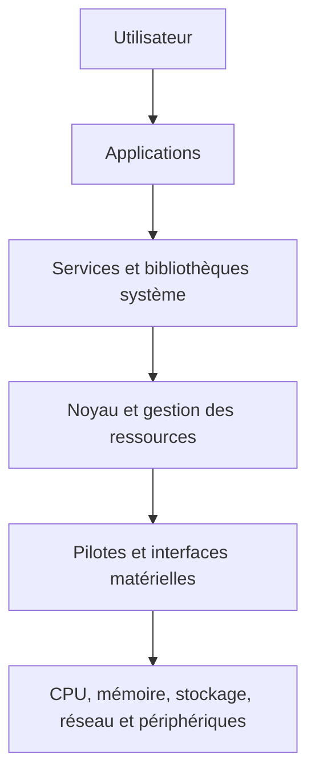
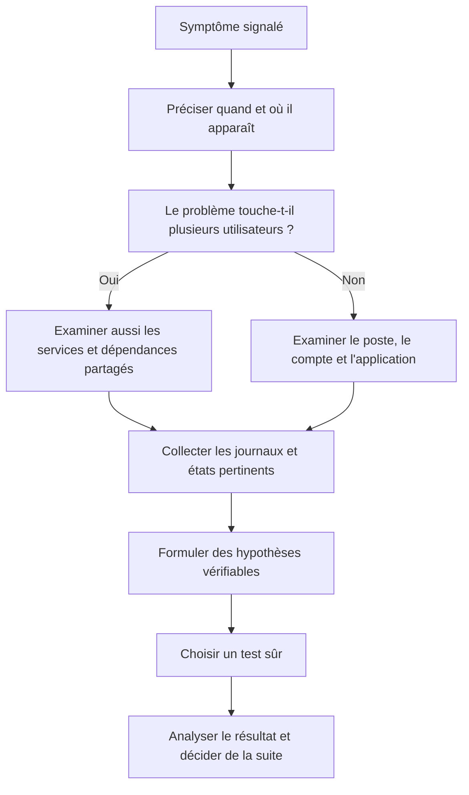
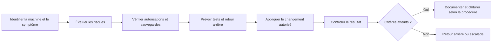
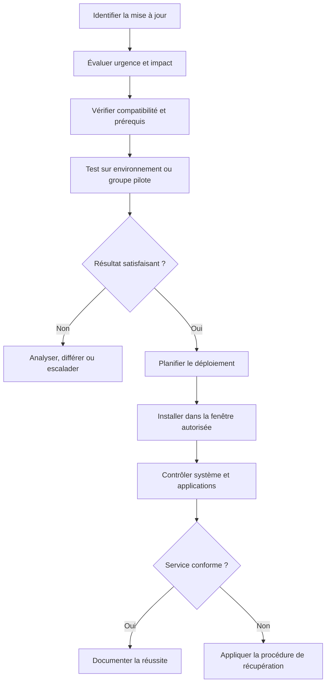
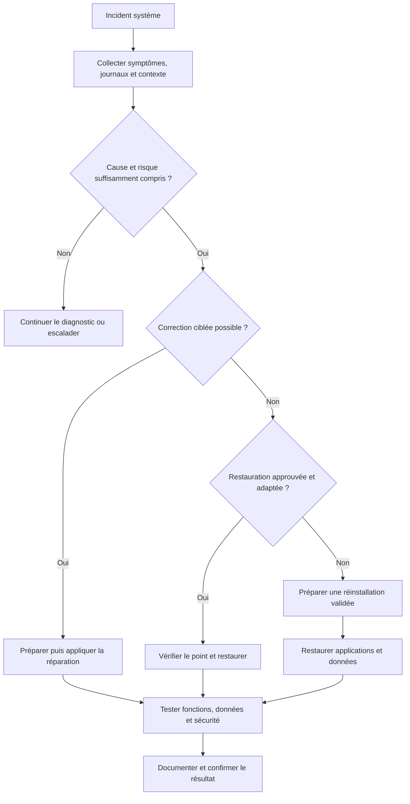
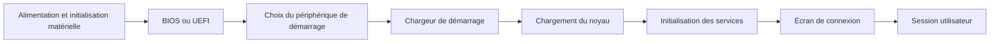

# Maintenance des systèmes d'exploitation

> **Mise en contexte**
>
> Dans une entreprise, un ordinateur démarre plus lentement que d'habitude, une mise à jour reste bloquée, un utilisateur n'arrive plus à ouvrir sa session et un autre poste affiche un message indiquant que l'espace disque est insuffisant. Ces problèmes semblent différents, mais ils peuvent concerner le système d'exploitation, ses services, ses pilotes, ses fichiers, sa configuration ou ses dépendances.
>
> Le technicien ne doit pas réinstaller Windows ou Linux dès qu'un incident apparaît. Une réinstallation mal préparée peut supprimer des données, interrompre le travail et masquer la cause réelle. La maintenance d'un système d'exploitation consiste à observer, diagnostiquer, entretenir et rétablir le système en préservant les données, la sécurité et la continuité de service.
>
> Ce cours t'apprend à comprendre le rôle du système d'exploitation, à effectuer les contrôles de base sous Windows et Linux, à gérer les mises à jour, les services, les comptes, les journaux et le stockage, puis à préparer une récupération ou une réinstallation lorsqu'elle est réellement nécessaire.

## 1. Objectifs pédagogiques

À la fin de ce cours, tu devras être capable de :

- expliquer le rôle d'un système d'exploitation ;
- distinguer le système, les applications, les pilotes et les services ;
- reconnaître les principaux symptômes d'une anomalie système ;
- collecter des informations avant de modifier la machine ;
- effectuer des contrôles de base sous Windows et Linux ;
- consulter les journaux et interpréter leurs limites ;
- comprendre le rôle des mises à jour et préparer leur déploiement ;
- identifier les risques liés aux comptes, aux permissions et aux privilèges ;
- examiner l'espace disque et les ressources système ;
- appliquer une méthode sûre de diagnostic ;
- préparer une sauvegarde et un plan de retour arrière ;
- distinguer réparation, restauration et réinstallation ;
- vérifier la machine après intervention ;
- documenter le résultat et escalader si nécessaire.

## 2. Comprendre le système d'exploitation

### 2.1. Qu'est-ce qu'un système d'exploitation ?

Un système d'exploitation, souvent abrégé en OS pour *Operating System*, est le logiciel de base qui coordonne l'utilisation du matériel et fournit des services aux applications. Il organise l'exécution des programmes, la mémoire, les fichiers, les périphériques, les comptes, les communications et une partie des fonctions de sécurité.

Exemples courants : Windows, diverses distributions Linux et macOS. Les serveurs, les postes de travail et les appareils embarqués utilisent des systèmes adaptés à leur rôle.

Le système d'exploitation n'est pas l'ensemble de l'informatique. Une application métier, un navigateur, un pilote d'imprimante et le système d'exploitation sont des éléments distincts, même s'ils interagissent.

### 2.2. Les principales responsabilités de l'OS

**Gestion des processus.** Le système coordonne les programmes en cours d'exécution et leur attribue du temps processeur.

**Gestion de la mémoire.** Il alloue et protège la mémoire utilisée par les processus.

**Gestion des fichiers.** Il organise les fichiers, les répertoires, les métadonnées et les permissions.

**Gestion des périphériques.** Il permet aux logiciels de communiquer avec les composants matériels par l'intermédiaire de pilotes et de mécanismes adaptés.

**Gestion des utilisateurs.** Il authentifie les utilisateurs et applique les autorisations configurées.

**Communication réseau.** Il fournit les fonctions nécessaires aux connexions réseau.

**Journalisation et sécurité.** Il enregistre certains événements et propose des mécanismes de protection, dont les fonctions exactes varient selon le système.

### 2.3. Schéma des relations entre les couches



Ce schéma simplifie l'architecture. Les interactions réelles dépendent de l'OS, des applications et du matériel. Il aide à comprendre pourquoi une même panne visible peut avoir plusieurs origines : application, service, noyau, pilote ou composant matériel.

### 2.4. Pourquoi un technicien doit comprendre ces couches

Supposons qu'un utilisateur ne puisse pas imprimer. L'imprimante peut être opérationnelle, mais la file d'impression du poste peut être bloquée. Le service système peut être arrêté, le pilote peut être incompatible ou l'application peut générer un document incorrect.

Si le technicien remplace l'imprimante sans vérifier ces possibilités, il risque de ne rien résoudre. Comprendre les couches permet de poser une question plus précise et de choisir le bon contrôle.

## 3. Symptômes fréquents et premières hypothèses

### 3.1. Démarrage lent

Un démarrage lent peut être lié à plusieurs facteurs : trop d'applications lancées au démarrage, stockage saturé ou dégradé, mises à jour en cours, pilote problématique, service en attente, problème matériel ou ressources insuffisantes.

Il faut noter si le ralentissement apparaît avant l'écran de connexion, pendant l'ouverture de session ou après l'affichage du bureau. Ces étapes ne sollicitent pas exactement les mêmes composants.

### 3.2. Écran bleu ou arrêt inattendu

Un écran d'erreur peut être causé par un pilote, une anomalie du système, une mémoire défectueuse, un stockage en difficulté ou d'autres conditions. Le code d'arrêt et les événements associés constituent des indices. Ils ne démontrent pas toujours à eux seuls la cause racine.

Le technicien doit relever le code exact, l'heure, la fréquence, les applications actives et les changements récents. Il faut éviter les logiciels inconnus qui promettent de corriger automatiquement toutes les erreurs.

### 3.3. Application qui ne démarre pas

Les hypothèses peuvent inclure un fichier manquant, une permission insuffisante, une dépendance absente, une version incompatible, un service indisponible ou un profil utilisateur endommagé.

Avant de réinstaller l'application, vérifie si d'autres utilisateurs sont touchés, si le problème est reproductible et si un message précis est affiché.

### 3.4. Espace disque insuffisant

Une partition presque pleine peut provoquer des échecs de mises à jour, empêcher la création de fichiers temporaires et dégrader le fonctionnement d'applications. Il faut identifier le système de fichiers concerné et comprendre quels éléments occupent l'espace avant d'en supprimer.

Ne supprime pas automatiquement les fichiers journaux, les dossiers système ou les répertoires dont le rôle est inconnu.

### 3.5. Mise à jour bloquée

Une mise à jour peut prendre du temps, nécessiter un redémarrage ou échouer à cause d'une connexion, d'un manque d'espace, d'une dépendance ou d'une incompatibilité. Une barre de progression immobile ne suffit pas toujours à conclure que le système est bloqué.

Observe le temps écoulé, les messages, l'activité du système et les consignes officielles de récupération. Évite de couper brutalement l'alimentation pendant une opération qui écrit dans des zones critiques, sauf si une procédure de récupération impose cette action.

### 3.6. Schéma de diagnostic initial



Le diagnostic ne doit pas être une liste de commandes lancées sans objectif. Chaque test doit aider à confirmer ou à écarter une hypothèse, ou indiquer les informations manquantes.

## 4. Avant toute intervention : inventaire et protection

### 4.1. Identifier précisément le système

Avant d'appliquer une procédure, identifie le système d'exploitation, sa version, son architecture, son rôle et la machine concernée. Une commande ou une procédure valable sur une version peut ne pas s'appliquer à une autre.

Sous Windows, des informations de base peuvent être consultées dans les paramètres du système ou avec les outils de gestion autorisés. Sous Linux, des commandes comme `cat /etc/os-release` peuvent décrire la distribution et sa version.

```powershell
Get-ComputerInfo
```

Cette commande PowerShell peut afficher beaucoup d'informations système. Sur une machine professionnelle, ne copie pas l'ensemble de la sortie dans un espace public. Ne recueille que les champs nécessaires au diagnostic.

```bash
cat /etc/os-release
uname -r
```

La première commande affiche des informations sur la distribution Linux ; la seconde affiche la version du noyau. Ces commandes sont des exemples adaptés à de nombreux environnements Linux, mais les outils disponibles peuvent varier.

### 4.2. Relever l'état initial

Note les symptômes, l'heure, l'utilisateur ou le service touché, les applications concernées, les changements récents et l'état de la machine. Si une action est prévue, conserve les informations utiles pour comparer la situation avant et après.

L'état initial peut inclure l'espace disponible, l'état d'un service, des erreurs visibles, l'activité des ressources et les alertes pertinentes. Il n'est pas nécessaire d'enregistrer chaque détail de la machine : cible les données qui peuvent éclairer le problème.

### 4.3. Protéger les données

Avant une opération susceptible de supprimer ou de modifier des données, vérifie la sauvegarde, les autorisations et la procédure de retour arrière. Une sauvegarde doit être évaluée selon sa date, son périmètre, son état et les règles de restauration de l'organisation.

Il faut distinguer :

- les fichiers personnels de l'utilisateur ;
- les données métier ;
- les profils et configurations ;
- les clés ou certificats nécessaires à certains services ;
- les licences et paramètres d'applications ;
- les journaux utiles au diagnostic.

Une image système peut faciliter la restauration d'un poste, mais ne remplace pas nécessairement une sauvegarde des données qui évoluent quotidiennement.

### 4.4. Schéma de préparation d'une modification



Si la protection des données ou l'autorisation nécessaire n'est pas disponible, l'intervention doit être interrompue jusqu'à clarification. La pression pour rétablir rapidement un service ne justifie pas une opération risquée non préparée.

## 5. Comptes, privilèges et permissions

### 5.1. Compte standard et compte administrateur

Un compte standard permet les tâches courantes sans disposer automatiquement de tous les droits de modification. Un compte administrateur peut effectuer des opérations plus sensibles, comme installer certains logiciels ou modifier la configuration système.

Le principe du moindre privilège consiste à n'accorder que les droits nécessaires. Le fait d'utiliser un compte administrateur pour toutes les activités quotidiennes augmente les conséquences possibles d'une erreur ou d'un logiciel malveillant.

### 5.2. Authentification et autorisation

L'authentification vérifie l'identité présentée. L'autorisation détermine les actions permises à cette identité.

Un utilisateur peut réussir à ouvrir sa session tout en étant empêché d'accéder à un dossier ou à une application. Le problème peut relever des permissions et non d'un défaut d'authentification.

Ne demande jamais à un utilisateur de révéler son mot de passe. Pour un incident de compte, suis les procédures officielles de récupération ou de réinitialisation.

### 5.3. Permissions des fichiers

Les systèmes d'exploitation associent souvent des permissions aux fichiers et répertoires. Ces permissions déterminent qui peut lire, modifier ou exécuter un élément. Les modèles diffèrent entre Windows, Linux et d'autres systèmes.

Sous Linux, `ls -l` affiche notamment les permissions traditionnelles du propriétaire, du groupe et des autres utilisateurs. Sur Windows, les permissions de sécurité peuvent être consultées dans les propriétés du fichier ou à l'aide d'outils d'administration.

Ne résous pas un refus d'accès en accordant des droits trop larges à tout le monde. Il faut déterminer quel accès est requis et appliquer le changement minimal, avec validation lorsque nécessaire.

### 5.4. UAC et élévation sous Windows

Le contrôle de compte d'utilisateur (UAC) contribue à encadrer certaines actions qui exigent des privilèges élevés. Une invite d'élévation ne doit pas être acceptée automatiquement sans vérifier le programme et l'action demandée.

Un technicien doit éviter de contourner les mécanismes de sécurité pour simplifier une intervention. La bonne pratique consiste à utiliser un compte ou un mécanisme d'administration autorisé et traçable.

## 6. Gestion des services

### 6.1. Qu'est-ce qu'un service ?

Un service est un composant logiciel qui peut fonctionner en arrière-plan pour fournir une fonction au système ou à une application. Exemples : impression, journalisation, authentification, mise à jour ou service applicatif.

Un service arrêté peut expliquer un symptôme, mais il ne faut pas le démarrer ou le redémarrer systématiquement sans comprendre son rôle. Certains services dépendent d'autres composants ou servent de nombreux utilisateurs.

### 6.2. Services sous Windows

PowerShell permet de consulter les services :

```powershell
Get-Service
```

Pour filtrer un service connu :

```powershell
Get-Service -Name Spooler
```

`Spooler` est le nom courant du service d'impression de Windows. L'exemple permet d'observer son état dans un scénario lié à l'impression. La disponibilité et les noms exacts peuvent dépendre de l'environnement.

Pour obtenir des informations détaillées sur un service, utilise les outils de gestion approuvés. La simple mention `Running` indique qu'un service est en cours d'exécution, mais ne prouve pas que toute sa fonction marche correctement.

### 6.3. Services sous Linux avec systemd

Sur de nombreux systèmes Linux utilisant systemd :

```bash
systemctl status nom-du-service
```

Les journaux associés peuvent être consultés ainsi :

```bash
journalctl -u nom-du-service --since "30 minutes ago"
```

Remplace le nom d'exemple par celui d'un service réel. Les permissions peuvent limiter les informations accessibles.

Les commandes qui démarrent, arrêtent ou redémarrent un service modifient son état. Sur un système de production, ne les utilise pas comme de simples tests : évalue les dépendances, l'impact et l'autorisation.

### 6.4. Méthode de diagnostic d'un service

1. Décrire le symptôme utilisateur.
2. Identifier le service potentiellement concerné.
3. Consulter son état et les journaux pertinents.
4. Déterminer si d'autres fonctions dépendent du service.
5. Vérifier la portée et l'impact.
6. Choisir l'action autorisée la moins risquée.
7. Vérifier la fonction réelle après intervention.
8. Documenter les résultats.

Un service peut être démarré mais échouer lorsqu'il reçoit une demande. Si le problème persiste, il faut examiner la configuration, les dépendances et les journaux plutôt que répéter les redémarrages.

## 7. Mises à jour du système d'exploitation

### 7.1. Pourquoi mettre à jour ?

Les mises à jour peuvent corriger des vulnérabilités, résoudre des défauts, améliorer la compatibilité ou corriger des problèmes de stabilité. Elles sont un élément important de la maintenance, mais elles doivent être gérées avec méthode.

Une mise à jour peut aussi introduire une incompatibilité avec un pilote ou une application. Le risque ne justifie pas de désactiver durablement les mises à jour ; il justifie une préparation adaptée à l'importance du système.

### 7.2. Différence entre patch, mise à niveau et pilote

Un correctif (*patch*) résout généralement un défaut ciblé ou une vulnérabilité. Une mise à niveau de version peut apporter des changements beaucoup plus importants. Un pilote permet au système d'interagir avec un composant matériel. Une mise à jour de micrologiciel concerne le logiciel intégré au matériel et peut avoir des risques spécifiques.

Il faut savoir ce qui est modifié avant d'installer un paquet. Une mise à jour de système, une mise à jour de pilote et une mise à jour de firmware ne se gèrent pas nécessairement de la même manière.

### 7.3. Préparer un déploiement

Avant une mise à jour importante :

- identifier les machines concernées ;
- vérifier les exigences et la compatibilité ;
- consulter les alertes connues du fournisseur ;
- vérifier l'espace disponible ;
- vérifier les sauvegardes lorsque les risques l'exigent ;
- choisir une fenêtre adaptée ;
- informer les utilisateurs ;
- définir les tests postérieurs ;
- prévoir un moyen de récupération acceptable.

Dans une grande organisation, les mises à jour sont généralement testées sur un groupe pilote ou un environnement de validation avant un déploiement plus large, selon la criticité et la politique de gestion des changements.

### 7.4. Schéma d'un cycle de mise à jour



Une mise à jour n'est pas terminée au moment où l'installation annonce un succès. Le technicien doit vérifier que le démarrage, les services et les applications requises fonctionnent encore.

### 7.5. Windows Update

Sur un poste Windows, utilise les paramètres et outils de gestion autorisés pour vérifier l'état des mises à jour, les redémarrages requis et les erreurs signalées.

Ne télécharge pas des fichiers d'installation depuis une source inconnue. Dans une organisation, respecte les politiques de mise à jour et les outils de gestion centraux. Un poste administré peut recevoir des mises à jour selon des règles qui ne doivent pas être contournées.

Si une mise à jour échoue, collecte le code d'erreur, la date, l'espace disponible, les événements pertinents et les changements récents avant d'essayer des réparations.

### 7.6. Mises à jour sous Linux

La gestion des paquets dépend de la distribution et de ses dépôts. Les commandes suivantes illustrent des opérations courantes, mais ne doivent être exécutées qu'après identification de la distribution, vérification des droits et compréhension des conséquences.

Sur les distributions de la famille Debian ou Ubuntu, l'actualisation des métadonnées peut utiliser :

```bash
sudo apt update
```

La mise à niveau de paquets disponibles peut utiliser :

```bash
sudo apt upgrade
```

Sur les distributions utilisant DNF, par exemple certaines versions de Fedora et familles compatibles, une mise à jour peut utiliser :

```bash
sudo dnf check-update
```

Puis, selon la politique de la machine et les résultats :

```bash
sudo dnf upgrade
```

Ces commandes ne sont pas interchangeables entre toutes les distributions. L'utilisation de `sudo` élève les privilèges et doit être autorisée. Sur un serveur de production, les mises à jour doivent respecter la fenêtre et la procédure de changement.

### 7.7. Que faire si une mise à jour échoue ?

Ne commence pas par supprimer au hasard les caches, les journaux ou les fichiers système. Recueille le code d'erreur, identifie le paquet ou le composant concerné, vérifie les prérequis et consulte les journaux adaptés.

Si le système est partiellement mis à jour, évite les redémarrages répétés sans comprendre l'état. Suis la procédure officielle de réparation pour la version concernée. Escalade si les données, l'intégrité du système ou la disponibilité d'un service critique sont menacées.

## 8. Pilotes et périphériques

### 8.1. Rôle du pilote

Un pilote permet au système d'exploitation de communiquer avec un composant matériel ou un périphérique. Une version incompatible ou endommagée peut provoquer une perte de fonction, des erreurs ou une instabilité.

Cependant, un périphérique qui ne fonctionne pas peut aussi être déconnecté, mal alimenté, incompatible ou défectueux physiquement. Il faut distinguer les hypothèses.

### 8.2. Diagnostic sous Windows

Le Gestionnaire de périphériques permet de consulter les composants détectés et certains états de pilote. Note le nom du périphérique, le message ou code d'erreur, le modèle et les changements récents.

Avant de désinstaller ou de remplacer un pilote, vérifie sa provenance et la procédure de récupération. Utilise les sources officielles du fabricant ou les mécanismes approuvés par l'organisation. Les outils tiers inconnus qui promettent de mettre automatiquement tous les pilotes à jour peuvent introduire des risques.

### 8.3. Diagnostic sous Linux

Selon la distribution et le matériel, des outils comme `lspci`, `lsusb` ou des journaux noyau peuvent aider à repérer les composants et les messages associés.

```bash
lspci
```

```bash
lsusb
```

Ces commandes listent respectivement les périphériques PCI et USB visibles lorsqu'elles sont disponibles. Les sorties peuvent révéler des informations d'inventaire ; traite-les selon les règles de confidentialité de l'organisation.

Pour examiner certains messages du noyau :

```bash
journalctl -k --since "30 minutes ago"
```

Cette commande est adaptée aux environnements avec systemd et selon les permissions. Elle peut aider à rechercher des erreurs liées au matériel, mais les messages doivent être reliés au symptôme réel.

### 8.4. Quand faut-il revenir à un pilote précédent ?

Si un problème apparaît immédiatement après un changement de pilote, ce changement est une piste importante. Il faut néanmoins confirmer la chronologie et vérifier si d'autres causes sont possibles.

Le retour à une version précédente doit respecter la procédure de l'organisation et les recommandations du fabricant. Sur un équipement critique, teste la modification et prévois un retour arrière avant de déployer le changement.

## 9. Stockage, partitions et système de fichiers

### 9.1. Partition et système de fichiers

Le stockage physique conserve les données. Le système d'exploitation peut organiser ce stockage en partitions ou volumes, puis y créer un système de fichiers pour organiser les fichiers et répertoires.

Une partition presque pleine, un système de fichiers endommagé et un disque physiquement défaillant sont trois situations différentes. Elles ne doivent pas être traitées avec la même procédure.

### 9.2. Vérifier l'espace disponible sous Windows

L'Explorateur de fichiers permet de consulter l'espace disponible sur un volume. Les outils de gestion ou PowerShell peuvent fournir des informations complémentaires, selon les droits et la configuration.

```powershell
Get-PSDrive -PSProvider FileSystem
```

Cette commande présente les lecteurs accessibles au fournisseur de système de fichiers PowerShell. Les résultats doivent être interprétés en tenant compte des lecteurs réellement concernés par l'incident.

Si l'espace est faible, identifie les répertoires qui occupent de la place, leur rôle et la politique de conservation. Ne supprime pas un répertoire système simplement parce qu'il est volumineux.

### 9.3. Vérifier l'espace sous Linux

```bash
df -h
```

La commande indique l'utilisation des systèmes de fichiers montés. Un point de montage peut être plein même si un autre volume dispose d'espace libre.

Pour examiner la taille d'un répertoire connu, une commande comme `du -sh /var/log` peut être utilisée si le chemin et les droits sont appropriés. Le répertoire cité est un exemple.

### 9.4. Nettoyage sûr

Avant de supprimer des données :

1. identifier le chemin exact ;
2. déterminer son rôle ;
3. vérifier la politique de conservation ;
4. rechercher une fonction de nettoyage officielle ;
5. vérifier si une sauvegarde est nécessaire ;
6. obtenir l'autorisation si le système est géré ;
7. enregistrer l'action et le résultat.

Évite les commandes de suppression récursive sur des chemins que tu n'as pas vérifiés. Une faute de chemin peut supprimer des données importantes.

### 9.5. Réparer un système de fichiers

Une réparation du système de fichiers peut nécessiter que le volume soit démonté ou que le système redémarre dans un environnement adapté. Certains outils peuvent modifier les données pour corriger une incohérence. Il faut donc connaître les risques avant de les lancer.

Sous Windows, les outils intégrés de vérification et de réparation doivent être utilisés selon la version et les recommandations officielles. Sous Linux, les outils varient selon le système de fichiers. Ne lance pas un outil de réparation sur un volume monté en écriture si sa procédure ne le permet pas.

Si le disque présente des signes de défaillance physique, l'objectif prioritaire peut être la protection des données plutôt que la réparation immédiate du système de fichiers.

## 10. Processus, mémoire et performance

### 10.1. Examiner le processeur

Une utilisation élevée du processeur peut être liée à une application légitime, à une tâche en arrière-plan, à un service bloqué ou à un problème logiciel. Le chiffre doit être observé dans la durée et en relation avec le comportement du poste.

Sous Windows, le Gestionnaire des tâches fournit une première vue. Sous Linux, des outils tels que `top` peuvent montrer les processus actifs et certaines mesures de ressources, si disponibles.

```bash
top
```

Ne termine pas arbitrairement un processus système. Identifie son rôle, examine les conditions et utilise les procédures d'administration prévues.

### 10.2. Examiner la mémoire

Une mémoire presque saturée peut entraîner des ralentissements, une pagination importante ou l'échec de certaines applications. Il faut examiner la consommation, les processus concernés et le comportement réel plutôt que se baser uniquement sur un seuil arbitraire.

Un outil affiche une mesure à un instant donné. Si le symptôme est intermittent, il faut recueillir des données pendant la période où il se produit ou utiliser un mécanisme de supervision.

### 10.3. Distinguer la lenteur du manque de ressources

Un système lent n'est pas toujours un système qui manque de CPU ou de RAM. Le stockage, le réseau, une application bloquée, une mise à jour ou un service distant peuvent être responsables.

La bonne démarche consiste à :

- préciser quelle opération est lente ;
- déterminer si le problème est local ou partagé ;
- observer les ressources ;
- consulter les événements pertinents ;
- comparer avec un fonctionnement normal ;
- réaliser un test ciblé ;
- documenter les résultats.

## 11. Journaux et diagnostic système

### 11.1. Pourquoi les journaux sont utiles

Les journaux peuvent conserver des erreurs, des avertissements, des changements d'état ou des événements de sécurité. Ils permettent de comparer ce qui s'est produit avec l'heure d'apparition d'un incident.

Un journal n'est pas une explication automatique. Certaines erreurs sont habituelles, certaines lignes sont peu pertinentes et un incident peut ne pas produire le message attendu. Il faut examiner la source, l'heure, la fréquence et les relations possibles.

### 11.2. Journaux Windows

L'Observateur d'événements permet d'examiner plusieurs catégories de journaux, notamment système et application. PowerShell peut aussi servir à filtrer les événements par période, source ou niveau.

Exemple d'observation limitée :

```powershell
Get-WinEvent -LogName System -MaxEvents 30
```

Cette commande fournit un échantillon récent, pas nécessairement les événements liés à l'incident. Si le problème a eu lieu plusieurs heures plus tôt, un filtre temporel adapté est préférable.

### 11.3. Journaux Linux

Les systèmes Linux utilisent différents systèmes de journalisation selon la distribution. Sur un système avec systemd, `journalctl` peut consulter le journal du système ou d'un service. D'autres environnements peuvent stocker des journaux dans des fichiers.

Commence par identifier la source qui correspond au symptôme. Une recherche trop large peut produire beaucoup de lignes sans rapport. Les droits d'accès peuvent également limiter ce qui est visible au technicien.

### 11.4. Construire une chronologie

Lorsque plusieurs anomalies semblent liées, consigne leur heure dans une chronologie. Par exemple : l'utilisateur remarque une lenteur à 9 h 10, une mise à jour a commencé à 9 h 00 et un service signale une erreur à 9 h 12.

Cette chronologie permet d'orienter les tests, mais une succession temporelle ne prouve pas une relation de cause à effet. Il faut vérifier la cohérence technique et rechercher les autres hypothèses.

## 12. Antivirus, pare-feu et sécurité du système

### 12.1. Protection du système

La maintenance du système d'exploitation comprend l'état des mécanismes de sécurité : mises à jour, protection contre les logiciels malveillants, pare-feu, comptes, permissions et journaux.

Une alerte doit être traitée conformément aux règles de l'organisation. Ne la désactive pas simplement pour faire disparaître un message ou permettre une installation.

### 12.2. Suspicion de malware

Des symptômes comme des fenêtres inattendues, des processus inconnus ou un comportement inhabituel peuvent avoir plusieurs causes. Il ne faut pas conclure à une infection sur la base d'un seul symptôme.

En cas de suspicion raisonnable :

- conserve les éléments utiles selon les procédures ;
- évite d'installer des outils inconnus ;
- n'efface pas les journaux ;
- informe l'équipe de sécurité ;
- suis les instructions officielles concernant l'isolement ou l'analyse de l'équipement.

Les procédures de réponse à incident peuvent exiger des actions spécifiques. Un technicien ne doit pas improviser une désinfection qui détruirait des éléments utiles à l'analyse.

### 12.3. Pare-feu et diagnostic

Un accès bloqué peut résulter d'une règle de filtrage, mais aussi d'un service arrêté, d'une route ou d'un nom incorrect. Désactiver complètement le pare-feu n'est pas une méthode de diagnostic acceptable sans autorisation et cadre contrôlé.

Un test de connexion autorisé et une inspection des règles pertinentes par une personne habilitée sont plus adaptés. Toute modification de règle doit être limitée, documentée, validée et revue.

## 13. Réparation, restauration et réinstallation

Ces trois opérations ont des objectifs différents. Les confondre conduit à utiliser une action trop lourde pour le problème rencontré.

### 13.1. Réparation

Une réparation vise à corriger un élément endommagé ou mal configuré sans nécessairement réinstaller tout le système. Elle peut concerner des fichiers système, un démarrage, une configuration ou un composant précis.

Les outils et procédures dépendent de l'OS et de la version. Avant d'exécuter une commande de réparation, vérifie sa fonction, ses prérequis et ses effets possibles.

Sous Windows, des outils intégrés comme DISM et SFC peuvent être utilisés dans certains scénarios de maintenance des fichiers système. Les paramètres et l'ordre d'utilisation dépendent du problème, de la version et des recommandations officielles ; il ne faut pas les appliquer automatiquement à chaque incident.

Exemples de commandes qui existent dans des environnements Windows pris en charge :

```powershell
sfc /scannow
```

```powershell
DISM /Online /Cleanup-Image /RestoreHealth
```

Ces commandes peuvent demander des privilèges administratifs, du temps et l'accès à des sources de réparation. Elles ne remplacent pas le diagnostic et ne réparent pas toutes les causes possibles. Sur un poste professionnel, respecte les procédures internes avant de les exécuter.

### 13.2. Restauration

Une restauration permet de revenir à un état sauvegardé ou à une configuration antérieure, selon le mécanisme disponible. Elle peut être utile après une mise à jour ou une modification problématique, mais elle peut également écraser des changements récents.

Avant la restauration, vérifie le point de récupération, les données qui seront remplacées, les dépendances et la possibilité de revenir en arrière. La restauration doit être réalisée par une personne autorisée, avec un plan de validation.

### 13.3. Réinstallation

La réinstallation consiste à installer de nouveau le système d'exploitation. Elle peut devenir nécessaire lorsque la réparation est impossible, trop risquée ou moins appropriée qu'une reconstruction maîtrisée.

Elle exige une préparation importante :

- sauvegarder les données nécessaires ;
- inventorier les applications et licences ;
- vérifier les pilotes et la compatibilité ;
- obtenir les médias d'installation approuvés ;
- connaître les paramètres réseau et sécurité requis ;
- prévoir la restauration des données ;
- planifier la réinstallation des applications ;
- vérifier les mises à jour ;
- valider les besoins métier ;
- documenter l'opération.

Une réinstallation ne doit jamais être le premier réflexe si un contrôle plus simple peut identifier la cause. Elle peut aussi supprimer les éléments utiles au diagnostic et rendre certaines données irrécupérables.

### 13.4. Schéma de décision



Le diagramme est un guide de réflexion. La décision réelle dépend des procédures, de la criticité et des mécanismes disponibles sur le système.

## 14. Démarrage et récupération du système

### 14.1. Comprendre les étapes

Le démarrage comporte plusieurs étapes : initialisation du matériel, sélection d'un périphérique ou d'un chargeur, chargement du système et lancement des composants nécessaires à l'ouverture de session.

Une panne avant le chargement de l'OS n'a pas nécessairement la même origine qu'une erreur survenant après l'ouverture de session. Il faut relever l'étape exacte et le message affiché.



Ce modèle reste simplifié. Les détails varient selon le système, le chiffrement, le type de démarrage et la configuration.

### 14.2. Échec avant le chargement

Si le système n'apparaît pas ou si le micrologiciel ne trouve pas le périphérique prévu, il faut vérifier les messages et les options de démarrage sans modifier les réglages au hasard.

Une modification de l'ordre de démarrage, du mode UEFI ou des paramètres de sécurité peut empêcher le système de démarrer. Note l'état initial et suis la documentation du modèle concerné.

### 14.3. Échec après le chargement du noyau

Si le système commence à se charger mais échoue avant la connexion, les hypothèses peuvent inclure un pilote, un service, un fichier système, le stockage ou une mise à jour. Les journaux et les outils de récupération adaptés à la version deviennent importants.

Évite les tentatives répétées et non documentées. Après chaque action, note ce qui a changé et si le symptôme a évolué.

### 14.4. Mode sans échec et environnement de récupération

Certains systèmes proposent un mode de démarrage limité ou un environnement de récupération permettant d'effectuer des diagnostics et des réparations. Les possibilités varient selon le système, la version et la configuration.

L'accès à ces modes ne donne pas le droit d'effectuer n'importe quelle opération. Les changements de fichiers, de compte ou de démarrage doivent respecter les autorisations et les procédures. Si le disque est défaillant ou si les données sont critiques, l'ordre des opérations doit être évalué avec soin.

## 15. Piloter la maintenance d'un parc

Une organisation doit gérer plus d'un ordinateur. Elle doit connaître les versions, les niveaux de mise à jour, les applications, le matériel, les risques et les incidents récurrents.

### 15.1. Inventaire des systèmes

Pour chaque équipement, l'inventaire peut contenir :

- nom ou identifiant ;
- propriétaire ou service ;
- système d'exploitation et version ;
- rôle de la machine ;
- applications principales ;
- état de support ;
- niveau de mise à jour ;
- date de dernière vérification ;
- outils de protection requis ;
- incidents importants ;
- dépendances essentielles.

Les données collectées doivent rester proportionnées aux besoins et être protégées. L'inventaire peut lui-même contenir des informations sensibles sur l'infrastructure.

### 15.2. Postes de travail et serveurs

Les postes utilisateurs peuvent être plus nombreux et avoir des profils d'applications relativement similaires. Les serveurs peuvent héberger des services critiques, dépendre d'autres systèmes et nécessiter des fenêtres de maintenance spécifiques.

Une action qui est acceptable pour un poste de test peut être inadaptée à un serveur de production. Il faut donc segmenter les stratégies selon le rôle, la criticité et le risque.

### 15.3. Groupe pilote

Avant un déploiement large, une organisation peut tester une mise à jour ou une configuration sur un groupe pilote représentatif. Le test doit inclure les applications nécessaires et les fonctions métier essentielles.

Un test réussi ne garantit pas l'absence de tous les problèmes, mais il réduit le risque avant généralisation. Les anomalies du groupe pilote doivent être analysées avant de poursuivre.

### 15.4. Gestion des changements

Une modification importante doit disposer d'un objectif, d'un périmètre, d'un responsable, de critères de validation et d'un plan de retour arrière lorsque nécessaire.

La traçabilité évite que plusieurs techniciens modifient indépendamment une configuration sans comprendre les effets cumulés. Elle permet aussi de relier les incidents aux changements récents.

## 16. Vérifier une machine après intervention

### 16.1. Tests fonctionnels

Vérifie les fonctions nécessaires à l'utilisateur ou au service : ouverture de session, démarrage des applications, accès aux fichiers, connectivité, impression ou tâches essentielles.

Le test doit être représentatif du besoin. Le fait que l'écran d'accueil apparaisse ne garantit pas que toutes les fonctions sont disponibles.

### 16.2. Sécurité

Après une réparation ou une réinstallation, vérifie que les protections requises sont actives, que les mises à jour nécessaires sont présentes et que les comptes et permissions respectent les règles.

Une restauration peut réintroduire une ancienne configuration. Il faut donc contrôler les points pertinents et ne pas supposer que toutes les protections se sont automatiquement rétablies.

### 16.3. Données et applications

Confirme que les données requises sont présentes et accessibles, que les applications attendues démarrent et que les licences ou configurations nécessaires ont été récupérées selon la procédure.

Si certains éléments restent indisponibles, documente les limites et ne déclare pas le système entièrement rétabli.

### 16.4. Surveillance après changement

Certains problèmes n'apparaissent que sous charge ou après un certain temps. Selon la criticité, une période de surveillance peut être nécessaire. Les critères doivent être définis : absence de nouvelle alerte, stabilité du service, fonctionnement des traitements et confirmation des utilisateurs.

## 17. Documentation, escalade et compte rendu

Une intervention système doit pouvoir être comprise par une autre personne.

### 17.1. Contenu du compte rendu

La documentation devrait indiquer :

- l'équipement et le système concernés ;
- la version utile au diagnostic ;
- le symptôme initial ;
- l'impact ;
- les contrôles et leurs résultats ;
- les erreurs exactes ;
- les changements réalisés ;
- la cause confirmée ou le fait qu'elle reste inconnue ;
- les tests de validation ;
- le statut final ;
- les limites restantes et le suivi à prévoir.

### 17.2. Modèle d'intervention

**Référence :** INC-2026-0207

**Système :** à compléter depuis l'inventaire.

**Symptôme :** démarrage lent après une mise à jour ; durée exacte et étapes concernées à confirmer.

**Impact :** démarrage et ouverture de session ralentis pour un utilisateur.

**Contrôles :** journaux système, état de l'espace disque, changements récents et ressources, à compléter avec les résultats réellement obtenus.

**Hypothèses :** mise à jour, service en attente, pilote, stockage ou application de démarrage.

**Action :** non définie tant que le diagnostic et l'autorisation ne sont pas suffisants.

**Vérification :** démarrage, ouverture de session et fonctions nécessaires après intervention.

**Statut :** en cours d'analyse.

Ce modèle est un exemple de structure, pas un compte rendu d'un incident réel. Il doit être renseigné avec des observations et des résultats effectifs.

### 17.3. Quand escalader ?

Escalade si le système ne démarre plus, si les données sont en danger, si une mise à jour critique est incohérente, si les autorisations manquent, si un incident de sécurité est suspecté ou si les contrôles disponibles n'expliquent pas le symptôme.

L'escalade doit inclure les actions déjà réalisées et leurs résultats pour éviter les répétitions inutiles.

## 18. Travaux pratiques guidés

Les activités suivantes doivent être réalisées dans un laboratoire ou sur une machine autorisée. N'applique pas de réparation risquée sur un système professionnel sans validation.

### TP 1 — Identifier le système et ses ressources

**Objectif :** relever les informations initiales d'un poste.

Sous Windows, consulte les informations du système et observe l'espace disque, les processus et les services. Tu peux utiliser `Get-ComputerInfo`, `Get-PSDrive -PSProvider FileSystem` et `Get-Service`.

Sous Linux, utilise `cat /etc/os-release`, `uname -r`, `df -h` et, si disponible, `top`.

**Travail demandé :**

1. identifier l'OS et la version ;
2. relever l'espace disponible ;
3. observer les services ou processus ;
4. noter les informations qui seraient utiles dans un ticket ;
5. signaler les données que tu ne devrais pas publier.

**Livrable :** une fiche d'inventaire et d'observation.

### TP 2 — Examiner une erreur système

**Objectif :** relier un événement à un symptôme sans exagérer sa portée.

Dans un laboratoire, consulte les journaux système autour d'un événement connu ou d'un problème simulé. Note l'heure, la source et le message. Construis une chronologie courte, puis indique quels tests permettraient de confirmer ou d'écarter l'hypothèse.

Ne modifie pas le système uniquement pour provoquer une erreur. Si tu utilises un événement existant, protège les informations personnelles ou confidentielles présentes dans les journaux.

### TP 3 — Préparer une mise à jour

**Objectif :** rédiger un plan de mise à jour sans l'appliquer.

Choisis un poste de laboratoire. Identifie sa version d'OS, les applications principales, les prérequis, l'espace disponible et la méthode de récupération approuvée.

Définis :

- le groupe de test ;
- la fenêtre de maintenance ;
- les critères de réussite ;
- les critères d'arrêt ;
- le plan de retour arrière ;
- les personnes à informer ;
- les résultats à documenter.

**Livrable :** un plan prêt à être revu par un responsable.

### TP 4 — Diagnostic d'un service

**Objectif :** examiner l'état d'un service sans le redémarrer.

Sur un laboratoire, choisis un service dont le rôle est connu. Observe son état avec l'outil adapté, consulte les journaux pertinents si l'accès est autorisé et décris ce que les informations démontrent.

N'arrête et ne redémarre pas le service. Le but est de pratiquer l'observation et l'interprétation.

### TP 5 — Préparer une récupération

**Objectif :** élaborer une stratégie de récupération pour un poste qui ne démarre plus correctement.

Établis une liste des données importantes, des sauvegardes, des applications, des licences et des éléments de configuration nécessaires. Définis les informations à recueillir avant de choisir entre réparation, restauration ou réinstallation.

**Livrable :** un arbre de décision qui indique les critères d'escalade et les conditions empêchant de poursuivre.

## 19. Exercices avec corrections

### Exercice 1 — Identifier le rôle du système d'exploitation

Quelle affirmation décrit le mieux le rôle d'un système d'exploitation ?

A. Il remplace tous les composants matériels.  
B. Il coordonne les ressources et fournit des services aux applications.  
C. Il est uniquement un navigateur Internet.  
D. Il sert uniquement à stocker les fichiers.

**Correction : B.** Le système d'exploitation coordonne notamment les processus, la mémoire, les fichiers, les périphériques, les comptes et les fonctions de communication.

### Exercice 2 — Application inaccessible

Une application ne démarre plus pour un seul utilisateur, alors que les autres utilisateurs peuvent l'ouvrir. Quelle première démarche est la plus pertinente ?

A. Réinstaller immédiatement tout le système.  
B. Désactiver le pare-feu global.  
C. Recueillir le message exact et comparer le compte, le poste et le contexte d'utilisation.  
D. Supprimer les journaux.

**Correction : C.** La portée limitée oriente d'abord vers des différences locales ou liées au compte, sans exclure d'autres causes. Il faut collecter des informations avant de modifier le système.

### Exercice 3 — Service démarré

Un service indique l'état « démarré », mais l'application reste indisponible. Quelle conclusion est correcte ?

**Correction :** l'état du service ne garantit pas que toutes ses fonctions sont opérationnelles. Il faut examiner les journaux, les dépendances, la configuration et effectuer des tests fonctionnels adaptés.

### Exercice 4 — Mise à jour échouée

Une mise à jour échoue avec un code d'erreur. Quelle est la première action raisonnable ?

**Correction :** relever le code exact, l'heure, la version et le contexte, vérifier l'espace et les prérequis pertinents, puis consulter la procédure adaptée à la version. Il faut éviter les suppressions et réparations improvisées.

### Exercice 5 — Droits d'accès

Un utilisateur est authentifié mais ne peut pas modifier un fichier partagé. Est-il nécessairement impossible de le connecter au système ?

**Correction : non.** L'authentification peut fonctionner tandis que l'autorisation de modification est absente. Il faut vérifier les permissions attendues et appliquer uniquement le droit nécessaire, avec validation.

### Exercice 6 — Partition pleine

Sous Linux, `df -h` indique qu'un système de fichiers est presque plein. Que faut-il faire avant de supprimer des fichiers ?

**Correction :** identifier le volume et les chemins qui occupent l'espace, comprendre leur fonction, vérifier les règles de conservation et choisir une procédure de nettoyage autorisée. Ne supprime pas de fichiers inconnus.

### Exercice 7 — Réparation ou réinstallation

Un poste est lent depuis ce matin. Faut-il immédiatement le réinstaller ?

**Correction : non.** Il faut décrire le symptôme, établir son périmètre, observer les ressources, examiner les journaux pertinents et rechercher les changements récents. La réinstallation est une action importante qui exige une justification, une sauvegarde et une préparation.

### Exercice 8 — Pilote après mise à jour

Un périphérique cesse de fonctionner peu après une mise à jour de pilote. Que faut-il noter et vérifier ?

**Correction :** documenter le modèle, la version du pilote, l'heure, le message d'erreur et la chronologie. Vérifier la compatibilité et la procédure de retour arrière approuvée. La proximité temporelle est un indice, pas une preuve complète.

### Exercice 9 — Réinstaller sans sauvegarde

Pourquoi une réinstallation sans préparation des données est-elle dangereuse ?

**Correction :** elle peut supprimer les fichiers, profils, configurations et applications nécessaires. Il faut vérifier la sauvegarde, les licences, les pilotes, les dépendances et le processus de restauration avant de lancer l'opération.

### Exercice 10 — Incident de sécurité suspecté

Un poste affiche des comportements inhabituels et un outil de sécurité émet une alerte. Quelle démarche est la plus professionnelle ?

**Correction :** suivre la procédure de sécurité, protéger les éléments utiles, éviter d'installer des outils inconnus ou d'effacer des journaux, et prévenir l'équipe responsable. Il ne faut pas affirmer une infection sans analyse suffisante ni entreprendre une désinfection improvisée.

## 20. Défi final — Maintenance complète d'un poste

### Situation

Un poste Windows commence à démarrer lentement après une mise à jour. L'utilisateur indique également qu'une application métier s'ouvre parfois avec une erreur. L'espace disque est peu élevé, mais le niveau exact reste à vérifier. Aucune sauvegarde récente n'a encore été confirmée.

Tu dois préparer la prise en charge sans supprimer de données et sans lancer de réparation irréversible.

### Travail demandé

1. Reformule les symptômes.
2. Détermine les données à recueillir.
3. Propose au moins cinq hypothèses.
4. Choisis les outils d'observation nécessaires.
5. Explique comment évaluer l'état du stockage.
6. Propose une méthode d'analyse des journaux.
7. Décris les contrôles préalables à une réparation.
8. Définis les conditions qui permettraient d'envisager une restauration ou une réinstallation.
9. Prépare les critères de vérification après intervention.
10. Rédige un compte rendu provisoire.

### Correction détaillée

**1. Reformulation**

« Depuis une mise à jour récente, le poste présente un démarrage plus lent et une application métier affiche parfois une erreur. L'espace disponible et l'état des sauvegardes n'ont pas encore été vérifiés. La cause reste inconnue. »

**2. Informations à recueillir**

Il faut connaître la date et le type de mise à jour, le temps de démarrage avant et après, le message exact de l'application, la fréquence des erreurs, les applications concernées, l'espace disponible, les changements récents et l'état des sauvegardes.

**3. Hypothèses**

- mise à jour qui affecte un pilote ou un composant système ;
- application incompatible ou en attente d'une modification ;
- espace disque insuffisant ;
- service de démarrage lent ou bloqué ;
- fichier système endommagé ;
- problème de profil utilisateur ;
- anomalie de stockage ou performance matérielle.

**4. Outils d'observation**

Utiliser les outils système approuvés, consulter les informations de mise à jour, examiner les processus et les services pertinents, vérifier l'espace disque et consulter les journaux autour des heures d'apparition. Les commandes doivent être choisies selon la question posée.

**5. État du stockage**

Identifier le volume concerné et l'espace disponible. Si le volume est presque plein, déterminer ce qui occupe l'espace et appliquer la procédure de nettoyage autorisée. Si des erreurs de stockage sont suspectées, protéger les données et éviter une réparation improvisée.

**6. Analyse des journaux**

Définir une fenêtre temporelle autour des démarrages lents et des erreurs d'application. Relever les événements pertinents et leur source, puis établir une chronologie. Une erreur enregistrée à la même heure peut fournir une piste sans démontrer automatiquement la cause.

**7. Contrôles avant réparation**

Vérifier la sauvegarde, le périmètre des données, les autorisations, la documentation de la version, les dépendances et la procédure de retour arrière. Si une sauvegarde ne peut pas être confirmée, ne pas lancer d'opération destructive sans validation.

**8. Restauration ou réinstallation**

Une restauration peut être envisagée si un point fiable existe, que ses effets sont connus et qu'elle est autorisée. Une réinstallation ne doit être considérée qu'après évaluation des solutions moins lourdes et préparation complète des données, applications, licences, pilotes et paramètres.

**9. Critères après intervention**

Le démarrage doit revenir à un niveau acceptable selon la référence disponible, l'application doit fonctionner dans les scénarios nécessaires, l'espace disque doit être suffisant, les protections de sécurité doivent être actives et les données doivent être accessibles. Toute limite restante doit être documentée.

**10. Compte rendu provisoire**

« Le poste présente un démarrage ralenti depuis une mise à jour récente et des erreurs intermittentes dans une application métier. La cause n'est pas confirmée. Les contrôles prévus comprennent la vérification de la mise à jour, l'espace disponible, les services et processus pertinents, les journaux et la compatibilité applicative. L'état de la sauvegarde doit être confirmé avant toute réparation susceptible d'affecter les données. Aucune suppression ni réinstallation n'est engagée à ce stade. »

### Barème indicatif

| Critère | Points |
|---|---:|
| Reformulation factuelle | 2 |
| Informations manquantes | 2 |
| Hypothèses distinctes | 3 |
| Choix des outils | 3 |
| Protection des données | 3 |
| Analyse des journaux et mise à jour | 2 |
| Critères de validation | 3 |
| Compte rendu et escalade | 2 |
| **Total** | **20** |

## 21. Synthèse du cours

La maintenance des systèmes d'exploitation consiste à conserver un système fonctionnel, sécurisé et adapté à son rôle. Elle couvre la gestion des services, des comptes, des permissions, des mises à jour, des pilotes, des journaux, du stockage et de la récupération.

Les principes à retenir sont les suivants :

1. Identifier le système et sa version avant d'appliquer une procédure.
2. Décrire le symptôme et déterminer sa portée.
3. Commencer par des contrôles ciblés et non intrusifs lorsque cela est possible.
4. Comprendre le rôle d'une commande avant de l'exécuter.
5. Distinguer authentification et autorisation.
6. Planifier les mises à jour selon la criticité et tester le résultat.
7. Protéger les données avant une réparation, une restauration ou une réinstallation.
8. Ne pas confondre un service démarré avec un service pleinement fonctionnel.
9. Éviter de supprimer des fichiers ou de modifier des protections sans justification.
10. Vérifier le système après chaque changement et documenter les limites restantes.
11. Escalader lorsque la sécurité, les données ou la disponibilité sont en jeu.

La méthode à mémoriser est :

**Identifier → observer → protéger → diagnostiquer → planifier → intervenir → vérifier → documenter.**

Un bon technicien ne choisit pas la réparation la plus radicale, mais l'action adaptée aux faits, au risque et au résultat attendu. C'est cette méthode qui permet de maintenir des postes fiables, de préparer une récupération maîtrisée et de préserver la continuité de l'activité.
