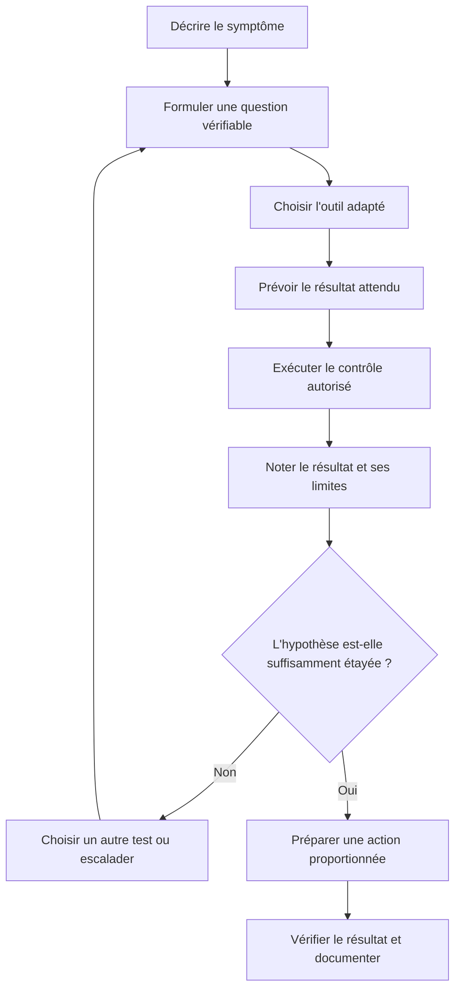
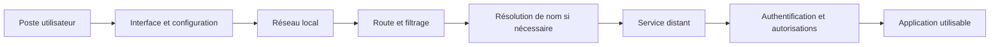

# Boîte à outils du technicien

> **Mise en contexte**
>
> Tu prends en charge un poste qui ne parvient plus à accéder à une application interne. L'utilisateur affirme que « le réseau est en panne », mais tu ne disposes encore d'aucune preuve permettant de confirmer cette explication. Tu dois décider quels outils utiliser, dans quel ordre et comment interpréter leurs résultats. Tu as accès à des commandes système, à des journaux, à des outils réseau et à un système de tickets, mais chaque outil ne montre qu'une partie de la situation.
>
> Le but n'est pas de mémoriser une longue liste de commandes. Il est d'apprendre à sélectionner l'outil adapté à la question posée, à comprendre les limites de la mesure, à éviter les manipulations risquées et à conserver des résultats utiles. Un bon technicien sait aussi reconnaître quand un outil ne permet pas de conclure et quand il faut demander une aide spécialisée.

## 1. Objectifs pédagogiques

À la fin de ce cours, tu devras être capable de :

- distinguer les grandes familles d'outils de maintenance ;
- choisir un outil en fonction d'une hypothèse de diagnostic ;
- recueillir des informations sans modifier inutilement le système ;
- utiliser quelques commandes courantes sous Windows et Linux ;
- réaliser les premiers contrôles réseau et interpréter leurs limites ;
- consulter les journaux et les informations système de façon méthodique ;
- utiliser les outils physiques de base en respectant les règles de sécurité ;
- choisir les outils d'inventaire, de ticketing, de sauvegarde et de supervision adaptés ;
- organiser les résultats dans une fiche de diagnostic ;
- distinguer un test, une preuve et une conclusion ;
- savoir quand arrêter une vérification et escalader.

## 2. Une boîte à outils ne remplace pas une méthode

Un technicien peut disposer de nombreux outils et pourtant perdre du temps s'il ne sait pas quelle question il cherche à résoudre. Avant chaque test, formule une question précise.

Exemples :

- Le poste possède-t-il une configuration IP cohérente avec le réseau attendu ?
- La destination répond-elle à une vérification de connectivité ?
- Le service local est-il démarré ?
- Un événement système a-t-il été enregistré à l'heure de l'incident ?
- Le problème concerne-t-il un seul utilisateur ou plusieurs personnes ?
- Le disque présente-t-il une alerte signalée par le système ?
- La dernière sauvegarde s'est-elle terminée et son résultat a-t-il été validé ?

Une commande n'est utile que si sa sortie aide à répondre à la question. Lancer de nombreux outils « pour voir » produit des informations difficiles à trier et peut augmenter les risques si certaines commandes modifient la configuration.

### 2.1. Les quatre catégories d'outils

On peut regrouper les outils de maintenance en quatre catégories principales.

| Catégorie | Fonction | Exemples |
|---|---|---|
| Observation | Montrer l'état d'un système | Gestionnaire des tâches, journaux, supervision |
| Mesure et test | Vérifier une propriété précise | Ping, test de câble, mesure de température |
| Intervention | Modifier ou rétablir le système | Gestion des services, outils d'installation, console d'administration |
| Traçabilité | Conserver l'historique | Ticketing, inventaire, rapport d'intervention |

Certains outils appartiennent à plusieurs catégories. Une console de gestion des services peut afficher l'état d'un service et permettre de le redémarrer. Il faut donc distinguer les actions d'observation des actions de modification.

### 2.2. Privilégier d'abord les contrôles sans modification

Dans la plupart des diagnostics, commence par collecter les symptômes, consulter les états et examiner les journaux accessibles. Une modification doit être justifiée par les résultats, les autorisations et l'évaluation du risque.

Cette règle n'est pas absolue : un incident majeur peut nécessiter une mesure de rétablissement rapide. Mais même dans ce cas, l'action doit suivre une procédure définie, être documentée et respecter les exigences de sécurité.

## 3. La démarche de choix d'un outil

Avant d'ouvrir une console ou de lancer une commande, suis cette démarche.

1. **Décrire le symptôme.** Qu'est-ce qui ne fonctionne pas, depuis quand et pour qui ?
2. **Formuler une question.** Quelle information manque pour comprendre le problème ?
3. **Choisir un outil adapté.** Utilise celui qui mesure réellement l'élément recherché.
4. **Prévoir le résultat.** Qu'attends-tu si ton hypothèse est correcte ? Que signifierait un résultat différent ?
5. **Exécuter le test autorisé.** Note l'équipement, l'heure, la commande et le résultat utile.
6. **Interpréter avec prudence.** Un résultat peut orienter le diagnostic sans prouver la cause.
7. **Décider de la suite.** Continuer avec un test discriminant, appliquer une correction autorisée ou escalader.

### 3.1. Diagramme du diagnostic guidé par une question



Ce diagramme rappelle qu'un test n'est pas une fin en soi. Il doit faire avancer le diagnostic. Si le résultat ne permet pas de trancher, il faut choisir une autre vérification plutôt que transformer une supposition en certitude.

## 4. Les outils physiques de base

Les outils physiques servent à examiner le matériel, à vérifier des connexions ou à effectuer une opération de maintenance. Ils doivent être choisis selon le composant, les instructions du fabricant et les compétences du technicien.

### 4.1. Tournevis et accessoires adaptés

Les vis peuvent avoir des formes et des tailles différentes. Un outil inadapté peut abîmer la tête d'une vis, endommager le boîtier ou faire glisser l'outil sur une carte électronique.

Avant d'ouvrir un équipement, vérifie les consignes du fabricant, les conditions de garantie et les procédures internes. Certaines opérations doivent être réalisées par un technicien habilité ou par un fournisseur agréé.

### 4.2. Protection contre les décharges électrostatiques

Une décharge électrostatique peut endommager certains composants sans être perceptible. Pour manipuler des cartes mémoire, des cartes d'extension ou d'autres composants sensibles, utilise les moyens antistatiques prévus par les procédures du matériel : poste adapté, bracelet antistatique correctement utilisé et emballage approprié.

Manipule les composants par leurs bords et évite de toucher inutilement les contacts. Ne pose pas une carte électronique sur une surface qui n'est pas prévue pour ce type de travail.

### 4.3. Testeur de câbles réseau

Un testeur de câble peut aider à repérer certaines erreurs de câblage, par exemple une continuité absente, une paire inversée ou un défaut détectable par le modèle utilisé. Les fonctions disponibles varient selon l'appareil.

Un testeur simple ne garantit pas que le lien réseau fonctionnera à la vitesse attendue dans toutes les conditions. Il faut vérifier ce que le modèle mesure réellement et ne pas conclure au-delà de ses capacités.

Avant de tester un câble, identifie ses deux extrémités et assure-toi qu'il peut être déconnecté sans interrompre un service critique. Étiquette les câbles lors d'une opération de baie afin d'éviter une déconnexion accidentelle.

### 4.4. Câble et adaptateur de référence

Un câble ou un adaptateur connu comme fonctionnel peut servir à effectuer une comparaison. Cette méthode est utile uniquement si le matériel de référence est compatible et si son fonctionnement a été vérifié.

Changer le câble puis observer une amélioration peut soutenir l'hypothèse d'un défaut de câble. Il reste toutefois important de noter précisément ce qui a été remplacé et de tester la connexion après l'opération.

### 4.5. Multimètre et mesures électriques

Le multimètre permet de mesurer certaines grandeurs électriques, mais son utilisation nécessite une formation et le choix correct du mode, des bornes et du calibre. Une mauvaise manipulation peut provoquer un choc électrique, un court-circuit ou détériorer l'appareil.

Un technicien débutant ne doit pas mesurer des circuits sous tension ni ouvrir une alimentation dangereuse sans formation et autorisation appropriées. Les opérations doivent respecter les règles de sécurité et les consignes du constructeur.

### 4.6. Nettoyage et environnement

Le nettoyage peut faire partie de la maintenance préventive, mais il doit être adapté au matériel. Il faut éviter les liquides, les produits non compatibles, les objets qui produisent de l'électricité statique et les méthodes susceptibles d'endommager les ventilateurs ou les connecteurs.

La poussière, la chaleur et une mauvaise ventilation peuvent contribuer à des problèmes matériels. Toutefois, la présence de poussière ne prouve pas à elle seule la cause d'une panne : il faut relier l'observation aux symptômes et aux tests disponibles.

## 5. Les outils d'observation du système

Les outils d'observation permettent de comprendre l'état d'un poste sans commencer par modifier sa configuration.

### 5.1. Gestionnaire des tâches sous Windows

Le Gestionnaire des tâches permet notamment de consulter l'utilisation du processeur, de la mémoire, du disque et du réseau, ainsi que certains processus actifs.

Il est utile lorsqu'un poste semble lent. Cependant, une valeur élevée ne suffit pas à prouver qu'un processus est la cause profonde du problème. Une consommation élevée peut être normale pendant une opération légitime ou être la conséquence d'un autre incident.

Méthode recommandée :

1. noter le moment et les circonstances du ralentissement ;
2. observer les ressources les plus sollicitées ;
3. repérer si le comportement est constant ou ponctuel ;
4. comparer avec les tâches réalisées par l'utilisateur ;
5. consulter d'autres informations si nécessaire ;
6. ne pas terminer un processus inconnu sans en comprendre le rôle et sans autorisation.

### 5.2. Moniteur de ressources

Le Moniteur de ressources de Windows fournit des informations plus détaillées sur l'activité du processeur, de la mémoire, du disque et du réseau. Il peut aider à observer des accès disque fréquents ou des échanges réseau associés à une application.

L'outil montre une activité, mais ne décide pas automatiquement si elle est anormale. Il faut prendre en compte le type de poste, les applications ouvertes et l'activité attendue.

### 5.3. Journaux d'événements Windows

Les journaux peuvent contenir des informations sur les erreurs système, les applications, les pilotes et certains services. L'Observateur d'événements permet de consulter les événements disponibles.

Un événement enregistré à la même heure qu'un incident peut fournir une piste utile. Il ne prouve pas toujours que l'événement a provoqué l'incident. Il faut examiner la description, la source, l'heure, la répétition et les événements voisins.

La commande PowerShell suivante affiche les vingt événements les plus récents du journal système :

```powershell
Get-WinEvent -LogName System -MaxEvents 20
```

Pour réduire le volume de données, on peut choisir une période ou un journal pertinent, mais les filtres doivent correspondre au problème recherché. Ne partage pas publiquement les journaux sans vérifier qu'ils ne contiennent pas de données confidentielles.

### 5.4. Journaux sous Linux

Sur un système Linux utilisant systemd, `journalctl` permet de consulter les journaux disponibles. Par exemple :

```bash
journalctl --since "30 minutes ago"
```

Pour consulter les événements associés à un service précis :

```bash
journalctl -u nom-du-service --since "30 minutes ago"
```

Remplace `nom-du-service` par le nom réel. Les permissions et la disponibilité des journaux dépendent de la configuration du système. Certains environnements Linux utilisent d'autres mécanismes de journalisation.

Cherche d'abord la période correspondant au symptôme. Une lecture ciblée est généralement plus utile que la collecte d'un fichier immense sans question précise.

### 5.5. Informations système

Les informations système permettent d'identifier le système d'exploitation, la mémoire disponible, le modèle de machine et certains composants. Ces informations aident à comparer un poste fonctionnel à un poste en difficulté.

Il faut toutefois respecter la confidentialité. Les numéros de série, noms de machines, noms de comptes, adresses et autres éléments d'inventaire ne doivent pas être publiés dans un espace non autorisé.

## 6. Les commandes de diagnostic Windows

Les commandes ci-dessous sont présentées pour un environnement de test ou une machine sur laquelle tu es autorisé à intervenir. Commence par les commandes d'observation et ne lance pas de commande de modification sans comprendre son effet.

### 6.1. Afficher la configuration IP

```powershell
ipconfig /all
```

Cette commande affiche notamment les interfaces, adresses IP, masques, passerelles et serveurs DNS configurés. Les champs présents dépendent de la machine et de la configuration réseau.

Utilise-la pour répondre à des questions comme :

- l'interface est-elle activée ?
- une adresse est-elle attribuée ?
- la passerelle attendue apparaît-elle ?
- quels serveurs DNS sont configurés ?

Une adresse présente ne garantit pas que toute la connectivité fonctionne. Il faut poursuivre avec des tests appropriés à la ressource concernée.

### 6.2. Tester la connectivité avec ping

```powershell
ping 192.168.1.1
```

L'adresse est un exemple : utilise une destination connue et pertinente dans l'environnement. `ping` envoie des requêtes ICMP lorsqu'elles sont permises et affiche les réponses reçues.

Une réponse indique qu'un échange ICMP a été possible vers la destination à ce moment-là. Elle ne prouve pas que tous les ports ou toutes les applications fonctionnent.

L'absence de réponse ne prouve pas non plus que la machine est hors service. Les requêtes peuvent être filtrées ou bloquées par la configuration réseau.

### 6.3. Examiner les routes

```powershell
route print
```

Cette commande affiche la table de routage. Elle aide à observer les chemins connus par le poste, sans démontrer à elle seule que chaque route peut être utilisée correctement.

Pour interpréter le résultat, il faut connaître le réseau attendu, la destination recherchée et les règles de l'environnement.

### 6.4. Examiner les connexions

```powershell
netstat -ano
```

Cette commande affiche des informations sur les connexions réseau, les ports à l'écoute et, selon le résultat, des identifiants de processus. Les détails varient suivant le système et l'état du réseau.

Un port à l'écoute ne signifie pas automatiquement qu'une application est accessible depuis le réseau. Un pare-feu, une interface d'écoute ou l'état applicatif peuvent encore empêcher l'accès.

### 6.5. Consulter les services

```powershell
Get-Service
```

Cette commande liste les services Windows et leur état. Pour examiner un service connu :

```powershell
Get-Service -Name spooler
```

Le service `spooler` est lié à la fonction d'impression dans Windows. Son état peut être une information utile lors d'un incident d'impression, sans constituer à lui seul un diagnostic complet.

Ne lance pas automatiquement une commande de redémarrage. Avant de modifier un service, vérifie son rôle, ses dépendances, l'impact sur les utilisateurs et les autorisations nécessaires.

### 6.6. Tester un nom de domaine ou de serveur

```powershell
nslookup exemple.local
```

`exemple.local` est un exemple fictif. Utilise le nom correspondant à ton environnement. `nslookup` interroge le système de résolution configuré afin d'obtenir des informations sur le nom recherché.

Un échec peut être dû au nom inexistant, au serveur de résolution, à la configuration ou à la nature du nom utilisé. Il faut comprendre l'environnement avant de conclure.

### 6.7. Tester un port TCP avec PowerShell

```powershell
Test-NetConnection serveur.exemple.local -Port 443
```

Le nom est un exemple et doit être remplacé par une destination autorisée. Cette commande aide à vérifier une tentative de connexion TCP vers le port demandé. Elle ne valide pas tout le fonctionnement de l'application ni la qualité de son service.

Si le test échoue, il faut envisager plusieurs causes : résolution de nom, routage, filtrage, service non à l'écoute ou destination incorrecte. Le résultat sert à guider le prochain contrôle.

### 6.8. Afficher les processus

```powershell
Get-Process
```

La commande affiche les processus visibles avec leurs informations disponibles. Elle peut être utile pour rechercher une consommation inhabituelle de ressources, mais elle ne remplace pas l'observation de la machine au moment précis où le symptôme se produit.

Évite de terminer un processus uniquement parce que son nom est inconnu ou qu'il consomme temporairement beaucoup de ressources.

## 7. Les commandes de diagnostic Linux

Les commandes suivantes sont courantes sur de nombreuses distributions Linux, mais les options disponibles peuvent varier. Utilise-les sur les machines autorisées et adapte les tests au système concerné.

### 7.1. Interfaces et adresses

```bash
ip address
```

Cette commande affiche les interfaces et les adresses configurées. Elle permet d'observer si une interface est présente et quelles adresses lui sont associées.

### 7.2. Table de routage

```bash
ip route
```

La table de routage aide à comprendre comment le système choisit une route vers une destination. Son interprétation demande de connaître l'adressage prévu et les routes attendues.

### 7.3. Connectivité

```bash
ping -c 4 192.168.1.1
```

Sur de nombreuses versions Linux, `-c 4` limite le test à quatre requêtes. L'adresse est illustrative. Les mêmes précautions s'appliquent que sous Windows : le résultat ne valide ni tous les ports ni toutes les fonctions du service.

### 7.4. État d'un service

Sur un système utilisant systemd :

```bash
systemctl status nom-du-service
```

La commande fournit l'état connu du service et parfois des informations récentes. Le nom doit être remplacé par un service réel.

Les commandes `systemctl start`, `stop` ou `restart` modifient l'état d'un service. Elles ne doivent pas être utilisées comme simples tests sur un système de production. Vérifie les autorisations et les conséquences avant toute action.

### 7.5. Espace disque

```bash
df -h
```

Cette commande présente l'utilisation des systèmes de fichiers montés, avec des valeurs lisibles. Une partition presque pleine peut expliquer certains problèmes, mais l'interprétation dépend de l'architecture, des quotas, des fichiers temporaires et des seuils définis.

### 7.6. Espace occupé par un répertoire

```bash
du -sh /var/log
```

Cette commande donne une estimation de l'espace occupé par le répertoire indiqué, selon les droits et les données accessibles. Le chemin est un exemple. Ne supprime pas de journaux simplement parce qu'ils occupent beaucoup d'espace : ils peuvent être nécessaires au diagnostic, à la sécurité ou à la conformité.

### 7.7. Processus

```bash
ps aux
```

Cette commande affiche des informations sur les processus. Les colonnes et leur interprétation peuvent varier légèrement selon le système. Pour étudier un processus, examine son rôle, sa durée de vie et sa consommation plutôt que d'utiliser un seul chiffre isolé.

## 8. Les outils de diagnostic réseau

Le diagnostic réseau consiste à déterminer où la communication échoue, sans supposer dès le départ que tout le réseau est indisponible.

### 8.1. Comprendre les étapes possibles

Une application peut dépendre de plusieurs éléments : la configuration du poste, le réseau local, le routage, la résolution de noms, les règles de sécurité, le service distant et les autorisations applicatives.



Ce schéma est une représentation simplifiée. L'ordre exact dépend de l'application, du protocole et de l'architecture. Son utilité est de rappeler qu'un échec visible dans l'application peut provenir de plusieurs couches.

### 8.2. Commencer par le périmètre

Demande si le problème concerne un utilisateur, plusieurs utilisateurs, un poste particulier, un bureau entier ou plusieurs sites. Compare ensuite les systèmes touchés et ceux qui fonctionnent.

Si un seul poste est concerné, examine d'abord les différences locales. Si plusieurs postes d'un même réseau sont touchés, étudie aussi les éléments partagés. Ce raisonnement oriente le diagnostic sans apporter, à lui seul, une preuve définitive.

### 8.3. Vérifier les paramètres locaux

Examine l'état de l'interface, l'adresse IP, le masque, la passerelle et les serveurs DNS configurés. Les résultats doivent être comparés à la configuration prévue pour cet environnement.

Une adresse qui commence par `169.254` sous certaines configurations IPv4 Windows peut signaler qu'une adresse automatique a été attribuée faute d'obtenir une configuration attendue. Ce signe doit être interprété dans son contexte : certaines architectures peuvent utiliser des configurations particulières.

Ne définis pas une adresse IP au hasard pour « faire revenir le réseau ». Une adresse incorrecte peut créer un conflit ou rendre inaccessible une autre ressource.

### 8.4. Utiliser ping avec discernement

Un contrôle vers la passerelle peut fournir un premier indice sur la communication avec le réseau local. Un test vers un autre équipement autorisé peut ensuite aider à comparer les résultats.

Si la passerelle répond mais que le serveur ne répond pas, la panne n'est pas nécessairement située sur le poste. Elle peut se trouver sur le chemin, au niveau de la destination ou dans une règle de filtrage.

Si aucun appareil ne répond, cela ne prouve pas que tous sont indisponibles : ils peuvent ignorer les requêtes ICMP. Il faut rechercher un test alternatif adapté, comme une connexion au port requis.

### 8.5. Résolution de noms

Les utilisateurs accèdent souvent aux applications par un nom plutôt que par une adresse IP. La résolution de noms transforme un nom en information exploitable par le client.

Si l'accès par nom échoue, mais qu'un test pertinent vers une adresse connue fonctionne, la résolution de noms peut être une piste à examiner. Toutefois, ce résultat doit être interprété selon le protocole et la configuration réelle.

N'utilise pas une adresse IP codée en dur comme correction durable sans analyser les dépendances : les services peuvent changer d'adresse et certaines applications s'appuient sur le nom, le certificat ou la configuration du serveur.

### 8.6. Ports et services

Une application peut dépendre d'un port spécifique. Le fait qu'un serveur réponde à un ping ne prouve pas que le port de l'application accepte les connexions.

Un test de port doit être effectué vers la destination et le port attendus, dans le respect des règles de sécurité. Il aide à vérifier la possibilité d'établir une connexion, mais il ne prouve pas que l'application traite correctement les demandes une fois la connexion établie.

### 8.7. Éviter les tests agressifs ou non autorisés

N'effectue pas de balayage de ports, de capture du trafic ou de test de charge sur un réseau de production sans autorisation explicite et cadre défini. Ces opérations peuvent exposer des données, déclencher des alertes ou perturber le service.

Le technicien débutant doit privilégier les contrôles approuvés et demander l'aide de l'équipe réseau lorsque des analyses plus avancées sont nécessaires.

## 9. Les outils de stockage et de matériel

Un problème de performance ou de disponibilité peut provenir du matériel, mais il ne faut pas le supposer sans preuve.

### 9.1. Espace disque et saturation

Un disque presque plein peut empêcher des applications de créer des fichiers temporaires, de mettre à jour des données ou de fonctionner normalement.

Sous Windows, l'Explorateur de fichiers ou les outils d'administration permettent d'observer l'espace disponible. Sous Linux, `df -h` fournit une vue générale des systèmes de fichiers.

Avant de supprimer des données, identifie leur rôle, vérifie la politique de conservation et privilégie les outils de nettoyage autorisés. Les fichiers journaux, fichiers temporaires et fichiers métier ne peuvent pas être traités de la même manière.

### 9.2. Santé d'un disque

Les outils du constructeur et les mécanismes de surveillance du système peuvent signaler certains problèmes de stockage. Les informations SMART, lorsqu'elles sont disponibles, peuvent fournir des indices sur l'état d'un disque.

Une valeur isolée ne permet pas toujours de prévoir une panne. Il faut examiner les alertes, les tendances, les erreurs d'entrée-sortie et les symptômes. Si des données importantes sont menacées, évite les tests qui sollicitent inutilement un support suspect et applique la procédure de protection des données.

### 9.3. Température et ventilation

Une température anormale, un ventilateur défaillant ou une obstruction peut entraîner une réduction de performance ou des arrêts de protection. Les moyens de mesure et les seuils varient selon le matériel.

Il faut comparer les mesures aux recommandations du constructeur et tenir compte de la charge. Ne démonte pas un équipement sous tension pour examiner un ventilateur sans procédure autorisée.

### 9.4. Gestionnaire de périphériques

Sous Windows, le Gestionnaire de périphériques présente les équipements détectés et certains problèmes de pilote ou d'état.

Un symbole d'erreur est une piste utile, pas nécessairement la cause complète. Vérifie le modèle, le pilote, les événements disponibles et les changements récents. Ne supprime pas un pilote ou un périphérique sans comprendre les conséquences et prévoir la méthode de réinstallation appropriée.

### 9.5. Remplacement par comparaison

Le remplacement temporaire par un composant de référence peut aider à isoler un défaut, mais seulement dans un environnement autorisé et contrôlé. Il faut s'assurer de la compatibilité, sauvegarder les données si nécessaire et noter les composants déplacés.

Après le test, vérifie le fonctionnement et remets en place ou identifie clairement les éléments selon le plan prévu. Un échange de pièces non tracé peut créer de la confusion lors d'une intervention future.

## 10. Outils de ticketing et d'inventaire

Les outils de maintenance ne se limitent pas aux commandes. Le ticketing et l'inventaire permettent de conserver la mémoire du service informatique.

### 10.1. Le système de tickets

Un ticket formalise une demande ou un incident. Il aide à attribuer le travail, à suivre l'évolution et à transmettre les informations entre intervenants.

Un ticket utile contient une description claire, l'impact, la priorité, l'équipement, les contrôles effectués, les actions réalisées, le statut et les prochaines étapes.

Les commentaires doivent rester factuels. Évite les formulations accusatrices, les informations confidentielles inutiles et les conclusions non confirmées.

### 10.2. Statuts et suivi

Les statuts varient selon l'outil, mais ils représentent généralement des étapes telles que : nouveau, en cours, en attente, escaladé, résolu ou clôturé.

Un ticket « en attente » doit indiquer ce qui manque et qui doit agir ensuite. Un ticket « résolu » doit s'appuyer sur les critères définis. La clôture peut suivre une confirmation utilisateur ou une règle de service.

Ne modifie pas le statut pour améliorer artificiellement les statistiques. Les rapports ne sont utiles que si les états enregistrés correspondent à la réalité.

### 10.3. L'inventaire informatique

L'inventaire décrit les équipements et éléments gérés : modèle, identifiant, emplacement, utilisateur ou service responsable, état, garantie et cycle de vie selon les règles de l'organisation.

L'inventaire aide à retrouver un équipement, préparer un remplacement, suivre les garanties et identifier les matériels anciens ou non supportés.

Les identifiants et numéros de série doivent être enregistrés dans les systèmes autorisés. Évite de les exposer dans des documents partagés publiquement.

### 10.4. Lier ticket et équipement

Associer un incident à l'équipement concerné facilite l'analyse des récurrences. Si un même poste fait l'objet de nombreux tickets, le service informatique peut rechercher une cause commune : matériel vieillissant, configuration particulière ou usage inadapté.

Cette analyse reste limitée par la qualité des données : des noms d'équipement incohérents ou des tickets sans identifiant rendent les tendances plus difficiles à exploiter.

## 11. Sauvegarde, supervision et outils de sécurité

### 11.1. Outils de sauvegarde

Un outil de sauvegarde planifie la copie des données et conserve des résultats d'exécution. Le technicien doit vérifier que le travail s'est terminé et examiner les avertissements, les éléments exclus et les échecs.

Selon les responsabilités de l'équipe, le technicien débutant peut consulter un rapport ou signaler une anomalie plutôt que déclencher lui-même une restauration. Une restauration peut remplacer des données et doit suivre une procédure adaptée.

### 11.2. Outils de supervision

La supervision collecte des informations sur la disponibilité, les performances et certains événements. Elle peut produire des alertes lorsque des seuils sont dépassés.

Une alerte doit être interprétée dans son contexte : gravité, durée, équipement, historique et conséquences métier. Une alerte isolée peut être transitoire, tandis que plusieurs signaux concordants peuvent nécessiter une intervention rapide.

Le technicien doit enregistrer les alertes pertinentes et éviter de simplement les acquitter sans en comprendre la raison selon les règles d'exploitation.

### 11.3. Outils de sécurité

Les organisations utilisent des antivirus ou outils de protection des postes, des pare-feu, des systèmes de journalisation et des solutions de gestion des accès.

Lorsqu'un comportement suspect apparaît, il faut respecter la procédure de sécurité. Ne désactive pas les protections pour faciliter un diagnostic et n'efface pas des traces susceptibles d'être nécessaires à l'analyse.

Si tu soupçonnes un incident de sécurité, limite tes actions aux procédures prévues et avertis l'équipe responsable. Une intervention bien intentionnée peut altérer les éléments nécessaires à l'investigation.

## 12. Organiser les résultats des tests

Les résultats collectés doivent permettre à une autre personne de comprendre ce qui a été fait et de reproduire, si nécessaire, le contrôle.

### 12.1. Une note de diagnostic efficace

Pour chaque test important, indique :

- la date et l'heure ;
- la machine ou le service concerné ;
- la question posée ;
- l'outil et la commande utilisés ;
- le résultat observé ;
- l'interprétation prudente ;
- la prochaine action.

Évite de copier des sorties énormes sans expliquer ce qu'il faut en retenir. Conserve les détails nécessaires dans l'espace approprié et protège les informations sensibles.

### 12.2. Séparer les faits et les conclusions

Exemple de fait : « `Test-NetConnection` n'a pas établi de connexion TCP vers le port attendu à 10 h 15. »

Exemple de conclusion excessive : « Le serveur est cassé. »

Exemple de conclusion prudente : « Le test de connexion TCP a échoué. Il faut vérifier la résolution du nom, la connectivité, le filtrage et l'état du service distant avant de localiser la cause. »

Cette différence est essentielle lorsqu'un dossier est transmis à une autre équipe.

### 12.3. Protéger les résultats

Les sorties de commandes peuvent révéler des noms de machines, adresses, utilisateurs, chemins, ports ou détails de configuration. Ne les publie pas dans un forum ou une conversation publique sans autorisation et sans vérification.

Dans un ticket, ne conserve que les données utiles à la résolution et respecte la politique de rétention de l'organisation.

## 13. Choisir le prochain test : exemples guidés

### Cas A : poste lent

**Symptôme :** le poste répond lentement au moment de l'ouverture d'une application.

**Premiers outils :** Gestionnaire des tâches, Moniteur de ressources, journaux pertinents et historique des changements connus.

**Questions :** le ralentissement concerne-t-il une seule application ? Une ressource est-elle durablement saturée ? Le phénomène est-il récent ? D'autres postes présentent-ils le même comportement ?

**Précaution :** ne termine pas arbitrairement les processus, ne désinstalle pas de programme et ne supprime pas des fichiers pour tenter d'accélérer le poste.

### Cas B : imprimante inaccessible

**Symptôme :** les travaux ne sortent plus.

**Premiers contrôles :** vérifier l'état physique de l'imprimante, le message d'erreur, le périmètre du problème et si d'autres utilisateurs peuvent imprimer.

**Outils possibles :** état de l'imprimante, file d'attente, outil de gestion des services, test réseau autorisé et journaux pertinents.

**Précaution :** si plusieurs personnes partagent la même imprimante, redémarrer un service ou vider une file peut affecter tous les utilisateurs. Vérifie les travaux en attente et applique la procédure prévue.

### Cas C : application inaccessible

**Symptôme :** l'application échoue à l'ouverture.

**Premiers contrôles :** message exact, nombre d'utilisateurs concernés, état de l'accès réseau et disponibilité du service selon les outils autorisés.

**Outils possibles :** `ipconfig /all`, `nslookup`, `Test-NetConnection`, journaux de l'application ou supervision, selon le contexte.

**Précaution :** un test réseau réussi ne prouve pas que l'authentification ou la logique applicative fonctionne.

### Cas D : alerte de stockage

**Symptôme :** un outil signale une anomalie de disque.

**Premiers contrôles :** vérifier le composant concerné, les messages exacts, l'impact et la criticité des données.

**Outils possibles :** outils du constructeur, alertes système, supervision et rapports de sauvegarde selon la procédure.

**Précaution :** si le support peut être défaillant, évite les opérations qui sollicitent inutilement le disque et demande rapidement l'aide de l'équipe compétente.

### Cas E : échec de sauvegarde

**Symptôme :** la tâche de sauvegarde signale une erreur.

**Premiers contrôles :** consulter le rapport, identifier la portée, déterminer si d'autres copies existent et vérifier les consignes de reprise.

**Précaution :** ne considère pas l'incident résolu sans preuve que la sauvegarde attendue est disponible ou qu'une mesure alternative est validée.

## 14. Erreurs fréquentes lors de l'utilisation des outils

### Erreur 1 : exécuter une commande sans question précise

**Conséquence :** une grande quantité d'informations apparaît sans aider à choisir l'action suivante.

**Correction :** note la question que le test doit éclairer avant de l'exécuter.

### Erreur 2 : confondre absence de réponse et absence de service

**Conséquence :** tu risques de localiser incorrectement l'incident.

**Correction :** vérifie les limites du protocole, les règles de filtrage et les autres dépendances.

### Erreur 3 : utiliser un outil de modification comme outil de test

**Conséquence :** tu peux provoquer une interruption ou masquer l'état initial.

**Correction :** commence par l'observation lorsque c'est possible et réserve les changements à une action préparée.

### Erreur 4 : collecter trop de données

**Conséquence :** le signal utile est noyé dans des informations sans rapport.

**Correction :** cible la période, le service et les événements pertinents ; conserve les éléments nécessaires à l'analyse.

### Erreur 5 : ignorer la confidentialité

**Conséquence :** des données d'infrastructure ou des informations personnelles peuvent être exposées.

**Correction :** protège les sorties, limite leur diffusion et respecte les règles internes.

### Erreur 6 : oublier l'état initial

**Conséquence :** il devient difficile de comparer avant et après l'intervention.

**Correction :** note la configuration pertinente et les résultats avant de modifier quoi que ce soit.

### Erreur 7 : interpréter un seul indicateur de manière absolue

**Conséquence :** une alerte passagère ou une mesure isolée peut conduire à une mauvaise conclusion.

**Correction :** compare plusieurs éléments, observe la tendance et replace les résultats dans leur contexte.

### Erreur 8 : ne pas noter l'outil et la commande utilisés

**Conséquence :** l'équipe suivante ne peut pas reproduire le test ni comprendre sa portée.

**Correction :** consigne la méthode et le résultat de chaque vérification importante.

## 15. Travaux pratiques

Les travaux pratiques doivent être réalisés sur une machine personnelle, une machine virtuelle ou un environnement de formation, sauf autorisation explicite pour un environnement professionnel. Les exercices ci-dessous privilégient l'observation et n'exigent pas de modifier la production.

### TP 1 — Créer une fiche d'observation Windows

**Objectif :** collecter les informations initiales d'un poste.

1. Ouvre PowerShell.
2. Lance `ipconfig /all`.
3. Note les interfaces visibles, l'adresse IP de l'interface active, la passerelle et les serveurs DNS lorsqu'ils sont configurés.
4. Lance `Get-Service` et repère le format de la sortie.
5. Consulte quelques événements récents du journal système avec `Get-WinEvent -LogName System -MaxEvents 20`.
6. N'enregistre que les éléments pertinents pour l'exercice.
7. Ajoute une colonne « interprétation » en prenant soin de distinguer ce qui est prouvé de ce qui reste à vérifier.

**Livrable :** une fiche contenant la question posée, l'outil, le résultat, la conclusion provisoire et la prochaine étape.

**Réussite :** tu n'as effectué aucune modification non nécessaire et tu peux expliquer la limite de chaque contrôle.

### TP 2 — Comparer deux postes

**Objectif :** apprendre à distinguer une différence pertinente d'une différence normale.

Dans un environnement autorisé, compare les informations réseau de deux postes similaires, dont l'un fonctionne et l'autre rencontre un problème simulé.

Examine les interfaces, adresses, passerelles, serveurs DNS et symptômes. Les adresses IP peuvent légitimement différer ; ne considère pas toute différence comme une anomalie.

**Questions à traiter :**

- Quelles différences sont attendues ?
- Quelles différences méritent une vérification ?
- Quel test supplémentaire permettrait de vérifier ton hypothèse ?
- Quelles conclusions ne peux-tu pas encore tirer ?

**Livrable :** un tableau comparatif avec des observations factuelles et une liste de contrôles complémentaires.

### TP 3 — Examiner un service sans le modifier

**Objectif :** consulter l'état d'un service et comprendre la différence entre observation et intervention.

Sur une machine de laboratoire, identifie un service non critique dont le rôle est connu. Consulte son état avec l'outil approprié. Ne l'arrête pas et ne le redémarre pas.

Rédige une note indiquant le nom du service, son état, la source d'information et ce que cet état permet ou ne permet pas de conclure.

**Livrable :** une courte fiche de diagnostic qui mentionne explicitement que seule une observation a été réalisée.

### TP 4 — Construire un tableau de choix d'outils

**Objectif :** sélectionner un outil pour chaque situation.

| Situation | Question à éclaircir | Outil initial possible | Limite à noter |
|---|---|---|---|
| Poste lent | Quelle ressource semble sollicitée ? | Gestionnaire des tâches | Un pic ponctuel n'explique pas nécessairement le problème |
| Accès par nom impossible | Le nom est-il résolu ? | `nslookup` | Le résultat dépend de la configuration et du nom utilisé |
| Espace disque faible | Quel système de fichiers est presque plein ? | Explorateur ou `df -h` | La suppression de données exige une analyse séparée |
| Application inaccessible | Le port attendu accepte-t-il une connexion ? | Test de port autorisé | Un port accessible ne valide pas toute l'application |
| Erreur système récente | Des événements sont-ils associés à l'heure de l'incident ? | Journaux système | Une corrélation temporelle ne prouve pas la causalité |

Complète le tableau avec trois autres situations de ton choix.

### TP 5 — Préparer une intervention sûre

**Objectif :** évaluer les risques avant un changement.

Scénario : un service partagé semble bloqué et un collègue propose de le redémarrer immédiatement.

Prépare une checklist qui indique :

- le service concerné et ses utilisateurs ;
- les éléments qui confirment le problème ;
- les dépendances connues ;
- l'autorisation nécessaire ;
- les conséquences possibles du redémarrage ;
- les personnes à informer ;
- le plan de vérification ;
- le plan de retour arrière ou d'escalade.

Tu n'as pas à redémarrer réellement le service pour réussir ce TP. L'objectif est de montrer que tu sais préparer une action plutôt que la déclencher au hasard.

## 16. Exercices avec corrections

### Exercice 1 — Associer une question à un outil

Associe chaque besoin à l'outil initial le plus pertinent.

1. Observer l'adresse IP et la passerelle configurées sous Windows.
2. Examiner les événements récents du journal système Windows.
3. Vérifier l'espace disponible sur les systèmes de fichiers Linux.
4. Observer l'état d'un service Windows.
5. Tester une connexion TCP vers un port précis depuis PowerShell.

Choix : `Get-Service`, `ipconfig /all`, `df -h`, `Get-WinEvent`, `Test-NetConnection`.

**Correction :**

1. `ipconfig /all` affiche la configuration IP.
2. `Get-WinEvent` permet de consulter les événements, avec un journal et un filtre adaptés.
3. `df -h` présente l'utilisation des systèmes de fichiers sous Linux.
4. `Get-Service` affiche l'état des services Windows.
5. `Test-NetConnection` permet notamment de tester une tentative de connexion TCP vers le port indiqué.

### Exercice 2 — Interpréter un ping

Le poste A reçoit une réponse à un ping vers une destination. Un utilisateur affirme alors que l'application distante doit fonctionner correctement. A-t-il raison ?

**Correction : non.** Le ping indique que des requêtes ICMP ont obtenu une réponse. Il ne valide pas les ports, l'authentification, les dépendances applicatives ni le traitement métier. Il faut tester les fonctions nécessaires avec des contrôles adaptés.

### Exercice 3 — Choisir entre observation et modification

Un service semble indisponible. Quelle démarche est la plus prudente au départ ?

A. Redémarrer tous les services de la machine.

B. Consulter l'état du service, les symptômes et les journaux accessibles avant de préparer une action.

C. Supprimer les fichiers journaux pour libérer de l'espace.

D. Désactiver le pare-feu sans vérifier la cause.

**Correction : B.** L'observation permet de collecter des indices sans provoquer une modification injustifiée. Toute action doit être préparée et autorisée.

### Exercice 4 — Un test TCP échoue

`Test-NetConnection serveur.exemple.local -Port 443` échoue. Peut-on affirmer que le serveur est matériellement défectueux ?

**Correction : non.** Plusieurs causes restent possibles : résolution du nom, connectivité, filtrage réseau, port non ouvert ou service non disponible. Le résultat indique l'échec de la connexion testée, pas nécessairement une défaillance matérielle.

### Exercice 5 — Examiner des journaux

Un événement apparaît à 10 h 15, au même moment qu'un incident. Quelle conclusion est correcte ?

**Correction :** l'événement est une piste pertinente à examiner. Il faut vérifier son contenu, sa source, le contexte, les événements voisins et sa relation avec le symptôme. La coïncidence temporelle ne prouve pas à elle seule la causalité.

### Exercice 6 — Choisir un outil physique

Un câble réseau semble défectueux. Quelle précaution prendre avant de le déconnecter pour le tester ?

**Correction :** identifier ses deux extrémités, vérifier qu'il ne dessert pas un service critique ou qu'une interruption est autorisée, et étiqueter le câble si nécessaire. Le testeur choisi doit être adapté au type de contrôle recherché.

### Exercice 7 — Interpréter une saturation disque

Une partition Linux est presque pleine selon `df -h`. Peut-on supprimer immédiatement les fichiers les plus volumineux ?

**Correction : non.** Il faut identifier les fichiers, leur rôle, les obligations de conservation et les procédures de nettoyage. La suppression de journaux ou de données applicatives peut créer un problème plus grave. Il faut d'abord déterminer ce qui occupe l'espace et choisir une action autorisée.

### Exercice 8 — Préparer une escalade

Tu as vérifié les paramètres locaux et effectué les tests réseau autorisés, mais l'application reste inaccessible. Les journaux applicatifs sont réservés à une équipe spécialisée. Que doit contenir l'escalade ?

**Correction :** le symptôme, l'heure, le périmètre, l'impact, les contrôles effectués, les résultats, les changements connus et la raison pour laquelle l'accès aux journaux applicatifs est nécessaire. Il faut préciser ce qui reste inconnu sans contourner les restrictions d'accès.

### Exercice 9 — Éviter les données inutiles

Tu copies plusieurs milliers de lignes d'un journal dans le ticket sans indiquer la période ni le message pertinent. Quel est le problème ?

**Correction :** le destinataire doit parcourir trop d'informations et ne sait pas ce qui a motivé leur collecte. Une note ciblée, avec période, source, événement utile et interprétation prudente, facilite le diagnostic. Les données sensibles doivent également être protégées.

### Exercice 10 — Distinguer preuve et conclusion

Le Gestionnaire des tâches montre une utilisation élevée du processeur pendant quelques secondes. Le technicien déclare que le processeur est défectueux. Pourquoi ce raisonnement est-il incorrect ?

**Correction :** une utilisation élevée peut être provoquée par une tâche normale ou une application sollicitée. Il faut examiner la durée, le processus, le contexte et les autres indices. La mesure prouve une activité élevée à un instant donné, pas une défaillance physique du processeur.

## 17. Défi final — Choisir les outils pour un diagnostic complet

### Situation

Dans une entreprise, une utilisatrice ne parvient plus à ouvrir une application interne depuis son poste Windows. Elle précise que le problème a commencé après une réunion du matin. Deux collègues affirment que l'application fonctionne depuis leurs postes. L'utilisatrice peut encore utiliser d'autres applications.

Tu as accès aux commandes d'observation du poste, aux journaux accessibles, au système de tickets et aux informations de contact de l'équipe applicative. Tu n'es pas autorisé à modifier le serveur ni à désactiver les protections de sécurité.

### Travail demandé

1. Décris le symptôme sans présumer de sa cause.
2. Établis les premières informations à recueillir.
3. Propose au moins cinq hypothèses distinctes.
4. Associe chaque hypothèse à un outil ou à un contrôle adapté.
5. Explique les limites des résultats de `ping` et de `Test-NetConnection`.
6. Indique les actions à éviter tant que le diagnostic n'est pas suffisamment avancé.
7. Précise à quel moment il faut escalader à l'équipe applicative.
8. Rédige une note de diagnostic courte et exploitable.

### Correction détaillée

**1. Symptôme**

« Depuis la réunion du matin, une utilisatrice ne parvient plus à ouvrir une application interne depuis son poste Windows. D'autres applications fonctionnent et deux collègues indiquent que l'application reste accessible depuis leurs postes. La cause n'est pas confirmée. »

**2. Informations à recueillir**

Il faut demander le message d'erreur exact, l'heure de début, les étapes pour reproduire le problème, le nom utilisé pour accéder à l'application, les changements intervenus sur le poste et le résultat obtenu avec le compte concerné. Il faut aussi vérifier si les collègues utilisent le même réseau et la même méthode d'accès.

**3. Hypothèses**

- configuration locale du poste ;
- problème de résolution de nom ;
- connectivité vers le service ;
- problème de navigateur ou de client ;
- authentification ou autorisation ;
- profil utilisateur ;
- incident propre à l'application pour certains comptes.

**4. Outils et contrôles**

- `ipconfig /all` pour observer la configuration locale ;
- `nslookup` pour examiner la résolution du nom ;
- `Test-NetConnection` vers le port attendu, si le nom, le port et le test sont autorisés ;
- les journaux locaux pertinents pour rechercher un événement temporel ;
- un essai contrôlé avec une autre méthode autorisée, si la procédure le permet ;
- le ticketing pour consigner les résultats et comparer le périmètre.

Chaque résultat doit être interprété avec prudence. Aucun de ces contrôles ne prouve à lui seul la cause complète de l'incident.

**5. Limites des tests réseau**

Le ping teste une communication ICMP et ne valide pas toutes les fonctions applicatives. `Test-NetConnection` permet de tester une connexion TCP vers un port précis, mais une réussite ne garantit pas que l'application s'authentifie correctement ou traite toutes les demandes.

**6. Actions à éviter**

Il faut éviter de modifier l'adresse IP au hasard, de supprimer des profils, de désactiver le pare-feu, de réinstaller le client sans diagnostic ou d'essayer de modifier le serveur. Toute modification doit respecter l'autorisation, le risque et la procédure.

**7. Escalade**

Si les vérifications locales et les tests autorisés n'expliquent pas la différence entre le poste concerné et les postes fonctionnels, le dossier peut être transmis à l'équipe applicative. L'escalade doit inclure les résultats exacts et les informations qui restent à obtenir.

**8. Exemple de note de diagnostic**

« L'utilisatrice ne peut plus ouvrir l'application interne depuis son poste Windows depuis la réunion du matin. D'autres applications fonctionnent et deux collègues indiquent que l'application reste accessible depuis leurs postes. Les contrôles de configuration, de résolution de nom, de connectivité et les journaux locaux sont à réaliser ou à documenter selon l'autorisation disponible. Aucune cause n'est confirmée. Si les contrôles locaux ne permettent pas d'expliquer le problème, transmettre à l'équipe applicative avec les résultats et le message d'erreur exact. »

### Barème indicatif

| Critère | Points |
|---|---:|
| Description factuelle | 2 |
| Collecte des informations | 2 |
| Hypothèses pertinentes | 4 |
| Choix des outils et limites | 4 |
| Gestion des risques | 2 |
| Escalade appropriée | 2 |
| Documentation claire | 4 |
| **Total** | **20** |

## 18. Synthèse du cours

La boîte à outils du technicien est composée d'outils physiques, de commandes système, de moyens de diagnostic réseau, de journaux, de solutions de ticketing, d'inventaire, de sauvegarde et de supervision.

La maîtrise de ces outils dépend de la méthode :

1. formuler une question précise avant de lancer un test ;
2. choisir l'outil qui mesure réellement l'élément recherché ;
3. privilégier les observations non intrusives lorsque cela est possible ;
4. comprendre les limites de chaque résultat ;
5. distinguer les faits des hypothèses et des causes confirmées ;
6. éviter les modifications non autorisées ;
7. protéger les données et les informations techniques ;
8. conserver des résultats ciblés et reproductibles ;
9. vérifier le besoin initial après toute correction ;
10. escalader lorsque les compétences, les droits ou les outils disponibles ne suffisent pas.

Le réflexe à adopter est simple : **une question précise, un outil adapté, un résultat interprété avec prudence et une trace exploitable.** Les outils ne remplacent pas le raisonnement ; ils l'aident à devenir plus rigoureux et plus reproductible.
