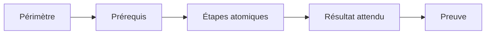
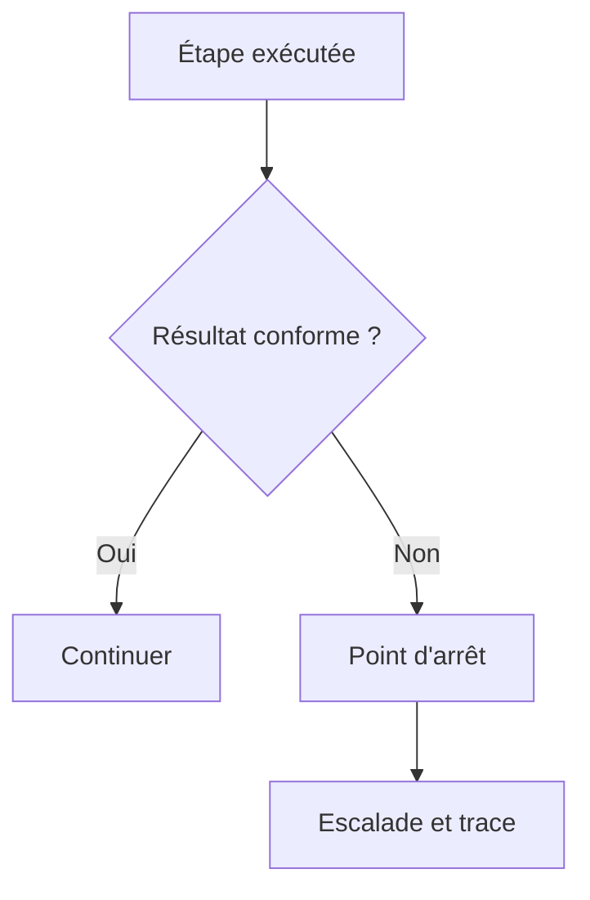
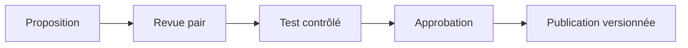
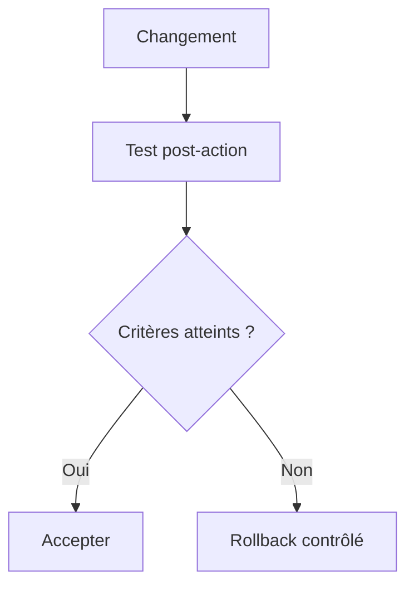
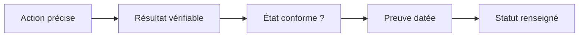
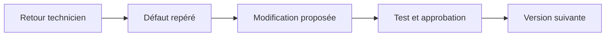

# Construire et maintenir des procédures d’intervention

> **Mise en contexte** — Ce cours s'adresse à un technicien intermédiaire qui doit agir dans un environnement réel, respecter les contraintes de service et laisser des preuves réutilisables. L'objectif n'est pas seulement de connaître les outils, mais de comprendre pourquoi une action est choisie, dans quelles conditions elle est sûre, comment vérifier son résultat et quand demander de l'aide.

## Présentation et enjeux

Une procédure technique transforme une connaissance parfois tacite en séquence reproductible, sûre et vérifiable. Elle doit guider un technicien dans un contexte réel : prérequis, autorisations, outils, étapes, points d'arrêt, validation, retour arrière et preuves à enregistrer. Cette discipline s'inscrit dans une démarche de qualité de service : chaque opération doit être reliée au besoin métier, au risque accepté et à un critère d'acceptation observable. L'intervenant doit pouvoir expliquer l'état initial, la décision prise, les résultats obtenus et les limites qui subsistent.

Dans une équipe de maintenance, les informations sont souvent réparties entre tickets, conversations, inventaires, systèmes de supervision et mémoire individuelle. Une méthode fiable les relie dans une trace commune et limite les décisions fondées sur une seule observation. Le cours met l'accent sur les preuves, les contrôles proportionnés, la reproductibilité et la communication utile.

Le niveau intermédiaire suppose que les gestes de base sont acquis. La difficulté consiste maintenant à traiter des environnements hétérogènes, des incidents ambigus, des changements qui touchent plusieurs composants et des situations où la donnée est imparfaite. Les règles présentées doivent être adaptées aux procédures approuvées de l'organisation et vérifiées dans un environnement de test avant toute action ayant un impact sur la production.

## Objectifs pédagogiques

À la fin du parcours, l'apprenant pourra :

- expliquer les principes et les limites des outils utilisés dans le domaine ;
- choisir un contrôle ou une méthode à partir de l'impact, de la criticité et des preuves disponibles ;
- effectuer une démarche reproductible et distinguer observation, hypothèse et décision ;
- interpréter les indicateurs sans confondre corrélation, résultat technique et expérience utilisateur ;
- rédiger une trace claire, traiter les exceptions et organiser une escalade ;
- vérifier l'effet d'une action, décrire le risque résiduel et proposer une amélioration mesurable.

## Prérequis et cadre de travail

Avant de commencer, savoir utiliser un terminal, lire les journaux, identifier un actif, comprendre les tickets et appliquer les règles locales de sécurité. Les commandes ci-dessous sont illustratives : adapter les noms d'hôte, les chemins et les versions, utiliser des cibles de test autorisées et ne jamais copier de secret dans un document. Une commande d'observation doit être préférée à une modification lorsqu'elle suffit à qualifier la situation.

Les principes directeurs sont les suivants : intervention autorisée, moindre privilège, sauvegarde ou retour arrière adaptés, fenêtre connue, communication compréhensible et preuve de validation. Si un contrôle critique échoue, ne pas continuer mécaniquement. Noter le constat, évaluer le risque et utiliser le point d'arrêt ou l'escalade défini par la procédure.

## Vocabulaire métier

| Terme | Utilisation opérationnelle |
|---|---|
| État initial | Description mesurée du système avant toute intervention. |
| Criticité | Conséquence potentielle de l'indisponibilité ou de la mauvaise configuration. |
| Preuve | Élément daté qui peut être vérifié par un autre intervenant. |
| Écart | Différence entre le résultat attendu et l'observation. |
| Exception | Situation où la procédure standard ne s'applique pas ou n'atteint pas son objectif. |
| Validation | Contrôle confirmant que le service ou l'opération satisfait les critères convenus. |
| Retour arrière | Séquence permettant de retrouver un état stable si les critères de réussite ne sont pas satisfaits. |
| Récurrence | Réapparition d'un problème similaire après un traitement précédent. |

## Schémas adaptés au sujet

### Schéma 1 — Structure d'une procédure



Une procédure fiable décrit les conditions d'entrée, chaque action et le contrôle qui autorise la poursuite.

### Schéma 2 — Gestion des exceptions



Un résultat inattendu doit conduire à un arrêt défini, pas à une improvisation silencieuse.

### Schéma 3 — Versionnement documentaire



La publication doit conserver l'auteur, l'approbation, le changement, la date d'entrée en vigueur et la version remplacée.

### Schéma 4 — Retour arrière



Le déclencheur du retour arrière et ses vérifications doivent être connus avant la fenêtre d'intervention.

### Schéma 5 — Checklist exploitable



Chaque case correspond à un contrôle réel ; la checklist doit rendre les écarts visibles et justifiables.

### Schéma 6 — Boucle de revue



Les difficultés rencontrées doivent améliorer la procédure de manière versionnée plutôt que produire des copies locales.

## Fondements techniques du domaine

### 1. Public et périmètre

**Définir le résultat avant de détailler les gestes.** « Traiter les postes lents » est trop large; « identifier les postes du lot pilote dont le démarrage dépasse le seuil approuvé, isoler la cause probable et consigner la décision » est vérifiable. Décrire les actifs concernés avec un identifiant d'inventaire ou un groupe maîtrisé, la population exclue, le service rendu et les dépendances. Une procédure de maintenance de parc ne doit pas être appliquée indistinctement à des postes utilisateurs, des serveurs critiques et des équipements réseau.

**Délimiter les responsabilités.** Nommer le rôle qui exécute, celui qui autorise les actions sensibles, la personne qui valide le service et le groupe à prévenir en cas d'impact. Une même personne peut cumuler des rôles dans une petite équipe, mais cette décision doit être explicite. Indiquer les limites de compétence et le canal d'escalade; ne pas transformer un guide en autorisation implicite de contourner une politique.

**Critère de sortie.** Un technicien qui découvre le document doit pouvoir répondre sans interprétation orale : « suis-je sur le bon actif, dans la bonne situation, avec la bonne autorisation, et quel résultat dois-je obtenir ? » Si la réponse reste ambiguë, le périmètre n'est pas prêt.
### 2. Prérequis vérifiables

**Transformer les prérequis en contrôles observables.** « Avoir une sauvegarde » ne suffit pas : préciser le périmètre sauvegardé, l'heure de la dernière exécution réussie, la rétention, l'emplacement et la preuve d'une restauration testée lorsque le risque l'exige. « Avoir les accès » doit signifier qu'un compte nominatif autorisé fonctionne, avec le niveau de privilège attendu, sans partager de mot de passe ni inclure de secret dans la procédure.

**Préparer les conditions de travail.** Confirmer la fenêtre de maintenance, la disponibilité d'un contact métier, les dépendances, les outils approuvés, la capacité de stockage ou d'alimentation nécessaire et le moyen de retour arrière. Pour un changement réseau, vérifier le chemin d'administration hors bande lorsqu'il est requis; pour un poste, vérifier que l'identifiant d'actif et le groupe de déploiement correspondent au ticket.

**Écrire la décision de blocage.** Pour chaque prérequis, documenter comment le contrôler et ce qui se passe s'il échoue. Une case cochée sans preuve n'est pas une validation. Si un élément obligatoire est inconnu, l'exécution doit rester en attente ou être escaladée; ne pas remplacer une information manquante par une hypothèse optimiste.
### 3. Étapes atomiques

**Une étape, une intention principale.** Séparer la collecte d'état, la décision, la modification et la vérification. Une instruction comme « sauvegarder, modifier le service, redémarrer puis confirmer » rend difficile le diagnostic si un sous-état échoue. Préférer une séquence numérotée avec l'action, la cible, le résultat attendu et la consigne en cas d'écart.

**Utiliser un vocabulaire opératoire.** Choisir des verbes précis : relever, comparer, exporter, désactiver, redémarrer, tester, joindre, approuver. Éviter « vérifier que tout est normal » sans définir le signal et le seuil. Les commandes doivent préciser le contexte d'exécution, l'identité de la cible et, si nécessaire, la version de l'outil. Une commande exemple doit être étiquetée comme exemple si elle varie selon le constructeur ou l'environnement; un placeholder ne doit jamais ressembler à une valeur de production valide.

**Rendre la reprise possible.** Insérer des points de sauvegarde ou des checkpoints après les étapes qui modifient l'état. Si une exécution s'interrompt, la checklist doit permettre de déterminer la dernière étape réellement terminée et les vérifications déjà effectuées. Une case ne doit être cochée qu'après observation du résultat attendu, pas à la simple lecture de l'instruction.
### 4. Points d'arrêt

**Associer chaque arrêt à une condition explicite.** Exemples : cible différente de celle du ticket, sauvegarde absente, fenêtre fermée, alerte critique apparue, perte du canal d'administration, échec d'un test pilote ou dépassement du délai de retour arrière. « Arrêter si nécessaire » laisse la décision au hasard; préciser le signal à observer et le rôle habilité à autoriser la reprise.

**Distinguer erreur récupérable et danger.** Une faute de saisie sans modification d'état peut autoriser une correction contrôlée. Une perte de connectivité, une corruption de données ou une dégradation sur plusieurs actifs exige un arrêt immédiat et une évaluation. L'opérateur ne doit pas multiplier les tentatives non documentées pour faire disparaître une alerte.

**Tracer l'exception.** Consigner l'heure, la cible, l'étape, le constat exact, les preuves, le risque, la personne contactée et la décision prise. La reprise doit avoir son propre critère : par exemple, accès rétabli, cible revalidée et accord enregistré. Si aucune action sûre n'est définie, l'issue correcte est une escalade, pas une improvisation.
### 5. Validation mesurable

**Comparer un état initial à un état final.** Un « succès » ne se limite pas à l'absence de message d'erreur. Avant l'action, relever les mesures qui seront comparées : disponibilité du service, version logicielle, état du lien, résultat d'un test fonctionnel, indicateurs de supervision, journaux pertinents ou retour du demandeur. Après l'action, refaire des tests équivalents dans un contexte comparable.

**Vérifier plusieurs dimensions.** Une intervention peut réussir techniquement et échouer pour l'utilisateur. Définir au moins le contrôle de fonctionnement, la non-régression des fonctions voisines et, selon le risque, la sécurité et la supervision. Préciser un seuil mesurable et une durée d'observation : un service qui répond une seule fois puis retombe n'est pas validé. Si une mesure dépend d'un cache, d'une réplication ou d'un délai de propagation, attendre la période prévue et expliquer cette limite.

**Rendre la décision auditable.** L'enregistrement final doit relier chaque critère à la preuve observée et à la personne qui accepte le résultat. Séparer « conforme », « non conforme » et « non testé »; ne jamais convertir l'absence de mesure en réussite. Les critères non satisfaits déclenchent la correction, le retour arrière ou l'escalade décrite par la procédure.
### 6. Retour arrière

**Préparer le retour avant la modification.** Définir l'état stable de référence, les données à préserver, les commandes ou étapes de restauration, les droits requis et le temps nécessaire. Une sauvegarde sans procédure de restauration ne garantit pas un retour maîtrisé. Le plan doit identifier ce qui sera restauré et ce qui ne doit surtout pas l'être, par exemple des données métier créées après le point de sauvegarde.

**Déclencher sur une règle connue.** Écrire les critères de décision avant l'intervention : perte d'un contrôle critique, échec du test fonctionnel, taux d'erreur supérieur au seuil, ou impossibilité de rétablir le service avant l'heure limite. Nommer qui prend la décision et qui coordonne la communication. Ne pas laisser un intervenant prolonger seul la fenêtre parce qu'il pense être proche de la résolution.

**Valider après retour.** Restaurer l'état antérieur ne clôt pas l'opération : vérifier l'accès, les fonctions essentielles, la supervision et l'absence d'effets secondaires. Enregistrer les différences qui subsistent, l'heure du retour, les tests réalisés et l'information transmise aux utilisateurs. Si le retour échoue, basculer vers le plan d'incident prévu au lieu de répéter des actions inconnues.
### 7. Version et revue

**Désigner une source faisant autorité.** Chaque procédure publiée possède un identifiant, un propriétaire, un numéro de version, un statut, une date d'effet et une date ou un déclencheur de revue. Les copies exportées ou jointes aux tickets doivent pointer vers cette version, et non devenir des documents concurrents. Une procédure retirée doit être clairement marquée comme obsolète et ne plus apparaître dans les résultats de recherche opérationnels.

**Relier la modification à un motif.** Un changement d'outil, d'architecture, de privilège, de constructeur, de seuil ou de dépendance peut invalider une étape. Enregistrer le motif, les sections affectées, le relecteur, les tests effectués et l'autorisation de publication. Pour un dépôt Git, examiner le diff et conserver l'historique; pour un outil documentaire, utiliser son mécanisme d'approbation et de versionnement.

**Planifier plusieurs niveaux de revue.** La revue périodique détecte les documents vieillissants; la revue événementielle est déclenchée par un incident, un écart, un changement d'infrastructure ou le retour d'un technicien. La date seule ne prouve pas que le contenu est toujours valide : la revue doit confirmer les actifs, captures, liens, commandes, permissions et critères de validation.
### 8. Ergonomie et lisibilité

**Écrire pour le moment où la procédure sera utilisée.** Un document consulté en pleine fenêtre de maintenance doit être scannable : titres orientés action, étapes courtes, avertissement juste avant l'action risquée, code copiable et résultat attendu immédiatement visible. Réserver les explications conceptuelles longues à une section séparée; conserver près de l'étape les informations nécessaires à la décision.

**Éviter la fatigue de checklist.** Regrouper les vérifications apparentées sans fusionner plusieurs décisions dans une case. Une liste trop longue de contrôles sans rapport augmente les coches automatiques; des cases « tout est bon » ne disent rien. Utiliser des contrôles proportionnés au risque, un ordre qui suit le déroulement réel et des points de pause clairement marqués.

**Tester la lisibilité par une autre personne.** Demander à un technicien qui n'a pas écrit le document d'exécuter une simulation sur un environnement autorisé. Noter les questions posées, les termes ambigus, les endroits où il doit revenir en arrière et le temps requis pour trouver une consigne. Toute ambiguïté rencontrée doit produire une correction documentée, pas seulement une explication orale au testeur.
## Méthode transversale pour une opération maîtrisée

### 1. Gouvernance

L'intervention doit être reliée à un objectif de service, un propriétaire et une décision explicite. Le contrôle de gouvernance n'a de valeur que s'il aide à identifier qui peut accepter le risque et qui doit être informé. Pour rédiger des procédures et checklists, cela signifie que la personne qui agit doit relier la règle à un élément concret : procédures révisées à temps, taux de réussite au premier passage, temps d'exécution, étapes sautées, retours arrière, incidents après intervention, taux de procédures avec propriétaire. Avant l'opération, noter l'état de départ et ce qui fera considérer le résultat comme acceptable. Pendant l'action, conserver le contexte des changements et indiquer immédiatement les écarts. Après l'action, exécuter le contrôle correspondant au risque, enregistrer le résultat et affecter les suites restantes. Cette discipline augmente la qualité de la passation et réduit la dépendance à une personne unique.

### 2. Cycle de vie

La solution doit être pensée depuis la préparation jusqu'à la sortie, y compris le maintien des compétences et le retrait des anciennes données. Une étape oubliée en fin de cycle transforme souvent une réussite ponctuelle en risque latent. Pour rédiger des procédures et checklists, cela signifie que la personne qui agit doit relier la règle à un élément concret : procédures révisées à temps, taux de réussite au premier passage, temps d'exécution, étapes sautées, retours arrière, incidents après intervention, taux de procédures avec propriétaire. Avant l'opération, noter l'état de départ et ce qui fera considérer le résultat comme acceptable. Pendant l'action, conserver le contexte des changements et indiquer immédiatement les écarts. Après l'action, exécuter le contrôle correspondant au risque, enregistrer le résultat et affecter les suites restantes. Cette discipline augmente la qualité de la passation et réduit la dépendance à une personne unique.

### 3. Qualité de données

Toute mesure dépend de la qualité de son périmètre, de l'horodatage, de l'unité et de la provenance. Il faut identifier les champs manquants et les conventions contradictoires avant de tirer une conclusion. Pour rédiger des procédures et checklists, cela signifie que la personne qui agit doit relier la règle à un élément concret : procédures révisées à temps, taux de réussite au premier passage, temps d'exécution, étapes sautées, retours arrière, incidents après intervention, taux de procédures avec propriétaire. Avant l'opération, noter l'état de départ et ce qui fera considérer le résultat comme acceptable. Pendant l'action, conserver le contexte des changements et indiquer immédiatement les écarts. Après l'action, exécuter le contrôle correspondant au risque, enregistrer le résultat et affecter les suites restantes. Cette discipline augmente la qualité de la passation et réduit la dépendance à une personne unique.

### 4. Gestion du risque

Le risque se juge par probabilité, impact, capacité de détection et marge de récupération. Les éléments critiques doivent recevoir plus de contrôles, sans imposer la même lourdeur aux opérations réversibles et aux changements irréversibles. Pour rédiger des procédures et checklists, cela signifie que la personne qui agit doit relier la règle à un élément concret : procédures révisées à temps, taux de réussite au premier passage, temps d'exécution, étapes sautées, retours arrière, incidents après intervention, taux de procédures avec propriétaire. Avant l'opération, noter l'état de départ et ce qui fera considérer le résultat comme acceptable. Pendant l'action, conserver le contexte des changements et indiquer immédiatement les écarts. Après l'action, exécuter le contrôle correspondant au risque, enregistrer le résultat et affecter les suites restantes. Cette discipline augmente la qualité de la passation et réduit la dépendance à une personne unique.

### 5. Communication

Une communication utile indique ce qui est connu, ce qui reste à vérifier, qui agit ensuite et quand une nouvelle information sera fournie. Les formulations doivent éviter les promesses non vérifiées. Pour rédiger des procédures et checklists, cela signifie que la personne qui agit doit relier la règle à un élément concret : procédures révisées à temps, taux de réussite au premier passage, temps d'exécution, étapes sautées, retours arrière, incidents après intervention, taux de procédures avec propriétaire. Avant l'opération, noter l'état de départ et ce qui fera considérer le résultat comme acceptable. Pendant l'action, conserver le contexte des changements et indiquer immédiatement les écarts. Après l'action, exécuter le contrôle correspondant au risque, enregistrer le résultat et affecter les suites restantes. Cette discipline augmente la qualité de la passation et réduit la dépendance à une personne unique.

### 6. Sécurité

Le périmètre technique doit rester limité aux systèmes autorisés, avec une identité traçable et les droits minimaux nécessaires. Les secrets doivent être protégés dans les fichiers, les journaux, les captures et les exports. Pour rédiger des procédures et checklists, cela signifie que la personne qui agit doit relier la règle à un élément concret : procédures révisées à temps, taux de réussite au premier passage, temps d'exécution, étapes sautées, retours arrière, incidents après intervention, taux de procédures avec propriétaire. Avant l'opération, noter l'état de départ et ce qui fera considérer le résultat comme acceptable. Pendant l'action, conserver le contexte des changements et indiquer immédiatement les écarts. Après l'action, exécuter le contrôle correspondant au risque, enregistrer le résultat et affecter les suites restantes. Cette discipline augmente la qualité de la passation et réduit la dépendance à une personne unique.

### 7. Traçabilité

Une action exploitable doit laisser un résultat vérifiable, un horodatage, un propriétaire et un lien avec le ticket ou le changement. La trace doit permettre à un autre technicien de comprendre ce qui a été fait. Pour rédiger des procédures et checklists, cela signifie que la personne qui agit doit relier la règle à un élément concret : procédures révisées à temps, taux de réussite au premier passage, temps d'exécution, étapes sautées, retours arrière, incidents après intervention, taux de procédures avec propriétaire. Avant l'opération, noter l'état de départ et ce qui fera considérer le résultat comme acceptable. Pendant l'action, conserver le contexte des changements et indiquer immédiatement les écarts. Après l'action, exécuter le contrôle correspondant au risque, enregistrer le résultat et affecter les suites restantes. Cette discipline augmente la qualité de la passation et réduit la dépendance à une personne unique.

### 8. Gestion des exceptions

Les cas hors procédure doivent être visibles et conduire à un point d'arrêt, une décision ou une escalade. Une exception récurrente est souvent le signal qu'il faut faire évoluer la procédure plutôt que la répéter. Pour rédiger des procédures et checklists, cela signifie que la personne qui agit doit relier la règle à un élément concret : procédures révisées à temps, taux de réussite au premier passage, temps d'exécution, étapes sautées, retours arrière, incidents après intervention, taux de procédures avec propriétaire. Avant l'opération, noter l'état de départ et ce qui fera considérer le résultat comme acceptable. Pendant l'action, conserver le contexte des changements et indiquer immédiatement les écarts. Après l'action, exécuter le contrôle correspondant au risque, enregistrer le résultat et affecter les suites restantes. Cette discipline augmente la qualité de la passation et réduit la dépendance à une personne unique.

### 9. Amélioration continue

Les incidents, les retours utilisateurs et les contrôles qualité doivent transformer les règles et procédures. Il faut vérifier si les modifications réduisent réellement le risque, et pas seulement si les documents ont été mis à jour. Pour rédiger des procédures et checklists, cela signifie que la personne qui agit doit relier la règle à un élément concret : procédures révisées à temps, taux de réussite au premier passage, temps d'exécution, étapes sautées, retours arrière, incidents après intervention, taux de procédures avec propriétaire. Avant l'opération, noter l'état de départ et ce qui fera considérer le résultat comme acceptable. Pendant l'action, conserver le contexte des changements et indiquer immédiatement les écarts. Après l'action, exécuter le contrôle correspondant au risque, enregistrer le résultat et affecter les suites restantes. Cette discipline augmente la qualité de la passation et réduit la dépendance à une personne unique.

### 10. Capacité

Les ressources, compétences, fenêtres et dépendances limitent le volume d'opérations réalisables. Une planification crédible tient compte de la charge, des temps de contrôle et des imprévus. Pour rédiger des procédures et checklists, cela signifie que la personne qui agit doit relier la règle à un élément concret : procédures révisées à temps, taux de réussite au premier passage, temps d'exécution, étapes sautées, retours arrière, incidents après intervention, taux de procédures avec propriétaire. Avant l'opération, noter l'état de départ et ce qui fera considérer le résultat comme acceptable. Pendant l'action, conserver le contexte des changements et indiquer immédiatement les écarts. Après l'action, exécuter le contrôle correspondant au risque, enregistrer le résultat et affecter les suites restantes. Cette discipline augmente la qualité de la passation et réduit la dépendance à une personne unique.

### 11. Contrôle du changement

Une modification nécessite un état initial connu, un périmètre, des critères de réussite et une solution de repli adaptée au risque. L'urgence ne supprime pas le besoin de garder une trace des décisions. Pour rédiger des procédures et checklists, cela signifie que la personne qui agit doit relier la règle à un élément concret : procédures révisées à temps, taux de réussite au premier passage, temps d'exécution, étapes sautées, retours arrière, incidents après intervention, taux de procédures avec propriétaire. Avant l'opération, noter l'état de départ et ce qui fera considérer le résultat comme acceptable. Pendant l'action, conserver le contexte des changements et indiquer immédiatement les écarts. Après l'action, exécuter le contrôle correspondant au risque, enregistrer le résultat et affecter les suites restantes. Cette discipline augmente la qualité de la passation et réduit la dépendance à une personne unique.

### 12. Mesure d'efficacité

Un indicateur ne vaut que si sa définition reste constante et si sa variation peut conduire à une décision. Les chiffres doivent être accompagnés d'une période, d'un périmètre et des limites de mesure. Pour rédiger des procédures et checklists, cela signifie que la personne qui agit doit relier la règle à un élément concret : procédures révisées à temps, taux de réussite au premier passage, temps d'exécution, étapes sautées, retours arrière, incidents après intervention, taux de procédures avec propriétaire. Avant l'opération, noter l'état de départ et ce qui fera considérer le résultat comme acceptable. Pendant l'action, conserver le contexte des changements et indiquer immédiatement les écarts. Après l'action, exécuter le contrôle correspondant au risque, enregistrer le résultat et affecter les suites restantes. Cette discipline augmente la qualité de la passation et réduit la dépendance à une personne unique.

### 13. Passation

Une tâche doit pouvoir être reprise par une autre personne sans dépendre des souvenirs du technicien présent. La transmission contient contexte, preuves, étapes déjà tentées et prochaine action. Pour rédiger des procédures et checklists, cela signifie que la personne qui agit doit relier la règle à un élément concret : procédures révisées à temps, taux de réussite au premier passage, temps d'exécution, étapes sautées, retours arrière, incidents après intervention, taux de procédures avec propriétaire. Avant l'opération, noter l'état de départ et ce qui fera considérer le résultat comme acceptable. Pendant l'action, conserver le contexte des changements et indiquer immédiatement les écarts. Après l'action, exécuter le contrôle correspondant au risque, enregistrer le résultat et affecter les suites restantes. Cette discipline augmente la qualité de la passation et réduit la dépendance à une personne unique.

### 14. Validation métier

Le résultat technique doit être confirmé du point de vue du service. Un équipement joignable ou un script qui termine sans erreur ne suffit pas si l'utilisateur ne peut pas accomplir son opération. Pour rédiger des procédures et checklists, cela signifie que la personne qui agit doit relier la règle à un élément concret : procédures révisées à temps, taux de réussite au premier passage, temps d'exécution, étapes sautées, retours arrière, incidents après intervention, taux de procédures avec propriétaire. Avant l'opération, noter l'état de départ et ce qui fera considérer le résultat comme acceptable. Pendant l'action, conserver le contexte des changements et indiquer immédiatement les écarts. Après l'action, exécuter le contrôle correspondant au risque, enregistrer le résultat et affecter les suites restantes. Cette discipline augmente la qualité de la passation et réduit la dépendance à une personne unique.

## Indicateurs : définition, lecture et limites

Les indicateurs les plus utiles pour ce domaine sont : **procédures révisées à temps, taux de réussite au premier passage, temps d'exécution, étapes sautées, retours arrière, incidents après intervention, taux de procédures avec propriétaire**. Chaque indicateur doit avoir une définition écrite. Il faut préciser l'unité, la source, le périmètre, la fréquence, la période et les exclusions. Lorsque les données ne couvrent qu'une partie de l'environnement, le rapport doit le signaler au lieu d'extrapoler silencieusement. Un indicateur doit permettre une décision : prioriser, déclencher une vérification, ajuster une capacité, revoir une procédure ou accepter explicitement un risque.

Un bon tableau de bord met en évidence la tendance et les écarts significatifs, sans supprimer la donnée de départ. Il distingue les valeurs brutes, les seuils, les anomalies confirmées et les périodes sans mesure. Une moyenne peut cacher des situations extrêmes ; il est donc souvent nécessaire d'observer la distribution, les percentiles, les valeurs maximales et la répartition par service ou par criticité. Les changements de définition doivent être versionnés pour éviter de comparer des séries qui ne signifient plus la même chose.

Les indicateurs ne doivent pas devenir des objectifs isolés. Par exemple, réduire le délai moyen n'est pas une amélioration si les tickets sont fermés avant validation et immédiatement rouverts. De même, atteindre un taux de conformité en excluant les actifs inconnus peut donner une image artificiellement favorable. Associer un KPI à un contrôle de qualité et à un résultat métier permet de repérer ces effets indésirables.

## Procédure opérationnelle recommandée

1. **Préparer.** Confirmer la demande, le périmètre, le propriétaire, l'autorisation et la fenêtre. Vérifier les dépendances, les sauvegardes et les accès nécessaires.
2. **Établir l'état initial.** Recueillir les mesures, l'état des services, les alertes, la dernière intervention et les écarts connus. Noter les éléments non vérifiables.
3. **Évaluer les risques.** Déterminer impact, probabilité, détectabilité, réversibilité et critère de report. Définir un point d'arrêt compréhensible.
4. **Exécuter par étapes.** Utiliser les outils approuvés, limiter le périmètre et vérifier les résultats intermédiaires avant de passer à l'étape suivante.
5. **Contrôler.** Comparer l'état final à l'état attendu et tester le service selon un scénario réaliste, pas uniquement le composant technique.
6. **Tracer.** Enregistrer les horaires, commandes ou actions, résultats, décisions et écarts dans le ticket ou le référentiel prévu.
7. **Communiquer.** Annoncer le résultat en termes compréhensibles, préciser les limites et indiquer qui gère les actions ouvertes.
8. **Améliorer.** Rechercher les étapes ambiguës ou les contrôles inefficaces et proposer une modification versionnée, testée et approuvée.

## Outils et contrôles pratiques

Les outils doivent être sélectionnés selon l'objectif, les droits et le type de preuve recherché. L'usage d'un outil connu ne dispense pas de contrôler son contexte : version, paramètres, cible, unité, état de connexion et limite de la mesure. base documentaire versionnée, tickets ITSM, modèles Markdown, diagrammes de flux, référentiel d'actifs, gestion de changements, revue par les pairs, dépôt Git constituent des exemples de technologies possibles ; leur choix exact dépend de l'environnement et des politiques internes.

| Contrôle | Question à poser | Trace à conserver |
|---|---|---|
| Identité de la cible | Est-ce bien l'actif ou le service autorisé ? | Identifiant, inventaire et horodatage. |
| État initial | Quelle condition de départ a été mesurée ? | Valeur, source, capture ou sortie. |
| Autorisation | Qui a approuvé l'action et pour quelle fenêtre ? | Ticket, validation et périmètre. |
| Résultat | Qu'est-ce qui démontre que le résultat est correct ? | Test de contrôle et résultat observé. |
| Écart | Que faire si le résultat attendu n'est pas obtenu ? | Point d'arrêt, escalade et action attribuée. |

### Commandes et exemples

Les commandes de cette section servent à illustrer la collecte de preuves. Remplacer les valeurs de test par des cibles autorisées et vérifier localement les options selon la distribution et la version de l'outil.

#### Exemple 1 — Afficher la version Git d'une procédure dans un dépôt local

```bash
git log -1 --oneline -- README.md
```

Interpréter la sortie avec le contexte de l'intervention. Un retour nul ne démontre pas toujours que la fonction métier est opérationnelle. Relever les erreurs, vérifier l'heure des journaux et comparer les observations avec une seconde source lorsque l'impact le justifie. Ne pas intégrer un résultat de terminal dans un rapport sans préciser la machine, la période et la commande effectivement exécutée.

#### Exemple 2 — Vérifier les modifications avant publication

```bash
git diff --check && git diff --stat
```

Interpréter la sortie avec le contexte de l'intervention. Un retour nul ne démontre pas toujours que la fonction métier est opérationnelle. Relever les erreurs, vérifier l'heure des journaux et comparer les observations avec une seconde source lorsque l'impact le justifie. Ne pas intégrer un résultat de terminal dans un rapport sans préciser la machine, la période et la commande effectivement exécutée.

#### Exemple 3 — Rechercher les occurrences d'une commande devenue obsolète

```bash
grep -RIn --exclude-dir=.git 'ancienne-commande' docs/
```

Interpréter la sortie avec le contexte de l'intervention. Un retour nul ne démontre pas toujours que la fonction métier est opérationnelle. Relever les erreurs, vérifier l'heure des journaux et comparer les observations avec une seconde source lorsque l'impact le justifie. Ne pas intégrer un résultat de terminal dans un rapport sans préciser la machine, la période et la commande effectivement exécutée.

#### Exemple 4 — Valider la syntaxe d'un fichier YAML avant diffusion

```bash
python -c "import yaml; yaml.safe_load(open('procedure.yml', encoding='utf-8'))"
```

Interpréter la sortie avec le contexte de l'intervention. Un retour nul ne démontre pas toujours que la fonction métier est opérationnelle. Relever les erreurs, vérifier l'heure des journaux et comparer les observations avec une seconde source lorsque l'impact le justifie. Ne pas intégrer un résultat de terminal dans un rapport sans préciser la machine, la période et la commande effectivement exécutée.


## Patrons opérationnels réutilisables

Les modèles ci-dessous servent de point de départ, pas de substitut aux règles internes. Avant publication, adapter les rôles, outils, seuils, durées de rétention, obligations de notification et exigences de sécurité au contexte réel. Supprimer les options qui ne s'appliquent pas plutôt que de laisser des instructions ambiguës. Un modèle doit aider à produire une décision cohérente, pas forcer toutes les opérations à suivre exactement le même niveau de lourdeur.

### Modèle de procédure prêt à adapter

Une procédure exploitable peut être organisée selon ce squelette. Le document publié doit identifier une source de référence unique et être lié au ticket ou à la demande de changement qui a motivé l'intervention.

~~~text
TITRE :
IDENTIFIANT / VERSION / STATUT :
PROPRIÉTAIRE / RELECTEUR / APPROBATEUR :
DATE D'EFFET / PROCHAINE REVUE :
OBJECTIF ET RÉSULTAT ATTENDU :
PÉRIMÈTRE / EXCLUSIONS :
RISQUES PRINCIPAUX :
AUTORISATION ET FENÊTRE :
PRÉREQUIS ET PREUVES ATTENDUES :
OUTILS / ACCÈS / DÉPENDANCES :
ÉTAT INITIAL À COLLECTER :
ÉTAPES (ACTION -> RÉSULTAT ATTENDU -> PREUVE) :
POINTS D'ARRÊT ET ESCALADE :
CRITÈRES D'ACCEPTATION :
RETOUR ARRIÈRE / HEURE LIMITE :
VÉRIFICATIONS APRÈS ACTION :
COMMUNICATION ET CLÔTURE :
INCIDENTS CONNUS / LIMITES :
HISTORIQUE DES MODIFICATIONS :
~~~

**Comment l'utiliser.** Si une rubrique n'est pas pertinente, indiquer « sans objet » avec une justification courte lorsqu'elle aide la revue. Ne pas laisser vide un champ qui conditionne la sécurité, comme l'autorisation, la cible, le point d'arrêt ou le retour arrière. Un lien vers un ticket ne remplace pas la reproduction des instructions de sécurité indispensables dans le document d'exécution.

### Modèle de checklist avec critères de preuve

Une checklist se compose de contrôles individuels qui appellent une réponse déterminée. La colonne « preuve » évite les validations à l'intuition; la colonne « si échec » donne une conduite immédiate au lieu de laisser le technicien inventer une suite.

| Phase | Contrôle | Critère observable | Preuve à associer | Si le contrôle échoue |
|---|---|---|---|---|
| Avant | Bonne cible | Identifiant égal à celui du ticket | Inventaire + ticket | Arrêter et faire confirmer la cible |
| Avant | Autorisation valide | Approbation présente et fenêtre ouverte | Référence de changement | Reporter l'opération |
| Avant | Retour possible | Sauvegarde restaurable et accès de secours testés si requis | Résultat de test ou état de préparation | Ne pas modifier l'état |
| Pendant | Étape précédente terminée | Résultat attendu constaté | Sortie, valeur ou journal horodaté | Pause, diagnostic et escalade selon le risque |
| Après | Service opérationnel | Tous les critères d'acceptation sont satisfaits | Résultats de tests avant/après | Corriger ou revenir à l'état stable |
| Après | Documentation clôturée | Résultat, écarts et suite enregistrés | Ticket mis à jour | Garder la demande ouverte |

**Règle de saisie.** La case indique que le contrôle a été exécuté, pas seulement lu. Lorsque le système utilisé prend en charge des champs structurés, conserver séparément l'opérateur, l'horodatage, la valeur mesurée et le statut. Éviter d'enregistrer des secrets, des données personnelles inutiles ou des captures contenant des informations hors périmètre.

### Cas fil rouge — changement contrôlé d'un port d'accès réseau

Une équipe doit modifier le VLAN d'un port d'accès utilisé par un poste d'administration. Le ticket mentionne le commutateur, le port et le VLAN cible, mais l'inventaire présente un nom d'hôte proche pour un autre équipement. La procédure doit empêcher une modification de la mauvaise cible avant même de proposer une commande.

~~~mermaid
flowchart TD
    A[Demande approuvée] --> B{Identité commutateur et port confirmée ?}
    B -- Non --> C[Arrêt et correction du ticket]
    B -- Oui --> D[Collecter état initial et configuration]
    D --> E{Sauvegarde et accès de secours disponibles ?}
    E -- Non --> C
    E -- Oui --> F[Appliquer la modification approuvée]
    F --> G[Tester lien, adressage et service métier]
    G --> H{Tous les critères sont satisfaits ?}
    H -- Oui --> I[Enregistrer les preuves et clôturer]
    H -- Non --> J{Retour arrière encore sûr et dans le délai ?}
    J -- Oui --> K[Restaurer l'état initial puis recontrôler]
    J -- Non --> L[Déclencher la procédure d'incident]
~~~

**Phase 1 — préparer.** Confirmer le ticket, l'interface réelle, la description du port, l'identifiant d'actif du terminal, la fonction métier et les dépendances. Relever l'état du port, le VLAN actuel, l'état du lien, la configuration pertinente et les résultats de tests de référence. Exporter la configuration selon la méthode validée par l'équipe; ne pas se contenter d'une capture d'écran incomplète.

**Phase 2 — protéger.** Vérifier la fenêtre approuvée, prévenir le demandeur, confirmer le canal d'administration et définir l'heure limite de décision. Vérifier que l'ancien paramétrage peut être restauré et que l'opérateur sait comment procéder sur cette version du système. Si l'accès d'administration passe lui-même par le port modifié, utiliser un chemin de gestion approuvé ou arrêter l'opération : une procédure qui détruit son propre moyen de contrôle n'est pas acceptable.

**Phase 3 — exécuter.** Ouvrir une étape pour la modification et une autre pour sa vérification. Les commandes ci-dessous sont des exemples de contrôles de type Cisco; leur syntaxe et leur disponibilité dépendent du modèle, de la version et des règles de l'entreprise. Elles ne constituent pas une configuration complète à copier sur un équipement de production.

~~~text
show interfaces Gi1/0/12 status
show interfaces Gi1/0/12 switchport
show running-config interface Gi1/0/12
show vlan brief
~~~

Comparer les résultats à l'état attendu. Appliquer uniquement la modification explicitement approuvée via la procédure propre à la plateforme. Éviter les changements additionnels « tant qu'on y est » et ne jamais enregistrer durablement une configuration tant que la politique interne ne le permet pas.

**Phase 4 — prouver.** Vérifier que l'interface a le bon mode, que le VLAN attendu est actif, que le terminal obtient un adressage adapté et que les services autorisés fonctionnent. Une interface « up » ne démontre pas à elle seule que le poste peut joindre sa passerelle ou l'application. Exécuter des tests limités et autorisés, comparer les résultats avant/après et prendre en compte les dépendances telles que DHCP, DNS, NAC, port-security ou filtrage.

**Phase 5 — décider.** Si l'identité de la cible était douteuse, l'accès tombe, le test fonctionnel échoue ou l'impact dépasse le périmètre, arrêter et suivre la règle convenue. Si le retour arrière est engagé, restaurer le paramétrage sauvegardé et vérifier à nouveau l'état du lien ainsi que le service. Enregistrer le résultat réel même si l'opération échoue : une intervention arrêtée à temps est préférable à un succès déclaré sans preuve.

### Préparation d'une maintenance de parc par vagues

Sur un parc de plusieurs centaines de postes, exécuter une même action partout en une seule fois augmente le rayon d'impact. Préférer un lot pilote représentatif, puis des vagues proportionnées à la capacité de support et au niveau de risque. La procédure doit spécifier le nombre ou le pourcentage de machines par vague, la fenêtre de surveillance et les critères d'arrêt; ces valeurs doivent être calculées et approuvées dans le contexte réel, pas reprises aveuglément d'un exemple pédagogique.

~~~mermaid
flowchart LR
    A[Inventaire et segmentation] --> B[Lot pilote représentatif]
    B --> C{Taux de réussite et incidents acceptables ?}
    C -- Non --> D[Arrêter, isoler la cause, corriger la procédure]
    D --> B
    C -- Oui --> E[Valider le passage à la vague suivante]
    E --> F[Déploiement progressif]
    F --> G[Surveillance et échantillonnage]
    G --> H{Seuils toujours respectés ?}
    H -- Non --> I[Pause des vagues et plan de retour]
    H -- Oui --> J[Clôture et mise à jour du parc]
~~~

Avant chaque vague, comparer la liste cible à l'inventaire réel et exclure les appareils hors ligne, en prêt, en réparation ou affectés à une fonction critique non couverte. Mesurer le succès sur le nombre d'actifs réellement traités, pas sur le nombre de tâches envoyées par l'outil. Prévoir les machines qui échouent, les redémarrages différés, les utilisateurs absents et les postes qui reviennent en ligne après la fenêtre.

Un lot pilote n'est pas un simple échantillon des postes les plus faciles. Il doit couvrir des profils représentatifs : modèles matériels, versions de système, groupes de sécurité, bureaux distants et applications métier différentes. Consigner les exceptions pour que les exclusions ne disparaissent pas du suivi. Si la première vague révèle une lacune documentaire, suspendre la progression, corriger la procédure, la faire relire et rejouer le scénario de validation avant de reprendre.

~~~mermaid
flowchart TD
    A[Préparer la vague] --> B[Contrôler actifs et exclusions]
    B --> C[Exécuter selon la procédure publiée]
    C --> D[Comparer résultats observés aux seuils]
    D --> E{Écart ou actif non maîtrisé ?}
    E -- Oui --> F[Arrêter la vague et ouvrir une exception]
    E -- Non --> G[Archiver les preuves]
    F --> H[Revue et nouvelle version si besoin]
    G --> I[Autoriser la vague suivante]
    H --> I
~~~

### Gérer un écart sans dégrader la traçabilité

Quand la réalité ne correspond pas à la procédure, ne pas corriger silencieusement le document pendant l'exécution. Séparer quatre objets : le fait observé, l'hypothèse qui peut l'expliquer, la décision temporaire et la correction définitive. Le technicien peut être autorisé à prendre une mesure de protection immédiate; il ne peut pas pour autant transformer cette action ponctuelle en nouvelle méthode de référence sans revue.

Un enregistrement d'écart utile contient :
- l'identifiant du document et sa version exacte;
- l'étape et le contexte où l'écart a été découvert;
- les valeurs observées, l'heure et la preuve;
- l'effet sur le service, les actifs touchés et le risque résiduel;
- la décision immédiate, son approbateur et les personnes informées;
- la cause confirmée ou encore hypothétique;
- l'action corrective, son responsable, son échéance et le test de non-régression.

~~~mermaid
flowchart LR
    A[Écart constaté] --> B[Protéger le service]
    B --> C[Enregistrer les faits]
    C --> D[Analyser la cause]
    D --> E[Proposer une correction]
    E --> F[Revue et approbation]
    F --> G[Test en environnement adapté]
    G --> H{Résultat acceptable ?}
    H -- Non --> D
    H -- Oui --> I[Publier une version contrôlée]
    I --> J[Informer les utilisateurs et retirer l'ancien document]
~~~

Le suivi d'un écart ne doit pas être confondu avec une analyse de cause racine complète. Une erreur isolée peut être corrigée par une clarification; des écarts récurrents peuvent indiquer une procédure mal conçue, un outil instable, une formation insuffisante, un contrôle impossible à réaliser ou une capacité de travail trop faible. Choisir la profondeur de l'analyse en fonction de la gravité, de la répétition et du risque, puis vérifier si la correction diminue réellement la récurrence.

### Contrôle de publication : document-as-code et revue par les pairs

Le versionnement d'une procédure dans un dépôt aide à comparer les changements et à retrouver une version connue. Il ne remplace ni l'approbation métier, ni les tests, ni la maîtrise des accès. Le dépôt doit éviter les secrets, limiter les droits d'écriture et désigner la branche ou le canal qui porte la version publiée.

~~~mermaid
flowchart TD
    A[Ticket ou retour terrain] --> B[Créer une branche de travail]
    B --> C[Modifier et documenter le motif]
    C --> D[Relecture par une autre personne]
    D --> E{Étapes et contrôles testés ?}
    E -- Non --> C
    E -- Oui --> F[Approbation selon le risque]
    F --> G[Publication versionnée]
    G --> H[Informer les équipes]
    H --> I[Archiver ou marquer l'ancienne version obsolète]
~~~

Sur un poste de travail où Git est installé, les vérifications suivantes permettent d'identifier certaines erreurs documentaires avant la revue. Elles ne prouvent pas que la procédure est sûre; elles détectent des problèmes de forme et rendent le diff plus lisible.

~~~bash
git status --short
git diff --check
git diff -- docs/procedures/
~~~

Examiner le contenu du diff, pas seulement le code de retour de la commande. Vérifier les liens, les exemples, les sorties attendues, la cohérence des seuils et les instructions retirées. Pour une modification à risque, tester le déroulement dans un laboratoire ou un environnement pilote et joindre la preuve pertinente au ticket de changement. Après publication, confirmer que le lien du catalogue documentaire ouvre bien la version approuvée.

### Revue périodique fondée sur le risque

Une échéance uniforme ne suffit pas : une instruction de redémarrage d'un service critique mérite plus d'attention qu'une fiche de vocabulaire. Classer les procédures selon l'impact d'une erreur, la fréquence d'usage, la vitesse d'évolution de l'environnement, la difficulté du retour arrière et le nombre de personnes qui s'en servent. Une revue événementielle est immédiate lorsqu'un incident révèle une étape dangereuse, qu'une interface change ou qu'un outil retire une option utilisée par la procédure.

~~~mermaid
flowchart TD
    A[Liste des procédures] --> B[Évaluer impact et fréquence]
    B --> C[Classer les priorités de revue]
    C --> D[Contrôler réalité technique et liens]
    D --> E[Simulation par un non-auteur]
    E --> F{Ambiguïté ou écart ?}
    F -- Oui --> G[Corriger, versionner et retester]
    F -- Non --> H[Enregistrer la revue]
    G --> H
    H --> I[Planifier la prochaine revue]
~~~

La preuve de revue peut être simple mais doit être réelle : date, personne, version examinée, résultats du contrôle, défauts découverts et décision. « Relu » sans critère ni résultat ne permet pas de savoir si les étapes ont été vérifiées. Un document peut être reconduit à l'identique si le système est stable et les essais restent valides; la reconduction doit néanmoins être justifiée.

### Références et repères pour approfondir

- **ISO 10013:2021 — Informations documentées.** Guide pour développer et maintenir l'information documentée adaptée au système de management de l'organisation. Il donne un repère pour penser le cycle de vie des documents, mais ne remplace pas les exigences spécifiques de l'entreprise. [Page officielle de l'ISO](https://www.iso.org/fr/standard/75736.html).
- **NIST SP 800-128 — Security-Focused Configuration Management.** Guide de gestion de configuration avec un accent sur la sécurité. Les thèmes utiles au technicien comprennent l'analyse d'impact, les changements contrôlés, les tests, l'approbation, la mise en œuvre et la vérification après modification. [Publication du NIST](https://www.nist.gov/publications/guide-security-focused-configuration-management-information-systems-0).
- **Consignes internes de changement et d'incident.** Elles définissent les rôles, les niveaux d'approbation, les fenêtres, les délais et les canaux d'escalade applicables dans l'organisation. En cas de différence, suivre la politique interne approuvée et faire corriger le support pédagogique pour qu'il reste cohérent.

Ces références sont des points de départ. Ne pas prétendre qu'une procédure est « conforme à une norme » simplement parce qu'elle contient quelques rubriques : la conformité dépend du référentiel complet, du périmètre et de son application démontrable.

## Atelier pratique guidé

### Situation de départ

L'équipe reçoit une demande concernant rédiger des procédures et checklists. Le contexte est incomplet : l'utilisateur décrit un symptôme, une mesure semble inhabituelle et une intervention antérieure est mentionnée sans détail. Le travail consiste à produire une réponse reproductible, sans prendre de risque inutile et sans annoncer une conclusion que les preuves ne soutiennent pas.

### Phase A — Qualification

Créer ou mettre à jour le ticket ; identifier le service, les utilisateurs concernés, le propriétaire technique, la période et les changements récents. Réunir les journaux et les mesures disponibles. Séparer les faits confirmés des déclarations de l'utilisateur. Déterminer si le problème est en cours, intermittent ou résolu, et préciser ce qui manque encore. Définir l'impact selon les critères de service et la priorité de traitement. Si la cible n'est pas certaine, valider son identité par l'inventaire avant d'exécuter la moindre action.

### Phase B — Hypothèses et tests

Formuler au moins deux hypothèses concurrentes. Pour chacune, préciser le signal qui devrait être observé si elle est vraie, le signal qui permettrait de la rejeter et le coût du test. Commencer par les contrôles en lecture seule, puis ne réaliser une modification que si elle est autorisée et nécessaire. Garder les résultats qui contredisent l'hypothèse initiale ; ils évitent de persister sur la mauvaise piste. Si les tests se contredisent, vérifier l'horloge, la version des données, la portée du contrôle et la possibilité d'une panne intermittente.

### Phase C — Action contrôlée

Choisir une action proportionnée au risque et limitée au périmètre identifié. Avant de modifier, noter l'état initial, confirmer la sauvegarde ou le retour arrière adapté et prévenir les personnes concernées. Exécuter une seule modification majeure à la fois lorsque cela permet d'isoler son effet. Si un point d'arrêt est atteint, conserver les preuves et contacter le niveau compétent plutôt que contourner la règle. Après l'action, répéter le test initial et vérifier le service par une transaction ou un parcours représentatif.

### Phase D — Validation et restitution

Comparer le résultat aux critères d'acceptation. Décrire ce qui a changé, ce qui a été vérifié, ce qui reste incertain et les actions ouvertes. La restitution doit être compréhensible pour un utilisateur non spécialiste et suffisamment technique pour un collègue qui reprendrait le dossier. Associer chaque action à un responsable et une échéance. Lorsque la procédure a été difficile à appliquer, signaler précisément la phrase, le champ ou le contrôle à améliorer.

## Études de cas

### Cas 1 — Procédure d'accès distant

**Situation.** Des techniciens se connectent aux équipements réseau pour un diagnostic urgent. Le service doit être préservé et les actions doivent rester explicables. La première réaction ne doit pas consister à redémarrer ou modifier au hasard : il faut d'abord vérifier le périmètre, l'heure, l'état initial et les changements concomitants.

**Analyse.** Définir approbation, identité nominative, bastion, périmètre, commandes en lecture seule, trace attendue et critères d'arrêt. Consigner les observations qui distinguent les hypothèses, puis rechercher les dépendances susceptibles de produire le même symptôme. Si une source de donnée est absente, l'indiquer et prévoir un moyen de la récupérer pour une prochaine occurrence. Vérifier aussi l'effet sur les autres services et le risque que l'action proposée crée une interruption plus large que le problème initial.

**Décision et preuve.** Faire tester le document par un pair qui ne l'a pas rédigé et noter les ambiguïtés rencontrées. La conclusion doit préciser le niveau de confiance et les contrôles qui ont été effectués après l'action. Si la cause n'est pas démontrée, préférer une formule prudente et assigner l'investigation complémentaire plutôt que fermer le dossier sur une supposition.

### Cas 2 — Checklist de maintenance mensuelle

**Situation.** Des contrôles réguliers sont effectués par plusieurs techniciens selon des habitudes différentes. Le service doit être préservé et les actions doivent rester explicables. La première réaction ne doit pas consister à redémarrer ou modifier au hasard : il faut d'abord vérifier le périmètre, l'heure, l'état initial et les changements concomitants.

**Analyse.** Transformer les habitudes en points vérifiables, préciser les seuils, distinguer conforme/non conforme/non applicable et rendre obligatoires les anomalies découvertes. Consigner les observations qui distinguent les hypothèses, puis rechercher les dépendances susceptibles de produire le même symptôme. Si une source de donnée est absente, l'indiquer et prévoir un moyen de la récupérer pour une prochaine occurrence. Vérifier aussi l'effet sur les autres services et le risque que l'action proposée crée une interruption plus large que le problème initial.

**Décision et preuve.** Comparer les résultats de deux techniciens sur le même équipement et corriger toute interprétation divergente. La conclusion doit préciser le niveau de confiance et les contrôles qui ont été effectués après l'action. Si la cause n'est pas démontrée, préférer une formule prudente et assigner l'investigation complémentaire plutôt que fermer le dossier sur une supposition.

### Cas 3 — Procédure devenue obsolète

**Situation.** Une mise à jour logicielle modifie le nom d'un service et rend la commande de redémarrage erronée. Le service doit être préservé et les actions doivent rester explicables. La première réaction ne doit pas consister à redémarrer ou modifier au hasard : il faut d'abord vérifier le périmètre, l'heure, l'état initial et les changements concomitants.

**Analyse.** Retirer le document du statut actif, vérifier la bonne commande dans un environnement de test puis publier une nouvelle version approuvée. Consigner les observations qui distinguent les hypothèses, puis rechercher les dépendances susceptibles de produire le même symptôme. Si une source de donnée est absente, l'indiquer et prévoir un moyen de la récupérer pour une prochaine occurrence. Vérifier aussi l'effet sur les autres services et le risque que l'action proposée crée une interruption plus large que le problème initial.

**Décision et preuve.** Informer les équipes, archiver la version précédente et tracer la date d'entrée en vigueur. La conclusion doit préciser le niveau de confiance et les contrôles qui ont été effectués après l'action. Si la cause n'est pas démontrée, préférer une formule prudente et assigner l'investigation complémentaire plutôt que fermer le dossier sur une supposition.

## Exercices d'application avec corrigés

### Exercice 1 — Définir le périmètre

**Question.** Une demande décrit un problème sans identifier clairement l'actif concerné. Quelles informations obtenir avant de lancer un contrôle ?

**Corrigé expliqué.** Identifier le service, la cible, l'utilisateur, la période, l'impact, l'autorisation, les dépendances et le résultat attendu. Aucun changement ne doit précéder la confirmation de la cible. Dans le contexte de rédiger des procédures et checklists, appliquer cette réponse en reliant le raisonnement à une preuve disponible, au risque et au service concerné. L'objectif n'est pas de remplir un formulaire, mais de rendre la décision reproductible et d'éviter qu'un résultat ambigu soit transformé en certitude.

### Exercice 2 — Distinguer fait et hypothèse

**Question.** Une alerte apparaît juste après une modification. Peut-on écrire que la modification est la cause ?

**Corrigé expliqué.** Non. La proximité temporelle est un indice. Il faut comparer l'état avant/après, tester le mécanisme supposé et évaluer les autres facteurs possibles. Dans le contexte de rédiger des procédures et checklists, appliquer cette réponse en reliant le raisonnement à une preuve disponible, au risque et au service concerné. L'objectif n'est pas de remplir un formulaire, mais de rendre la décision reproductible et d'éviter qu'un résultat ambigu soit transformé en certitude.

### Exercice 3 — Choisir la mesure

**Question.** Un indicateur semble bon mais les utilisateurs signalent un problème. Quelle démarche appliquer ?

**Corrigé expliqué.** Vérifier que le point de mesure représente le service, examiner le périmètre et la fraîcheur des données, puis croiser avec un test de bout en bout et le retour utilisateur. Dans le contexte de rédiger des procédures et checklists, appliquer cette réponse en reliant le raisonnement à une preuve disponible, au risque et au service concerné. L'objectif n'est pas de remplir un formulaire, mais de rendre la décision reproductible et d'éviter qu'un résultat ambigu soit transformé en certitude.

### Exercice 4 — Protéger la production

**Question.** Une opération comporte un risque de perte de données ou d'indisponibilité. Quelles garanties vérifier ?

**Corrigé expliqué.** Autorisation, fenêtre, état initial, sauvegarde ou retour arrière adapté, prérequis, lot limité, critères de réussite, point d'arrêt et responsable du rétablissement. Dans le contexte de rédiger des procédures et checklists, appliquer cette réponse en reliant le raisonnement à une preuve disponible, au risque et au service concerné. L'objectif n'est pas de remplir un formulaire, mais de rendre la décision reproductible et d'éviter qu'un résultat ambigu soit transformé en certitude.

### Exercice 5 — Rédiger la passation

**Question.** Un autre technicien reprend l'incident en milieu d'investigation. Quelles informations minimales transmettre ?

**Corrigé expliqué.** Résumé, impact, heure, cible, faits, hypothèses testées, preuves, actions déjà effectuées, changements récents, risques, propriétaire et prochaine action proposée. Dans le contexte de rédiger des procédures et checklists, appliquer cette réponse en reliant le raisonnement à une preuve disponible, au risque et au service concerné. L'objectif n'est pas de remplir un formulaire, mais de rendre la décision reproductible et d'éviter qu'un résultat ambigu soit transformé en certitude.

### Exercice 6 — Vérifier l'efficacité

**Question.** Comment démontrer qu'une action corrective a amélioré la situation ?

**Corrigé expliqué.** Définir une référence, un indicateur, une fenêtre d'observation et un critère de réussite avant l'action ; mesurer ensuite le résultat et documenter les limites. Dans le contexte de rédiger des procédures et checklists, appliquer cette réponse en reliant le raisonnement à une preuve disponible, au risque et au service concerné. L'objectif n'est pas de remplir un formulaire, mais de rendre la décision reproductible et d'éviter qu'un résultat ambigu soit transformé en certitude.

## Glossaire opérationnel

| Terme | Définition et usage |
|---|---|
| Procédure | Document qui prescrit des étapes, conditions, contrôles et responsabilités pour atteindre un résultat. |
| Checklist | Liste de vérifications qui limite les oublis et fournit une preuve d'exécution. |
| Point d'arrêt | Condition qui interdit la poursuite tant qu'une décision ou un contrôle n'est pas obtenu. |
| Retour arrière | Séquence de rétablissement d'un état antérieur sûr après un échec ou un risque inacceptable. |
| Version maîtrisée | Version publiée avec historique, propriétaire, approbation et date d'application. |
| Preuve | Élément observable et daté démontrant qu'une action ou un résultat a été contrôlé. |
| Non applicable | État documenté indiquant qu'une étape ne concerne pas le périmètre examiné, avec justification. |
| Revue par les pairs | Contrôle d'un document par une personne compétente autre que son auteur. |

## Checklist de qualité avant clôture

- [ ] Le périmètre et le propriétaire de l'opération sont clairs.
- [ ] Les autorisations, prérequis et limites de la procédure ont été vérifiés.
- [ ] L'état initial et les données utiles sont datés et traçables.
- [ ] Les hypothèses sont séparées des faits et les tests sont reproductibles.
- [ ] Les modifications sont limitées au périmètre autorisé et liées à un ticket ou changement.
- [ ] Le contrôle post-action confirme le résultat technique et le service réel.
- [ ] Les écarts et incertitudes restent visibles, avec un propriétaire de suivi.
- [ ] Les informations sensibles ne figurent pas dans les copies diffusées sans nécessité.
- [ ] Le compte rendu précise la prochaine action et la date de revue si le dossier reste ouvert.
- [ ] Les apprentissages sont intégrés à la procédure lorsque l'écart peut se reproduire.

## Défi final — traiter un cas de bout en bout

Le service responsable vous signale une dégradation après plusieurs changements récents. Les données sont partielles, une mesure contredit un témoignage et la prochaine fenêtre d'intervention est limitée. Vous devez livrer un dossier que pourrait reprendre un collègue, sans multiplier les manipulations et sans promettre une résolution avant preuve.

**Travail demandé.** Rédiger le périmètre, la chronologie, trois hypothèses, les preuves associées, le test le moins risqué, la décision d'escalade éventuelle, le plan de validation, les actions de suivi et le message destiné au demandeur. Pour chaque étape, préciser les conditions qui vous feraient arrêter ou changer de stratégie.

**Correction attendue.** Le dossier commence par l'impact et les faits confirmés, puis présente les hypothèses avec des tests discriminants. Les contrôles en lecture seule précèdent les modifications. L'action choisie est autorisée, limitée et réversible dans la mesure du possible. Le résultat est vérifié par une mesure indépendante et une validation du service. Les éléments manquants restent explicitement notés. Les conclusions sont prudentes, les preuves sont accessibles et les actions restantes possèdent un propriétaire, une échéance et un indicateur d'efficacité.

## Synthèse

Une pratique intermédiaire de qualité associe connaissance technique, gestion du risque, mesure, communication et apprentissage. L'outil n'est pas la méthode : il fournit des observations ou exécute des actions, tandis que le technicien définit le périmètre, vérifie les prérequis, interprète les résultats et prend une décision proportionnée. Pour rédiger des procédures et checklists, la réussite se mesure à la fois par le résultat obtenu et par la capacité à expliquer comment ce résultat a été atteint, quelles limites subsistent et comment prévenir la récidive.
