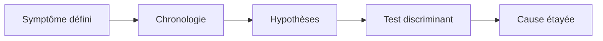
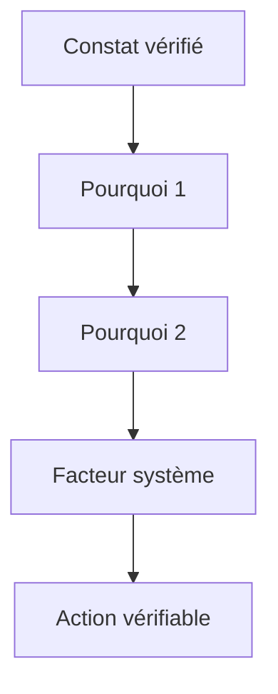
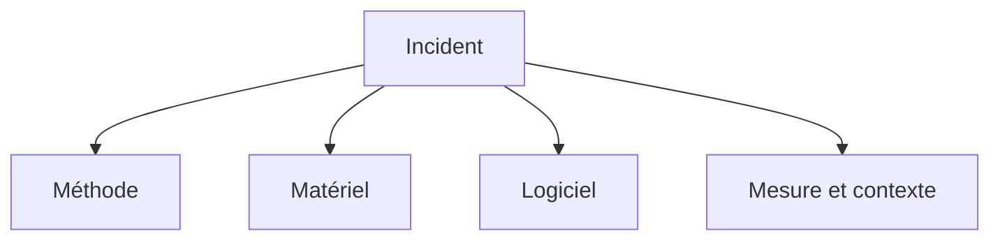
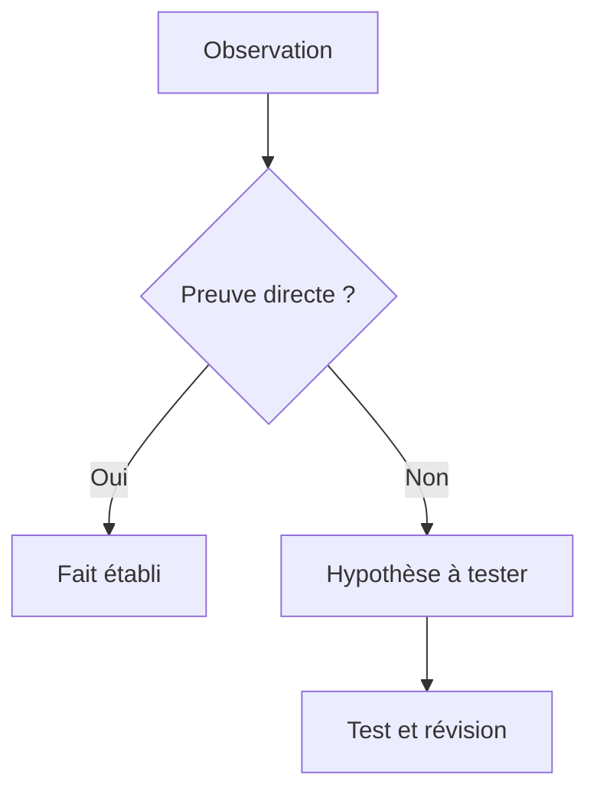
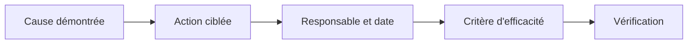
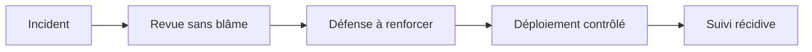

# Analyse de cause racine (5 Pourquoi, Ishikawa)

> **Mise en contexte** — Ce cours s'adresse à un technicien intermédiaire qui doit agir dans un environnement réel, respecter les contraintes de service et laisser des preuves réutilisables. L'objectif n'est pas seulement de connaître les outils, mais de comprendre pourquoi une action est choisie, dans quelles conditions elle est sûre, comment vérifier son résultat et quand demander de l'aide.

## Présentation et enjeux

L'analyse de cause racine cherche à expliquer pourquoi un incident s'est produit et pourquoi les défenses existantes ne l'ont pas empêché ou limité. Les méthodes des cinq pourquoi et du diagramme d'Ishikawa aident à structurer l'investigation, mais elles ne remplacent pas les preuves, les hypothèses vérifiables ni la prise en compte des facteurs systémiques. Cette discipline s'inscrit dans une démarche de qualité de service : chaque opération doit être reliée au besoin métier, au risque accepté et à un critère d'acceptation observable. L'intervenant doit pouvoir expliquer l'état initial, la décision prise, les résultats obtenus et les limites qui subsistent.

Dans une équipe de maintenance, les informations sont souvent réparties entre tickets, conversations, inventaires, systèmes de supervision et mémoire individuelle. Une méthode fiable les relie dans une trace commune et limite les décisions fondées sur une seule observation. Le cours met l'accent sur les preuves, les contrôles proportionnés, la reproductibilité et la communication utile.

Le niveau intermédiaire suppose que les gestes de base sont acquis. La difficulté consiste maintenant à traiter des environnements hétérogènes, des incidents ambigus, des changements qui touchent plusieurs composants et des situations où la donnée est imparfaite. Les règles présentées doivent être adaptées aux procédures approuvées de l'organisation et vérifiées dans un environnement de test avant toute action ayant un impact sur la production.

## Objectifs pédagogiques

À la fin du parcours, l'apprenant pourra :

- expliquer les principes et les limites des outils utilisés dans le domaine ;
- choisir un contrôle ou une méthode à partir de l'impact, de la criticité et des preuves disponibles ;
- effectuer une démarche reproductible et distinguer observation, hypothèse et décision ;
- interpréter les indicateurs sans confondre corrélation, résultat technique et expérience utilisateur ;
- rédiger une trace claire, traiter les exceptions et organiser une escalade ;
- vérifier l'effet d'une action, décrire le risque résiduel et proposer une amélioration mesurable.

## Prérequis et cadre de travail

Avant de commencer, savoir utiliser un terminal, lire les journaux, identifier un actif, comprendre les tickets et appliquer les règles locales de sécurité. Les commandes ci-dessous sont illustratives : adapter les noms d'hôte, les chemins et les versions, utiliser des cibles de test autorisées et ne jamais copier de secret dans un document. Une commande d'observation doit être préférée à une modification lorsqu'elle suffit à qualifier la situation.

Les principes directeurs sont les suivants : intervention autorisée, moindre privilège, sauvegarde ou retour arrière adaptés, fenêtre connue, communication compréhensible et preuve de validation. Si un contrôle critique échoue, ne pas continuer mécaniquement. Noter le constat, évaluer le risque et utiliser le point d'arrêt ou l'escalade défini par la procédure.

## Vocabulaire métier

| Terme | Utilisation opérationnelle |
|---|---|
| État initial | Description mesurée du système avant toute intervention. |
| Criticité | Conséquence potentielle de l'indisponibilité ou de la mauvaise configuration. |
| Preuve | Élément daté qui peut être vérifié par un autre intervenant. |
| Écart | Différence entre le résultat attendu et l'observation. |
| Exception | Situation où la procédure standard ne s'applique pas ou n'atteint pas son objectif. |
| Validation | Contrôle confirmant que le service ou l'opération satisfait les critères convenus. |
| Retour arrière | Séquence permettant de retrouver un état stable si les critères de réussite ne sont pas satisfaits. |
| Récurrence | Réapparition d'un problème similaire après un traitement précédent. |

## Schémas adaptés au sujet

### Schéma 1 — Chaîne d'une RCA



Les conclusions doivent découler des faits observables, des tests et de l'élimination des explications alternatives.

### Schéma 2 — Cinq pourquoi



Les questions successives doivent rester rattachées aux preuves ; le nombre cinq est indicatif et la chaîne peut se ramifier.

### Schéma 3 — Ishikawa



Le diagramme organise les causes potentielles par famille ; chaque branche doit ensuite être testée, confirmée ou rejetée.

### Schéma 4 — Fait ou hypothèse



La séparation entre faits et hypothèses évite de figer une explication non démontrée dans le rapport.

### Schéma 5 — Actions correctives



Une action doit cibler le mécanisme de risque et sa réussite doit être mesurée après une période définie.

### Schéma 6 — Apprentissage incident



Analyser les conditions de travail et les barrières techniques aide à prévenir les répétitions plutôt qu'à attribuer seulement une faute.

## Fondements techniques du domaine

### 1. Définir le problème

Un énoncé de problème décrit un symptôme observable, un périmètre et une période sans conclure prématurément sur sa cause. Formuler une mesure de référence et préciser ce qui fonctionne encore évite d'investiguer un problème trop large.

**Mise en œuvre.** Pour appliquer ce principe dans analyse de cause racine (5 pourquoi, ishikawa), commencer par fixer le périmètre et l'état attendu. Identifier ensuite la donnée qui permet d'observer le résultat, la personne autorisée à prendre la décision et le moment où le contrôle doit être réalisé. Le test doit être assez précis pour qu'un second technicien puisse le reproduire sans demander une explication orale complémentaire. Si plusieurs méthodes sont possibles, noter pourquoi la méthode retenue est la plus proportionnée au risque et au temps disponible.

**Preuves et interprétation.** Conserver la chronologie, les captures, les journaux et la source de chaque fait protège l'analyse contre les souvenirs imprécis. L'intervenant doit garder la source, l'heure, le résultat, le contexte et la limite éventuelle de l'observation. Une preuve isolée n'a parfois qu'une valeur indicative ; elle doit alors être croisée avec un autre signal indépendant. Les données manquantes ne doivent pas être remplacées par une supposition. Lorsqu'une mesure est indirecte, préciser ce qu'elle démontre réellement et ce qu'elle ne démontre pas.

**Pièges et décision.** Écrire « erreur humaine » dès le départ confond souvent un déclencheur immédiat avec une cause systémique. En cas d'écart, classer le résultat comme confirmé, probable ou inconnu et déterminer la prochaine action. Ne pas masquer un résultat défavorable par une moyenne, une fermeture de ticket ou un changement de catégorie. Si le risque dépasse l'autorité de l'intervenant, conserver les preuves et escalader plutôt que poursuivre sur la base d'une hypothèse fragile.

### 2. Collecter des preuves

La qualité de la cause proposée dépend de preuves contemporaines, cohérentes et reliées au périmètre de l'incident. Corréler supervision, changements, métriques, logs, état matériel et communications sur la même ligne de temps.

**Mise en œuvre.** Pour appliquer ce principe dans analyse de cause racine (5 pourquoi, ishikawa), commencer par fixer le périmètre et l'état attendu. Identifier ensuite la donnée qui permet d'observer le résultat, la personne autorisée à prendre la décision et le moment où le contrôle doit être réalisé. Le test doit être assez précis pour qu'un second technicien puisse le reproduire sans demander une explication orale complémentaire. Si plusieurs méthodes sont possibles, noter pourquoi la méthode retenue est la plus proportionnée au risque et au temps disponible.

**Preuves et interprétation.** Marquer les faits, les hypothèses et les éléments non disponibles évite de transformer une supposition en certitude. L'intervenant doit garder la source, l'heure, le résultat, le contexte et la limite éventuelle de l'observation. Une preuve isolée n'a parfois qu'une valeur indicative ; elle doit alors être croisée avec un autre signal indépendant. Les données manquantes ne doivent pas être remplacées par une supposition. Lorsqu'une mesure est indirecte, préciser ce qu'elle démontre réellement et ce qu'elle ne démontre pas.

**Pièges et décision.** Un journal manquant doit être indiqué comme une limite, pas remplacé par un récit inventé. En cas d'écart, classer le résultat comme confirmé, probable ou inconnu et déterminer la prochaine action. Ne pas masquer un résultat défavorable par une moyenne, une fermeture de ticket ou un changement de catégorie. Si le risque dépasse l'autorité de l'intervenant, conserver les preuves et escalader plutôt que poursuivre sur la base d'une hypothèse fragile.

### 3. Cinq pourquoi

La méthode déroule une chaîne de questions sur le mécanisme qui rend le résultat possible ; le nombre cinq est un guide, pas une obligation mathématique. À chaque niveau, demander quelle preuve soutient la réponse et si une autre branche causale est plausible.

**Mise en œuvre.** Pour appliquer ce principe dans analyse de cause racine (5 pourquoi, ishikawa), commencer par fixer le périmètre et l'état attendu. Identifier ensuite la donnée qui permet d'observer le résultat, la personne autorisée à prendre la décision et le moment où le contrôle doit être réalisé. Le test doit être assez précis pour qu'un second technicien puisse le reproduire sans demander une explication orale complémentaire. Si plusieurs méthodes sont possibles, noter pourquoi la méthode retenue est la plus proportionnée au risque et au temps disponible.

**Preuves et interprétation.** Les réponses validées et les hypothèses restant ouvertes doivent être conservées dans le compte rendu. L'intervenant doit garder la source, l'heure, le résultat, le contexte et la limite éventuelle de l'observation. Une preuve isolée n'a parfois qu'une valeur indicative ; elle doit alors être croisée avec un autre signal indépendant. Les données manquantes ne doivent pas être remplacées par une supposition. Lorsqu'une mesure est indirecte, préciser ce qu'elle démontre réellement et ce qu'elle ne démontre pas.

**Pièges et décision.** Une suite linéaire peut masquer plusieurs causes contributives ; arrêter dès qu'une réponse devient spéculative. En cas d'écart, classer le résultat comme confirmé, probable ou inconnu et déterminer la prochaine action. Ne pas masquer un résultat défavorable par une moyenne, une fermeture de ticket ou un changement de catégorie. Si le risque dépasse l'autorité de l'intervenant, conserver les preuves et escalader plutôt que poursuivre sur la base d'une hypothèse fragile.

### 4. Ishikawa

Le diagramme d'Ishikawa organise les causes possibles par familles, par exemple méthode, matériel, logiciel, mesure, environnement et organisation. Faire générer les hypothèses par plusieurs rôles, puis les classer selon preuves et possibilité de test.

**Mise en œuvre.** Pour appliquer ce principe dans analyse de cause racine (5 pourquoi, ishikawa), commencer par fixer le périmètre et l'état attendu. Identifier ensuite la donnée qui permet d'observer le résultat, la personne autorisée à prendre la décision et le moment où le contrôle doit être réalisé. Le test doit être assez précis pour qu'un second technicien puisse le reproduire sans demander une explication orale complémentaire. Si plusieurs méthodes sont possibles, noter pourquoi la méthode retenue est la plus proportionnée au risque et au temps disponible.

**Preuves et interprétation.** Le diagramme annoté avec les causes confirmées, rejetées et ouvertes rend le raisonnement compréhensible. L'intervenant doit garder la source, l'heure, le résultat, le contexte et la limite éventuelle de l'observation. Une preuve isolée n'a parfois qu'une valeur indicative ; elle doit alors être croisée avec un autre signal indépendant. Les données manquantes ne doivent pas être remplacées par une supposition. Lorsqu'une mesure est indirecte, préciser ce qu'elle démontre réellement et ce qu'elle ne démontre pas.

**Pièges et décision.** Un diagramme rempli d'hypothèses non testées est un brainstorming, pas une conclusion de RCA. En cas d'écart, classer le résultat comme confirmé, probable ou inconnu et déterminer la prochaine action. Ne pas masquer un résultat défavorable par une moyenne, une fermeture de ticket ou un changement de catégorie. Si le risque dépasse l'autorité de l'intervenant, conserver les preuves et escalader plutôt que poursuivre sur la base d'une hypothèse fragile.

### 5. Facteurs humains et système

Les erreurs surviennent dans un contexte de charge, d'interface, de procédure, de supervision et d'autorité ; l'analyse doit examiner ces conditions. Examiner si une action était raisonnable avec les informations disponibles et si les contrôles étaient réalistes.

**Mise en œuvre.** Pour appliquer ce principe dans analyse de cause racine (5 pourquoi, ishikawa), commencer par fixer le périmètre et l'état attendu. Identifier ensuite la donnée qui permet d'observer le résultat, la personne autorisée à prendre la décision et le moment où le contrôle doit être réalisé. Le test doit être assez précis pour qu'un second technicien puisse le reproduire sans demander une explication orale complémentaire. Si plusieurs méthodes sont possibles, noter pourquoi la méthode retenue est la plus proportionnée au risque et au temps disponible.

**Preuves et interprétation.** Les témoignages sont confrontés à des preuves sans effacer les incertitudes ni présumer la mauvaise intention. L'intervenant doit garder la source, l'heure, le résultat, le contexte et la limite éventuelle de l'observation. Une preuve isolée n'a parfois qu'une valeur indicative ; elle doit alors être croisée avec un autre signal indépendant. Les données manquantes ne doivent pas être remplacées par une supposition. Lorsqu'une mesure est indirecte, préciser ce qu'elle démontre réellement et ce qu'elle ne démontre pas.

**Pièges et décision.** Attribuer toute panne à une personne peut empêcher de corriger l'interface, les permissions ou les contrôles ayant permis l'erreur. En cas d'écart, classer le résultat comme confirmé, probable ou inconnu et déterminer la prochaine action. Ne pas masquer un résultat défavorable par une moyenne, une fermeture de ticket ou un changement de catégorie. Si le risque dépasse l'autorité de l'intervenant, conserver les preuves et escalader plutôt que poursuivre sur la base d'une hypothèse fragile.

### 6. Cause immédiate et causes contributives

Une action ou un composant peut déclencher l'incident alors que plusieurs faiblesses expliquent son ampleur ou sa durée. Distinguer déclencheur, conditions latentes, défaut de détection et obstacle au rétablissement.

**Mise en œuvre.** Pour appliquer ce principe dans analyse de cause racine (5 pourquoi, ishikawa), commencer par fixer le périmètre et l'état attendu. Identifier ensuite la donnée qui permet d'observer le résultat, la personne autorisée à prendre la décision et le moment où le contrôle doit être réalisé. Le test doit être assez précis pour qu'un second technicien puisse le reproduire sans demander une explication orale complémentaire. Si plusieurs méthodes sont possibles, noter pourquoi la méthode retenue est la plus proportionnée au risque et au temps disponible.

**Preuves et interprétation.** Une carte causale annotée aide à lier chaque action corrective à un mécanisme concret. L'intervenant doit garder la source, l'heure, le résultat, le contexte et la limite éventuelle de l'observation. Une preuve isolée n'a parfois qu'une valeur indicative ; elle doit alors être croisée avec un autre signal indépendant. Les données manquantes ne doivent pas être remplacées par une supposition. Lorsqu'une mesure est indirecte, préciser ce qu'elle démontre réellement et ce qu'elle ne démontre pas.

**Pièges et décision.** Corriger seulement le déclencheur peut rendre l'incident moins fréquent sans réduire le risque global. En cas d'écart, classer le résultat comme confirmé, probable ou inconnu et déterminer la prochaine action. Ne pas masquer un résultat défavorable par une moyenne, une fermeture de ticket ou un changement de catégorie. Si le risque dépasse l'autorité de l'intervenant, conserver les preuves et escalader plutôt que poursuivre sur la base d'une hypothèse fragile.

### 7. Actions correctives

Une action utile modifie un mécanisme causal, a un propriétaire, une échéance et une méthode de vérification. Combiner mesures techniques, procédures, formation, supervision et changements de gouvernance selon les causes démontrées.

**Mise en œuvre.** Pour appliquer ce principe dans analyse de cause racine (5 pourquoi, ishikawa), commencer par fixer le périmètre et l'état attendu. Identifier ensuite la donnée qui permet d'observer le résultat, la personne autorisée à prendre la décision et le moment où le contrôle doit être réalisé. Le test doit être assez précis pour qu'un second technicien puisse le reproduire sans demander une explication orale complémentaire. Si plusieurs méthodes sont possibles, noter pourquoi la méthode retenue est la plus proportionnée au risque et au temps disponible.

**Preuves et interprétation.** La preuve d'efficacité est une mesure observée après mise en œuvre, pas la simple fermeture du ticket d'action. L'intervenant doit garder la source, l'heure, le résultat, le contexte et la limite éventuelle de l'observation. Une preuve isolée n'a parfois qu'une valeur indicative ; elle doit alors être croisée avec un autre signal indépendant. Les données manquantes ne doivent pas être remplacées par une supposition. Lorsqu'une mesure est indirecte, préciser ce qu'elle démontre réellement et ce qu'elle ne démontre pas.

**Pièges et décision.** Une formation générique ne compense pas une architecture fragile ou un contrôle automatique absent. En cas d'écart, classer le résultat comme confirmé, probable ou inconnu et déterminer la prochaine action. Ne pas masquer un résultat défavorable par une moyenne, une fermeture de ticket ou un changement de catégorie. Si le risque dépasse l'autorité de l'intervenant, conserver les preuves et escalader plutôt que poursuivre sur la base d'une hypothèse fragile.

### 8. Vérifier l'efficacité

La RCA n'est utile que si les mesures diminuent la probabilité, l'impact ou le temps de détection de la panne. Définir avant l'action une mesure de base, un délai d'observation et un critère de réussite ou de réouverture.

**Mise en œuvre.** Pour appliquer ce principe dans analyse de cause racine (5 pourquoi, ishikawa), commencer par fixer le périmètre et l'état attendu. Identifier ensuite la donnée qui permet d'observer le résultat, la personne autorisée à prendre la décision et le moment où le contrôle doit être réalisé. Le test doit être assez précis pour qu'un second technicien puisse le reproduire sans demander une explication orale complémentaire. Si plusieurs méthodes sont possibles, noter pourquoi la méthode retenue est la plus proportionnée au risque et au temps disponible.

**Preuves et interprétation.** Comparer les événements similaires, les quasi-incidents et les résultats de tests permet de vérifier l'effet. L'intervenant doit garder la source, l'heure, le résultat, le contexte et la limite éventuelle de l'observation. Une preuve isolée n'a parfois qu'une valeur indicative ; elle doit alors être croisée avec un autre signal indépendant. Les données manquantes ne doivent pas être remplacées par une supposition. Lorsqu'une mesure est indirecte, préciser ce qu'elle démontre réellement et ce qu'elle ne démontre pas.

**Pièges et décision.** L'absence d'incident sur une courte période ne prouve pas à elle seule que le risque est supprimé. En cas d'écart, classer le résultat comme confirmé, probable ou inconnu et déterminer la prochaine action. Ne pas masquer un résultat défavorable par une moyenne, une fermeture de ticket ou un changement de catégorie. Si le risque dépasse l'autorité de l'intervenant, conserver les preuves et escalader plutôt que poursuivre sur la base d'une hypothèse fragile.

## Méthode transversale pour une opération maîtrisée

### 1. Gouvernance

L'intervention doit être reliée à un objectif de service, un propriétaire et une décision explicite. Le contrôle de gouvernance n'a de valeur que s'il aide à identifier qui peut accepter le risque et qui doit être informé. Pour analyse de cause racine (5 pourquoi, ishikawa), cela signifie que la personne qui agit doit relier la règle à un élément concret : récidive après action, délai d'analyse, actions correctives en retard, pourcentage d'actions vérifiées, incidents sans cause étayée, détection avant impact. Avant l'opération, noter l'état de départ et ce qui fera considérer le résultat comme acceptable. Pendant l'action, conserver le contexte des changements et indiquer immédiatement les écarts. Après l'action, exécuter le contrôle correspondant au risque, enregistrer le résultat et affecter les suites restantes. Cette discipline augmente la qualité de la passation et réduit la dépendance à une personne unique.

### 2. Cycle de vie

La solution doit être pensée depuis la préparation jusqu'à la sortie, y compris le maintien des compétences et le retrait des anciennes données. Une étape oubliée en fin de cycle transforme souvent une réussite ponctuelle en risque latent. Pour analyse de cause racine (5 pourquoi, ishikawa), cela signifie que la personne qui agit doit relier la règle à un élément concret : récidive après action, délai d'analyse, actions correctives en retard, pourcentage d'actions vérifiées, incidents sans cause étayée, détection avant impact. Avant l'opération, noter l'état de départ et ce qui fera considérer le résultat comme acceptable. Pendant l'action, conserver le contexte des changements et indiquer immédiatement les écarts. Après l'action, exécuter le contrôle correspondant au risque, enregistrer le résultat et affecter les suites restantes. Cette discipline augmente la qualité de la passation et réduit la dépendance à une personne unique.

### 3. Qualité de données

Toute mesure dépend de la qualité de son périmètre, de l'horodatage, de l'unité et de la provenance. Il faut identifier les champs manquants et les conventions contradictoires avant de tirer une conclusion. Pour analyse de cause racine (5 pourquoi, ishikawa), cela signifie que la personne qui agit doit relier la règle à un élément concret : récidive après action, délai d'analyse, actions correctives en retard, pourcentage d'actions vérifiées, incidents sans cause étayée, détection avant impact. Avant l'opération, noter l'état de départ et ce qui fera considérer le résultat comme acceptable. Pendant l'action, conserver le contexte des changements et indiquer immédiatement les écarts. Après l'action, exécuter le contrôle correspondant au risque, enregistrer le résultat et affecter les suites restantes. Cette discipline augmente la qualité de la passation et réduit la dépendance à une personne unique.

### 4. Gestion du risque

Le risque se juge par probabilité, impact, capacité de détection et marge de récupération. Les éléments critiques doivent recevoir plus de contrôles, sans imposer la même lourdeur aux opérations réversibles et aux changements irréversibles. Pour analyse de cause racine (5 pourquoi, ishikawa), cela signifie que la personne qui agit doit relier la règle à un élément concret : récidive après action, délai d'analyse, actions correctives en retard, pourcentage d'actions vérifiées, incidents sans cause étayée, détection avant impact. Avant l'opération, noter l'état de départ et ce qui fera considérer le résultat comme acceptable. Pendant l'action, conserver le contexte des changements et indiquer immédiatement les écarts. Après l'action, exécuter le contrôle correspondant au risque, enregistrer le résultat et affecter les suites restantes. Cette discipline augmente la qualité de la passation et réduit la dépendance à une personne unique.

### 5. Communication

Une communication utile indique ce qui est connu, ce qui reste à vérifier, qui agit ensuite et quand une nouvelle information sera fournie. Les formulations doivent éviter les promesses non vérifiées. Pour analyse de cause racine (5 pourquoi, ishikawa), cela signifie que la personne qui agit doit relier la règle à un élément concret : récidive après action, délai d'analyse, actions correctives en retard, pourcentage d'actions vérifiées, incidents sans cause étayée, détection avant impact. Avant l'opération, noter l'état de départ et ce qui fera considérer le résultat comme acceptable. Pendant l'action, conserver le contexte des changements et indiquer immédiatement les écarts. Après l'action, exécuter le contrôle correspondant au risque, enregistrer le résultat et affecter les suites restantes. Cette discipline augmente la qualité de la passation et réduit la dépendance à une personne unique.

### 6. Sécurité

Le périmètre technique doit rester limité aux systèmes autorisés, avec une identité traçable et les droits minimaux nécessaires. Les secrets doivent être protégés dans les fichiers, les journaux, les captures et les exports. Pour analyse de cause racine (5 pourquoi, ishikawa), cela signifie que la personne qui agit doit relier la règle à un élément concret : récidive après action, délai d'analyse, actions correctives en retard, pourcentage d'actions vérifiées, incidents sans cause étayée, détection avant impact. Avant l'opération, noter l'état de départ et ce qui fera considérer le résultat comme acceptable. Pendant l'action, conserver le contexte des changements et indiquer immédiatement les écarts. Après l'action, exécuter le contrôle correspondant au risque, enregistrer le résultat et affecter les suites restantes. Cette discipline augmente la qualité de la passation et réduit la dépendance à une personne unique.

### 7. Traçabilité

Une action exploitable doit laisser un résultat vérifiable, un horodatage, un propriétaire et un lien avec le ticket ou le changement. La trace doit permettre à un autre technicien de comprendre ce qui a été fait. Pour analyse de cause racine (5 pourquoi, ishikawa), cela signifie que la personne qui agit doit relier la règle à un élément concret : récidive après action, délai d'analyse, actions correctives en retard, pourcentage d'actions vérifiées, incidents sans cause étayée, détection avant impact. Avant l'opération, noter l'état de départ et ce qui fera considérer le résultat comme acceptable. Pendant l'action, conserver le contexte des changements et indiquer immédiatement les écarts. Après l'action, exécuter le contrôle correspondant au risque, enregistrer le résultat et affecter les suites restantes. Cette discipline augmente la qualité de la passation et réduit la dépendance à une personne unique.

### 8. Gestion des exceptions

Les cas hors procédure doivent être visibles et conduire à un point d'arrêt, une décision ou une escalade. Une exception récurrente est souvent le signal qu'il faut faire évoluer la procédure plutôt que la répéter. Pour analyse de cause racine (5 pourquoi, ishikawa), cela signifie que la personne qui agit doit relier la règle à un élément concret : récidive après action, délai d'analyse, actions correctives en retard, pourcentage d'actions vérifiées, incidents sans cause étayée, détection avant impact. Avant l'opération, noter l'état de départ et ce qui fera considérer le résultat comme acceptable. Pendant l'action, conserver le contexte des changements et indiquer immédiatement les écarts. Après l'action, exécuter le contrôle correspondant au risque, enregistrer le résultat et affecter les suites restantes. Cette discipline augmente la qualité de la passation et réduit la dépendance à une personne unique.

### 9. Amélioration continue

Les incidents, les retours utilisateurs et les contrôles qualité doivent transformer les règles et procédures. Il faut vérifier si les modifications réduisent réellement le risque, et pas seulement si les documents ont été mis à jour. Pour analyse de cause racine (5 pourquoi, ishikawa), cela signifie que la personne qui agit doit relier la règle à un élément concret : récidive après action, délai d'analyse, actions correctives en retard, pourcentage d'actions vérifiées, incidents sans cause étayée, détection avant impact. Avant l'opération, noter l'état de départ et ce qui fera considérer le résultat comme acceptable. Pendant l'action, conserver le contexte des changements et indiquer immédiatement les écarts. Après l'action, exécuter le contrôle correspondant au risque, enregistrer le résultat et affecter les suites restantes. Cette discipline augmente la qualité de la passation et réduit la dépendance à une personne unique.

### 10. Capacité

Les ressources, compétences, fenêtres et dépendances limitent le volume d'opérations réalisables. Une planification crédible tient compte de la charge, des temps de contrôle et des imprévus. Pour analyse de cause racine (5 pourquoi, ishikawa), cela signifie que la personne qui agit doit relier la règle à un élément concret : récidive après action, délai d'analyse, actions correctives en retard, pourcentage d'actions vérifiées, incidents sans cause étayée, détection avant impact. Avant l'opération, noter l'état de départ et ce qui fera considérer le résultat comme acceptable. Pendant l'action, conserver le contexte des changements et indiquer immédiatement les écarts. Après l'action, exécuter le contrôle correspondant au risque, enregistrer le résultat et affecter les suites restantes. Cette discipline augmente la qualité de la passation et réduit la dépendance à une personne unique.

### 11. Contrôle du changement

Une modification nécessite un état initial connu, un périmètre, des critères de réussite et une solution de repli adaptée au risque. L'urgence ne supprime pas le besoin de garder une trace des décisions. Pour analyse de cause racine (5 pourquoi, ishikawa), cela signifie que la personne qui agit doit relier la règle à un élément concret : récidive après action, délai d'analyse, actions correctives en retard, pourcentage d'actions vérifiées, incidents sans cause étayée, détection avant impact. Avant l'opération, noter l'état de départ et ce qui fera considérer le résultat comme acceptable. Pendant l'action, conserver le contexte des changements et indiquer immédiatement les écarts. Après l'action, exécuter le contrôle correspondant au risque, enregistrer le résultat et affecter les suites restantes. Cette discipline augmente la qualité de la passation et réduit la dépendance à une personne unique.

### 12. Mesure d'efficacité

Un indicateur ne vaut que si sa définition reste constante et si sa variation peut conduire à une décision. Les chiffres doivent être accompagnés d'une période, d'un périmètre et des limites de mesure. Pour analyse de cause racine (5 pourquoi, ishikawa), cela signifie que la personne qui agit doit relier la règle à un élément concret : récidive après action, délai d'analyse, actions correctives en retard, pourcentage d'actions vérifiées, incidents sans cause étayée, détection avant impact. Avant l'opération, noter l'état de départ et ce qui fera considérer le résultat comme acceptable. Pendant l'action, conserver le contexte des changements et indiquer immédiatement les écarts. Après l'action, exécuter le contrôle correspondant au risque, enregistrer le résultat et affecter les suites restantes. Cette discipline augmente la qualité de la passation et réduit la dépendance à une personne unique.

### 13. Passation

Une tâche doit pouvoir être reprise par une autre personne sans dépendre des souvenirs du technicien présent. La transmission contient contexte, preuves, étapes déjà tentées et prochaine action. Pour analyse de cause racine (5 pourquoi, ishikawa), cela signifie que la personne qui agit doit relier la règle à un élément concret : récidive après action, délai d'analyse, actions correctives en retard, pourcentage d'actions vérifiées, incidents sans cause étayée, détection avant impact. Avant l'opération, noter l'état de départ et ce qui fera considérer le résultat comme acceptable. Pendant l'action, conserver le contexte des changements et indiquer immédiatement les écarts. Après l'action, exécuter le contrôle correspondant au risque, enregistrer le résultat et affecter les suites restantes. Cette discipline augmente la qualité de la passation et réduit la dépendance à une personne unique.

### 14. Validation métier

Le résultat technique doit être confirmé du point de vue du service. Un équipement joignable ou un script qui termine sans erreur ne suffit pas si l'utilisateur ne peut pas accomplir son opération. Pour analyse de cause racine (5 pourquoi, ishikawa), cela signifie que la personne qui agit doit relier la règle à un élément concret : récidive après action, délai d'analyse, actions correctives en retard, pourcentage d'actions vérifiées, incidents sans cause étayée, détection avant impact. Avant l'opération, noter l'état de départ et ce qui fera considérer le résultat comme acceptable. Pendant l'action, conserver le contexte des changements et indiquer immédiatement les écarts. Après l'action, exécuter le contrôle correspondant au risque, enregistrer le résultat et affecter les suites restantes. Cette discipline augmente la qualité de la passation et réduit la dépendance à une personne unique.

## Indicateurs : définition, lecture et limites

Les indicateurs les plus utiles pour ce domaine sont : **récidive après action, délai d'analyse, actions correctives en retard, pourcentage d'actions vérifiées, incidents sans cause étayée, détection avant impact**. Chaque indicateur doit avoir une définition écrite. Il faut préciser l'unité, la source, le périmètre, la fréquence, la période et les exclusions. Lorsque les données ne couvrent qu'une partie de l'environnement, le rapport doit le signaler au lieu d'extrapoler silencieusement. Un indicateur doit permettre une décision : prioriser, déclencher une vérification, ajuster une capacité, revoir une procédure ou accepter explicitement un risque.

Un bon tableau de bord met en évidence la tendance et les écarts significatifs, sans supprimer la donnée de départ. Il distingue les valeurs brutes, les seuils, les anomalies confirmées et les périodes sans mesure. Une moyenne peut cacher des situations extrêmes ; il est donc souvent nécessaire d'observer la distribution, les percentiles, les valeurs maximales et la répartition par service ou par criticité. Les changements de définition doivent être versionnés pour éviter de comparer des séries qui ne signifient plus la même chose.

Les indicateurs ne doivent pas devenir des objectifs isolés. Par exemple, réduire le délai moyen n'est pas une amélioration si les tickets sont fermés avant validation et immédiatement rouverts. De même, atteindre un taux de conformité en excluant les actifs inconnus peut donner une image artificiellement favorable. Associer un KPI à un contrôle de qualité et à un résultat métier permet de repérer ces effets indésirables.

## Procédure opérationnelle recommandée

1. **Préparer.** Confirmer la demande, le périmètre, le propriétaire, l'autorisation et la fenêtre. Vérifier les dépendances, les sauvegardes et les accès nécessaires.
2. **Établir l'état initial.** Recueillir les mesures, l'état des services, les alertes, la dernière intervention et les écarts connus. Noter les éléments non vérifiables.
3. **Évaluer les risques.** Déterminer impact, probabilité, détectabilité, réversibilité et critère de report. Définir un point d'arrêt compréhensible.
4. **Exécuter par étapes.** Utiliser les outils approuvés, limiter le périmètre et vérifier les résultats intermédiaires avant de passer à l'étape suivante.
5. **Contrôler.** Comparer l'état final à l'état attendu et tester le service selon un scénario réaliste, pas uniquement le composant technique.
6. **Tracer.** Enregistrer les horaires, commandes ou actions, résultats, décisions et écarts dans le ticket ou le référentiel prévu.
7. **Communiquer.** Annoncer le résultat en termes compréhensibles, préciser les limites et indiquer qui gère les actions ouvertes.
8. **Améliorer.** Rechercher les étapes ambiguës ou les contrôles inefficaces et proposer une modification versionnée, testée et approuvée.

## Outils et contrôles pratiques

Les outils doivent être sélectionnés selon l'objectif, les droits et le type de preuve recherché. L'usage d'un outil connu ne dispense pas de contrôler son contexte : version, paramètres, cible, unité, état de connexion et limite de la mesure. chronologie d'incident, journaux, supervision, traces de changement, cinq pourquoi, Ishikawa, arbre de défaillance simplifié, méthode d'action corrective constituent des exemples de technologies possibles ; leur choix exact dépend de l'environnement et des politiques internes.

| Contrôle | Question à poser | Trace à conserver |
|---|---|---|
| Identité de la cible | Est-ce bien l'actif ou le service autorisé ? | Identifiant, inventaire et horodatage. |
| État initial | Quelle condition de départ a été mesurée ? | Valeur, source, capture ou sortie. |
| Autorisation | Qui a approuvé l'action et pour quelle fenêtre ? | Ticket, validation et périmètre. |
| Résultat | Qu'est-ce qui démontre que le résultat est correct ? | Test de contrôle et résultat observé. |
| Écart | Que faire si le résultat attendu n'est pas obtenu ? | Point d'arrêt, escalade et action attribuée. |

### Commandes et exemples

Les commandes de cette section servent à illustrer la collecte de preuves. Remplacer les valeurs de test par des cibles autorisées et vérifier localement les options selon la distribution et la version de l'outil.

#### Exemple 1 — Consulter la chronologie système récente

```bash
journalctl --since '2 hours ago' --no-pager
```

Interpréter la sortie avec le contexte de l'intervention. Un retour nul ne démontre pas toujours que la fonction métier est opérationnelle. Relever les erreurs, vérifier l'heure des journaux et comparer les observations avec une seconde source lorsque l'impact le justifie. Ne pas intégrer un résultat de terminal dans un rapport sans préciser la machine, la période et la commande effectivement exécutée.

#### Exemple 2 — Filtrer les journaux d'un service à une période donnée

```bash
journalctl -u nom-du-service --since '2026-10-27 08:00:00' --until '2026-10-27 09:00:00' --no-pager
```

Interpréter la sortie avec le contexte de l'intervention. Un retour nul ne démontre pas toujours que la fonction métier est opérationnelle. Relever les erreurs, vérifier l'heure des journaux et comparer les observations avec une seconde source lorsque l'impact le justifie. Ne pas intégrer un résultat de terminal dans un rapport sans préciser la machine, la période et la commande effectivement exécutée.

#### Exemple 3 — Comparer une version de configuration dans Git

```bash
git diff -- config/
```

Interpréter la sortie avec le contexte de l'intervention. Un retour nul ne démontre pas toujours que la fonction métier est opérationnelle. Relever les erreurs, vérifier l'heure des journaux et comparer les observations avec une seconde source lorsque l'impact le justifie. Ne pas intégrer un résultat de terminal dans un rapport sans préciser la machine, la période et la commande effectivement exécutée.

#### Exemple 4 — Créer une empreinte d'un fichier de preuve avant archivage

```bash
sha256sum fichier-preuve.log
```

Interpréter la sortie avec le contexte de l'intervention. Un retour nul ne démontre pas toujours que la fonction métier est opérationnelle. Relever les erreurs, vérifier l'heure des journaux et comparer les observations avec une seconde source lorsque l'impact le justifie. Ne pas intégrer un résultat de terminal dans un rapport sans préciser la machine, la période et la commande effectivement exécutée.

## Atelier pratique guidé

### Situation de départ

L'équipe reçoit une demande concernant analyse de cause racine (5 pourquoi, ishikawa). Le contexte est incomplet : l'utilisateur décrit un symptôme, une mesure semble inhabituelle et une intervention antérieure est mentionnée sans détail. Le travail consiste à produire une réponse reproductible, sans prendre de risque inutile et sans annoncer une conclusion que les preuves ne soutiennent pas.

### Phase A — Qualification

Créer ou mettre à jour le ticket ; identifier le service, les utilisateurs concernés, le propriétaire technique, la période et les changements récents. Réunir les journaux et les mesures disponibles. Séparer les faits confirmés des déclarations de l'utilisateur. Déterminer si le problème est en cours, intermittent ou résolu, et préciser ce qui manque encore. Définir l'impact selon les critères de service et la priorité de traitement. Si la cible n'est pas certaine, valider son identité par l'inventaire avant d'exécuter la moindre action.

### Phase B — Hypothèses et tests

Formuler au moins deux hypothèses concurrentes. Pour chacune, préciser le signal qui devrait être observé si elle est vraie, le signal qui permettrait de la rejeter et le coût du test. Commencer par les contrôles en lecture seule, puis ne réaliser une modification que si elle est autorisée et nécessaire. Garder les résultats qui contredisent l'hypothèse initiale ; ils évitent de persister sur la mauvaise piste. Si les tests se contredisent, vérifier l'horloge, la version des données, la portée du contrôle et la possibilité d'une panne intermittente.

### Phase C — Action contrôlée

Choisir une action proportionnée au risque et limitée au périmètre identifié. Avant de modifier, noter l'état initial, confirmer la sauvegarde ou le retour arrière adapté et prévenir les personnes concernées. Exécuter une seule modification majeure à la fois lorsque cela permet d'isoler son effet. Si un point d'arrêt est atteint, conserver les preuves et contacter le niveau compétent plutôt que contourner la règle. Après l'action, répéter le test initial et vérifier le service par une transaction ou un parcours représentatif.

### Phase D — Validation et restitution

Comparer le résultat aux critères d'acceptation. Décrire ce qui a changé, ce qui a été vérifié, ce qui reste incertain et les actions ouvertes. La restitution doit être compréhensible pour un utilisateur non spécialiste et suffisamment technique pour un collègue qui reprendrait le dossier. Associer chaque action à un responsable et une échéance. Lorsque la procédure a été difficile à appliquer, signaler précisément la phrase, le champ ou le contrôle à améliorer.

## Études de cas

### Cas 1 — Panne après changement

**Situation.** Un service tombe après une modification de configuration, mais le lien causal n'est pas encore démontré. Le service doit être préservé et les actions doivent rester explicables. La première réaction ne doit pas consister à redémarrer ou modifier au hasard : il faut d'abord vérifier le périmètre, l'heure, l'état initial et les changements concomitants.

**Analyse.** Aligner la chronologie, comparer la configuration avant/après, reproduire les tests et séparer les faits des hypothèses. Consigner les observations qui distinguent les hypothèses, puis rechercher les dépendances susceptibles de produire le même symptôme. Si une source de donnée est absente, l'indiquer et prévoir un moyen de la récupérer pour une prochaine occurrence. Vérifier aussi l'effet sur les autres services et le risque que l'action proposée crée une interruption plus large que le problème initial.

**Décision et preuve.** Si le retour arrière rétablit le service, cela renforce une relation causale, mais il faut encore identifier le mécanisme exact. La conclusion doit préciser le niveau de confiance et les contrôles qui ont été effectués après l'action. Si la cause n'est pas démontrée, préférer une formule prudente et assigner l'investigation complémentaire plutôt que fermer le dossier sur une supposition.

### Cas 2 — Saturation périodique

**Situation.** Un lien réseau sature chaque fin de journée. Le service doit être préservé et les actions doivent rester explicables. La première réaction ne doit pas consister à redémarrer ou modifier au hasard : il faut d'abord vérifier le périmètre, l'heure, l'état initial et les changements concomitants.

**Analyse.** Comparer plusieurs jours, relever le volume, les flux, les tâches planifiées et les percentiles de charge ; éviter de conclure à partir d'une seule capture. Consigner les observations qui distinguent les hypothèses, puis rechercher les dépendances susceptibles de produire le même symptôme. Si une source de donnée est absente, l'indiquer et prévoir un moyen de la récupérer pour une prochaine occurrence. Vérifier aussi l'effet sur les autres services et le risque que l'action proposée crée une interruption plus large que le problème initial.

**Décision et preuve.** Relier l'action corrective à la source de trafic, à la capacité ou à la planification, puis vérifier que le profil de saturation change. La conclusion doit préciser le niveau de confiance et les contrôles qui ont été effectués après l'action. Si la cause n'est pas démontrée, préférer une formule prudente et assigner l'investigation complémentaire plutôt que fermer le dossier sur une supposition.

### Cas 3 — Erreur de procédure

**Situation.** Plusieurs techniciens appliquent une commande différente parce que la documentation est ambiguë. Le service doit être préservé et les actions doivent rester explicables. La première réaction ne doit pas consister à redémarrer ou modifier au hasard : il faut d'abord vérifier le périmètre, l'heure, l'état initial et les changements concomitants.

**Analyse.** Comparer les versions utilisées, interviewer sans accusation, vérifier le comportement de la commande et l'emplacement de la dernière publication. Consigner les observations qui distinguent les hypothèses, puis rechercher les dépendances susceptibles de produire le même symptôme. Si une source de donnée est absente, l'indiquer et prévoir un moyen de la récupérer pour une prochaine occurrence. Vérifier aussi l'effet sur les autres services et le risque que l'action proposée crée une interruption plus large que le problème initial.

**Décision et preuve.** La correction porte sur le versionnement et le point de contrôle, puis son efficacité est vérifiée avec un exercice supervisé. La conclusion doit préciser le niveau de confiance et les contrôles qui ont été effectués après l'action. Si la cause n'est pas démontrée, préférer une formule prudente et assigner l'investigation complémentaire plutôt que fermer le dossier sur une supposition.

## Exercices d'application avec corrigés

### Exercice 1 — Définir le périmètre

**Question.** Une demande décrit un problème sans identifier clairement l'actif concerné. Quelles informations obtenir avant de lancer un contrôle ?

**Corrigé expliqué.** Identifier le service, la cible, l'utilisateur, la période, l'impact, l'autorisation, les dépendances et le résultat attendu. Aucun changement ne doit précéder la confirmation de la cible. Dans le contexte de analyse de cause racine (5 pourquoi, ishikawa), appliquer cette réponse en reliant le raisonnement à une preuve disponible, au risque et au service concerné. L'objectif n'est pas de remplir un formulaire, mais de rendre la décision reproductible et d'éviter qu'un résultat ambigu soit transformé en certitude.

### Exercice 2 — Distinguer fait et hypothèse

**Question.** Une alerte apparaît juste après une modification. Peut-on écrire que la modification est la cause ?

**Corrigé expliqué.** Non. La proximité temporelle est un indice. Il faut comparer l'état avant/après, tester le mécanisme supposé et évaluer les autres facteurs possibles. Dans le contexte de analyse de cause racine (5 pourquoi, ishikawa), appliquer cette réponse en reliant le raisonnement à une preuve disponible, au risque et au service concerné. L'objectif n'est pas de remplir un formulaire, mais de rendre la décision reproductible et d'éviter qu'un résultat ambigu soit transformé en certitude.

### Exercice 3 — Choisir la mesure

**Question.** Un indicateur semble bon mais les utilisateurs signalent un problème. Quelle démarche appliquer ?

**Corrigé expliqué.** Vérifier que le point de mesure représente le service, examiner le périmètre et la fraîcheur des données, puis croiser avec un test de bout en bout et le retour utilisateur. Dans le contexte de analyse de cause racine (5 pourquoi, ishikawa), appliquer cette réponse en reliant le raisonnement à une preuve disponible, au risque et au service concerné. L'objectif n'est pas de remplir un formulaire, mais de rendre la décision reproductible et d'éviter qu'un résultat ambigu soit transformé en certitude.

### Exercice 4 — Protéger la production

**Question.** Une opération comporte un risque de perte de données ou d'indisponibilité. Quelles garanties vérifier ?

**Corrigé expliqué.** Autorisation, fenêtre, état initial, sauvegarde ou retour arrière adapté, prérequis, lot limité, critères de réussite, point d'arrêt et responsable du rétablissement. Dans le contexte de analyse de cause racine (5 pourquoi, ishikawa), appliquer cette réponse en reliant le raisonnement à une preuve disponible, au risque et au service concerné. L'objectif n'est pas de remplir un formulaire, mais de rendre la décision reproductible et d'éviter qu'un résultat ambigu soit transformé en certitude.

### Exercice 5 — Rédiger la passation

**Question.** Un autre technicien reprend l'incident en milieu d'investigation. Quelles informations minimales transmettre ?

**Corrigé expliqué.** Résumé, impact, heure, cible, faits, hypothèses testées, preuves, actions déjà effectuées, changements récents, risques, propriétaire et prochaine action proposée. Dans le contexte de analyse de cause racine (5 pourquoi, ishikawa), appliquer cette réponse en reliant le raisonnement à une preuve disponible, au risque et au service concerné. L'objectif n'est pas de remplir un formulaire, mais de rendre la décision reproductible et d'éviter qu'un résultat ambigu soit transformé en certitude.

### Exercice 6 — Vérifier l'efficacité

**Question.** Comment démontrer qu'une action corrective a amélioré la situation ?

**Corrigé expliqué.** Définir une référence, un indicateur, une fenêtre d'observation et un critère de réussite avant l'action ; mesurer ensuite le résultat et documenter les limites. Dans le contexte de analyse de cause racine (5 pourquoi, ishikawa), appliquer cette réponse en reliant le raisonnement à une preuve disponible, au risque et au service concerné. L'objectif n'est pas de remplir un formulaire, mais de rendre la décision reproductible et d'éviter qu'un résultat ambigu soit transformé en certitude.

## Glossaire opérationnel

| Terme | Définition et usage |
|---|---|
| Cause racine | Cause étayée qui explique un mécanisme essentiel de l'incident et sur laquelle une action peut réduire le risque. |
| Cause contributive | Condition qui favorise l'incident ou augmente son impact sans être nécessairement le déclencheur direct. |
| Cinq pourquoi | Technique d'interrogation successive qui approfondit une chaîne causale à partir d'un fait. |
| Ishikawa | Diagramme de causes potentielles regroupées par familles afin d'organiser l'investigation. |
| Hypothèse | Explication possible qui doit être distinguée des faits et testée. |
| Chronologie | Séquence datée d'événements, d'actions et de changements liés à l'incident. |
| Action corrective | Action qui vise à supprimer ou réduire une cause ou une faiblesse démontrée. |
| Efficacité | Démonstration mesurée qu'une action a produit l'effet attendu sur le risque ou le fonctionnement. |

## Checklist de qualité avant clôture

- [ ] Le périmètre et le propriétaire de l'opération sont clairs.
- [ ] Les autorisations, prérequis et limites de la procédure ont été vérifiés.
- [ ] L'état initial et les données utiles sont datés et traçables.
- [ ] Les hypothèses sont séparées des faits et les tests sont reproductibles.
- [ ] Les modifications sont limitées au périmètre autorisé et liées à un ticket ou changement.
- [ ] Le contrôle post-action confirme le résultat technique et le service réel.
- [ ] Les écarts et incertitudes restent visibles, avec un propriétaire de suivi.
- [ ] Les informations sensibles ne figurent pas dans les copies diffusées sans nécessité.
- [ ] Le compte rendu précise la prochaine action et la date de revue si le dossier reste ouvert.
- [ ] Les apprentissages sont intégrés à la procédure lorsque l'écart peut se reproduire.

## Défi final — traiter un cas de bout en bout

Le service responsable vous signale une dégradation après plusieurs changements récents. Les données sont partielles, une mesure contredit un témoignage et la prochaine fenêtre d'intervention est limitée. Vous devez livrer un dossier que pourrait reprendre un collègue, sans multiplier les manipulations et sans promettre une résolution avant preuve.

**Travail demandé.** Rédiger le périmètre, la chronologie, trois hypothèses, les preuves associées, le test le moins risqué, la décision d'escalade éventuelle, le plan de validation, les actions de suivi et le message destiné au demandeur. Pour chaque étape, préciser les conditions qui vous feraient arrêter ou changer de stratégie.

**Correction attendue.** Le dossier commence par l'impact et les faits confirmés, puis présente les hypothèses avec des tests discriminants. Les contrôles en lecture seule précèdent les modifications. L'action choisie est autorisée, limitée et réversible dans la mesure du possible. Le résultat est vérifié par une mesure indépendante et une validation du service. Les éléments manquants restent explicitement notés. Les conclusions sont prudentes, les preuves sont accessibles et les actions restantes possèdent un propriétaire, une échéance et un indicateur d'efficacité.

## Synthèse

Une pratique intermédiaire de qualité associe connaissance technique, gestion du risque, mesure, communication et apprentissage. L'outil n'est pas la méthode : il fournit des observations ou exécute des actions, tandis que le technicien définit le périmètre, vérifie les prérequis, interprète les résultats et prend une décision proportionnée. Pour analyse de cause racine (5 pourquoi, ishikawa), la réussite se mesure à la fois par le résultat obtenu et par la capacité à expliquer comment ce résultat a été atteint, quelles limites subsistent et comment prévenir la récidive.
