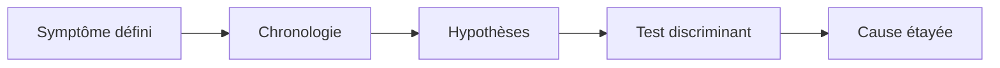
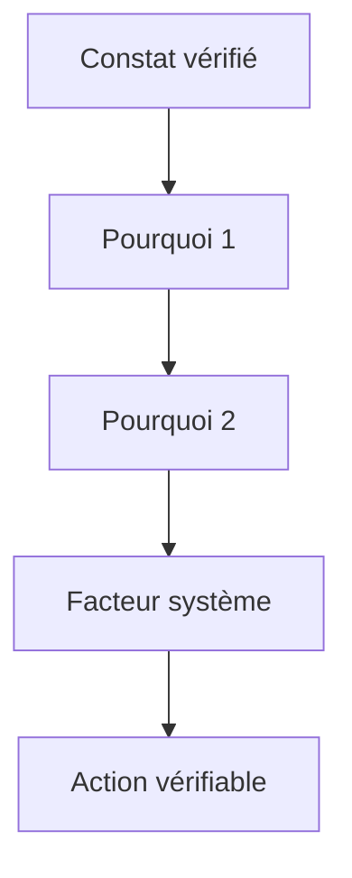
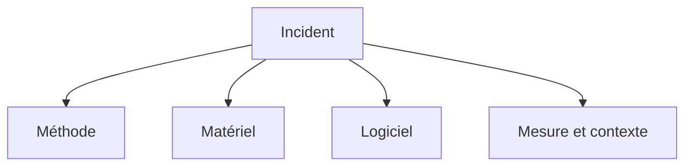
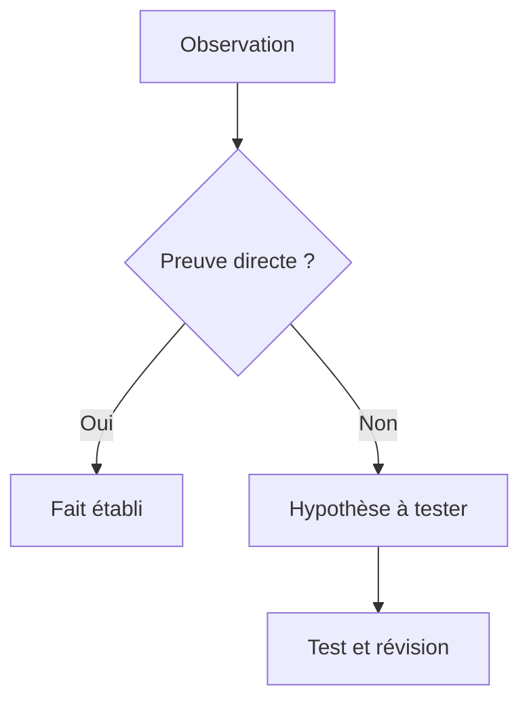
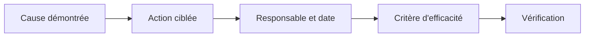
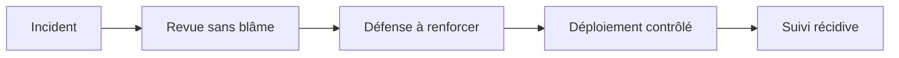

# Analyse de cause racine (5 Pourquoi, Ishikawa)

> **Mise en contexte** — Ce cours s'adresse à un technicien intermédiaire qui doit agir dans un environnement réel, respecter les contraintes de service et laisser des preuves réutilisables. L'objectif n'est pas seulement de connaître les outils, mais de comprendre pourquoi une action est choisie, dans quelles conditions elle est sûre, comment vérifier son résultat et quand demander de l'aide.

## Présentation et enjeux

L'analyse de cause racine cherche à expliquer pourquoi un incident s'est produit et pourquoi les défenses existantes ne l'ont pas empêché ou limité. Les méthodes des cinq pourquoi et du diagramme d'Ishikawa aident à structurer l'investigation, mais elles ne remplacent pas les preuves, les hypothèses vérifiables ni la prise en compte des facteurs systémiques. Cette discipline s'inscrit dans une démarche de qualité de service : chaque opération doit être reliée au besoin métier, au risque accepté et à un critère d'acceptation observable. L'intervenant doit pouvoir expliquer l'état initial, la décision prise, les résultats obtenus et les limites qui subsistent.

Dans une équipe de maintenance, les informations sont souvent réparties entre tickets, conversations, inventaires, systèmes de supervision et mémoire individuelle. Une méthode fiable les relie dans une trace commune et limite les décisions fondées sur une seule observation. Le cours met l'accent sur les preuves, les contrôles proportionnés, la reproductibilité et la communication utile.

Le niveau intermédiaire suppose que les gestes de base sont acquis. La difficulté consiste maintenant à traiter des environnements hétérogènes, des incidents ambigus, des changements qui touchent plusieurs composants et des situations où la donnée est imparfaite. Les règles présentées doivent être adaptées aux procédures approuvées de l'organisation et vérifiées dans un environnement de test avant toute action ayant un impact sur la production.

## Objectifs pédagogiques

À la fin du parcours, l'apprenant pourra :

- expliquer les principes et les limites des outils utilisés dans le domaine ;
- choisir un contrôle ou une méthode à partir de l'impact, de la criticité et des preuves disponibles ;
- effectuer une démarche reproductible et distinguer observation, hypothèse et décision ;
- interpréter les indicateurs sans confondre corrélation, résultat technique et expérience utilisateur ;
- rédiger une trace claire, traiter les exceptions et organiser une escalade ;
- vérifier l'effet d'une action, décrire le risque résiduel et proposer une amélioration mesurable.

## Prérequis et cadre de travail

Avant de commencer, savoir utiliser un terminal, lire les journaux, identifier un actif, comprendre les tickets et appliquer les règles locales de sécurité. Les commandes ci-dessous sont illustratives : adapter les noms d'hôte, les chemins et les versions, utiliser des cibles de test autorisées et ne jamais copier de secret dans un document. Une commande d'observation doit être préférée à une modification lorsqu'elle suffit à qualifier la situation.

Les principes directeurs sont les suivants : intervention autorisée, moindre privilège, sauvegarde ou retour arrière adaptés, fenêtre connue, communication compréhensible et preuve de validation. Si un contrôle critique échoue, ne pas continuer mécaniquement. Noter le constat, évaluer le risque et utiliser le point d'arrêt ou l'escalade défini par la procédure.

## Vocabulaire métier

| Terme | Utilisation opérationnelle |
|---|---|
| État initial | Description mesurée du système avant toute intervention. |
| Criticité | Conséquence potentielle de l'indisponibilité ou de la mauvaise configuration. |
| Preuve | Élément daté qui peut être vérifié par un autre intervenant. |
| Écart | Différence entre le résultat attendu et l'observation. |
| Exception | Situation où la procédure standard ne s'applique pas ou n'atteint pas son objectif. |
| Validation | Contrôle confirmant que le service ou l'opération satisfait les critères convenus. |
| Retour arrière | Séquence permettant de retrouver un état stable si les critères de réussite ne sont pas satisfaits. |
| Récurrence | Réapparition d'un problème similaire après un traitement précédent. |

## Schémas adaptés au sujet

### Schéma 1 — Chaîne d'une RCA



Les conclusions doivent découler des faits observables, des tests et de l'élimination des explications alternatives.

### Schéma 2 — Cinq pourquoi



Les questions successives doivent rester rattachées aux preuves ; le nombre cinq est indicatif et la chaîne peut se ramifier.

### Schéma 3 — Ishikawa



Le diagramme organise les causes potentielles par famille ; chaque branche doit ensuite être testée, confirmée ou rejetée.

### Schéma 4 — Fait ou hypothèse



La séparation entre faits et hypothèses évite de figer une explication non démontrée dans le rapport.

### Schéma 5 — Actions correctives



Une action doit cibler le mécanisme de risque et sa réussite doit être mesurée après une période définie.

### Schéma 6 — Apprentissage incident



Analyser les conditions de travail et les barrières techniques aide à prévenir les répétitions plutôt qu'à attribuer seulement une faute.

## Fondements techniques du domaine

### 1. Définir le problème

Une RCA commence par une description de l'écart observable, pas par une explication choisie à l'avance. Une formulation robuste précise le service ou le processus, l'état attendu, l'état constaté, la période, le périmètre et les conséquences. « Le réseau est instable » ne permet pas de vérifier une cause. « Sur le site B, 18 postes ont perdu leur connexion à l'application entre 09 h 12 et 09 h 26, alors que les postes du site A fonctionnaient » fixe un début d'enquête sans conclure trop tôt au réseau.

Définir ce qui est inclus et exclu. Indiquer les actifs, versions, sites, utilisateurs, transactions, fenêtres horaires et conditions de reproduction connus. Comparer avec un groupe qui ne présente pas le symptôme aide souvent à déterminer les variables pertinentes. Préciser la méthode de détection et les limites de mesure : une alarme mal configurée peut être elle-même un problème de mesure.

Un bon énoncé ne contient ni accusation, ni cause présumée, ni solution déjà décidée. Les expressions « erreur de l'opérateur », « mauvais fournisseur » ou « changement défectueux » sont des hypothèses si elles ne sont pas démontrées. L'énoncé doit rester stable pendant la collecte de preuves; s'il évolue parce que le périmètre change, noter cette évolution et la raison. En cas d'incident encore actif, protéger le service et suivre les procédures d'urgence en parallèle : la RCA ne doit pas retarder une mesure de sécurité ou de restauration nécessaire.
### 2. Collecter des preuves

La qualité de l'analyse dépend de la qualité des données disponibles. Construire une chronologie unifiée avec les heures, sources et fuseaux cohérents. Rassembler les tickets liés, les alarmes, les journaux système, les métriques, les changements, les inventaires et les témoignages horodatés. Ne pas supposer que toutes les horloges sont synchronisées : vérifier les dérives et documenter toute correction appliquée à la chronologie.

Séparer quatre catégories dans le dossier :
- **Faits observés** : événements, mesures, valeurs de configuration ou comportements reproduits avec leur source.
- **Hypothèses** : explications provisoires qui restent à tester.
- **Décisions** : actions entreprises, auteur, moment, autorisation et motif.
- **Inconnues** : données indisponibles, fenêtre non couverte, logs manquants et limites du dispositif d'observation.

Conserver les données sources conformément à la politique interne; ne pas éditer silencieusement les journaux originaux. Pour les extraits, noter le système d'origine, l'intervalle temporel, les filtres et l'heure d'extraction. Protéger les secrets, les données personnelles et les informations sensibles; restreindre l'accès aux personnes qui en ont besoin. Si une donnée essentielle n'existe pas, cette absence n'est pas la preuve d'une absence d'événement : c'est une limite de l'enquête et potentiellement une action d'amélioration du système de surveillance.

Une cause plausible doit produire des prédictions vérifiables. Si l'hypothèse est que la saturation d'un lien a provoqué une perte de sessions, rechercher les mesures de charge, les compteurs d'erreurs, les pertes et la concordance temporelle. Une simple coïncidence entre un changement et un incident ne prouve pas que le changement est causal; comparer avec la configuration antérieure, les composants non affectés et les autres changements contemporains.
### 3. Cinq pourquoi

La méthode des cinq pourquoi est une conversation guidée qui cherche à creuser les mécanismes sous un symptôme. « Cinq » est un repère, pas un nombre obligatoire. Il faut arrêter lorsqu'une réponse devient trop spéculative, lorsqu'on n'a plus de preuves, ou lorsqu'il faut ouvrir une branche causale différente. Chaque réponse devrait être formulée comme une affirmation testable, liée à une preuve ou à un plan de vérification.

Exemple illustratif : des postes perdent l'accès à une application après un renouvellement de certificats. Pourquoi les sessions échouent-elles ? Parce que certains clients ne valident plus la chaîne présentée. Pourquoi ? Parce que le certificat intermédiaire attendu n'est pas envoyé sur le chemin utilisé. Pourquoi la différence n'a-t-elle pas été détectée ? Parce que le test avant changement ne couvrait qu'un client récent. Pourquoi le plan d'essai était-il limité ? Parce que les profils de clients n'étaient pas maintenus dans le référentiel de test. Pourquoi ce référentiel n'était-il pas à jour ? Parce que son propriétaire et sa revue n'étaient pas définis. Cette dernière réponse suggère une défaillance de gouvernance de test, mais elle reste à valider : les logs, versions, changements et résultats de reproduction doivent soutenir chaque lien.

Ne force pas une chaîne linéaire si plusieurs causes contribuent au même effet. Le défaut technique, l'absence d'un test représentatif, la faiblesse de l'alerte et l'absence de procédure de retour peuvent coexister sans qu'une seule soit « la » cause. Évite le raisonnement circulaire comme « cela a échoué parce que cela ne marchait pas » et les réponses vagues telles que « erreur humaine ». Demande plutôt quelle condition rendait l'erreur possible, quels contrôles auraient dû la détecter et pourquoi ils n'ont pas fonctionné.
### 4. Ishikawa

Le diagramme d'Ishikawa, ou diagramme de cause à effet, organise les causes possibles en familles avant de décider quoi tester. Les catégories dites des 6 M — méthodes, main-d'œuvre, machines, matières, mesures et milieu — viennent d'environnements industriels, mais leur adaptation doit refléter le problème réel. En maintenance informatique, on peut examiner les personnes et compétences, les procédures, les composants matériels ou logiciels, les données, les mesures de supervision, les fournisseurs et le contexte d'exploitation.

L'objectif est d'élargir la recherche puis de prioriser les branches vérifiables, pas de remplir chaque arête pour faire joli. Une liste d'idées issue d'un atelier reste un inventaire d'hypothèses. Chaque branche utile doit être associée à une observation attendue, une source de preuve, un test sûr, un propriétaire et une décision si l'hypothèse est infirmée. Les participants qui connaissent le travail réel doivent être représentés; une RCA menée uniquement par des personnes éloignées du terrain risque d'ignorer des contraintes invisibles dans les documents.

Après la séance, classer les causes candidates selon l'impact possible, la force des indices, le coût du test et le délai. Ne pas confondre vote majoritaire et preuve. Une hypothèse minoritaire mais falsifiable peut être plus utile qu'une explication populaire non vérifiée. Si plusieurs facteurs sont confirmés, documente leur relation : certains provoquent l'événement, d'autres permettent qu'il atteigne l'utilisateur ou retardent sa détection.
### 5. Facteurs humains et système

Une RCA utile examine l'interaction entre les individus, les procédures, les outils, les informations, la charge de travail, l'environnement et les mécanismes de contrôle. La question « qui a fait cela ? » peut aider à établir la chronologie, mais ne suffit pas à expliquer pourquoi l'action semblait correcte, pourquoi elle n'a pas été détectée et pourquoi les barrières n'ont pas limité ses conséquences.

Examiner, par exemple, si une instruction était ambiguë, si l'interface rendait deux actifs semblables, si les droits étaient excessifs, si la consigne d'arrêt était connue, si les alertes étaient saturées, si la fatigue ou l'interruption ont affecté l'exécution et si l'organisation autorisait de fait une pratique non documentée. Ces éléments ne dédouanent pas automatiquement une personne; ils permettent de proposer des mesures qui réduisent le risque même lorsque des personnes différentes exécutent la même tâche.

Une action « rappeler aux techniciens d'être plus attentifs » est rarement suffisante seule. Préférer des contrôles qui agissent sur le mécanisme : confirmation explicite de la cible, validation à deux personnes pour les actions critiques, séparation des environnements, test automatisé sur un profil représentatif, permission minimale ou alerte mesurable. La formation reste utile si un déficit de compétence a été démontré, mais elle ne remplace pas un contrôle technique possible.
### 6. Cause immédiate et causes contributives

La cause immédiate décrit le mécanisme proche de l'effet observé. Les facteurs contributifs expliquent pourquoi ce mécanisme s'est produit ou pourquoi son impact a été plus important. Les conditions latentes concernent des contrôles, des décisions ou des défauts d'organisation qui ont rendu l'événement plus probable. Les barrières de détection et de récupération méritent leur propre analyse : comprendre l'origine d'une panne ne suffit pas si l'organisation aurait pu la détecter plus tôt ou limiter son rayon d'impact.

Un incident peut avoir plusieurs chaînes causales. Par exemple, une saturation est causée par une croissance de charge; l'impact devient important parce que la capacité n'a pas été surveillée; il dure longtemps parce que l'alerte n'est pas routée vers le bon propriétaire; la récupération est lente parce qu'aucune procédure de délestage n'a été testée. Il ne faut pas déclarer chacun de ces éléments « cause racine » sans préciser leur rôle. Distinguer déclencheur, mécanisme, facteur aggravant, échec de détection et échec de récupération rend les actions plus ciblées.

Le diagramme causal doit être validé par la chronologie et les données. Vérifier que la cause proposée précède l'effet, qu'elle est compatible avec les faits et que les observations contraires ont été traitées. Une causalité peut être renforcée par un test contrôlé, une reproduction, une comparaison entre périmètres affectés et non affectés, ou l'évolution des indicateurs après correction. Si la preuve reste incomplète, documenter un niveau de confiance et les prochaines vérifications au lieu d'affirmer une certitude artificielle.
### 7. Actions correctives

Les actions doivent viser le mécanisme causal établi et les barrières qui auraient réduit l'impact. Séparer les mesures immédiates de stabilisation, les corrections définitives, les améliorations de détection et les actions organisationnelles. Attribuer à chaque action un responsable, une date cible, des dépendances, le risque traité et un critère d'achèvement vérifiable. Une tâche « revoir la procédure » est insuffisante sans indiquer quelle ambiguïté sera corrigée et comment la version révisée sera testée.

Privilégier la hiérarchie des contrôles lorsqu'elle est pertinente : éliminer la condition dangereuse, rendre l'erreur plus difficile, détecter l'écart avant son impact, limiter les conséquences, puis soutenir la bonne pratique par une procédure ou une formation. Le choix dépend du contexte; une action plus simple peut être appropriée si elle est suffisante et peut être validée rapidement. Vérifier qu'une correction n'introduit pas un autre risque ou une dégradation d'accessibilité.

Une action corrective est achevée lorsque l'état attendu a été démontré, pas lorsqu'une tâche est marquée « terminée » dans le système de tickets. Conserver les tests, leur périmètre, les résultats et les limites. Pour une modification de production, utiliser le circuit de changement applicable. Si la correction doit être déployée par vagues, définir la taille des lots, les critères d'arrêt et le retour arrière. Les actions non réalisées doivent rester visibles avec un propriétaire et un risque résiduel explicitement accepté par la personne autorisée.
### 8. Vérifier l'efficacité

Une RCA n'est pas achevée lorsque le rapport est publié. Il faut vérifier que les actions ont changé le comportement du système et que la récurrence ou l'impact ont diminué. Définir avant l'action une mesure de référence, une cible, une durée d'observation et un propriétaire du suivi. Selon le problème, mesurer le nombre d'incidents comparables par période, le taux d'échec, le temps de détection, la durée d'interruption, le pourcentage d'essais réussis ou le taux de conformité à une procédure.

Éviter les conclusions à partir d'un petit échantillon ou d'une période atypique. Si le volume est faible, compléter les mesures par un test de défaillance en environnement contrôlé ou un examen d'échantillons. Segmenter par version, site, type d'actif ou scénario afin de ne pas masquer une régression localisée. Un indicateur qui s'améliore peut refléter une baisse de déclaration plutôt qu'une réduction réelle des incidents; trianguler les tickets, la supervision et le retour des utilisateurs.

Si le résultat attendu n'est pas atteint, ne déclare pas automatiquement que les équipes ont mal exécuté la correction. Reprendre l'analyse : cause initiale incomplète, mise en œuvre partielle, effet secondaire, mesure mal choisie ou facteurs externes. Les actions correctives peuvent devoir être adaptées. Fermer la RCA lorsque le résultat convenu est vérifié, ou documenter explicitement pourquoi un risque résiduel demeure et qui a accepté ce risque.
## Méthode transversale pour une opération maîtrisée

### 1. Gouvernance

L'intervention doit être reliée à un objectif de service, un propriétaire et une décision explicite. Le contrôle de gouvernance n'a de valeur que s'il aide à identifier qui peut accepter le risque et qui doit être informé. Pour analyse de cause racine (5 pourquoi, ishikawa), cela signifie que la personne qui agit doit relier la règle à un élément concret : récidive après action, délai d'analyse, actions correctives en retard, pourcentage d'actions vérifiées, incidents sans cause étayée, détection avant impact. Avant l'opération, noter l'état de départ et ce qui fera considérer le résultat comme acceptable. Pendant l'action, conserver le contexte des changements et indiquer immédiatement les écarts. Après l'action, exécuter le contrôle correspondant au risque, enregistrer le résultat et affecter les suites restantes. Cette discipline augmente la qualité de la passation et réduit la dépendance à une personne unique.

### 2. Cycle de vie

La solution doit être pensée depuis la préparation jusqu'à la sortie, y compris le maintien des compétences et le retrait des anciennes données. Une étape oubliée en fin de cycle transforme souvent une réussite ponctuelle en risque latent. Pour analyse de cause racine (5 pourquoi, ishikawa), cela signifie que la personne qui agit doit relier la règle à un élément concret : récidive après action, délai d'analyse, actions correctives en retard, pourcentage d'actions vérifiées, incidents sans cause étayée, détection avant impact. Avant l'opération, noter l'état de départ et ce qui fera considérer le résultat comme acceptable. Pendant l'action, conserver le contexte des changements et indiquer immédiatement les écarts. Après l'action, exécuter le contrôle correspondant au risque, enregistrer le résultat et affecter les suites restantes. Cette discipline augmente la qualité de la passation et réduit la dépendance à une personne unique.

### 3. Qualité de données

Toute mesure dépend de la qualité de son périmètre, de l'horodatage, de l'unité et de la provenance. Il faut identifier les champs manquants et les conventions contradictoires avant de tirer une conclusion. Pour analyse de cause racine (5 pourquoi, ishikawa), cela signifie que la personne qui agit doit relier la règle à un élément concret : récidive après action, délai d'analyse, actions correctives en retard, pourcentage d'actions vérifiées, incidents sans cause étayée, détection avant impact. Avant l'opération, noter l'état de départ et ce qui fera considérer le résultat comme acceptable. Pendant l'action, conserver le contexte des changements et indiquer immédiatement les écarts. Après l'action, exécuter le contrôle correspondant au risque, enregistrer le résultat et affecter les suites restantes. Cette discipline augmente la qualité de la passation et réduit la dépendance à une personne unique.

### 4. Gestion du risque

Le risque se juge par probabilité, impact, capacité de détection et marge de récupération. Les éléments critiques doivent recevoir plus de contrôles, sans imposer la même lourdeur aux opérations réversibles et aux changements irréversibles. Pour analyse de cause racine (5 pourquoi, ishikawa), cela signifie que la personne qui agit doit relier la règle à un élément concret : récidive après action, délai d'analyse, actions correctives en retard, pourcentage d'actions vérifiées, incidents sans cause étayée, détection avant impact. Avant l'opération, noter l'état de départ et ce qui fera considérer le résultat comme acceptable. Pendant l'action, conserver le contexte des changements et indiquer immédiatement les écarts. Après l'action, exécuter le contrôle correspondant au risque, enregistrer le résultat et affecter les suites restantes. Cette discipline augmente la qualité de la passation et réduit la dépendance à une personne unique.

### 5. Communication

Une communication utile indique ce qui est connu, ce qui reste à vérifier, qui agit ensuite et quand une nouvelle information sera fournie. Les formulations doivent éviter les promesses non vérifiées. Pour analyse de cause racine (5 pourquoi, ishikawa), cela signifie que la personne qui agit doit relier la règle à un élément concret : récidive après action, délai d'analyse, actions correctives en retard, pourcentage d'actions vérifiées, incidents sans cause étayée, détection avant impact. Avant l'opération, noter l'état de départ et ce qui fera considérer le résultat comme acceptable. Pendant l'action, conserver le contexte des changements et indiquer immédiatement les écarts. Après l'action, exécuter le contrôle correspondant au risque, enregistrer le résultat et affecter les suites restantes. Cette discipline augmente la qualité de la passation et réduit la dépendance à une personne unique.

### 6. Sécurité

Le périmètre technique doit rester limité aux systèmes autorisés, avec une identité traçable et les droits minimaux nécessaires. Les secrets doivent être protégés dans les fichiers, les journaux, les captures et les exports. Pour analyse de cause racine (5 pourquoi, ishikawa), cela signifie que la personne qui agit doit relier la règle à un élément concret : récidive après action, délai d'analyse, actions correctives en retard, pourcentage d'actions vérifiées, incidents sans cause étayée, détection avant impact. Avant l'opération, noter l'état de départ et ce qui fera considérer le résultat comme acceptable. Pendant l'action, conserver le contexte des changements et indiquer immédiatement les écarts. Après l'action, exécuter le contrôle correspondant au risque, enregistrer le résultat et affecter les suites restantes. Cette discipline augmente la qualité de la passation et réduit la dépendance à une personne unique.

### 7. Traçabilité

Une action exploitable doit laisser un résultat vérifiable, un horodatage, un propriétaire et un lien avec le ticket ou le changement. La trace doit permettre à un autre technicien de comprendre ce qui a été fait. Pour analyse de cause racine (5 pourquoi, ishikawa), cela signifie que la personne qui agit doit relier la règle à un élément concret : récidive après action, délai d'analyse, actions correctives en retard, pourcentage d'actions vérifiées, incidents sans cause étayée, détection avant impact. Avant l'opération, noter l'état de départ et ce qui fera considérer le résultat comme acceptable. Pendant l'action, conserver le contexte des changements et indiquer immédiatement les écarts. Après l'action, exécuter le contrôle correspondant au risque, enregistrer le résultat et affecter les suites restantes. Cette discipline augmente la qualité de la passation et réduit la dépendance à une personne unique.

### 8. Gestion des exceptions

Les cas hors procédure doivent être visibles et conduire à un point d'arrêt, une décision ou une escalade. Une exception récurrente est souvent le signal qu'il faut faire évoluer la procédure plutôt que la répéter. Pour analyse de cause racine (5 pourquoi, ishikawa), cela signifie que la personne qui agit doit relier la règle à un élément concret : récidive après action, délai d'analyse, actions correctives en retard, pourcentage d'actions vérifiées, incidents sans cause étayée, détection avant impact. Avant l'opération, noter l'état de départ et ce qui fera considérer le résultat comme acceptable. Pendant l'action, conserver le contexte des changements et indiquer immédiatement les écarts. Après l'action, exécuter le contrôle correspondant au risque, enregistrer le résultat et affecter les suites restantes. Cette discipline augmente la qualité de la passation et réduit la dépendance à une personne unique.

### 9. Amélioration continue

Les incidents, les retours utilisateurs et les contrôles qualité doivent transformer les règles et procédures. Il faut vérifier si les modifications réduisent réellement le risque, et pas seulement si les documents ont été mis à jour. Pour analyse de cause racine (5 pourquoi, ishikawa), cela signifie que la personne qui agit doit relier la règle à un élément concret : récidive après action, délai d'analyse, actions correctives en retard, pourcentage d'actions vérifiées, incidents sans cause étayée, détection avant impact. Avant l'opération, noter l'état de départ et ce qui fera considérer le résultat comme acceptable. Pendant l'action, conserver le contexte des changements et indiquer immédiatement les écarts. Après l'action, exécuter le contrôle correspondant au risque, enregistrer le résultat et affecter les suites restantes. Cette discipline augmente la qualité de la passation et réduit la dépendance à une personne unique.

### 10. Capacité

Les ressources, compétences, fenêtres et dépendances limitent le volume d'opérations réalisables. Une planification crédible tient compte de la charge, des temps de contrôle et des imprévus. Pour analyse de cause racine (5 pourquoi, ishikawa), cela signifie que la personne qui agit doit relier la règle à un élément concret : récidive après action, délai d'analyse, actions correctives en retard, pourcentage d'actions vérifiées, incidents sans cause étayée, détection avant impact. Avant l'opération, noter l'état de départ et ce qui fera considérer le résultat comme acceptable. Pendant l'action, conserver le contexte des changements et indiquer immédiatement les écarts. Après l'action, exécuter le contrôle correspondant au risque, enregistrer le résultat et affecter les suites restantes. Cette discipline augmente la qualité de la passation et réduit la dépendance à une personne unique.

### 11. Contrôle du changement

Une modification nécessite un état initial connu, un périmètre, des critères de réussite et une solution de repli adaptée au risque. L'urgence ne supprime pas le besoin de garder une trace des décisions. Pour analyse de cause racine (5 pourquoi, ishikawa), cela signifie que la personne qui agit doit relier la règle à un élément concret : récidive après action, délai d'analyse, actions correctives en retard, pourcentage d'actions vérifiées, incidents sans cause étayée, détection avant impact. Avant l'opération, noter l'état de départ et ce qui fera considérer le résultat comme acceptable. Pendant l'action, conserver le contexte des changements et indiquer immédiatement les écarts. Après l'action, exécuter le contrôle correspondant au risque, enregistrer le résultat et affecter les suites restantes. Cette discipline augmente la qualité de la passation et réduit la dépendance à une personne unique.

### 12. Mesure d'efficacité

Un indicateur ne vaut que si sa définition reste constante et si sa variation peut conduire à une décision. Les chiffres doivent être accompagnés d'une période, d'un périmètre et des limites de mesure. Pour analyse de cause racine (5 pourquoi, ishikawa), cela signifie que la personne qui agit doit relier la règle à un élément concret : récidive après action, délai d'analyse, actions correctives en retard, pourcentage d'actions vérifiées, incidents sans cause étayée, détection avant impact. Avant l'opération, noter l'état de départ et ce qui fera considérer le résultat comme acceptable. Pendant l'action, conserver le contexte des changements et indiquer immédiatement les écarts. Après l'action, exécuter le contrôle correspondant au risque, enregistrer le résultat et affecter les suites restantes. Cette discipline augmente la qualité de la passation et réduit la dépendance à une personne unique.

### 13. Passation

Une tâche doit pouvoir être reprise par une autre personne sans dépendre des souvenirs du technicien présent. La transmission contient contexte, preuves, étapes déjà tentées et prochaine action. Pour analyse de cause racine (5 pourquoi, ishikawa), cela signifie que la personne qui agit doit relier la règle à un élément concret : récidive après action, délai d'analyse, actions correctives en retard, pourcentage d'actions vérifiées, incidents sans cause étayée, détection avant impact. Avant l'opération, noter l'état de départ et ce qui fera considérer le résultat comme acceptable. Pendant l'action, conserver le contexte des changements et indiquer immédiatement les écarts. Après l'action, exécuter le contrôle correspondant au risque, enregistrer le résultat et affecter les suites restantes. Cette discipline augmente la qualité de la passation et réduit la dépendance à une personne unique.

### 14. Validation métier

Le résultat technique doit être confirmé du point de vue du service. Un équipement joignable ou un script qui termine sans erreur ne suffit pas si l'utilisateur ne peut pas accomplir son opération. Pour analyse de cause racine (5 pourquoi, ishikawa), cela signifie que la personne qui agit doit relier la règle à un élément concret : récidive après action, délai d'analyse, actions correctives en retard, pourcentage d'actions vérifiées, incidents sans cause étayée, détection avant impact. Avant l'opération, noter l'état de départ et ce qui fera considérer le résultat comme acceptable. Pendant l'action, conserver le contexte des changements et indiquer immédiatement les écarts. Après l'action, exécuter le contrôle correspondant au risque, enregistrer le résultat et affecter les suites restantes. Cette discipline augmente la qualité de la passation et réduit la dépendance à une personne unique.

## Indicateurs : définition, lecture et limites

Les indicateurs les plus utiles pour ce domaine sont : **récidive après action, délai d'analyse, actions correctives en retard, pourcentage d'actions vérifiées, incidents sans cause étayée, détection avant impact**. Chaque indicateur doit avoir une définition écrite. Il faut préciser l'unité, la source, le périmètre, la fréquence, la période et les exclusions. Lorsque les données ne couvrent qu'une partie de l'environnement, le rapport doit le signaler au lieu d'extrapoler silencieusement. Un indicateur doit permettre une décision : prioriser, déclencher une vérification, ajuster une capacité, revoir une procédure ou accepter explicitement un risque.

Un bon tableau de bord met en évidence la tendance et les écarts significatifs, sans supprimer la donnée de départ. Il distingue les valeurs brutes, les seuils, les anomalies confirmées et les périodes sans mesure. Une moyenne peut cacher des situations extrêmes ; il est donc souvent nécessaire d'observer la distribution, les percentiles, les valeurs maximales et la répartition par service ou par criticité. Les changements de définition doivent être versionnés pour éviter de comparer des séries qui ne signifient plus la même chose.

Les indicateurs ne doivent pas devenir des objectifs isolés. Par exemple, réduire le délai moyen n'est pas une amélioration si les tickets sont fermés avant validation et immédiatement rouverts. De même, atteindre un taux de conformité en excluant les actifs inconnus peut donner une image artificiellement favorable. Associer un KPI à un contrôle de qualité et à un résultat métier permet de repérer ces effets indésirables.

## Procédure opérationnelle recommandée

1. **Préparer.** Confirmer la demande, le périmètre, le propriétaire, l'autorisation et la fenêtre. Vérifier les dépendances, les sauvegardes et les accès nécessaires.
2. **Établir l'état initial.** Recueillir les mesures, l'état des services, les alertes, la dernière intervention et les écarts connus. Noter les éléments non vérifiables.
3. **Évaluer les risques.** Déterminer impact, probabilité, détectabilité, réversibilité et critère de report. Définir un point d'arrêt compréhensible.
4. **Exécuter par étapes.** Utiliser les outils approuvés, limiter le périmètre et vérifier les résultats intermédiaires avant de passer à l'étape suivante.
5. **Contrôler.** Comparer l'état final à l'état attendu et tester le service selon un scénario réaliste, pas uniquement le composant technique.
6. **Tracer.** Enregistrer les horaires, commandes ou actions, résultats, décisions et écarts dans le ticket ou le référentiel prévu.
7. **Communiquer.** Annoncer le résultat en termes compréhensibles, préciser les limites et indiquer qui gère les actions ouvertes.
8. **Améliorer.** Rechercher les étapes ambiguës ou les contrôles inefficaces et proposer une modification versionnée, testée et approuvée.

## Outils et contrôles pratiques

Les outils doivent être sélectionnés selon l'objectif, les droits et le type de preuve recherché. L'usage d'un outil connu ne dispense pas de contrôler son contexte : version, paramètres, cible, unité, état de connexion et limite de la mesure. chronologie d'incident, journaux, supervision, traces de changement, cinq pourquoi, Ishikawa, arbre de défaillance simplifié, méthode d'action corrective constituent des exemples de technologies possibles ; leur choix exact dépend de l'environnement et des politiques internes.

| Contrôle | Question à poser | Trace à conserver |
|---|---|---|
| Identité de la cible | Est-ce bien l'actif ou le service autorisé ? | Identifiant, inventaire et horodatage. |
| État initial | Quelle condition de départ a été mesurée ? | Valeur, source, capture ou sortie. |
| Autorisation | Qui a approuvé l'action et pour quelle fenêtre ? | Ticket, validation et périmètre. |
| Résultat | Qu'est-ce qui démontre que le résultat est correct ? | Test de contrôle et résultat observé. |
| Écart | Que faire si le résultat attendu n'est pas obtenu ? | Point d'arrêt, escalade et action attribuée. |

### Commandes et exemples

Les commandes de cette section servent à illustrer la collecte de preuves. Remplacer les valeurs de test par des cibles autorisées et vérifier localement les options selon la distribution et la version de l'outil.

#### Exemple 1 — Consulter la chronologie système récente

```bash
journalctl --since '2 hours ago' --no-pager
```

Interpréter la sortie avec le contexte de l'intervention. Un retour nul ne démontre pas toujours que la fonction métier est opérationnelle. Relever les erreurs, vérifier l'heure des journaux et comparer les observations avec une seconde source lorsque l'impact le justifie. Ne pas intégrer un résultat de terminal dans un rapport sans préciser la machine, la période et la commande effectivement exécutée.

#### Exemple 2 — Filtrer les journaux d'un service à une période donnée

```bash
journalctl -u nom-du-service --since '2026-10-27 08:00:00' --until '2026-10-27 09:00:00' --no-pager
```

Interpréter la sortie avec le contexte de l'intervention. Un retour nul ne démontre pas toujours que la fonction métier est opérationnelle. Relever les erreurs, vérifier l'heure des journaux et comparer les observations avec une seconde source lorsque l'impact le justifie. Ne pas intégrer un résultat de terminal dans un rapport sans préciser la machine, la période et la commande effectivement exécutée.

#### Exemple 3 — Comparer une version de configuration dans Git

```bash
git diff -- config/
```

Interpréter la sortie avec le contexte de l'intervention. Un retour nul ne démontre pas toujours que la fonction métier est opérationnelle. Relever les erreurs, vérifier l'heure des journaux et comparer les observations avec une seconde source lorsque l'impact le justifie. Ne pas intégrer un résultat de terminal dans un rapport sans préciser la machine, la période et la commande effectivement exécutée.

#### Exemple 4 — Créer une empreinte d'un fichier de preuve avant archivage

```bash
sha256sum fichier-preuve.log
```

Interpréter la sortie avec le contexte de l'intervention. Un retour nul ne démontre pas toujours que la fonction métier est opérationnelle. Relever les erreurs, vérifier l'heure des journaux et comparer les observations avec une seconde source lorsque l'impact le justifie. Ne pas intégrer un résultat de terminal dans un rapport sans préciser la machine, la période et la commande effectivement exécutée.


## Boîte à outils RCA pour l'équipe de maintenance

Une analyse efficace combine plusieurs outils au lieu de demander à une seule méthode de produire toute la vérité. Les cinq pourquoi aident à creuser un mécanisme; Ishikawa élargit les causes possibles; la chronologie révèle les relations temporelles; Pareto aide à sélectionner les occurrences les plus fréquentes; les comparaisons « est / n'est pas » isolent les différences; un arbre de défaillances représente des combinaisons logiques; et un plan d'action transforme les conclusions en améliorations vérifiables. Le choix dépend de la question et des données disponibles.

### Comparer « est / n'est pas » avant de conclure

Quand le symptôme ne se produit que sur une partie du parc, la comparaison structurée peut être plus informative qu'une longue séance d'idées. Décrire ce qui est touché et ce qui ne l'est pas selon des dimensions comparables : qui, quoi, où, quand, combien, version, changement et conditions de fonctionnement. Les différences constituent des pistes, non une preuve en elles-mêmes.

| Dimension | EST : observation | N'EST PAS : contraste utile | Question à tester |
|---|---|---|---|
| Qui | Postes de deux équipes d'un site | Postes d'un autre site | Différence de profil ou de stratégie ? |
| Où | VLAN utilisateurs X | VLAN utilisateurs Y | Chemin réseau ou règle différente ? |
| Quand | Apparition après une fenêtre de changement | Période antérieure stable | Quel état a réellement changé ? |
| Quoi | Connexion à une application précise | Autres applications accessibles | Dépendance commune ou spécifique ? |
| Combien | 18 actifs affectés | 140 actifs comparables sans défaut | Quel élément différencie ces groupes ? |
| Version | Clients avec une version donnée | Clients de version précédente | Compatibilité ou déploiement incomplet ? |

Ne pas sélectionner uniquement les différences qui confirment la première hypothèse. Noter aussi les différences sans effet et tester si elles sont réellement pertinentes. Une comparaison utile porte sur des actifs aussi similaires que possible et utilise une même méthode de mesure. Si les groupes diffèrent sur beaucoup de dimensions, isoler progressivement les variables plutôt que conclure sur un seul facteur.

~~~mermaid
flowchart TD
    A[Définir le symptôme] --> B[Choisir un groupe affecté]
    A --> C[Choisir un groupe non affecté comparable]
    B --> D[Relever versions, lieu, heure et état]
    C --> D
    D --> E[Comparer les différences]
    E --> F[Formuler plusieurs hypothèses]
    F --> G[Choisir un test discriminant]
    G --> H{Les résultats correspondent-ils ?}
    H -- Non --> F
    H -- Oui --> I[Confirmer avec une preuve indépendante]
~~~

### Pareto : choisir où approfondir sans ignorer le risque

Le diagramme de Pareto classe les catégories par fréquence ou contribution mesurée, souvent avec une courbe cumulative. Il aide à décider où concentrer l'investigation lorsque de nombreux incidents se ressemblent. Il ne démontre pas la causalité et ne doit pas servir à ignorer un incident rare à conséquence très grave. Les événements de sécurité, d'intégrité ou de continuité peuvent demander une analyse prioritaire même s'ils sont peu fréquents.

Avant de construire le Pareto, définir l'unité : nombre de tickets, minutes d'indisponibilité, coût, actifs touchés ou échecs de contrôle. Ces mesures répondent à des questions différentes. Dédupliquer les alertes répétées si elles décrivent un seul événement; autrement, une sonde bruyante peut dominer artificiellement les résultats. Garder la période, les règles de classification et les limites de données dans le rapport.

~~~mermaid
flowchart LR
    A[Exporter les incidents comparables] --> B[Nettoyer doublons et catégories]
    B --> C[Choisir une mesure adaptée]
    C --> D[Classer les catégories du plus grand au plus faible]
    D --> E[Examiner le cumul et le contexte]
    E --> F[Prioriser les investigations]
    F --> G[Tester les causes, pas seulement les fréquences]
~~~

### Arbre de défaillances : comprendre les combinaisons de facteurs

Un arbre de défaillances part d'un événement redouté et décompose les conditions susceptibles de le produire. Les portes logiques AND et OR représentent des relations précises : une porte OR signifie qu'une seule des branches suffit selon le modèle; une porte AND signifie que plusieurs conditions doivent être réunies. Il faut préciser les hypothèses et le périmètre de chaque porte. L'arbre reste un modèle tant que les relations n'ont pas été corroborées.

Exemple : l'interruption d'accès à un service pourrait nécessiter simultanément la perte de la route principale et l'indisponibilité du chemin de secours. Si un seul de ces événements suffit à interrompre le service dans l'architecture réelle, le modèle doit utiliser une autre relation. Une erreur de logique rendrait l'analyse trompeuse.

~~~mermaid
flowchart TD
    A[Perte totale du service] --> OR{OU}
    OR --> B[Défaillance du chemin principal]
    OR --> C[Erreur de configuration commune]
    B --> AND{ET}
    AND --> D[Route principale indisponible]
    AND --> E[Chemin secondaire non opérationnel]
    C --> F[Changement appliqué à plusieurs chemins]
~~~

Ne pas interpréter l'arbre comme une preuve que toutes les branches sont survenues. Il sert à identifier les données à recueillir, les barrières à examiner et les scénarios à tester. Les seuils d'acceptation, les conséquences et le plan de continuité restent documentés à part.

### Relier chronologie, changement et impact

Une timeline RCA comprend idéalement le dernier état connu comme sain, le premier signal anormal, les changements observés, les symptômes utilisateurs, les décisions, les mitigations et le moment où les critères de rétablissement sont satisfaits. Les heures doivent être normalisées tout en conservant les horodatages d'origine. En cas de décalage d'horloge, noter la correction estimée et son incertitude.

~~~mermaid
timeline
    title Exemple de chronologie d'incident
    08:45 : Service encore sain selon la supervision
    09:00 : Changement approuvé appliqué
    09:07 : Première alerte de latence
    09:10 : Premiers tickets utilisateurs
    09:18 : Mitigation déclenchée
    09:32 : Test fonctionnel concluant
    10:00 : Surveillance renforcée et suivi
~~~

Cette chronologie est un exemple pédagogique, pas un enregistrement d'incident réel. Dans une véritable RCA, remplacer chaque étape par des preuves traçables et indiquer les intervalles où il est impossible de préciser l'heure. Si l'alerte est arrivée après le début de l'effet, examiner aussi le délai de détection et non seulement la cause de l'événement.

### Vérifier une hypothèse par un test discriminant

Une bonne investigation ne multiplie pas les tests au hasard. Pour chaque hypothèse prioritaire, écrire ce qui devrait être observé si elle est vraie, ce qu'on devrait voir si elle est fausse, quel système fournit la mesure et quel résultat pourrait être ambigu. Le test doit distinguer les hypothèses concurrentes sans créer un risque disproportionné.

| Hypothèse | Résultat attendu si elle est vraie | Test adapté | Limite à noter |
|---|---|---|---|
| Un changement a modifié un paramètre fautif | Écart entre état précédent et état courant sur les actifs affectés | Diff de configuration et comparaison d'actifs | D'autres changements ont pu survenir |
| Le lien est saturé | Charge élevée concordant avec pertes et latence | Courbes d'utilisation, compteurs et mesures de bout en bout | Une moyenne peut masquer les pics |
| La procédure de déploiement omet un profil | Les clients de ce profil échouent plus fréquemment | Comparaison reproductible par profil | Les profils peuvent différer sur d'autres critères |
| L'alerte n'est pas correctement routée | Le signal existe mais la notification ou l'assignation échoue | Historique de règle, destination et accusé | Un incident de canal peut imiter une règle incorrecte |

Un test non concluant n'est pas une validation partielle de l'hypothèse. Il peut signifier que la fenêtre est trop courte, la méthode inadéquate, le signal absent ou l'hypothèse mal formulée. Enregistrer ce qui a été appris et modifier le plan d'enquête. Si le test exige une modification de production, passer par l'autorisation appropriée et convenir d'un retour arrière.

~~~mermaid
flowchart TD
    A[Énoncer une hypothèse falsifiable] --> B[Prédire le résultat attendu]
    B --> C[Définir le test et la source de preuve]
    C --> D[Évaluer sécurité et autorisation]
    D --> E[Exécuter le test contrôlé]
    E --> F{Résultat discriminant ?}
    F -- Non --> G[Documenter la limite et redessiner le test]
    G --> C
    F -- Oui --> H[Conserver données et interprétation]
    H --> I[Confirmer ou rejeter l'hypothèse]
~~~

### Construire un Ishikawa et convertir les idées en tests

Pour une panne informatique, les familles classiques peuvent être adaptées à l'environnement : personnes et compétences, méthodes et procédures, matériel et logiciel, données et mesures, environnement, fournisseurs et gouvernance. Les causes peuvent apparaître dans plusieurs familles; l'important est de rendre visible l'hypothèse, pas de ranger chaque idée dans une case parfaite.

~~~mermaid
flowchart LR
    A[Personnes et compétences] --> X[Incident analysé]
    B[Méthodes et procédures] --> X
    C[Matériel et logiciel] --> X
    D[Données et mesures] --> X
    E[Environnement et charge] --> X
    F[Fournisseurs et gouvernance] --> X
~~~

Dans chaque famille, formuler des causes précises. « Supervision » est une catégorie; « le seuil d'alerte ne se déclenche que lorsque le délai moyen dépasse la limite sur cinq minutes, ce qui retarde la détection d'un pic bref » est une hypothèse testable. Associer ensuite chaque idée à une source et à une méthode de test. Les idées qui ne peuvent être testées faute de donnée deviennent des limites et des possibilités d'amélioration du dispositif de mesure.

### Plan d'actions correctives et préventives

Un plan d'action relie la preuve à une mesure proportionnée. Il ne s'agit pas de remplir une longue liste : chaque action doit répondre à une cause confirmée ou à un risque de détection/récupération démontré.

| Champ | Question de contrôle |
|---|---|
| Cause ou barrière visée | Quelle observation ou conclusion justifie l'action ? |
| Action choisie | Quel changement concret sera fait ? |
| Responsable | Qui possède la compétence et l'autorité pour la réaliser ? |
| Échéance | Quelle date correspond au risque et aux dépendances ? |
| Risque secondaire | Quel effet indésirable peut être introduit ? |
| Validation | Quel test prouvera que l'action fonctionne ? |
| Efficacité | Quel indicateur ou échantillon vérifiera l'effet dans le temps ? |
| Risque résiduel | Qu'est-ce qui restera possible, et qui accepte ce risque ? |

~~~mermaid
flowchart TD
    A[Cause ou barrière confirmée] --> B[Proposer plusieurs mesures]
    B --> C[Évaluer effet, effort et risque secondaire]
    C --> D[Choisir la mesure proportionnée]
    D --> E[Nommer responsable et échéance]
    E --> F[Mettre en œuvre sous contrôle]
    F --> G[Test d'acceptation]
    G --> H{Test concluant ?}
    H -- Non --> B
    H -- Oui --> I[Surveiller l'efficacité dans le temps]
    I --> J{Récurrence ou impact réduit ?}
    J -- Non --> A
    J -- Oui --> K[Clôturer et partager l'apprentissage]
~~~

Une action de prévention doit viser les conditions qui permettent à la défaillance de se reproduire; une action de détection vise à réduire le délai entre l'événement et sa prise en compte; une action d'atténuation réduit le rayon d'impact; une action de récupération réduit le temps pour retrouver un état stable. Ces catégories aident à vérifier que le plan ne s'appuie pas uniquement sur la formation ou sur une nouvelle consigne.

### Rapport RCA : structure recommandée

~~~text
1. Résumé exécutif et décision attendue
2. Service, périmètre et impact mesuré
3. Chronologie avec sources et niveau de confiance
4. Symptôme précis et critères de détection
5. Actions de protection et de restauration réalisées
6. Faits confirmés, hypothèses et données manquantes
7. Analyse causale (5 pourquoi, Ishikawa, comparaison ou arbre)
8. Cause immédiate, facteurs contributifs et barrières défaillantes
9. Éléments qui soutiennent ou contredisent chaque hypothèse
10. Actions correctives, préventives et de détection
11. Responsables, échéances, risques secondaires
12. Méthode et date de vérification d'efficacité
13. Risque résiduel et acceptation éventuelle
14. Annexes, sources, versions et preuves protégées
~~~

Le rapport doit permettre à un lecteur qui n'a pas participé à l'enquête de comprendre les faits, reproduire le raisonnement et voir ce qui reste inconnu. La taille du rapport dépend de la gravité et de la complexité; un incident limité peut être documenté brièvement si toutes les décisions et preuves essentielles sont présentes.

### Cas guidé : saturation de stockage pendant les sauvegardes

Un serveur de fichiers devient lent chaque nuit durant la fenêtre de sauvegarde. Les premiers tickets accusent la sauvegarde, mais aucune preuve n'établit encore que le logiciel lui-même est défectueux. L'équipe doit examiner la chronologie, l'utilisation de stockage, la concurrence des travaux, les politiques de rétention et les indicateurs de latence avant de choisir une correction.

**Énoncé du problème.** Plusieurs utilisateurs signalent une dégradation du partage de fichiers pendant la fenêtre nocturne. La supervision indique une hausse de latence et une baisse temporaire des opérations d'entrée-sortie terminées. Les informations sont des observations initiales à vérifier par comparaison des journaux et des heures.

**Hypothèses concurrentes.** Le volume de sauvegarde a augmenté; un autre traitement consomme les mêmes ressources; la cible de sauvegarde est lente; la rétention retient trop de données; le stockage approche une limite de capacité; une modification récente a déplacé les fenêtres de plusieurs jobs. Ces hypothèses ne sont pas exclusives.

**Investigation.** Comparer des nuits avec et sans dégradation, aligner les courbes de latence et de débit avec les travaux de sauvegarde et les autres traitements planifiés, vérifier les changements et la capacité disponible, puis choisir des tests qui différencient les hypothèses. Ne pas désactiver la protection des données pour voir si la latence disparaît sans décision de risque et solution de retour.

**Conclusion provisoire.** Supposons que la chronologie montre une concurrence entre une sauvegarde incrémentale et une tâche d'indexation déplacée récemment. Le changement de planification est une piste forte, mais il faut confirmer la relation avec des mesures répétées ou un test contrôlé. La cause ne doit pas être déclarée sur la seule coïncidence temporelle.

**Actions possibles.** Replanifier la tâche après évaluation des fenêtres et dépendances, établir des seuils d'alerte sur la latence et la saturation, documenter les critères d'escalade, puis surveiller plusieurs cycles. Le propriétaire métier valide l'acceptabilité des performances; l'équipe technique prouve que le changement a été appliqué et que la sauvegarde continue de produire les résultats attendus.

~~~mermaid
flowchart TD
    A[Dégradation pendant la sauvegarde] --> B[Aligner tickets, travaux et métriques]
    B --> C[Formuler plusieurs hypothèses]
    C --> D[Comparer nuits affectées et non affectées]
    D --> E{Facteur causal confirmé ?}
    E -- Non --> F[Collecter une mesure discriminante]
    F --> C
    E -- Oui --> G[Évaluer une action réversible]
    G --> H[Test contrôlé et validation métier]
    H --> I[Surveiller plusieurs cycles]
    I --> J{Performance et sauvegarde acceptables ?}
    J -- Non --> C
    J -- Oui --> K[Documenter cause, action et efficacité]
~~~

### Cas guidé : incident après un changement d'identité

Après un changement de configuration d'authentification, certains utilisateurs ne peuvent plus ouvrir une application, alors que d'autres restent opérationnels. Il faut éviter de conclure trop vite à une panne générale de l'identité ou à une erreur de l'équipe de changement. Le comportement différentiel peut dépendre du profil, du site, du cache, de la version client ou du chemin réseau.

**Collecter.** Préserver l'identifiant du changement et sa version, les heures des premiers échecs, les utilisateurs et groupes affectés, le résultat de tests sur des profils non affectés, les journaux d'authentification et la méthode exacte de reproduction. Protéger les identifiants et données sensibles dans les preuves partagées.

**Analyser.** Utiliser un tableau « est / n'est pas » pour comparer les clients, puis l'Ishikawa pour identifier d'autres facteurs. Les cinq pourquoi peuvent ensuite creuser une branche confirmée. Un changement temporellement proche est un point de départ, pas une preuve suffisante.

**Rétablir.** Les options de mitigation doivent être approuvées et réversibles. Après le test de correction, vérifier plusieurs profils représentatifs, mesurer l'erreur sur la période et documenter les personnes encore affectées. Si la cause ne peut être confirmée, rédiger les limites du rapport et les prochaines hypothèses à tester.

**Prévenir.** Améliorer le jeu de profils de test, le plan de changement, les contrôles sur les clients anciens et la supervision des échecs d'authentification, à condition que l'investigation ait démontré ces lacunes. Chaque mesure doit avoir un propriétaire et une validation d'efficacité.

### Pièges de la RCA à éviter

- **Confondre cause et corrélation.** Un changement juste avant une panne est une piste; il faut démontrer le mécanisme.
- **S'arrêter à « erreur humaine ».** Identifier les conditions, les interfaces, les procédures et les barrières qui ont rendu l'erreur possible.
- **Forcer cinq réponses.** Le nombre de questions est une heuristique; des branches multiples peuvent être nécessaires.
- **Transformer Ishikawa en verdict.** Les branches sont des possibilités jusqu'à vérification.
- **N'utiliser que la fréquence.** Une cause rare peut avoir un impact très grave.
- **Choisir une action sans test.** Une tâche terminée n'est pas une preuve d'efficacité.
- **Effacer les éléments contradictoires.** Une hypothèse doit être revue lorsqu'une donnée la contredit.
- **Publier un rapport sans propriétaire des actions.** Les causes documentées ne réduisent pas le risque si personne ne traite les mesures.
- **Confondre absence de journal et absence d'événement.** Les lacunes de mesure doivent apparaître dans le rapport et devenir des actions si nécessaire.

### Ressources officielles pour approfondir

- **ASQ — Root Cause Analysis Tools.** Présente des outils d'analyse des causes, notamment Ishikawa, Pareto et les diagrammes de dispersion. [Ressources ASQ](https://asq.org/quality-resources/root-cause-analysis/tools).
- **ASQ — Five Whys and Five Hows.** Explique l'utilisation des cinq pourquoi et rappelle que le nombre peut être inférieur ou supérieur à cinq selon le problème. [Guide ASQ](https://asq.org/quality-resources/five-whys).
- **ASQ — Fishbone Diagram.** Décrit le diagramme de cause à effet, son usage en atelier et le besoin d'examiner les causes identifiées avant de les traiter comme avérées. [Guide ASQ](https://asq.org/quality-resources/fishbone).
- **NIST CSRC — Root Cause Analysis.** Définit la RCA comme une approche systémique pour identifier des causes sous-jacentes associées à des risques. [Glossaire NIST](https://csrc.nist.gov/glossary/term/root_cause_analysis).
- **AHRQ — Using Root Cause Analysis to Improve Quality and Performance.** Présente les cinq pourquoi, Ishikawa et l'analyse des écarts dans un contexte d'amélioration de la qualité; les principes d'analyse structurée peuvent être adaptés à la maintenance informatique. [Ressource AHRQ](https://www.ahrq.gov/evidencenow/tools/root-cause-analysis.html).

Ces ressources aident à choisir et appliquer les outils mais ne remplacent pas les règles de conservation des preuves, de sécurité, de gestion des changements et de responsabilité propres à l'organisation. La RCA doit être proportionnée au risque, transparente sur les limites et orientée vers des mesures dont l'effet peut être vérifié.

## Atelier pratique guidé

### Situation de départ

L'équipe reçoit une demande concernant analyse de cause racine (5 pourquoi, ishikawa). Le contexte est incomplet : l'utilisateur décrit un symptôme, une mesure semble inhabituelle et une intervention antérieure est mentionnée sans détail. Le travail consiste à produire une réponse reproductible, sans prendre de risque inutile et sans annoncer une conclusion que les preuves ne soutiennent pas.

### Phase A — Qualification

Créer ou mettre à jour le ticket ; identifier le service, les utilisateurs concernés, le propriétaire technique, la période et les changements récents. Réunir les journaux et les mesures disponibles. Séparer les faits confirmés des déclarations de l'utilisateur. Déterminer si le problème est en cours, intermittent ou résolu, et préciser ce qui manque encore. Définir l'impact selon les critères de service et la priorité de traitement. Si la cible n'est pas certaine, valider son identité par l'inventaire avant d'exécuter la moindre action.

### Phase B — Hypothèses et tests

Formuler au moins deux hypothèses concurrentes. Pour chacune, préciser le signal qui devrait être observé si elle est vraie, le signal qui permettrait de la rejeter et le coût du test. Commencer par les contrôles en lecture seule, puis ne réaliser une modification que si elle est autorisée et nécessaire. Garder les résultats qui contredisent l'hypothèse initiale ; ils évitent de persister sur la mauvaise piste. Si les tests se contredisent, vérifier l'horloge, la version des données, la portée du contrôle et la possibilité d'une panne intermittente.

### Phase C — Action contrôlée

Choisir une action proportionnée au risque et limitée au périmètre identifié. Avant de modifier, noter l'état initial, confirmer la sauvegarde ou le retour arrière adapté et prévenir les personnes concernées. Exécuter une seule modification majeure à la fois lorsque cela permet d'isoler son effet. Si un point d'arrêt est atteint, conserver les preuves et contacter le niveau compétent plutôt que contourner la règle. Après l'action, répéter le test initial et vérifier le service par une transaction ou un parcours représentatif.

### Phase D — Validation et restitution

Comparer le résultat aux critères d'acceptation. Décrire ce qui a changé, ce qui a été vérifié, ce qui reste incertain et les actions ouvertes. La restitution doit être compréhensible pour un utilisateur non spécialiste et suffisamment technique pour un collègue qui reprendrait le dossier. Associer chaque action à un responsable et une échéance. Lorsque la procédure a été difficile à appliquer, signaler précisément la phrase, le champ ou le contrôle à améliorer.

## Études de cas

### Cas 1 — Panne après changement

**Situation.** Un service tombe après une modification de configuration, mais le lien causal n'est pas encore démontré. Le service doit être préservé et les actions doivent rester explicables. La première réaction ne doit pas consister à redémarrer ou modifier au hasard : il faut d'abord vérifier le périmètre, l'heure, l'état initial et les changements concomitants.

**Analyse.** Aligner la chronologie, comparer la configuration avant/après, reproduire les tests et séparer les faits des hypothèses. Consigner les observations qui distinguent les hypothèses, puis rechercher les dépendances susceptibles de produire le même symptôme. Si une source de donnée est absente, l'indiquer et prévoir un moyen de la récupérer pour une prochaine occurrence. Vérifier aussi l'effet sur les autres services et le risque que l'action proposée crée une interruption plus large que le problème initial.

**Décision et preuve.** Si le retour arrière rétablit le service, cela renforce une relation causale, mais il faut encore identifier le mécanisme exact. La conclusion doit préciser le niveau de confiance et les contrôles qui ont été effectués après l'action. Si la cause n'est pas démontrée, préférer une formule prudente et assigner l'investigation complémentaire plutôt que fermer le dossier sur une supposition.

### Cas 2 — Saturation périodique

**Situation.** Un lien réseau sature chaque fin de journée. Le service doit être préservé et les actions doivent rester explicables. La première réaction ne doit pas consister à redémarrer ou modifier au hasard : il faut d'abord vérifier le périmètre, l'heure, l'état initial et les changements concomitants.

**Analyse.** Comparer plusieurs jours, relever le volume, les flux, les tâches planifiées et les percentiles de charge ; éviter de conclure à partir d'une seule capture. Consigner les observations qui distinguent les hypothèses, puis rechercher les dépendances susceptibles de produire le même symptôme. Si une source de donnée est absente, l'indiquer et prévoir un moyen de la récupérer pour une prochaine occurrence. Vérifier aussi l'effet sur les autres services et le risque que l'action proposée crée une interruption plus large que le problème initial.

**Décision et preuve.** Relier l'action corrective à la source de trafic, à la capacité ou à la planification, puis vérifier que le profil de saturation change. La conclusion doit préciser le niveau de confiance et les contrôles qui ont été effectués après l'action. Si la cause n'est pas démontrée, préférer une formule prudente et assigner l'investigation complémentaire plutôt que fermer le dossier sur une supposition.

### Cas 3 — Erreur de procédure

**Situation.** Plusieurs techniciens appliquent une commande différente parce que la documentation est ambiguë. Le service doit être préservé et les actions doivent rester explicables. La première réaction ne doit pas consister à redémarrer ou modifier au hasard : il faut d'abord vérifier le périmètre, l'heure, l'état initial et les changements concomitants.

**Analyse.** Comparer les versions utilisées, interviewer sans accusation, vérifier le comportement de la commande et l'emplacement de la dernière publication. Consigner les observations qui distinguent les hypothèses, puis rechercher les dépendances susceptibles de produire le même symptôme. Si une source de donnée est absente, l'indiquer et prévoir un moyen de la récupérer pour une prochaine occurrence. Vérifier aussi l'effet sur les autres services et le risque que l'action proposée crée une interruption plus large que le problème initial.

**Décision et preuve.** La correction porte sur le versionnement et le point de contrôle, puis son efficacité est vérifiée avec un exercice supervisé. La conclusion doit préciser le niveau de confiance et les contrôles qui ont été effectués après l'action. Si la cause n'est pas démontrée, préférer une formule prudente et assigner l'investigation complémentaire plutôt que fermer le dossier sur une supposition.

## Exercices d'application avec corrigés

### Exercice 1 — Définir le périmètre

**Question.** Une demande décrit un problème sans identifier clairement l'actif concerné. Quelles informations obtenir avant de lancer un contrôle ?

**Corrigé expliqué.** Identifier le service, la cible, l'utilisateur, la période, l'impact, l'autorisation, les dépendances et le résultat attendu. Aucun changement ne doit précéder la confirmation de la cible. Dans le contexte de analyse de cause racine (5 pourquoi, ishikawa), appliquer cette réponse en reliant le raisonnement à une preuve disponible, au risque et au service concerné. L'objectif n'est pas de remplir un formulaire, mais de rendre la décision reproductible et d'éviter qu'un résultat ambigu soit transformé en certitude.

### Exercice 2 — Distinguer fait et hypothèse

**Question.** Une alerte apparaît juste après une modification. Peut-on écrire que la modification est la cause ?

**Corrigé expliqué.** Non. La proximité temporelle est un indice. Il faut comparer l'état avant/après, tester le mécanisme supposé et évaluer les autres facteurs possibles. Dans le contexte de analyse de cause racine (5 pourquoi, ishikawa), appliquer cette réponse en reliant le raisonnement à une preuve disponible, au risque et au service concerné. L'objectif n'est pas de remplir un formulaire, mais de rendre la décision reproductible et d'éviter qu'un résultat ambigu soit transformé en certitude.

### Exercice 3 — Choisir la mesure

**Question.** Un indicateur semble bon mais les utilisateurs signalent un problème. Quelle démarche appliquer ?

**Corrigé expliqué.** Vérifier que le point de mesure représente le service, examiner le périmètre et la fraîcheur des données, puis croiser avec un test de bout en bout et le retour utilisateur. Dans le contexte de analyse de cause racine (5 pourquoi, ishikawa), appliquer cette réponse en reliant le raisonnement à une preuve disponible, au risque et au service concerné. L'objectif n'est pas de remplir un formulaire, mais de rendre la décision reproductible et d'éviter qu'un résultat ambigu soit transformé en certitude.

### Exercice 4 — Protéger la production

**Question.** Une opération comporte un risque de perte de données ou d'indisponibilité. Quelles garanties vérifier ?

**Corrigé expliqué.** Autorisation, fenêtre, état initial, sauvegarde ou retour arrière adapté, prérequis, lot limité, critères de réussite, point d'arrêt et responsable du rétablissement. Dans le contexte de analyse de cause racine (5 pourquoi, ishikawa), appliquer cette réponse en reliant le raisonnement à une preuve disponible, au risque et au service concerné. L'objectif n'est pas de remplir un formulaire, mais de rendre la décision reproductible et d'éviter qu'un résultat ambigu soit transformé en certitude.

### Exercice 5 — Rédiger la passation

**Question.** Un autre technicien reprend l'incident en milieu d'investigation. Quelles informations minimales transmettre ?

**Corrigé expliqué.** Résumé, impact, heure, cible, faits, hypothèses testées, preuves, actions déjà effectuées, changements récents, risques, propriétaire et prochaine action proposée. Dans le contexte de analyse de cause racine (5 pourquoi, ishikawa), appliquer cette réponse en reliant le raisonnement à une preuve disponible, au risque et au service concerné. L'objectif n'est pas de remplir un formulaire, mais de rendre la décision reproductible et d'éviter qu'un résultat ambigu soit transformé en certitude.

### Exercice 6 — Vérifier l'efficacité

**Question.** Comment démontrer qu'une action corrective a amélioré la situation ?

**Corrigé expliqué.** Définir une référence, un indicateur, une fenêtre d'observation et un critère de réussite avant l'action ; mesurer ensuite le résultat et documenter les limites. Dans le contexte de analyse de cause racine (5 pourquoi, ishikawa), appliquer cette réponse en reliant le raisonnement à une preuve disponible, au risque et au service concerné. L'objectif n'est pas de remplir un formulaire, mais de rendre la décision reproductible et d'éviter qu'un résultat ambigu soit transformé en certitude.

## Glossaire opérationnel

| Terme | Définition et usage |
|---|---|
| Cause racine | Cause étayée qui explique un mécanisme essentiel de l'incident et sur laquelle une action peut réduire le risque. |
| Cause contributive | Condition qui favorise l'incident ou augmente son impact sans être nécessairement le déclencheur direct. |
| Cinq pourquoi | Technique d'interrogation successive qui approfondit une chaîne causale à partir d'un fait. |
| Ishikawa | Diagramme de causes potentielles regroupées par familles afin d'organiser l'investigation. |
| Hypothèse | Explication possible qui doit être distinguée des faits et testée. |
| Chronologie | Séquence datée d'événements, d'actions et de changements liés à l'incident. |
| Action corrective | Action qui vise à supprimer ou réduire une cause ou une faiblesse démontrée. |
| Efficacité | Démonstration mesurée qu'une action a produit l'effet attendu sur le risque ou le fonctionnement. |

## Checklist de qualité avant clôture

- [ ] Le périmètre et le propriétaire de l'opération sont clairs.
- [ ] Les autorisations, prérequis et limites de la procédure ont été vérifiés.
- [ ] L'état initial et les données utiles sont datés et traçables.
- [ ] Les hypothèses sont séparées des faits et les tests sont reproductibles.
- [ ] Les modifications sont limitées au périmètre autorisé et liées à un ticket ou changement.
- [ ] Le contrôle post-action confirme le résultat technique et le service réel.
- [ ] Les écarts et incertitudes restent visibles, avec un propriétaire de suivi.
- [ ] Les informations sensibles ne figurent pas dans les copies diffusées sans nécessité.
- [ ] Le compte rendu précise la prochaine action et la date de revue si le dossier reste ouvert.
- [ ] Les apprentissages sont intégrés à la procédure lorsque l'écart peut se reproduire.

## Défi final — traiter un cas de bout en bout

Le service responsable vous signale une dégradation après plusieurs changements récents. Les données sont partielles, une mesure contredit un témoignage et la prochaine fenêtre d'intervention est limitée. Vous devez livrer un dossier que pourrait reprendre un collègue, sans multiplier les manipulations et sans promettre une résolution avant preuve.

**Travail demandé.** Rédiger le périmètre, la chronologie, trois hypothèses, les preuves associées, le test le moins risqué, la décision d'escalade éventuelle, le plan de validation, les actions de suivi et le message destiné au demandeur. Pour chaque étape, préciser les conditions qui vous feraient arrêter ou changer de stratégie.

**Correction attendue.** Le dossier commence par l'impact et les faits confirmés, puis présente les hypothèses avec des tests discriminants. Les contrôles en lecture seule précèdent les modifications. L'action choisie est autorisée, limitée et réversible dans la mesure du possible. Le résultat est vérifié par une mesure indépendante et une validation du service. Les éléments manquants restent explicitement notés. Les conclusions sont prudentes, les preuves sont accessibles et les actions restantes possèdent un propriétaire, une échéance et un indicateur d'efficacité.

## Synthèse

Une pratique intermédiaire de qualité associe connaissance technique, gestion du risque, mesure, communication et apprentissage. L'outil n'est pas la méthode : il fournit des observations ou exécute des actions, tandis que le technicien définit le périmètre, vérifie les prérequis, interprète les résultats et prend une décision proportionnée. Pour analyse de cause racine (5 pourquoi, ishikawa), la réussite se mesure à la fois par le résultat obtenu et par la capacité à expliquer comment ce résultat a été atteint, quelles limites subsistent et comment prévenir la récidive.
