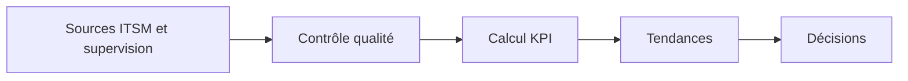
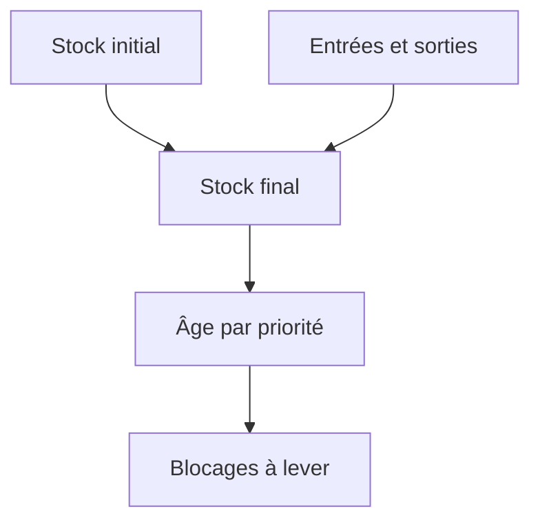
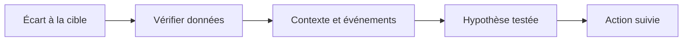
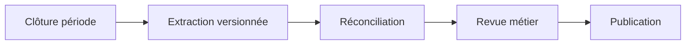
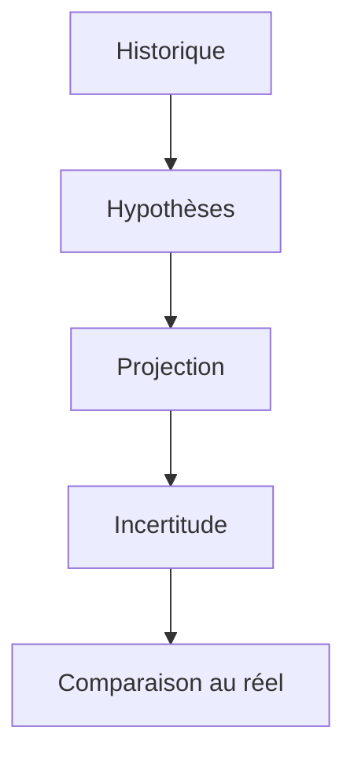
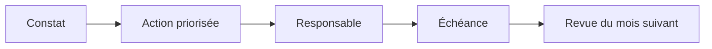

# Rédiger un reporting mensuel

> **Mise en contexte** — Ce cours s'adresse à un technicien intermédiaire qui doit agir dans un environnement réel, respecter les contraintes de service et laisser des preuves réutilisables. L'objectif n'est pas seulement de connaître les outils, mais de comprendre pourquoi une action est choisie, dans quelles conditions elle est sûre, comment vérifier son résultat et quand demander de l'aide.

## Présentation et enjeux

Le reporting mensuel rassemble des mesures fiables pour orienter les décisions de maintenance, de capacité, de budget et d'amélioration. Il doit exposer les tendances et limites, pas seulement présenter des graphiques ; chaque écart significatif doit être relié à une analyse, une action et un propriétaire. Cette discipline s'inscrit dans une démarche de qualité de service : chaque opération doit être reliée au besoin métier, au risque accepté et à un critère d'acceptation observable. L'intervenant doit pouvoir expliquer l'état initial, la décision prise, les résultats obtenus et les limites qui subsistent.

Dans une équipe de maintenance, les informations sont souvent réparties entre tickets, conversations, inventaires, systèmes de supervision et mémoire individuelle. Une méthode fiable les relie dans une trace commune et limite les décisions fondées sur une seule observation. Le cours met l'accent sur les preuves, les contrôles proportionnés, la reproductibilité et la communication utile.

Le niveau intermédiaire suppose que les gestes de base sont acquis. La difficulté consiste maintenant à traiter des environnements hétérogènes, des incidents ambigus, des changements qui touchent plusieurs composants et des situations où la donnée est imparfaite. Les règles présentées doivent être adaptées aux procédures approuvées de l'organisation et vérifiées dans un environnement de test avant toute action ayant un impact sur la production.

## Objectifs pédagogiques

À la fin du parcours, l'apprenant pourra :

- expliquer les principes et les limites des outils utilisés dans le domaine ;
- choisir un contrôle ou une méthode à partir de l'impact, de la criticité et des preuves disponibles ;
- effectuer une démarche reproductible et distinguer observation, hypothèse et décision ;
- interpréter les indicateurs sans confondre corrélation, résultat technique et expérience utilisateur ;
- rédiger une trace claire, traiter les exceptions et organiser une escalade ;
- vérifier l'effet d'une action, décrire le risque résiduel et proposer une amélioration mesurable.

## Prérequis et cadre de travail

Avant de commencer, savoir utiliser un terminal, lire les journaux, identifier un actif, comprendre les tickets et appliquer les règles locales de sécurité. Les commandes ci-dessous sont illustratives : adapter les noms d'hôte, les chemins et les versions, utiliser des cibles de test autorisées et ne jamais copier de secret dans un document. Une commande d'observation doit être préférée à une modification lorsqu'elle suffit à qualifier la situation.

Les principes directeurs sont les suivants : intervention autorisée, moindre privilège, sauvegarde ou retour arrière adaptés, fenêtre connue, communication compréhensible et preuve de validation. Si un contrôle critique échoue, ne pas continuer mécaniquement. Noter le constat, évaluer le risque et utiliser le point d'arrêt ou l'escalade défini par la procédure.

## Vocabulaire métier

| Terme | Utilisation opérationnelle |
|---|---|
| État initial | Description mesurée du système avant toute intervention. |
| Criticité | Conséquence potentielle de l'indisponibilité ou de la mauvaise configuration. |
| Preuve | Élément daté qui peut être vérifié par un autre intervenant. |
| Écart | Différence entre le résultat attendu et l'observation. |
| Exception | Situation où la procédure standard ne s'applique pas ou n'atteint pas son objectif. |
| Validation | Contrôle confirmant que le service ou l'opération satisfait les critères convenus. |
| Retour arrière | Séquence permettant de retrouver un état stable si les critères de réussite ne sont pas satisfaits. |
| Récurrence | Réapparition d'un problème similaire après un traitement précédent. |

## Schémas adaptés au sujet

### Schéma 1 — Chaîne du reporting



Le contrôle de qualité précède le calcul pour éviter d'expliquer des variations créées par des données incomplètes.

### Schéma 2 — Backlog



Le stock total doit être complété par l'âge, la priorité et les flux d'entrée/sortie.

### Schéma 3 — Interpréter un écart



Distinguer mesure, interprétation et action empêche de traiter une corrélation comme une explication démontrée.

### Schéma 4 — Cycle mensuel



Un flux reproductible conserve période, périmètre, formules et décisions pour chaque rapport.

### Schéma 5 — Prévision



Une prévision est un outil d'anticipation ; ses hypothèses et son erreur doivent être réévaluées à la période suivante.

### Schéma 6 — Suivi d'actions



Le rapport du mois suivant doit montrer si les actions prises ont réellement réduit les écarts.

## Fondements techniques du domaine

### 1. Dictionnaire d'indicateurs

Un KPI est utile lorsqu'il répond à une question concrète de gestion. Pour chaque indicateur, documenter le nom, la définition, l'unité, la formule, le périmètre, la source, la fréquence, le propriétaire, la cible, les règles d'exclusion et la date de version. Une définition du type « MTTR » est insuffisante : la mesure peut désigner un temps moyen de réparation, de résolution, de rétablissement ou de réponse. Le rapport doit préciser l'événement de départ, l'événement de fin et les dossiers inclus.

Distinguer un indicateur de résultat, qui constate ce qui s'est passé, d'un indicateur avancé, qui signale un risque ou une capacité à venir. Le nombre d'incidents clos est une mesure d'activité; le vieillissement du backlog, la capacité disponible, les échecs de changement et les tendances de récurrence peuvent aider à anticiper les problèmes. Tous les chiffres ne méritent pas le statut de KPI : un tableau de bord plus court, relié à des décisions précises, est généralement plus facile à maintenir et à interpréter.

Le dictionnaire sert aussi à assurer la comparabilité historique. Si la définition, la catégorie, la source ou le périmètre change, dater la modification et décider si une série ancienne peut être recalculée. Ne jamais modifier une formule en silence : cela peut créer une amélioration artificielle ou effacer une tendance. Lorsque plusieurs outils produisent des valeurs différentes, désigner une source faisant autorité et expliquer les écarts plutôt que de choisir la valeur la plus favorable.
### 2. Qualité des données

Un reporting fiable commence par une validation des données avant toute visualisation. Vérifier la période complète, les dates manquantes, les doublons, les identifiants, les statuts, les catégories, les fuseaux horaires et l'existence d'enregistrements tardifs. Un ticket créé en fin de mois puis reclassé le mois suivant peut modifier les résultats selon que l'on mesure la date d'ouverture, de résolution ou de clôture. Définir explicitement la date de rattachement.

Séparer les erreurs de donnée, les événements exceptionnels et les changements réels de performance. Un volume de tickets inhabituellement bas peut signaler une meilleure fiabilité, mais aussi une panne du portail ou une interruption de collecte. Comparer la source ITSM aux alertes de supervision, aux changements et aux retours métier afin de détecter les trous de mesure. Documenter le nombre de lignes reçues, les exclusions, les corrections appliquées, le motif de chaque exclusion et la personne qui les a validées.

Éviter de supprimer des valeurs extrêmes uniquement parce qu'elles déforment le graphique. Un ticket resté ouvert 90 jours peut être une donnée légitime et précisément le problème à mettre en évidence. Analyser les cas atypiques, puis annoter ou segmenter si leur nature est réellement différente. Conserver la donnée originale selon la politique de rétention et travailler sur une copie contrôlée pour la normalisation ou la déduplication.

Le rapport doit afficher les limites des données qui changent l'interprétation : couverture partielle d'un site, nouvelle taxonomie, outil de ticketing modifié, indisponibilité de la supervision ou taux de réponse faible à une enquête. Une mesure peut être calculable sans être suffisamment fiable pour soutenir une conclusion forte. Dans ce cas, qualifier la confiance et créer une action pour améliorer la collecte.
### 3. Tendances

Une tendance mensuelle ne se résume pas à comparer le mois actuel au précédent. Utiliser une fenêtre assez longue pour distinguer bruit, saisonnalité et changement durable. Selon le service, comparer trois, six ou douze mois peut révéler des cycles liés aux calendriers, mises à jour, périodes de facturation ou mouvements de personnel. Signaler les périodes atypiques et les changements de périmètre.

Comparer les nombres bruts et les taux lorsque le volume d'activité change. Si le parc passe de 400 à 600 équipements, le nombre d'incidents peut augmenter même si le taux d'incident par équipement diminue. Choisir un dénominateur lié à l'activité : incidents par 100 actifs, incidents par 1 000 transactions, incidents par site-mois ou taux d'échec par changement. Indiquer l'exposition utilisée et les limites d'une normalisation qui ne corrige pas les différences de risque entre les actifs.

Utiliser des comparaisons complémentaires : mois précédent, même mois de l'année précédente si les données existent, moyenne glissante et écart à la cible. Ne pas multiplier les graphiques sans question de gestion. Ajouter une annotation lorsque des événements connus ont pu influencer la série — changement de logiciel, migration, pic d'activité, panne fournisseur ou évolution de la classification. L'annotation indique un contexte plausible, pas une causalité démontrée.

Une hausse des tickets peut refléter un problème de fiabilité, une meilleure détection, une campagne de communication ou un canal de support devenu plus accessible. Une baisse peut refléter une résolution durable, mais aussi un portail indisponible ou des tickets mal classés. Croiser les sources et examiner un échantillon de dossiers avant de conclure.
### 4. Audience

Le même dataset doit produire des lectures différentes selon les décisions attendues. La direction a besoin de l'impact métier, de la tendance, du risque, des dépenses ou ressources nécessaires et des décisions à prendre. Le responsable de service a besoin du respect des SLA/OLA, du backlog, de la qualité de résolution et des dépendances. Les équipes techniques ont besoin d'un diagnostic plus granulaire par catégorie, composant, version, site ou type de changement. Les techniciens peuvent avoir besoin d'une liste d'actions concrètes plutôt que d'un graphique agrégé.

Le rapport doit annoncer sa période, son périmètre, la date d'extraction et la personne responsable. Commencer par une synthèse des constats majeurs, puis montrer les indicateurs qui expliquent ces constats et enfin les actions demandées. Ne pas confondre un tableau de bord de suivi continu avec un rapport mensuel d'analyse : le premier permet de repérer une variation; le second doit expliquer ce que l'on sait, ce que l'on ne sait pas et la décision à prendre.

Adapter le niveau de détail au temps disponible. Une page de synthèse peut suffire à la direction si elle permet de retrouver les preuves et les détails. Une annexe technique peut contenir les définitions, les règles de calcul, les données segmentées et les cas représentatifs. Éviter les copies divergentes : conserver un dataset et un dictionnaire de référence, et appliquer des filtres explicites pour produire les vues.

Une visualisation doit faciliter la lecture, pas décorer le rapport. Les courbes montrent les tendances temporelles; les barres permettent de comparer des catégories; les tableaux conviennent aux valeurs exactes et aux responsables; les nuages de points peuvent aider à examiner une relation entre variables. Toujours annoter unités, périodes, cibles, axes et périmètres. Ne pas raccourcir l'axe d'un graphique sans signaler la transformation, car cela peut exagérer visuellement une variation faible.
### 5. Écarts

Un écart à la cible appelle une enquête, pas une justification rédigée après coup. Quantifier l'écart absolu et relatif, indiquer la direction souhaitable et confirmer que les périodes sont comparables. Pour un indicateur où une valeur basse est meilleure, comme le délai de résolution, une hausse est défavorable; pour une mesure de disponibilité, une baisse est généralement défavorable. Le sens de la variation doit être défini dans le dictionnaire.

Formuler l'observation sans lui attribuer une cause qui n'a pas été vérifiée. « Le nombre d'incidents réseau a augmenté de 18 % par rapport au mois précédent » est une observation si le calcul est reproductible. « Les changements ont causé cette hausse » est une conclusion causale qui nécessite une analyse. Examiner les changements, les actifs, les sites, la catégorie, la répartition par priorité, le taux d'ouverture des tickets et la qualité de la classification. Noter les hypothèses, les données qui les soutiennent, les éléments qui les contredisent et le test suivant.

Un rapport utile montre aussi les résultats positifs. Une baisse de l'âge du backlog peut refléter une action efficace, mais vérifier que le nombre de réouvertures, le taux de résolution au premier passage et la satisfaction ne se sont pas dégradés. Un indicateur isolé peut être optimisé au détriment du service global. Présenter les indicateurs qui se contrebalancent et expliquer les arbitrages.

Chaque écart significatif se termine par une décision : poursuivre la surveillance, analyser une cause, corriger une procédure, modifier une capacité, lancer une action de fiabilité ou accepter un risque selon le processus. Désigner un responsable, une échéance et une mesure de réussite. Si le rapport ne conduit à aucune action ni décision, se demander si l'indicateur sert réellement au pilotage.
### 6. Backlog

Le backlog est un stock à une date donnée, pas simplement la somme des tickets reçus pendant le mois. Le reporting doit préciser si le stock couvre tous les tickets ouverts, seulement les incidents, les demandes de service ou un sous-ensemble filtré. Distinguer le flux entrant, les tickets résolus ou fermés et la variation du stock. Les tickets ouverts puis fermés dans la même période contribuent au flux mais pas au stock de fin de mois.

Mesurer le backlog total et son âge : médiane, percentiles, part au-delà d'un seuil et nombre de tickets bloqués. Un stock stable peut masquer un vieillissement inquiétant si les nouveaux tickets simples sont traités tandis que les cas difficiles restent ouverts. Segmenter par priorité, service, groupe assigné, motif d'attente et propriétaire. Définir comment sont traités les tickets en attente de l'utilisateur, du fournisseur ou d'une fenêtre de changement, en appliquant les règles contractuelles existantes sans exclure arbitrairement les cas difficiles.

Relier le stock à la capacité et à la demande entrante. Si le flux de tickets reçus dépasse durablement celui des tickets traités, le backlog croîtra, sauf changement du périmètre ou correction de données. Une prévision doit cependant tenir compte de la saisonnalité, de la complexité des tickets, des absences, des projets planifiés et du temps réservé à la maintenance préventive. Ne pas convertir mécaniquement le stock en effectif nécessaire avec une simple division sans examiner le type de travail.

Tout ticket ancien doit avoir un état actuel, un propriétaire, une prochaine action et une date de suivi. Le rapport mensuel peut mettre en avant les éléments qui dépassent les seuils et demander une décision pour les dépendances structurelles. L'objectif est de réduire le risque de vieillissement, pas de fermer des tickets sans validation réelle.
### 7. Prévision

Une prévision mensuelle aide à préparer la capacité, les astreintes, les achats et les fenêtres de maintenance. Elle doit s'appuyer sur suffisamment d'historique, un périmètre cohérent et des hypothèses écrites. Une tendance issue de trois points seulement est fragile; les changements de parc, de volume transactionnel, de procédure de ticket ou de couverture rendent les comparaisons plus difficiles.

Commencer par une référence simple : moyenne des derniers mois comparables, moyenne glissante ou tendance segmentée par catégorie. Comparer ensuite la prévision aux valeurs observées et calculer l'erreur avec une méthode cohérente. Éviter d'afficher une précision excessive; une projection de 127,4 incidents n'a aucun sens si les données sont volatiles et les catégories instables. Utiliser une fourchette lorsque l'incertitude est élevée et expliciter les événements exceptionnels connus.

Différencier une prévision, un objectif et un engagement. Une prévision décrit ce qui pourrait arriver selon les hypothèses actuelles; un objectif décrit ce que l'équipe vise; un SLA représente un engagement convenu selon ses propres termes. Une projection de dépassement de capacité ne constitue pas une garantie de panne, mais elle doit susciter une décision : renfort, priorisation, automatisation, réduction du travail non urgent ou révision du plan.

Revoir l'exactitude des prévisions chaque mois. Si les erreurs sont systématiquement d'un seul côté, rechercher les biais : événements exceptionnels oubliés, saisonnalité, périmètre modifié ou hypothèses optimistes. Garder une trace des versions et des hypothèses utilisées au moment de la décision.
### 8. Plan d'action

Le plan d'action transforme l'observation en amélioration suivie. Chaque ligne doit relier un constat à une action, à un propriétaire, à une échéance, à un niveau de priorité, à une dépendance et à un critère de succès mesurable. « Réduire les incidents » est trop vague; « identifier les trois catégories qui expliquent la majorité des interruptions, valider une cause sur les incidents récurrents et tester une mesure corrective avant la prochaine revue » est plus exploitable.

Distinguer une tâche, un livrable et un effet attendu. Publier une procédure est un livrable; réduire les erreurs de manipulation observées est un effet qui doit être mesuré. Définir le point de départ et la période de vérification avant de lancer l'action. L'action peut nécessiter une validation de sécurité ou un changement; le reporting doit conserver le lien vers le dossier concerné.

À la revue suivante, comparer le résultat à la ligne de base, expliquer les écarts, et décider de poursuivre, corriger ou clore l'action. Une action en retard doit afficher son risque et son nouveau jalon. Les actions annulées doivent aussi être tracées avec la justification et l'autorité qui a décidé. Éviter de garder indéfiniment des actions génériques qui sont recopiées d'un mois à l'autre sans mesure d'effet.
## Méthode transversale pour une opération maîtrisée

### 1. Gouvernance

L'intervention doit être reliée à un objectif de service, un propriétaire et une décision explicite. Le contrôle de gouvernance n'a de valeur que s'il aide à identifier qui peut accepter le risque et qui doit être informé. Pour rédiger un reporting mensuel, cela signifie que la personne qui agit doit relier la règle à un élément concret : incidents, MTTR selon définition, disponibilité, backlog, âge des tickets, respect SLA, satisfaction, coûts et taux de récidive. Avant l'opération, noter l'état de départ et ce qui fera considérer le résultat comme acceptable. Pendant l'action, conserver le contexte des changements et indiquer immédiatement les écarts. Après l'action, exécuter le contrôle correspondant au risque, enregistrer le résultat et affecter les suites restantes. Cette discipline augmente la qualité de la passation et réduit la dépendance à une personne unique.

### 2. Cycle de vie

La solution doit être pensée depuis la préparation jusqu'à la sortie, y compris le maintien des compétences et le retrait des anciennes données. Une étape oubliée en fin de cycle transforme souvent une réussite ponctuelle en risque latent. Pour rédiger un reporting mensuel, cela signifie que la personne qui agit doit relier la règle à un élément concret : incidents, MTTR selon définition, disponibilité, backlog, âge des tickets, respect SLA, satisfaction, coûts et taux de récidive. Avant l'opération, noter l'état de départ et ce qui fera considérer le résultat comme acceptable. Pendant l'action, conserver le contexte des changements et indiquer immédiatement les écarts. Après l'action, exécuter le contrôle correspondant au risque, enregistrer le résultat et affecter les suites restantes. Cette discipline augmente la qualité de la passation et réduit la dépendance à une personne unique.

### 3. Qualité de données

Toute mesure dépend de la qualité de son périmètre, de l'horodatage, de l'unité et de la provenance. Il faut identifier les champs manquants et les conventions contradictoires avant de tirer une conclusion. Pour rédiger un reporting mensuel, cela signifie que la personne qui agit doit relier la règle à un élément concret : incidents, MTTR selon définition, disponibilité, backlog, âge des tickets, respect SLA, satisfaction, coûts et taux de récidive. Avant l'opération, noter l'état de départ et ce qui fera considérer le résultat comme acceptable. Pendant l'action, conserver le contexte des changements et indiquer immédiatement les écarts. Après l'action, exécuter le contrôle correspondant au risque, enregistrer le résultat et affecter les suites restantes. Cette discipline augmente la qualité de la passation et réduit la dépendance à une personne unique.

### 4. Gestion du risque

Le risque se juge par probabilité, impact, capacité de détection et marge de récupération. Les éléments critiques doivent recevoir plus de contrôles, sans imposer la même lourdeur aux opérations réversibles et aux changements irréversibles. Pour rédiger un reporting mensuel, cela signifie que la personne qui agit doit relier la règle à un élément concret : incidents, MTTR selon définition, disponibilité, backlog, âge des tickets, respect SLA, satisfaction, coûts et taux de récidive. Avant l'opération, noter l'état de départ et ce qui fera considérer le résultat comme acceptable. Pendant l'action, conserver le contexte des changements et indiquer immédiatement les écarts. Après l'action, exécuter le contrôle correspondant au risque, enregistrer le résultat et affecter les suites restantes. Cette discipline augmente la qualité de la passation et réduit la dépendance à une personne unique.

### 5. Communication

Une communication utile indique ce qui est connu, ce qui reste à vérifier, qui agit ensuite et quand une nouvelle information sera fournie. Les formulations doivent éviter les promesses non vérifiées. Pour rédiger un reporting mensuel, cela signifie que la personne qui agit doit relier la règle à un élément concret : incidents, MTTR selon définition, disponibilité, backlog, âge des tickets, respect SLA, satisfaction, coûts et taux de récidive. Avant l'opération, noter l'état de départ et ce qui fera considérer le résultat comme acceptable. Pendant l'action, conserver le contexte des changements et indiquer immédiatement les écarts. Après l'action, exécuter le contrôle correspondant au risque, enregistrer le résultat et affecter les suites restantes. Cette discipline augmente la qualité de la passation et réduit la dépendance à une personne unique.

### 6. Sécurité

Le périmètre technique doit rester limité aux systèmes autorisés, avec une identité traçable et les droits minimaux nécessaires. Les secrets doivent être protégés dans les fichiers, les journaux, les captures et les exports. Pour rédiger un reporting mensuel, cela signifie que la personne qui agit doit relier la règle à un élément concret : incidents, MTTR selon définition, disponibilité, backlog, âge des tickets, respect SLA, satisfaction, coûts et taux de récidive. Avant l'opération, noter l'état de départ et ce qui fera considérer le résultat comme acceptable. Pendant l'action, conserver le contexte des changements et indiquer immédiatement les écarts. Après l'action, exécuter le contrôle correspondant au risque, enregistrer le résultat et affecter les suites restantes. Cette discipline augmente la qualité de la passation et réduit la dépendance à une personne unique.

### 7. Traçabilité

Une action exploitable doit laisser un résultat vérifiable, un horodatage, un propriétaire et un lien avec le ticket ou le changement. La trace doit permettre à un autre technicien de comprendre ce qui a été fait. Pour rédiger un reporting mensuel, cela signifie que la personne qui agit doit relier la règle à un élément concret : incidents, MTTR selon définition, disponibilité, backlog, âge des tickets, respect SLA, satisfaction, coûts et taux de récidive. Avant l'opération, noter l'état de départ et ce qui fera considérer le résultat comme acceptable. Pendant l'action, conserver le contexte des changements et indiquer immédiatement les écarts. Après l'action, exécuter le contrôle correspondant au risque, enregistrer le résultat et affecter les suites restantes. Cette discipline augmente la qualité de la passation et réduit la dépendance à une personne unique.

### 8. Gestion des exceptions

Les cas hors procédure doivent être visibles et conduire à un point d'arrêt, une décision ou une escalade. Une exception récurrente est souvent le signal qu'il faut faire évoluer la procédure plutôt que la répéter. Pour rédiger un reporting mensuel, cela signifie que la personne qui agit doit relier la règle à un élément concret : incidents, MTTR selon définition, disponibilité, backlog, âge des tickets, respect SLA, satisfaction, coûts et taux de récidive. Avant l'opération, noter l'état de départ et ce qui fera considérer le résultat comme acceptable. Pendant l'action, conserver le contexte des changements et indiquer immédiatement les écarts. Après l'action, exécuter le contrôle correspondant au risque, enregistrer le résultat et affecter les suites restantes. Cette discipline augmente la qualité de la passation et réduit la dépendance à une personne unique.

### 9. Amélioration continue

Les incidents, les retours utilisateurs et les contrôles qualité doivent transformer les règles et procédures. Il faut vérifier si les modifications réduisent réellement le risque, et pas seulement si les documents ont été mis à jour. Pour rédiger un reporting mensuel, cela signifie que la personne qui agit doit relier la règle à un élément concret : incidents, MTTR selon définition, disponibilité, backlog, âge des tickets, respect SLA, satisfaction, coûts et taux de récidive. Avant l'opération, noter l'état de départ et ce qui fera considérer le résultat comme acceptable. Pendant l'action, conserver le contexte des changements et indiquer immédiatement les écarts. Après l'action, exécuter le contrôle correspondant au risque, enregistrer le résultat et affecter les suites restantes. Cette discipline augmente la qualité de la passation et réduit la dépendance à une personne unique.

### 10. Capacité

Les ressources, compétences, fenêtres et dépendances limitent le volume d'opérations réalisables. Une planification crédible tient compte de la charge, des temps de contrôle et des imprévus. Pour rédiger un reporting mensuel, cela signifie que la personne qui agit doit relier la règle à un élément concret : incidents, MTTR selon définition, disponibilité, backlog, âge des tickets, respect SLA, satisfaction, coûts et taux de récidive. Avant l'opération, noter l'état de départ et ce qui fera considérer le résultat comme acceptable. Pendant l'action, conserver le contexte des changements et indiquer immédiatement les écarts. Après l'action, exécuter le contrôle correspondant au risque, enregistrer le résultat et affecter les suites restantes. Cette discipline augmente la qualité de la passation et réduit la dépendance à une personne unique.

### 11. Contrôle du changement

Une modification nécessite un état initial connu, un périmètre, des critères de réussite et une solution de repli adaptée au risque. L'urgence ne supprime pas le besoin de garder une trace des décisions. Pour rédiger un reporting mensuel, cela signifie que la personne qui agit doit relier la règle à un élément concret : incidents, MTTR selon définition, disponibilité, backlog, âge des tickets, respect SLA, satisfaction, coûts et taux de récidive. Avant l'opération, noter l'état de départ et ce qui fera considérer le résultat comme acceptable. Pendant l'action, conserver le contexte des changements et indiquer immédiatement les écarts. Après l'action, exécuter le contrôle correspondant au risque, enregistrer le résultat et affecter les suites restantes. Cette discipline augmente la qualité de la passation et réduit la dépendance à une personne unique.

### 12. Mesure d'efficacité

Un indicateur ne vaut que si sa définition reste constante et si sa variation peut conduire à une décision. Les chiffres doivent être accompagnés d'une période, d'un périmètre et des limites de mesure. Pour rédiger un reporting mensuel, cela signifie que la personne qui agit doit relier la règle à un élément concret : incidents, MTTR selon définition, disponibilité, backlog, âge des tickets, respect SLA, satisfaction, coûts et taux de récidive. Avant l'opération, noter l'état de départ et ce qui fera considérer le résultat comme acceptable. Pendant l'action, conserver le contexte des changements et indiquer immédiatement les écarts. Après l'action, exécuter le contrôle correspondant au risque, enregistrer le résultat et affecter les suites restantes. Cette discipline augmente la qualité de la passation et réduit la dépendance à une personne unique.

### 13. Passation

Une tâche doit pouvoir être reprise par une autre personne sans dépendre des souvenirs du technicien présent. La transmission contient contexte, preuves, étapes déjà tentées et prochaine action. Pour rédiger un reporting mensuel, cela signifie que la personne qui agit doit relier la règle à un élément concret : incidents, MTTR selon définition, disponibilité, backlog, âge des tickets, respect SLA, satisfaction, coûts et taux de récidive. Avant l'opération, noter l'état de départ et ce qui fera considérer le résultat comme acceptable. Pendant l'action, conserver le contexte des changements et indiquer immédiatement les écarts. Après l'action, exécuter le contrôle correspondant au risque, enregistrer le résultat et affecter les suites restantes. Cette discipline augmente la qualité de la passation et réduit la dépendance à une personne unique.

### 14. Validation métier

Le résultat technique doit être confirmé du point de vue du service. Un équipement joignable ou un script qui termine sans erreur ne suffit pas si l'utilisateur ne peut pas accomplir son opération. Pour rédiger un reporting mensuel, cela signifie que la personne qui agit doit relier la règle à un élément concret : incidents, MTTR selon définition, disponibilité, backlog, âge des tickets, respect SLA, satisfaction, coûts et taux de récidive. Avant l'opération, noter l'état de départ et ce qui fera considérer le résultat comme acceptable. Pendant l'action, conserver le contexte des changements et indiquer immédiatement les écarts. Après l'action, exécuter le contrôle correspondant au risque, enregistrer le résultat et affecter les suites restantes. Cette discipline augmente la qualité de la passation et réduit la dépendance à une personne unique.

## Indicateurs : définition, lecture et limites

Les indicateurs les plus utiles pour ce domaine sont : **incidents, MTTR selon définition, disponibilité, backlog, âge des tickets, respect SLA, satisfaction, coûts et taux de récidive**. Chaque indicateur doit avoir une définition écrite. Il faut préciser l'unité, la source, le périmètre, la fréquence, la période et les exclusions. Lorsque les données ne couvrent qu'une partie de l'environnement, le rapport doit le signaler au lieu d'extrapoler silencieusement. Un indicateur doit permettre une décision : prioriser, déclencher une vérification, ajuster une capacité, revoir une procédure ou accepter explicitement un risque.

Un bon tableau de bord met en évidence la tendance et les écarts significatifs, sans supprimer la donnée de départ. Il distingue les valeurs brutes, les seuils, les anomalies confirmées et les périodes sans mesure. Une moyenne peut cacher des situations extrêmes ; il est donc souvent nécessaire d'observer la distribution, les percentiles, les valeurs maximales et la répartition par service ou par criticité. Les changements de définition doivent être versionnés pour éviter de comparer des séries qui ne signifient plus la même chose.

Les indicateurs ne doivent pas devenir des objectifs isolés. Par exemple, réduire le délai moyen n'est pas une amélioration si les tickets sont fermés avant validation et immédiatement rouverts. De même, atteindre un taux de conformité en excluant les actifs inconnus peut donner une image artificiellement favorable. Associer un KPI à un contrôle de qualité et à un résultat métier permet de repérer ces effets indésirables.

## Procédure opérationnelle recommandée

1. **Préparer.** Confirmer la demande, le périmètre, le propriétaire, l'autorisation et la fenêtre. Vérifier les dépendances, les sauvegardes et les accès nécessaires.
2. **Établir l'état initial.** Recueillir les mesures, l'état des services, les alertes, la dernière intervention et les écarts connus. Noter les éléments non vérifiables.
3. **Évaluer les risques.** Déterminer impact, probabilité, détectabilité, réversibilité et critère de report. Définir un point d'arrêt compréhensible.
4. **Exécuter par étapes.** Utiliser les outils approuvés, limiter le périmètre et vérifier les résultats intermédiaires avant de passer à l'étape suivante.
5. **Contrôler.** Comparer l'état final à l'état attendu et tester le service selon un scénario réaliste, pas uniquement le composant technique.
6. **Tracer.** Enregistrer les horaires, commandes ou actions, résultats, décisions et écarts dans le ticket ou le référentiel prévu.
7. **Communiquer.** Annoncer le résultat en termes compréhensibles, préciser les limites et indiquer qui gère les actions ouvertes.
8. **Améliorer.** Rechercher les étapes ambiguës ou les contrôles inefficaces et proposer une modification versionnée, testée et approuvée.

## Outils et contrôles pratiques

Les outils doivent être sélectionnés selon l'objectif, les droits et le type de preuve recherché. L'usage d'un outil connu ne dispense pas de contrôler son contexte : version, paramètres, cible, unité, état de connexion et limite de la mesure. ITSM, supervision, inventaire, tableur, requêtes SQL contrôlées, dictionnaire de métriques, calendrier de reporting constituent des exemples de technologies possibles ; leur choix exact dépend de l'environnement et des politiques internes.

| Contrôle | Question à poser | Trace à conserver |
|---|---|---|
| Identité de la cible | Est-ce bien l'actif ou le service autorisé ? | Identifiant, inventaire et horodatage. |
| État initial | Quelle condition de départ a été mesurée ? | Valeur, source, capture ou sortie. |
| Autorisation | Qui a approuvé l'action et pour quelle fenêtre ? | Ticket, validation et périmètre. |
| Résultat | Qu'est-ce qui démontre que le résultat est correct ? | Test de contrôle et résultat observé. |
| Écart | Que faire si le résultat attendu n'est pas obtenu ? | Point d'arrêt, escalade et action attribuée. |

### Commandes et exemples

Les commandes de cette section servent à illustrer la collecte de preuves. Remplacer les valeurs de test par des cibles autorisées et vérifier localement les options selon la distribution et la version de l'outil.

#### Exemple 1 — Compter les lignes d'un export

```bash
wc -l incidents.csv
```

Interpréter la sortie avec le contexte de l'intervention. Un retour nul ne démontre pas toujours que la fonction métier est opérationnelle. Relever les erreurs, vérifier l'heure des journaux et comparer les observations avec une seconde source lorsque l'impact le justifie. Ne pas intégrer un résultat de terminal dans un rapport sans préciser la machine, la période et la commande effectivement exécutée.

#### Exemple 2 — Examiner les premières lignes d'un CSV

```bash
head -n 5 incidents.csv
```

Interpréter la sortie avec le contexte de l'intervention. Un retour nul ne démontre pas toujours que la fonction métier est opérationnelle. Relever les erreurs, vérifier l'heure des journaux et comparer les observations avec une seconde source lorsque l'impact le justifie. Ne pas intégrer un résultat de terminal dans un rapport sans préciser la machine, la période et la commande effectivement exécutée.

#### Exemple 3 — Lire un premier enregistrement avec Python

```bash
python -c "import csv; print(next(csv.DictReader(open('incidents.csv', encoding='utf-8'))))"
```

Interpréter la sortie avec le contexte de l'intervention. Un retour nul ne démontre pas toujours que la fonction métier est opérationnelle. Relever les erreurs, vérifier l'heure des journaux et comparer les observations avec une seconde source lorsque l'impact le justifie. Ne pas intégrer un résultat de terminal dans un rapport sans préciser la machine, la période et la commande effectivement exécutée.

#### Exemple 4 — Calculer une empreinte d'export

```bash
sha256sum incidents.csv
```

Interpréter la sortie avec le contexte de l'intervention. Un retour nul ne démontre pas toujours que la fonction métier est opérationnelle. Relever les erreurs, vérifier l'heure des journaux et comparer les observations avec une seconde source lorsque l'impact le justifie. Ne pas intégrer un résultat de terminal dans un rapport sans préciser la machine, la période et la commande effectivement exécutée.


## Produire un reporting mensuel reproductible

Un rapport mensuel fiable suit une chaîne de préparation stable. Les étapes restent identiques d'un mois à l'autre, même si les détails changent : extraire les sources, contrôler leur qualité, calculer les indicateurs, comparer les périodes, étudier les écarts, rédiger les décisions puis vérifier les actions précédentes. La reproductibilité permet de distinguer une vraie variation du service d'un changement de méthode de mesure.

~~~mermaid
flowchart TD
    A[Clôture de la période] --> B[Extraire les sources identifiées]
    B --> C[Contrôler qualité et complétude]
    C --> D[Calculer les KPI versionnés]
    D --> E[Comparer cibles et tendances]
    E --> F[Analyser les écarts majeurs]
    F --> G[Formuler conclusions et décisions]
    G --> H[Relecture et validation]
    H --> I[Publier, assigner et suivre les actions]
~~~

### Calendrier de production type

| Moment | Tâche | Contrôle attendu |
|---|---|---|
| Dernier jour de la période | Figer la période et les périmètres | Calendrier, fuseaux et règles de clôture confirmés |
| Jours 1–2 | Extraire tickets, supervision, satisfaction et capacité | Sources, volumes et horodatages enregistrés |
| Jours 2–3 | Contrôler, dédupliquer et calculer | Anomalies de données documentées |
| Jours 3–4 | Comparer aux cibles et analyser | Variations majeures expliquées ou explicitement inconnues |
| Jour 4–5 | Préparer la synthèse et les actions | Chaque conclusion reliée à une preuve |
| Revue mensuelle | Valider décisions et priorités | Propriétaires, échéances et risques confirmés |
| Mois suivant | Vérifier les actions et mesures | Résultat comparé à la ligne de base |

Ce calendrier est illustratif, à adapter à la taille de l'équipe, aux obligations de clôture et à la disponibilité des données. La date de publication et la date d'extraction doivent être visibles si des événements tardifs peuvent modifier les chiffres. Une version révisée du rapport doit indiquer la raison, la date et les sections qui changent.

## Dictionnaire de KPI et formules d'exemple

Les formules ci-dessous sont des exemples pour apprendre à définir une mesure, pas des normes universelles. Avant de les adopter, préciser le service, la période, les populations incluses, les règles de fermeture et les exceptions.

| Indicateur | Formule illustrative | Interprétation et garde-fou |
|---|---|---|
| Tickets reçus | Nombre d'identifiants uniques ouverts dans la période | Contrôler doublons, tickets liés et changement de canal |
| Taux de résolution dans le SLA | Tickets éligibles résolus dans le délai / tickets éligibles arrivés à maturité × 100 | Définir le point de départ, le point de fin et les exclusions |
| Taux de réouverture | Tickets rouverts selon une règle définie / tickets résolus de la cohorte × 100 | Une période d'observation est nécessaire |
| Backlog de fin de mois | Tickets correspondant au filtre et encore ouverts à la date de photographie | Définir précisément la date d'extraction et le statut |
| Âge médian du backlog | Médiane de l'âge des tickets ouverts selon l'horodatage défini | Compléter avec les percentiles et les tickets très anciens |
| Taux de résolution au premier contact | Dossiers résolus au premier contact selon la règle / dossiers éligibles × 100 | Définir « premier contact » et exclure les simples réponses automatiques |
| Satisfaction moyenne | Somme des scores valides / nombre de réponses valides | Afficher volume et taux de réponse; analyser aussi les commentaires |
| Incidents rapportés au parc | Incidents uniques sur la période / taille moyenne ou exposition du parc × facteur choisi | Comparer le même dénominateur et le même périmètre |

Pour chaque mesure, prévoir au moins une validation. Pour une part de résolution SLA, le nombre de dossiers éligibles doit correspondre à la période de cohorte choisie, plutôt qu'à tous les tickets arbitrairement encore présents. Pour le backlog, prendre une photographie à un instant précis; ne pas calculer le stock en soustrayant simplement les tickets clôturés des tickets reçus si des tickets ont été rouverts, fusionnés ou reclassés.

### Décomposer un KPI avant de conclure

Un pourcentage peut changer à cause du numérateur, du dénominateur ou du mélange de catégories. Si le taux SLA augmente, vérifier si davantage de tickets sont réellement traités à temps, si les dossiers les plus lents ont été reclassés ou si la définition des tickets éligibles a changé. Les mesures doivent être comparées avec le volume et la composition du portefeuille.

~~~mermaid
flowchart TD
    A[Variation d'un KPI] --> B[Valider la donnée et la formule]
    B --> C[Examiner numérateur et dénominateur]
    C --> D[Segmenter par priorité et catégorie]
    D --> E[Comparer calendrier et périmètre]
    E --> F[Étudier changements et événements connus]
    F --> G[Formuler les conclusions soutenues]
    G --> H[Définir ce qui reste à vérifier]
~~~

## Concevoir un tableau de bord lisible

La première page devrait montrer un nombre limité d'indicateurs reliés à des objectifs : disponibilité ou qualité du service, respect des délais, volume d'incidents, backlog et âge, récurrence, satisfaction et actions en retard. Chaque indicateur doit afficher sa valeur, sa cible, la comparaison temporelle, une unité, un propriétaire et une définition accessible. Un chiffre sans cible ni tendance donne peu de contexte; une couleur sans définition peut conduire à une décision erronée.

Les graphiques peuvent répondre à des questions différentes :
- Courbe temporelle : la mesure évolue-t-elle sur plusieurs mois ?
- Barres par catégorie : quelles catégories contribuent au volume ou à l'impact ?
- Valeurs empilées : comment le total se répartit-il par priorité ?
- Tableau d'actions : qui doit faire quoi, pour quelle échéance et avec quelle preuve ?
- Distribution ou percentile : le résultat est-il assez homogène, ou quelques cas extrêmes dominent-ils ?

~~~mermaid
flowchart LR
    A[Objectifs de service] --> B[KPI et cibles définis]
    B --> C[Vue synthétique mensuelle]
    C --> D[Tendances et segments]
    D --> E[Analyse des écarts]
    E --> F[Actions et propriétaires]
    F --> G[Contrôle au mois suivant]
    G --> B
~~~

Choisir les couleurs avec parcimonie et leur donner un sens stable. Le rouge ne doit pas signifier tour à tour un mauvais résultat, une donnée manquante et un risque de sécurité. Utiliser un libellé textuel et une unité pour les situations où la couleur n'est pas accessible. Les axes doivent commencer et finir sur des limites qui ne déforment pas la variation; toute transformation doit être indiquée. Le tableau de bord ne remplace pas l'annexe permettant d'examiner les définitions et les données.

## Exemple chiffré : interpréter sans surconclure

Supposons les valeurs fictives suivantes pour deux mois. Elles servent d'exercice d'interprétation et ne décrivent aucune organisation réelle.

| KPI | Mois A | Mois B | Lecture immédiate |
|---|---:|---:|---|
| Tickets reçus | 420 | 470 | Hausse de 50 tickets, soit environ 11,9 % |
| Tickets résolus | 405 | 450 | Le débit de résolution a augmenté |
| Backlog de fin de mois | 210 | 230 | Le stock progresse de 20 |
| Part des tickets dans le SLA | 94 % | 96 % | Amélioration de 2 points |
| Taux de réouverture | 5 % | 8 % | Dégradation à investiguer |
| Satisfaction moyenne | 4,2/5 | 4,0/5 | Baisse de 0,2 point; examiner le taux de réponse |

Le piège serait de conclure que l'équipe s'améliore uniquement parce que le taux SLA augmente, ou qu'elle se dégrade uniquement parce que les tickets entrants augmentent. Le volume traité progresse, mais le stock augmente aussi; les réouvertures augmentent et la satisfaction baisse. Il faut donc examiner la composition des tickets, le délai de résolution des dossiers difficiles, les raisons des réouvertures et les commentaires utilisateurs.

~~~mermaid
flowchart TD
    A[Volume entrant en hausse] --> B[Débit de résolution également en hausse]
    B --> C[Backlog progresse malgré tout]
    D[Taux SLA meilleur] --> E[Réouvertures plus fréquentes]
    E --> F[Analyser qualité de résolution]
    G[Satisfaction en baisse] --> H[Examiner commentaires et taux de réponse]
    C --> I[Décisions du reporting]
    F --> I
    H --> I
~~~

Une conclusion mesurée pourrait être : « Le respect du délai s'améliore, mais le stock continue de croître et les réouvertures augmentent. Le reporting ne permet pas encore d'expliquer la cause; une analyse par catégorie et par âge est demandée avant de conclure à une amélioration globale. » Cette formulation décrit les faits et indique la prochaine analyse sans inventer une explication.

## Analyse Pareto et segmentation opérationnelle

Une analyse Pareto peut aider à trouver les catégories qui représentent le plus grand volume ou la plus grande durée d'impact. Définir la mesure avant de trier : les trois catégories les plus fréquentes ne sont pas nécessairement les plus coûteuses ou les plus critiques. Les incidents rares à forte conséquence peuvent nécessiter une action même s'ils ne figurent pas en haut du classement.

~~~mermaid
flowchart TD
    A[Extraire les tickets de la période] --> B[Contrôler catégories et doublons]
    B --> C[Choisir volume, durée ou impact]
    C --> D[Classer les catégories]
    D --> E[Examiner les tendances et les cas critiques]
    E --> F[Choisir les deux ou trois investigations prioritaires]
    F --> G[Relier aux RCA et actions correctives]
~~~

Segmenter avec une question en tête : « Les incidents augmentent-ils sur une version précise ? », « Le retard vient-il de l'assignation ou du diagnostic ? », « La satisfaction est-elle plus faible sur un canal ? ». Ne pas rechercher tous les croisements possibles sans objectif, car les petits échantillons font varier fortement les pourcentages. Signaler les volumes trop faibles pour une comparaison robuste.

## Backlog, capacité et prévision

La lecture du backlog doit rapprocher le stock, le flux entrant et le débit de résolution. Si les tickets reçus restent supérieurs aux tickets résolus pendant plusieurs périodes, le stock tend à croître, à périmètre constant. Mais le nombre de tickets ne mesure pas la charge exacte : un incident complexe peut consommer plusieurs jours alors que dix demandes standard sont traitées en quelques minutes. Compléter avec des catégories de complexité, l'âge, les dépendances et le temps de travail si les données sont fiables.

~~~mermaid
flowchart TD
    A[Flux entrant et backlog historique] --> B[Segmenter par catégorie et complexité]
    B --> C[Ajouter capacité, congés et projets prévus]
    C --> D[Produire une projection ou des scénarios]
    D --> E[Identifier les risques de dépassement]
    E --> F[Choisir actions et priorités]
    F --> G[Comparer prévision et résultat au mois suivant]
~~~

Au lieu de produire une seule prédiction, présenter des scénarios si l'incertitude est élevée : charge stable, croissance modérée ou événement exceptionnel. Documenter les hypothèses et éviter une précision décimale qui n'est pas soutenue par l'historique. Un scénario n'est pas un engagement. Il sert à prendre des décisions sur la capacité, la priorisation, les automatismes ou les périodes de maintenance.

## Préparer une revue mensuelle orientée décisions

~~~text
REPORTING MENSUEL — PÉRIODE :
Date d'extraction / date de publication :
Auteur / responsable du service / relecteur :
Périmètre couvert / exclusions / sources :
Qualité des données et limites :

1. Résumé exécutif : trois constats maximum
2. KPI et cibles : valeur, unité, tendance, statut
3. SLA/OLA : écarts, dépassements et risques à venir
4. Incidents : volume, impact, récurrence et causes connues
5. Backlog : stock, âge, priorités et tickets bloqués
6. Satisfaction : score, taux de réponse et principaux motifs
7. Capacité : flux entrant, débit, dépendances et prévision
8. Changements majeurs et événements explicatifs
9. Actions du mois précédent : résultat et retard
10. Décisions demandées et risques à arbitrer

Action | Motif/preuve | Responsable | Échéance | Mesure du succès | Statut
...
~~~

La revue doit se terminer par des décisions précises. Chaque constat majeur est relié à une preuve et à une action, une décision ou une explication du risque accepté. Quand aucune décision n'est nécessaire, indiquer la raison pour laquelle la surveillance simple suffit. Les désaccords sur les sources, exclusions ou formules doivent rester visibles et être assignés à un propriétaire; il ne faut pas modifier la méthode silencieusement pour améliorer la conformité apparente.

## Références pour approfondir

- **Microsoft Power BI — KPI dashboards.** Rappelle qu'un KPI doit être relié à un objectif mesurable, inclure une cible et une évolution temporelle et soutenir une décision. [Guide Microsoft](https://www.microsoft.com/en-gb/power-platform/products/power-bi/topics/dashboards/kpi-dashboards).
- **Microsoft Learn — visualisations KPI.** Détaille le rôle d'une mesure, d'une cible et d'un axe de tendance dans la visualisation d'un KPI. [Documentation technique](https://learn.microsoft.com/en-us/power-bi/visuals/power-bi-visualization-kpi).
- **Atlassian — rapports de projets de service.** Présente les rapports de tendances, la comparaison des demandes créées et résolues et l'intérêt d'analyser les résultats sur la durée. [Documentation](https://confluence.atlassian.com/servicemanagementserver112/setting-up-service-project-reports-1688901082.html).
- **Atlassian — mesures et reporting IT.** Insiste sur le contexte, les objectifs, l'historique, la lisibilité et l'utilisation des indicateurs pour l'action. [Guide pratique](https://wac-cdn.atlassian.com/itsm/service-request-management/it-metrics-and-reporting).

Ces ressources sont des références méthodologiques; elles ne définissent pas les engagements contractuels d'un service particulier. Le dictionnaire d'indicateurs, les objectifs, les seuils, les règles d'exclusion et les propriétaires doivent correspondre aux décisions réelles de l'organisation.

## Atelier pratique guidé

### Situation de départ

L'équipe reçoit une demande concernant rédiger un reporting mensuel. Le contexte est incomplet : l'utilisateur décrit un symptôme, une mesure semble inhabituelle et une intervention antérieure est mentionnée sans détail. Le travail consiste à produire une réponse reproductible, sans prendre de risque inutile et sans annoncer une conclusion que les preuves ne soutiennent pas.

### Phase A — Qualification

Créer ou mettre à jour le ticket ; identifier le service, les utilisateurs concernés, le propriétaire technique, la période et les changements récents. Réunir les journaux et les mesures disponibles. Séparer les faits confirmés des déclarations de l'utilisateur. Déterminer si le problème est en cours, intermittent ou résolu, et préciser ce qui manque encore. Définir l'impact selon les critères de service et la priorité de traitement. Si la cible n'est pas certaine, valider son identité par l'inventaire avant d'exécuter la moindre action.

### Phase B — Hypothèses et tests

Formuler au moins deux hypothèses concurrentes. Pour chacune, préciser le signal qui devrait être observé si elle est vraie, le signal qui permettrait de la rejeter et le coût du test. Commencer par les contrôles en lecture seule, puis ne réaliser une modification que si elle est autorisée et nécessaire. Garder les résultats qui contredisent l'hypothèse initiale ; ils évitent de persister sur la mauvaise piste. Si les tests se contredisent, vérifier l'horloge, la version des données, la portée du contrôle et la possibilité d'une panne intermittente.

### Phase C — Action contrôlée

Choisir une action proportionnée au risque et limitée au périmètre identifié. Avant de modifier, noter l'état initial, confirmer la sauvegarde ou le retour arrière adapté et prévenir les personnes concernées. Exécuter une seule modification majeure à la fois lorsque cela permet d'isoler son effet. Si un point d'arrêt est atteint, conserver les preuves et contacter le niveau compétent plutôt que contourner la règle. Après l'action, répéter le test initial et vérifier le service par une transaction ou un parcours représentatif.

### Phase D — Validation et restitution

Comparer le résultat aux critères d'acceptation. Décrire ce qui a changé, ce qui a été vérifié, ce qui reste incertain et les actions ouvertes. La restitution doit être compréhensible pour un utilisateur non spécialiste et suffisamment technique pour un collègue qui reprendrait le dossier. Associer chaque action à un responsable et une échéance. Lorsque la procédure a été difficile à appliquer, signaler précisément la phrase, le champ ou le contrôle à améliorer.

## Études de cas

### Cas 1 — Hausse d'incidents

**Situation.** Le volume d'incidents augmente nettement d'un mois à l'autre. Le service doit être préservé et les actions doivent rester explicables. La première réaction ne doit pas consister à redémarrer ou modifier au hasard : il faut d'abord vérifier le périmètre, l'heure, l'état initial et les changements concomitants.

**Analyse.** Contrôler les doublons, le nombre d'utilisateurs, les changements de catégorie et les services les plus touchés avant d'affirmer une dégradation. Consigner les observations qui distinguent les hypothèses, puis rechercher les dépendances susceptibles de produire le même symptôme. Si une source de donnée est absente, l'indiquer et prévoir un moyen de la récupérer pour une prochaine occurrence. Vérifier aussi l'effet sur les autres services et le risque que l'action proposée crée une interruption plus large que le problème initial.

**Décision et preuve.** Relier les causes confirmées à des actions et séparer les hypothèses. La conclusion doit préciser le niveau de confiance et les contrôles qui ont été effectués après l'action. Si la cause n'est pas démontrée, préférer une formule prudente et assigner l'investigation complémentaire plutôt que fermer le dossier sur une supposition.

### Cas 2 — MTTR en baisse mais réouvertures en hausse

**Situation.** L'indicateur s'améliore alors que les utilisateurs signalent des résolutions prématurées. Le service doit être préservé et les actions doivent rester explicables. La première réaction ne doit pas consister à redémarrer ou modifier au hasard : il faut d'abord vérifier le périmètre, l'heure, l'état initial et les changements concomitants.

**Analyse.** Comparer médiane, percentiles, règles de pause et réouvertures avant d'interpréter la baisse. Consigner les observations qui distinguent les hypothèses, puis rechercher les dépendances susceptibles de produire le même symptôme. Si une source de donnée est absente, l'indiquer et prévoir un moyen de la récupérer pour une prochaine occurrence. Vérifier aussi l'effet sur les autres services et le risque que l'action proposée crée une interruption plus large que le problème initial.

**Décision et preuve.** Présenter la nuance et améliorer la définition pour éviter les comportements indésirables. La conclusion doit préciser le niveau de confiance et les contrôles qui ont été effectués après l'action. Si la cause n'est pas démontrée, préférer une formule prudente et assigner l'investigation complémentaire plutôt que fermer le dossier sur une supposition.

### Cas 3 — Backlog ancien

**Situation.** Le volume total reste stable, mais un groupe de tickets dépasse ses engagements. Le service doit être préservé et les actions doivent rester explicables. La première réaction ne doit pas consister à redémarrer ou modifier au hasard : il faut d'abord vérifier le périmètre, l'heure, l'état initial et les changements concomitants.

**Analyse.** Découper par âge, priorité, équipe et blocage ; identifier les décisions attendues. Consigner les observations qui distinguent les hypothèses, puis rechercher les dépendances susceptibles de produire le même symptôme. Si une source de donnée est absente, l'indiquer et prévoir un moyen de la récupérer pour une prochaine occurrence. Vérifier aussi l'effet sur les autres services et le risque que l'action proposée crée une interruption plus large que le problème initial.

**Décision et preuve.** Attribuer responsable et date puis suivre la diminution du backlog ancien. La conclusion doit préciser le niveau de confiance et les contrôles qui ont été effectués après l'action. Si la cause n'est pas démontrée, préférer une formule prudente et assigner l'investigation complémentaire plutôt que fermer le dossier sur une supposition.

## Exercices d'application avec corrigés

### Exercice 1 — Définir le périmètre

**Question.** Une demande décrit un problème sans identifier clairement l'actif concerné. Quelles informations obtenir avant de lancer un contrôle ?

**Corrigé expliqué.** Identifier le service, la cible, l'utilisateur, la période, l'impact, l'autorisation, les dépendances et le résultat attendu. Aucun changement ne doit précéder la confirmation de la cible. Dans le contexte de rédiger un reporting mensuel, appliquer cette réponse en reliant le raisonnement à une preuve disponible, au risque et au service concerné. L'objectif n'est pas de remplir un formulaire, mais de rendre la décision reproductible et d'éviter qu'un résultat ambigu soit transformé en certitude.

### Exercice 2 — Distinguer fait et hypothèse

**Question.** Une alerte apparaît juste après une modification. Peut-on écrire que la modification est la cause ?

**Corrigé expliqué.** Non. La proximité temporelle est un indice. Il faut comparer l'état avant/après, tester le mécanisme supposé et évaluer les autres facteurs possibles. Dans le contexte de rédiger un reporting mensuel, appliquer cette réponse en reliant le raisonnement à une preuve disponible, au risque et au service concerné. L'objectif n'est pas de remplir un formulaire, mais de rendre la décision reproductible et d'éviter qu'un résultat ambigu soit transformé en certitude.

### Exercice 3 — Choisir la mesure

**Question.** Un indicateur semble bon mais les utilisateurs signalent un problème. Quelle démarche appliquer ?

**Corrigé expliqué.** Vérifier que le point de mesure représente le service, examiner le périmètre et la fraîcheur des données, puis croiser avec un test de bout en bout et le retour utilisateur. Dans le contexte de rédiger un reporting mensuel, appliquer cette réponse en reliant le raisonnement à une preuve disponible, au risque et au service concerné. L'objectif n'est pas de remplir un formulaire, mais de rendre la décision reproductible et d'éviter qu'un résultat ambigu soit transformé en certitude.

### Exercice 4 — Protéger la production

**Question.** Une opération comporte un risque de perte de données ou d'indisponibilité. Quelles garanties vérifier ?

**Corrigé expliqué.** Autorisation, fenêtre, état initial, sauvegarde ou retour arrière adapté, prérequis, lot limité, critères de réussite, point d'arrêt et responsable du rétablissement. Dans le contexte de rédiger un reporting mensuel, appliquer cette réponse en reliant le raisonnement à une preuve disponible, au risque et au service concerné. L'objectif n'est pas de remplir un formulaire, mais de rendre la décision reproductible et d'éviter qu'un résultat ambigu soit transformé en certitude.

### Exercice 5 — Rédiger la passation

**Question.** Un autre technicien reprend l'incident en milieu d'investigation. Quelles informations minimales transmettre ?

**Corrigé expliqué.** Résumé, impact, heure, cible, faits, hypothèses testées, preuves, actions déjà effectuées, changements récents, risques, propriétaire et prochaine action proposée. Dans le contexte de rédiger un reporting mensuel, appliquer cette réponse en reliant le raisonnement à une preuve disponible, au risque et au service concerné. L'objectif n'est pas de remplir un formulaire, mais de rendre la décision reproductible et d'éviter qu'un résultat ambigu soit transformé en certitude.

### Exercice 6 — Vérifier l'efficacité

**Question.** Comment démontrer qu'une action corrective a amélioré la situation ?

**Corrigé expliqué.** Définir une référence, un indicateur, une fenêtre d'observation et un critère de réussite avant l'action ; mesurer ensuite le résultat et documenter les limites. Dans le contexte de rédiger un reporting mensuel, appliquer cette réponse en reliant le raisonnement à une preuve disponible, au risque et au service concerné. L'objectif n'est pas de remplir un formulaire, mais de rendre la décision reproductible et d'éviter qu'un résultat ambigu soit transformé en certitude.

## Glossaire opérationnel

| Terme | Définition et usage |
|---|---|
| KPI | Indicateur utilisé pour suivre un objectif avec une définition stable. |
| Backlog | Stock de dossiers encore ouverts à un instant donné. |
| MTTR | Indicateur de durée moyenne dont la formule doit être explicitée. |
| Taux | Rapport d'une mesure à une base connue. |
| Saisonnalité | Variation qui revient de manière régulière selon un cycle. |
| Dictionnaire de données | Référentiel des champs, sources, définitions et responsabilités. |
| Écart | Différence entre une mesure et une cible ou référence. |
| Action suivie | Action associée à un propriétaire, une échéance et un critère de résultat. |

## Checklist de qualité avant clôture

- [ ] Le périmètre et le propriétaire de l'opération sont clairs.
- [ ] Les autorisations, prérequis et limites de la procédure ont été vérifiés.
- [ ] L'état initial et les données utiles sont datés et traçables.
- [ ] Les hypothèses sont séparées des faits et les tests sont reproductibles.
- [ ] Les modifications sont limitées au périmètre autorisé et liées à un ticket ou changement.
- [ ] Le contrôle post-action confirme le résultat technique et le service réel.
- [ ] Les écarts et incertitudes restent visibles, avec un propriétaire de suivi.
- [ ] Les informations sensibles ne figurent pas dans les copies diffusées sans nécessité.
- [ ] Le compte rendu précise la prochaine action et la date de revue si le dossier reste ouvert.
- [ ] Les apprentissages sont intégrés à la procédure lorsque l'écart peut se reproduire.

## Défi final — traiter un cas de bout en bout

Le service responsable vous signale une dégradation après plusieurs changements récents. Les données sont partielles, une mesure contredit un témoignage et la prochaine fenêtre d'intervention est limitée. Vous devez livrer un dossier que pourrait reprendre un collègue, sans multiplier les manipulations et sans promettre une résolution avant preuve.

**Travail demandé.** Rédiger le périmètre, la chronologie, trois hypothèses, les preuves associées, le test le moins risqué, la décision d'escalade éventuelle, le plan de validation, les actions de suivi et le message destiné au demandeur. Pour chaque étape, préciser les conditions qui vous feraient arrêter ou changer de stratégie.

**Correction attendue.** Le dossier commence par l'impact et les faits confirmés, puis présente les hypothèses avec des tests discriminants. Les contrôles en lecture seule précèdent les modifications. L'action choisie est autorisée, limitée et réversible dans la mesure du possible. Le résultat est vérifié par une mesure indépendante et une validation du service. Les éléments manquants restent explicitement notés. Les conclusions sont prudentes, les preuves sont accessibles et les actions restantes possèdent un propriétaire, une échéance et un indicateur d'efficacité.

## Synthèse

Une pratique intermédiaire de qualité associe connaissance technique, gestion du risque, mesure, communication et apprentissage. L'outil n'est pas la méthode : il fournit des observations ou exécute des actions, tandis que le technicien définit le périmètre, vérifie les prérequis, interprète les résultats et prend une décision proportionnée. Pour rédiger un reporting mensuel, la réussite se mesure à la fois par le résultat obtenu et par la capacité à expliquer comment ce résultat a été atteint, quelles limites subsistent et comment prévenir la récidive.
