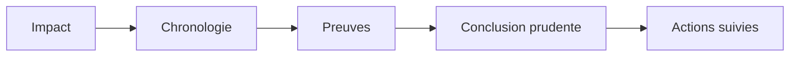
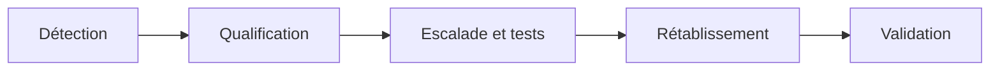
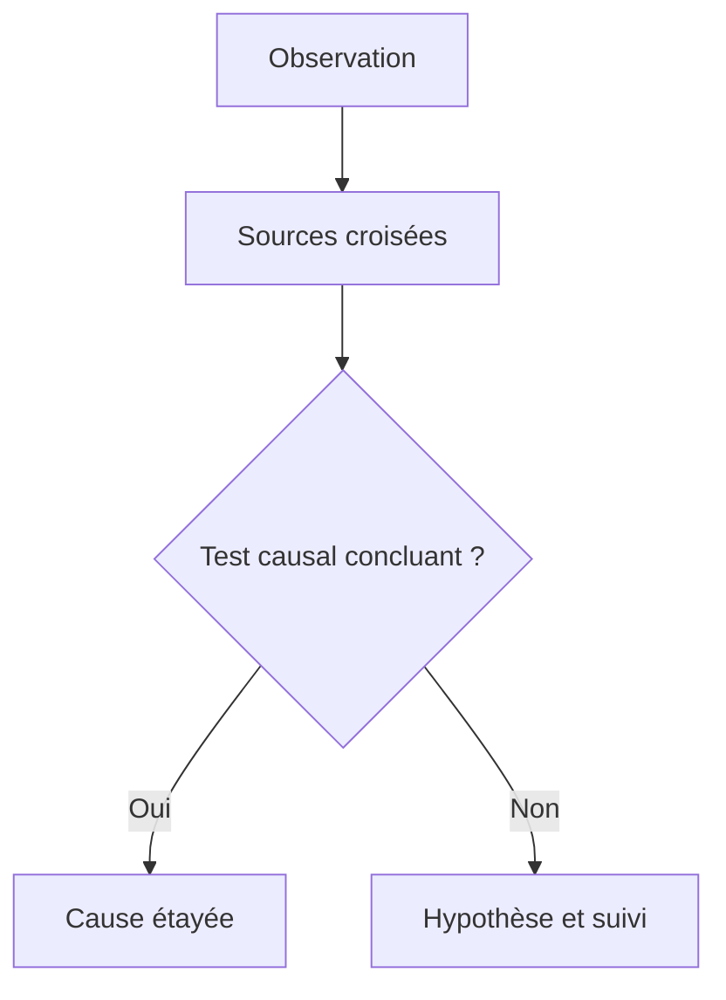
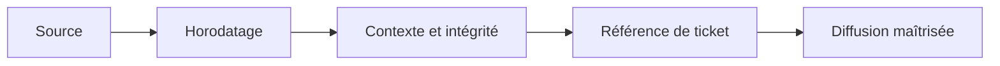
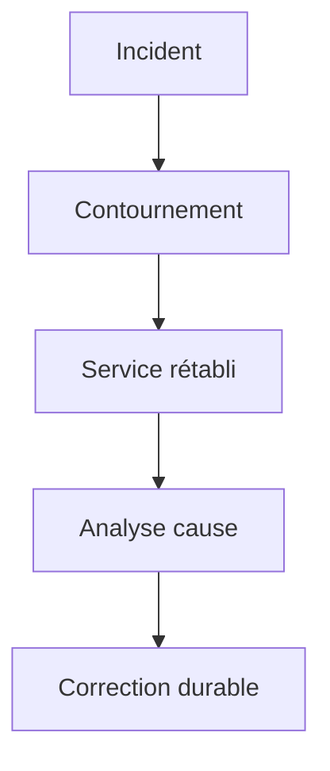
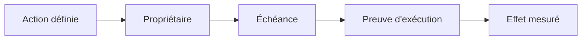

# Rédiger un rapport d'incident

> **Mise en contexte** — Ce cours s'adresse à un technicien intermédiaire qui doit agir dans un environnement réel, respecter les contraintes de service et laisser des preuves réutilisables. L'objectif n'est pas seulement de connaître les outils, mais de comprendre pourquoi une action est choisie, dans quelles conditions elle est sûre, comment vérifier son résultat et quand demander de l'aide.

## Présentation et enjeux

Le rapport d'incident constitue une trace structurée des faits, de l'impact, de la chronologie, des décisions et des actions. Il doit séparer les informations confirmées des hypothèses afin d'aider le support, les responsables métier et les équipes techniques à prendre des décisions réutilisables. Cette discipline s'inscrit dans une démarche de qualité de service : chaque opération doit être reliée au besoin métier, au risque accepté et à un critère d'acceptation observable. L'intervenant doit pouvoir expliquer l'état initial, la décision prise, les résultats obtenus et les limites qui subsistent.

Dans une équipe de maintenance, les informations sont souvent réparties entre tickets, conversations, inventaires, systèmes de supervision et mémoire individuelle. Une méthode fiable les relie dans une trace commune et limite les décisions fondées sur une seule observation. Le cours met l'accent sur les preuves, les contrôles proportionnés, la reproductibilité et la communication utile.

Le niveau intermédiaire suppose que les gestes de base sont acquis. La difficulté consiste maintenant à traiter des environnements hétérogènes, des incidents ambigus, des changements qui touchent plusieurs composants et des situations où la donnée est imparfaite. Les règles présentées doivent être adaptées aux procédures approuvées de l'organisation et vérifiées dans un environnement de test avant toute action ayant un impact sur la production.

## Objectifs pédagogiques

À la fin du parcours, l'apprenant pourra :

- expliquer les principes et les limites des outils utilisés dans le domaine ;
- choisir un contrôle ou une méthode à partir de l'impact, de la criticité et des preuves disponibles ;
- effectuer une démarche reproductible et distinguer observation, hypothèse et décision ;
- interpréter les indicateurs sans confondre corrélation, résultat technique et expérience utilisateur ;
- rédiger une trace claire, traiter les exceptions et organiser une escalade ;
- vérifier l'effet d'une action, décrire le risque résiduel et proposer une amélioration mesurable.

## Prérequis et cadre de travail

Avant de commencer, savoir utiliser un terminal, lire les journaux, identifier un actif, comprendre les tickets et appliquer les règles locales de sécurité. Les commandes ci-dessous sont illustratives : adapter les noms d'hôte, les chemins et les versions, utiliser des cibles de test autorisées et ne jamais copier de secret dans un document. Une commande d'observation doit être préférée à une modification lorsqu'elle suffit à qualifier la situation.

Les principes directeurs sont les suivants : intervention autorisée, moindre privilège, sauvegarde ou retour arrière adaptés, fenêtre connue, communication compréhensible et preuve de validation. Si un contrôle critique échoue, ne pas continuer mécaniquement. Noter le constat, évaluer le risque et utiliser le point d'arrêt ou l'escalade défini par la procédure.

## Vocabulaire métier

| Terme | Utilisation opérationnelle |
|---|---|
| État initial | Description mesurée du système avant toute intervention. |
| Criticité | Conséquence potentielle de l'indisponibilité ou de la mauvaise configuration. |
| Preuve | Élément daté qui peut être vérifié par un autre intervenant. |
| Écart | Différence entre le résultat attendu et l'observation. |
| Exception | Situation où la procédure standard ne s'applique pas ou n'atteint pas son objectif. |
| Validation | Contrôle confirmant que le service ou l'opération satisfait les critères convenus. |
| Retour arrière | Séquence permettant de retrouver un état stable si les critères de réussite ne sont pas satisfaits. |
| Récurrence | Réapparition d'un problème similaire après un traitement précédent. |

## Schémas adaptés au sujet

### Schéma 1 — Structure du rapport



Le lecteur comprend d'abord l'effet sur le service, puis les faits, les preuves, le niveau de confiance et les actions.

### Schéma 2 — Chronologie incident



Normaliser les heures et conserver les sources rend possible la reconstruction du déroulé.

### Schéma 3 — Confiance des conclusions



Le rapport doit montrer ce qui est confirmé et ce qui reste à démontrer, sans transformer la proximité temporelle en causalité.

### Schéma 4 — Gestion des preuves



Chaque pièce doit être utile et traçable, tandis que les copies distribuées limitent l'exposition des informations sensibles.

### Schéma 5 — Contournement et correction



Le contournement permet de retrouver le service mais peut laisser un risque ; le rapport doit le rendre visible.

### Schéma 6 — Suivi des actions



Une action n'est pas efficace simplement parce qu'elle est marquée terminée ; le suivi doit vérifier l'effet sur le risque.

## Fondements techniques du domaine

### 1. Résumé exécutif

Le résumé exécutif doit permettre à un responsable qui n'a pas participé à l'intervention de comprendre rapidement ce qui s'est passé, qui a été affecté, pendant combien de temps, quelle mesure a rétabli le service et ce qui reste à faire. Il ne doit pas tenter de remplacer l'analyse détaillée, ni transformer une hypothèse en certitude pour rendre le récit plus simple.

Structurer le résumé en quelques éléments vérifiables : service concerné, impact utilisateur et métier, début et fin connus, gravité selon la classification interne, mode de détection, mitigation ou restauration principale, état actuel, incertitudes importantes et actions prioritaires. Lorsque la durée n'est pas précisément mesurable, indiquer la plage estimée et la raison de l'incertitude. Les chiffres doivent utiliser des définitions cohérentes avec la supervision et les données du support.

Une synthèse utile évite les formulations vagues comme « incident résolu après intervention technique ». Préférer une description factuelle du type : « Entre 09 h 12 et 09 h 38 UTC, une partie des utilisateurs du site B n'a pas pu accéder au partage de fichiers. Le contournement a restauré l'accès; l'analyse de la cause et la vérification de la prévention restent ouvertes. » Cet exemple est fictif. Le rapport doit différencier l'état actuel de la cause supposée et ne doit pas cacher les utilisateurs ou fonctions encore dégradés.
### 2. Périmètre et impact

Décrire l'impact depuis le point de vue des utilisateurs et du service : sites, groupes, applications, fonctions métier, équipements, transactions ou données concernés. Préciser ce qui n'a pas été touché lorsque cette comparaison aide à comprendre le périmètre. Éviter d'écrire « tous les clients » si les preuves montrent seulement un sous-ensemble ou si la visibilité est incomplète. Quantifier les personnes ou actifs quand une source fiable le permet, et signaler les estimations.

Séparer l'impact technique de la conséquence métier. Une perte de connectivité de quelques minutes peut avoir un effet élevé si elle interrompt des paiements ou un service essentiel; une alerte technique peut rester sans impact utilisateur visible. Documenter les contournements disponibles, les données qui auraient pu être perdues ou corrompues, les obligations de notification et les restrictions de sécurité. L'absence de plainte ne suffit pas à prouver l'absence d'impact.

Indiquer comment la portée a été évaluée : tickets rattachés, métriques, sondes, journaux, inventaire, confirmation du propriétaire métier ou échantillon d'utilisateurs. Si certains sites ou périodes ne sont pas observés, le rapport doit le préciser. Une plage de confiance honnête est plus utile qu'un nombre exact en apparence mais reposant sur des données incomplètes.
### 3. Chronologie

La chronologie doit permettre de reconstituer le déroulement de l'incident sans dépendre de la mémoire d'un participant. Inclure le dernier état connu comme sain, le premier symptôme, la détection, le début de la réponse, les escalades, les décisions, les changements d'état, la mitigation, les tests de rétablissement et la fin de l'impact. Chaque entrée doit avoir une heure, une source, un événement observé et, lorsque c'est utile, l'action ou la décision qui en a découlé.

Normaliser les heures dans un fuseau explicite, souvent UTC pour coordonner des équipes réparties, tout en conservant l'horodatage d'origine si les systèmes ne sont pas synchronisés. Ne pas inventer une heure exacte à partir d'un souvenir approximatif; marquer une estimation comme telle. Une alerte reçue après le début de l'impact n'est pas l'heure de début de l'incident. Ces deux temps doivent rester distincts pour mesurer la détection.

Les entrées de chronologie doivent provenir d'éléments observables : historique d'alerte, horodatage du ticket, journal d'application, journal de changement, commande exécutée ou confirmation d'un opérateur. Si deux sources se contredisent, conserver l'écart et rechercher l'origine du décalage plutôt que choisir silencieusement celle qui semble la plus plausible.
### 4. Preuves

Une preuve soutient une affirmation précise du rapport. Elle peut être une métrique, une ligne de journal, un événement de supervision, une sortie de commande, un état de configuration, une capture pertinente, un résultat de test ou un ticket horodaté. Préciser sa source, la période, le système concerné, le contexte de collecte et ce qu'elle permet réellement de conclure. Un ping réussi prouve une réponse ICMP depuis ce point, pas la disponibilité complète d'une application.

Éviter d'insérer des centaines de lignes de logs sans expliquer leur pertinence. Garder le jeu de données original selon la politique de rétention, puis joindre un extrait contrôlé qui conserve assez de contexte pour être interprété. Indiquer les filtres, les unités, les versions, les fuseaux et les limites. Protéger les mots de passe, jetons, clés, données personnelles, adresses sensibles et éléments relevant d'une enquête sécurité. Utiliser un emplacement d'accès contrôlé pour les preuves volumineuses.

Distinguer une preuve directe d'une inférence. La corrélation temporelle entre un changement et une panne mérite une investigation, mais ne démontre pas automatiquement la causalité. Si un journal manquant empêche une conclusion, mentionner cette limite et prévoir une amélioration de la collecte. Ne jamais modifier l'original silencieusement pour simplifier le récit; toute normalisation ou anonymisation d'une copie doit être décrite.
### 5. Cause et incertitude

Le rapport doit séparer quatre choses : le symptôme observé, la cause confirmée, les facteurs contributifs et les inconnues persistantes. Le symptôme décrit ce que les utilisateurs ou les systèmes ont vécu. La cause doit s'appuyer sur un mécanisme compatible avec les preuves. Un facteur contributif peut avoir permis l'événement, accru son impact ou retardé sa détection. Une inconnue est un élément non démontré, pas un défaut que l'auteur doit combler par intuition.

Quand l'analyse n'est pas terminée au moment de publier le rapport de situation, présenter les hypothèses principales, les éléments qui les soutiennent, les éléments contradictoires et le prochain test prévu. Ne pas attribuer automatiquement l'incident à la dernière personne ayant effectué une modification, au fournisseur ou à une « erreur humaine ». Examiner les contrôles, la procédure, la capacité, la supervision, les dépendances et les conditions de travail.

Pour les incidents significatifs, relier le rapport à une analyse RCA distincte si nécessaire. Les outils tels que les cinq pourquoi ou Ishikawa structurent l'enquête, mais le rapport ne doit pas présenter une chaîne causale comme prouvée si chaque lien n'a pas été vérifié. Ajouter le niveau de confiance lorsque c'est utile et préciser qui validera la conclusion finale.
### 6. Rétablissement

Décrire les mesures de mitigation et de restauration dans l'ordre, avec leur motif, le propriétaire, l'heure, le résultat observé et les risques acceptés. Distinguer le contournement, qui réduit l'impact sans forcément supprimer la cause, de la correction définitive. Mentionner les options évaluées, si cette information aide à comprendre la décision, et pourquoi l'option retenue était adaptée au risque et au temps disponible.

La fin d'une action ne prouve pas que le service est rétabli. Énumérer les critères de rétablissement et les tests exécutés : fonctionnalité, accessibilité pour les profils concernés, métriques de performance, absence de nouvelle alerte, intégrité des données, non-régression et validation du propriétaire métier si nécessaire. Préciser la durée d'observation si un retour intermittent est possible. Les points qui n'ont pas été testés doivent être visibles.

Si un retour arrière a été réalisé, expliquer le déclencheur, les étapes de restauration et les vérifications après le retour. Indiquer les effets secondaires ou les limitations restant à traiter. Un incident peut être déclaré stabilisé tout en gardant une action de cause racine ouverte, à condition de nommer un propriétaire, une échéance et un risque résiduel qui a été accepté par la personne habilitée.
### 7. Communication

La communication doit refléter l'état du service sans exagérer la certitude. Un message de situation indique le périmètre confirmé, les conséquences, les mesures en cours, le contournement autorisé s'il existe, la prochaine mise à jour et le canal de référence. Éviter de promettre une heure de résolution sans estimation étayée. Quand l'heure de restauration reste inconnue, expliquer ce qui est en cours et quand l'information sera actualisée.

Le rapport technique peut contenir des détails destinés aux équipes de support, alors que la communication aux utilisateurs doit présenter les effets pratiques et les consignes. Une version destinée à la direction doit se concentrer sur l'impact, le risque, les décisions et les actions prioritaires. La cohérence entre ces vues est essentielle : conserver un ticket ou un canal de référence et un propriétaire de communication clairement désigné.

Respecter les contraintes de sécurité, de confidentialité et de notification contractuelle. Un incident impliquant des données sensibles peut nécessiter des destinataires et un canal spécifiques. Ne pas ajouter des secrets ou données personnelles aux versions largement diffusées. Si de nouvelles preuves changent le périmètre ou la cause, publier une mise à jour datée qui explique ce qui a changé au lieu de réécrire le passé sans trace.
### 8. Actions correctives

Les actions doivent traiter la cause établie, réduire la probabilité de récurrence, accélérer la détection ou limiter les conséquences. Une action telle que « faire attention » est trop vague pour être évaluée. Décrire la modification attendue, le mécanisme de risque ciblé, le responsable, l'échéance, les dépendances, le risque secondaire et la preuve de réalisation. Le rapport doit relier chaque action à l'affirmation ou à la lacune qui la justifie.

Distinguer les actions immédiates, les corrections définitives, les améliorations de supervision, les mises à jour de procédure et les besoins de formation. Affecter les actions au bon backlog ou système de suivi, puis maintenir le lien vers le rapport d'incident. Pour les actions de production, appliquer le processus de changement adapté et définir des tests, des critères de réussite et un retour arrière lorsque nécessaire.

La publication du rapport ne vaut pas clôture de toutes les actions. Un responsable doit vérifier les échéances et l'efficacité des mesures après leur mise en œuvre. Si une action est reportée, documenter la raison, le risque résiduel et la décision de l'autorité compétente. Les incidents récurrents ou les actions en retard doivent être présentés en revue de service pour empêcher que la même recommandation reste indéfiniment ouverte.
## Méthode transversale pour une opération maîtrisée

### 1. Gouvernance

L'intervention doit être reliée à un objectif de service, un propriétaire et une décision explicite. Le contrôle de gouvernance n'a de valeur que s'il aide à identifier qui peut accepter le risque et qui doit être informé. Pour rédiger un rapport d'incident, cela signifie que la personne qui agit doit relier la règle à un élément concret : complétude du rapport, délai de publication, actions correctives suivies, chronologies vérifiées, corrections requises après revue. Avant l'opération, noter l'état de départ et ce qui fera considérer le résultat comme acceptable. Pendant l'action, conserver le contexte des changements et indiquer immédiatement les écarts. Après l'action, exécuter le contrôle correspondant au risque, enregistrer le résultat et affecter les suites restantes. Cette discipline augmente la qualité de la passation et réduit la dépendance à une personne unique.

### 2. Cycle de vie

La solution doit être pensée depuis la préparation jusqu'à la sortie, y compris le maintien des compétences et le retrait des anciennes données. Une étape oubliée en fin de cycle transforme souvent une réussite ponctuelle en risque latent. Pour rédiger un rapport d'incident, cela signifie que la personne qui agit doit relier la règle à un élément concret : complétude du rapport, délai de publication, actions correctives suivies, chronologies vérifiées, corrections requises après revue. Avant l'opération, noter l'état de départ et ce qui fera considérer le résultat comme acceptable. Pendant l'action, conserver le contexte des changements et indiquer immédiatement les écarts. Après l'action, exécuter le contrôle correspondant au risque, enregistrer le résultat et affecter les suites restantes. Cette discipline augmente la qualité de la passation et réduit la dépendance à une personne unique.

### 3. Qualité de données

Toute mesure dépend de la qualité de son périmètre, de l'horodatage, de l'unité et de la provenance. Il faut identifier les champs manquants et les conventions contradictoires avant de tirer une conclusion. Pour rédiger un rapport d'incident, cela signifie que la personne qui agit doit relier la règle à un élément concret : complétude du rapport, délai de publication, actions correctives suivies, chronologies vérifiées, corrections requises après revue. Avant l'opération, noter l'état de départ et ce qui fera considérer le résultat comme acceptable. Pendant l'action, conserver le contexte des changements et indiquer immédiatement les écarts. Après l'action, exécuter le contrôle correspondant au risque, enregistrer le résultat et affecter les suites restantes. Cette discipline augmente la qualité de la passation et réduit la dépendance à une personne unique.

### 4. Gestion du risque

Le risque se juge par probabilité, impact, capacité de détection et marge de récupération. Les éléments critiques doivent recevoir plus de contrôles, sans imposer la même lourdeur aux opérations réversibles et aux changements irréversibles. Pour rédiger un rapport d'incident, cela signifie que la personne qui agit doit relier la règle à un élément concret : complétude du rapport, délai de publication, actions correctives suivies, chronologies vérifiées, corrections requises après revue. Avant l'opération, noter l'état de départ et ce qui fera considérer le résultat comme acceptable. Pendant l'action, conserver le contexte des changements et indiquer immédiatement les écarts. Après l'action, exécuter le contrôle correspondant au risque, enregistrer le résultat et affecter les suites restantes. Cette discipline augmente la qualité de la passation et réduit la dépendance à une personne unique.

### 5. Communication

Une communication utile indique ce qui est connu, ce qui reste à vérifier, qui agit ensuite et quand une nouvelle information sera fournie. Les formulations doivent éviter les promesses non vérifiées. Pour rédiger un rapport d'incident, cela signifie que la personne qui agit doit relier la règle à un élément concret : complétude du rapport, délai de publication, actions correctives suivies, chronologies vérifiées, corrections requises après revue. Avant l'opération, noter l'état de départ et ce qui fera considérer le résultat comme acceptable. Pendant l'action, conserver le contexte des changements et indiquer immédiatement les écarts. Après l'action, exécuter le contrôle correspondant au risque, enregistrer le résultat et affecter les suites restantes. Cette discipline augmente la qualité de la passation et réduit la dépendance à une personne unique.

### 6. Sécurité

Le périmètre technique doit rester limité aux systèmes autorisés, avec une identité traçable et les droits minimaux nécessaires. Les secrets doivent être protégés dans les fichiers, les journaux, les captures et les exports. Pour rédiger un rapport d'incident, cela signifie que la personne qui agit doit relier la règle à un élément concret : complétude du rapport, délai de publication, actions correctives suivies, chronologies vérifiées, corrections requises après revue. Avant l'opération, noter l'état de départ et ce qui fera considérer le résultat comme acceptable. Pendant l'action, conserver le contexte des changements et indiquer immédiatement les écarts. Après l'action, exécuter le contrôle correspondant au risque, enregistrer le résultat et affecter les suites restantes. Cette discipline augmente la qualité de la passation et réduit la dépendance à une personne unique.

### 7. Traçabilité

Une action exploitable doit laisser un résultat vérifiable, un horodatage, un propriétaire et un lien avec le ticket ou le changement. La trace doit permettre à un autre technicien de comprendre ce qui a été fait. Pour rédiger un rapport d'incident, cela signifie que la personne qui agit doit relier la règle à un élément concret : complétude du rapport, délai de publication, actions correctives suivies, chronologies vérifiées, corrections requises après revue. Avant l'opération, noter l'état de départ et ce qui fera considérer le résultat comme acceptable. Pendant l'action, conserver le contexte des changements et indiquer immédiatement les écarts. Après l'action, exécuter le contrôle correspondant au risque, enregistrer le résultat et affecter les suites restantes. Cette discipline augmente la qualité de la passation et réduit la dépendance à une personne unique.

### 8. Gestion des exceptions

Les cas hors procédure doivent être visibles et conduire à un point d'arrêt, une décision ou une escalade. Une exception récurrente est souvent le signal qu'il faut faire évoluer la procédure plutôt que la répéter. Pour rédiger un rapport d'incident, cela signifie que la personne qui agit doit relier la règle à un élément concret : complétude du rapport, délai de publication, actions correctives suivies, chronologies vérifiées, corrections requises après revue. Avant l'opération, noter l'état de départ et ce qui fera considérer le résultat comme acceptable. Pendant l'action, conserver le contexte des changements et indiquer immédiatement les écarts. Après l'action, exécuter le contrôle correspondant au risque, enregistrer le résultat et affecter les suites restantes. Cette discipline augmente la qualité de la passation et réduit la dépendance à une personne unique.

### 9. Amélioration continue

Les incidents, les retours utilisateurs et les contrôles qualité doivent transformer les règles et procédures. Il faut vérifier si les modifications réduisent réellement le risque, et pas seulement si les documents ont été mis à jour. Pour rédiger un rapport d'incident, cela signifie que la personne qui agit doit relier la règle à un élément concret : complétude du rapport, délai de publication, actions correctives suivies, chronologies vérifiées, corrections requises après revue. Avant l'opération, noter l'état de départ et ce qui fera considérer le résultat comme acceptable. Pendant l'action, conserver le contexte des changements et indiquer immédiatement les écarts. Après l'action, exécuter le contrôle correspondant au risque, enregistrer le résultat et affecter les suites restantes. Cette discipline augmente la qualité de la passation et réduit la dépendance à une personne unique.

### 10. Capacité

Les ressources, compétences, fenêtres et dépendances limitent le volume d'opérations réalisables. Une planification crédible tient compte de la charge, des temps de contrôle et des imprévus. Pour rédiger un rapport d'incident, cela signifie que la personne qui agit doit relier la règle à un élément concret : complétude du rapport, délai de publication, actions correctives suivies, chronologies vérifiées, corrections requises après revue. Avant l'opération, noter l'état de départ et ce qui fera considérer le résultat comme acceptable. Pendant l'action, conserver le contexte des changements et indiquer immédiatement les écarts. Après l'action, exécuter le contrôle correspondant au risque, enregistrer le résultat et affecter les suites restantes. Cette discipline augmente la qualité de la passation et réduit la dépendance à une personne unique.

### 11. Contrôle du changement

Une modification nécessite un état initial connu, un périmètre, des critères de réussite et une solution de repli adaptée au risque. L'urgence ne supprime pas le besoin de garder une trace des décisions. Pour rédiger un rapport d'incident, cela signifie que la personne qui agit doit relier la règle à un élément concret : complétude du rapport, délai de publication, actions correctives suivies, chronologies vérifiées, corrections requises après revue. Avant l'opération, noter l'état de départ et ce qui fera considérer le résultat comme acceptable. Pendant l'action, conserver le contexte des changements et indiquer immédiatement les écarts. Après l'action, exécuter le contrôle correspondant au risque, enregistrer le résultat et affecter les suites restantes. Cette discipline augmente la qualité de la passation et réduit la dépendance à une personne unique.

### 12. Mesure d'efficacité

Un indicateur ne vaut que si sa définition reste constante et si sa variation peut conduire à une décision. Les chiffres doivent être accompagnés d'une période, d'un périmètre et des limites de mesure. Pour rédiger un rapport d'incident, cela signifie que la personne qui agit doit relier la règle à un élément concret : complétude du rapport, délai de publication, actions correctives suivies, chronologies vérifiées, corrections requises après revue. Avant l'opération, noter l'état de départ et ce qui fera considérer le résultat comme acceptable. Pendant l'action, conserver le contexte des changements et indiquer immédiatement les écarts. Après l'action, exécuter le contrôle correspondant au risque, enregistrer le résultat et affecter les suites restantes. Cette discipline augmente la qualité de la passation et réduit la dépendance à une personne unique.

### 13. Passation

Une tâche doit pouvoir être reprise par une autre personne sans dépendre des souvenirs du technicien présent. La transmission contient contexte, preuves, étapes déjà tentées et prochaine action. Pour rédiger un rapport d'incident, cela signifie que la personne qui agit doit relier la règle à un élément concret : complétude du rapport, délai de publication, actions correctives suivies, chronologies vérifiées, corrections requises après revue. Avant l'opération, noter l'état de départ et ce qui fera considérer le résultat comme acceptable. Pendant l'action, conserver le contexte des changements et indiquer immédiatement les écarts. Après l'action, exécuter le contrôle correspondant au risque, enregistrer le résultat et affecter les suites restantes. Cette discipline augmente la qualité de la passation et réduit la dépendance à une personne unique.

### 14. Validation métier

Le résultat technique doit être confirmé du point de vue du service. Un équipement joignable ou un script qui termine sans erreur ne suffit pas si l'utilisateur ne peut pas accomplir son opération. Pour rédiger un rapport d'incident, cela signifie que la personne qui agit doit relier la règle à un élément concret : complétude du rapport, délai de publication, actions correctives suivies, chronologies vérifiées, corrections requises après revue. Avant l'opération, noter l'état de départ et ce qui fera considérer le résultat comme acceptable. Pendant l'action, conserver le contexte des changements et indiquer immédiatement les écarts. Après l'action, exécuter le contrôle correspondant au risque, enregistrer le résultat et affecter les suites restantes. Cette discipline augmente la qualité de la passation et réduit la dépendance à une personne unique.

## Indicateurs : définition, lecture et limites

Les indicateurs les plus utiles pour ce domaine sont : **complétude du rapport, délai de publication, actions correctives suivies, chronologies vérifiées, corrections requises après revue**. Chaque indicateur doit avoir une définition écrite. Il faut préciser l'unité, la source, le périmètre, la fréquence, la période et les exclusions. Lorsque les données ne couvrent qu'une partie de l'environnement, le rapport doit le signaler au lieu d'extrapoler silencieusement. Un indicateur doit permettre une décision : prioriser, déclencher une vérification, ajuster une capacité, revoir une procédure ou accepter explicitement un risque.

Un bon tableau de bord met en évidence la tendance et les écarts significatifs, sans supprimer la donnée de départ. Il distingue les valeurs brutes, les seuils, les anomalies confirmées et les périodes sans mesure. Une moyenne peut cacher des situations extrêmes ; il est donc souvent nécessaire d'observer la distribution, les percentiles, les valeurs maximales et la répartition par service ou par criticité. Les changements de définition doivent être versionnés pour éviter de comparer des séries qui ne signifient plus la même chose.

Les indicateurs ne doivent pas devenir des objectifs isolés. Par exemple, réduire le délai moyen n'est pas une amélioration si les tickets sont fermés avant validation et immédiatement rouverts. De même, atteindre un taux de conformité en excluant les actifs inconnus peut donner une image artificiellement favorable. Associer un KPI à un contrôle de qualité et à un résultat métier permet de repérer ces effets indésirables.

## Procédure opérationnelle recommandée

1. **Préparer.** Confirmer la demande, le périmètre, le propriétaire, l'autorisation et la fenêtre. Vérifier les dépendances, les sauvegardes et les accès nécessaires.
2. **Établir l'état initial.** Recueillir les mesures, l'état des services, les alertes, la dernière intervention et les écarts connus. Noter les éléments non vérifiables.
3. **Évaluer les risques.** Déterminer impact, probabilité, détectabilité, réversibilité et critère de report. Définir un point d'arrêt compréhensible.
4. **Exécuter par étapes.** Utiliser les outils approuvés, limiter le périmètre et vérifier les résultats intermédiaires avant de passer à l'étape suivante.
5. **Contrôler.** Comparer l'état final à l'état attendu et tester le service selon un scénario réaliste, pas uniquement le composant technique.
6. **Tracer.** Enregistrer les horaires, commandes ou actions, résultats, décisions et écarts dans le ticket ou le référentiel prévu.
7. **Communiquer.** Annoncer le résultat en termes compréhensibles, préciser les limites et indiquer qui gère les actions ouvertes.
8. **Améliorer.** Rechercher les étapes ambiguës ou les contrôles inefficaces et proposer une modification versionnée, testée et approuvée.

## Outils et contrôles pratiques

Les outils doivent être sélectionnés selon l'objectif, les droits et le type de preuve recherché. L'usage d'un outil connu ne dispense pas de contrôler son contexte : version, paramètres, cible, unité, état de connexion et limite de la mesure. ITSM, journaux, supervision, horodatage UTC, diff de configuration, modèle de rapport, revue post-incident constituent des exemples de technologies possibles ; leur choix exact dépend de l'environnement et des politiques internes.

| Contrôle | Question à poser | Trace à conserver |
|---|---|---|
| Identité de la cible | Est-ce bien l'actif ou le service autorisé ? | Identifiant, inventaire et horodatage. |
| État initial | Quelle condition de départ a été mesurée ? | Valeur, source, capture ou sortie. |
| Autorisation | Qui a approuvé l'action et pour quelle fenêtre ? | Ticket, validation et périmètre. |
| Résultat | Qu'est-ce qui démontre que le résultat est correct ? | Test de contrôle et résultat observé. |
| Écart | Que faire si le résultat attendu n'est pas obtenu ? | Point d'arrêt, escalade et action attribuée. |

### Commandes et exemples

Les commandes de cette section servent à illustrer la collecte de preuves. Remplacer les valeurs de test par des cibles autorisées et vérifier localement les options selon la distribution et la version de l'outil.

#### Exemple 1 — Capturer des journaux sur une période

```bash
journalctl --since '2026-10-27 08:00:00' --until '2026-10-27 09:00:00' --no-pager
```

Interpréter la sortie avec le contexte de l'intervention. Un retour nul ne démontre pas toujours que la fonction métier est opérationnelle. Relever les erreurs, vérifier l'heure des journaux et comparer les observations avec une seconde source lorsque l'impact le justifie. Ne pas intégrer un résultat de terminal dans un rapport sans préciser la machine, la période et la commande effectivement exécutée.

#### Exemple 2 — Établir l'heure UTC

```bash
date -u '+%Y-%m-%dT%H:%M:%SZ'
```

Interpréter la sortie avec le contexte de l'intervention. Un retour nul ne démontre pas toujours que la fonction métier est opérationnelle. Relever les erreurs, vérifier l'heure des journaux et comparer les observations avec une seconde source lorsque l'impact le justifie. Ne pas intégrer un résultat de terminal dans un rapport sans préciser la machine, la période et la commande effectivement exécutée.

#### Exemple 3 — Calculer l'empreinte d'une preuve

```bash
sha256sum preuve.log
```

Interpréter la sortie avec le contexte de l'intervention. Un retour nul ne démontre pas toujours que la fonction métier est opérationnelle. Relever les erreurs, vérifier l'heure des journaux et comparer les observations avec une seconde source lorsque l'impact le justifie. Ne pas intégrer un résultat de terminal dans un rapport sans préciser la machine, la période et la commande effectivement exécutée.

#### Exemple 4 — Vérifier les changements de configuration suivis

```bash
git status --short && git diff --check
```

Interpréter la sortie avec le contexte de l'intervention. Un retour nul ne démontre pas toujours que la fonction métier est opérationnelle. Relever les erreurs, vérifier l'heure des journaux et comparer les observations avec une seconde source lorsque l'impact le justifie. Ne pas intégrer un résultat de terminal dans un rapport sans préciser la machine, la période et la commande effectivement exécutée.


## Modèle professionnel de rapport d'incident

Un bon modèle améliore la cohérence, mais ne doit pas imposer le même niveau de détail à tous les événements. Un incident limité peut être documenté avec une synthèse et des preuves concises; un incident majeur ou sensible exige souvent une chronologie plus riche, des responsables de décision, des éléments de contrôle et une revue post-incident. Le rapport doit être lisible indépendamment de la mémoire de ceux qui étaient présents.

### Modèle prêt à copier

~~~text
RAPPORT D'INCIDENT — IDENTIFIANT :
Statut du rapport : préliminaire / confirmé / final / révisé
Date de publication et fuseau :
Auteur / propriétaire / relecteur :
Service et environnements :
Niveau de sévérité selon la classification interne :

1. RÉSUMÉ EXÉCUTIF
- Que s'est-il passé ?
- Qui et quoi ont été affectés ?
- Quand l'impact a-t-il commencé et pris fin ?
- Quelle mesure a rétabli le service ?
- Quelles actions restent ouvertes ?

2. IMPACT
- Fonctions et utilisateurs affectés :
- Périmètre confirmé et estimation :
- Conséquences métier :
- Données perdues, altérées ou non concernées :
- Contournements et limites :

3. DÉTECTION ET CHRONOLOGIE
- Dernier état sain connu :
- Première alerte :
- Premier impact confirmé :
- Actions, décisions, escalades :
- Mitigation / retour arrière :
- Tests et heure de rétablissement :
- Période de surveillance :

4. ANALYSE
- Faits confirmés :
- Cause confirmée ou hypothèses :
- Facteurs contributifs :
- Preuves et références :
- Incertitudes et données manquantes :

5. RESTAURATION ET VALIDATION
- Action et motif :
- Critères d'acceptation :
- Tests réalisés et résultats :
- Tests non réalisés et limites :
- Risque résiduel :

6. ACTIONS
- Action / type / responsable / échéance :
- Critère d'achèvement :
- Mesure d'efficacité et date de contrôle :
- Risque accepté si l'action est différée :

7. COMMUNICATION ET CLÔTURE
- Publics informés et horaires :
- Prochaine mise à jour ou état final :
- Liens vers incident, problème, changement et RCA :
- Relecteur / approbateur si requis :
- Historique des versions et corrections :
~~~

Ne pas laisser un champ critique vide sans explication. Lorsqu'une information n'est pas disponible, indiquer « inconnu à cette date », le motif et le moyen de la confirmer, plutôt que masquer la lacune. Le statut « préliminaire » convient lorsque le service est stabilisé mais que la cause ou certaines conséquences restent à établir.

### Choisir le niveau de détail du rapport

| Type de document | Lecteur principal | Contenu prioritaire | Limite à éviter |
|---|---|---|---|
| Mise à jour pendant incident | Utilisateurs, propriétaire de service, coordination | État, impact, action en cours, prochaine mise à jour | Affirmer une cause non confirmée |
| Rapport technique initial | Support et équipes spécialisées | Chronologie, preuves, tests, décisions, état de restauration | Verser tous les logs sans interprétation |
| Rapport exécutif | Direction et responsables métier | Impact, durée, niveau de confiance, risque et décisions | Noyer le lecteur dans des détails de commande |
| Post-incident / RCA | Équipes techniques et responsables d'amélioration | Cause, facteurs contributifs, mesures, apprentissage et suivis | Chercher un coupable au lieu de comprendre le système |
| Version client ou externe | Client et parties contractuelles | Conséquences, état, mesure de rétablissement et suites validées | Divulguer des informations internes ou sensibles |

Les documents peuvent partager une même source de vérité mais ne doivent pas tous exposer les mêmes détails. Conserver une version maîtresse, gérer ses révisions et faire relire les versions externes lorsqu'une exigence contractuelle ou sécurité l'impose.

## Concevoir une chronologie qui permet l'audit

La chronologie doit distinguer au moins quatre instants : le premier événement technique connu, le premier impact utilisateur confirmé, la détection par l'organisation et la prise en charge effective. Selon le service, l'ordre réel peut être différent; c'est précisément pour cela que les notions doivent rester distinctes. Le délai entre l'impact et la détection éclaire la supervision; celui entre détection et prise en charge éclaire le routage; celui entre prise en charge et mitigation éclaire le diagnostic et la décision.

~~~mermaid
flowchart TD
    A[Dernier état sain connu] --> B[Premier symptôme ou changement]
    B --> C[Première détection]
    C --> D[Prise en charge et qualification]
    D --> E[Escalades et décisions]
    E --> F[Mitigation ou retour arrière]
    F --> G[Tests de rétablissement]
    G --> H[Fin de l'impact confirmé]
    H --> I[Surveillance et clôture du rapport]
~~~

Pour chaque événement, conserver une ligne structurée :

~~~text
Horodatage normalisé | source | événement observé | décision/action | résultat | auteur ou système
~~~

Les événements peuvent provenir d'un ticket, d'une alerte, d'un journal, d'un changement documenté, d'une conversation opérationnelle ou d'un relevé métier. Chaque source peut avoir une précision différente. Si la première plainte est horodatée à 09:18 mais que la métrique montre une dégradation dès 09:12, ne choisir pas l'heure de plainte comme début de l'impact sans expliquer cette distinction.

### Exemple fictif de chronologie

| Heure UTC | Source | Fait ou action | Interprétation permise |
|---|---|---|---|
| 08:45 | Supervision | Les tests synthétiques réussissent | Dernier état sain mesuré par cette sonde |
| 09:00 | Outil de changement | Une modification est déclarée appliquée | Une modification a eu lieu; sa causalité reste à confirmer |
| 09:07 | Métrique applicative | Le taux d'erreurs augmente | Première anomalie observée par cette source |
| 09:10 | Support | Premier ticket utilisateur | Premier signalement enregistré, pas nécessairement le début de l'impact |
| 09:18 | Ticket d'incident | L'équipe d'astreinte accepte le dossier | Début de la prise en charge documentée |
| 09:26 | Journal d'action | Mitigation appliquée | Action exécutée; effet encore à vérifier |
| 09:32 | Test de bout en bout | Le scénario métier réussit | Critère fonctionnel testé avec succès à cet instant |
| 10:00 | Supervision et métier | État stable pendant la fenêtre convenue | Confirmation de stabilité selon les signaux retenus |

Les données sont fictives et servent à montrer la structure. Dans un rapport réel, joindre les références vers les sources originales et indiquer les périodes non couvertes. La réussite d'un scénario de test ne démontre pas que toutes les transactions étaient correctes pendant tout l'incident.

~~~mermaid
sequenceDiagram
    participant Mon as Supervision
    participant SD as Centre de services
    participant Ops as Équipe technique
    participant Biz as Propriétaire métier
    Mon->>SD: Signal et premier horodatage
    SD->>Ops: Ticket qualifié et impact connu
    Ops->>Ops: Diagnostiquer et appliquer une mitigation approuvée
    Ops->>Mon: Contrôler métriques et erreurs
    Ops->>Biz: Demander la validation fonctionnelle
    Biz-->>Ops: Confirmer ou signaler les écarts
    Ops->>SD: Résultat, limites et actions restantes
~~~

## Quantifier l'impact sans surpromettre la précision

Les rapports sont plus crédibles lorsqu'ils indiquent la méthode de calcul et la qualité des données. Le nombre de tickets ne correspond pas nécessairement au nombre de personnes affectées : plusieurs demandes peuvent concerner une même personne, et certains utilisateurs peuvent ne pas contacter le support. Les métriques de supervision peuvent mesurer des requêtes ou des sondes, pas des personnes. Il faut nommer l'unité.

Une formulation solide ressemble à « 24 actifs distincts ont été identifiés dans l'inventaire et 17 utilisateurs ont confirmé un blocage; la couverture des autres sites est incomplète ». Elle révèle à la fois les chiffres observés et la limite. Éviter de convertir une estimation en une certitude ou d'extrapoler à tout le parc sans méthode.

~~~mermaid
flowchart TD
    A[Collecter tickets, métriques et retours métier] --> B[Définir l'unité : personnes, actifs, requêtes ou durée]
    B --> C[Dédupliquer et vérifier le périmètre]
    C --> D[Calculer le résultat et sa fenêtre]
    D --> E[Qualifier les zones non observées]
    E --> F[Publier le chiffre avec sa méthode]
    F --> G[Associer la preuve à chaque conclusion]
~~~

Pour mesurer une durée d'impact, préciser le point de départ utilisé et le critère de fin. Le premier ticket n'est pas nécessairement le début de l'incident; la dernière commande exécutée n'est pas nécessairement le rétablissement. Si les métriques d'indisponibilité, les tickets et la confirmation métier se contredisent, écrire cette contradiction et lancer une vérification.

## Gouverner les preuves et protéger les informations sensibles

Le rapport peut devoir être relu par de nombreuses personnes; l'ensemble des preuves techniques n'a pas nécessairement à être accessible à tous. Séparer les informations qui peuvent être publiées dans le corps du rapport des annexes restreintes contenant des journaux, identifiants d'actifs sensibles, captures d'administration ou informations personnelles. Les liens doivent respecter les droits d'accès et la politique de conservation.

~~~mermaid
flowchart LR
    A[Sources originales] --> B[Copie de travail contrôlée]
    B --> C[Filtrer les secrets et données inutiles]
    C --> D[Rapport lisible et synthèse]
    C --> E[Annexe technique avec accès limité]
    D --> F[Relecture selon le niveau du rapport]
    E --> F
    F --> G[Publication et rétention selon la politique]
~~~

Ne pas supprimer les éléments contraires à la conclusion retenue. Si une preuve n'est pas disponible, préciser si elle a expiré, n'a jamais été collectée, est inaccessible ou n'a pas encore été analysée. Ces explications conduisent à des actions différentes. Le rapport doit permettre de retrouver la preuve utilisée au moment de la décision, tout en évitant l'exposition de secrets ou l'ajout de copies incontrôlées.

## Rédiger une analyse causale lisible

Le rapport n'a pas besoin de reproduire toute la discussion du groupe d'intervention. Il doit présenter une chaîne causale compacte, montrer les preuves principales et expliquer pourquoi les autres hypothèses n'ont pas été retenues ou restent ouvertes. Distinguer cause immédiate, facteur contributif, défaut de détection et difficulté de récupération. Cette structure facilite le choix d'actions complémentaires.

~~~mermaid
flowchart TD
    A[Symptôme et impact constatés] --> B[Preuve du mécanisme technique]
    B --> C[Facteur contributif ou barrière manquante]
    C --> D[Pourquoi l'impact n'a-t-il pas été détecté plus tôt ?]
    D --> E[Pourquoi la récupération a-t-elle pris ce temps ?]
    E --> F[Actions ciblées : prévention, détection, atténuation, récupération]
~~~

Exemple : une saturation a causé des délais élevés; l'impact a été amplifié parce que la file d'attente n'était pas surveillée; la mitigation a été retardée parce que l'alerte était attribuée à une équipe sans accès au composant. Les trois éléments peuvent appeler des actions distinctes. Écrire seulement « le serveur était saturé » explique le mécanisme proche mais ne suffit pas à réduire la récurrence ou le temps de rétablissement.

## De la publication à la clôture des actions

Un rapport publié doit conserver un statut : préliminaire, validé, final ou révisé selon les règles locales. La mise à jour après publication doit préserver un historique des modifications importantes, notamment si la cause, la durée, le périmètre ou les actions changent. Les lecteurs doivent pouvoir savoir quelles conclusions étaient disponibles à une date donnée.

~~~mermaid
flowchart TD
    A[Rapport initial] --> B[Relecture technique et métier]
    B --> C{Faits et preuves suffisants ?}
    C -- Non --> D[Marquer les inconnues et planifier les vérifications]
    D --> E[Mettre à jour avec les preuves nouvelles]
    E --> B
    C -- Oui --> F[Valider le rapport selon la gouvernance]
    F --> G[Créer et assigner les actions]
    G --> H[Suivre échéances et dépendances]
    H --> I[Tester l'efficacité des actions]
    I --> J{Effet démontré ?}
    J -- Non --> G
    J -- Oui --> K[Clôturer les actions et partager l'apprentissage]
~~~

Les actions ne doivent pas rester uniquement dans le rapport si l'organisation utilise un backlog, un outil de tickets ou un registre de risques. Créer un item traçable par action, lier son propriétaire et son échéance, puis revenir au rapport pour enregistrer le résultat de sa vérification. Une action en retard doit garder un risque associé et être portée au bon niveau de décision.

## Deux exemples de rapports : factuel et incomplet

### Exemple A — Rapport factuel et utile

> Entre 09:07 et 09:32 UTC, le taux d'échec des transactions de consultation a dépassé le seuil d'alerte sur une partie des utilisateurs. Le centre de services a reçu le premier ticket à 09:10; l'équipe technique a accepté le dossier à 09:18. Une mitigation approuvée a été appliquée à 09:26. Le test de bout en bout a réussi à 09:32 et la supervision est restée stable durant la fenêtre d'observation convenue. La cause exacte est encore en cours de confirmation; le rapport relie les journaux et le changement récent comme pistes à examiner. Le propriétaire de l'analyse RCA et l'échéance sont enregistrés dans le dossier incident.

Cet exemple fictif distingue les événements et les preuves des hypothèses. Il n'affirme ni que le ticket est le début de l'impact, ni que la mitigation est une correction permanente.

### Exemple B — Ce qui manque dans un rapport insuffisant

> « Le réseau était en panne à cause d'une mauvaise configuration. L'équipe a corrigé le problème. Tout fonctionne maintenant. »

Ce rapport ne donne ni période ni périmètre, ne cite aucune source, ne nomme pas la configuration fautive, n'explique pas ce que signifie « fonctionne », ne présente aucun test de validation et n'indique pas si la cause est confirmée. Il faut le reprendre avec les faits disponibles, les résultats observés et les inconnues, plutôt que remplir les vides avec des suppositions.

## Checklist de relecture avant publication

- Le résumé tient-il compte de l'impact métier et de l'état actuel ?
- Les dates et heures utilisent-elles un fuseau explicite et cohérent ?
- Le dernier état sain, la première détection, la prise en charge et le rétablissement sont-ils distingués ?
- Chaque chiffre est-il accompagné de son unité, de sa période et de sa source ?
- Les faits, les hypothèses et les conclusions sont-ils séparés ?
- Les tests de restauration prouvent-ils le fonctionnement du service, pas seulement l'exécution d'une action ?
- Les limites, contradictions et données manquantes sont-elles visibles ?
- Les secrets et informations personnelles inutiles ont-ils été retirés des versions diffusées ?
- Chaque action a-t-elle un propriétaire, une échéance et un critère de réussite ?
- Les lecteurs savent-ils où se trouvent le ticket de référence, les annexes et la prochaine mise à jour ?

## Ressources pour approfondir

- **Atlassian — Incident Postmortem: Process & Best Practices.** Décrit la structure d'un postmortem, l'impact, la chronologie, les causes, les mesures de mitigation et les actions de suivi. [Guide de pratique](https://www.atlassian.com/incident-management/postmortem).
- **Atlassian — A Guide to the Incident Postmortem Process.** Propose un modèle de rapport avec résumé, chronologie, cause, rétablissement, apprentissages et actions correctives. [Modèles de postmortem](https://www.atlassian.com/incident-management/postmortem/templates).
- **Google SRE — Incident Management Guide.** Présente les rôles, la coordination, la communication et la revue après incident pour les services techniques. [Guide officiel](https://sre.google/resources/practices-and-processes/incident-management-guide/).

Ces ressources servent de repères pour structurer le rapport, mais les règles de confidentialité, d'escalade, de rétention, de notification et d'approbation restent celles de l'organisation. Le rapport doit rester factuel, proportionné au risque et relié à des actions dont l'effet peut être vérifié.

## Atelier pratique guidé

### Situation de départ

L'équipe reçoit une demande concernant rédiger un rapport d'incident. Le contexte est incomplet : l'utilisateur décrit un symptôme, une mesure semble inhabituelle et une intervention antérieure est mentionnée sans détail. Le travail consiste à produire une réponse reproductible, sans prendre de risque inutile et sans annoncer une conclusion que les preuves ne soutiennent pas.

### Phase A — Qualification

Créer ou mettre à jour le ticket ; identifier le service, les utilisateurs concernés, le propriétaire technique, la période et les changements récents. Réunir les journaux et les mesures disponibles. Séparer les faits confirmés des déclarations de l'utilisateur. Déterminer si le problème est en cours, intermittent ou résolu, et préciser ce qui manque encore. Définir l'impact selon les critères de service et la priorité de traitement. Si la cible n'est pas certaine, valider son identité par l'inventaire avant d'exécuter la moindre action.

### Phase B — Hypothèses et tests

Formuler au moins deux hypothèses concurrentes. Pour chacune, préciser le signal qui devrait être observé si elle est vraie, le signal qui permettrait de la rejeter et le coût du test. Commencer par les contrôles en lecture seule, puis ne réaliser une modification que si elle est autorisée et nécessaire. Garder les résultats qui contredisent l'hypothèse initiale ; ils évitent de persister sur la mauvaise piste. Si les tests se contredisent, vérifier l'horloge, la version des données, la portée du contrôle et la possibilité d'une panne intermittente.

### Phase C — Action contrôlée

Choisir une action proportionnée au risque et limitée au périmètre identifié. Avant de modifier, noter l'état initial, confirmer la sauvegarde ou le retour arrière adapté et prévenir les personnes concernées. Exécuter une seule modification majeure à la fois lorsque cela permet d'isoler son effet. Si un point d'arrêt est atteint, conserver les preuves et contacter le niveau compétent plutôt que contourner la règle. Après l'action, répéter le test initial et vérifier le service par une transaction ou un parcours représentatif.

### Phase D — Validation et restitution

Comparer le résultat aux critères d'acceptation. Décrire ce qui a changé, ce qui a été vérifié, ce qui reste incertain et les actions ouvertes. La restitution doit être compréhensible pour un utilisateur non spécialiste et suffisamment technique pour un collègue qui reprendrait le dossier. Associer chaque action à un responsable et une échéance. Lorsque la procédure a été difficile à appliquer, signaler précisément la phrase, le champ ou le contrôle à améliorer.

## Études de cas

### Cas 1 — Interruption d'un service

**Situation.** Un service indisponible pendant quarante minutes nécessite la contribution de plusieurs équipes. Le service doit être préservé et les actions doivent rester explicables. La première réaction ne doit pas consister à redémarrer ou modifier au hasard : il faut d'abord vérifier le périmètre, l'heure, l'état initial et les changements concomitants.

**Analyse.** Assembler alertes, communications et changements dans une chronologie unifiée puis calculer la durée selon les règles de service. Consigner les observations qui distinguent les hypothèses, puis rechercher les dépendances susceptibles de produire le même symptôme. Si une source de donnée est absente, l'indiquer et prévoir un moyen de la récupérer pour une prochaine occurrence. Vérifier aussi l'effet sur les autres services et le risque que l'action proposée crée une interruption plus large que le problème initial.

**Décision et preuve.** Présenter les causes confirmées, les limites de preuve et les actions restantes. La conclusion doit préciser le niveau de confiance et les contrôles qui ont été effectués après l'action. Si la cause n'est pas démontrée, préférer une formule prudente et assigner l'investigation complémentaire plutôt que fermer le dossier sur une supposition.

### Cas 2 — Cause inconnue au moment de la publication

**Situation.** Les tests montrent une piste probable mais aucune preuve décisive. Le service doit être préservé et les actions doivent rester explicables. La première réaction ne doit pas consister à redémarrer ou modifier au hasard : il faut d'abord vérifier le périmètre, l'heure, l'état initial et les changements concomitants.

**Analyse.** Décrire les faits, signaler l'hypothèse avec son niveau de confiance et affecter les tests supplémentaires. Consigner les observations qui distinguent les hypothèses, puis rechercher les dépendances susceptibles de produire le même symptôme. Si une source de donnée est absente, l'indiquer et prévoir un moyen de la récupérer pour une prochaine occurrence. Vérifier aussi l'effet sur les autres services et le risque que l'action proposée crée une interruption plus large que le problème initial.

**Décision et preuve.** Versionner la conclusion si des éléments nouveaux modifient le diagnostic. La conclusion doit préciser le niveau de confiance et les contrôles qui ont été effectués après l'action. Si la cause n'est pas démontrée, préférer une formule prudente et assigner l'investigation complémentaire plutôt que fermer le dossier sur une supposition.

### Cas 3 — Rapport sensible

**Situation.** Les journaux contiennent des identifiants et des adresses internes. Le service doit être préservé et les actions doivent rester explicables. La première réaction ne doit pas consister à redémarrer ou modifier au hasard : il faut d'abord vérifier le périmètre, l'heure, l'état initial et les changements concomitants.

**Analyse.** Limiter l'accès, expurger les secrets et garder les preuves complètes dans un emplacement autorisé. Consigner les observations qui distinguent les hypothèses, puis rechercher les dépendances susceptibles de produire le même symptôme. Si une source de donnée est absente, l'indiquer et prévoir un moyen de la récupérer pour une prochaine occurrence. Vérifier aussi l'effet sur les autres services et le risque que l'action proposée crée une interruption plus large que le problème initial.

**Décision et preuve.** Valider que la copie partagée demeure utile à la décision sans divulguer les données inutiles. La conclusion doit préciser le niveau de confiance et les contrôles qui ont été effectués après l'action. Si la cause n'est pas démontrée, préférer une formule prudente et assigner l'investigation complémentaire plutôt que fermer le dossier sur une supposition.

## Exercices d'application avec corrigés

### Exercice 1 — Définir le périmètre

**Question.** Une demande décrit un problème sans identifier clairement l'actif concerné. Quelles informations obtenir avant de lancer un contrôle ?

**Corrigé expliqué.** Identifier le service, la cible, l'utilisateur, la période, l'impact, l'autorisation, les dépendances et le résultat attendu. Aucun changement ne doit précéder la confirmation de la cible. Dans le contexte de rédiger un rapport d'incident, appliquer cette réponse en reliant le raisonnement à une preuve disponible, au risque et au service concerné. L'objectif n'est pas de remplir un formulaire, mais de rendre la décision reproductible et d'éviter qu'un résultat ambigu soit transformé en certitude.

### Exercice 2 — Distinguer fait et hypothèse

**Question.** Une alerte apparaît juste après une modification. Peut-on écrire que la modification est la cause ?

**Corrigé expliqué.** Non. La proximité temporelle est un indice. Il faut comparer l'état avant/après, tester le mécanisme supposé et évaluer les autres facteurs possibles. Dans le contexte de rédiger un rapport d'incident, appliquer cette réponse en reliant le raisonnement à une preuve disponible, au risque et au service concerné. L'objectif n'est pas de remplir un formulaire, mais de rendre la décision reproductible et d'éviter qu'un résultat ambigu soit transformé en certitude.

### Exercice 3 — Choisir la mesure

**Question.** Un indicateur semble bon mais les utilisateurs signalent un problème. Quelle démarche appliquer ?

**Corrigé expliqué.** Vérifier que le point de mesure représente le service, examiner le périmètre et la fraîcheur des données, puis croiser avec un test de bout en bout et le retour utilisateur. Dans le contexte de rédiger un rapport d'incident, appliquer cette réponse en reliant le raisonnement à une preuve disponible, au risque et au service concerné. L'objectif n'est pas de remplir un formulaire, mais de rendre la décision reproductible et d'éviter qu'un résultat ambigu soit transformé en certitude.

### Exercice 4 — Protéger la production

**Question.** Une opération comporte un risque de perte de données ou d'indisponibilité. Quelles garanties vérifier ?

**Corrigé expliqué.** Autorisation, fenêtre, état initial, sauvegarde ou retour arrière adapté, prérequis, lot limité, critères de réussite, point d'arrêt et responsable du rétablissement. Dans le contexte de rédiger un rapport d'incident, appliquer cette réponse en reliant le raisonnement à une preuve disponible, au risque et au service concerné. L'objectif n'est pas de remplir un formulaire, mais de rendre la décision reproductible et d'éviter qu'un résultat ambigu soit transformé en certitude.

### Exercice 5 — Rédiger la passation

**Question.** Un autre technicien reprend l'incident en milieu d'investigation. Quelles informations minimales transmettre ?

**Corrigé expliqué.** Résumé, impact, heure, cible, faits, hypothèses testées, preuves, actions déjà effectuées, changements récents, risques, propriétaire et prochaine action proposée. Dans le contexte de rédiger un rapport d'incident, appliquer cette réponse en reliant le raisonnement à une preuve disponible, au risque et au service concerné. L'objectif n'est pas de remplir un formulaire, mais de rendre la décision reproductible et d'éviter qu'un résultat ambigu soit transformé en certitude.

### Exercice 6 — Vérifier l'efficacité

**Question.** Comment démontrer qu'une action corrective a amélioré la situation ?

**Corrigé expliqué.** Définir une référence, un indicateur, une fenêtre d'observation et un critère de réussite avant l'action ; mesurer ensuite le résultat et documenter les limites. Dans le contexte de rédiger un rapport d'incident, appliquer cette réponse en reliant le raisonnement à une preuve disponible, au risque et au service concerné. L'objectif n'est pas de remplir un formulaire, mais de rendre la décision reproductible et d'éviter qu'un résultat ambigu soit transformé en certitude.

## Glossaire opérationnel

| Terme | Définition et usage |
|---|---|
| Chronologie | Suite d'événements horodatés permettant de comprendre le déroulement du problème. |
| Impact | Conséquence sur les utilisateurs, les opérations, les données ou les engagements. |
| Contournement | Mesure temporaire qui réduit l'impact sans supprimer nécessairement la cause. |
| Cause confirmée | Explication appuyée par des preuves et des tests appropriés. |
| Action corrective | Action qui réduit la probabilité ou la gravité de la récidive. |
| Niveau de confiance | Appréciation documentée de la solidité des conclusions. |
| Preuve | Élément observable, daté et traçable qui étaye une affirmation. |
| Diffusion maîtrisée | Partage conforme au besoin d'en connaître et à la sensibilité des données. |

## Checklist de qualité avant clôture

- [ ] Le périmètre et le propriétaire de l'opération sont clairs.
- [ ] Les autorisations, prérequis et limites de la procédure ont été vérifiés.
- [ ] L'état initial et les données utiles sont datés et traçables.
- [ ] Les hypothèses sont séparées des faits et les tests sont reproductibles.
- [ ] Les modifications sont limitées au périmètre autorisé et liées à un ticket ou changement.
- [ ] Le contrôle post-action confirme le résultat technique et le service réel.
- [ ] Les écarts et incertitudes restent visibles, avec un propriétaire de suivi.
- [ ] Les informations sensibles ne figurent pas dans les copies diffusées sans nécessité.
- [ ] Le compte rendu précise la prochaine action et la date de revue si le dossier reste ouvert.
- [ ] Les apprentissages sont intégrés à la procédure lorsque l'écart peut se reproduire.

## Défi final — traiter un cas de bout en bout

Le service responsable vous signale une dégradation après plusieurs changements récents. Les données sont partielles, une mesure contredit un témoignage et la prochaine fenêtre d'intervention est limitée. Vous devez livrer un dossier que pourrait reprendre un collègue, sans multiplier les manipulations et sans promettre une résolution avant preuve.

**Travail demandé.** Rédiger le périmètre, la chronologie, trois hypothèses, les preuves associées, le test le moins risqué, la décision d'escalade éventuelle, le plan de validation, les actions de suivi et le message destiné au demandeur. Pour chaque étape, préciser les conditions qui vous feraient arrêter ou changer de stratégie.

**Correction attendue.** Le dossier commence par l'impact et les faits confirmés, puis présente les hypothèses avec des tests discriminants. Les contrôles en lecture seule précèdent les modifications. L'action choisie est autorisée, limitée et réversible dans la mesure du possible. Le résultat est vérifié par une mesure indépendante et une validation du service. Les éléments manquants restent explicitement notés. Les conclusions sont prudentes, les preuves sont accessibles et les actions restantes possèdent un propriétaire, une échéance et un indicateur d'efficacité.

## Synthèse

Une pratique intermédiaire de qualité associe connaissance technique, gestion du risque, mesure, communication et apprentissage. L'outil n'est pas la méthode : il fournit des observations ou exécute des actions, tandis que le technicien définit le périmètre, vérifie les prérequis, interprète les résultats et prend une décision proportionnée. Pour rédiger un rapport d'incident, la réussite se mesure à la fois par le résultat obtenu et par la capacité à expliquer comment ce résultat a été atteint, quelles limites subsistent et comment prévenir la récidive.
