# Retour d'expérience (RETEX)

> **Mise en contexte — Retour d'expérience et apprentissage organisationnel** : Un incident important interrompt un service de maintenance pendant plusieurs heures. L'équipe rétablit le service en contournant une dépendance, puis clôt le ticket avec la mention « erreur humaine » et l'action « refaire une formation ». Quelques mois plus tard, un événement semblable se reproduit. Le rapport précédent avait consigné ce qui s'était passé, mais n'avait ni analysé les conditions de décision ni vérifié l'efficacité des actions. L'organisation a produit un document ; elle n'a pas construit une capacité d'apprentissage.
>
> Le RETEX est une démarche structurée qui transforme une expérience en décisions et en changements vérifiables. Il vise à comprendre les faits, les conditions de travail, les barrières et les décisions, puis à vérifier que les améliorations sont efficaces. Il sépare l'apprentissage de la recherche de blâme sans effacer les obligations de sécurité ni les responsabilités prévues par les procédures applicables.

## Objectifs pédagogiques

À l'issue de ce cours, l'apprenant sera capable de :

- décider quels événements justifient un RETEX et choisir une profondeur d'investigation proportionnée aux conséquences potentielles, à la récurrence et à la valeur d'apprentissage ;
- préserver les faits, les traces et les éléments techniques avant qu'ils ne soient écrasés ou altérés ;
- reconstruire une chronologie fiable en distinguant observation, témoignage, hypothèse, interprétation et conclusion ;
- conduire des entretiens utiles, limiter les biais et créer des conditions permettant aux personnes de parler des difficultés réelles ;
- analyser les facteurs techniques, humains, organisationnels, environnementaux et de gouvernance sans forcer une cause unique ;
- comparer plusieurs méthodes d'analyse causale et choisir celle qui convient à la question ;
- différencier correction immédiate, action corrective, action préventive, amélioration systémique et décision d'acceptation du risque ;
- formuler des actions testables, assignées, financées et contrôlées ;
- vérifier l'efficacité des actions par des preuves pertinentes et rechercher les récurrences au-delà du dossier initial ;
- diffuser les enseignements sans divulguer inutilement des informations sensibles ni transformer le RETEX en accusatoire ;
- gouverner un portefeuille d'actions, mesurer la qualité de la boucle d'apprentissage et identifier les causes systémiques ;
- intégrer les RETEX dans la maintenance, la gestion du changement, la stratégie d'actifs, la sécurité, la formation et l'amélioration continue.

## Prérequis et cadre de responsabilité

Ce cours s'adresse à un professionnel capable de lire des tickets, procédures, historiques, mesures techniques et décisions opérationnelles. Les exemples sont pédagogiques. Ils ne remplacent pas les obligations locales de déclaration, les procédures d'urgence, les investigations réglementaires, les enquêtes judiciaires, les règles de sécurité industrielle ni les décisions d'autorités habilitées. En cas d'accident grave, d'atteinte à une personne, d'incident de sécurité, de risque environnemental ou d'obligation légale de conservation, suivre d'abord les procédures et les autorités compétentes. Ne pas improviser une collecte susceptible de compromettre une enquête officielle.

La priorité immédiate reste la sécurité des personnes, la maîtrise du danger, la protection de l'environnement et la continuité adaptée au risque. L'analyse vient ensuite, sans retarder les mesures urgentes. Ne jamais remettre une installation en service uniquement pour reproduire un incident. Les tests de reproduction doivent être autorisés, évalués et réalisés dans des conditions maîtrisées.

Un RETEX ne donne pas automatiquement l'immunité à toute conduite. Une approche non punitive pour les erreurs ordinaires et les décisions prises de bonne foi peut être compatible avec une démarche distincte de traitement des actes intentionnellement dangereux, des falsifications ou des violations délibérées de règles essentielles. Les critères et responsabilités doivent être explicites, cohérents et conformes aux règles applicables. L'équipe de RETEX ne doit pas prononcer une sanction au détour d'une analyse technique.

## 1. Comprendre l'objectif : apprendre, pas seulement raconter

Un compte rendu raconte une séquence. Une analyse explique les conditions dans lesquelles cette séquence a pu se produire. Un RETEX complet fait plus encore : il relie l'analyse à des changements, vérifie ces changements puis partage les enseignements utiles à d'autres équipes.

Quatre questions guident le travail :

1. **Que s'est-il passé ?** Reconstituer les faits, la portée, la durée, les actifs, les utilisateurs concernés et les décisions.
2. **Pourquoi le système a-t-il permis cet enchaînement ?** Examiner les conditions de travail, les défenses, les dépendances, les données, les priorités et les contraintes, au-delà du dernier geste visible.
3. **Qu'est-ce qui a limité ou aggravé l'impact ?** Identifier les détections efficaces, les contournements sûrs, les retards, les communications et les décisions qui ont modifié la situation.
4. **Que va-t-on changer et comment saura-t-on que cela fonctionne ?** Construire des actions précises, désigner les responsables, attribuer les ressources et établir une preuve d'efficacité.

Le RETEX peut aussi étudier une réussite. Une intervention particulièrement efficace, une restauration rapide ou un changement complexe réalisé sans dégradation peut révéler une compétence, un contrôle ou une coopération à rendre reproductible. L'analyse positive ne doit pas idéaliser l'événement : déterminer les conditions nécessaires et vérifier que la pratique reste sûre dans d'autres contextes.

### 1.1 Distinguer les objets du RETEX

| Objet | Question principale | Résultat attendu |
|---|---|---|
| Rapport factuel | Que savons-nous et quelles traces existent ? | Chronologie, portée, sources et incertitudes |
| Analyse d'incident | Comment l'événement est-il devenu possible ? | Facteurs, mécanismes, barrières et explications étayées |
| RETEX | Qu'avons-nous appris et que changeons-nous ? | Actions, décisions, vérification et diffusion |
| Analyse de risque | Que pourrait-il arriver et quelles protections sont nécessaires ? | Scénarios et contrôles préventifs |
| Audit de conformité | Les exigences approuvées sont-elles respectées ? | Constats et suites de conformité |
| Enquête disciplinaire ou judiciaire | Des obligations ont-elles été violées selon les règles applicables ? | Processus distinct conduit par les autorités appropriées |
| Capitalisation de connaissances | Comment retrouver et réutiliser un savoir validé ? | Ressource versionnée, indexée et maintenue |

Ces activités peuvent se nourrir mutuellement, mais ne doivent pas être confondues. Un RETEX peut alimenter une mise à jour de l'analyse de risque, de la stratégie de maintenance, d'un dossier de conformité ou d'une base de connaissances. Il ne remplace aucun de ces processus.

### 1.2 Le test de réussite

À la fin du RETEX, un lecteur extérieur doit comprendre l'événement sans connaître les personnes impliquées, distinguer les faits des interprétations, identifier les leçons, voir les actions et savoir comment l'organisation vérifiera leur efficacité. Si le rapport ne change aucune décision, ne déclenche aucune action justifiée et n'améliore aucune connaissance partageable, il faut se demander si le format ou le périmètre était adapté.

## 2. Déclencher le RETEX et choisir sa profondeur

Tous les événements ne justifient pas la même investigation. Un petit écart sans potentiel grave peut être enregistré et analysé rapidement. Un incident à conséquences importantes, un presque-accident révélant une barrière défaillante, une panne répétitive ou un changement avec des effets inattendus peut exiger une équipe pluridisciplinaire et une analyse détaillée. Le choix ne doit pas dépendre uniquement du dommage effectivement observé : la chance peut expliquer qu'un scénario dangereux se soit terminé sans blessure ni arrêt prolongé.

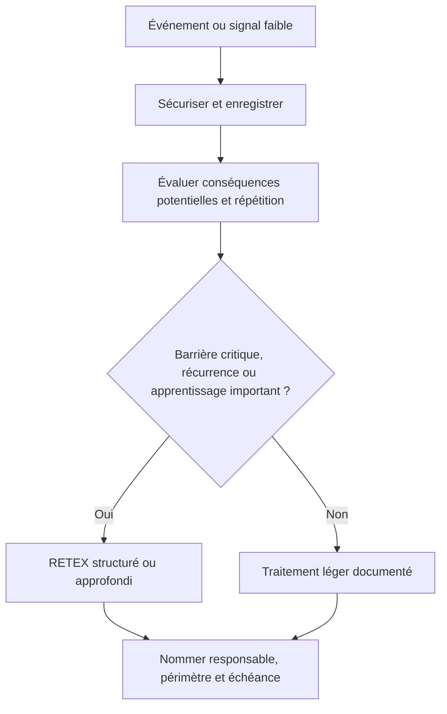

### 2.1 Critères de déclenchement

Évaluer de façon cohérente :

- gravité réelle et conséquences potentielles crédibles ;
- probabilité de répétition, fréquence d'événements similaires et tendance ;
- nombre d'actifs, de services, d'équipes ou de personnes touchés ;
- caractère nouveau, inattendu ou difficile à expliquer ;
- défaillance possible d'une barrière critique ;
- durée de rétablissement et efficacité des décisions ;
- coût, perte de capacité, impact client ou conséquence réglementaire ;
- réapparition malgré des actions antérieures ;
- valeur de l'enseignement pour d'autres sites ou systèmes ;
- demande légitime d'une autorité ou exigence interne de revue.

La grille doit guider une décision, non remplacer le jugement. Une conséquence grave potentielle peut justifier une investigation même si aucun dommage n'a eu lieu. Plusieurs petits événements semblables peuvent révéler un défaut systémique plus important qu'un événement isolé.

### 2.2 Choisir un niveau d'investigation

| Niveau indicatif | Cas type | Approche possible | Livrable attendu |
|---|---|---|---|
| 1 — Léger | Écart simple, impact limité, mécanisme connu | Enregistrement, échange court, action locale vérifiable | Note courte et suivi |
| 2 — Structuré | Incident ayant perturbé le service ou écart récurrent | Chronologie, revue des traces, entretien ciblé, analyse des facteurs | RETEX structuré et actions assignées |
| 3 — Approfondi | Conséquence importante, scénario grave possible, barrières critiques ou récurrence | Équipe pluridisciplinaire, collecte préservée, méthodes causales adaptées, revue indépendante | Dossier de preuve, analyse détaillée, plan systémique |
| 4 — Coordonné | Événement majeur impliquant plusieurs organisations ou enquête officielle | Gouvernance spécifique, coordination des autorités, règles de preuve et communications formelles | Résultats coordonnés, décisions et suivi selon le cadre applicable |

Cette échelle est un exemple de gouvernance, pas une norme. L'organisation doit définir les seuils, la composition des équipes, les délais cibles et les circuits d'escalade. Un RETEX approfondi exige du temps, de l'accès aux données et un mandat clair. Demander une investigation détaillée sans fournir ces moyens revient souvent à obtenir un récit superficiel.

### 2.3 Définir le périmètre et la question d'apprentissage

Une question trop large, comme « pourquoi la maintenance est-elle mauvaise ? », ne permet pas de collecter des preuves utiles. Une question plus précise serait : « Pourquoi la perte de communication avec le contrôleur n'a-t-elle pas déclenché l'escalade prévue, et quelles conditions ont permis la reprise sans vérification de la mesure ? »

Le périmètre précise :
- la fenêtre temporelle et les événements inclus ;
- les actifs, services, équipes et fournisseurs concernés ;
- le point de départ et le point de fin de l'analyse ;
- les questions prioritaires et les hypothèses à tester ;
- ce qui est exclu, avec une justification ;
- les personnes habilitées à décider des actions ;
- les contraintes de confidentialité, de sécurité et de conservation ;
- les critères de sortie et le délai de revue.

Il ne faut pas verrouiller la conclusion au stade du cadrage. Une question guide le travail, mais les preuves peuvent révéler que le périmètre doit s'étendre ou que la première hypothèse est incorrecte.

## 3. Sécuriser la situation et préserver les preuves

### 3.1 Séparer la réponse à l'événement de son analyse

La gestion opérationnelle vise à protéger, contenir, rétablir et communiquer. Le RETEX vise à comprendre et améliorer. Ces activités se chevauchent, mais leurs priorités ne sont pas identiques. Pendant une urgence, les équipes peuvent devoir modifier un équipement, redémarrer un service ou remplacer une pièce. Ces gestes peuvent être nécessaires ; ils doivent être consignés dès que possible pour ne pas perdre le contexte de l'enquête.

Après les mesures immédiates :
1. confirmer que les personnes et l'environnement sont en sécurité ;
2. identifier les risques encore présents et les restrictions d'exploitation ;
3. déterminer s'il existe une obligation de notification ou de conservation ;
4. désigner un responsable de la préservation des traces ;
5. enregistrer les actions de mitigation et leurs effets ;
6. définir les personnes autorisées à manipuler les éléments concernés ;
7. préserver une copie fiable avant toute modification ultérieure si la situation le permet ;
8. planifier la suite de l'analyse sans retarder le rétablissement sûr.

### 3.2 Quelles preuves préserver ?

Selon le contexte, les éléments utiles peuvent être :
- journaux d'événements, systèmes de supervision, alarmes et données télémétriques ;
- mesures brutes, unités, étalonnage et configuration du capteur ;
- historiques de changement, versions de firmware et paramètres ;
- tickets, appels, messages opérationnels et journaux de décision ;
- procédures réellement disponibles au moment de l'incident ;
- ordre de travail, permis, analyse de risque, consignation et contrôle de remise en service ;
- état des pièces, lots, références et pièces remplacées ;
- photographies ou relevés autorisés du terrain ;
- plan, configuration, topologie, inventaire et dépendances ;
- témoignages, comptes rendus et horodatages ;
- conditions d'environnement, charge, météo, bruit, éclairage, accès ou interruptions ;
- historique des événements semblables et des actions antérieures.

Ne pas tout collecter par réflexe. Privilégier les éléments qui répondent à la question d'apprentissage et conserver leur contexte. Une capture d'écran sans heure, source ni paramètres peut être difficile à interpréter. Une valeur de tendance peut être utile, mais elle ne remplace pas toujours l'échantillon brut nécessaire pour examiner un transitoire.

### 3.3 Intégrité, provenance et chaîne de conservation

Pour chaque élément sensible, noter :
- identifiant unique ;
- source, emplacement et système émetteur ;
- personne ou mécanisme ayant effectué la collecte ;
- date et heure, fuseau horaire et éventuelle incertitude ;
- méthode, filtre et outil de collecte ;
- éventuelle conversion, anonymisation ou transformation ;
- contrôle d'intégrité disponible ;
- accès autorisés, copies et modifications ;
- lien avec l'affirmation ou la question examinée.

Le but est de permettre à un autre analyste de comprendre d'où vient la preuve et ce qui lui est arrivé. Les exigences formelles de chaîne de conservation varient selon les secteurs et les enquêtes ; les appliquer lorsque le contexte le demande. Ne pas supprimer ou modifier des journaux pour « nettoyer » le dossier. Les corrections doivent être traçables.

### 3.4 Ne pas confondre l'absence de trace et la preuve d'absence

Si le journal d'alarme est vide, plusieurs explications sont possibles : l'alarme n'a pas été générée, le capteur n'a pas transmis, la collecte a échoué, la rétention a expiré ou le filtre masque l'événement. L'analyste doit écrire ce qui est réellement établi : « aucun événement correspondant n'a été retrouvé dans la source conservée », et non « l'alarme ne s'est jamais déclenchée », si la couverture du journal n'est pas démontrée.

Le niveau de confiance dépend de la complétude, de la synchronisation, de la résolution temporelle et des limites des outils. Documenter les lacunes avant d'établir les conclusions. Si une preuve manquante change la décision, organiser une collecte complémentaire ou garder la conclusion ouverte.

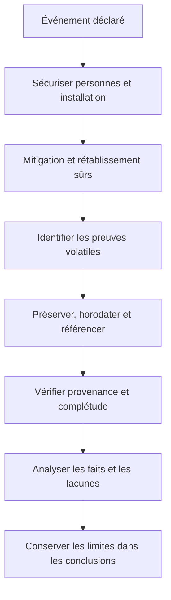

Ce flux rappelle que la préservation n'est pas une formalité documentaire. Elle conditionne la capacité de vérifier les affirmations. Les actions urgentes restent prioritaires ; la collecte doit être coordonnée avec elles.

## 4. Reconstruire une chronologie vérifiable

### 4.1 Événement, observation, décision et action

Une chronologie utile sépare au minimum quatre éléments :
- **Événement** : ce qui survient dans le système ou dans le travail.
- **Observation** : ce qu'une personne ou un dispositif a pu percevoir.
- **Décision** : ce qu'une personne ou une règle décide, avec l'information disponible à ce moment.
- **Action** : ce qui est effectivement exécuté et dont le résultat peut être observé.

Une alarme générée à 14:02, consultée à 14:07 et escaladée à 14:19 correspond à trois étapes différentes. Il serait trompeur d'écrire « l'alarme a été traitée à 14:02 ». L'horodatage de l'événement ne prouve pas que quelqu'un l'a vu, compris ou accepté.

### 4.2 Construire la table chronologique

| Heure / intervalle | Type | Description observable | Source | Confiance | Question restante |
|---|---|---|---|---|---|
| 14:02 | Événement technique | Le contrôleur cesse d'émettre des mesures valides | Journal collecteur | Élevée si horloge vérifiée | Perte de liaison ou arrêt du contrôleur ? |
| 14:04 | Observation | L'écran affiche une valeur figée | Témoignage et capture | Moyenne | L'indication de fraîcheur était-elle visible ? |
| 14:07 | Décision | L'opérateur décide de poursuivre la procédure en cours | Entretien et fiche d'intervention | Moyenne | Quel contexte et quelles options étaient disponibles ? |
| 14:19 | Action | L'équipe appelle l'astreinte | Journal d'appel | Élevée | Pourquoi l'escalade n'a-t-elle pas eu lieu plus tôt ? |
| 14:32 | Action | La mesure de secours est utilisée après vérification | Fiche d'intervention | À confirmer | Quelles conditions ont rendu la mesure de secours fiable ? |

Les heures ci-dessus illustrent la structure et ne sont pas des valeurs universelles. Le rapport doit distinguer les temps exacts des estimations. Si deux sources se contredisent, garder les deux versions, rechercher une troisième preuve et documenter l'incertitude.

### 4.3 Harmoniser les horodatages

Dans des environnements distribués, les systèmes peuvent avoir des horloges décalées ou des fuseaux différents. Avant de conclure à l'ordre de deux événements proches :
- vérifier la configuration d'heure et l'état de synchronisation ;
- connaître la précision des horloges et la résolution de collecte ;
- distinguer heure de l'équipement, heure d'ingestion et heure d'affichage ;
- noter les corrections connues et les conversions de fuseau ;
- utiliser des intervalles quand une heure exacte n'est pas démontrable ;
- éviter de comparer des horodatages affichés dans des fuseaux différents sans normalisation.

Une chronologie qui place une cause après son effet peut produire une interprétation fausse. La qualité de l'ordre temporel compte notamment pour les événements réseau, les automates, les systèmes distribués et les changements simultanés.

### 4.4 Séparer fait, interprétation et hypothèse

| Formulation | Catégorie | Pourquoi |
|---|---|---|
| « Le journal contient 37 secondes sans donnée valide » | Fait documenté, si la source est fiable | Observation reproductible |
| « L'opérateur n'a pas vu l'alarme » | Hypothèse à vérifier | Le journal peut montrer l'affichage mais pas forcément la perception |
| « L'affichage ne signalait pas clairement que la mesure était figée » | Interprétation basée sur l'interface et les témoignages | Demande comparaison et preuve |
| « La formation est la seule cause » | Conclusion prématurée | Ne démontre pas les conditions qui ont permis l'erreur |
| « Le temps nécessaire à l'escalade a augmenté après le changement de procédure » | Constat temporel à vérifier | Nécessite des données comparables et une chronologie fiable |

Marquer les hypothèses non résolues. Cela n'affaiblit pas le RETEX ; cela protège sa crédibilité. Il vaut mieux une conclusion limitée et exacte qu'une explication catégorique dépourvue de preuve.

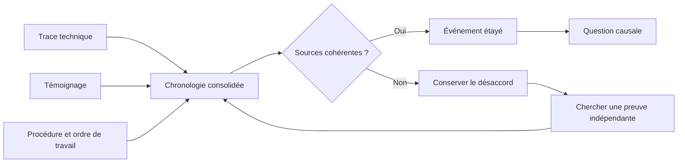

La chronologie n'a pas pour objectif de forcer une version unique avant l'analyse. Les contradictions peuvent être informatives : elles peuvent révéler une interface ambiguë, une procédure qui ne décrit pas le travail réel ou des systèmes qui n'utilisent pas la même notion d'heure.

## 5. Conduire des entretiens qui révèlent le travail réel

### 5.1 Préparer l'entretien

Un entretien de RETEX vise à comprendre comment l'événement a été vécu et quelles informations étaient disponibles. Ce n'est pas un interrogatoire dont la conclusion serait déjà écrite. Avant l'entretien, préciser son objectif, le périmètre, la manière dont les notes seront conservées, les règles de confidentialité, les personnes qui pourront consulter le compte rendu et les limites de confidentialité éventuelles imposées par les règles applicables.

Interroger les rôles pertinents : opérateurs, techniciens, planificateurs, superviseurs, spécialistes, support, fournisseur, responsable d'astreinte et utilisateurs touchés. Les hiérarchiques ne doivent pas nécessairement être présents lors du premier échange avec une personne si leur présence risquerait de limiter la parole. Le choix doit être adapté au contexte et au besoin d'équité.

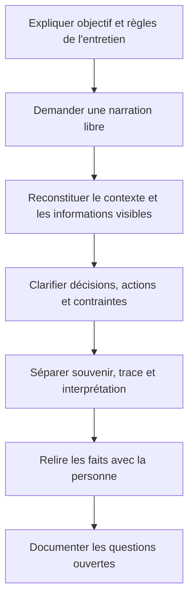

### 5.2 Questions ouvertes et neutres

Préférer :
- « Que se passait-il juste avant que vous remarquiez le problème ? »
- « Quelle information était visible à ce moment-là ? »
- « Qu'attendiez-vous du système ? »
- « Quelles options vous semblaient disponibles ? »
- « Qu'est-ce qui a rendu cette option raisonnable dans le contexte ? »
- « Quelles contraintes ou interruptions aviez-vous ? »
- « Qu'est-ce qui vous a aidé à rétablir le service ? »
- « Quelle information auriez-vous eu besoin de voir plus tôt ? »
- « Cette situation ressemble-t-elle à d'autres que vous avez rencontrées ? »
- « Qu'est-ce qui vous aurait permis d'agir autrement sans créer un autre risque ? »

Éviter les questions qui contiennent déjà un jugement, par exemple « Pourquoi avez-vous ignoré l'alarme ? ». Une formulation neutre serait : « Qu'avez-vous remarqué sur l'alarme et comment avez-vous décidé quoi faire ? »

### 5.3 Biais rétrospectif et information disponible au moment de la décision

Après un incident, l'issue semble souvent évidente. Il est tentant de penser qu'une personne aurait dû reconnaître un signal que personne n'avait encore interprété. L'analyse doit reconstruire ce que les acteurs savaient à l'instant de la décision, les signaux réellement visibles, les options disponibles et les contraintes. Les nouvelles informations obtenues après l'événement ne doivent pas être projetées sur le passé.

Une question utile est : « Avec les informations et les outils dont disposait la personne à cet instant, quelle décision était compréhensible ? » Cela ne signifie pas que chaque décision était correcte ; cela permet de trouver les conditions qui ont rendu la décision plausible et les améliorations qui rendent une option sûre plus facile à choisir.

### 5.4 La sécurité psychologique et la juste responsabilité

Une démarche sans recherche de blâme favorise la description honnête des conditions de travail. Si les personnes anticipent une sanction pour toute erreur, elles peuvent omettre des détails utiles, minimiser les incertitudes ou présenter une version conforme à la procédure plutôt que la réalité. La sécurité psychologique n'est pas un slogan : elle dépend de la façon dont les entretiens sont conduits, de la manière dont les conclusions sont utilisées et des actions réellement prises.

Ne pas confondre approche non punitive et absence de responsabilité. Distinguer les erreurs involontaires, les adaptations locales face à une contrainte, le risque accepté par une décision explicite, une procédure inapplicable, un défaut de conception et un acte volontaire potentiellement contraire aux règles. Lorsque des questions de conduite individuelle dépassent le mandat du RETEX, les transférer au processus approprié, en protégeant la neutralité de l'analyse système.

### 5.5 Le travail prescrit et le travail réel

Une procédure décrit le travail prévu. Le travail réel est influencé par les outils disponibles, la charge, les délais, les interruptions, les pièces, l'accès au site, l'ergonomie, les compétences, les fournisseurs et les compromis quotidiens. Un écart entre prescrit et réel est une piste d'analyse, pas automatiquement une faute.

Demander :
- Pourquoi la pratique réelle s'est-elle développée ?
- Quel problème la pratique résout-elle au quotidien ?
- Quel risque ou effet secondaire crée-t-elle ?
- La procédure est-elle réalisable avec les ressources et le contexte existants ?
- Les équipes avaient-elles signalé le problème auparavant ?
- Le management connaissait-il la contrainte ?
- Comment adapter le système afin que le comportement sûr soit aussi le comportement faisable ?

### 5.6 Réduire les biais de l'enquêteur

Les biais fréquents comprennent la recherche d'une cause unique, le biais de confirmation, l'ancrage sur la première explication, le biais d'autorité, le biais de disponibilité et la sélection de données favorables. Pour les limiter :
- écrire plusieurs hypothèses au lieu de défendre la première ;
- demander quelle preuve réfuterait chacune d'elles ;
- faire relire la chronologie par une personne non impliquée ;
- intégrer l'expertise technique et la connaissance du travail réel ;
- examiner les événements sans dommage ainsi que les quasi-réussites ;
- distinguer les éléments absents des éléments négatifs ;
- conserver le désaccord raisonné ;
- tester les hypothèses contre les traces, plutôt que chercher seulement des témoignages qui les confirment.

## 6. Analyser les facteurs contributifs et les mécanismes causaux

### 6.1 Pourquoi une cause immédiate ne suffit pas

« La pompe s'est arrêtée », « le technicien a saisi une mauvaise valeur » ou « le script a supprimé la route » décrit souvent un événement ou une action proche du dommage. Cela n'explique pas pourquoi la pompe pouvait tomber en panne sans détection, pourquoi une saisie incorrecte était facile, pourquoi le script avait un droit trop large ou pourquoi le contrôle n'a pas limité l'effet.

L'analyse doit relier :
- mécanisme physique, logiciel ou humain de l'événement ;
- conditions présentes avant l'événement ;
- barrières qui auraient dû prévenir, détecter ou limiter la situation ;
- raisons pour lesquelles ces barrières n'ont pas fonctionné ou n'existaient pas ;
- conditions de récupération et d'apprentissage ;
- décisions de conception, de financement, de maintenance ou de gestion qui ont influencé les risques.

Une « cause racine » n'est pas un mot magique désignant la réponse la plus profonde. Certaines situations comportent plusieurs causes et aucun point unique dont la suppression résoudrait tout. Une analyse utile précise le mécanisme, les preuves, les conditions de validité et les mesures susceptibles de réduire le risque.

### 6.2 Distinguer les familles de facteurs

| Famille | Exemples de questions |
|---|---|
| Matériel / physique | Usure, défaut de fabrication, corrosion, vibration, température, alimentation, montage, pièce incompatible ? |
| Logiciel / données | Version, configuration, schéma, droits, qualité de donnée, synchronisation, limite de débit, contrôle de validation ? |
| Interface / ergonomie | État ambigu, alarme peu visible, libellé trompeur, retour de commande manquant, informations dispersées ? |
| Procédure / méthode | Étape absente, ordre impossible, règle contradictoire, procédure non à jour, préconditions imprécises ? |
| Compétence / expérience | Connaissance nécessaire accessible ? Formation pratiquée ? Appui d'expert disponible ? |
| Charge / organisation | Effectif, interruption, urgence, astreinte, charge simultanée, transfert de responsabilité ? |
| Planification / ressources | Pièces, outils, budget, temps d'arrêt, accès, sous-traitant ou fenêtre de maintenance suffisants ? |
| Gouvernance / gestion | Propriétaire absent, risque non accepté explicitement, indicateur pervers, action antérieure non financée ? |
| Dépendances / environnement | Réseau, fournisseur, météo, état du site, coactivité, service auxiliaire ou approvisionnement ? |
| Défenses / détection | Barrière absente, inefficace, désactivée, non testée, mal surveillée ou contournée ? |

Une analyse complète n'a pas besoin de trouver un facteur dans chaque catégorie. Elle doit examiner les familles plausibles selon l'événement et justifier les exclusions importantes.

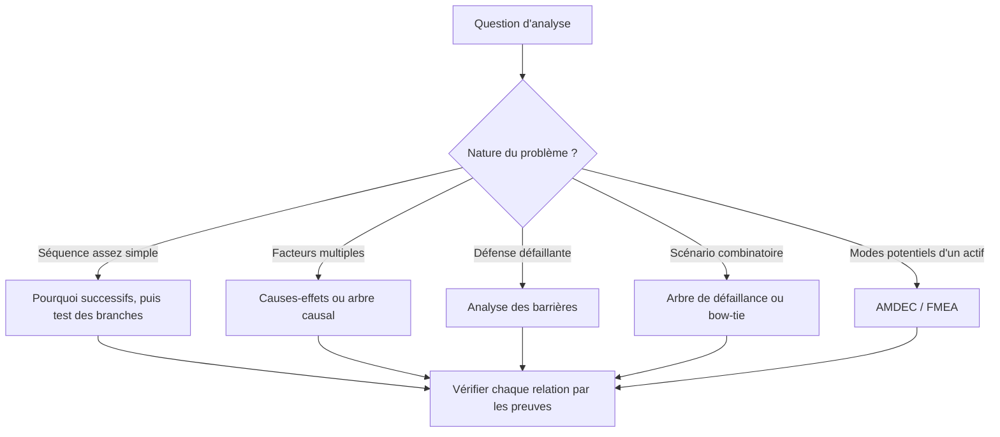

### 6.3 Méthode des « pourquoi » successifs

Les questions de type « pourquoi » aident à dépasser la première description, mais elles peuvent créer une chaîne artificielle si l'analyste suppose qu'une réponse n'en possède qu'une seule. Plusieurs facteurs peuvent converger, et une question peut révéler une condition plutôt qu'une cause.

Exemple :
1. Pourquoi le service a-t-il perdu ses mesures ? Le collecteur a cessé de recevoir des messages valides.
2. Pourquoi le collecteur n'a-t-il pas rétabli le flux ? La reconnexion attendait une réponse qui n'arrivait plus.
3. Pourquoi le mécanisme de reconnexion a-t-il attendu aussi longtemps ? Le délai et le nombre de tentatives étaient configurés pour un autre profil réseau.
4. Pourquoi ce profil était-il appliqué ? Le changement de topologie n'avait pas déclenché la revue de cette configuration.
5. Pourquoi la revue n'a-t-elle pas eu lieu ? Le processus de changement ne reliait pas la modification réseau à la supervision et aux dépendances de collecte.

Cette chaîne n'est qu'une hypothèse. Il faut vérifier les paramètres, le comportement de reconnexion et les règles de gestion du changement. Si la cause n'est pas démontrée, l'écrire explicitement. Il peut exister une seconde branche, comme la mauvaise visibilité de l'état de collecte ou l'absence d'alarme de données périmées.

### 6.4 Diagramme causes-effets

Un diagramme causes-effets, parfois appelé Ishikawa, organise les hypothèses afin d'éviter de limiter trop tôt l'analyse à une seule personne ou pièce. Les catégories doivent s'adapter au travail étudié ; elles ne constituent pas une taxonomie obligatoire.

Exemple pour un délai d'escalade :
- données : horodatage, état de fraîcheur, qualité des alarmes ;
- interface : affichage, priorité, visibilité sur mobile ;
- procédure : seuil, responsabilité, voie de secours ;
- personnes et équipe : charge, astreinte, compétence, interruption ;
- organisation : effectifs, rôles, objectifs de délai ;
- technologie : disponibilité, réseau, notification, dépendances.

Pour chaque branche, formuler une hypothèse testable et noter la preuve attendue. Une grande affiche avec beaucoup de causes possibles n'est pas encore une analyse. Il faut vérifier les branches pertinentes et préciser ce qui est confirmé, réfuté ou inconnu.

### 6.5 Analyse des barrières

Une barrière est un contrôle destiné à prévenir un scénario, le détecter, limiter ses conséquences ou soutenir le rétablissement. Elle peut être technique, physique, humaine ou organisationnelle. L'important est de spécifier ce qu'elle doit faire et comment vérifier son fonctionnement.

| Phase | Exemple de barrière | Question du RETEX |
|---|---|---|
| Prévention | Limite de configuration, verrouillage, contrôle de compatibilité | L'événement aurait-il dû être impossible ou moins probable ? |
| Détection | Alarme, surveillance de donnée périmée, inspection | Le signal a-t-il été généré, transmis, affiché et compris ? |
| Mitigation | Interverrouillage, mode dégradé, isolement | L'impact a-t-il été contenu et dans quelles limites ? |
| Rétablissement | Sauvegarde, pièce de secours, procédure de reprise | La restauration était-elle disponible, testée et sûre ? |
| Apprentissage | Revue des écarts, suivi des actions, partage des leçons | Les événements antérieurs auraient-ils pu signaler ce risque ? |

Ne pas se contenter de dire « le contrôle a échoué ». Vérifier s'il était prévu, installé, disponible, capable d'agir dans ce scénario, testé et utilisé. Un contrôle peut exister sur le papier sans être efficace dans la réalité.

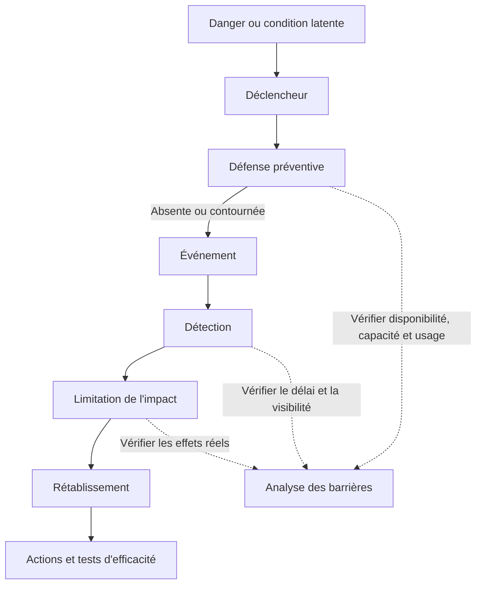

Ce schéma force l'équipe à examiner le parcours complet, pas uniquement l'instant où l'événement est devenu visible. Il permet aussi de reconnaître les barrières qui ont bien fonctionné, car ces éléments doivent souvent être conservés dans la solution.

### 6.6 Arbre causal et causes multiples

Un arbre causal représente les relations nécessaires ou contributives entre plusieurs événements. Il est utile lorsque plusieurs facteurs ont dû se combiner pour produire l'effet. Chaque lien doit être justifié : « A et B ont contribué à C » ne doit pas devenir un dessin convaincant sans preuve.

Pour chaque relation, demander :
- quel mécanisme relie les facteurs ?
- quelle observation soutient ce lien ?
- le lien est-il nécessaire, contributif ou simplement corrélé ?
- existe-t-il une autre explication compatible avec les faits ?
- quel contrôle aurait rompu cette chaîne ?
- l'action proposée vise-t-elle le facteur documenté ou une cause supposée ?

Les analyses systémiques admettent une causalité distribuée. Un défaut de conception, une configuration, une consigne ambiguë et une charge élevée peuvent tous contribuer. La solution peut alors être un ensemble cohérent de contrôles, plutôt qu'un correctif isolé.

### 6.7 FMEA / AMDEC et analyse de risques

L'AMDEC (analyse des modes de défaillance, de leurs effets et de leur criticité) sert à examiner les modes de défaillance possibles et à décider des actions de prévention ou de détection. Elle peut être utilisée après un RETEX pour mettre à jour les modes connus, les effets, les contrôles et les priorités. Elle n'explique pas automatiquement un événement passé, et un score numérique ne remplace pas une discussion des conséquences.

Lorsque l'AMDEC utilise occurrence, gravité et détectabilité, les définitions, échelles et règles de décision doivent être cohérentes et adaptées au processus. Les produits de notes peuvent masquer des scénarios graves mais rares. Les obligations de sécurité et les conséquences intolérables doivent rester visibles, indépendamment d'un score global.

### 6.8 Arbre de défaillance, scénario et contre-factuel

Un arbre de défaillance explore les combinaisons de conditions qui peuvent conduire à un événement indésirable. Une analyse de scénario examine l'enchaînement dans son contexte. Le raisonnement contre-factuel demande ce qui aurait été différent si une condition précise avait été modifiée : par exemple, si l'alarme avait signalé la fraîcheur de la donnée, si le droit avait été limité ou si une vérification avait été obligatoire.

Le contre-factuel aide à examiner la pertinence d'une action, mais il n'est pas une preuve à lui seul. Une question telle que « l'événement aurait-il eu lieu si le technicien avait reçu une formation ? » doit être testée contre les contraintes, la fréquence, l'interface et les cas comparables. Si la réponse demeure incertaine, choisir plusieurs actions complémentaires et vérifier leurs effets.

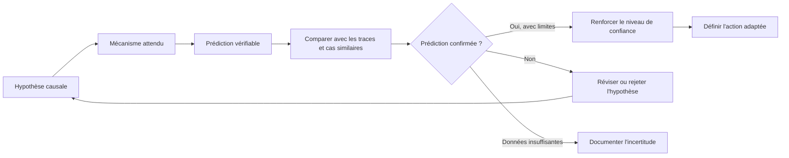

### 6.9 Ne pas confondre corrélation et cause

Deux événements peuvent apparaître ensemble parce qu'ils sont influencés par une troisième variable. Une diminution de pannes après une formation peut coïncider avec une baisse de charge ou un renouvellement d'équipements. Le RETEX doit décrire la relation observée sans prétendre à une causalité qui n'est pas établie.

Pour tester une explication :
- comparer plusieurs occurrences et contre-exemples ;
- examiner les données avant, pendant et après ;
- vérifier si le mécanisme proposé correspond aux propriétés du système ;
- rechercher les événements sans dommage qui partagent la même condition ;
- identifier les variables confondantes ;
- préciser le niveau de confiance et ce qui ferait changer d'avis.

Une conclusion graduée — confirmée par plusieurs preuves, fortement soutenue, plausible mais incomplète, ou non résolue — est souvent plus utile qu'une affirmation binaire. La gradation doit être explicite et cohérente entre les RETEX.

## 7. Construire des actions qui changent réellement le système

### 7.1 Les trois couches d'action

Une bonne réponse traite plusieurs horizons :

1. **Correction immédiate** : rétablir ou sécuriser ici et maintenant. Exemple : isoler une configuration erronée, remplacer la pièce défaillante ou informer les personnes concernées.
2. **Action corrective** : supprimer ou réduire le mécanisme mis en évidence dans le cas analysé. Exemple : corriger le profil de reconnexion et vérifier son fonctionnement.
3. **Action systémique** : réduire la probabilité que le même type d'écart réapparaisse ailleurs. Exemple : intégrer le contrôle des dépendances de collecte dans la gestion du changement et tester périodiquement la fraîcheur des données.

Les actions immédiates restent nécessaires, mais elles ne démontrent pas que la cause a été traitée. Une mise à jour locale peut rétablir le service tout en laissant d'autres équipements vulnérables. L'action systémique doit être fondée sur une cause ou un motif récurrent confirmé, pas sur une généralisation automatique à partir d'un seul cas.

### 7.2 Prioriser la force du contrôle

Lorsque c'est possible et proportionné, préférer une mesure qui élimine le danger ou empêche techniquement l'erreur à une mesure qui dépend uniquement de l'attention humaine. Selon le contexte, l'ordre de réflexion peut être :

- supprimer la condition dangereuse ou la tâche inutile ;
- remplacer le composant, produit ou procédé par une option moins risquée ;
- ajouter un dispositif technique, un interverrouillage ou une limite de droits ;
- améliorer la séparation, l'affichage, le retour d'état et la détection ;
- adapter les règles, la planification et l'organisation ;
- compléter par une procédure, une formation ou une communication.

Ce n'est pas une hiérarchie universelle applicable sans analyse à tout incident. Dans certains cas, la conception technique peut être complexe ou créer d'autres risques. Le choix doit expliquer la réduction attendue, les effets secondaires, la fiabilité et le besoin de maintenir la mesure dans le temps.

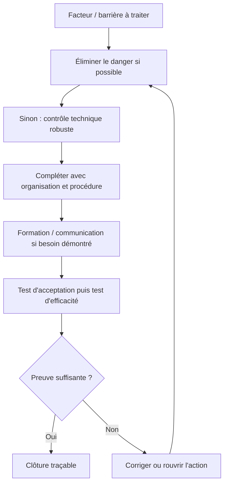

### 7.3 Une action de qualité est vérifiable

Chaque action devrait préciser :
- un état de départ et une condition observée ;
- le changement concret attendu ;
- un propriétaire unique, avec contributeurs identifiés ;
- un délai et les dépendances ;
- le budget, la disponibilité des personnes et l'autorité d'approbation ;
- un livrable vérifiable ;
- le test d'acceptation ;
- la preuve de mise en œuvre ;
- le test d'efficacité ;
- la date de revue et le critère de clôture ;
- le risque résiduel et le responsable qui l'accepte si l'action ne supprime pas tout le risque.

Exemple faible : « Sensibiliser les équipes aux alarmes ».

Exemple plus robuste : « Avant le 30 novembre, le propriétaire du service met à jour le profil d'alarme pour distinguer donnée fraîche, périmée et absente. L'exploitation teste les trois états sur deux versions représentatives, conserve les captures et vérifie que l'astreinte reçoit le signal dans la fenêtre approuvée. Après déploiement, la revue examine pendant une période convenue les alarmes manquées et les écarts de délai. »

L'exemple est utile parce qu'il précise une modification, des critères de test et une vérification après mise en service. Les délais et seuils doivent être adaptés au contexte réel ; ce ne sont pas des prescriptions universelles.

### 7.4 Eviter les actions de façade

Actions souvent insuffisantes si elles sont utilisées seules :
- « rappeler la procédure » alors qu'elle est impraticable ou obsolète ;
- « former le technicien » sans vérifier l'interface, la charge et la disponibilité des outils ;
- « redoubler de vigilance » sans contrôle mesurable ;
- « surveiller » sans seuil, propriétaire ni réponse définie ;
- « communiquer le RETEX » sans public cible, usage et retour ;
- « acheter un outil » sans problème précis ni mesure de succès ;
- « mettre à jour la documentation » sans vérifier que les utilisateurs la trouvent et l'utilisent ;
- « clore le ticket » dès que le livrable existe, sans test d'efficacité.

La formation peut être indispensable, mais doit correspondre à une lacune de compétence identifiée et disposer d'un moyen de vérification. Une action administrative peut compléter un contrôle technique, mais ne doit pas remplacer automatiquement une solution plus robuste.

### 7.5 Coûts, arbitrage et acceptation du risque

Certaines actions sont coûteuses ou nécessitent un arrêt. Le RETEX doit présenter le mécanisme de réduction du risque, les options, les coûts, les conséquences d'un report, les mesures compensatoires et le responsable habilité à arbitrer. Si le budget ne permet pas l'action la plus robuste, l'organisation doit choisir explicitement une alternative ou accepter un risque selon son processus, sans présenter l'action reportée comme terminée.

Une action en retard peut être due à un manque de capacité, une dépendance externe, une spécification insuffisante ou une priorité contradictoire. Le registre doit montrer la cause du retard, le risque temporaire, la mesure transitoire et le prochain point de décision. L'indicateur de clôture ne doit pas pousser à fermer artificiellement les actions.

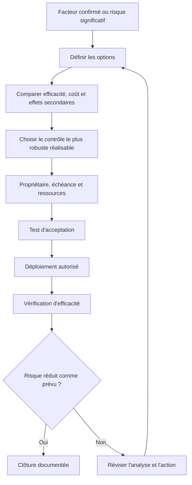

La boucle évite de confondre l'achèvement d'une tâche et l'obtention du résultat. Si l'action ne produit pas l'effet prévu, il faut revoir l'hypothèse, le contrôle, les conditions d'exploitation ou la mesure, plutôt que simplement fermer le dossier.

## 8. Vérifier l'efficacité et surveiller la récurrence

### 8.1 Trois niveaux de vérification

| Niveau | Ce que l'on vérifie | Exemple |
|---|---|---|
| Mise en œuvre | L'action existe-t-elle et le changement a-t-il été déployé ? | Une alarme de donnée périmée est configurée |
| Fonctionnement | Le contrôle se comporte-t-il comme prévu dans les tests représentatifs ? | Une donnée figée déclenche l'alarme et l'escalade attendues |
| Efficacité durable | Le risque ou le problème diminue-t-il en exploitation, sans effet secondaire inacceptable ? | Les occurrences et délais sont suivis, et les nouveaux défauts sont traités |

Une capture d'écran de configuration peut prouver le premier niveau, pas les deux autres. Un test unitaire peut démontrer une propriété technique, mais ne garantit pas que l'équipe sait réagir à l'alarme. Choisir les preuves selon la nature de l'action et le niveau de risque.

### 8.2 Définir la vérification avant l'exécution

Avant de commencer l'action, décider :
- quel résultat doit apparaître ;
- sur quel environnement et quelles conditions il sera testé ;
- quels scénarios inclure ;
- qui observe, qui accepte et qui vérifie indépendamment si nécessaire ;
- quelle durée d'observation est pertinente ;
- quels indicateurs sont associés ;
- comment traiter une régression ou un effet secondaire ;
- quelles preuves seront archivées ;
- quand une action sera rouverte.

Définir la réussite après avoir vu les résultats crée un risque de biais. Le critère doit être fixé à l'avance, dans une mesure qui correspond à l'action. Pour les événements rares, la simple absence de nouvelle occurrence pendant quelques jours ne suffit pas nécessairement. Il peut être nécessaire de tester le contrôle dans un environnement maîtrisé et de suivre les indicateurs sur une période adaptée.

### 8.3 Mesurer la récurrence avec un dénominateur

Compter les incidents bruts sans tenir compte de l'activité peut induire en erreur. Si le volume de travail double, le nombre de défauts peut augmenter malgré une baisse du taux par intervention. Si le périmètre de surveillance change, une hausse peut refléter une meilleure détection plutôt qu'une dégradation réelle.

Pour un indicateur utile, définir :
- l'événement qui compte comme récurrence ;
- le périmètre de services et de modes de défaillance ;
- la population ou le volume d'exposition ;
- la source, la période et la qualité de couverture ;
- la manière de traiter les doublons et les événements liés ;
- les exclusions justifiées ;
- les effets secondaires à surveiller.

Analyser les motifs récurrents, pas seulement le titre du ticket. Des incidents identifiés avec des catégories différentes peuvent partager la même cause de fond, et le même intitulé peut masquer des mécanismes différents.

### 8.4 Ne pas clore artificiellement une action

Une action peut être déclarée :
- ouverte, lorsque le besoin est identifié ;
- en analyse, lorsque les options et la preuve attendue sont élaborées ;
- approuvée et planifiée, lorsque les ressources et la décision sont acquises ;
- en cours, lorsque le changement est exécuté ;
- mise en œuvre, lorsque le livrable a été livré ;
- en vérification, lorsque l'efficacité est évaluée ;
- clôturée, lorsque les critères convenus sont satisfaits ;
- réouverte, lorsqu'une nouvelle preuve invalide la conclusion.

Les noms des états peuvent varier. Ce qui importe est de distinguer livraison et efficacité. Les actions abandonnées ou remplacées restent traçables avec motif, décision et traitement du risque résiduel.

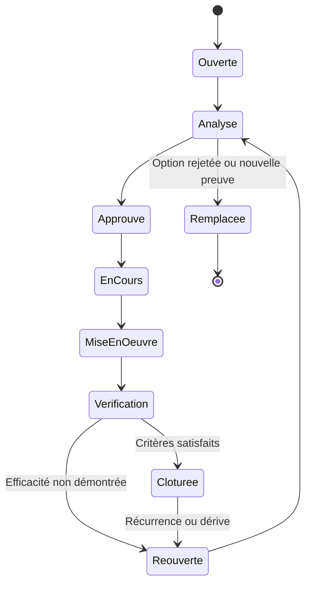

Le workflow permet à une équipe de distinguer l'activité administrative de la réelle réduction du risque. Les actions peuvent être fermées administrativement pour une raison valide, mais la décision et le risque résiduel doivent rester visibles.

## 9. Gouverner le portefeuille d'actions

### 9.1 Responsabilité explicite

Un registre d'actions fonctionne lorsqu'il existe un propriétaire unique pour chaque action, un responsable de la vérification et une autorité capable d'arbitrer les obstacles. Plusieurs personnes peuvent contribuer, mais une action sans propriétaire est rarement menée à terme. Le responsable du RETEX suit la cohérence générale ; il ne doit pas devenir le propriétaire de toutes les corrections techniques.

Le registre devrait contenir : identifiant, incident source, facteur ou recommandation, priorité, propriétaire, contributeurs, échéance, statut, dépendances, budget, preuve attendue, test d'efficacité, date de revue, risque résiduel, autorité de validation et motif de toute modification.

### 9.2 Prioriser selon le risque, pas seulement l'ancienneté

Une action échue depuis 90 jours n'est pas nécessairement plus urgente qu'une action échue depuis 7 jours si la seconde protège une barrière critique. Inversement, le danger ne doit pas être masqué derrière une date très lointaine. Le portefeuille doit prioriser selon la conséquence, l'exposition, la répétition, les barrières concernées et les solutions transitoires. L'âge et l'échéance demeurent importants pour la gouvernance, mais ne constituent pas l'unique règle.

Les mécanismes d'escalade doivent préciser :
- quand le retard entraîne une nouvelle revue du risque ;
- qui accepte la mesure temporaire ;
- quand le niveau de direction est alerté ;
- comment les dépendances sont arbitrées ;
- à quelle fréquence la priorité est réévaluée ;
- comment un risque critique non financé est présenté.

### 9.3 Suivre les actions liées et les causes communes

Plusieurs RETEX peuvent conduire à la même action transverse, par exemple renforcer la synchronisation d'heure, fiabiliser l'inventaire, standardiser la validation après maintenance ou tester la sauvegarde. Répliquer un correctif dans chaque ticket crée parfois une charge inutile et une vision fragmentée.

Créer un lien entre les RETEX, la cause commune, l'action transverse et les actifs ou services concernés. Cette relation permet de mesurer le nombre de cas couverts, de suivre la progression et de réexaminer les dossiers lorsque l'action systémique évolue. Elle évite aussi de prétendre qu'une correction locale a éliminé un problème présent ailleurs.

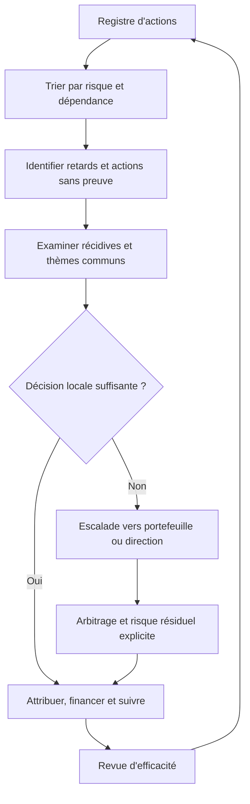

### 9.4 Revues de gouvernance

Une revue périodique doit examiner :
- les actions critiques en retard ;
- les actions déclarées closes sans preuve d'efficacité ;
- les récurrences associées à des actions antérieures ;
- les problèmes sans propriétaire ou sans financement ;
- les thèmes transverses qui nécessitent un changement de stratégie ;
- les risques acceptés dont la date de réexamen approche ;
- la qualité des RETEX et les délais de diffusion ;
- les enseignements externes qui pourraient concerner l'organisation ;
- les effets de l'amélioration sur la charge, le coût et la sécurité.

Une revue utile débouche sur une décision : attribuer une ressource, modifier une priorité, accepter ou réduire un risque, rouvrir une analyse, changer un standard ou retirer une action devenue inutile.

## 10. Transformer les enseignements en connaissance réutilisable

### 10.1 Du rapport à la mémoire organisationnelle

Une leçon n'est réutilisable que si la personne future peut la retrouver, comprendre les conditions où elle s'applique, vérifier qu'elle est toujours valide et agir en conséquence. Un document enterré dans un répertoire ou une liste de mails ne constitue pas à lui seul une capitalisation efficace.

Une fiche de leçon peut inclure :
- titre descriptif basé sur le mécanisme ou le risque ;
- résumé du contexte sans détails personnels inutiles ;
- symptôme et conséquence ;
- conditions et facteurs confirmés ;
- signal de détection précoce ;
- contrôles préventifs et mesures de récupération ;
- actions réalisées et statut de vérification ;
- conditions où la leçon s'applique ou ne s'applique pas ;
- actifs, technologies, fournisseurs et processus concernés ;
- mots-clés et liens vers les RETEX associés ;
- propriétaire de la connaissance, version et date de revue.

Une fiche ne doit pas être formulée comme une règle absolue si la preuve est limitée. Utiliser des avertissements contextuels et des liens vers la source complète. La connaissance doit conserver son niveau de confiance et sa date, surtout quand la technologie, le fournisseur ou la procédure évolue.

### 10.2 Taxonomie et moteur de recherche

Classer les RETEX par service, famille d'actifs, mode de défaillance, type de barrière, mécanisme d'impact, phase de cycle de vie, type d'intervention, fournisseur et cause systémique, selon les besoins de l'organisation. Les catégories doivent être compréhensibles, suffisamment stables pour les tendances et révisables pour éviter une explosion de tags.

Éviter de classer un RETEX uniquement par symptôme, par exemple « panne de pompe », si le mécanisme concerne en réalité la qualité des données de vibration ou la gestion des pièces de rechange. Un même cas peut recevoir plusieurs catégories reliées. La taxonomie doit soutenir la recherche d'expériences proches, pas imposer une seule étiquette artificielle.

### 10.3 Diffusion proportionnée

Toutes les informations ne sont pas destinées au même public. Une synthèse opérationnelle peut être partagée largement ; une donnée personnelle, une vulnérabilité détaillée, un secret industriel ou une information réglementée peut nécessiter des contrôles d'accès. La restriction doit être justifiée et ne pas servir à cacher les enseignements gênants.

Adapter la forme :
- point de cinq minutes pour l'équipe de quart ;
- fiche de pratique pour techniciens ;
- revue transversale pour plusieurs sites ;
- bulletin de fiabilité pour les propriétaires d'actifs ;
- dossier de décision pour la direction ;
- signalement réglementaire ou fournisseur selon le cadre applicable ;
- exercice ou simulation pour vérifier que la leçon est comprise.

Le but n'est pas de diffuser le maximum de pages. Il est de faire parvenir l'information utile à ceux qui peuvent la mettre en pratique, au moment où ils en ont besoin.

### 10.4 Apprendre à partir d'autres organisations

Les retours externes et les événements d'autres secteurs peuvent révéler un mécanisme qui n'a pas encore touché l'organisation. Il faut toutefois vérifier la similarité des technologies, des conditions, des barrières, des compétences et du contexte. Copier une recommandation sans valider son applicabilité peut créer un risque nouveau.

La revue des enseignements externes peut avoir une fréquence définie ou être déclenchée par une alerte fournisseur, un changement majeur ou un incident grave. Les recommandations transférées doivent être tracées, avec la décision d'adoption, d'adaptation ou de non-applicabilité et son raisonnement.

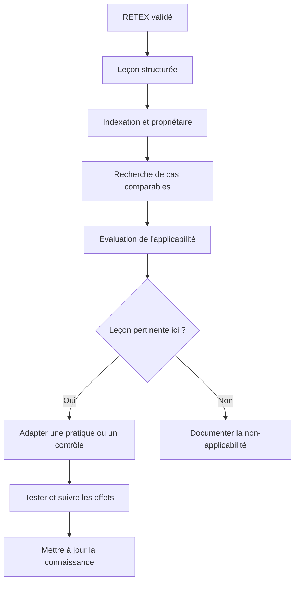

Ce modèle évite deux extrêmes : ignorer les enseignements d'autres sites, ou les appliquer sans examen. Le transfert d'une leçon est une décision de gestion de risque.

## 11. Mesurer la qualité du RETEX

### 11.1 Indicateurs d'un système d'apprentissage

Les indicateurs doivent aider à prendre des décisions. Ils peuvent comprendre :
- temps entre événement, démarrage de l'analyse et validation du RETEX ;
- proportion de dossiers avec chronologie et sources référencées ;
- proportion de conclusions qui distinguent faits et hypothèses ;
- proportion d'actions avec propriétaire, échéance, preuve et contrôle d'efficacité ;
- ancienneté des actions critiques et nombre de reports justifiés ;
- taux d'actions vérifiées comme efficaces ;
- récurrence de modes de défaillance déjà analysés ;
- fréquence de réouverture d'actions après preuve insuffisante ;
- réutilisation de leçons dans des procédures, changements ou formations ;
- nombre de thèmes transverses conduisant à une action de portefeuille ;
- retour des participants sur l'équité, la clarté et l'utilité du processus.

Aucun indicateur n'est parfait. Une baisse du nombre de RETEX peut signaler une amélioration, une sous-déclaration ou une capacité d'investigation insuffisante. Un temps de clôture court peut montrer de la réactivité ou pousser à produire des analyses trop superficielles. Interpréter les mesures avec les tendances, les contrôles de qualité et les observations de terrain.

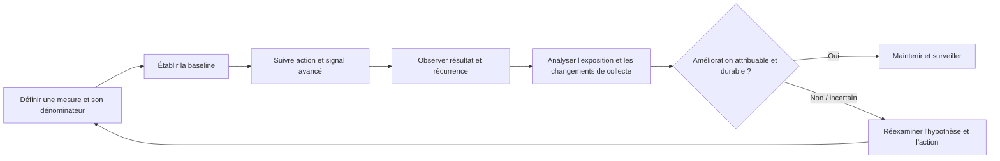

### 11.2 Indicateurs de résultat et signaux avancés

Un indicateur retardé, comme la répétition d'un arrêt, constate un dommage ou une récurrence après coup. Un indicateur avancé, comme la proportion de tests de barrière réussis, peut révéler tôt une faiblesse. Combiner les deux aide à savoir si le système devient plus robuste.

Exemple :
- retardé : nombre d'incidents similaires par volume d'interventions ;
- avancé : taux d'actions critiques ayant une vérification efficace ;
- retardé : durée d'indisponibilité attribuée à un mode de défaillance ;
- avancé : proportion d'alarmes de donnée périmée testées selon la procédure ;
- retardé : interventions répétées pour la même cause ;
- avancé : taux d'AMDEC actualisées après un changement important.

Les indicateurs avancés ne garantissent pas un résultat positif, mais ils permettent de voir si les barrières attendues sont en place et fonctionnent.

### 11.3 Maturité du RETEX

| Niveau indicatif | Comportement | Preuves attendues |
|---|---|---|
| 1 — Réactif | Le rapport est fait selon la pression de l'événement ; actions locales et mémoire dispersée | Peu de propriétaires, analyses peu traçables, récurrence peu suivie |
| 2 — Répétable | Déclencheurs, modèle de compte rendu et registre d'actions communs | Formats cohérents et revues périodiques |
| 3 — Maîtrisé | Analyse proportionnée, preuves et actions suivies | Vérifications d'efficacité, rôles définis et données accessibles |
| 4 — Transversal | Les enseignements sont comparés entre équipes et intégrés aux processus | Actions systémiques, tendances, réutilisation de leçons |
| 5 — Apprenant | L'organisation anticipe, teste et apprend aussi des réussites et des signaux faibles | Exercices, analyse de récurrence, changements de conception et amélioration mesurée |

Cette grille est un outil de discussion, pas une norme de certification. Une organisation peut être avancée dans la collecte et faible dans le suivi d'efficacité. Évaluer les dimensions séparément plutôt que produire une note unique qui masque la faiblesse la plus importante.

## 12. Gouverner les sujets sensibles, la confidentialité et les données

### 12.1 Confidentialité sans effacer les faits

Minimiser les données personnelles qui ne sont pas nécessaires à l'apprentissage. Contrôler l'accès aux dossiers selon les responsabilités, protéger les informations de sécurité, secrets et données contractuelles, et respecter les règles de conservation. Une copie de travail peut être pseudonymisée pour l'analyse collective, à condition que la transformation ne fasse pas perdre les détails utiles à la causalité.

Ne pas modifier une preuve originale pour anonymiser la version de diffusion. Conserver l'original sous contrôle, produire une copie avec traitement documenté et vérifier que les informations supprimées ne changent pas l'interprétation.

### 12.2 Désaccords et conclusions minoritaires

Les personnes peuvent être en désaccord sur une cause, une décision ou la faisabilité d'une action. Le responsable du RETEX doit :
- vérifier les points factuels et corriger les erreurs ;
- séparer les faits contestés des interprétations ;
- demander les preuves qui pourraient trancher ;
- documenter les hypothèses concurrentes et les limites ;
- préciser la décision finale, son autorité et sa justification ;
- conserver un désaccord technique pertinent si les preuves ne permettent pas de le résoudre.

Le consensus apparent n'est pas une preuve. Une conclusion validée par un responsable doit rester soumise aux limites des données et à une revue ultérieure si de nouveaux éléments apparaissent.

### 12.3 Outils numériques et IA d'assistance

Des outils peuvent accélérer le regroupement des journaux, la recherche de précédents, la construction d'une chronologie ou la rédaction d'un premier résumé. Ils ne doivent pas inventer les événements, confondre les horloges, transformer une hypothèse en fait ni décider seuls des responsabilités.

Si un outil d'IA est utilisé :
- vérifier que les données sont autorisées à être traitées par le service ;
- retirer ou minimiser secrets, données personnelles et informations sensibles lorsque possible ;
- garder la provenance de chaque affirmation importante ;
- demander une séparation explicite des faits, hypothèses et conclusions ;
- faire valider la chronologie et les conclusions par un analyste compétent ;
- utiliser un jeu de test représentatif pour les tâches automatisées ;
- conserver les versions et les corrections lorsque cela est nécessaire à l'audit ;
- traiter les sorties comme des propositions, jamais comme une preuve autonome ;
- interdire l'envoi automatique d'actions correctives sans approbation habilitée ;
- prévoir un mode manuel si le service d'analyse est indisponible.

Une IA peut générer une explication fluide mais non fondée. Les preuves sources restent prioritaires ; toute phrase qui guide une décision doit être liée aux traces ou marquée comme hypothèse. L'outil ne remplace ni l'entretien, ni la connaissance du travail réel, ni le jugement professionnel.

## 13. Intégrer le RETEX à la maintenance et à la stratégie d'actifs

### 13.1 Boucle vers les processus opérationnels

Selon la leçon, actualiser :
- la stratégie de maintenance et la politique d'intervention ;
- les fréquences et critères d'inspection ;
- les plans d'entretien et instructions de travail ;
- l'analyse de modes de défaillance ;
- les stocks de pièces et la stratégie d'obsolescence ;
- la configuration et la supervision ;
- les contrats et les exigences fournisseur ;
- la procédure de changement, de consignation ou de remise en service ;
- les compétences, la formation et les exercices ;
- le plan de continuité et la procédure de reprise ;
- le portefeuille de risques et le budget.

Le transfert doit être concret. Le RETEX référence la procédure modifiée, son propriétaire, la version et la preuve de validation. Une note d'analyse qui ne relie pas les conclusions aux processus concernés risque de rester séparée du travail quotidien.

### 13.2 Apprendre de la maintenance préventive et des interventions

Après une défaillance répétitive, le RETEX devrait revoir si la tâche de maintenance cible le mécanisme réel, si la fréquence est cohérente avec les données, si l'inspection peut détecter le défaut et si les conditions d'exploitation ont changé. Ajouter des tâches sans vérifier leur efficacité peut accroître les coûts, les manipulations et même introduire de nouveaux risques.

Après une intervention réussie, examiner ce qui a permis le succès : préparation, pièces disponibles, dossier technique à jour, coopération entre équipes, mesure de contrôle, procédure de consignation ou diagnostic efficace. Préserver cette connaissance pour les équipes futures, tout en identifiant les conditions nécessaires à sa reproduction.

### 13.3 Identifier les signaux faibles et les quasi-accidents

Un quasi-accident révèle parfois une barrière qui a fonctionné par hasard ou juste à temps. L'investigation est souvent plus facile avant qu'un dommage ne survienne. Encourager les signalements utiles, simplifier leur collecte et montrer les changements résultants. Si les personnes ne voient jamais de réponse après un signalement, la confiance diminue et les futurs signaux peuvent ne pas être signalés.

Le nombre de signalements doit être interprété avec prudence. Une hausse peut refléter une meilleure culture, une meilleure détection ou une augmentation des dangers. Le contexte et la qualité des réponses permettent d'interpréter la tendance.

### 13.4 Transformer les récidives en décision de direction

Quand plusieurs RETEX pointent une même faiblesse, le sujet dépasse l'équipe locale. Il peut exiger une décision sur le financement, le renouvellement d'actif, la disponibilité des compétences, le modèle fournisseur, la tolérance au risque ou la planification. Le dossier de direction doit montrer :
- les événements reliés et leurs preuves ;
- la cause commune ou le thème à confirmer ;
- les risques et conséquences potentiels ;
- les options de traitement ;
- le coût des actions et le coût plausible de l'inaction ;
- les mesures temporaires ;
- les risques résiduels ;
- l'autorité qui doit décider et la date de revue.

Le rôle du RETEX est de rendre le conflit de décision visible. Il ne doit pas prétendre résoudre seul un arbitrage que l'organisation n'a pas autorisé.

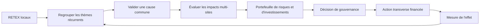

Cette boucle donne à la direction une vue des causes qui dépassent un incident. Elle évite qu'une même faiblesse soit traitée plusieurs fois par de petits correctifs sans décision sur la condition commune.

## 14. Procédure opérationnelle recommandée

### Phase A — Protéger et cadrer

1. Sécuriser les personnes, l'environnement, l'installation et les opérations.
2. Appliquer les procédures d'urgence, de notification et de conservation appropriées.
3. Définir le déclencheur, le périmètre, la question d'apprentissage et le niveau d'investigation.
4. Nommer un responsable du RETEX et les rôles de soutien.
5. Identifier les preuves volatiles, les propriétaires et les accès autorisés.
6. Établir les délais, les destinataires, les contraintes de confidentialité et les critères de sortie.

**Livrable :** une fiche de cadrage qui justifie le niveau d'analyse et identifie les ressources nécessaires.

### Phase B — Collecter et vérifier

1. Préserver les journaux, configurations, tickets et éléments matériels pertinents.
2. Identifier les sources, les heures, la qualité et les limites.
3. Construire une chronologie avec type d'événement et niveau de confiance.
4. Interroger les personnes de manière neutre et documenter leur contexte.
5. Comparer la procédure prescrite et le travail réellement réalisé.
6. Conserver les contradictions et organiser les vérifications nécessaires.

**Livrable :** un dossier de preuves, une chronologie et une liste explicite des inconnues.

### Phase C — Analyser

1. Décrire le mécanisme de l'événement sans attribuer prématurément de responsabilité.
2. Identifier les barrières prévues, observées et manquantes.
3. Formuler plusieurs hypothèses causales et les preuves qui pourraient les soutenir ou les réfuter.
4. Examiner les facteurs matériels, logiciels, humains, organisationnels, environnementaux et de gestion.
5. Choisir une méthode d'analyse proportionnée et la documenter.
6. Définir le degré de confiance, les causes non résolues et les conséquences pour le risque.

**Livrable :** une analyse argumentée, reliée aux sources et qui distingue faits, hypothèses et interprétations.

### Phase D — Décider les actions

1. Séparer correction immédiate, action corrective et action systémique.
2. Comparer les options, la force des contrôles, les coûts et les effets secondaires.
3. Définir propriétaire, contributeurs, ressources, échéance et approbation.
4. Écrire les critères de mise en œuvre et d'efficacité avant l'exécution.
5. Définir le traitement des retards et l'acceptation éventuelle du risque résiduel.
6. Relier les actions aux procédures, actifs, risques et autres RETEX concernés.

**Livrable :** un plan d'action traçable qui ne confond pas réalisation et efficacité.

### Phase E — Vérifier et diffuser

1. Tester la mise en œuvre selon les critères convenus.
2. Vérifier le fonctionnement dans les conditions pertinentes.
3. Observer l'efficacité et les effets secondaires dans la durée appropriée.
4. Réouvrir l'action si la preuve contredit l'hypothèse ou si la récurrence persiste.
5. Extraire les leçons applicables et identifier les destinataires utiles.
6. Mettre à jour les documents, pratiques, formations et indicateurs concernés.
7. Présenter la synthèse de gouvernance et les risques résiduels.

**Livrable :** un RETEX final, des actions suivies, des preuves d'efficacité et une connaissance réutilisable.

### Phase F — Apprendre à l'échelle du portefeuille

1. Regrouper les événements par mécanisme, actif, barrière et processus.
2. Rechercher les récurrences, y compris sous des catégories différentes.
3. Revoir les actions échues, répétées ou insuffisamment efficaces.
4. Faire remonter les causes qui demandent une décision transverse.
5. Réévaluer la pertinence des leçons après les changements majeurs.
6. Mesurer la qualité de la boucle d'apprentissage, pas seulement le nombre de rapports.

**Livrable :** une revue périodique qui relie les RETEX aux risques, investissements et évolutions opérationnelles.

## 15. Atelier pratique — RETEX d'une panne multiéquipes

### Situation de départ

Une station technique s'appuie sur un contrôleur industriel, un réseau de collecte et une supervision centrale. Un changement réseau réalisé pendant une fenêtre de maintenance précède une perte intermittente de données. Le tableau de bord reste sur la dernière valeur reçue sans signaler clairement sa fraîcheur. L'équipe de quart pense que la valeur demeure valide, puis constate une incohérence. L'astreinte est appelée avec retard, le service passe en mode dégradé et le rétablissement nécessite une vérification manuelle.

Le rapport initial dit : « L'opérateur n'a pas contrôlé la mesure ; formation à rappeler. » Deux mois plus tard, une autre station présente une perte de données similaire. L'équipe doit conduire un RETEX assez précis pour guider les actions, sans inventer une cause unique avant d'examiner les preuves.

### Phase A — Préserver et cadrer

Le responsable confirme la sécurité, le mode dégradé autorisé, les conditions d'exploitation et les éventuelles obligations de déclaration. Il préserve les journaux du contrôleur, du réseau et du collecteur, l'historique du changement, les versions de configuration, la procédure de remise en service, les captures d'écran et les messages d'astreinte. Il note les fuseaux horaires et l'état de synchronisation des systèmes.

La question de travail devient : « Pourquoi la perte de données n'a-t-elle pas été détectée et escaladée dans la fenêtre attendue, et quelles conditions ont permis qu'une autre station rencontre le même problème ? » Cette formulation laisse ouvertes plusieurs hypothèses : collecte, interface, changement, procédure ou organisation.

### Phase B — Construire la chronologie

| Heure indicative | Élément | Source à vérifier |
|---|---|---|
| 08:40 | Début de la fenêtre de changement | Ordre de changement |
| 08:53 | Paramètre réseau modifié | Historique de configuration |
| 09:01 | Première séquence de données manquantes | Journaux de collecte |
| 09:05 | Valeur figée visible sur l'écran | Capture et témoignage |
| 09:13 | Vérification manuelle lancée | Journal d'intervention |
| 09:22 | Appel à l'astreinte | Journal d'appel |
| 09:36 | Passage confirmé en mode dégradé | Journal opérationnel |
| 10:18 | Collecte rétablie et validée | Mesures, test et ticket |

Les heures sont illustratives. L'équipe doit confirmer chaque point à partir des sources, distinguer la première absence de données de sa détection et identifier les intervalles où la chronologie reste incertaine.

### Phase C — Formuler et tester les hypothèses

Hypothèse 1 : le changement réseau a introduit une incompatibilité de chemin ou de configuration. À tester avec le diff, les flux, les erreurs et une reproduction sûre.

Hypothèse 2 : le tableau de bord ne signale pas la donnée périmée. À tester avec l'état de la valeur, le comportement de rafraîchissement, l'interface et des scénarios simulés.

Hypothèse 3 : la procédure de remise en service ne comprend pas un test explicite de fraîcheur. À tester avec la version approuvée, l'observation du travail réel et les tests de réception.

Hypothèse 4 : le retard d'astreinte résulte d'une mauvaise compréhension des seuils ou d'une charge simultanée. À examiner dans les journaux, entretiens et règles de disponibilité.

Hypothèse 5 : la configuration est copiée sur plusieurs sites sans validation de dépendances. À tester en comparant les changements, les standards et les historiques d'incident.

Les hypothèses ne doivent pas toutes être conservées si elles sont réfutées. Plusieurs peuvent rester contributives. Le rapport doit expliquer quelles preuves soutiennent la conclusion et quelles questions restent ouvertes.

### Phase D — Décider des actions

Exemples de propositions à évaluer :
- ajouter un état explicite de donnée fraîche, périmée ou absente ;
- définir et tester une alarme en cas de silence de collecte ;
- intégrer la vérification de bout en bout dans les critères de fin de changement ;
- examiner les autres stations utilisant la même configuration ;
- corriger la règle d'escalade et vérifier sa compréhension par un exercice ;
- mettre à jour le standard de configuration ou la procédure, avec version et propriétaire ;
- surveiller les écarts sur un périmètre représentatif après déploiement.

Chaque action reçoit un propriétaire, une échéance, une preuve d'implémentation, un test fonctionnel et une méthode d'efficacité. L'équipe ne suppose pas que le rappel de formation suffit ; elle traite l'interface, la détection, le processus et les dépendances révélées par les preuves.

### Phase E — Diffuser et suivre

La synthèse d'équipe décrit le mécanisme, le signal précoce et la conduite attendue. La revue transverse identifie les stations affectées par le même standard. Le propriétaire du service vérifie les alarmes avec des essais contrôlés ; le responsable du changement vérifie la nouvelle étape de réception ; le responsable de la connaissance publie une fiche de leçon versionnée.

Le RETEX reste en vérification jusqu'à ce que les preuves convenues soient disponibles. La réalisation d'une mise à jour ne suffit pas à clôturer le risque. Le responsable doit également regarder les éventuels effets secondaires, comme les fausses alertes ou la charge d'alarme excessive.

### Critères de réussite de l'atelier

Un dossier acceptable contient le périmètre, la chronologie avec sources, la liste des inconnues, les entretiens, les hypothèses concurrentes, les barrières, l'analyse causale, les actions proportionnées, les responsables, le test d'efficacité, le plan de diffusion et la décision sur le risque résiduel. Une conclusion qui attribue tout à « l'erreur opérateur » sans examiner les conditions de travail est insuffisante.

## 16. Études de cas

### Cas 1 — Le RETEX qui ne parle que de faute

Un rapport dit qu'un technicien a contourné une validation. L'historique montre que la procédure exigeait deux approbations, mais qu'une approbation était inaccessible durant une fenêtre de maintenance et que les objectifs de rétablissement exigeaient une action rapide.

**Analyse attendue :** déterminer ce qui a été fait, ce que la personne savait, les alternatives disponibles et le risque de chacune. Vérifier si l'inaccessibilité de l'approbation était connue, si une procédure de secours avait été définie et si le management acceptait explicitement le compromis. Une enquête de conduite, si elle est nécessaire, relève d'un circuit distinct. Le RETEX doit expliquer pourquoi le système a créé une impasse et comment rendre la décision sûre et praticable.

### Cas 2 — Deux chronologies incompatibles

Le journal de supervision situe l'alarme à 14:03, tandis que le journal d'appel mentionne 14:01. Un témoin affirme que l'alarme est apparue après l'appel.

**Analyse attendue :** vérifier les horloges, fuseaux, synchronisation, heure d'ingestion et définition du timestamp. Ne pas choisir arbitrairement la source qui semble la plus crédible. Conserver la plage de temps si l'ordre exact n'est pas prouvable. La leçon peut porter sur l'absence d'un référentiel horaire fiable si cet écart affecte la réponse à incident.

### Cas 3 — Les actions sont closes, les incidents reviennent

Le registre affiche 100 % des actions clôturées. Pourtant, plusieurs pannes présentent le même mécanisme et la plupart des actions étaient des rappels de procédure.

**Analyse attendue :** distinguer mise en œuvre et efficacité, rechercher les facteurs communs, comparer les mesures et ouvrir les actions qui n'ont pas obtenu la preuve prévue. Examiner si le système de gouvernance favorise la fermeture administrative au détriment du risque. Définir des contrôles plus robustes et une vérification transversale.

### Cas 4 — La leçon reste introuvable

Une équipe a résolu un incident complexe et rédigé un rapport détaillé. Un autre site rencontre la même situation mais ne trouve pas le document avant de reproduire la même erreur.

**Analyse attendue :** examiner taxonomie, indexation, recherche, accès et intégration de la connaissance dans le point de travail. Extraire la leçon opérationnelle avec un titre retrouvable, les conditions d'application, les symptômes et la procédure validée. Tester la recherche avec les mots réellement employés par les techniciens et mesurer la réutilisation.

### Cas 5 — Une bonne pratique qui dépend d'une personne

Une technicienne expérimentée détecte rapidement une vibration anormale parce qu'elle compare un son inhabituel à un historique qu'elle garde dans sa mémoire personnelle. Après son départ, les équipes détectent plus tard le même mécanisme.

**Analyse attendue :** comprendre l'indice observable et vérifier son lien au défaut avant de le formaliser. Si la pratique est pertinente, rendre accessibles les critères, exemples, limites et moyens de confirmation, puis valider avec plusieurs personnes. Ne pas transformer une intuition unique en règle universelle sans preuve.

## 17. Exercices d'application avec corrigés

### Exercice 1 — Déterminer le niveau du RETEX

Une alarme de température provoque un arrêt automatique sans dommage, mais les tendances montrent trois occurrences similaires en un mois.

**Question :** une note courte est-elle suffisante ?

**Corrigé :** pas nécessairement. La répétition, la fonction de la barrière et les conséquences potentielles justifient au moins une investigation structurée. Le niveau précis dépend de la criticité, de l'exposition et des exigences internes. Examiner les conditions de mesure, l'alarme, les seuils, la configuration et les actions antérieures.

### Exercice 2 — Séparer fait et hypothèse

Le ticket indique : « Le technicien n'a pas vu l'alarme. » Le journal montre que l'alarme a été générée mais ne contient aucune preuve qu'elle a été affichée à l'écran.

**Corrigé :** le fait disponible est la génération enregistrée de l'alarme. La perception du technicien reste inconnue. Tester le parcours de notification, les journaux d'affichage, les interruptions et le témoignage. Ne pas transformer l'absence de preuve d'affichage en preuve d'inattention.

### Exercice 3 — Construire une action vérifiable

Proposition initiale : « Sensibiliser les équipes à la remise en service ».

**Corrigé :** identifier d'abord le contrôle qui a manqué. Si la remise en service omet la vérification des signaux de capteurs, définir une étape et un critère d'acceptation, un propriétaire, une version de procédure, un test de scénario et une observation de son exécution. Ajouter une formation si une compétence réelle manque, puis vérifier la compétence par une tâche pratique.

### Exercice 4 — Éviter le biais rétrospectif

Après une panne, la valeur incorrecte semble évidente sur un graphique détaillé que les opérateurs ne consultaient pas pendant l'événement.

**Corrigé :** ne pas reprocher aux personnes de ne pas avoir vu une information qui n'était pas accessible dans leur contexte. Évaluer l'interface de travail, les alarmes et les procédures disponibles à l'instant de décision. Si le graphique aurait été utile, le rendre visible ou fournir un signal pertinent et tester son effet.

### Exercice 5 — Choisir une méthode causale

Un incident résulte peut-être d'un défaut matériel, d'une alimentation instable et d'une alarme tardive.

**Corrigé :** une analyse de barrières et un arbre causal peuvent mieux représenter plusieurs contributions que cinq questions linéaires. Le diagramme causes-effets peut structurer les hypothèses au départ. Le choix dépend de la question, des preuves et du risque ; aucun outil ne remplace la vérification.

### Exercice 6 — Définir l'efficacité

Une action consistant à mettre à jour une procédure est réalisée et le fichier est publié.

**Corrigé :** cela prouve la publication, pas nécessairement que les utilisateurs trouvent, comprennent ou appliquent la procédure. Vérifier le test d'acceptation, observer des interventions représentatives, examiner les écarts et les récurrences sur une période appropriée. Réouvrir l'action si l'effet attendu n'est pas démontré.

### Exercice 7 — Interpréter une hausse des signalements

Après une campagne de RETEX, le nombre de presque-accidents signalés double.

**Corrigé :** ne pas conclure automatiquement à une détérioration ou à une amélioration. Examiner l'exposition, la définition, la couverture de signalement, la qualité des rapports, les impacts et les tendances de risques. Une meilleure culture peut faire remonter des événements auparavant cachés.

### Exercice 8 — Gérer un désaccord

L'ingénieur estime que le changement de configuration est la cause principale ; le responsable d'exploitation pense que la charge d'astreinte a retardé la détection.

**Corrigé :** ces hypothèses peuvent être complémentaires. Vérifier les traces de configuration et de collecte, puis examiner la chronologie de notification et la charge de travail. Si les preuves ne tranchent pas, documenter les deux facteurs avec leurs degrés de confiance et retenir des actions qui réduisent les risques démontrés.

### Exercice 9 — Prioriser des actions concurrentes

Le budget ne permet pas de réaliser simultanément un changement d'interface, un système de surveillance redondant et une formation étendue.

**Corrigé :** comparer conséquences, exposition, efficacité attendue, délai, dépendances et contrôles temporaires. Les exigences obligatoires et barrières critiques doivent être traitées selon les règles applicables. Faire approuver explicitement le risque résiduel et un échéancier. Ne pas réduire la décision à la facilité de clôture.

### Exercice 10 — Détecter une action répétitive inefficace

Trois RETEX recommandent une formation similaire sans mesurer si les erreurs diminuent.

**Corrigé :** chercher si la même faiblesse est systémique : interface, charge, outils, procédures, management ou compétence. Mesurer l'erreur ciblée et les conditions de travail avant et après. Conserver la formation si elle répond à une lacune démontrée, mais ajouter les contrôles nécessaires et vérifier le résultat.

### Exercice 11 — Réutiliser une leçon externe

Un bulletin décrit une panne d'un équipement similaire, mais la topologie et la stratégie de protection diffèrent.

**Corrigé :** comparer le mode de défaillance, les conditions d'exploitation, les contrôles, les dépendances et les conséquences. La leçon peut révéler un scénario à évaluer, mais elle doit être adaptée ou déclarée non applicable avec justification. Ne pas copier le plan d'action sans vérifier sa pertinence.

### Exercice 12 — Mesurer les récurrences correctement

Le nombre de pannes baisse de 12 à 10, alors que le volume d'interventions baisse aussi de moitié.

**Corrigé :** le nombre brut est insuffisant. Calculer un indicateur avec un dénominateur approprié et un périmètre comparable, puis vérifier les changements de déclaration et de détection. Le taux par intervention peut avoir augmenté malgré la diminution des cas bruts.

## 18. Défi final — construire un RETEX expert et une boucle d'apprentissage

### Contexte

Une entreprise exploite plusieurs stations de maintenance. Après un changement d'infrastructure, une station perd des mesures pendant 40 minutes. L'équipe rétablit le service en mode dégradé. Aucun dommage n'est constaté, mais certaines décisions ont été prises avec une donnée qui semblait à jour alors qu'elle ne l'était plus. Un événement similaire s'était produit sur un autre site quatre mois plus tôt ; le RETEX précédent avait recommandé une formation sans vérifier les effets.

La direction veut un rapport dans dix jours et des actions immédiates. Le dossier de preuve est incomplet : les horloges de plusieurs systèmes diffèrent, l'historique des alertes a une lacune et les versions des configurations ne sont pas toutes archivées. Votre équipe doit produire un RETEX utile sans inventer une explication définitive.

### Livrables demandés

**Livrable A — Cadrage et niveau d'investigation**

Justifier le niveau choisi selon les conséquences potentielles, la récurrence, les barrières, le périmètre et la valeur d'apprentissage. Définir les rôles, le calendrier, les limites et les conditions de conservation.

**Livrable B — Dossier de preuves et chronologie**

Lister les sources, leur qualité, les timestamps, les personnes consultées et les lacunes. Produire une chronologie séparant événements, observations, décisions et actions. Indiquer les faits établis, hypothèses et points non résolus.

**Livrable C — Analyse causale**

Présenter plusieurs hypothèses, les barrières attendues, leurs états, les mécanismes plausibles et les preuves qui soutiennent ou réfutent chaque hypothèse. Décrire les facteurs techniques, humains, organisationnels et de gouvernance pertinents, sans attribuer prématurément le résultat à une seule cause.

**Livrable D — Plan d'action**

Distinguer les mesures immédiates, correctives et systémiques. Pour chacune, préciser propriétaire, échéance, dépendances, ressources, risque résiduel, preuve de réalisation, test d'efficacité et déclencheur de réouverture.

**Livrable E — Diffusion et gouvernance**

Définir les destinataires, la fiche de leçon, l'intégration à la maintenance et à la gestion du changement, les indicateurs de récurrence, la revue des sites exposés et la décision de direction à prendre.

### Exemple de plan de travail sur dix jours

| Période indicative | Activité | Résultat |
|---|---|---|
| Jours 1–2 | Sécurité, conservation des traces, cadrage et équipe | Mandat clair, preuves protégées et priorités |
| Jours 3–4 | Collecte, vérification des horloges et entretiens | Chronologie et lacunes explicites |
| Jours 5–6 | Analyse des mécanismes et barrières | Hypothèses testées, facteurs confirmés et incertitudes |
| Jour 7 | Conception et arbitrage des actions | Plan avec propriétaires, ressources et critères |
| Jour 8 | Revue critique avec les équipes concernées | Conclusions corrigées, désaccords documentés |
| Jour 9 | Fiche de leçon et diffusion contrôlée | Connaissance réutilisable et parties prenantes informées |
| Jour 10 | Rapport et décision de gouvernance | Actions prioritaires validées et suivi programmé |

Ce calendrier est un exemple de planification, pas une obligation. Une investigation qui ne dispose pas des preuves ou ressources nécessaires doit le signaler. La pression pour publier un rapport ne justifie pas de masquer les inconnues.

### Corrigé attendu — exemple de raisonnement expert

Le déclenchement d'un RETEX structuré est justifié par la perte de données, la possible décision sur information périmée et l'existence d'un événement similaire. L'équipe préserve d'abord les traces et confirme le mode sûr. Elle ne conclut pas à une erreur de l'opérateur sur la seule base de la décision prise après coup.

La chronologie doit conserver une incertitude sur les heures tant que la synchronisation n'est pas vérifiée. Le journal manquant ne prouve pas l'absence d'alarme. L'analyse propose au moins trois mécanismes : changement de configuration, défaut de signalement de donnée périmée, et retard de notification ou d'escalade. Les hypothèses sont confrontées aux logs, à la configuration, aux procédures et aux entretiens. Le second site permet de tester la récurrence et la présence de dépendances communes.

Les mesures immédiates peuvent inclure un contrôle manuel documenté de fraîcheur, une consigne de prudence adaptée et une revue des stations utilisant la même configuration, sous réserve d'approbation opérationnelle. Les mesures correctives peuvent porter sur la détection de données périmées, la supervision de la collecte et les critères de fin de changement. Les mesures systémiques peuvent inclure un test transversal des configurations, une règle de gouvernance des dépendances et une mise à jour du registre de risques.

La réussite ne se mesure pas à la publication du rapport ni à la formation délivrée. Elle se vérifie par des essais de donnée fraîche, périmée et absente, une alerte correctement transmise, un exercice d'escalade et un suivi des incidents similaires sur un périmètre et une période définis. L'action n'est close qu'après satisfaction des critères convenus. Toute lacune importante restante doit être décrite et faire l'objet d'une décision explicite sur le risque résiduel.

### Barème indicatif sur 100 points

| Critère | Points |
|---|---:|
| Cadrage, proportionnalité et conservation des preuves | 15 |
| Chronologie, sources, incertitudes et entretiens | 20 |
| Analyse des facteurs, hypothèses et barrières | 20 |
| Actions robustes avec preuves et vérification d'efficacité | 20 |
| Gouvernance, diffusion et capitalisation | 15 |
| Qualité des indicateurs, récurrence et décision de risque | 10 |
| **Total** | **100** |

Un dossier ne peut être considéré comme maîtrisé s'il efface une incertitude importante, conclut à une cause unique sans preuve, confond action réalisée et efficacité ou ne désigne personne pour traiter le risque résiduel.

## 19. Ressources techniques et références

- [IEC 62740:2015 — Root cause analysis (RCA)](https://webstore.iec.ch/en/publication/21810) : décrit les principes et les étapes d'une analyse des causes racines ainsi que les forces et limites des techniques disponibles. L'IEC précise que ces techniques ne sont pas conçues pour attribuer une responsabilité ou une faute ; elles soutiennent l'analyse des facteurs contributifs sans remplacer les procédures d'enquête ou les obligations sectorielles applicables.

Ces ressources proposent des méthodes de RETEX et d'apprentissage après incident. Elles n'ont pas toutes la même portée. Vérifier l'édition, le secteur, les obligations locales et les conditions d'application avant de les utiliser comme critères formels.

- [Google SRE Workbook — Postmortem Practices for Incident Management](https://sre.google/workbook/postmortem-culture/) : structure de compte rendu, culture d'apprentissage, éléments quantifiables, actions concrètes, diffusion et suivi.
- [Google SRE — Postmortem Culture: Learning from Failure](https://sre.google/sre-book/postmortem-culture/) : justification de l'analyse après incident et des pratiques non punitives orientées vers l'amélioration de la fiabilité.
- [Google SRE — Incident Management Guide](https://sre.google/resources/practices-and-processes/incident-management-guide/) : gestion de l'incident, rétablissement, apprentissage et prévention des récurrences.
- [NASA APPEL — Lessons Learned](https://www.nasa.gov/learning-resources/for-professionals/appel-lessons-learned/) : cycle de vie de capitalisation comprenant la collecte, l'enregistrement, la diffusion et la réutilisation des leçons.
- [NASA — Lessons Learned System](https://www.nasa.gov/nasa-lessons-learned/) : base de leçons examinées provenant de programmes et projets, avec mécanismes de recherche et de partage.
- [HSE — Investigating accidents and incidents, HSG245](https://www.hse.gov.uk/pubns/books/hsg245.htm) : démarche structurée de collecte d'informations, analyse, choix des mesures de maîtrise et plan d'action. La publication originale date de 2004 ; vérifier l'adaptation aux exigences locales actuelles.
- [HSE — Learning organisations](https://www.hse.gov.uk/humanfactors/topics/learning.htm) : différence entre leçon identifiée et apprentissage réellement intégré aux pratiques.
- [HSE — Introduction to managing health and safety](https://www.hse.gov.uk/managing/introduction/how-to-manage.htm) : usage des événements et presque-accidents pour réviser les mesures de maîtrise et améliorer la gestion du risque.
- [U.S. Department of Energy — Corporate Operating Experience Program](https://www.energy.gov/ehss/doe-corporate-operating-experience-program) : approche de partage des enseignements, d'exploitation des retours et de prévention des événements répétés.
- [Energy Institute — Reporting, investigating and learning from incidents, accidents and events, publication 3295, 1re édition, mars 2026](https://www.energyinst.org/technical/publications/topics/human-and-organisational-factors/reporting%2Cinvestigating-and-learning-from-incidents%2C-accidents-and-events) : guide récent sur le signalement, l'investigation, l'apprentissage, la planification d'actions, les facteurs humains et organisationnels et le suivi de l'efficacité. L'accès complet peut être soumis aux conditions de l'éditeur.

## Synthèse finale

Un RETEX expert est une boucle de maîtrise, pas un document de clôture. Il protège les preuves, reconstruit une chronologie fiable, examine les conditions réelles de décision, analyse les facteurs et les barrières, formule des actions proportionnées puis vérifie leur efficacité. Il distingue explicitement les faits, les hypothèses et les incertitudes, car la crédibilité du rapport dépend de cette transparence.

L'apprentissage ne devient durable que si les actions ont des propriétaires, des ressources, des critères d'acceptation et une revue d'efficacité. Les leçons pertinentes sont intégrées aux procédures, à la stratégie de maintenance, aux contrôles, aux compétences et aux décisions de portefeuille. Les récurrences doivent conduire à examiner les causes communes au-delà du site ou de l'équipe d'origine.

La qualité d'un RETEX ne se mesure pas au nombre de pages, au nombre de personnes formées ni au pourcentage d'actions administrativement fermées. Elle se mesure à la capacité de mieux détecter, prévenir, limiter et rétablir les événements, et à la preuve que l'organisation a appris quelque chose de transférable.
