# Stratégies de sauvegarde (3-2-1)

> **Mise en contexte** — Ce cours s'adresse à un technicien intermédiaire qui doit agir dans un environnement réel, respecter les contraintes de service et laisser des preuves réutilisables. L'objectif n'est pas seulement de connaître les outils, mais de comprendre pourquoi une action est choisie, dans quelles conditions elle est sûre, comment vérifier son résultat et quand demander de l'aide.

## Présentation et enjeux

Une stratégie de sauvegarde n'est pas une simple copie de fichiers : elle combine couverture, indépendance des supports, maîtrise des accès, rétention, contrôles d'intégrité et tests de restauration. La règle 3-2-1 sert de repère, mais elle ne remplace ni l'analyse des objectifs de reprise ni la protection contre la compromission des identifiants. Cette discipline s'inscrit dans une démarche de qualité de service : chaque opération doit être reliée au besoin métier, au risque accepté et à un critère d'acceptation observable. L'intervenant doit pouvoir expliquer l'état initial, la décision prise, les résultats obtenus et les limites qui subsistent.

Dans une équipe de maintenance, les informations sont souvent réparties entre tickets, conversations, inventaires, systèmes de supervision et mémoire individuelle. Une méthode fiable les relie dans une trace commune et limite les décisions fondées sur une seule observation. Le cours met l'accent sur les preuves, les contrôles proportionnés, la reproductibilité et la communication utile.

Le niveau intermédiaire suppose que les gestes de base sont acquis. La difficulté consiste maintenant à traiter des environnements hétérogènes, des incidents ambigus, des changements qui touchent plusieurs composants et des situations où la donnée est imparfaite. Les règles présentées doivent être adaptées aux procédures approuvées de l'organisation et vérifiées dans un environnement de test avant toute action ayant un impact sur la production.

## Objectifs pédagogiques

À la fin du parcours, l'apprenant pourra :

- expliquer les principes et les limites des outils utilisés dans le domaine ;
- choisir un contrôle ou une méthode à partir de l'impact, de la criticité et des preuves disponibles ;
- effectuer une démarche reproductible et distinguer observation, hypothèse et décision ;
- interpréter les indicateurs sans confondre corrélation, résultat technique et expérience utilisateur ;
- rédiger une trace claire, traiter les exceptions et organiser une escalade ;
- vérifier l'effet d'une action, décrire le risque résiduel et proposer une amélioration mesurable.

## Prérequis et cadre de travail

Avant de commencer, savoir utiliser un terminal, lire les journaux, identifier un actif, comprendre les tickets et appliquer les règles locales de sécurité. Les commandes ci-dessous sont illustratives : adapter les noms d'hôte, les chemins et les versions, utiliser des cibles de test autorisées et ne jamais copier de secret dans un document. Une commande d'observation doit être préférée à une modification lorsqu'elle suffit à qualifier la situation.

Les principes directeurs sont les suivants : intervention autorisée, moindre privilège, sauvegarde ou retour arrière adaptés, fenêtre connue, communication compréhensible et preuve de validation. Si un contrôle critique échoue, ne pas continuer mécaniquement. Noter le constat, évaluer le risque et utiliser le point d'arrêt ou l'escalade défini par la procédure.

## Vocabulaire métier

| Terme | Utilisation opérationnelle |
|---|---|
| État initial | Description mesurée du système avant toute intervention. |
| Criticité | Conséquence potentielle de l'indisponibilité ou de la mauvaise configuration. |
| Preuve | Élément daté qui peut être vérifié par un autre intervenant. |
| Écart | Différence entre le résultat attendu et l'observation. |
| Exception | Situation où la procédure standard ne s'applique pas ou n'atteint pas son objectif. |
| Validation | Contrôle confirmant que le service ou l'opération satisfait les critères convenus. |
| Retour arrière | Séquence permettant de retrouver un état stable si les critères de réussite ne sont pas satisfaits. |
| Récurrence | Réapparition d'un problème similaire après un traitement précédent. |

## Schémas adaptés au sujet

### Schéma 1 — Règle 3-2-1

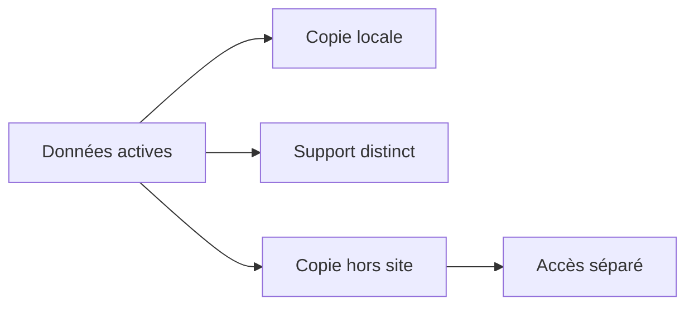

Les copies doivent survivre à un domaine de panne commun ; plusieurs répertoires sur le même volume ne forment pas une stratégie 3-2-1 robuste.

### Schéma 2 — Chaîne de protection

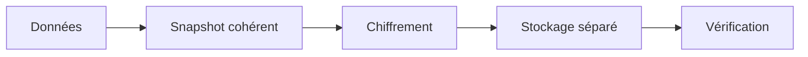

La chaîne inclut cohérence, protection du contenu, séparation et contrôle d'intégrité.

### Schéma 3 — Choisir un point de reprise

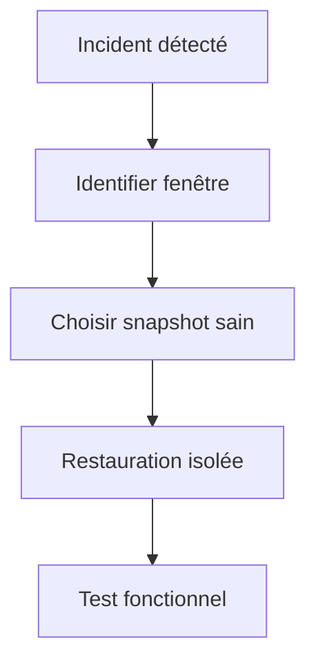

La date la plus récente n'est pas automatiquement la meilleure si elle est postérieure à la compromission ou déjà corrompue.

### Schéma 4 — RPO


Le respect du RPO se mesure par l'âge du dernier point effectivement restaurable, pas seulement par le dernier job terminé.

### Schéma 5 — RTO

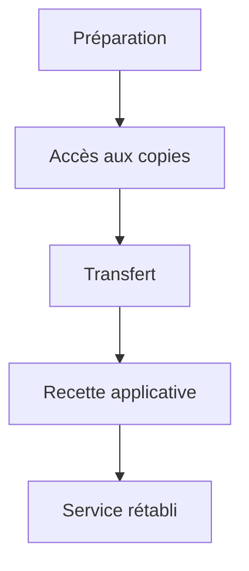

Le temps de transfert n'est qu'une partie du RTO. Les accès, clés, tests et dépendances doivent aussi être disponibles.

### Schéma 6 — Séparation des privilèges

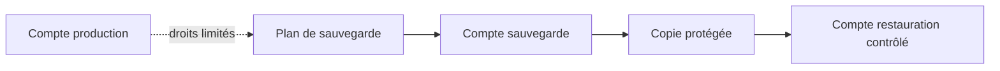

La séparation d'identités réduit le risque qu'une compromission en production permette de supprimer toutes les copies.

## Fondements techniques du domaine

### 1. Inventaire et classification

Toutes les données n'ont pas la même valeur : une base transactionnelle, un dépôt de configuration et un cache temporaire n'ont pas les mêmes objectifs de reprise. Associer chaque jeu de données à un propriétaire, une fréquence de changement, une criticité, une durée de conservation et une dépendance applicative.

**Mise en œuvre.** Pour appliquer ce principe dans stratégies de sauvegarde (3-2-1), commencer par fixer le périmètre et l'état attendu. Identifier ensuite la donnée qui permet d'observer le résultat, la personne autorisée à prendre la décision et le moment où le contrôle doit être réalisé. Le test doit être assez précis pour qu'un second technicien puisse le reproduire sans demander une explication orale complémentaire. Si plusieurs méthodes sont possibles, noter pourquoi la méthode retenue est la plus proportionnée au risque et au temps disponible.

**Preuves et interprétation.** L'inventaire daté, la liste de sélection et la preuve de validation par le propriétaire rendent la couverture vérifiable. L'intervenant doit garder la source, l'heure, le résultat, le contexte et la limite éventuelle de l'observation. Une preuve isolée n'a parfois qu'une valeur indicative ; elle doit alors être croisée avec un autre signal indépendant. Les données manquantes ne doivent pas être remplacées par une supposition. Lorsqu'une mesure est indirecte, préciser ce qu'elle démontre réellement et ce qu'elle ne démontre pas.

**Pièges et décision.** Une sauvegarde qui omet une base, une clé ou un fichier de configuration peut être techniquement réussie mais inutilisable au redémarrage. En cas d'écart, classer le résultat comme confirmé, probable ou inconnu et déterminer la prochaine action. Ne pas masquer un résultat défavorable par une moyenne, une fermeture de ticket ou un changement de catégorie. Si le risque dépasse l'autorité de l'intervenant, conserver les preuves et escalader plutôt que poursuivre sur la base d'une hypothèse fragile.

### Schéma — valider réellement la stratégie 3-2-1

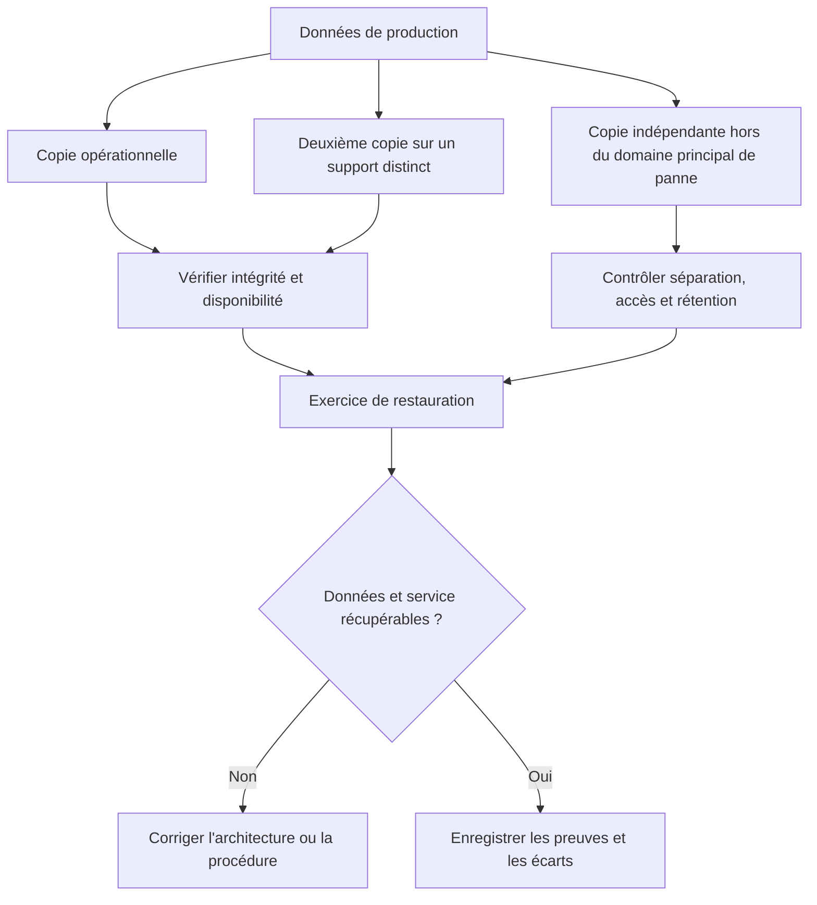

Le nombre de copies ne suffit pas à démontrer la résilience. Des copies qui partagent les mêmes identifiants, le même domaine d'administration ou le même emplacement peuvent être touchées par un incident commun. La validation porte donc aussi sur l'indépendance des copies et la capacité réelle de restauration.

### 2. Règle 3-2-1

Conserver plusieurs copies, répartir les supports et maintenir une copie hors du domaine de panne réduit les risques de perte simultanée. Vérifier l'indépendance réelle des copies : comptes d'administration séparés, réseau distinct, rétention, séparation géographique si nécessaire et chemin de restauration documenté.

**Mise en œuvre.** Pour appliquer ce principe dans stratégies de sauvegarde (3-2-1), commencer par fixer le périmètre et l'état attendu. Identifier ensuite la donnée qui permet d'observer le résultat, la personne autorisée à prendre la décision et le moment où le contrôle doit être réalisé. Le test doit être assez précis pour qu'un second technicien puisse le reproduire sans demander une explication orale complémentaire. Si plusieurs méthodes sont possibles, noter pourquoi la méthode retenue est la plus proportionnée au risque et au temps disponible.

**Preuves et interprétation.** Pour chaque copie, documenter emplacement, accès, période de rétention, chiffrement, dernière vérification et responsable. L'intervenant doit garder la source, l'heure, le résultat, le contexte et la limite éventuelle de l'observation. Une preuve isolée n'a parfois qu'une valeur indicative ; elle doit alors être croisée avec un autre signal indépendant. Les données manquantes ne doivent pas être remplacées par une supposition. Lorsqu'une mesure est indirecte, préciser ce qu'elle démontre réellement et ce qu'elle ne démontre pas.

**Pièges et décision.** Trois répertoires sur le même disque ou trois snapshots administrés par le même compte compromis ne fournissent pas trois copies indépendantes. En cas d'écart, classer le résultat comme confirmé, probable ou inconnu et déterminer la prochaine action. Ne pas masquer un résultat défavorable par une moyenne, une fermeture de ticket ou un changement de catégorie. Si le risque dépasse l'autorité de l'intervenant, conserver les preuves et escalader plutôt que poursuivre sur la base d'une hypothèse fragile.

### Schéma — traduire le RPO en fréquence et en contrôles

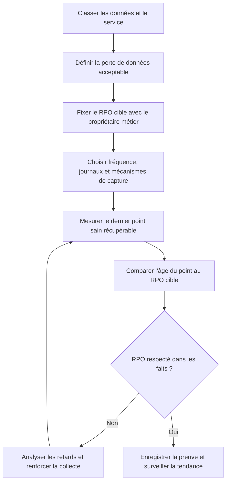

Le RPO ne se déduit pas simplement de l'horaire prévu des tâches. Il faut mesurer l'âge du dernier point récupérable, en tenant compte des échecs, de la cohérence applicative et du délai nécessaire pour vérifier la restauration.

### 3. RPO et fréquence

Le RPO définit la quantité maximale de données que l'organisation accepte de perdre, exprimée en durée entre le dernier état récupérable et l'incident. Choisir une fréquence et un journal de transactions compatibles avec la fenêtre de perte tolérée, en tenant compte de la durée des jobs et de la capacité réseau.

**Mise en œuvre.** Pour appliquer ce principe dans stratégies de sauvegarde (3-2-1), commencer par fixer le périmètre et l'état attendu. Identifier ensuite la donnée qui permet d'observer le résultat, la personne autorisée à prendre la décision et le moment où le contrôle doit être réalisé. Le test doit être assez précis pour qu'un second technicien puisse le reproduire sans demander une explication orale complémentaire. Si plusieurs méthodes sont possibles, noter pourquoi la méthode retenue est la plus proportionnée au risque et au temps disponible.

**Preuves et interprétation.** La politique signée, l'heure des points de reprise et les résultats de restauration montrent si l'objectif est réellement atteint. L'intervenant doit garder la source, l'heure, le résultat, le contexte et la limite éventuelle de l'observation. Une preuve isolée n'a parfois qu'une valeur indicative ; elle doit alors être croisée avec un autre signal indépendant. Les données manquantes ne doivent pas être remplacées par une supposition. Lorsqu'une mesure est indirecte, préciser ce qu'elle démontre réellement et ce qu'elle ne démontre pas.

**Pièges et décision.** Une fréquence de sauvegarde trop espacée peut être incompatible avec le métier, même si tous les jobs se terminent sans erreur. En cas d'écart, classer le résultat comme confirmé, probable ou inconnu et déterminer la prochaine action. Ne pas masquer un résultat défavorable par une moyenne, une fermeture de ticket ou un changement de catégorie. Si le risque dépasse l'autorité de l'intervenant, conserver les preuves et escalader plutôt que poursuivre sur la base d'une hypothèse fragile.

### Schéma — mesurer le RTO de bout en bout

```mermaid
flowchart LR
    A["Incident détecté"] --> B["Décision et autorisation de reprise"]
    B --> C["Accès au point de récupération"]
    C --> D["Transfert et restauration des données"]
    D --> E["Reconstruction des dépendances"]
    E --> F["Contrôles techniques et applicatifs"]
    F --> G["Validation par le responsable du service"]
    G --> H["Remise à disposition"]
    H --> I["Comparer la durée réelle au RTO cible"]
```

Mesure les étapes qui composent réellement la reprise. Un test qui mesure uniquement la copie des fichiers sous-estime le RTO si l'application doit ensuite être reconfigurée, vérifier sa cohérence, retrouver ses secrets ou recevoir une validation métier.

### 4. RTO et restauration

Le RTO est le délai cible pour remettre le service en état acceptable ; il couvre découverte, accès aux copies, restauration, validation applicative et remise à disposition. Répéter la restauration à blanc et mesurer chaque étape plutôt que d'estimer le délai à partir du seul débit de copie.

**Mise en œuvre.** Pour appliquer ce principe dans stratégies de sauvegarde (3-2-1), commencer par fixer le périmètre et l'état attendu. Identifier ensuite la donnée qui permet d'observer le résultat, la personne autorisée à prendre la décision et le moment où le contrôle doit être réalisé. Le test doit être assez précis pour qu'un second technicien puisse le reproduire sans demander une explication orale complémentaire. Si plusieurs méthodes sont possibles, noter pourquoi la méthode retenue est la plus proportionnée au risque et au temps disponible.

**Preuves et interprétation.** Conserver durée de préparation, durée de transfert, validation fonctionnelle et décision de retour en service. L'intervenant doit garder la source, l'heure, le résultat, le contexte et la limite éventuelle de l'observation. Une preuve isolée n'a parfois qu'une valeur indicative ; elle doit alors être croisée avec un autre signal indépendant. Les données manquantes ne doivent pas être remplacées par une supposition. Lorsqu'une mesure est indirecte, préciser ce qu'elle démontre réellement et ce qu'elle ne démontre pas.

**Pièges et décision.** Une copie rapide à lire ne garantit pas un RTO court si les clés, les procédures, les dépendances DNS ou les administrateurs ne sont pas disponibles. En cas d'écart, classer le résultat comme confirmé, probable ou inconnu et déterminer la prochaine action. Ne pas masquer un résultat défavorable par une moyenne, une fermeture de ticket ou un changement de catégorie. Si le risque dépasse l'autorité de l'intervenant, conserver les preuves et escalader plutôt que poursuivre sur la base d'une hypothèse fragile.

### Schéma — choisir une méthode de sauvegarde cohérente

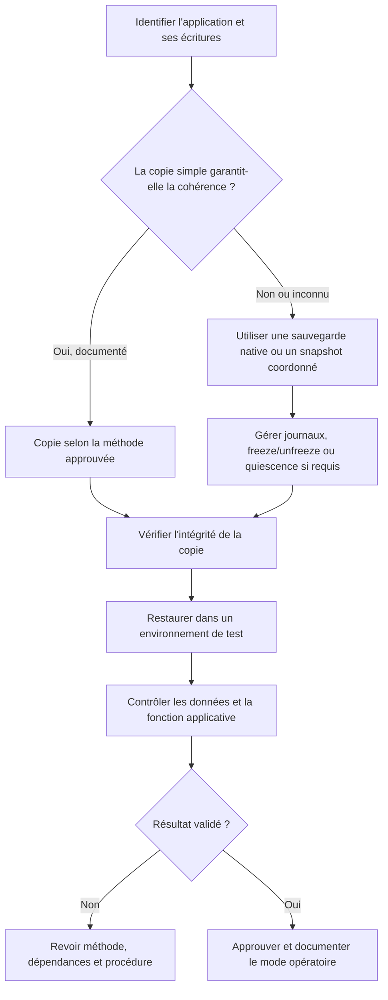

Une copie complète en taille ne garantit pas une base de données cohérente. Pour une application transactionnelle, vérifie les instructions du fournisseur et valide la restauration à la fois au niveau des fichiers et au niveau fonctionnel.

### 5. Cohérence applicative

Les fichiers copiés pendant une écriture peuvent être incohérents ; certaines applications exigent un snapshot coordonné ou une sauvegarde native. Prévoir freeze/unfreeze, export natif, snapshot cohérent ou sauvegarde des journaux selon les capacités de l'application.

**Mise en œuvre.** Pour appliquer ce principe dans stratégies de sauvegarde (3-2-1), commencer par fixer le périmètre et l'état attendu. Identifier ensuite la donnée qui permet d'observer le résultat, la personne autorisée à prendre la décision et le moment où le contrôle doit être réalisé. Le test doit être assez précis pour qu'un second technicien puisse le reproduire sans demander une explication orale complémentaire. Si plusieurs méthodes sont possibles, noter pourquoi la méthode retenue est la plus proportionnée au risque et au temps disponible.

**Preuves et interprétation.** Enregistrer la version de l'application, la méthode de cohérence et le résultat d'un contrôle applicatif après restauration. L'intervenant doit garder la source, l'heure, le résultat, le contexte et la limite éventuelle de l'observation. Une preuve isolée n'a parfois qu'une valeur indicative ; elle doit alors être croisée avec un autre signal indépendant. Les données manquantes ne doivent pas être remplacées par une supposition. Lorsqu'une mesure est indirecte, préciser ce qu'elle démontre réellement et ce qu'elle ne démontre pas.

**Pièges et décision.** Le simple code retour d'un outil de copie ne prouve pas que la base de données restaurée peut démarrer et répondre correctement. En cas d'écart, classer le résultat comme confirmé, probable ou inconnu et déterminer la prochaine action. Ne pas masquer un résultat défavorable par une moyenne, une fermeture de ticket ou un changement de catégorie. Si le risque dépasse l'autorité de l'intervenant, conserver les preuves et escalader plutôt que poursuivre sur la base d'une hypothèse fragile.

### Schéma — limiter les effets d'une compromission sur les sauvegardes

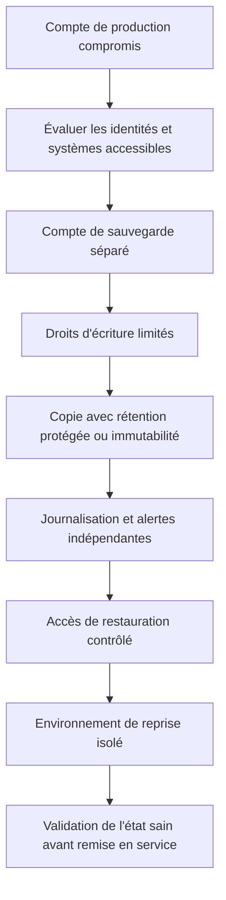

L'immutabilité réduit certains risques de modification ou de suppression pendant une période protégée, mais ne remplace ni le contrôle des comptes, ni la surveillance, ni les tests de restauration. Vérifie les limites exactes du mécanisme utilisé et protège aussi les moyens d'administration.

### 6. Immutabilité et séparation

Les ransomwares peuvent supprimer des copies accessibles avec les mêmes identifiants que le système de production. Séparer les comptes, limiter les droits de suppression, appliquer une rétention protégée et tester l'accès de restauration depuis un environnement isolé.

**Mise en œuvre.** Pour appliquer ce principe dans stratégies de sauvegarde (3-2-1), commencer par fixer le périmètre et l'état attendu. Identifier ensuite la donnée qui permet d'observer le résultat, la personne autorisée à prendre la décision et le moment où le contrôle doit être réalisé. Le test doit être assez précis pour qu'un second technicien puisse le reproduire sans demander une explication orale complémentaire. Si plusieurs méthodes sont possibles, noter pourquoi la méthode retenue est la plus proportionnée au risque et au temps disponible.

**Preuves et interprétation.** Journaliser les accès administratifs et les changements de politique ; alerter sur les suppressions massives ou la baisse anormale du volume sauvegardé. L'intervenant doit garder la source, l'heure, le résultat, le contexte et la limite éventuelle de l'observation. Une preuve isolée n'a parfois qu'une valeur indicative ; elle doit alors être croisée avec un autre signal indépendant. Les données manquantes ne doivent pas être remplacées par une supposition. Lorsqu'une mesure est indirecte, préciser ce qu'elle démontre réellement et ce qu'elle ne démontre pas.

**Pièges et décision.** Une copie distante mais modifiable avec le compte de production reste vulnérable à une compromission de ce compte. En cas d'écart, classer le résultat comme confirmé, probable ou inconnu et déterminer la prochaine action. Ne pas masquer un résultat défavorable par une moyenne, une fermeture de ticket ou un changement de catégorie. Si le risque dépasse l'autorité de l'intervenant, conserver les preuves et escalader plutôt que poursuivre sur la base d'une hypothèse fragile.

### 7. Intégrité et chiffrement

Les sauvegardes transportent parfois des données personnelles, des secrets ou des informations de production ; leur protection doit couvrir transfert et stockage. Utiliser un chiffrement documenté, un stockage de clés séparé, des contrôles d'intégrité et un test régulier de récupération des clés.

**Mise en œuvre.** Pour appliquer ce principe dans stratégies de sauvegarde (3-2-1), commencer par fixer le périmètre et l'état attendu. Identifier ensuite la donnée qui permet d'observer le résultat, la personne autorisée à prendre la décision et le moment où le contrôle doit être réalisé. Le test doit être assez précis pour qu'un second technicien puisse le reproduire sans demander une explication orale complémentaire. Si plusieurs méthodes sont possibles, noter pourquoi la méthode retenue est la plus proportionnée au risque et au temps disponible.

**Preuves et interprétation.** Documenter la rotation, la possession de clés, les résultats de vérification et les personnes habilitées à restaurer. L'intervenant doit garder la source, l'heure, le résultat, le contexte et la limite éventuelle de l'observation. Une preuve isolée n'a parfois qu'une valeur indicative ; elle doit alors être croisée avec un autre signal indépendant. Les données manquantes ne doivent pas être remplacées par une supposition. Lorsqu'une mesure est indirecte, préciser ce qu'elle démontre réellement et ce qu'elle ne démontre pas.

**Pièges et décision.** Une copie chiffrée sans procédure de récupération de clé équivaut à une perte de données. En cas d'écart, classer le résultat comme confirmé, probable ou inconnu et déterminer la prochaine action. Ne pas masquer un résultat défavorable par une moyenne, une fermeture de ticket ou un changement de catégorie. Si le risque dépasse l'autorité de l'intervenant, conserver les preuves et escalader plutôt que poursuivre sur la base d'une hypothèse fragile.

### Schéma — organiser un programme de tests de restauration

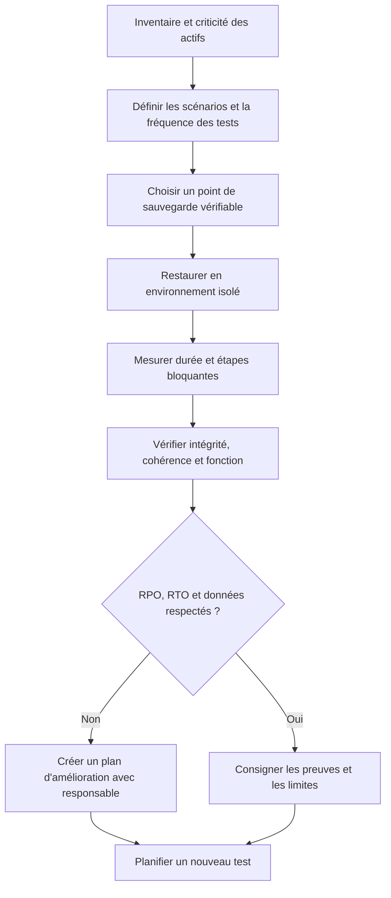

Le programme doit inclure des restaurations réalistes et proportionnées à la criticité : fichier, répertoire, application ou service complet. Le résultat, les écarts, les durées et les décisions doivent être enregistrés, puis les corrections retestées.

### 8. Tests et rétention

La restauration est la preuve ultime qu'une sauvegarde protège réellement le service. Planifier des exercices représentatifs, du fichier isolé à la reprise d'une application complète, et faire approuver les résultats par le propriétaire du service.

**Mise en œuvre.** Pour appliquer ce principe dans stratégies de sauvegarde (3-2-1), commencer par fixer le périmètre et l'état attendu. Identifier ensuite la donnée qui permet d'observer le résultat, la personne autorisée à prendre la décision et le moment où le contrôle doit être réalisé. Le test doit être assez précis pour qu'un second technicien puisse le reproduire sans demander une explication orale complémentaire. Si plusieurs méthodes sont possibles, noter pourquoi la méthode retenue est la plus proportionnée au risque et au temps disponible.

**Preuves et interprétation.** Le compte rendu indique le périmètre, le point restauré, la durée, les anomalies, les preuves et les actions correctives. L'intervenant doit garder la source, l'heure, le résultat, le contexte et la limite éventuelle de l'observation. Une preuve isolée n'a parfois qu'une valeur indicative ; elle doit alors être croisée avec un autre signal indépendant. Les données manquantes ne doivent pas être remplacées par une supposition. Lorsqu'une mesure est indirecte, préciser ce qu'elle démontre réellement et ce qu'elle ne démontre pas.

**Pièges et décision.** Ne jamais considérer une exécution verte comme un test de restaurabilité ; les sauvegardes doivent être restaurées dans un environnement maîtrisé. En cas d'écart, classer le résultat comme confirmé, probable ou inconnu et déterminer la prochaine action. Ne pas masquer un résultat défavorable par une moyenne, une fermeture de ticket ou un changement de catégorie. Si le risque dépasse l'autorité de l'intervenant, conserver les preuves et escalader plutôt que poursuivre sur la base d'une hypothèse fragile.

## Méthode transversale pour une opération maîtrisée

### 1. Gouvernance

L'intervention doit être reliée à un objectif de service, un propriétaire et une décision explicite. Le contrôle de gouvernance n'a de valeur que s'il aide à identifier qui peut accepter le risque et qui doit être informé. Pour stratégies de sauvegarde (3-2-1), cela signifie que la personne qui agit doit relier la règle à un élément concret : taux de jobs réussis, âge de la dernière copie vérifiée, durée de restauration, taux de tests réussis, volume protégé, écart RPO, écart RTO, erreurs d'intégrité. Avant l'opération, noter l'état de départ et ce qui fera considérer le résultat comme acceptable. Pendant l'action, conserver le contexte des changements et indiquer immédiatement les écarts. Après l'action, exécuter le contrôle correspondant au risque, enregistrer le résultat et affecter les suites restantes. Cette discipline augmente la qualité de la passation et réduit la dépendance à une personne unique.

### 2. Cycle de vie

La solution doit être pensée depuis la préparation jusqu'à la sortie, y compris le maintien des compétences et le retrait des anciennes données. Une étape oubliée en fin de cycle transforme souvent une réussite ponctuelle en risque latent. Pour stratégies de sauvegarde (3-2-1), cela signifie que la personne qui agit doit relier la règle à un élément concret : taux de jobs réussis, âge de la dernière copie vérifiée, durée de restauration, taux de tests réussis, volume protégé, écart RPO, écart RTO, erreurs d'intégrité. Avant l'opération, noter l'état de départ et ce qui fera considérer le résultat comme acceptable. Pendant l'action, conserver le contexte des changements et indiquer immédiatement les écarts. Après l'action, exécuter le contrôle correspondant au risque, enregistrer le résultat et affecter les suites restantes. Cette discipline augmente la qualité de la passation et réduit la dépendance à une personne unique.

### 3. Qualité de données

Toute mesure dépend de la qualité de son périmètre, de l'horodatage, de l'unité et de la provenance. Il faut identifier les champs manquants et les conventions contradictoires avant de tirer une conclusion. Pour stratégies de sauvegarde (3-2-1), cela signifie que la personne qui agit doit relier la règle à un élément concret : taux de jobs réussis, âge de la dernière copie vérifiée, durée de restauration, taux de tests réussis, volume protégé, écart RPO, écart RTO, erreurs d'intégrité. Avant l'opération, noter l'état de départ et ce qui fera considérer le résultat comme acceptable. Pendant l'action, conserver le contexte des changements et indiquer immédiatement les écarts. Après l'action, exécuter le contrôle correspondant au risque, enregistrer le résultat et affecter les suites restantes. Cette discipline augmente la qualité de la passation et réduit la dépendance à une personne unique.

### 4. Gestion du risque

Le risque se juge par probabilité, impact, capacité de détection et marge de récupération. Les éléments critiques doivent recevoir plus de contrôles, sans imposer la même lourdeur aux opérations réversibles et aux changements irréversibles. Pour stratégies de sauvegarde (3-2-1), cela signifie que la personne qui agit doit relier la règle à un élément concret : taux de jobs réussis, âge de la dernière copie vérifiée, durée de restauration, taux de tests réussis, volume protégé, écart RPO, écart RTO, erreurs d'intégrité. Avant l'opération, noter l'état de départ et ce qui fera considérer le résultat comme acceptable. Pendant l'action, conserver le contexte des changements et indiquer immédiatement les écarts. Après l'action, exécuter le contrôle correspondant au risque, enregistrer le résultat et affecter les suites restantes. Cette discipline augmente la qualité de la passation et réduit la dépendance à une personne unique.

### 5. Communication

Une communication utile indique ce qui est connu, ce qui reste à vérifier, qui agit ensuite et quand une nouvelle information sera fournie. Les formulations doivent éviter les promesses non vérifiées. Pour stratégies de sauvegarde (3-2-1), cela signifie que la personne qui agit doit relier la règle à un élément concret : taux de jobs réussis, âge de la dernière copie vérifiée, durée de restauration, taux de tests réussis, volume protégé, écart RPO, écart RTO, erreurs d'intégrité. Avant l'opération, noter l'état de départ et ce qui fera considérer le résultat comme acceptable. Pendant l'action, conserver le contexte des changements et indiquer immédiatement les écarts. Après l'action, exécuter le contrôle correspondant au risque, enregistrer le résultat et affecter les suites restantes. Cette discipline augmente la qualité de la passation et réduit la dépendance à une personne unique.

### 6. Sécurité

Le périmètre technique doit rester limité aux systèmes autorisés, avec une identité traçable et les droits minimaux nécessaires. Les secrets doivent être protégés dans les fichiers, les journaux, les captures et les exports. Pour stratégies de sauvegarde (3-2-1), cela signifie que la personne qui agit doit relier la règle à un élément concret : taux de jobs réussis, âge de la dernière copie vérifiée, durée de restauration, taux de tests réussis, volume protégé, écart RPO, écart RTO, erreurs d'intégrité. Avant l'opération, noter l'état de départ et ce qui fera considérer le résultat comme acceptable. Pendant l'action, conserver le contexte des changements et indiquer immédiatement les écarts. Après l'action, exécuter le contrôle correspondant au risque, enregistrer le résultat et affecter les suites restantes. Cette discipline augmente la qualité de la passation et réduit la dépendance à une personne unique.

### 7. Traçabilité

Une action exploitable doit laisser un résultat vérifiable, un horodatage, un propriétaire et un lien avec le ticket ou le changement. La trace doit permettre à un autre technicien de comprendre ce qui a été fait. Pour stratégies de sauvegarde (3-2-1), cela signifie que la personne qui agit doit relier la règle à un élément concret : taux de jobs réussis, âge de la dernière copie vérifiée, durée de restauration, taux de tests réussis, volume protégé, écart RPO, écart RTO, erreurs d'intégrité. Avant l'opération, noter l'état de départ et ce qui fera considérer le résultat comme acceptable. Pendant l'action, conserver le contexte des changements et indiquer immédiatement les écarts. Après l'action, exécuter le contrôle correspondant au risque, enregistrer le résultat et affecter les suites restantes. Cette discipline augmente la qualité de la passation et réduit la dépendance à une personne unique.

### 8. Gestion des exceptions

Les cas hors procédure doivent être visibles et conduire à un point d'arrêt, une décision ou une escalade. Une exception récurrente est souvent le signal qu'il faut faire évoluer la procédure plutôt que la répéter. Pour stratégies de sauvegarde (3-2-1), cela signifie que la personne qui agit doit relier la règle à un élément concret : taux de jobs réussis, âge de la dernière copie vérifiée, durée de restauration, taux de tests réussis, volume protégé, écart RPO, écart RTO, erreurs d'intégrité. Avant l'opération, noter l'état de départ et ce qui fera considérer le résultat comme acceptable. Pendant l'action, conserver le contexte des changements et indiquer immédiatement les écarts. Après l'action, exécuter le contrôle correspondant au risque, enregistrer le résultat et affecter les suites restantes. Cette discipline augmente la qualité de la passation et réduit la dépendance à une personne unique.

### 9. Amélioration continue

Les incidents, les retours utilisateurs et les contrôles qualité doivent transformer les règles et procédures. Il faut vérifier si les modifications réduisent réellement le risque, et pas seulement si les documents ont été mis à jour. Pour stratégies de sauvegarde (3-2-1), cela signifie que la personne qui agit doit relier la règle à un élément concret : taux de jobs réussis, âge de la dernière copie vérifiée, durée de restauration, taux de tests réussis, volume protégé, écart RPO, écart RTO, erreurs d'intégrité. Avant l'opération, noter l'état de départ et ce qui fera considérer le résultat comme acceptable. Pendant l'action, conserver le contexte des changements et indiquer immédiatement les écarts. Après l'action, exécuter le contrôle correspondant au risque, enregistrer le résultat et affecter les suites restantes. Cette discipline augmente la qualité de la passation et réduit la dépendance à une personne unique.

### 10. Capacité

Les ressources, compétences, fenêtres et dépendances limitent le volume d'opérations réalisables. Une planification crédible tient compte de la charge, des temps de contrôle et des imprévus. Pour stratégies de sauvegarde (3-2-1), cela signifie que la personne qui agit doit relier la règle à un élément concret : taux de jobs réussis, âge de la dernière copie vérifiée, durée de restauration, taux de tests réussis, volume protégé, écart RPO, écart RTO, erreurs d'intégrité. Avant l'opération, noter l'état de départ et ce qui fera considérer le résultat comme acceptable. Pendant l'action, conserver le contexte des changements et indiquer immédiatement les écarts. Après l'action, exécuter le contrôle correspondant au risque, enregistrer le résultat et affecter les suites restantes. Cette discipline augmente la qualité de la passation et réduit la dépendance à une personne unique.

### 11. Contrôle du changement

Une modification nécessite un état initial connu, un périmètre, des critères de réussite et une solution de repli adaptée au risque. L'urgence ne supprime pas le besoin de garder une trace des décisions. Pour stratégies de sauvegarde (3-2-1), cela signifie que la personne qui agit doit relier la règle à un élément concret : taux de jobs réussis, âge de la dernière copie vérifiée, durée de restauration, taux de tests réussis, volume protégé, écart RPO, écart RTO, erreurs d'intégrité. Avant l'opération, noter l'état de départ et ce qui fera considérer le résultat comme acceptable. Pendant l'action, conserver le contexte des changements et indiquer immédiatement les écarts. Après l'action, exécuter le contrôle correspondant au risque, enregistrer le résultat et affecter les suites restantes. Cette discipline augmente la qualité de la passation et réduit la dépendance à une personne unique.

### 12. Mesure d'efficacité

Un indicateur ne vaut que si sa définition reste constante et si sa variation peut conduire à une décision. Les chiffres doivent être accompagnés d'une période, d'un périmètre et des limites de mesure. Pour stratégies de sauvegarde (3-2-1), cela signifie que la personne qui agit doit relier la règle à un élément concret : taux de jobs réussis, âge de la dernière copie vérifiée, durée de restauration, taux de tests réussis, volume protégé, écart RPO, écart RTO, erreurs d'intégrité. Avant l'opération, noter l'état de départ et ce qui fera considérer le résultat comme acceptable. Pendant l'action, conserver le contexte des changements et indiquer immédiatement les écarts. Après l'action, exécuter le contrôle correspondant au risque, enregistrer le résultat et affecter les suites restantes. Cette discipline augmente la qualité de la passation et réduit la dépendance à une personne unique.

### 13. Passation

Une tâche doit pouvoir être reprise par une autre personne sans dépendre des souvenirs du technicien présent. La transmission contient contexte, preuves, étapes déjà tentées et prochaine action. Pour stratégies de sauvegarde (3-2-1), cela signifie que la personne qui agit doit relier la règle à un élément concret : taux de jobs réussis, âge de la dernière copie vérifiée, durée de restauration, taux de tests réussis, volume protégé, écart RPO, écart RTO, erreurs d'intégrité. Avant l'opération, noter l'état de départ et ce qui fera considérer le résultat comme acceptable. Pendant l'action, conserver le contexte des changements et indiquer immédiatement les écarts. Après l'action, exécuter le contrôle correspondant au risque, enregistrer le résultat et affecter les suites restantes. Cette discipline augmente la qualité de la passation et réduit la dépendance à une personne unique.

### 14. Validation métier

Le résultat technique doit être confirmé du point de vue du service. Un équipement joignable ou un script qui termine sans erreur ne suffit pas si l'utilisateur ne peut pas accomplir son opération. Pour stratégies de sauvegarde (3-2-1), cela signifie que la personne qui agit doit relier la règle à un élément concret : taux de jobs réussis, âge de la dernière copie vérifiée, durée de restauration, taux de tests réussis, volume protégé, écart RPO, écart RTO, erreurs d'intégrité. Avant l'opération, noter l'état de départ et ce qui fera considérer le résultat comme acceptable. Pendant l'action, conserver le contexte des changements et indiquer immédiatement les écarts. Après l'action, exécuter le contrôle correspondant au risque, enregistrer le résultat et affecter les suites restantes. Cette discipline augmente la qualité de la passation et réduit la dépendance à une personne unique.

## Indicateurs : définition, lecture et limites

Les indicateurs les plus utiles pour ce domaine sont : **taux de jobs réussis, âge de la dernière copie vérifiée, durée de restauration, taux de tests réussis, volume protégé, écart RPO, écart RTO, erreurs d'intégrité**. Chaque indicateur doit avoir une définition écrite. Il faut préciser l'unité, la source, le périmètre, la fréquence, la période et les exclusions. Lorsque les données ne couvrent qu'une partie de l'environnement, le rapport doit le signaler au lieu d'extrapoler silencieusement. Un indicateur doit permettre une décision : prioriser, déclencher une vérification, ajuster une capacité, revoir une procédure ou accepter explicitement un risque.

Un bon tableau de bord met en évidence la tendance et les écarts significatifs, sans supprimer la donnée de départ. Il distingue les valeurs brutes, les seuils, les anomalies confirmées et les périodes sans mesure. Une moyenne peut cacher des situations extrêmes ; il est donc souvent nécessaire d'observer la distribution, les percentiles, les valeurs maximales et la répartition par service ou par criticité. Les changements de définition doivent être versionnés pour éviter de comparer des séries qui ne signifient plus la même chose.

Les indicateurs ne doivent pas devenir des objectifs isolés. Par exemple, réduire le délai moyen n'est pas une amélioration si les tickets sont fermés avant validation et immédiatement rouverts. De même, atteindre un taux de conformité en excluant les actifs inconnus peut donner une image artificiellement favorable. Associer un KPI à un contrôle de qualité et à un résultat métier permet de repérer ces effets indésirables.

### Schéma — traiter une alerte de sauvegarde sans se limiter au voyant du job

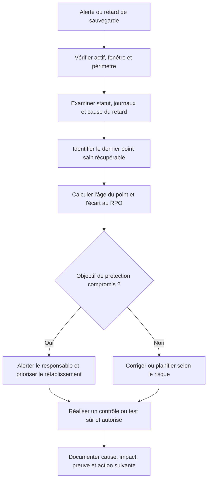

Un statut « réussi » ne décrit pas toujours la qualité de la récupération ; un statut « échoué » n'explique pas à lui seul le risque métier. La décision doit s'appuyer sur le point réellement récupérable, sa cohérence et les objectifs convenus.

## Procédure opérationnelle recommandée

1. **Préparer.** Confirmer la demande, le périmètre, le propriétaire, l'autorisation et la fenêtre. Vérifier les dépendances, les sauvegardes et les accès nécessaires.
2. **Établir l'état initial.** Recueillir les mesures, l'état des services, les alertes, la dernière intervention et les écarts connus. Noter les éléments non vérifiables.
3. **Évaluer les risques.** Déterminer impact, probabilité, détectabilité, réversibilité et critère de report. Définir un point d'arrêt compréhensible.
4. **Exécuter par étapes.** Utiliser les outils approuvés, limiter le périmètre et vérifier les résultats intermédiaires avant de passer à l'étape suivante.
5. **Contrôler.** Comparer l'état final à l'état attendu et tester le service selon un scénario réaliste, pas uniquement le composant technique.
6. **Tracer.** Enregistrer les horaires, commandes ou actions, résultats, décisions et écarts dans le ticket ou le référentiel prévu.
7. **Communiquer.** Annoncer le résultat en termes compréhensibles, préciser les limites et indiquer qui gère les actions ouvertes.
8. **Améliorer.** Rechercher les étapes ambiguës ou les contrôles inefficaces et proposer une modification versionnée, testée et approuvée.

## Outils et contrôles pratiques

Les outils doivent être sélectionnés selon l'objectif, les droits et le type de preuve recherché. L'usage d'un outil connu ne dispense pas de contrôler son contexte : version, paramètres, cible, unité, état de connexion et limite de la mesure. restic ou Borg selon l'environnement, sauvegarde applicative cohérente, stockage objet avec verrouillage lorsque disponible, chiffrement, journalisation, supervision de jobs, procédures de restauration constituent des exemples de technologies possibles ; leur choix exact dépend de l'environnement et des politiques internes.

| Contrôle | Question à poser | Trace à conserver |
|---|---|---|
| Identité de la cible | Est-ce bien l'actif ou le service autorisé ? | Identifiant, inventaire et horodatage. |
| État initial | Quelle condition de départ a été mesurée ? | Valeur, source, capture ou sortie. |
| Autorisation | Qui a approuvé l'action et pour quelle fenêtre ? | Ticket, validation et périmètre. |
| Résultat | Qu'est-ce qui démontre que le résultat est correct ? | Test de contrôle et résultat observé. |
| Écart | Que faire si le résultat attendu n'est pas obtenu ? | Point d'arrêt, escalade et action attribuée. |

### Commandes et exemples

Les commandes de cette section servent à illustrer la collecte de preuves. Remplacer les valeurs de test par des cibles autorisées et vérifier localement les options selon la distribution et la version de l'outil.

#### Exemple 1 — Initialiser un dépôt restic chiffré (après validation du chemin et des secrets)

```bash
restic -r /srv/backup/restic-repo init
```

Interpréter la sortie avec le contexte de l'intervention. Un retour nul ne démontre pas toujours que la fonction métier est opérationnelle. Relever les erreurs, vérifier l'heure des journaux et comparer les observations avec une seconde source lorsque l'impact le justifie. Ne pas intégrer un résultat de terminal dans un rapport sans préciser la machine, la période et la commande effectivement exécutée.

#### Exemple 2 — Créer un snapshot d'un répertoire de test

```bash
restic -r /srv/backup/restic-repo backup /srv/data-test
```

Interpréter la sortie avec le contexte de l'intervention. Un retour nul ne démontre pas toujours que la fonction métier est opérationnelle. Relever les erreurs, vérifier l'heure des journaux et comparer les observations avec une seconde source lorsque l'impact le justifie. Ne pas intégrer un résultat de terminal dans un rapport sans préciser la machine, la période et la commande effectivement exécutée.

#### Exemple 3 — Lister les snapshots disponibles

```bash
restic -r /srv/backup/restic-repo snapshots
```

Interpréter la sortie avec le contexte de l'intervention. Un retour nul ne démontre pas toujours que la fonction métier est opérationnelle. Relever les erreurs, vérifier l'heure des journaux et comparer les observations avec une seconde source lorsque l'impact le justifie. Ne pas intégrer un résultat de terminal dans un rapport sans préciser la machine, la période et la commande effectivement exécutée.

#### Exemple 4 — Vérifier les données du dépôt

```bash
restic -r /srv/backup/restic-repo check
```

Interpréter la sortie avec le contexte de l'intervention. Un retour nul ne démontre pas toujours que la fonction métier est opérationnelle. Relever les erreurs, vérifier l'heure des journaux et comparer les observations avec une seconde source lorsque l'impact le justifie. Ne pas intégrer un résultat de terminal dans un rapport sans préciser la machine, la période et la commande effectivement exécutée.

### Schéma — enchaîner l'exercice intermédiaire de reprise


Pour cet atelier, les résultats non mesurés doivent rester « à relever ». Le but est d'appliquer une méthode reproductible, pas d'affirmer un RPO ou un RTO conforme sans preuve chronométrée.

## Parcours pratique intermédiaire — concevoir et éprouver une reprise

Cet atelier est prévu pour environ 60 à 90 minutes sur des données fictives ou un environnement de test isolé. N'exécute pas de restauration sur un système de production sans autorisation, plan de changement et coordination avec le propriétaire du service.

### Scénario

Une application de gestion de commandes utilise une base de données et un partage de documents. Le propriétaire indique une perte de données maximale acceptable de 30 minutes et demande un rétablissement du service en moins de 4 heures. Une tâche de sauvegarde nocturne a réussi, mais la dernière sauvegarde du journal de transactions a affiché une alerte. Tu dois déterminer si les objectifs de reprise restent tenus et préparer un test de restauration.

### Étape 1 — Définir le périmètre et les dépendances

Liste base de données, journaux, documents, configuration, secrets nécessaires, dépendances applicatives et contacts de décision. Sépare les informations confirmées de celles qui restent à vérifier. Identifie le propriétaire métier autorisé à accepter la perte éventuelle de données.

### Étape 2 — Vérifier le RPO réel

Relève l'heure du dernier point complet et l'heure du dernier point cohérent récupérable. Calcule l'âge du point par rapport à l'heure de référence du scénario. L'heure du dernier job réussi n'est pas nécessairement celle du dernier point récupérable ; vérifie la chaîne requise.

### Étape 3 — Évaluer le RTO

Décompose le délai : décision, accès aux copies, transfert, restauration, remise en place des dépendances, contrôle technique, vérification applicative et validation métier. Utilise des durées mesurées dans le test ou signale les valeurs non mesurées.

### Étape 4 — Vérifier l'indépendance 3-2-1

Dessine les copies et note les supports, emplacements, identités d'administration, rétentions et domaines de panne. Recherche les dépendances communes : comptes identiques, réseau partagé, mêmes privilèges de suppression ou clé de chiffrement inaccessible. Propose une correction pour chaque faiblesse identifiée.

### Étape 5 — Préparer le test de restauration

Définis le point à restaurer, l'environnement isolé, les personnes autorisées, les données de test et les critères d'acceptation. Ne connecte pas directement une copie à un système suspect ou compromis. Enregistre le plan et prévois le nettoyage contrôlé de l'environnement de test.

### Étape 6 — Exécuter ou simuler les contrôles

Dans un environnement autorisé, mesure les durées et vérifie l'intégrité, la cohérence de la base et les fonctions essentielles de l'application. Si tu ne disposes pas d'un environnement réel, fournis une procédure de test et marque les résultats comme « non exécutés » au lieu d'inventer des valeurs.

### Étape 7 — Décider et restituer

Compare les observations aux objectifs de RPO et RTO du scénario. Si un objectif n'est pas tenu ou si une preuve manque, explique l'impact, le responsable, l'action corrective, l'échéance et le retest attendu. Rédige une synthèse compréhensible par les équipes techniques et par le propriétaire métier.

**Livrables attendus :** matrice des actifs et dépendances, schéma des copies 3-2-1, calcul du RPO, décomposition du RTO, plan de restauration isolée, critères d'acceptation et compte rendu des écarts.

## Atelier pratique guidé

### Situation de départ

L'équipe reçoit une demande concernant stratégies de sauvegarde (3-2-1). Le contexte est incomplet : l'utilisateur décrit un symptôme, une mesure semble inhabituelle et une intervention antérieure est mentionnée sans détail. Le travail consiste à produire une réponse reproductible, sans prendre de risque inutile et sans annoncer une conclusion que les preuves ne soutiennent pas.

### Phase A — Qualification

Créer ou mettre à jour le ticket ; identifier le service, les utilisateurs concernés, le propriétaire technique, la période et les changements récents. Réunir les journaux et les mesures disponibles. Séparer les faits confirmés des déclarations de l'utilisateur. Déterminer si le problème est en cours, intermittent ou résolu, et préciser ce qui manque encore. Définir l'impact selon les critères de service et la priorité de traitement. Si la cible n'est pas certaine, valider son identité par l'inventaire avant d'exécuter la moindre action.

### Phase B — Hypothèses et tests

Formuler au moins deux hypothèses concurrentes. Pour chacune, préciser le signal qui devrait être observé si elle est vraie, le signal qui permettrait de la rejeter et le coût du test. Commencer par les contrôles en lecture seule, puis ne réaliser une modification que si elle est autorisée et nécessaire. Garder les résultats qui contredisent l'hypothèse initiale ; ils évitent de persister sur la mauvaise piste. Si les tests se contredisent, vérifier l'horloge, la version des données, la portée du contrôle et la possibilité d'une panne intermittente.

### Phase C — Action contrôlée

Choisir une action proportionnée au risque et limitée au périmètre identifié. Avant de modifier, noter l'état initial, confirmer la sauvegarde ou le retour arrière adapté et prévenir les personnes concernées. Exécuter une seule modification majeure à la fois lorsque cela permet d'isoler son effet. Si un point d'arrêt est atteint, conserver les preuves et contacter le niveau compétent plutôt que contourner la règle. Après l'action, répéter le test initial et vérifier le service par une transaction ou un parcours représentatif.

### Phase D — Validation et restitution

Comparer le résultat aux critères d'acceptation. Décrire ce qui a changé, ce qui a été vérifié, ce qui reste incertain et les actions ouvertes. La restitution doit être compréhensible pour un utilisateur non spécialiste et suffisamment technique pour un collègue qui reprendrait le dossier. Associer chaque action à un responsable et une échéance. Lorsque la procédure a été difficile à appliquer, signaler précisément la phrase, le champ ou le contrôle à améliorer.

## Études de cas

### Cas 1 — Suppression accidentelle

**Situation.** Un dossier métier a été supprimé alors que le serveur répond normalement. Le service doit être préservé et les actions doivent rester explicables. La première réaction ne doit pas consister à redémarrer ou modifier au hasard : il faut d'abord vérifier le périmètre, l'heure, l'état initial et les changements concomitants.

**Analyse.** Identifier la date de suppression, le propriétaire, le point de restauration et les fichiers modifiés ; restaurer d'abord dans un répertoire temporaire. Consigner les observations qui distinguent les hypothèses, puis rechercher les dépendances susceptibles de produire le même symptôme. Si une source de donnée est absente, l'indiquer et prévoir un moyen de la récupérer pour une prochaine occurrence. Vérifier aussi l'effet sur les autres services et le risque que l'action proposée crée une interruption plus large que le problème initial.

**Décision et preuve.** Comparer les permissions, l'intégrité et les versions avant de recopier en production ; préserver les fichiers actuels si leur écrasement pourrait aggraver l'incident. La conclusion doit préciser le niveau de confiance et les contrôles qui ont été effectués après l'action. Si la cause n'est pas démontrée, préférer une formule prudente et assigner l'investigation complémentaire plutôt que fermer le dossier sur une supposition.

### Cas 2 — Ransomware sur le serveur de fichiers

**Situation.** Les fichiers sont renommés et les snapshots accessibles depuis le serveur sont également affectés. Le service doit être préservé et les actions doivent rester explicables. La première réaction ne doit pas consister à redémarrer ou modifier au hasard : il faut d'abord vérifier le périmètre, l'heure, l'état initial et les changements concomitants.

**Analyse.** Isoler le système compromis, suspendre les accès de sauvegarde depuis l'hôte, conserver les journaux et identifier une copie indépendante antérieure à la compromission. Consigner les observations qui distinguent les hypothèses, puis rechercher les dépendances susceptibles de produire le même symptôme. Si une source de donnée est absente, l'indiquer et prévoir un moyen de la récupérer pour une prochaine occurrence. Vérifier aussi l'effet sur les autres services et le risque que l'action proposée crée une interruption plus large que le problème initial.

**Décision et preuve.** Récupérer dans un environnement assaini, vérifier le point de reprise et ne réouvrir le service qu'après validation de sécurité et contrôle métier. La conclusion doit préciser le niveau de confiance et les contrôles qui ont été effectués après l'action. Si la cause n'est pas démontrée, préférer une formule prudente et assigner l'investigation complémentaire plutôt que fermer le dossier sur une supposition.

### Cas 3 — RPO non tenu

**Situation.** Le job quotidien est vert, mais le dernier point récupérable date de plus de vingt-quatre heures. Le service doit être préservé et les actions doivent rester explicables. La première réaction ne doit pas consister à redémarrer ou modifier au hasard : il faut d'abord vérifier le périmètre, l'heure, l'état initial et les changements concomitants.

**Analyse.** Vérifier la chaîne de jobs, les échecs masqués, la durée d'exécution, le transfert hors site et la validation du point final. Consigner les observations qui distinguent les hypothèses, puis rechercher les dépendances susceptibles de produire le même symptôme. Si une source de donnée est absente, l'indiquer et prévoir un moyen de la récupérer pour une prochaine occurrence. Vérifier aussi l'effet sur les autres services et le risque que l'action proposée crée une interruption plus large que le problème initial.

**Décision et preuve.** Ajouter des alertes basées sur l'âge du dernier point restaurable plutôt que sur le seul statut du dernier job. La conclusion doit préciser le niveau de confiance et les contrôles qui ont été effectués après l'action. Si la cause n'est pas démontrée, préférer une formule prudente et assigner l'investigation complémentaire plutôt que fermer le dossier sur une supposition.

## Exercices d'application avec corrigés

### Exercice 1 — Définir le périmètre

**Question.** Une demande décrit un problème sans identifier clairement l'actif concerné. Quelles informations obtenir avant de lancer un contrôle ?

**Corrigé expliqué.** Identifier le service, la cible, l'utilisateur, la période, l'impact, l'autorisation, les dépendances et le résultat attendu. Aucun changement ne doit précéder la confirmation de la cible. Dans le contexte de stratégies de sauvegarde (3-2-1), appliquer cette réponse en reliant le raisonnement à une preuve disponible, au risque et au service concerné. L'objectif n'est pas de remplir un formulaire, mais de rendre la décision reproductible et d'éviter qu'un résultat ambigu soit transformé en certitude.

### Exercice 2 — Distinguer fait et hypothèse

**Question.** Une alerte apparaît juste après une modification. Peut-on écrire que la modification est la cause ?

**Corrigé expliqué.** Non. La proximité temporelle est un indice. Il faut comparer l'état avant/après, tester le mécanisme supposé et évaluer les autres facteurs possibles. Dans le contexte de stratégies de sauvegarde (3-2-1), appliquer cette réponse en reliant le raisonnement à une preuve disponible, au risque et au service concerné. L'objectif n'est pas de remplir un formulaire, mais de rendre la décision reproductible et d'éviter qu'un résultat ambigu soit transformé en certitude.

### Exercice 3 — Choisir la mesure

**Question.** Un indicateur semble bon mais les utilisateurs signalent un problème. Quelle démarche appliquer ?

**Corrigé expliqué.** Vérifier que le point de mesure représente le service, examiner le périmètre et la fraîcheur des données, puis croiser avec un test de bout en bout et le retour utilisateur. Dans le contexte de stratégies de sauvegarde (3-2-1), appliquer cette réponse en reliant le raisonnement à une preuve disponible, au risque et au service concerné. L'objectif n'est pas de remplir un formulaire, mais de rendre la décision reproductible et d'éviter qu'un résultat ambigu soit transformé en certitude.

### Exercice 4 — Protéger la production

**Question.** Une opération comporte un risque de perte de données ou d'indisponibilité. Quelles garanties vérifier ?

**Corrigé expliqué.** Autorisation, fenêtre, état initial, sauvegarde ou retour arrière adapté, prérequis, lot limité, critères de réussite, point d'arrêt et responsable du rétablissement. Dans le contexte de stratégies de sauvegarde (3-2-1), appliquer cette réponse en reliant le raisonnement à une preuve disponible, au risque et au service concerné. L'objectif n'est pas de remplir un formulaire, mais de rendre la décision reproductible et d'éviter qu'un résultat ambigu soit transformé en certitude.

### Exercice 5 — Rédiger la passation

**Question.** Un autre technicien reprend l'incident en milieu d'investigation. Quelles informations minimales transmettre ?

**Corrigé expliqué.** Résumé, impact, heure, cible, faits, hypothèses testées, preuves, actions déjà effectuées, changements récents, risques, propriétaire et prochaine action proposée. Dans le contexte de stratégies de sauvegarde (3-2-1), appliquer cette réponse en reliant le raisonnement à une preuve disponible, au risque et au service concerné. L'objectif n'est pas de remplir un formulaire, mais de rendre la décision reproductible et d'éviter qu'un résultat ambigu soit transformé en certitude.

### Exercice 6 — Vérifier l'efficacité

**Question.** Comment démontrer qu'une action corrective a amélioré la situation ?

**Corrigé expliqué.** Définir une référence, un indicateur, une fenêtre d'observation et un critère de réussite avant l'action ; mesurer ensuite le résultat et documenter les limites. Dans le contexte de stratégies de sauvegarde (3-2-1), appliquer cette réponse en reliant le raisonnement à une preuve disponible, au risque et au service concerné. L'objectif n'est pas de remplir un formulaire, mais de rendre la décision reproductible et d'éviter qu'un résultat ambigu soit transformé en certitude.

## Glossaire opérationnel

| Terme | Définition et usage |
|---|---|
| RPO | Durée maximale de perte de données tolérée, mesurée par rapport au dernier point récupérable. |
| RTO | Durée cible pour rétablir un service à un niveau défini après interruption. |
| Immutabilité | Protection empêchant ou retardant la modification ou la suppression d'une copie durant une période donnée. |
| Restauration granulaire | Récupération d'un objet précis, par exemple un fichier, une table ou un répertoire. |
| Copie hors domaine de panne | Copie qui reste disponible si les systèmes, comptes ou supports principaux sont compromis. |
| Intégrité | Propriété attestant qu'un contenu est complet et n'a pas été altéré de manière inattendue. |
| Rétention | Durée pendant laquelle les points de sauvegarde doivent rester disponibles. |
| Sauvegarde cohérente | Copie dont l'état est compatible avec les règles de cohérence de l'application sauvegardée. |

## Checklist de qualité avant clôture

- [ ] Le périmètre et le propriétaire de l'opération sont clairs.
- [ ] Les autorisations, prérequis et limites de la procédure ont été vérifiés.
- [ ] L'état initial et les données utiles sont datés et traçables.
- [ ] Les hypothèses sont séparées des faits et les tests sont reproductibles.
- [ ] Les modifications sont limitées au périmètre autorisé et liées à un ticket ou changement.
- [ ] Le contrôle post-action confirme le résultat technique et le service réel.
- [ ] Les écarts et incertitudes restent visibles, avec un propriétaire de suivi.
- [ ] Les informations sensibles ne figurent pas dans les copies diffusées sans nécessité.
- [ ] Le compte rendu précise la prochaine action et la date de revue si le dossier reste ouvert.
- [ ] Les apprentissages sont intégrés à la procédure lorsque l'écart peut se reproduire.

## Défi final — traiter un cas de bout en bout

Le service responsable vous signale une dégradation après plusieurs changements récents. Les données sont partielles, une mesure contredit un témoignage et la prochaine fenêtre d'intervention est limitée. Vous devez livrer un dossier que pourrait reprendre un collègue, sans multiplier les manipulations et sans promettre une résolution avant preuve.

**Travail demandé.** Rédiger le périmètre, la chronologie, trois hypothèses, les preuves associées, le test le moins risqué, la décision d'escalade éventuelle, le plan de validation, les actions de suivi et le message destiné au demandeur. Pour chaque étape, préciser les conditions qui vous feraient arrêter ou changer de stratégie.

**Correction attendue.** Le dossier commence par l'impact et les faits confirmés, puis présente les hypothèses avec des tests discriminants. Les contrôles en lecture seule précèdent les modifications. L'action choisie est autorisée, limitée et réversible dans la mesure du possible. Le résultat est vérifié par une mesure indépendante et une validation du service. Les éléments manquants restent explicitement notés. Les conclusions sont prudentes, les preuves sont accessibles et les actions restantes possèdent un propriétaire, une échéance et un indicateur d'efficacité.

## Synthèse

Une pratique intermédiaire de qualité associe connaissance technique, gestion du risque, mesure, communication et apprentissage. L'outil n'est pas la méthode : il fournit des observations ou exécute des actions, tandis que le technicien définit le périmètre, vérifie les prérequis, interprète les résultats et prend une décision proportionnée. Pour stratégies de sauvegarde (3-2-1), la réussite se mesure à la fois par le résultat obtenu et par la capacité à expliquer comment ce résultat a été atteint, quelles limites subsistent et comment prévenir la récidive.
