# Sécurité de base pour les interventions

> **Mise en contexte**
>
> Tu dois intervenir sur un ordinateur qui ne démarre plus. L'utilisateur te propose son mot de passe, un collègue te suggère de désactiver l'antivirus pour accélérer le dépannage et un autre te demande de déplacer rapidement un serveur. Chacune de ces propositions peut sembler pratique, mais elle crée des risques : exposition d'identifiants, affaiblissement des protections, perte de données, dommage matériel ou interruption d'un service.
>
> La sécurité pendant une intervention ne consiste pas uniquement à éviter les accidents physiques. Elle comprend aussi la protection des données, des accès, des systèmes, des personnes et de la continuité de l'activité. Le technicien doit savoir reconnaître ses limites, respecter les autorisations, travailler dans un environnement adapté, préparer les changements et interrompre une action lorsque le risque dépasse ce qui est maîtrisé.
>
> Ce cours établit les règles fondamentales pour les interventions de maintenance. Il ne remplace pas les procédures spécialisées, l'habilitation électrique, les règles de sécurité du site ou les instructions du fabricant. Il t'apprend à évaluer le risque, à appliquer les précautions essentielles, à protéger les informations et à savoir quand demander une validation ou une assistance spécialisée.

## 1. Objectifs pédagogiques

À la fin de ce cours, tu devras pouvoir :

- expliquer pourquoi la sécurité fait partie de chaque intervention ;
- distinguer sécurité physique, sécurité informatique et sécurité des données ;
- reconnaître les situations qui nécessitent une autorisation ou une habilitation particulière ;
- appliquer les principes de mise hors tension et de protection antistatique selon la procédure ;
- organiser un poste de travail sûr ;
- protéger les identifiants, les secrets et les informations confidentielles ;
- respecter le principe du moindre privilège ;
- préparer un changement avec un plan de vérification et de retour arrière ;
- réagir correctement face à un soupçon d'incident de sécurité ;
- protéger les données pendant une sauvegarde, une réparation ou un remplacement matériel ;
- gérer les composants, câbles et équipements sans créer un risque supplémentaire ;
- reconnaître les situations où il faut arrêter l'intervention ;
- documenter les contrôles, les actions et les risques observés.

## 2. La sécurité : une responsabilité pendant tout le cycle

La sécurité doit être considérée avant, pendant et après la maintenance. Un geste sûr au milieu d'une intervention ne compense pas une mauvaise préparation qui expose des données ou fait tomber un service.

### 2.1 Avant l'intervention

Avant de commencer, il faut comprendre :
- l'équipement et son rôle ;
- les personnes ou services affectés ;
- la nature de l'intervention ;
- les risques connus ;
- les compétences et autorisations nécessaires ;
- les protections des données ;
- l'environnement physique ;
- les procédures applicables.

Si une information essentielle manque, il faut la recueillir ou faire valider la démarche avant de poursuivre.

### 2.2 Pendant l'intervention

Pendant le travail, respecte les étapes prévues, utilise les outils appropriés et surveille tout changement inattendu. Ne contourne pas une protection simplement parce qu'elle ralentit le travail.

Une action peut être interrompue si un risque nouveau apparaît, si le matériel ne correspond pas à la documentation ou si l'opération exige une autorisation absente.

### 2.3 Après l'intervention

Après la correction, il faut vérifier le résultat, remettre l'environnement en ordre, protéger les données, retirer les accès temporaires qui ne sont plus nécessaires, mettre à jour l'inventaire lorsque le matériel a changé et documenter les risques restants.

Une opération n'est complète que lorsque l'équipement, les données, les protections et la traçabilité sont dans un état acceptable.

### Schéma 1 — Cycle d'une intervention sécurisée

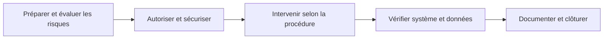

### Schéma — décider si une intervention peut commencer

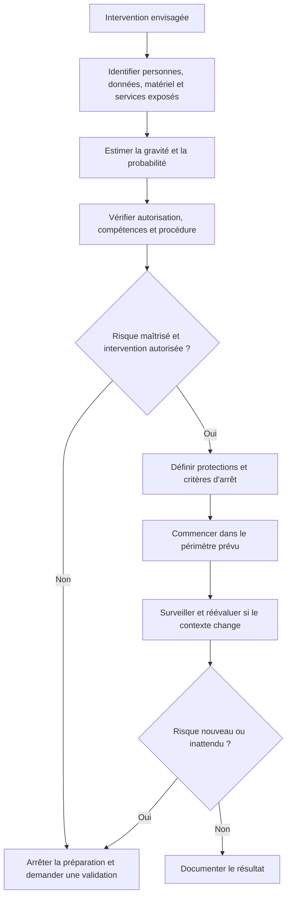

L'évaluation des risques n'est pas une formalité. Elle doit déboucher sur une décision : poursuivre avec des protections adaptées, modifier le plan, reporter l'action ou faire appel à une personne qualifiée.

## 3. Évaluer les risques avant d'agir

### 3.1 Qu'est-ce qu'un risque ?

Le risque associe la possibilité qu'un événement indésirable survienne et les conséquences possibles. Pour la maintenance, les conséquences peuvent être physiques, matérielles, opérationnelles, financières ou liées à la confidentialité.

Exemples :
- un équipement lourd peut tomber pendant son déplacement ;
- une décharge électrostatique peut endommager un composant ;
- une modification de configuration peut interrompre un service ;
- une restauration peut écraser des données récentes ;
- un partage de mot de passe peut exposer plusieurs systèmes.

### 3.2 Questions de préparation

Avant une action importante, demande-toi :
1. Qu'est-ce qui pourrait mal se passer ?
2. Qui ou quoi serait affecté ?
3. Quelle est la gravité possible ?
4. Quelle procédure réduit le risque ?
5. L'action est-elle autorisée ?
6. Comment reconnaître immédiatement un problème ?
7. Comment arrêter ou revenir à un état sûr ?
8. Qui doit être informé si le risque se matérialise ?

Ces questions doivent être proportionnées au contexte. Un simple contrôle visuel n'exige pas le même niveau de formalité qu'un changement sur un serveur critique.

### 3.3 Matrice indicative

| Probabilité | Conséquence | Réponse indicative |
|---|---|---|
| Faible | Faible | Contrôles habituels et documentation |
| Moyenne | Modérée | Précautions supplémentaires et validation si requise |
| Élevée | Élevée | Préparer un plan détaillé ou différer l'action |
| Incertaine | Potentiellement grave | Arrêter et demander une évaluation compétente |

Cette matrice est pédagogique. L'organisation peut disposer de sa propre méthode de classification. Il faut l'utiliser plutôt que créer des seuils arbitraires.

### 3.4 Le droit de s'arrêter

Un technicien débutant ne doit pas poursuivre une action dangereuse pour éviter de paraître inexpérimenté. Si le matériel présente un risque électrique, si l'autorisation manque, si la donnée peut être perdue ou si l'environnement n'est pas sûr, arrête la manipulation et demande une assistance adaptée.

S'arrêter n'est pas abandonner le ticket : il faut sécuriser la situation, documenter le risque et transmettre le dossier.

### Schéma — sécuriser l'espace de travail avant de manipuler du matériel

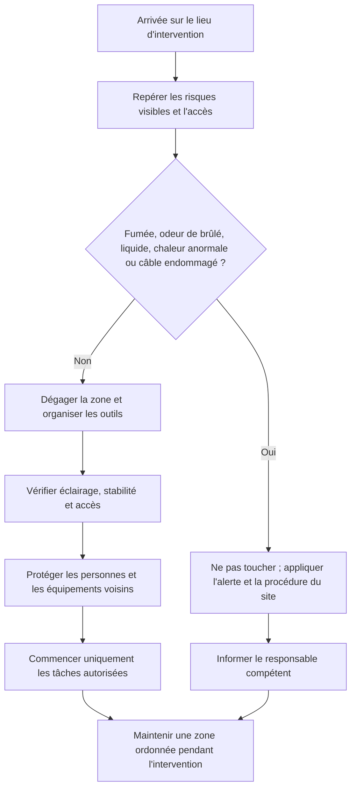

Si tu observes un danger immédiat, ne tente pas de diagnostiquer toi-même une installation électrique ou un équipement suspect. Éloigne-toi de la zone si nécessaire, alerte selon la procédure et attends une personne compétente.

## 4. Sécurité physique et environnement de travail

### 4.1 Organiser l'espace

Un poste de maintenance doit être dégagé, stable et adapté au type d'équipement. Les câbles ne doivent pas créer de risque de trébuchement. Les outils doivent être rangés et les composants protégés contre les chocs.

Évite de placer des liquides près des équipements. Garde les passages, les sorties et les accès aux dispositifs d'urgence libres selon les règles du site.

### 4.2 Transporter un équipement

Avant de déplacer un ordinateur, un écran, une batterie ou un serveur, évalue son poids, sa prise, son centre de gravité et les contraintes du trajet. Utilise les moyens de manutention prévus et demande de l'aide lorsque la charge ou la posture l'exige.

Ne transporte pas un serveur lourd seul si les règles ou les conditions rendent cette action dangereuse. Les équipements installés en baie peuvent exiger des rails, des supports et plusieurs personnes formées.

### 4.3 Équipements de protection et règles du site

Les équipements de protection dépendent du risque. Il ne faut pas improviser un équipement de protection à la place de la procédure. Respecte les consignes locales, les avertissements et les restrictions d'accès.

Un technicien de maintenance informatique n'est pas automatiquement habilité à intervenir sur une installation électrique, à déplacer un onduleur lourd ou à ouvrir un équipement contenant des composants dangereux.

### 4.4 Incendie, fumée, odeur ou chaleur anormale

Si un appareil dégage de la fumée, une odeur de brûlé ou une chaleur inhabituelle, ne poursuis pas un test ordinaire. Éloigne-toi si nécessaire, préviens les responsables et applique la procédure d'urgence du site. Ne manipule pas une installation dangereuse pour tenter d'identifier la cause.

La priorité est la sécurité des personnes et la maîtrise du danger, pas la récupération immédiate du service.

### Schéma — limite de sécurité avant une intervention électrique

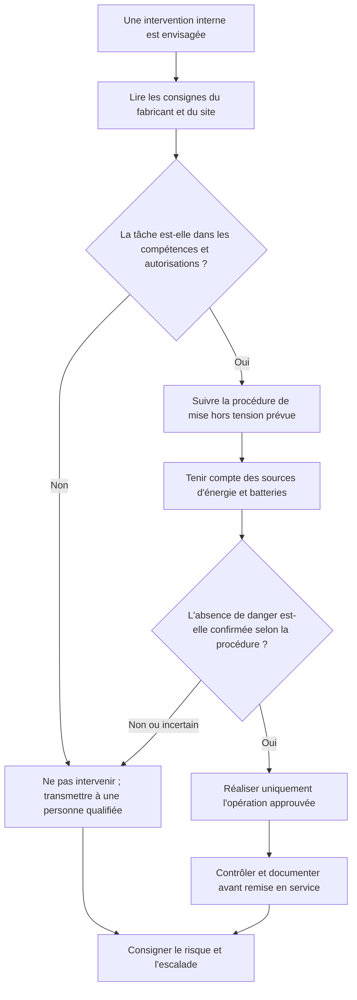

Ce schéma ne remplace pas une formation électrique ni la procédure constructeur. Un bloc d'alimentation peut conserver des tensions dangereuses après déconnexion : ne l'ouvre pas et n'interviens pas sur un circuit dangereux sans qualification adaptée.

## 5. Sécurité électrique et mise hors tension

### 5.1 Limites de compétence

L'électricité peut provoquer une blessure grave ou un incendie. Les interventions sur des circuits, des alimentations ouvertes ou des installations électriques doivent être réservées aux personnes formées et autorisées conformément aux règles applicables.

Ce cours ne fournit pas une habilitation électrique. Si l'opération dépasse les manipulations prévues par le constructeur pour un technicien autorisé, confie-la à une personne qualifiée.

### 5.2 Mise hors tension

Pour une intervention interne, suis exactement la procédure du fabricant et les consignes du site. Selon le matériel, cela peut inclure un arrêt propre, la déconnexion des sources d'énergie prévues et des étapes supplémentaires.

Un appareil dont l'écran est éteint n'est pas nécessairement sans énergie. Un portable peut avoir une batterie interne ; un onduleur, une baie ou un serveur peut être relié à plusieurs sources. Il ne faut pas supposer que débrancher un seul câble isole tout le système.

### 5.3 Blocs d'alimentation

Ne démonte pas un bloc d'alimentation pour une réparation improvisée. Des composants peuvent conserver une charge dangereuse après déconnexion. Remplace le module complet selon une procédure autorisée ou adresse le matériel à un intervenant qualifié.

### 5.4 Vérifier avant de toucher

Identifie le composant, la source d'alimentation, la procédure d'isolement et les risques. Si une étape n'est pas claire, ne tente pas de deviner. Les systèmes de production et les équipements redondants exigent une attention supplémentaire, car une coupure apparemment simple peut interrompre un service.

### Schéma — protéger les composants contre les décharges électrostatiques

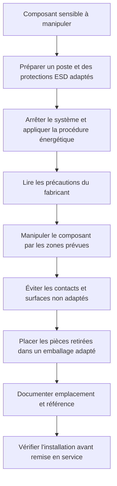

Les précautions antistatiques doivent être adaptées au poste et à la documentation du matériel. Ne touche pas inutilement les contacts et ne pose pas une carte sur une surface improvisée.

## 6. Décharges électrostatiques et composants sensibles

### 6.1 Comprendre le risque

Une décharge électrostatique peut endommager une carte électronique ou un composant sans provoquer un dommage visible immédiat. Le composant peut fonctionner de façon intermittente ou présenter un défaut ultérieur.

### 6.2 Bonnes pratiques

Applique les consignes antistatiques du fabricant et du site :
- utiliser une surface de travail adaptée ;
- utiliser les moyens antistatiques prévus et correctement installés ;
- manipuler les modules par les bords ;
- éviter de toucher les contacts ;
- conserver les pièces dans un emballage adapté ;
- ne pas poser une carte sur une surface inappropriée ;
- réduire les manipulations inutiles.

Un bracelet antistatique ne remplace ni la mise hors tension ni les règles de sécurité. Il doit être utilisé selon sa procédure et dans un environnement approprié.

### 6.3 Ranger les pièces retirées

Étiquette les composants si plusieurs pièces sont manipulées. Sépare les vis et accessoires. Ne mélange pas des composants qui appartiennent à différents équipements. La traçabilité permet de savoir ce qui a été retiré, testé, remplacé ou envoyé en réparation.

### Schéma — vérifier la protection des données avant un changement risqué

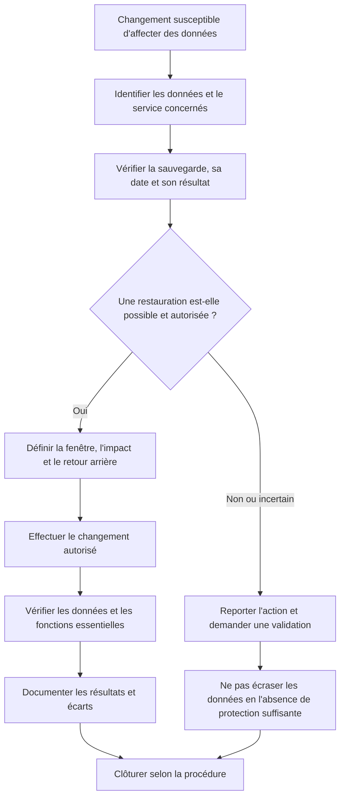

La présence d'une sauvegarde dans un tableau de bord ne suffit pas toujours : vérifie les informations disponibles et les procédures de restauration. N'effectue pas une opération irréversible tant que la protection nécessaire demeure incertaine.

## 7. Protection des données et confidentialité

### 7.1 Données sensibles

Les systèmes peuvent contenir des informations personnelles, données métier, dossiers financiers, identifiants, secrets applicatifs, certificats et journaux. L'accès technique à une machine n'autorise pas automatiquement la consultation de tous les contenus.

Ne copie pas un fichier métier pour faciliter un test si un fichier de test non sensible suffit. Respecte les permissions et les règles de confidentialité.

### 7.2 Principe de minimisation

La collecte et le partage doivent être limités aux données nécessaires au diagnostic. Une capture d'écran ou une sortie de commande peut révéler des comptes, des chemins, des adresses ou d'autres informations d'infrastructure.

Avant de joindre une pièce au ticket, vérifie son contenu et les droits d'accès. Utilise le canal approuvé et évite les copies sur des appareils ou espaces personnels.

### 7.3 Sauvegarde avant opération risquée

Une sauvegarde doit être appropriée au type de donnée et à l'opération prévue. Vérifie son périmètre, sa date et le mécanisme de restauration selon la politique. Une sauvegarde dont l'existence ou l'exploitabilité n'est pas confirmée ne doit pas être traitée comme une garantie.

Avant une réinstallation, un formatage ou un remplacement de support, identifie les données à conserver, les applications et les configurations nécessaires, puis fais valider la procédure.

### 7.4 Restauration et écrasement

La restauration peut remplacer des données plus récentes. Il faut identifier la source, la date, le périmètre et les conséquences, puis vérifier l'autorisation. Ne restaure pas un système partagé sans connaître l'impact sur les utilisateurs et les dépendances.

### 7.5 Effacement sécurisé et fin de vie

Lorsqu'un équipement ou un support quitte le parc, la procédure doit prévoir le traitement des données : réutilisation, effacement approprié, conservation temporaire ou destruction par un prestataire autorisé selon le contexte.

Supprimer un fichier ou reformater rapidement un support ne garantit pas à lui seul que les données sont irrécupérables. Utilise la procédure officielle et conserve la preuve prévue lorsque la traçabilité est requise.

### Schéma — gérer un accès sans demander ni exposer de secret

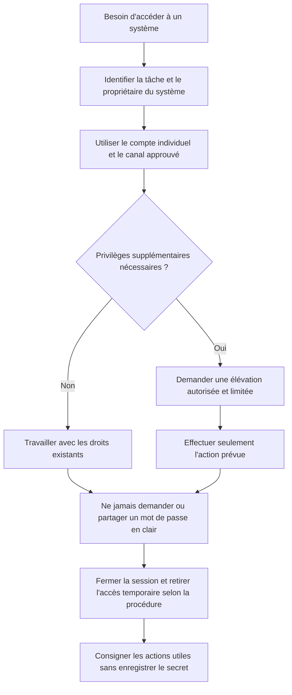

Un compte partagé ou un secret envoyé dans une conversation rend l'attribution des actions et la protection de l'accès plus difficiles. Utilise les mécanismes approuvés de gestion des identités et des secrets.

## 8. Identifiants, secrets et moindre privilège

### 8.1 Ne pas demander le mot de passe de l'utilisateur

Un technicien ne doit pas demander qu'un utilisateur lui communique son mot de passe en clair. Utilise les procédures d'assistance à distance et de réinitialisation approuvées.

Si un secret est partagé par erreur dans un ticket ou un message, limite sa diffusion et suis la procédure de traitement d'un secret exposé.

### 8.2 Comptes personnels et comptes d'administration

Les comptes doivent être utilisés conformément à leur rôle. Un compte administrateur ne doit pas servir automatiquement aux activités quotidiennes. Les actions privilégiées doivent rester limitées, justifiées et traçables.

Évite le partage de comptes personnels. Il réduit la capacité à attribuer les actions et complique l'analyse d'un incident.

### 8.3 Principe du moindre privilège

Accorde uniquement les droits nécessaires à la tâche et pour la durée utile lorsque les outils permettent cette limitation. Un technicien ne doit pas augmenter largement les permissions d'un dossier pour résoudre un problème précis.

Avant d'appliquer un droit, vérifie le besoin, l'identité concernée, l'approbation et l'effet du changement.

### 8.4 Accès distant

Une session distante doit être initiée avec un outil approuvé et une autorisation adaptée. Vérifie l'identité de la personne, l'équipement ciblé et le périmètre de l'intervention.

N'utilise pas un outil de contrôle à distance inconnu, ne laisse pas une session ouverte inutilement et ne contourne pas les règles d'accès. Termine la session selon les procédures et retire les droits temporaires lorsqu'ils ne sont plus nécessaires.

### Schéma — contrôler un changement avant et après son exécution

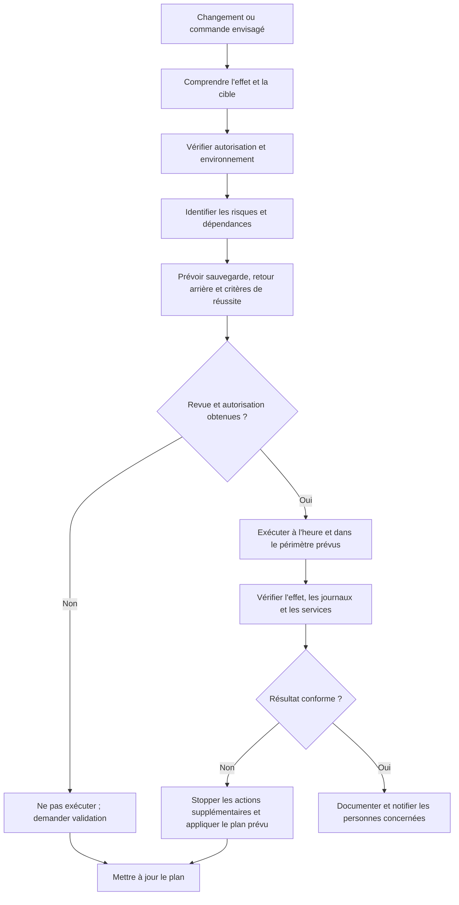

Une commande valide peut avoir un effet dangereux dans le mauvais environnement. Avant de l'exécuter, vérifie la cible réelle, les privilèges, les options et la possibilité de récupération.

## 9. Sécurité des changements et des commandes

### 9.1 Comprendre l'effet d'une commande

Une commande peut observer un système, modifier un fichier, arrêter un service, effacer des données ou changer des permissions. Avant de l'exécuter, comprends son effet, son périmètre et les risques.

La présence de droits administratifs ne signifie pas qu'une opération est autorisée.

### 9.2 Environnements de test et de production

Un environnement de test permet de vérifier un changement dans des conditions contrôlées. La production fournit le service réel aux utilisateurs. Une opération sûre dans un laboratoire peut être dangereuse en production si les données, la charge ou les dépendances sont différentes.

Vérifie la cible avant toute commande administrative. Un bon technicien confirme le nom de la machine, l'environnement et le périmètre avant d'exécuter une action sensible.

### 9.3 Plan de changement

Pour une modification qui présente un risque, le plan devrait comporter :
- objectif ;
- périmètre ;
- validation ;
- prérequis ;
- risque et impact ;
- étapes ;
- tests ;
- fenêtre d'intervention ;
- retour arrière ;
- communication ;
- critères de réussite.

### Schéma 2 — Autorisation avant un changement risqué

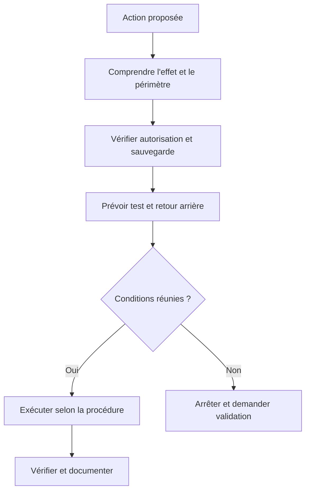

Le schéma est volontairement court. Si l'on ne peut pas vérifier les conditions essentielles, il faut différer l'action ou passer par une personne habilitée.

### 9.4 Désactiver une protection pour tester

Désactiver un antivirus, un pare-feu ou une protection du système ne doit pas être une mesure improvisée. Cela peut exposer la machine et son réseau, même si le test est bref.

Il faut privilégier un contrôle ciblé, l'examen des journaux ou une modification limitée selon une procédure approuvée. Toute dérogation doit être autorisée, surveillée et annulée à la fin selon les règles.

### Schéma — premières réactions à une suspicion de compromission

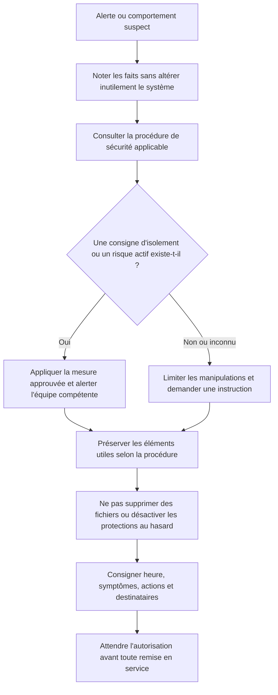

En cas de suspicion de compromission, la priorité est une réponse coordonnée. Des nettoyages improvisés peuvent faire disparaître des preuves ou rendre l'analyse plus difficile.

## 10. Reconnaître un incident de sécurité

### 10.1 Signes possibles

Les signes peuvent inclure une alerte de sécurité, une connexion inattendue, un comportement inhabituel, des fichiers modifiés, un accès refusé inexpliqué ou un message suspect. Ces éléments ne prouvent pas tous à eux seuls une compromission, mais justifient un traitement prudent.

### 10.2 Que faire en cas de soupçon ?

1. Reste calme et évite les manipulations improvisées.
2. Note les symptômes, l'heure et les éléments observés.
3. Préserve les traces utiles selon la procédure.
4. Informe immédiatement le contact ou l'équipe de sécurité prévu.
5. Applique les consignes autorisées sur l'isolement ou l'utilisation de la machine.
6. Documente les actions et les décisions.
7. Ne partage pas publiquement les détails ou les journaux.

Les actions de réponse peuvent varier selon la gravité et les règles internes. Ne réinstalle pas l'ordinateur ni n'efface les traces simplement pour supprimer un comportement inquiétant sans validation de l'équipe responsable.

### 10.3 Phishing et messages suspects

Si un utilisateur signale un message suspect, suis la procédure de signalement approuvée. Ne lui demande pas de renvoyer un message contenant des secrets vers un canal public. Les pièces jointes et liens inconnus ne doivent pas être ouverts pour « voir ce qu'ils font ».

### 10.4 Secret exposé

Si un mot de passe, un jeton ou une clé apparaît dans une capture ou un ticket, limite l'accès à la donnée et applique la procédure prévue, qui peut nécessiter une rotation ou révocation du secret. Ne recopie pas la valeur exposée dans le compte rendu ; documente l'action sans enregistrer le secret lui-même.

### Schéma 3 — Première réaction à une suspicion de sécurité

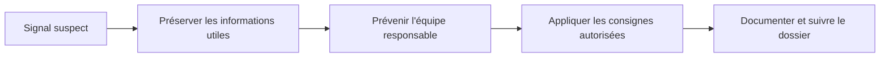

L'objectif n'est pas d'effectuer une enquête complète sans compétence dédiée. Il est de ne pas aggraver l'incident, de conserver les éléments utiles et de déclencher la réponse appropriée.

### Schéma — préparer une ouverture de boîtier sans brûler d'étapes

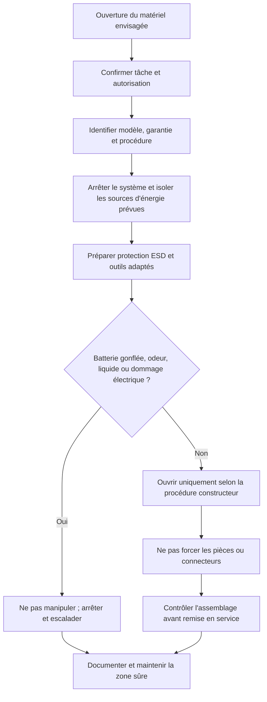

Les batteries gonflées ou endommagées ne doivent pas être comprimées, percées ou manipulées comme des pièces ordinaires. Suis la procédure du fabricant et les règles du site pour leur signalement et leur prise en charge.

## 11. Sécurité des interventions matérielles

### 11.1 Avant d'ouvrir

Identifie le modèle, vérifie les instructions, la garantie, l'autorisation et les risques pour les données. Prépare les outils adaptés et l'espace de travail. Pour une opération interne, suis la procédure de mise hors tension et les précautions antistatiques applicables.

### 11.2 Ne pas forcer

Un connecteur ou une pièce qui ne s'insère pas peut être mal orienté, incompatible ou encore retenu par une fixation. Forcer peut endommager le composant ou le connecteur. Arrête, consulte la documentation et demande de l'aide si nécessaire.

### 11.3 Ventilateurs et pièces mobiles

Ne place pas les doigts ou un outil près d'une pièce mobile pendant son fonctionnement. Ne bloque pas un ventilateur comme méthode de test improvisée. Utilise les mécanismes de mesure et les procédures prévus pour le matériel.

### 11.4 Batteries

Les batteries peuvent présenter des risques si elles sont perforées, écrasées, gonflées ou soumises à des conditions inadaptées. Une batterie gonflée ou endommagée ne doit pas être comprimée, percée ou forcée dans son logement.

Suis les consignes du fabricant et du site, mets le matériel en sécurité et sollicite une personne qualifiée. Ne jette pas une batterie dans les déchets ordinaires lorsque la filière de collecte applicable impose un traitement spécifique.

### 11.5 Pièces et outils

Range les vis, outils et composants. Ne laisse pas un outil dans le boîtier. Étiquette les pièces retirées et protège les composants sensibles. Vérifie visuellement l'état de l'équipement avant la remise sous tension.

### Schéma — éviter une déconnexion accidentelle en baie

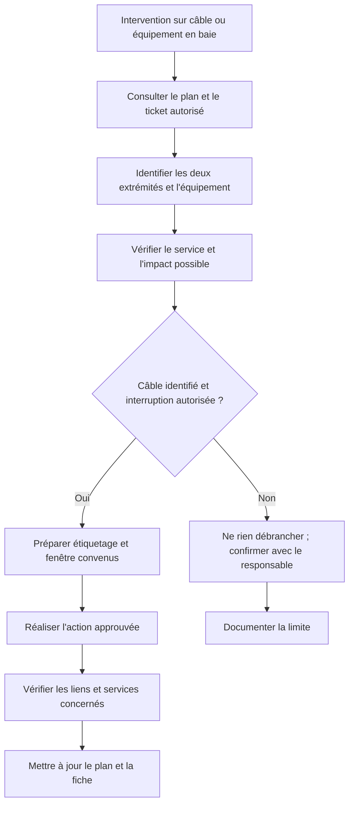

Une baie peut contenir les liaisons de plusieurs services critiques. Ne débranche jamais un câble uniquement parce qu'il semble encombrant ou inutile : vérifie son identification, ses deux extrémités et le plan de câblage.

## 12. Câbles, baies et salles informatiques

### 12.1 Identifier avant de débrancher

Un câble mal étiqueté peut desservir un service important. Avant de le retirer, identifie ses extrémités, son rôle et les conséquences possibles. Ne considère pas un câble comme inutilisé simplement parce qu'il semble libre ou mal rangé.

### 12.2 Équipements lourds

Les serveurs et les baies peuvent être lourds et difficiles à manipuler. N'essaie pas de les déplacer sans les moyens et les personnes appropriés. Le retrait d'un serveur d'une baie peut demander une préparation spécifique et parfois plusieurs intervenants.

### 12.3 Circulation d'air

Les équipements de baie dégagent de la chaleur. Ne bloque pas les entrées ou sorties d'air avec des objets ou des câbles. Une opération de rangement ne doit pas perturber le refroidissement.

### 12.4 Alimentations redondantes et onduleurs

La présence de deux alimentations ne garantit pas que leur déconnexion est sans conséquence. Il faut connaître l'architecture, vérifier l'état de redondance et respecter les procédures. Ne débranche pas une alimentation pour tester la redondance sans autorisation et plan de contrôle.

## 13. Ergonomie et organisation du travail

### 13.1 Posture et durée

Le travail prolongé devant un écran, la manipulation de petits composants ou une position inconfortable peuvent provoquer une fatigue. Organise le poste de façon à limiter les postures dangereuses, fais des pauses adaptées et demande de l'aide pour les charges ou les opérations difficiles.

### 13.2 Fatigue et précipitation

La fatigue, le stress et les interruptions augmentent le risque d'erreur. Avant une opération sensible, relis les étapes et vérifie la cible. Évite de travailler sur plusieurs équipements semblables sans une méthode d'identification claire.

### 13.3 Organisation des petites pièces

Les vis, adaptateurs, câbles et modules doivent être identifiés et rangés. Utilise des étiquettes ou contenants distincts. Un détail d'organisation peut éviter une erreur coûteuse lors du remontage.

### Schéma — préserver la continuité pendant une intervention

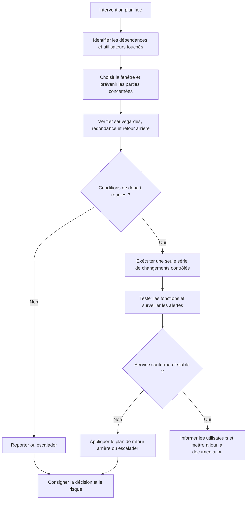

La redondance et une sauvegarde ne dispensent pas de planifier la maintenance. Si plusieurs changements non liés sont appliqués ensemble, il devient plus difficile d'identifier la cause d'un nouvel incident et de revenir à un état sûr.

## 14. Protection des services et continuité

### 14.1 Évaluer l'impact avant de redémarrer

Un redémarrage peut affecter d'autres utilisateurs ou dépendances. Avant d'arrêter un service, identifier son rôle, ses utilisateurs, les tâches en cours et le plan de vérification.

### 14.2 Fenêtre d'intervention

Une opération planifiée devrait avoir une fenêtre adaptée, une information aux personnes concernées et un plan de retour arrière. La fenêtre ne supprime pas le risque : elle permet de le gérer et de réduire les conséquences.

### 14.3 Sauvegardes et test de restauration

Les sauvegardes doivent être contrôlées et les restaurations réalisées selon la procédure appropriée. Ne teste pas une restauration sur les données de production si l'action peut les remplacer sans validation. Utilise un environnement de test lorsque cela convient.

### 14.4 Éviter les changements simultanés

Plusieurs modifications simultanées compliquent l'identification de la cause en cas de problème. Lorsque c'est possible, applique un changement à la fois et vérifie le résultat. Si une procédure coordonnée exige plusieurs actions, documente leur ordre et leurs critères d'arrêt.

## 15. Quand arrêter l'intervention ?

Arrête et demande une validation lorsque :
- tu ne comprends pas l'effet de la commande ou de la manipulation ;
- l'opération dépasse tes compétences ou ton autorisation ;
- un risque électrique ou physique apparaît ;
- les données critiques peuvent être perdues ;
- le composant ou la procédure ne correspond pas au matériel ;
- la suspicion d'incident de sécurité nécessite une équipe spécialisée ;
- un service critique risque d'être interrompu sans plan ;
- la sauvegarde nécessaire ne peut pas être confirmée ;
- une étape importante du retour arrière est indisponible.

### Schéma 4 — Décision de poursuivre ou d'arrêter

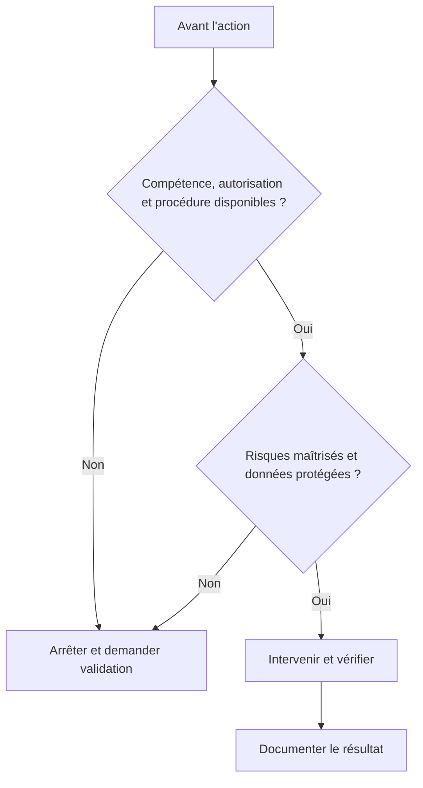

La décision doit se baser sur des conditions réelles. Si une donnée essentielle est inconnue, il est plus sûr de clarifier ou d'escalader que de supposer que tout est acceptable.

### Schéma — clôturer la fiche de sécurité sans omettre les écarts

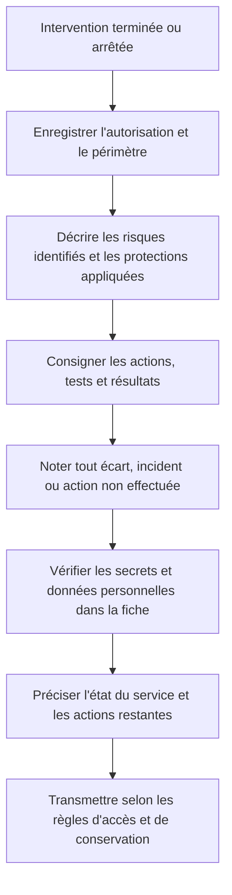

Une intervention arrêtée avant la tâche prévue doit aussi être documentée : l'arrêt peut être la bonne décision de sécurité. Décris le risque détecté, la personne ou l'équipe informée et les conditions requises avant de reprendre.

## 16. Documentation de sécurité

Le compte rendu doit indiquer les précautions importantes prises, les autorisations obtenues lorsque cela est pertinent, les changements, les tests et les risques qui restent ouverts.

N'inclus pas les secrets dans le ticket. Pour les incidents sensibles, utilise la procédure et les canaux de l'organisation.

Un compte rendu utile peut préciser :
- le périmètre de l'intervention ;
- les autorisations et validations nécessaires ;
- les sauvegardes ou contrôles préalables ;
- les actions réalisées ;
- les vérifications finales ;
- les informations sensibles protégées ;
- le statut du risque ;
- le suivi requis.

Exemple de formulation :
« L'intervention a été arrêtée avant toute modification car le périmètre de l'accès n'était pas confirmé. Le responsable du service a été contacté pour valider la demande. Aucune permission n'a été changée. »

Cette formulation décrit une décision prudente plutôt que de présenter une absence d'action comme un échec.

## Parcours pratique du débutant

Prévois 45 à 60 minutes dans un environnement de formation ou à partir d'un scénario fictif. Ce parcours consiste à repérer les risques et à préparer une intervention sûre ; il ne demande pas d'ouvrir un équipement sous tension, de manipuler un bloc d'alimentation ni d'exécuter un changement de production.

### Étape 1 — Décrire l'intervention

Scénario : un poste doit recevoir une mise à jour et un contrôle matériel est aussi envisagé. Note le but, l'équipement concerné, les utilisateurs impactés et les informations qu'il faut confirmer. Si la tâche ou le périmètre ne sont pas clairs, demande une précision avant de continuer.

### Étape 2 — Lister les risques

Sépare les risques pour les personnes, les données, le matériel, les accès et la continuité du service. Pour chaque risque, indique sa conséquence possible et une mesure de prévention. Ne donne pas une cote de risque artificiellement précise quand les informations ne suffisent pas.

### Étape 3 — Vérifier les conditions de départ

Fais une checklist : intervention autorisée, documentation du fabricant disponible, personne qualifiée désignée, sauvegarde vérifiée si nécessaire, fenêtre approuvée, moyens de protection appropriés et plan de retour arrière. Si une condition essentielle manque, consigne le blocage et reporte l'action.

### Étape 4 — Protéger données et identifiants

Explique comment vérifier la sauvegarde sans exposer des fichiers, comment utiliser un compte individuel et comment éviter d'écrire un mot de passe ou un jeton dans le ticket. Prévois un emplacement approuvé pour les journaux et les pièces jointes utiles.

### Étape 5 — Préparer le contrôle après intervention

Définis les critères permettant de vérifier la réussite : état du poste, démarrage normal, application concernée, alertes pertinentes et confirmation utilisateur selon la procédure. Décris aussi la condition qui déclencherait un arrêt ou un retour arrière.

### Étape 6 — Simuler un risque inattendu

Le scénario indique une odeur de brûlé près de l'équipement ou une batterie visiblement gonflée. Écris les actions sûres : ne pas continuer la manipulation, ne pas forcer ni démonter la pièce, appliquer l'alerte du site et demander une personne qualifiée. N'improvise pas une opération électrique.

### Étape 7 — Rédiger une fiche de préparation

Consigne le but, le périmètre, les risques, les protections, les autorisations attendues, les critères de réussite et le plan d'escalade. Marque les tâches comme « prévues » tant qu'elles n'ont pas réellement été exécutées.

**Critère de réussite :** tu sais identifier les conditions qui autorisent à commencer, celles qui imposent une pause et les preuves à recueillir avant de déclarer le service remis en état.

## 17. Travaux pratiques

Les activités sont conçues pour un laboratoire ou une situation simulée. Ne réalise pas de manipulation électrique ou de changement de sécurité sur un système réel sans formation, autorisation et procédure adaptées.

### TP 1 — Évaluation du risque avant intervention

**Situation :** un serveur de fichiers est lent et un collègue propose de le redémarrer immédiatement.

Rédige une checklist qui couvre :
- le rôle du serveur et les utilisateurs ;
- les symptômes observés ;
- les risques de perte de données ;
- les services dépendants ;
- les autorisations ;
- la fenêtre d'intervention ;
- le plan de retour arrière ;
- les tests après action ;
- les personnes à informer.

**Livrable :** une décision écrite indiquant si l'intervention peut commencer, doit être préparée ou doit être escaladée.

### TP 2 — Protéger un ticket

**Situation :** un utilisateur transmet une capture contenant son mot de passe en clair.

Décris les étapes à suivre selon une procédure interne : limiter la diffusion, traiter la pièce jointe, informer la personne responsable, remplacer le secret si nécessaire et consigner l'action sans recopier le mot de passe.

Le livrable ne doit pas contenir le secret fictif lui-même.

### TP 3 — Préparer une intervention matérielle

**Situation :** un composant doit être remplacé dans un poste encore sous garantie.

Prépare une fiche de sécurité comprenant le modèle exact, la garantie, l'autorisation, les instructions du fabricant, la protection des données, les précautions antistatiques, les outils adaptés et les tests finaux.

Précise les conditions qui conduiraient à demander une intervention au fournisseur.

### TP 4 — Réagir à une suspicion de malware

**Situation :** un outil de sécurité émet une alerte sur un poste.

Écris une procédure de première réaction adaptée au rôle d'un technicien débutant. Elle doit préserver les informations utiles, respecter les consignes de sécurité, éviter la désinfection improvisée et identifier l'équipe à contacter.

### TP 5 — Contrôler une baie sans interruption

**Situation :** la baie présente un câblage désordonné et quelques étiquettes illisibles.

Décris une inspection non intrusive, la méthode d'identification des câbles, les risques à évaluer et les conditions avant toute opération de rebrassage. Aucun câble ne doit être débranché dans ce TP.

## 18. Exercices avec corrections

### Exercice 1 — Mot de passe utilisateur

Un utilisateur propose de te donner son mot de passe pour accélérer la réparation. Que dois-tu faire ?

**Correction :** ne demande pas et n'enregistre pas son mot de passe. Utilise les mécanismes approuvés d'assistance et de réinitialisation. Si le secret est divulgué dans un message, applique la procédure prévue pour limiter le risque.

### Exercice 2 — Redémarrer en production

Un service partagé est lent. Un technicien veut le redémarrer sans prévenir personne.

**Correction :** il faut d'abord évaluer le rôle du service, son impact, les autres utilisateurs, les dépendances, les contrôles existants et les autorisations. Le redémarrage doit suivre la procédure applicable et inclure une vérification après action.

### Exercice 3 — Bloc d'alimentation

Un ordinateur ne s'allume plus. Un débutant propose d'ouvrir le bloc d'alimentation.

**Correction :** il ne doit pas ouvrir un bloc d'alimentation pour une réparation improvisée. Il faut respecter les limites de compétence, utiliser la procédure de diagnostic autorisée et confier toute opération électrique spécialisée à une personne qualifiée.

### Exercice 4 — Décharge électrostatique

Pourquoi un composant peut-il être endommagé par une décharge qui n'est pas perceptible ?

**Correction :** certains circuits électroniques sensibles peuvent subir des dommages dus à une décharge électrostatique même lorsque la personne ne ressent rien. Il faut appliquer les précautions antistatiques adaptées.

### Exercice 5 — Sauvegarde incertaine

Une réinstallation est proposée, mais l'état de la sauvegarde n'est pas connu.

**Correction :** ne lance pas une opération destructive avant d'avoir évalué les données et confirmé la procédure de protection nécessaire, ou obtenu une validation compétente. Il faut éviter de transformer une panne réparable en perte de données.

### Exercice 6 — Désactiver le pare-feu

Une connexion échoue. Un collègue propose de désactiver le pare-feu globalement.

**Correction :** cette action peut exposer le système et le réseau. Privilégie un test ciblé et la vérification des règles pertinentes par une personne autorisée. Toute dérogation doit être validée, limitée, documentée et annulée selon la procédure.

### Exercice 7 — Câble non identifié

Un câble dans une baie semble inutilisé. Peut-on le débrancher immédiatement ?

**Correction : non.** Il faut identifier ses extrémités, son rôle, le service associé et l'impact possible. L'apparence visuelle ne prouve pas qu'un câble est inutilisé.

### Exercice 8 — Suspicion d'incident de sécurité

Un poste présente un comportement inhabituel et une alerte de sécurité vient d'apparaître. Que faut-il éviter ?

**Correction :** éviter les outils inconnus, la suppression des journaux, la réinstallation improvisée et les actions qui peuvent détruire les preuves. Il faut suivre la procédure de l'organisation et contacter l'équipe de sécurité.

### Exercice 9 — Fin de vie d'un support

Un disque contenant des données doit être retiré du parc. Suffit-il de supprimer les fichiers visibles ?

**Correction : non.** Il faut appliquer la procédure d'effacement ou de traitement des supports définie par l'organisation et conserver la preuve prévue lorsque nécessaire. La suppression de fichiers visibles ne garantit pas l'absence de données récupérables.

### Exercice 10 — Action non autorisée

Un technicien possède les droits techniques pour modifier un dossier, mais l'approbation requise n'a pas été donnée.

**Correction :** ne pas modifier les droits. Il faut suivre le processus d'approbation, documenter le blocage et expliquer la prochaine étape au demandeur.

## 19. Défi final — Préparer une intervention sécurisée

### Situation

Un serveur hébergeant des documents partagés signale des erreurs de stockage. Les utilisateurs peuvent encore accéder aux fichiers, mais des alertes se répètent. Un collègue propose de redémarrer le serveur et de lancer une réparation immédiate. L'état de la dernière sauvegarde n'est pas confirmé. Tu n'es pas autorisé à intervenir seul sur ce serveur.

### Travail demandé

1. Décris les risques principaux.
2. Identifie les informations à recueillir.
3. Précise ce qu'il ne faut pas faire sans validation.
4. Prépare les actions d'observation non intrusives.
5. Définis les personnes ou équipes à contacter.
6. Prépare une fiche d'escalade.
7. Indique les conditions préalables à une réparation.
8. Décris les critères de vérification et de clôture.

### Correction détaillée

**1. Risques**

Les données peuvent être menacées par la défaillance du stockage. Un redémarrage ou une réparation non préparée peut rendre le service indisponible ou aggraver l'état du support. Le serveur est partagé et l'intervention dépasse l'autorisation du technicien.

**2. Informations à recueillir**

Identifier le serveur, les alertes exactes, les horaires, l'étendue des erreurs, l'impact sur les utilisateurs, les informations disponibles sur le stockage et l'état réel des sauvegardes. Les résultats doivent provenir des outils autorisés.

**3. Actions à éviter**

Ne pas redémarrer, remplacer un disque, lancer une réparation destructive ou déclencher une restauration sans validation et plan. Ne pas solliciter inutilement le stockage défaillant par des tests intensifs.

**4. Observations non intrusives**

Consulter les alertes accessibles, relever les messages et heures, examiner la supervision et vérifier les informations de sauvegarde disponibles selon le rôle du technicien. Ne pas contourner les restrictions d'accès.

**5. Contacts**

Prévenir le responsable d'exploitation ou l'équipe de stockage selon les règles. Si le risque pour les données est important, le signaler immédiatement au responsable du service.

**6. Fiche d'escalade**

« Le serveur de fichiers signale des erreurs de stockage répétées. L'accès reste possible selon les observations initiales, mais le risque pour les données et la disponibilité doit être évalué. L'état de la dernière sauvegarde n'est pas confirmé. Aucun redémarrage ni aucune réparation n'ont été effectués. Une analyse par l'équipe habilitée est requise avant toute intervention. »

**7. Conditions préalables**

L'équipe compétente doit confirmer le diagnostic, le périmètre, l'état du stockage, la stratégie de protection des données, l'autorisation et le plan de retour arrière ou de récupération. Les opérations doivent suivre les recommandations du constructeur et les procédures internes.

**8. Vérification et clôture**

Après l'intervention autorisée, vérifier l'état du stockage, les alertes, les services, l'accès aux documents et le résultat des contrôles de sauvegarde selon la procédure. Documenter les risques restants et ne clôturer que lorsque les critères définis sont satisfaits.

### Barème indicatif

| Critère | Points |
|---|---:|
| Identification des risques | 3 |
| Collecte d'informations | 2 |
| Respect des autorisations | 3 |
| Contrôles non intrusifs | 2 |
| Escalade et transmission | 3 |
| Préparation de la réparation | 3 |
| Vérification et documentation | 4 |
| **Total** | **20** |

## 20. Synthèse du cours

La sécurité de base doit accompagner chaque intervention : observation, diagnostic, modification, remplacement matériel, récupération et clôture.

Les principes à retenir :

1. évaluer les risques et les autorisations avant d'agir ;
2. respecter les règles électriques, physiques et antistatiques ;
3. protéger les données avant toute opération destructive ;
4. appliquer le moindre privilège et ne jamais collecter inutilement des secrets ;
5. utiliser des outils approuvés et comprendre leurs effets ;
6. préparer les changements avec tests et retour arrière adaptés ;
7. suivre la procédure de sécurité en cas de suspicion de compromission ;
8. identifier les câbles et composants avant de les manipuler ;
9. interrompre l'action lorsque les risques ou les compétences dépassent le périmètre ;
10. documenter les actions, les résultats et les risques restants.

La règle à mémoriser est : **évaluer → autoriser → protéger → intervenir → vérifier → documenter.**

Une intervention rapide n'est utile que si elle reste maîtrisée. Un technicien professionnel ne se contente pas de remettre un système en marche : il évite de créer un nouveau risque pour les personnes, les données et les services.
