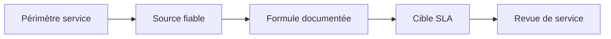
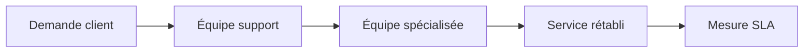
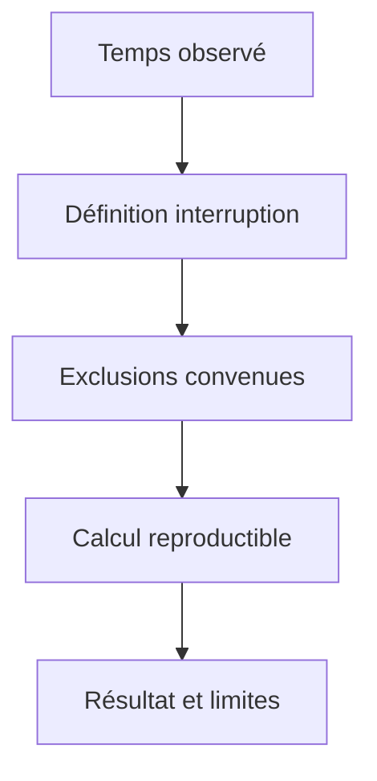
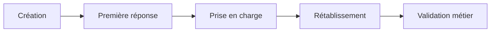
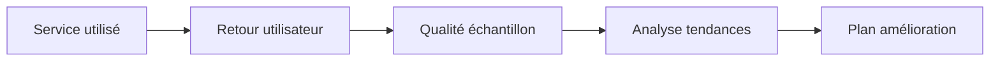
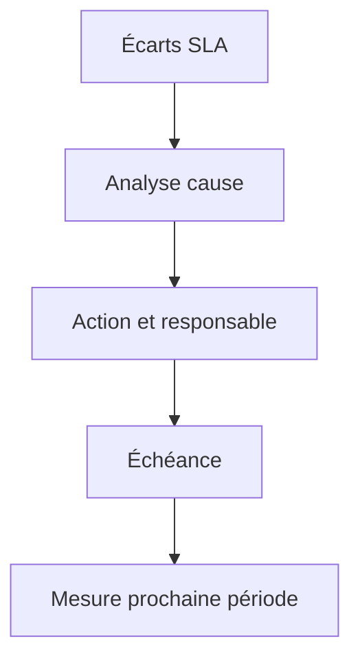

# SLA, OLA et satisfaction utilisateur

> **Mise en contexte** — Ce cours s'adresse à un technicien intermédiaire qui doit agir dans un environnement réel, respecter les contraintes de service et laisser des preuves réutilisables. L'objectif n'est pas seulement de connaître les outils, mais de comprendre pourquoi une action est choisie, dans quelles conditions elle est sûre, comment vérifier son résultat et quand demander de l'aide.

## Présentation et enjeux

Un accord de niveau de service transforme une attente métier en engagements mesurables, compréhensibles et suivis. Un SLA externe ou contractuel décrit le service et les objectifs convenus ; un OLA organise les engagements internes entre équipes pour permettre au service global de tenir ses objectifs. Cette discipline s'inscrit dans une démarche de qualité de service : chaque opération doit être reliée au besoin métier, au risque accepté et à un critère d'acceptation observable. L'intervenant doit pouvoir expliquer l'état initial, la décision prise, les résultats obtenus et les limites qui subsistent.

Dans une équipe de maintenance, les informations sont souvent réparties entre tickets, conversations, inventaires, systèmes de supervision et mémoire individuelle. Une méthode fiable les relie dans une trace commune et limite les décisions fondées sur une seule observation. Le cours met l'accent sur les preuves, les contrôles proportionnés, la reproductibilité et la communication utile.

Le niveau intermédiaire suppose que les gestes de base sont acquis. La difficulté consiste maintenant à traiter des environnements hétérogènes, des incidents ambigus, des changements qui touchent plusieurs composants et des situations où la donnée est imparfaite. Les règles présentées doivent être adaptées aux procédures approuvées de l'organisation et vérifiées dans un environnement de test avant toute action ayant un impact sur la production.

## Objectifs pédagogiques

À la fin du parcours, l'apprenant pourra :

- expliquer les principes et les limites des outils utilisés dans le domaine ;
- choisir un contrôle ou une méthode à partir de l'impact, de la criticité et des preuves disponibles ;
- effectuer une démarche reproductible et distinguer observation, hypothèse et décision ;
- interpréter les indicateurs sans confondre corrélation, résultat technique et expérience utilisateur ;
- rédiger une trace claire, traiter les exceptions et organiser une escalade ;
- vérifier l'effet d'une action, décrire le risque résiduel et proposer une amélioration mesurable.

## Prérequis et cadre de travail

Avant de commencer, savoir utiliser un terminal, lire les journaux, identifier un actif, comprendre les tickets et appliquer les règles locales de sécurité. Les commandes ci-dessous sont illustratives : adapter les noms d'hôte, les chemins et les versions, utiliser des cibles de test autorisées et ne jamais copier de secret dans un document. Une commande d'observation doit être préférée à une modification lorsqu'elle suffit à qualifier la situation.

Les principes directeurs sont les suivants : intervention autorisée, moindre privilège, sauvegarde ou retour arrière adaptés, fenêtre connue, communication compréhensible et preuve de validation. Si un contrôle critique échoue, ne pas continuer mécaniquement. Noter le constat, évaluer le risque et utiliser le point d'arrêt ou l'escalade défini par la procédure.

## Vocabulaire métier

| Terme | Utilisation opérationnelle |
|---|---|
| État initial | Description mesurée du système avant toute intervention. |
| Criticité | Conséquence potentielle de l'indisponibilité ou de la mauvaise configuration. |
| Preuve | Élément daté qui peut être vérifié par un autre intervenant. |
| Écart | Différence entre le résultat attendu et l'observation. |
| Exception | Situation où la procédure standard ne s'applique pas ou n'atteint pas son objectif. |
| Validation | Contrôle confirmant que le service ou l'opération satisfait les critères convenus. |
| Retour arrière | Séquence permettant de retrouver un état stable si les critères de réussite ne sont pas satisfaits. |
| Récurrence | Réapparition d'un problème similaire après un traitement précédent. |

## Schémas adaptés au sujet

### Schéma 1 — Mesurer un SLA



Le périmètre et la formule doivent représenter ce qui a été promis aux utilisateurs.

### Schéma 2 — SLA et OLA



Les OLA internes doivent conserver assez de marge pour respecter l'engagement global de service.

### Schéma 3 — Calcul disponibilité



Le chiffre de disponibilité est interprétable uniquement si son périmètre, ses périodes et ses exclusions sont explicites.

### Schéma 4 — Délais de ticket



Le temps de réponse n'est pas le temps de rétablissement ; les transitions doivent être définies pour comparer les équipes.

### Schéma 5 — Satisfaction utilisateur



La satisfaction complète les métriques techniques et doit être interprétée avec le taux de réponse et le contexte.

### Schéma 6 — Revue d'engagement



Les revues doivent aboutir à des décisions et au suivi de leur effet, pas seulement à une présentation de chiffres.

## Fondements techniques du domaine

### 1. Périmètre du service

Un niveau de service n'a de sens que si le service mesuré est défini. Décrire le service métier rendu, les utilisateurs concernés, les sites ou régions inclus, les composants nécessaires, les horaires de couverture, les canaux de support et les limites connues. Un nom d'application peut désigner une interface, plusieurs API, une base de données, un fournisseur d'identité et un réseau d'accès; mesurer un seul composant ne garantit pas que la transaction de bout en bout fonctionne.

Identifier les parties qui reçoivent ou fournissent le service : propriétaire métier, équipe de support, exploitation, équipes applicatives, fournisseur externe et responsable du contrat. Préciser les heures de couverture et les calendriers applicables. Un délai mesuré en heures ouvrées ne doit pas être comparé directement à un délai calendaire. Documenter les interruptions planifiées, les exclusions contractuelles, les prérequis techniques et le processus d'escalade.

Un périmètre bien défini permet de répondre aux questions suivantes : qui est protégé par l'engagement, qu'est-ce qui compte comme indisponibilité, quelle source fait foi, quelle période est mesurée et qui peut contester ou approuver le résultat ? Si une dépendance est externe, préciser que son SLA ne couvre pas nécessairement la disponibilité de l'application complète. La responsabilité de conception du service reste de gérer les risques entre dépendances et de mesurer l'expérience réellement vécue par l'utilisateur.
### 2. SLA et OLA

Un SLA (Service Level Agreement) formalise les objectifs et engagements convenus entre le fournisseur de service et le client, avec le périmètre, la méthode de mesure, les périodes, les responsabilités, les exclusions, les modalités de compte rendu et les conséquences éventuellement prévues. Un OLA (Operational Level Agreement) définit les engagements entre équipes internes qui contribuent au service, par exemple le délai de prise en charge par le support, le temps de diagnostic réseau, la disponibilité de l'astreinte ou la validation par une équipe applicative.

L'OLA doit soutenir la promesse externe. Si le SLA exige une première réponse en 30 minutes, mais que l'équipe de diagnostic ne prend le dossier qu'au bout de 45 minutes, le flux interne met le résultat contractuel en danger même si le support de premier niveau répond à temps. Décomposer l'objectif global en budgets temporels pour la qualification, l'assignation, l'investigation, l'approbation, le rétablissement et la communication aide à trouver les points de blocage.

Un SLA et un OLA ne doivent pas être confondus avec un objectif interne SLO (Service Level Objective), qui est une cible de fiabilité choisie par l'équipe pour piloter le service, ni avec un SLI (Service Level Indicator), qui est la mesure quantitative elle-même. Une équipe peut définir un SLO plus strict que le minimum contractuel afin de détecter une dégradation avant une violation du SLA. Le sens précis des termes et leur caractère contractuel doivent rester explicites dans le contexte de l'organisation.
### 3. Disponibilité

La disponibilité doit correspondre à la possibilité d'utiliser le service selon une définition écrite. Un serveur qui répond au ping ne prouve pas que l'utilisateur peut se connecter, réaliser une transaction ou enregistrer ses données. Pour un service métier, associer des contrôles techniques à des tests synthétiques de bout en bout et, quand c'est pertinent, aux mesures côté client. Choisir les points de mesure, la fréquence, la définition d'une réussite, les délais de réponse et le traitement des tentatives répétées.

Pour une mesure temporelle simple, la disponibilité peut se calculer comme le temps de service disponible divisé par le temps de service prévu, après application des exclusions définies par l'accord. Cette formule n'est valable que si la définition des périodes et des événements est cohérente. Une mesure par requêtes calcule plutôt la proportion de requêtes valides réussies. Ces approches ne sont pas interchangeables : l'une peut compter une minute indisponible comme indisponible, tandis que l'autre tient compte du volume de demandes pendant cette minute.

Toute formule doit préciser le dénominateur, la fenêtre d'observation, le fuseau horaire, les périodes de maintenance, les exclusions, la granularité de collecte, les règles d'agrégation et les sources de vérité. Les calculs agrégés peuvent masquer une panne locale lorsqu'une partie du parc reste disponible. Une mesure de disponibilité ne remplace pas les indicateurs de latence, de capacité, d'intégrité des données et de justesse des transactions.
### 4. Temps de traitement

Les métriques temporelles doivent nommer précisément leur point de départ et leur point d'arrivée. Le délai de première réponse va de l'ouverture ou de la réception officielle jusqu'à la première réponse répondant à la définition du contrat; le délai de prise en charge peut correspondre à l'acceptation effective par une équipe; le délai de rétablissement va du début de l'impact jusqu'au retour d'un service utilisable; le délai de résolution définitive peut inclure une correction de la cause. La réponse automatique d'un outil n'est pas forcément une prise en charge humaine.

Distinguer heures ouvrées et heures calendaires, temps en attente utilisateur, attente fournisseur, pauses autorisées et délais d'approbation. Si des pauses sont exclues, les conditions doivent être définies et les horodatages conservés. Sinon, deux équipes peuvent obtenir des résultats différents à partir du même ticket. Les délais de priorités différentes doivent être calculés séparément et comparés avec des règles identiques.

Les moyennes ne décrivent pas seules l'expérience. Une majorité de tickets très rapides peut masquer une minorité de dossiers qui restent bloqués pendant des jours. Ajouter médiane, percentiles, distribution des âges en cours et cas ayant dépassé le seuil. Vérifier aussi le volume et les périodes, car un indicateur change lorsque la composition du portefeuille évolue. Une amélioration réelle doit être visible sur les utilisateurs concernés et ne pas provenir seulement d'une clôture administrative prématurée.
### 5. Segmentation et priorités

Le service ne doit pas mesurer tous les incidents comme s'ils étaient comparables. Segmenter par service métier, priorité, catégorie, site, période de couverture, type de demande, fournisseur et cause probable lorsqu'elle est connue. Cette segmentation aide à identifier un SLA global conforme mais une fonction critique dégradée. Éviter de multiplier les segments jusqu'à rendre les chiffres instables ou impossibles à interpréter; chaque segment doit répondre à une décision concrète.

La priorité est déterminée par la matrice locale d'impact et d'urgence. Un incident P1 ne doit pas recevoir le même flux de communication qu'une demande standard. Le niveau attendu peut inclure une notification immédiate, un responsable désigné, des mises à jour à intervalles convenus et une activation de l'astreinte. Les valeurs précises sont celles du contrat et du catalogue de service, pas des nombres universels à recopier.

Quand un seuil approche, la mesure doit permettre une action avant la violation : escalade, ajout de ressources, demande d'approbation ou information du propriétaire métier. Pour cela, suivre le temps déjà écoulé, le budget restant, l'étape actuelle, l'équipe responsable et le prochain jalon. Un tableau de bord uniquement historique ne suffit pas pour gérer les dossiers qui risquent de dépasser leurs objectifs dans les prochaines minutes.
### 6. Satisfaction utilisateur

La satisfaction complète les indicateurs techniques et de processus. Un ticket peut respecter le délai contractuel tout en frustrant son demandeur si la communication est opaque, si la solution ne résout pas le besoin réel ou si le problème revient. Réciproquement, une interaction appréciée ne prouve pas à elle seule que le service a respecté les objectifs de disponibilité ou de sécurité. Il faut interpréter ensemble les mesures quantitatives et les retours qualitatifs.

Définir quand le questionnaire est envoyé, à quelle population, par quel canal et avec quelles questions. Préciser le taux de réponse, la période, la méthode de calcul et la manière dont les commentaires libres sont analysés. Un faible taux de réponse ou une collecte limitée aux tickets clos peut créer un biais important. Éviter de comparer deux périodes si le questionnaire ou la population a changé sans le signaler.

Analyser les motifs : délai trop long, manque de nouvelles, explication incompréhensible, procédure répétée, résolution temporaire, problème récurrent ou manque de visibilité sur la prochaine action. Protéger les données personnelles; partager les commentaires selon le besoin, et ne pas transformer une réponse individuelle en jugement sur un technicien sans contexte. Convertir les tendances en actions précises, puis vérifier si les scores et les commentaires changent après l'amélioration.
### 7. Pénalités et exceptions

Les conséquences d'un écart de SLA dépendent du contrat : crédit de service, plan correctif, obligation d'information, escalade contractuelle ou autre mécanisme convenu. Ne pas supposer qu'une disponibilité calculée sous la cible déclenche automatiquement une pénalité. Le texte contractuel fixe les conditions, les exclusions, la définition de la panne, les délais de notification, les pièces justificatives et la procédure de réclamation. L'analyse technique aide à constituer le dossier mais ne remplace pas l'examen des clauses applicables.

Un registre des exceptions doit documenter les dates, les preuves, la règle invoquée, la décision, l'approbateur et les effets sur le calcul. Une exclusion ne doit pas être ajoutée après coup simplement pour améliorer le résultat. Si un cas est ambigu ou contesté, préserver les données et demander au propriétaire contractuel ou juridique de trancher selon le processus. Le rapport de service doit distinguer les données observées du résultat calculé et de l'interprétation contractuelle.

Même quand le SLA reste formellement respecté, les utilisateurs peuvent avoir subi une dégradation non couverte par la définition. Ces événements restent importants pour la fiabilité et la satisfaction; les exclure du calcul contractuel ne signifie pas qu'ils doivent disparaître de l'analyse interne.
### 8. Revue de service

Une revue de service transforme les métriques en décisions. Préparer la période de référence, les définitions de mesure, les écarts aux cibles, les incidents majeurs, les tendances, les commentaires utilisateurs, les risques, les dépendances et les actions encore ouvertes. Signaler les lacunes de données et les changements de méthode afin que les participants comprennent les limites du rapport.

La réunion doit permettre de décider : quelles actions sont prioritaires, qui en est responsable, quelle échéance est acceptable, quel risque résiduel doit être accepté, quelle évolution du contrat ou de l'OLA est nécessaire et quelle mesure permettra de confirmer le résultat. Une liste de chiffres sans décision ne fait pas vivre le service. Les clients métier doivent pouvoir expliquer quels résultats comptent le plus; les équipes techniques doivent expliquer les contraintes et les options sans cacher les écarts.

Le compte rendu conserve les décisions, les désaccords non résolus, les responsables, les échéances et la prochaine date de revue. Examiner les actions précédentes avant de créer de nouvelles tâches. Une même violation récurrente peut révéler une cible irréaliste, un manque de capacité, une dépendance mal gérée ou une mesure inadaptée; il faut analyser le mécanisme avant de réviser l'engagement.
## Méthode transversale pour une opération maîtrisée

### 1. Gouvernance

L'intervention doit être reliée à un objectif de service, un propriétaire et une décision explicite. Le contrôle de gouvernance n'a de valeur que s'il aide à identifier qui peut accepter le risque et qui doit être informé. Pour sla, ola et satisfaction utilisateur, cela signifie que la personne qui agit doit relier la règle à un élément concret : disponibilité selon définition contractuelle, temps de réponse, délai de résolution, respect des engagements, satisfaction, volume de réouvertures, erreurs de mesure. Avant l'opération, noter l'état de départ et ce qui fera considérer le résultat comme acceptable. Pendant l'action, conserver le contexte des changements et indiquer immédiatement les écarts. Après l'action, exécuter le contrôle correspondant au risque, enregistrer le résultat et affecter les suites restantes. Cette discipline augmente la qualité de la passation et réduit la dépendance à une personne unique.

### 2. Cycle de vie

La solution doit être pensée depuis la préparation jusqu'à la sortie, y compris le maintien des compétences et le retrait des anciennes données. Une étape oubliée en fin de cycle transforme souvent une réussite ponctuelle en risque latent. Pour sla, ola et satisfaction utilisateur, cela signifie que la personne qui agit doit relier la règle à un élément concret : disponibilité selon définition contractuelle, temps de réponse, délai de résolution, respect des engagements, satisfaction, volume de réouvertures, erreurs de mesure. Avant l'opération, noter l'état de départ et ce qui fera considérer le résultat comme acceptable. Pendant l'action, conserver le contexte des changements et indiquer immédiatement les écarts. Après l'action, exécuter le contrôle correspondant au risque, enregistrer le résultat et affecter les suites restantes. Cette discipline augmente la qualité de la passation et réduit la dépendance à une personne unique.

### 3. Qualité de données

Toute mesure dépend de la qualité de son périmètre, de l'horodatage, de l'unité et de la provenance. Il faut identifier les champs manquants et les conventions contradictoires avant de tirer une conclusion. Pour sla, ola et satisfaction utilisateur, cela signifie que la personne qui agit doit relier la règle à un élément concret : disponibilité selon définition contractuelle, temps de réponse, délai de résolution, respect des engagements, satisfaction, volume de réouvertures, erreurs de mesure. Avant l'opération, noter l'état de départ et ce qui fera considérer le résultat comme acceptable. Pendant l'action, conserver le contexte des changements et indiquer immédiatement les écarts. Après l'action, exécuter le contrôle correspondant au risque, enregistrer le résultat et affecter les suites restantes. Cette discipline augmente la qualité de la passation et réduit la dépendance à une personne unique.

### 4. Gestion du risque

Le risque se juge par probabilité, impact, capacité de détection et marge de récupération. Les éléments critiques doivent recevoir plus de contrôles, sans imposer la même lourdeur aux opérations réversibles et aux changements irréversibles. Pour sla, ola et satisfaction utilisateur, cela signifie que la personne qui agit doit relier la règle à un élément concret : disponibilité selon définition contractuelle, temps de réponse, délai de résolution, respect des engagements, satisfaction, volume de réouvertures, erreurs de mesure. Avant l'opération, noter l'état de départ et ce qui fera considérer le résultat comme acceptable. Pendant l'action, conserver le contexte des changements et indiquer immédiatement les écarts. Après l'action, exécuter le contrôle correspondant au risque, enregistrer le résultat et affecter les suites restantes. Cette discipline augmente la qualité de la passation et réduit la dépendance à une personne unique.

### 5. Communication

Une communication utile indique ce qui est connu, ce qui reste à vérifier, qui agit ensuite et quand une nouvelle information sera fournie. Les formulations doivent éviter les promesses non vérifiées. Pour sla, ola et satisfaction utilisateur, cela signifie que la personne qui agit doit relier la règle à un élément concret : disponibilité selon définition contractuelle, temps de réponse, délai de résolution, respect des engagements, satisfaction, volume de réouvertures, erreurs de mesure. Avant l'opération, noter l'état de départ et ce qui fera considérer le résultat comme acceptable. Pendant l'action, conserver le contexte des changements et indiquer immédiatement les écarts. Après l'action, exécuter le contrôle correspondant au risque, enregistrer le résultat et affecter les suites restantes. Cette discipline augmente la qualité de la passation et réduit la dépendance à une personne unique.

### 6. Sécurité

Le périmètre technique doit rester limité aux systèmes autorisés, avec une identité traçable et les droits minimaux nécessaires. Les secrets doivent être protégés dans les fichiers, les journaux, les captures et les exports. Pour sla, ola et satisfaction utilisateur, cela signifie que la personne qui agit doit relier la règle à un élément concret : disponibilité selon définition contractuelle, temps de réponse, délai de résolution, respect des engagements, satisfaction, volume de réouvertures, erreurs de mesure. Avant l'opération, noter l'état de départ et ce qui fera considérer le résultat comme acceptable. Pendant l'action, conserver le contexte des changements et indiquer immédiatement les écarts. Après l'action, exécuter le contrôle correspondant au risque, enregistrer le résultat et affecter les suites restantes. Cette discipline augmente la qualité de la passation et réduit la dépendance à une personne unique.

### 7. Traçabilité

Une action exploitable doit laisser un résultat vérifiable, un horodatage, un propriétaire et un lien avec le ticket ou le changement. La trace doit permettre à un autre technicien de comprendre ce qui a été fait. Pour sla, ola et satisfaction utilisateur, cela signifie que la personne qui agit doit relier la règle à un élément concret : disponibilité selon définition contractuelle, temps de réponse, délai de résolution, respect des engagements, satisfaction, volume de réouvertures, erreurs de mesure. Avant l'opération, noter l'état de départ et ce qui fera considérer le résultat comme acceptable. Pendant l'action, conserver le contexte des changements et indiquer immédiatement les écarts. Après l'action, exécuter le contrôle correspondant au risque, enregistrer le résultat et affecter les suites restantes. Cette discipline augmente la qualité de la passation et réduit la dépendance à une personne unique.

### 8. Gestion des exceptions

Les cas hors procédure doivent être visibles et conduire à un point d'arrêt, une décision ou une escalade. Une exception récurrente est souvent le signal qu'il faut faire évoluer la procédure plutôt que la répéter. Pour sla, ola et satisfaction utilisateur, cela signifie que la personne qui agit doit relier la règle à un élément concret : disponibilité selon définition contractuelle, temps de réponse, délai de résolution, respect des engagements, satisfaction, volume de réouvertures, erreurs de mesure. Avant l'opération, noter l'état de départ et ce qui fera considérer le résultat comme acceptable. Pendant l'action, conserver le contexte des changements et indiquer immédiatement les écarts. Après l'action, exécuter le contrôle correspondant au risque, enregistrer le résultat et affecter les suites restantes. Cette discipline augmente la qualité de la passation et réduit la dépendance à une personne unique.

### 9. Amélioration continue

Les incidents, les retours utilisateurs et les contrôles qualité doivent transformer les règles et procédures. Il faut vérifier si les modifications réduisent réellement le risque, et pas seulement si les documents ont été mis à jour. Pour sla, ola et satisfaction utilisateur, cela signifie que la personne qui agit doit relier la règle à un élément concret : disponibilité selon définition contractuelle, temps de réponse, délai de résolution, respect des engagements, satisfaction, volume de réouvertures, erreurs de mesure. Avant l'opération, noter l'état de départ et ce qui fera considérer le résultat comme acceptable. Pendant l'action, conserver le contexte des changements et indiquer immédiatement les écarts. Après l'action, exécuter le contrôle correspondant au risque, enregistrer le résultat et affecter les suites restantes. Cette discipline augmente la qualité de la passation et réduit la dépendance à une personne unique.

### 10. Capacité

Les ressources, compétences, fenêtres et dépendances limitent le volume d'opérations réalisables. Une planification crédible tient compte de la charge, des temps de contrôle et des imprévus. Pour sla, ola et satisfaction utilisateur, cela signifie que la personne qui agit doit relier la règle à un élément concret : disponibilité selon définition contractuelle, temps de réponse, délai de résolution, respect des engagements, satisfaction, volume de réouvertures, erreurs de mesure. Avant l'opération, noter l'état de départ et ce qui fera considérer le résultat comme acceptable. Pendant l'action, conserver le contexte des changements et indiquer immédiatement les écarts. Après l'action, exécuter le contrôle correspondant au risque, enregistrer le résultat et affecter les suites restantes. Cette discipline augmente la qualité de la passation et réduit la dépendance à une personne unique.

### 11. Contrôle du changement

Une modification nécessite un état initial connu, un périmètre, des critères de réussite et une solution de repli adaptée au risque. L'urgence ne supprime pas le besoin de garder une trace des décisions. Pour sla, ola et satisfaction utilisateur, cela signifie que la personne qui agit doit relier la règle à un élément concret : disponibilité selon définition contractuelle, temps de réponse, délai de résolution, respect des engagements, satisfaction, volume de réouvertures, erreurs de mesure. Avant l'opération, noter l'état de départ et ce qui fera considérer le résultat comme acceptable. Pendant l'action, conserver le contexte des changements et indiquer immédiatement les écarts. Après l'action, exécuter le contrôle correspondant au risque, enregistrer le résultat et affecter les suites restantes. Cette discipline augmente la qualité de la passation et réduit la dépendance à une personne unique.

### 12. Mesure d'efficacité

Un indicateur ne vaut que si sa définition reste constante et si sa variation peut conduire à une décision. Les chiffres doivent être accompagnés d'une période, d'un périmètre et des limites de mesure. Pour sla, ola et satisfaction utilisateur, cela signifie que la personne qui agit doit relier la règle à un élément concret : disponibilité selon définition contractuelle, temps de réponse, délai de résolution, respect des engagements, satisfaction, volume de réouvertures, erreurs de mesure. Avant l'opération, noter l'état de départ et ce qui fera considérer le résultat comme acceptable. Pendant l'action, conserver le contexte des changements et indiquer immédiatement les écarts. Après l'action, exécuter le contrôle correspondant au risque, enregistrer le résultat et affecter les suites restantes. Cette discipline augmente la qualité de la passation et réduit la dépendance à une personne unique.

### 13. Passation

Une tâche doit pouvoir être reprise par une autre personne sans dépendre des souvenirs du technicien présent. La transmission contient contexte, preuves, étapes déjà tentées et prochaine action. Pour sla, ola et satisfaction utilisateur, cela signifie que la personne qui agit doit relier la règle à un élément concret : disponibilité selon définition contractuelle, temps de réponse, délai de résolution, respect des engagements, satisfaction, volume de réouvertures, erreurs de mesure. Avant l'opération, noter l'état de départ et ce qui fera considérer le résultat comme acceptable. Pendant l'action, conserver le contexte des changements et indiquer immédiatement les écarts. Après l'action, exécuter le contrôle correspondant au risque, enregistrer le résultat et affecter les suites restantes. Cette discipline augmente la qualité de la passation et réduit la dépendance à une personne unique.

### 14. Validation métier

Le résultat technique doit être confirmé du point de vue du service. Un équipement joignable ou un script qui termine sans erreur ne suffit pas si l'utilisateur ne peut pas accomplir son opération. Pour sla, ola et satisfaction utilisateur, cela signifie que la personne qui agit doit relier la règle à un élément concret : disponibilité selon définition contractuelle, temps de réponse, délai de résolution, respect des engagements, satisfaction, volume de réouvertures, erreurs de mesure. Avant l'opération, noter l'état de départ et ce qui fera considérer le résultat comme acceptable. Pendant l'action, conserver le contexte des changements et indiquer immédiatement les écarts. Après l'action, exécuter le contrôle correspondant au risque, enregistrer le résultat et affecter les suites restantes. Cette discipline augmente la qualité de la passation et réduit la dépendance à une personne unique.

## Indicateurs : définition, lecture et limites

Les indicateurs les plus utiles pour ce domaine sont : **disponibilité selon définition contractuelle, temps de réponse, délai de résolution, respect des engagements, satisfaction, volume de réouvertures, erreurs de mesure**. Chaque indicateur doit avoir une définition écrite. Il faut préciser l'unité, la source, le périmètre, la fréquence, la période et les exclusions. Lorsque les données ne couvrent qu'une partie de l'environnement, le rapport doit le signaler au lieu d'extrapoler silencieusement. Un indicateur doit permettre une décision : prioriser, déclencher une vérification, ajuster une capacité, revoir une procédure ou accepter explicitement un risque.

Un bon tableau de bord met en évidence la tendance et les écarts significatifs, sans supprimer la donnée de départ. Il distingue les valeurs brutes, les seuils, les anomalies confirmées et les périodes sans mesure. Une moyenne peut cacher des situations extrêmes ; il est donc souvent nécessaire d'observer la distribution, les percentiles, les valeurs maximales et la répartition par service ou par criticité. Les changements de définition doivent être versionnés pour éviter de comparer des séries qui ne signifient plus la même chose.

Les indicateurs ne doivent pas devenir des objectifs isolés. Par exemple, réduire le délai moyen n'est pas une amélioration si les tickets sont fermés avant validation et immédiatement rouverts. De même, atteindre un taux de conformité en excluant les actifs inconnus peut donner une image artificiellement favorable. Associer un KPI à un contrôle de qualité et à un résultat métier permet de repérer ces effets indésirables.

## Procédure opérationnelle recommandée

1. **Préparer.** Confirmer la demande, le périmètre, le propriétaire, l'autorisation et la fenêtre. Vérifier les dépendances, les sauvegardes et les accès nécessaires.
2. **Établir l'état initial.** Recueillir les mesures, l'état des services, les alertes, la dernière intervention et les écarts connus. Noter les éléments non vérifiables.
3. **Évaluer les risques.** Déterminer impact, probabilité, détectabilité, réversibilité et critère de report. Définir un point d'arrêt compréhensible.
4. **Exécuter par étapes.** Utiliser les outils approuvés, limiter le périmètre et vérifier les résultats intermédiaires avant de passer à l'étape suivante.
5. **Contrôler.** Comparer l'état final à l'état attendu et tester le service selon un scénario réaliste, pas uniquement le composant technique.
6. **Tracer.** Enregistrer les horaires, commandes ou actions, résultats, décisions et écarts dans le ticket ou le référentiel prévu.
7. **Communiquer.** Annoncer le résultat en termes compréhensibles, préciser les limites et indiquer qui gère les actions ouvertes.
8. **Améliorer.** Rechercher les étapes ambiguës ou les contrôles inefficaces et proposer une modification versionnée, testée et approuvée.

## Outils et contrôles pratiques

Les outils doivent être sélectionnés selon l'objectif, les droits et le type de preuve recherché. L'usage d'un outil connu ne dispense pas de contrôler son contexte : version, paramètres, cible, unité, état de connexion et limite de la mesure. catalogue de services, outil ITSM, supervision, mesure de disponibilité, enquête de satisfaction, contrats, tableau de bord, gestion de capacité constituent des exemples de technologies possibles ; leur choix exact dépend de l'environnement et des politiques internes.

| Contrôle | Question à poser | Trace à conserver |
|---|---|---|
| Identité de la cible | Est-ce bien l'actif ou le service autorisé ? | Identifiant, inventaire et horodatage. |
| État initial | Quelle condition de départ a été mesurée ? | Valeur, source, capture ou sortie. |
| Autorisation | Qui a approuvé l'action et pour quelle fenêtre ? | Ticket, validation et périmètre. |
| Résultat | Qu'est-ce qui démontre que le résultat est correct ? | Test de contrôle et résultat observé. |
| Écart | Que faire si le résultat attendu n'est pas obtenu ? | Point d'arrêt, escalade et action attribuée. |

### Commandes et exemples

Les commandes de cette section servent à illustrer la collecte de preuves. Remplacer les valeurs de test par des cibles autorisées et vérifier localement les options selon la distribution et la version de l'outil.

#### Exemple 1 — Convertir un horodatage système en repère UTC

```bash
date -u '+%Y-%m-%dT%H:%M:%SZ'
```

Interpréter la sortie avec le contexte de l'intervention. Un retour nul ne démontre pas toujours que la fonction métier est opérationnelle. Relever les erreurs, vérifier l'heure des journaux et comparer les observations avec une seconde source lorsque l'impact le justifie. Ne pas intégrer un résultat de terminal dans un rapport sans préciser la machine, la période et la commande effectivement exécutée.

#### Exemple 2 — Vérifier si un point de mesure répond à une cible HTTP de test autorisée

```bash
curl -sS -o /dev/null -w 'code=%{http_code} durée=%{time_total}s\n' https://example.com/health
```

Interpréter la sortie avec le contexte de l'intervention. Un retour nul ne démontre pas toujours que la fonction métier est opérationnelle. Relever les erreurs, vérifier l'heure des journaux et comparer les observations avec une seconde source lorsque l'impact le justifie. Ne pas intégrer un résultat de terminal dans un rapport sans préciser la machine, la période et la commande effectivement exécutée.

#### Exemple 3 — Contrôler les erreurs système d'une période d'incident

```bash
journalctl --since '30 minutes ago' -p warning --no-pager
```

Interpréter la sortie avec le contexte de l'intervention. Un retour nul ne démontre pas toujours que la fonction métier est opérationnelle. Relever les erreurs, vérifier l'heure des journaux et comparer les observations avec une seconde source lorsque l'impact le justifie. Ne pas intégrer un résultat de terminal dans un rapport sans préciser la machine, la période et la commande effectivement exécutée.

#### Exemple 4 — Exporter des données SLA seulement après validation des filtres et des exclusions

```bash
printf '%s\n' 'Vérifier service, période, interruptions, exclusions et source de calcul'
```

Interpréter la sortie avec le contexte de l'intervention. Un retour nul ne démontre pas toujours que la fonction métier est opérationnelle. Relever les erreurs, vérifier l'heure des journaux et comparer les observations avec une seconde source lorsque l'impact le justifie. Ne pas intégrer un résultat de terminal dans un rapport sans préciser la machine, la période et la commande effectivement exécutée.


## Concevoir des indicateurs de niveau de service exploitables

Un SLA robuste commence par le besoin métier : quel résultat le client doit-il réellement pouvoir obtenir ? La réponse guide le choix des indicateurs et des seuils. Mesurer uniquement ce que l'outil sait produire conduit souvent à des objectifs faciles à mesurer, mais sans rapport avec l'expérience utilisateur. Pour une application de gestion, les signaux pertinents peuvent être la capacité à ouvrir une session, charger les données nécessaires et enregistrer une transaction, complétés par la disponibilité des composants, la latence et les erreurs.

### Définitions SLI, SLO, SLA, OLA et KPI

| Terme | Définition opérationnelle | Usage principal |
|---|---|---|
| SLI — Service Level Indicator | Mesure quantitative définie d'un aspect du service, avec unité, périmètre et méthode de collecte | Observer la qualité réellement obtenue |
| SLO — Service Level Objective | Cible interne attribuée à un SLI sur une période et selon des conditions définies | Piloter la fiabilité et les décisions d'exploitation |
| SLA — Service Level Agreement | Engagement convenu avec le client, décrivant objectifs, responsabilités et conditions | Clarifier l'engagement contractuel et ses conséquences |
| OLA — Operational Level Agreement | Engagement entre équipes internes qui contribuent au service | Organiser la capacité nécessaire pour tenir le SLA |
| KPI — Key Performance Indicator | Indicateur d'un résultat ou d'une activité importante | Gérer une performance opérationnelle plus large |

Les termes doivent être définis dans le contexte local, car les organisations ne les utilisent pas toujours de façon identique. Une métrique de ticket n'est pas automatiquement un SLI fiable : sa définition, sa couverture et sa source doivent être cohérentes. Un SLO est une cible de pilotage et ne remplace pas l'engagement écrit du SLA. L'OLA doit être construit de façon à laisser suffisamment de marge pour la qualification, les escalades, la validation et la communication.

~~~mermaid
flowchart TD
    A[Besoin métier] --> B[Choisir un indicateur SLI]
    B --> C[Définir collecte et périmètre]
    C --> D[Fixer la cible SLO interne]
    D --> E[Formaliser l'engagement SLA]
    E --> F[Décliner les contributions dans les OLA]
    F --> G[Surveiller et communiquer]
    G --> H[Revue de service et amélioration]
~~~

### Fiche d'un indicateur : modèle prêt à l'emploi

Chaque métrique doit posséder une fiche de définition versionnée. Sans cette fiche, le même nom peut représenter plusieurs calculs et la discussion devient un débat sur les chiffres plutôt qu'une analyse de la qualité du service.

~~~text
Nom de l'indicateur :
Question métier à laquelle il répond :
Service / population / composants couverts :
Définition d'un succès et d'un échec :
Numérateur :
Dénominateur :
Unité et fenêtre de calcul :
Fréquence et source de collecte :
Méthode d'agrégation :
Seuil cible / seuil d'alerte :
Périodes et exclusions autorisées :
Responsable de la donnée :
Limites connues / qualité de mesure :
Règle de vérification et de contestation :
Version de la définition / date d'effet :
~~~

Pour l'indicateur « transactions métier réussies », par exemple, définir ce qui constitue une transaction valide, comment traiter les abandons utilisateur, les retries, les timeouts, les données de test et les opérations interrompues avant l'arrivée au service. Si certaines catégories sont exclues, cette règle doit être écrite et stable. Une modification de définition doit être annotée dans le rapport afin que les tendances restent interprétables.

### Disponibilité, latence et succès fonctionnel

La disponibilité seule ne suffit pas à décrire un service. Ajouter un indicateur de latence (par exemple un percentile de réponse), un taux d'erreur et, lorsque la fonction métier l'exige, un indicateur de justesse. Les moyennes peuvent cacher les longues latences vécues par une minorité d'utilisateurs. Choisir les percentiles selon le profil de trafic et les besoins métier, puis documenter la fenêtre d'agrégation et les requêtes incluses.

~~~mermaid
flowchart LR
    A[Test de bout en bout] --> B[Le service répond-il ?]
    A --> C[Le délai est-il acceptable ?]
    A --> D[Le résultat est-il correct ?]
    B --> E[SLI disponibilité]
    C --> F[SLI latence]
    D --> G[SLI qualité fonctionnelle]
    E --> H[Vue consolidée du service]
    F --> H
    G --> H
~~~

Un ping peut rester positif pendant que l'authentification ou la transaction échoue. À l'inverse, un test synthétique peut échouer pour une cause isolée dans son environnement. Associer les sondes réseau, les mesures applicatives, les journaux et les signaux côté client donne une image plus robuste. Les tests automatisés doivent avoir des comptes et données adaptés, des limites de fréquence et une supervision de leur propre fonctionnement.

### Calculs illustratifs et pièges d'interprétation

Supposons un service prévu pour fonctionner 30 jours sans exclusion contractuelle : la période théorique contient 43 200 minutes. Si la définition du SLA mesure la disponibilité en minutes et que le service a été indisponible 43 minutes, alors :

~~~text
Disponibilité = (temps prévu - temps indisponible) / temps prévu × 100
              = (43 200 - 43) / 43 200 × 100
              ≈ 99,9005 %
~~~

Cet exemple explique le calcul, mais ne dit pas si le SLA est respecté : il faut connaître la cible, la définition de l'indisponibilité et les exclusions contractuelles. Une mesure par requêtes peut produire un pourcentage différent si les erreurs ne sont pas uniformes dans le temps. Ne pas utiliser la disponibilité de deux composants pour multiplier leurs pourcentages et prétendre obtenir la disponibilité réelle du service composite; les défaillances peuvent être corrélées, et chaque engagement peut avoir ses propres conditions.

Pour un service qui mesure la fraction de requêtes valides réussies, le SLI peut être défini ainsi :

~~~text
Taux de succès = requêtes valides réussies / total des requêtes valides × 100
~~~

Avant de comparer les périodes, figer le périmètre, les critères de requêtes valides, le mode d'agrégation, les retries, les environnements et les fenêtres. Si une version modifie la méthode de collecte ou le nombre de transactions, la tendance peut être trompeuse sans annotation.

### Budget d'erreur et arbitrage entre fiabilité et évolution

Un SLO de disponibilité ne prétend pas à une perfection permanente. Dans une approche SRE, le budget d'erreur représente la marge entre la fiabilité idéale et l'objectif défini. Pour un SLO de 99,9 % sur une période donnée, la marge théorique est de 0,1 % des unités couvertes par cet objectif. Les unités exactes — temps, requêtes ou autres mesures — doivent suivre la définition du SLI.

Le budget permet aux équipes de discuter d'un choix fondé sur les données : poursuivre les changements prévus, réduire le rythme des déploiements, investir dans la stabilité, améliorer les tests ou traiter une source de défaillance répétée. Il ne constitue pas une autorisation de provoquer des incidents et ne remplace pas les exigences de sécurité ni les obligations contractuelles. Une politique de budget doit préciser ce qui se passe quand la marge se rapproche de l'épuisement et qui décide des actions.

~~~mermaid
flowchart TD
    A[Mesurer le SLI sur la période] --> B[Comparer à la cible SLO]
    B --> C[Calculer la marge restante]
    C --> D{Budget d'erreur sous le seuil d'alerte ?}
    D -- Oui --> E[Poursuivre les évolutions avec les contrôles normaux]
    D -- Non --> F[Prioriser fiabilité et correction]
    F --> G[Limiter les changements risqués selon la politique]
    E --> H[Surveiller erreurs et impact utilisateur]
    G --> H
    H --> I[Revoir tendance et actions]
~~~

## Faire tenir les OLA et le SLA sur la même chaîne opérationnelle

Le SLA est un engagement sur le service présenté au client, pas une addition automatique des engagements de chaque équipe. Pour construire des OLA utilisables, cartographier le flux réel : détection, qualification, assignation, diagnostic, approbation, intervention, validation et communication. Pour chaque étape, définir un propriétaire, un délai ou objectif, une preuve de début et de fin, un canal de secours et une règle d'escalade.

~~~mermaid
flowchart LR
    A[Centre de services] --> B[Équipe applicative]
    B --> C[Équipe infrastructure]
    C --> D[Fournisseur externe si nécessaire]
    D --> E[Test de restauration]
    E --> F[Confirmation au métier]
~~~

Cette séquence est illustrative et doit être adaptée au service réel. Certains diagnostics se font en parallèle; d'autres exigent une approbation ou une dépendance séquentielle. Les délais internes ne doivent pas consommer toute la marge contractuelle : réserver du temps pour la validation, la communication et les imprévus. Un OLA plus lent que la marge disponible constitue un risque structurel à traiter avant l'incident.

Exemple fictif pour un objectif de rétablissement de quatre heures : 15 minutes de qualification, 20 minutes d'assignation et de prise en charge, 90 minutes de diagnostic, 75 minutes de mise en œuvre d'une mitigation, 30 minutes de validation et communication, avec une réserve explicite pour l'escalade ou l'incertitude. Ces valeurs ne sont pas universelles; il faut les établir à partir de données historiques, du risque et de la couverture des équipes.

### Matrice de dépendances et responsabilités

| Étape | Responsable principal | Preuve de fin | Risque si le délai dérive |
|---|---|---|---|
| Qualification | Centre de services | Impact, priorité et périmètre confirmés | Mauvaise priorité ou mauvais routage |
| Diagnostic | Équipe technique concernée | Hypothèse étayée et prochaine action | Attente non visible ou investigations répétées |
| Approbation | Autorité définie par le service | Décision horodatée | Modification bloquée ou risque non accepté |
| Intervention | Équipe autorisée | Résultat de l'action et état observé | Dépassement de fenêtre |
| Validation | Équipe technique et représentant métier selon le service | Tests et acceptation | Clôture prématurée |
| Communication | Propriétaire de l'incident | Mise à jour datée et prochain jalon | Insatisfaction et perte de confiance |

Les responsables doivent être désignés pour chaque service et chaque plage de couverture. Une adresse de groupe ou une file d'attente ne constitue pas à elle seule un propriétaire effectif. L'accord interne doit préciser les horaires, l'astreinte, la remplaçabilité, les critères de priorité, la qualité des preuves à transférer et la manière de demander une décision.

## Satisfaction utilisateur : concevoir une mesure exploitable

Un questionnaire de satisfaction ne doit pas seulement demander « êtes-vous satisfait ? ». Des questions séparées peuvent couvrir la résolution du besoin, le délai perçu, la qualité des explications et la facilité de contacter le support. Garder le questionnaire suffisamment court pour encourager les réponses, tout en définissant une méthode constante entre les périodes. Les scores numériques gagnent à être accompagnés de commentaires qualitatifs codés par thème.

~~~mermaid
flowchart TD
    A[Ticket ou interaction terminée] --> B[Envoyer le questionnaire selon la règle]
    B --> C[Collecter réponses et taux de réponse]
    C --> D[Analyser scores et commentaires]
    D --> E[Regrouper les motifs récurrents]
    E --> F[Choisir une action et un responsable]
    F --> G[Mesurer l'effet à la prochaine période]
    G --> H{Expérience améliorée ?}
    H -- Non --> E
    H -- Oui --> I[Conserver la pratique efficace]
~~~

Lire un score de satisfaction sans le taux de réponse est risqué. Une population mécontente peut répondre davantage qu'une population satisfaite, et les tickets clos peuvent ne pas représenter les incidents qui restent ouverts. Afficher la période, le volume de réponses, les biais possibles et les changements de méthode. Protéger les identifiants et limiter l'accès aux commentaires individuels. Utiliser le retour utilisateur pour améliorer le service, et non comme unique indicateur de performance d'un agent.

### De l'insatisfaction à une action concrète

Un retour tel que « le support est lent » n'indique pas encore si la cause est un long délai de première réponse, une attente fournisseur, une absence de nouvelles ou une résolution récurrente. Codifier les motifs, regarder des dossiers représentatifs et confronter les commentaires aux horodatages réels. Éviter de supposer que la perception est erronée lorsqu'elle ne correspond pas à la mesure actuelle : cela peut montrer que l'indicateur ne reflète pas le besoin réel.

Exemple : le SLA de première réponse est respecté, mais les commentaires indiquent que le demandeur n'a aucune information pendant les six heures d'investigation. L'action appropriée pourrait être d'introduire une cadence de mise à jour définie par priorité, un propriétaire de communication et un champ de prochain jalon. La vérification pourrait examiner un échantillon de tickets et mesurer si les mises à jour sont envoyées à temps, puis comparer les commentaires à la période précédente. Une bonne action doit préciser ce qu'elle change et comment son effet sera observé.

## Gestion de l'âge des tickets et prévention du dépassement

Pour chaque ticket ouvert, afficher le temps écoulé selon le calendrier applicable, l'objectif associé, le propriétaire actuel, l'étape, le blocage, le prochain jalon et le temps restant avant le seuil. Le but est de prévenir un dépassement évitable. Des files d'attente et des dépendances mal visibles peuvent consommer la marge même quand chaque équipe respecte son propre OLA.

~~~mermaid
flowchart TD
    A[Ticket ouvert] --> B[Calculer le temps selon le calendrier]
    B --> C[Comparer au seuil et au délai restant]
    C --> D{Risque de dépassement ?}
    D -- Non --> E[Suivi normal et prochaine action]
    D -- Oui --> F[Identifier le blocage et son propriétaire]
    F --> G[Escalader ou demander les ressources nécessaires]
    G --> H[Informer le demandeur selon la cadence]
    H --> I[Documenter la décision et suivre le résultat]
~~~

Une notification automatique doit être actionnable : ticket, responsable, objectif concerné, délai restant, blocage observé et prochaine décision nécessaire. Une avalanche d'alertes sans priorité explicite favorise l'ignorance des alertes. Tester les règles avec des scénarios réels et vérifier que les changements de priorité, les tickets liés, les pauses autorisées et les heures ouvrées sont pris en compte correctement.

## Rapport de revue SLA/OLA : ordre du jour type

~~~text
1. Périmètre, sources et changements de définition
2. Résultats SLA par service et priorité
3. Indicateurs de qualité : latence, erreurs et disponibilité
4. Respect des OLA et points d'attente internes
5. Tickets ouverts à risque de dépassement
6. Incidents majeurs, récurrence et causes connues
7. Satisfaction, commentaires et taux de réponse
8. Exclusions et contestations, avec preuves
9. Risques, capacité et dépendances fournisseurs
10. Actions précédentes : état, résultats et retards
11. Décisions, responsables, échéances et mesures de suivi
12. Prochain point de revue
~~~

La revue doit se conclure par une liste courte de décisions et d'actions, pas par un long compte rendu de chiffres. Chaque action doit avoir un propriétaire, une échéance, un critère de fin et, lorsque cela s'applique, une mesure d'efficacité. Les désaccords sur la définition ou le calcul doivent rester visibles et être dirigés vers l'autorité appropriée; on ne doit pas modifier la méthode silencieusement pour obtenir un résultat conforme.

## Ressources officielles pour approfondir

- **Microsoft Learn — How to Read a Service-Level Agreement (SLA).** Explique les engagements conditionnels, les méthodes de mesure, les prérequis, les exclusions et les limites des pourcentages de disponibilité. [Documentation officielle](https://learn.microsoft.com/en-us/azure/reliability/concept-service-level-agreements).
- **Google SRE Book — Service Level Objectives.** Définit les SLI, SLO et notions liées; insiste sur le choix des mesures selon l'expérience utilisateur plutôt que sur ce qui est simplement facile à mesurer. [Chapitre officiel](https://sre.google/sre-book/service-level-objectives/).
- **Google SRE — Error Budget Policy.** Présente les budgets d'erreur comme un mécanisme de décision entre évolution et fiabilité. [Guide officiel](https://sre.google/workbook/error-budget-policy/).
- **Microsoft Licensing — Service Level Agreements for Online Services.** Donne accès aux versions en vigueur des SLA de services Microsoft en ligne lorsque le contrat concerné dépend de ces services. [Catalogue officiel](https://www.microsoft.com/licensing/docs/view/Service-Level-Agreements-SLA-for-Online-Services).

Ces ressources complètent le cours; elles ne remplacent pas le contrat applicable. Les périodes, exclusions, règles de réclamation, cibles et responsabilités doivent être déterminées à partir du SLA et de la gouvernance interne réels.

## Atelier pratique guidé

### Situation de départ

L'équipe reçoit une demande concernant sla, ola et satisfaction utilisateur. Le contexte est incomplet : l'utilisateur décrit un symptôme, une mesure semble inhabituelle et une intervention antérieure est mentionnée sans détail. Le travail consiste à produire une réponse reproductible, sans prendre de risque inutile et sans annoncer une conclusion que les preuves ne soutiennent pas.

### Phase A — Qualification

Créer ou mettre à jour le ticket ; identifier le service, les utilisateurs concernés, le propriétaire technique, la période et les changements récents. Réunir les journaux et les mesures disponibles. Séparer les faits confirmés des déclarations de l'utilisateur. Déterminer si le problème est en cours, intermittent ou résolu, et préciser ce qui manque encore. Définir l'impact selon les critères de service et la priorité de traitement. Si la cible n'est pas certaine, valider son identité par l'inventaire avant d'exécuter la moindre action.

### Phase B — Hypothèses et tests

Formuler au moins deux hypothèses concurrentes. Pour chacune, préciser le signal qui devrait être observé si elle est vraie, le signal qui permettrait de la rejeter et le coût du test. Commencer par les contrôles en lecture seule, puis ne réaliser une modification que si elle est autorisée et nécessaire. Garder les résultats qui contredisent l'hypothèse initiale ; ils évitent de persister sur la mauvaise piste. Si les tests se contredisent, vérifier l'horloge, la version des données, la portée du contrôle et la possibilité d'une panne intermittente.

### Phase C — Action contrôlée

Choisir une action proportionnée au risque et limitée au périmètre identifié. Avant de modifier, noter l'état initial, confirmer la sauvegarde ou le retour arrière adapté et prévenir les personnes concernées. Exécuter une seule modification majeure à la fois lorsque cela permet d'isoler son effet. Si un point d'arrêt est atteint, conserver les preuves et contacter le niveau compétent plutôt que contourner la règle. Après l'action, répéter le test initial et vérifier le service par une transaction ou un parcours représentatif.

### Phase D — Validation et restitution

Comparer le résultat aux critères d'acceptation. Décrire ce qui a changé, ce qui a été vérifié, ce qui reste incertain et les actions ouvertes. La restitution doit être compréhensible pour un utilisateur non spécialiste et suffisamment technique pour un collègue qui reprendrait le dossier. Associer chaque action à un responsable et une échéance. Lorsque la procédure a été difficile à appliquer, signaler précisément la phrase, le champ ou le contrôle à améliorer.

## Études de cas

### Cas 1 — Disponibilité contradictoire

**Situation.** Le tableau de bord annonce 99,9 %, mais des utilisateurs signalent des interruptions quotidiennes. Le service doit être préservé et les actions doivent rester explicables. La première réaction ne doit pas consister à redémarrer ou modifier au hasard : il faut d'abord vérifier le périmètre, l'heure, l'état initial et les changements concomitants.

**Analyse.** Vérifier le point de mesure, la fréquence, les exclusions et les dégradations partielles ; comparer les tests synthétiques aux retours utilisateurs. Consigner les observations qui distinguent les hypothèses, puis rechercher les dépendances susceptibles de produire le même symptôme. Si une source de donnée est absente, l'indiquer et prévoir un moyen de la récupérer pour une prochaine occurrence. Vérifier aussi l'effet sur les autres services et le risque que l'action proposée crée une interruption plus large que le problème initial.

**Décision et preuve.** Redéfinir la mesure si elle ne représente pas l'expérience réelle, puis expliquer la rupture de comparabilité. La conclusion doit préciser le niveau de confiance et les contrôles qui ont été effectués après l'action. Si la cause n'est pas démontrée, préférer une formule prudente et assigner l'investigation complémentaire plutôt que fermer le dossier sur une supposition.

### Cas 2 — OLA qui bloque le SLA

**Situation.** Le support respecte son délai de prise en charge, mais attend plusieurs heures une équipe spécialisée. Le service doit être préservé et les actions doivent rester explicables. La première réaction ne doit pas consister à redémarrer ou modifier au hasard : il faut d'abord vérifier le périmètre, l'heure, l'état initial et les changements concomitants.

**Analyse.** Cartographier les temps de file, les horaires et les critères d'acceptation, puis définir un OLA compatible avec la cible globale. Consigner les observations qui distinguent les hypothèses, puis rechercher les dépendances susceptibles de produire le même symptôme. Si une source de donnée est absente, l'indiquer et prévoir un moyen de la récupérer pour une prochaine occurrence. Vérifier aussi l'effet sur les autres services et le risque que l'action proposée crée une interruption plus large que le problème initial.

**Décision et preuve.** Ajouter une alerte sur l'âge des tickets en attente et réviser la capacité, la documentation ou la chaîne d'escalade. La conclusion doit préciser le niveau de confiance et les contrôles qui ont été effectués après l'action. Si la cause n'est pas démontrée, préférer une formule prudente et assigner l'investigation complémentaire plutôt que fermer le dossier sur une supposition.

### Cas 3 — Satisfaction en baisse malgré de bons chiffres

**Situation.** Les objectifs techniques sont tenus, mais les utilisateurs sont frustrés par le manque d'information. Le service doit être préservé et les actions doivent rester explicables. La première réaction ne doit pas consister à redémarrer ou modifier au hasard : il faut d'abord vérifier le périmètre, l'heure, l'état initial et les changements concomitants.

**Analyse.** Analyser commentaires, délais de communication, réouvertures et clarté du message ; ne pas réduire l'amélioration à une hausse de disponibilité. Consigner les observations qui distinguent les hypothèses, puis rechercher les dépendances susceptibles de produire le même symptôme. Si une source de donnée est absente, l'indiquer et prévoir un moyen de la récupérer pour une prochaine occurrence. Vérifier aussi l'effet sur les autres services et le risque que l'action proposée crée une interruption plus large que le problème initial.

**Décision et preuve.** Introduire un point de contact et une cadence de mise à jour mesurable lors des incidents significatifs. La conclusion doit préciser le niveau de confiance et les contrôles qui ont été effectués après l'action. Si la cause n'est pas démontrée, préférer une formule prudente et assigner l'investigation complémentaire plutôt que fermer le dossier sur une supposition.

## Exercices d'application avec corrigés

### Exercice 1 — Définir le périmètre

**Question.** Une demande décrit un problème sans identifier clairement l'actif concerné. Quelles informations obtenir avant de lancer un contrôle ?

**Corrigé expliqué.** Identifier le service, la cible, l'utilisateur, la période, l'impact, l'autorisation, les dépendances et le résultat attendu. Aucun changement ne doit précéder la confirmation de la cible. Dans le contexte de sla, ola et satisfaction utilisateur, appliquer cette réponse en reliant le raisonnement à une preuve disponible, au risque et au service concerné. L'objectif n'est pas de remplir un formulaire, mais de rendre la décision reproductible et d'éviter qu'un résultat ambigu soit transformé en certitude.

### Exercice 2 — Distinguer fait et hypothèse

**Question.** Une alerte apparaît juste après une modification. Peut-on écrire que la modification est la cause ?

**Corrigé expliqué.** Non. La proximité temporelle est un indice. Il faut comparer l'état avant/après, tester le mécanisme supposé et évaluer les autres facteurs possibles. Dans le contexte de sla, ola et satisfaction utilisateur, appliquer cette réponse en reliant le raisonnement à une preuve disponible, au risque et au service concerné. L'objectif n'est pas de remplir un formulaire, mais de rendre la décision reproductible et d'éviter qu'un résultat ambigu soit transformé en certitude.

### Exercice 3 — Choisir la mesure

**Question.** Un indicateur semble bon mais les utilisateurs signalent un problème. Quelle démarche appliquer ?

**Corrigé expliqué.** Vérifier que le point de mesure représente le service, examiner le périmètre et la fraîcheur des données, puis croiser avec un test de bout en bout et le retour utilisateur. Dans le contexte de sla, ola et satisfaction utilisateur, appliquer cette réponse en reliant le raisonnement à une preuve disponible, au risque et au service concerné. L'objectif n'est pas de remplir un formulaire, mais de rendre la décision reproductible et d'éviter qu'un résultat ambigu soit transformé en certitude.

### Exercice 4 — Protéger la production

**Question.** Une opération comporte un risque de perte de données ou d'indisponibilité. Quelles garanties vérifier ?

**Corrigé expliqué.** Autorisation, fenêtre, état initial, sauvegarde ou retour arrière adapté, prérequis, lot limité, critères de réussite, point d'arrêt et responsable du rétablissement. Dans le contexte de sla, ola et satisfaction utilisateur, appliquer cette réponse en reliant le raisonnement à une preuve disponible, au risque et au service concerné. L'objectif n'est pas de remplir un formulaire, mais de rendre la décision reproductible et d'éviter qu'un résultat ambigu soit transformé en certitude.

### Exercice 5 — Rédiger la passation

**Question.** Un autre technicien reprend l'incident en milieu d'investigation. Quelles informations minimales transmettre ?

**Corrigé expliqué.** Résumé, impact, heure, cible, faits, hypothèses testées, preuves, actions déjà effectuées, changements récents, risques, propriétaire et prochaine action proposée. Dans le contexte de sla, ola et satisfaction utilisateur, appliquer cette réponse en reliant le raisonnement à une preuve disponible, au risque et au service concerné. L'objectif n'est pas de remplir un formulaire, mais de rendre la décision reproductible et d'éviter qu'un résultat ambigu soit transformé en certitude.

### Exercice 6 — Vérifier l'efficacité

**Question.** Comment démontrer qu'une action corrective a amélioré la situation ?

**Corrigé expliqué.** Définir une référence, un indicateur, une fenêtre d'observation et un critère de réussite avant l'action ; mesurer ensuite le résultat et documenter les limites. Dans le contexte de sla, ola et satisfaction utilisateur, appliquer cette réponse en reliant le raisonnement à une preuve disponible, au risque et au service concerné. L'objectif n'est pas de remplir un formulaire, mais de rendre la décision reproductible et d'éviter qu'un résultat ambigu soit transformé en certitude.

## Glossaire opérationnel

| Terme | Définition et usage |
|---|---|
| SLA | Engagement de niveau de service convenu avec le client ou le destinataire du service. |
| OLA | Accord opérationnel interne entre équipes contribuant au respect du service global. |
| Disponibilité | Mesure de la période où un service respecte ses critères d'opération définis. |
| Temps de réponse | Durée entre une demande ou un signal et la première réponse définie par le processus. |
| Temps de rétablissement | Durée nécessaire pour remettre le service dans un état acceptable après interruption. |
| Exclusion | Période ou événement non comptabilisé selon une règle explicitement convenue. |
| Satisfaction | Retour du destinataire sur le service, interprété avec la qualité de l'échantillon et le contexte. |
| Écart SLA | Différence entre un objectif convenu et la mesure effectivement observée. |

## Checklist de qualité avant clôture

- [ ] Le périmètre et le propriétaire de l'opération sont clairs.
- [ ] Les autorisations, prérequis et limites de la procédure ont été vérifiés.
- [ ] L'état initial et les données utiles sont datés et traçables.
- [ ] Les hypothèses sont séparées des faits et les tests sont reproductibles.
- [ ] Les modifications sont limitées au périmètre autorisé et liées à un ticket ou changement.
- [ ] Le contrôle post-action confirme le résultat technique et le service réel.
- [ ] Les écarts et incertitudes restent visibles, avec un propriétaire de suivi.
- [ ] Les informations sensibles ne figurent pas dans les copies diffusées sans nécessité.
- [ ] Le compte rendu précise la prochaine action et la date de revue si le dossier reste ouvert.
- [ ] Les apprentissages sont intégrés à la procédure lorsque l'écart peut se reproduire.

## Défi final — traiter un cas de bout en bout

Le service responsable vous signale une dégradation après plusieurs changements récents. Les données sont partielles, une mesure contredit un témoignage et la prochaine fenêtre d'intervention est limitée. Vous devez livrer un dossier que pourrait reprendre un collègue, sans multiplier les manipulations et sans promettre une résolution avant preuve.

**Travail demandé.** Rédiger le périmètre, la chronologie, trois hypothèses, les preuves associées, le test le moins risqué, la décision d'escalade éventuelle, le plan de validation, les actions de suivi et le message destiné au demandeur. Pour chaque étape, préciser les conditions qui vous feraient arrêter ou changer de stratégie.

**Correction attendue.** Le dossier commence par l'impact et les faits confirmés, puis présente les hypothèses avec des tests discriminants. Les contrôles en lecture seule précèdent les modifications. L'action choisie est autorisée, limitée et réversible dans la mesure du possible. Le résultat est vérifié par une mesure indépendante et une validation du service. Les éléments manquants restent explicitement notés. Les conclusions sont prudentes, les preuves sont accessibles et les actions restantes possèdent un propriétaire, une échéance et un indicateur d'efficacité.

## Synthèse

Une pratique intermédiaire de qualité associe connaissance technique, gestion du risque, mesure, communication et apprentissage. L'outil n'est pas la méthode : il fournit des observations ou exécute des actions, tandis que le technicien définit le périmètre, vérifie les prérequis, interprète les résultats et prend une décision proportionnée. Pour sla, ola et satisfaction utilisateur, la réussite se mesure à la fois par le résultat obtenu et par la capacité à expliquer comment ce résultat a été atteint, quelles limites subsistent et comment prévenir la récidive.
