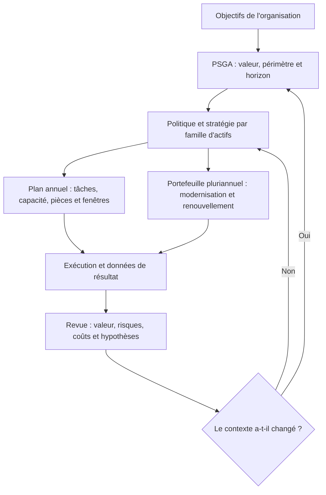
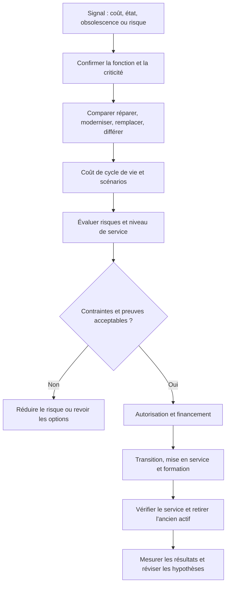

# Stratégie de maintenance à long terme — Expert

> **Mise en contexte — Stratégie de maintenance** : La stratégie de maintenance définit comment les actifs contribuent aux objectifs de l'organisation durant leur cycle de vie. Elle relie criticité, fiabilité, risque, coût, ressources, obsolescence, données, compétences et résultats de service. Elle doit guider les choix d'entretien et d'investissement, puis être révisée lorsque l'état des actifs ou les priorités évoluent. Une stratégie mature ne cherche ni à maximiser le préventif ni à minimiser les dépenses immédiates de manière aveugle. Elle choisit une combinaison justifiée de maintenance corrective, préventive, conditionnelle et prédictive, selon les conséquences d'une défaillance et les moyens de contrôle disponibles. Les décisions doivent être traçables et différencier une obligation impérative d'une préférence technique.

## Objectifs pédagogiques

À l'issue du cours, l'apprenant sera capable de :

- aligner les décisions de maintenance sur les objectifs et le cycle de vie des actifs
- segmenter les actifs selon criticité, risque et conséquence de défaillance
- choisir une politique corrective, préventive ou conditionnelle adaptée
- conduire des analyses de modes de défaillance et de stratégie
- planifier capacité, renouvellement, obsolescence et risque de portefeuille
- mesurer la performance de stratégie et arbitrer le risque résiduel

## Prérequis et cadre de responsabilité

Ce cours s'adresse à un professionnel capable de travailler avec des procédures, tickets, données et décisions opérationnelles. Toute décision financière, technique, contractuelle, humaine ou de production doit respecter les autorisations et politiques applicables. Les exemples sont pédagogiques ; ils ne remplacent pas un avis juridique, une règle comptable, une politique de sécurité ou une validation interne. Ne pas inventer de seuil ou présenter une hypothèse comme une exigence approuvée.

Avant une action importante, définir le périmètre, les objectifs, la source de données, le responsable, le résultat attendu, les risques et les conditions d'arrêt. Séparer les faits observés des estimations et hypothèses. Si la qualité des données est insuffisante, le signaler, éviter les conclusions trop générales et organiser le contrôle complémentaire.

## Vocabulaire de référence

| Terme | Définition |
|---|---|
| Gestion d'actifs | Activité coordonnée visant à réaliser de la valeur à partir des actifs sur leur cycle de vie. |
| Criticité | Priorité déterminée par les conséquences et le contexte de défaillance. |
| RCM | Reliability-Centered Maintenance : méthode visant à déterminer les tâches de maintenance appropriées aux fonctions et modes de défaillance. |
| FMEA/AMDEC | Analyse des modes de défaillance, de leurs effets et de leur criticité. |
| Préventif systématique | Maintenance planifiée à intervalle défini, indépendamment d'un signal d'état immédiat. |
| Conditionnel | Maintenance déclenchée par l'état mesuré ou une condition observable. |
| Prédictif | Utilisation d'analyses et modèles pour estimer une dégradation ou une défaillance future. |
| Risque résiduel | Risque restant après les mesures de maîtrise décidées et mises en œuvre. |

## Schémas de référence

### Schéma 1 — Cascade de la stratégie vers le travail

~~~mermaid
flowchart TD
  A["Objectifs métier"] --> B["Niveau de service et contraintes"]
  B --> C["Politique de gestion d'actifs"]
  C --> D["Stratégie de maintenance par famille"]
  D --> E["Tâches, ressources, pièces et fenêtres"]
  E --> F["Résultats, risques et coûts observés"]
  F --> G{"Hypothèses toujours valides ?"}
  G -- "Oui" --> D
  G -- "Non" --> H["Réviser la stratégie et les décisions d'actifs"]
  H --> C
~~~

Le schéma montre la chaîne de décision complète. Une stratégie n'est utile que si elle se traduit en actions réalisables et si les résultats peuvent ensuite invalider les hypothèses initiales.

### Schéma 2 — Criticité et conséquence

~~~mermaid
flowchart TD
  A["Actif et fonction dans le système"] --> B["Conséquences plausibles de défaillance"]
  B --> C["Sécurité, service, environnement, conformité"]
  C --> D["Délais de rétablissement et solutions de secours"]
  D --> E["Classe de criticité validée"]
  E --> F["Politique, contrôles et priorité"]
  F --> G["Revue si fonction, état ou contexte change"]
~~~

La criticité doit refléter les conséquences au niveau du service, pas seulement le prix de l'équipement. Une obligation ou un risque de sécurité doit rester identifiable même si un score agrégé paraît modéré.

### Schéma 3 — Choisir une politique de maintenance

~~~mermaid
flowchart TD
  A["Définir fonction et mode de défaillance"] --> B{"Conséquence inacceptable ?"}
  B -- "Oui" --> C["Contrôle obligatoire, protection ou changement de conception"]
  B -- "Non" --> D{"Signal détectable assez tôt ?"}
  D -- "Oui" --> E["Conditionnelle si signal, seuil et action sont fiables"]
  D -- "Non" --> F{"Tâche périodique techniquement efficace ?"}
  F -- "Oui" --> G["Préventif selon mécanisme et intervalle justifié"]
  F -- "Non" --> H["Corrective contrôlée ou autre mesure de réduction"]
  C --> I["Planifier, vérifier et réévaluer"]
  E --> I
  G --> I
  H --> I
~~~

Le diagramme n'est pas un automate de décision universel. Il structure la discussion et rappelle que les obligations, les conséquences et l'efficacité technique de la tâche priment sur les habitudes.

### Schéma 4 — Analyse de modes de défaillance et apprentissage

~~~mermaid
flowchart LR
  A["Fonction et contexte"] --> B["Perte de fonction et mode"]
  B --> C["Effets locaux et effets système"]
  C --> D["Causes plausibles et contrôles existants"]
  D --> E["Conséquence et action techniquement efficace"]
  E --> F["Ressources, pièces et preuve d'exécution"]
  F --> G["Vérification d'efficacité"]
  G --> H["Mise à jour de l'analyse et des plans"]
  H --> B
~~~

L'AMDEC et les démarches de maintenance centrée sur la fiabilité sont utiles lorsqu'elles partent des fonctions réelles et produisent des décisions exécutables. Une grille remplie sans vérifier les causes, les contrôles et les résultats ne suffit pas.

### Schéma 5 — Cycle de vie des actifs

~~~mermaid
flowchart LR
  A["Conception et acquisition"] --> B["Réception et mise en service"]
  B --> C["Exploitation"]
  C --> D["Maintenance et amélioration"]
  D --> E{"Maintenir, moderniser ou remplacer ?"}
  E -- "Maintenir" --> C
  E -- "Moderniser" --> F["Migration et validation"]
  E -- "Remplacer" --> G["Acquisition et transition"]
  F --> C
  G --> B
  C --> H["Retrait, contrats, données et pièces"]
~~~

Le coût total et le risque s'accumulent sur toute la durée de vie. L'entretien courant ne peut donc pas être séparé des choix de conception, de standardisation, de disponibilité des pièces et de retrait.

### Schéma 6 — Gouverner le risque résiduel

~~~mermaid
flowchart TD
  A["Défaillance, écart ou changement de contexte"] --> B["Évaluer conséquence et urgence"]
  B --> C{"Risque au-dessus des limites autorisées ?"}
  C -- "Oui" --> D["Mitigation immédiate et escalade"]
  C -- "Non" --> E["Action planifiée avec échéance"]
  D --> F["Décision par une autorité habilitée"]
  E --> F
  F --> G["Propriétaire, mesures provisoires et date de revue"]
  G --> H{"Risque maîtrisé et preuve disponible ?"}
  H -- "Oui" --> I["Clôture et conservation des preuves"]
  H -- "Non" --> J["Nouvelle mitigation ou arrêt en sécurité"]
~~~

Toute exception doit conserver son propriétaire, sa durée et les mesures compensatoires. Une acceptation de risque n'est ni une fermeture administrative ni une permission de contourner une obligation.

### Schéma 7 — Renouvellement et arbitrage du portefeuille

~~~mermaid
flowchart TD
  A["Besoin de renouvellement"] --> B["État, criticité, support et dépendances"]
  B --> C["Réparer, prolonger, moderniser, remplacer ou retirer"]
  C --> D["Coût complet, risques, bénéfices et capacité"]
  D --> E["Scénarios, incertitudes et transition"]
  E --> F["Arbitrage documenté"]
  F --> G["Projet, calendrier et ressources"]
  G --> H["Tests de réception et bénéfices après mise en service"]
~~~

Le portefeuille doit contenir la justification des options rejetées, les conséquences du report et les points où une nouvelle donnée peut changer le classement. Les priorités financières ne suppriment pas les obligations de sécurité ou de conformité.

### Schéma 8 — Tableau de bord orienté décision

~~~mermaid
flowchart LR
  A["Données de travail et de condition"] --> B["Indicateurs à définitions stables"]
  B --> C["Segmentation par criticité et famille"]
  C --> D["Tendances, incertitudes et exceptions"]
  D --> E["Décision et responsable"]
  E --> F["Action, échéance et preuve d'efficacité"]
  F --> A
~~~

Les KPI ne sont pas des objectifs isolés. Le tableau de bord doit montrer les effets pervers possibles, les actifs hors couverture et la décision réellement prise à partir du résultat.

### Schéma 9 — Revue d'efficacité

~~~mermaid
flowchart TD
  A["Choisir une famille ou un mode de panne"] --> B["Valider données et baseline"]
  B --> C["Comparer tâche actuelle et options"]
  C --> D["Pilote ou modification contrôlée"]
  D --> E["Mesurer performance et effets secondaires"]
  E --> F{"Résultat et risque acceptables ?"}
  F -- "Oui" --> G["Standardiser et mettre à jour les plans"]
  F -- "Non" --> H["Corriger, limiter ou revenir à la pratique précédente"]
  G --> I["Revue périodique"]
  H --> I
~~~

La vérification d'efficacité est différente de la preuve d'exécution. Elle doit examiner la population, l'exposition, les changements simultanés et la gravité des défaillances, pas seulement le nombre d'ordres fermés.

### Schéma 10 — Décision d'obsolescence

~~~mermaid
flowchart TD
  A["Actif en service"] --> B{"Fin de support, pièce rare ou risque nouveau ?"}
  B -- "Non" --> C["Optimiser stratégie et surveiller les évolutions"]
  B -- "Oui" --> D["Comparer prolongation, modernisation, remplacement et retrait"]
  D --> E["Coût complet, dépendances et plan de transition"]
  E --> F{"Risque et exécution maîtrisés ?"}
  F -- "Oui" --> G["Financer, séquencer et tester"]
  F -- "Non" --> H["Mitigation temporaire et acceptation du risque habilitée"]
  G --> I["Migrer, retirer et vérifier"]
  H --> J["Date de revue et plan de sortie"]
~~~

La fin de support est un signal de décision anticipée, et non un ordre automatique de remplacement. La stratégie doit comparer les options et gérer explicitement la période de transition.

## 1. Définir les objectifs de gestion d'actifs

La stratégie commence par les résultats attendus : sécurité, service, disponibilité, qualité, conformité, coût total, durabilité et capacité d'évolution. Ces objectifs peuvent être concurrents. Une politique de maintenance moins fréquente réduit certaines charges mais peut accroître les conséquences d'une panne ; un remplacement anticipé réduit le risque technique mais immobilise du capital et peut créer une transition complexe. Le rôle stratégique est de rendre l'arbitrage visible, pas de dissimuler un coût dans une autre équipe.

Le cycle de vie commence avant l'acquisition et se poursuit jusqu'au retrait. Les choix de conception, pièces de rechange, standardisation, accès de maintenance, instrumentation et documentation influencent le coût futur. Une architecture difficile à entretenir peut rendre chaque intervention plus longue et augmenter la dépendance fournisseur. La stratégie de maintenance doit donc influencer les projets et les achats, au lieu de recevoir passivement les actifs déjà conçus.

Définir le périmètre : familles d'actifs, sites, services, contrats, environnement, horizon et responsabilités. Les actifs doivent être liés à leurs fonctions, propriétaires, conditions d'exploitation, criticité et dépendances. Les systèmes multi-composants exigent une analyse de service : une pièce peu coûteuse peut être très critique si elle constitue un point unique de défaillance. La priorité ne se déduit pas du seul prix d'achat.

Une stratégie documente ses hypothèses et contraintes : qualité des données, disponibilité des techniciens, capacité des fournisseurs, temps d'approvisionnement, obsolescence et budget. Les données manquantes sont un risque de décision. Au lieu de produire une politique précise sur une population incertaine, établir des actions pour améliorer l'inventaire, confirmer les actifs critiques et mesurer les effets de l'incertitude.

## 2. Segmenter les actifs et choisir les politiques

La criticité doit associer probabilité et conséquences : sécurité, environnement, qualité, perte de service, coûts, conformité, dépendances et délai de récupération. Une matrice de risque peut utiliser des catégories ou un score numérique, à condition de définir les niveaux et d'éviter une précision artificielle. La décision doit être validée par les propriétaires métier et techniques concernés. Les obligations impératives et les actifs dont la défaillance peut menacer des personnes exigent un traitement dédié.

La maintenance corrective peut être acceptable lorsque les conséquences sont faibles, l'équipement remplaçable et la panne détectable ; elle ne doit pas être considérée comme une stratégie sans analyse. Le préventif systématique convient quand les tâches sont efficaces selon le mode de défaillance et l'intervalle est justifié. Une tâche inutile peut introduire des erreurs de maintenance ou consommer des ressources pour peu de gain. La politique doit être liée à la fonction et au mécanisme de dégradation.

La maintenance conditionnelle s'appuie sur des signes d'état : vibration, température, courant, pression, erreur logicielle, dérive de performance ou autre signal pertinent. Les seuils doivent avoir une base, un propriétaire, une qualité de mesure et une conduite à tenir. Un capteur mal calibré ou une alerte sans action ne crée pas de maintenance conditionnelle efficace. Le système doit relier signal, diagnostic, décision, ordre de travail et vérification.

La maintenance prédictive peut aider si les données sont suffisantes, le phénomène prévisible, l'alerte exploitable et la conséquence d'une mauvaise prédiction maîtrisée. Evaluer faux positifs, faux négatifs, dérive du modèle, saisonnalité, coûts de collecte, disponibilité de pièces et charge de traitement. Un modèle n'est pas automatiquement préférable à une règle simple, un calendrier ou une inspection. Comparer la valeur additionnelle, le risque et le coût total.

## 3. Utiliser RCM, FMEA et analyse de défaillance

L'analyse des modes de défaillance relie les fonctions attendues, les pertes de fonction, les mécanismes, les effets locaux et au niveau système, les causes plausibles, les contrôles actuels et les actions. Elle doit être proportionnée à l'impact et s'appuyer sur l'expérience, les données et les connaissances techniques. Un tableau rempli sans discussion des fonctions ou des preuves crée une apparence de rigueur mais peu d'amélioration.

RCM examine ce qui doit être fait pour que les actifs continuent à remplir leurs fonctions dans les conditions d'exploitation. La question n'est pas seulement « quel intervalle de maintenance ? », mais « quelle défaillance fonctionnelle, quelle conséquence et quel type de tâche réduit effectivement le risque ? ». Selon le cas, les réponses peuvent être une tâche conditionnelle, un remplacement planifié, une recherche de panne, une modification de conception ou l'acceptation documentée d'un risque.

Les analyses de défaillance doivent distinguer causes, symptômes et mécanismes. Le remplacement de pièce peut restaurer le service sans supprimer une cause récurrente, comme une mauvaise ventilation, une alimentation instable, une erreur de procédure ou une configuration fragile. Les actions peuvent porter sur conception, environnement, opération, approvisionnement, formation et supervision. Une action doit être liée au mécanisme qu'elle vise à contrôler.

Les priorités issues de l'analyse sont traduites en plan de travail, pièces, ressources, compétences et budget. Un contrôle recommandé mais non planifié ne réduit pas le risque. Les actions non financées doivent apparaître dans le portefeuille d'exceptions avec le risque résiduel et l'autorité qui accepte la situation. Réévaluer l'analyse lorsque les conditions, la technologie ou l'historique de panne évoluent.

## 4. Construire le portefeuille d'investissement et de renouvellement

La stratégie doit anticiper l'obsolescence, la disponibilité des pièces, la fin de support, l'énergie, la capacité, l'état physique et la possibilité de remplacer ou migrer. Un inventaire des actifs proches de la fin de vie permet de comparer prolongation, modernisation, remplacement, externalisation ou retrait. La décision intègre le coût total de possession, le risque d'arrêt, la valeur de l'actif, le délai fournisseur et la capacité à migrer sans perdre le service.

Un portefeuille de renouvellement doit être classé par criticité, échéance, dépendances, coût et préparation. Les projets partagent souvent les mêmes ressources internes, les mêmes fournisseurs et les mêmes fenêtres de changement. Un plan qui remplace trop de systèmes simultanément peut dépasser la capacité de validation et créer des risques liés à la transition. Les vagues doivent correspondre aux dépendances et aux compétences disponibles.

Les pièces critiques exigent une politique cohérente avec les délais d'approvisionnement et le risque. Un stock trop faible augmente la durée d'indisponibilité ; un stock excessif immobilise du capital, vieillit et peut devenir inutilisable. Examiner la demande, les délais, les substitutions, les garanties, la fin de fabrication et les alternatives approuvées. Un modèle statistique doit être adapté à la criticité et à la faible fréquence de certaines pannes.

Les investissements doivent préciser les critères d'approbation et les bénéfices mesurables. Les gains peuvent porter sur la disponibilité, le risque de sécurité, le temps de maintenance, la consommation ou la continuité. Le suivi compare la performance après remplacement avec la baseline et recherche les effets secondaires : nouveaux coûts récurrents, compétences manquantes, pièces différentes ou dépendance à un seul intégrateur.

## 5. Piloter et revoir la stratégie

Le tableau de bord stratégique associe résultats, risque, état du portefeuille, qualité de données, capacité, budget et actions de maîtrise. Inclure MTBF, MTTR et disponibilité lorsque leurs conventions sont stables, mais aussi préventif échu, récidive, obsolescence, couverture d'actifs, stock critique et risque résiduel. Un agrégat est accompagné de segments pour les actifs et services critiques afin que les risques majeurs ne disparaissent pas dans la moyenne.

Les revues se basent sur les décisions à prendre. Un actif peut être reclassé après plusieurs défaillances, une nouvelle obligation, un changement d'usage ou la disparition d'une pièce. La stratégie doit déclencher une revue lorsqu'un seuil ou une condition change. Une revue annuelle formelle ne suffit pas si un risque critique survient et exige une décision immédiate.

La stratégie doit équilibrer standardisation et adaptation locale. Un modèle unique réduit la complexité mais peut ignorer des conditions d'exploitation très différentes. Définir un socle commun et les critères d'exception ; chaque exception doit avoir un propriétaire, une raison, un risque, une durée et une revue. L'objectif n'est pas d'éliminer toutes les variations, mais de contrôler celles qui comptent.

Le programme d'amélioration tient un historique des hypothèses, des décisions et des résultats. Quand une politique de maintenance est modifiée, évaluer si la fréquence de panne, le coût et le risque évoluent dans la direction attendue. Les résultats négatifs sont eux-mêmes des connaissances : ils permettent d'éviter de généraliser une mesure inefficace à d'autres actifs.

## Procédure opérationnelle recommandée

1. Formuler le besoin et le résultat métier attendu, avant de choisir un outil ou une solution.
2. Définir le périmètre, les parties prenantes, les hypothèses, les contraintes et les critères de réussite.
3. Établir un état initial à partir de sources traçables, vérifier leur qualité et documenter les lacunes.
4. Comparer plusieurs options, leurs bénéfices, coûts, risques, dépendances, réversibilité et effets secondaires.
5. Définir la gouvernance, les approbations, les responsabilités, les délais et les conditions d'arrêt.
6. Tester l'option retenue dans un cadre proportionné au risque, en définissant les preuves attendues.
7. Mettre en œuvre par étapes, conserver la traçabilité et communiquer les écarts.
8. Mesurer le résultat selon les critères initialement retenus, analyser la comparabilité et les effets secondaires.
9. Attribuer les actions restantes, les responsables, les échéances et le test d'efficacité.
10. Réviser la décision ou la stratégie lorsque les preuves, les risques ou les hypothèses changent.

## Gouvernance, mesure et amélioration

Toute mesure utile dispose d'une définition, d'une source, d'un propriétaire, d'une période, d'une fréquence, d'un dénominateur et d'une décision associée. Publier le niveau de couverture et les exceptions lorsque des données sont manquantes. Des chiffres calculés avec des méthodes ou des populations différentes ne sont pas comparables sans analyse de la rupture.

Les décisions importantes doivent être reliées aux preuves, aux risques et aux responsabilités. Une approbation ne prouve pas que l'action a été réalisée ; la réalisation ne prouve pas toujours que le résultat attendu est atteint. Définir séparément la preuve d'implémentation et la vérification d'efficacité. Les écarts doivent rester visibles, avec des mesures provisoires et un risque résiduel accepté par une personne habilitée.

## Atelier pratique — définir la stratégie de maintenance d'une flotte

### Situation de départ

Une organisation exploite trois familles d'actifs : serveurs critiques, équipements réseau redondants et équipements de soutien remplaçables. Le préventif est identique pour les trois familles, les pannes récurrentes ne sont pas classées uniformément et plusieurs équipements approchent la fin de support. Le budget ne permet pas de tout remplacer la même année. L'équipe doit proposer une stratégie différenciée et une feuille de route pluriannuelle.

### Phase A — Inventaire et criticité

Définir fonctions, propriétaires, conditions d'exploitation, état, dépendances et conséquences de panne. Qualifier les écarts d'inventaire. Définir des niveaux de criticité et les faire valider par les propriétaires.

### Phase B — Politique par famille

Comparer corrective, préventive, conditionnelle et prédictive pour chaque mode de défaillance significatif. Documenter la justification, les données requises, le test d'efficacité et les coûts de chaque politique.

### Phase C — Cycle de vie

Lister fins de support, délais de pièces, renouvellement, migrations et dépendances. Comparer prolongation, remplacement, modernisation ou retrait en TCO et risque ; séquencer les projets selon la capacité.

### Phase D — Budget et risques

Associer les décisions au budget, à l'échéance, au risque résiduel et à la personne qui l'accepte. Identifier les contrôles temporaires et les actions qui ne peuvent pas être différées.

### Phase E — Gouvernance

Définir le tableau de bord, les déclencheurs de revue, la qualité des données, la cadence de décision et les mesures de résultat après une intervention.

### Critères de réussite

Le dossier doit être repris par une personne qui n'a pas participé à l'exercice. Il doit montrer le besoin, la méthode, les données, les décisions, les risques et les validations. Les hypothèses non vérifiées restent identifiées ; les actions sont attribuées et mesurables ; le résultat est confronté à une baseline ou à des critères approuvés. Une conclusion convaincante mais non reproductible n'est pas validée.

## Études de cas

### Cas 1 — Préventif uniforme

La même tâche est répétée sans preuve d'efficacité sur deux actifs très différents. Segmenter selon fonction et mode de défaillance, puis démontrer la valeur et le risque de la politique.

### Cas 2 — Obsolescence sans plan

Un composant critique n'est plus supporté et les pièces sont difficiles à trouver. Évaluer les options de maintien, les mesures compensatoires, le renouvellement et les délais d'approvisionnement.

### Cas 3 — Prédictif sans décision

Les capteurs génèrent de nombreuses alertes qui ne débouchent sur aucune intervention. Vérifier la qualité des signaux, les seuils, le workflow et la capacité de traitement avant d'étendre le modèle.

## Exercices d'application avec corrigés

### Exercice 1 — Définir et comparer

**Question.** Pourquoi la criticité ne doit-elle pas dépendre seulement du prix ?

**Corrigé expliqué.** Parce qu'un équipement peu cher peut être un point unique de défaillance et affecter un service très critique. Les conséquences, dépendances et possibilités de récupération comptent.

### Exercice 2 — Interpréter le résultat

**Question.** Quelle politique est la meilleure pour chaque actif ?

**Corrigé expliqué.** Il n'existe pas de politique universelle. Choisir selon fonctions, modes de défaillance, conséquences, données, efficacité des tâches, coût et moyens disponibles.

### Exercice 3 — Sélectionner une méthode

**Question.** Une alerte prédictive est-elle la preuve qu'une panne aura lieu ?

**Corrigé expliqué.** Non. Elle exprime un signal ou une estimation incertaine ; il faut considérer faux positifs, faux négatifs, validation, seuils et conduite à tenir.

### Exercice 4 — Traiter un risque

**Question.** Comment intégrer une fin de support dans le portefeuille ?

**Corrigé expliqué.** Évaluer risque, pièces, correctifs, compatibilité, dépendances, coût complet, solution de rechange et calendrier, puis attribuer un propriétaire et un plan de mitigation.

### Exercice 5 — Évaluer la preuve

**Question.** Pourquoi l'historique des décisions compte-t-il ?

**Corrigé expliqué.** Il aide à comprendre les hypothèses et les résultats, comparer les options et éviter de répéter une politique qui n'a pas produit les bénéfices attendus.

### Exercice 6 — Vérifier l'efficacité

**Question.** Quel indicateur montre que le préventif crée de la valeur ?

**Corrigé expliqué.** Aucun indicateur seul. Combiner réalisation à l'échéance, modes de panne, récidive, disponibilité, coûts et preuves de qualité, sur une population comparable.

## Défi final — mise en situation experte

Concevoir une stratégie de maintenance sur cinq ans pour une flotte comprenant des actifs critiques, des équipements redondants et des systèmes en fin de support. Produire un registre de criticité, une analyse de modes de défaillance pour les risques prioritaires, une politique de maintenance par famille, un portefeuille de renouvellement, un budget indicatif, les KPI, les exceptions à risque et la gouvernance de revue. Le corrigé justifie les politiques au regard des fonctions et conséquences, et lie les dépenses à des résultats mesurables.

**Livrable attendu.** Produire un dossier qui présente la situation, la décision, les options, les preuves, les risques et le plan de suivi. Chaque recommandation doit être liée à une raison, un propriétaire et un critère de réussite. Expliquer les incertitudes, les limites du périmètre et les conditions qui feraient réviser la décision.

**Correction attendue.** Une solution experte est cohérente, mesurable et gouvernée. Elle ne confond pas une estimation et un résultat confirmé, ne masque pas les coûts ou risques, compare les options dans un cadre commun et prévoit le contrôle de fin. Elle identifie les décisions qui nécessitent une validation spécialisée et laisse une piste compréhensible pour une revue ultérieure.

## Modèles de décision — criticité, politique de maintenance et renouvellement

La stratégie devient exploitable lorsqu'elle relie les classifications à des choix concrets. Une matrice de criticité ne constitue pas une mesure universelle ; elle doit adopter les échelles, facteurs et validations propres à l'organisation. Son objectif est de rendre les décisions cohérentes et explicables, surtout lorsqu'un budget ne permet pas de traiter toutes les demandes simultanément.

### Exemple de matrice de criticité

| Niveau | Exemple de conséquence | Contrôles attendus à définir |
|---|---|---|
| Critique | Risque pour la sécurité, arrêt d'une fonction essentielle ou violation majeure d'une obligation | Analyse détaillée des modes de panne, contrôles renforcés, plan de reprise et surveillance adaptée |
| Élevé | Interruption majeure ou service fortement dégradé avec récupération coûteuse | Préventif justifié, pièces ou stratégie de secours, revue des récurrences |
| Modéré | Dégradation limitée, solution de remplacement disponible et perte maîtrisable | Maintenance planifiée et contrôle proportionné, surveillance des tendances |
| Faible | Conséquence faible et actif facilement remplaçable | Corrective contrôlée possible si le risque est accepté et si les exigences sont satisfaites |

Avant d'attribuer un niveau, définir l'impact, la probabilité ou l'exposition, la détectabilité, la réversibilité et les obligations applicables. Le score n'est pas automatiquement la décision. Une exception réglementaire ou un risque de sécurité peut exiger une réponse spécifique, même si le score agrégé est faible. Les désaccords doivent être résolus par les propriétaires métier et techniques qui assument les conséquences.

### Choisir une politique selon le mode de défaillance

| Situation | Politique possible | Questions à traiter |
|---|---|---|
| Défaillance peu coûteuse, détection facile, remplacement immédiat | Corrective contrôlée | L'arrêt est-il acceptable ? Les pièces sont-elles disponibles ? |
| Usure prévisible et tâche dont l'efficacité est démontrée | Préventif périodique | L'intervalle est-il fondé sur l'expérience ou la recommandation applicable ? |
| Dégradation observable par mesure pertinente | Maintenance conditionnelle | Le signal est-il fiable, le seuil justifié et le délai d'action suffisant ? |
| Signaux multidimensionnels et mécanisme prédictible | Maintenance prédictive potentielle | Les données, validations, faux positifs, coûts et actions sont-ils maîtrisés ? |
| Risque qui ne peut être réduit par la tâche d'entretien seule | Modification de conception ou mitigation | Une architecture différente ou une redondance réduirait-elle mieux le risque ? |

Cette matrice fournit une démarche de choix, pas un verdict automatique. Un actif peut combiner plusieurs politiques selon ses modes de défaillance. La stratégie doit vérifier si une tâche a réellement l'effet souhaité, mais aussi si elle introduit des risques, par exemple une erreur de remontage après un démontage inutile.

### Exemple de priorisation d'un portefeuille

Supposons trois actifs fictifs : un serveur de gestion indispensable, un routeur redondant avec une voie de secours testée et une imprimante d'étiquettes facilement remplaçable. La politique du serveur peut inclure contrôle de sauvegarde, tests de restauration, correctifs rigoureux, capacité et pièces de rechange ; le routeur demande une validation de la redondance et un plan de remplacement, sans oublier de tester le basculement ; l'imprimante peut être maintenue de manière plus corrective si la solution de remplacement et le stock sont suffisants. Une fréquence unique de préventif serait plus simple administrativement mais pas nécessairement la plus sûre ou rentable.

La sélection des projets de renouvellement doit également tenir compte des dépendances. Un serveur peut dépendre d'une version de base de données, d'un réseau et d'une licence qui expirent à des dates différentes. Remplacer seulement le serveur peut rendre l'application incompatible ou déplacer le risque vers un autre composant. Cartographier les actifs, applications, contrats, interfaces, pièces et équipes avant de figer le calendrier.

### Contrôles de gouvernance de la stratégie

Chaque politique approuvée doit avoir un propriétaire, une justification, une date de revue, les hypothèses et la preuve attendue. Les exceptions doivent préciser la raison, la durée, le risque résiduel, la mitigation, l'autorité d'acceptation et le déclencheur de réexamen. Une exception sans date de fin devient souvent une nouvelle règle informelle. Les rapports stratégiques montrent le nombre et la criticité des exceptions ainsi que les actifs sans politique validée.

Les revues s'appuient sur l'historique des défaillances, le MTBF/MTTR définis, l'efficacité du préventif, les coûts, les ruptures de stock, les résultats de prédiction et les incidents post-maintenance. Une variation d'indicateur peut provenir d'une évolution des règles ou de la population : vérifier la comparabilité avant d'en tirer une conclusion. Si une politique est modifiée, définir une référence et une période d'observation pour vérifier qu'elle produit la valeur attendue.

## Gouverner le portefeuille pluriannuel et les exceptions de risque

Un portefeuille de maintenance réunit les actions courantes, les évolutions de politiques, le renouvellement d'actifs, la réduction d'obsolescence, les améliorations de fiabilité et les obligations de continuité. Les initiatives sont comparées selon criticité, risques, valeur, dépendances, échéance, coût de cycle de vie et capacité. Le score aide à discuter les priorités, mais une exigence obligatoire ou une action de sécurité peut nécessiter un traitement dédié plutôt qu'un classement purement financier.

### Exemple de plan de portefeuille

| Initiative | Risque ou objectif | Dépendance | Critère de décision |
|---|---|---|---|
| Remplacement d'un composant sans support | Risque d'indisponibilité et d'absence de correctif | Application, fournisseur, fenêtre | Migration testée, pièces et support confirmés |
| Mise en place de surveillance conditionnelle | Détecter une dégradation avant la panne | Capteurs, données, workflow de maintenance | Qualité de mesure et action associée vérifiées |
| Refonte d'un préventif inefficace | Réduire coûts inutiles sans augmenter les pannes | Modes de défaillance, historique | Résultat observé sur population comparable |
| Constitution de stock critique | Réduire délai de réparation | Prévisions, fournisseur, conservation | Disponibilité de pièce et coût complet contrôlés |
| Standardisation de configurations | Réduire variabilité et incidents de changement | Inventaire, automatisation, droits | Tests, déploiement pilote et preuve de conformité |

Les initiatives doivent être séquencées pour éviter de mobiliser simultanément les mêmes experts et fenêtres. Un plan de renouvellement crédible montre les dépendances et les points de décision, pas seulement les montants par année. Les changements de coût, de délai fournisseur, de criticité ou de disponibilité des compétences peuvent modifier l'ordre ; le portefeuille doit être réévalué selon des règles transparentes.

### Accepter et réexaminer un risque résiduel

Lorsqu'une action ne peut pas être mise en œuvre immédiatement, la décision précise le risque, le propriétaire, la raison du délai, les mesures compensatoires, l'échéance et le déclencheur de réexamen. Une exception n'est pas une suppression du risque. Si la condition change — aggravation des pannes, perte d'une pièce, changement réglementaire ou incident majeur — le contrôle doit se déclencher avant la revue périodique prévue.

Les stratégies doivent être liées aux budgets et aux compétences. Une politique qui exige des mesures mensuelles sans capteur, personne qualifiée ou budget de pièces n'est pas réellement mise en œuvre. De même, une stratégie prédictive exige du temps pour traiter les alertes, vérifier les prédictions et planifier les interventions. Le plan doit financer les capacités nécessaires et constater si les bénéfices compensent le coût.

### Revue annuelle de la stratégie

La revue confronte objectifs, actifs, risques, incidents, efficacité des politiques, dépenses, qualité de données, capacités et évolution technologique. Elle identifie les décisions qui restent valides, celles qui doivent être testées et les hypothèses à abandonner. Les modifications sont versionnées et communiquées aux planificateurs, achats, opérations, finance et propriétaires métier. Le rapport indique les risques acceptés, les actions financées, les actions reportées et les raisons.

Une stratégie mature n'est pas un document figé à cinq ans. Elle fournit une direction stable et un processus d'adaptation aux signaux réels. La valeur apparaît lorsque les politiques sont cohérentes avec les fonctions, les investissements arrivent au bon moment, les exceptions sont maîtrisées et les résultats sont revus à partir de preuves.

## Évaluer la performance d'une stratégie sans favoriser un seul KPI

Un portefeuille ne doit pas être évalué à partir d'un indicateur qui récompense un comportement contraire au but de maintenance. Un ratio élevé de maintenance préventive peut coexister avec des tâches mal choisies. Un MTTR plus faible peut refléter la clôture de tickets avant validation. Une baisse du coût peut provenir du report de tâches ou de la réduction de stock critique. Relier chaque KPI à une preuve de qualité et à une vue par criticité aide à identifier les effets pervers.

La revue peut comparer quatre dimensions : résultats de service (disponibilité, interruptions, récurrence), efficacité des tâches (préventif, essais, maintenance conditionnelle), coût et capacité (budget, pièces, charge) et exposition au risque (obsolescence, absence de compétences, exceptions, dépendances). Les tendances sont interprétées sur une population cohérente, avec les changements de définition et les données manquantes visibles. Les actifs sans mesure ne disparaissent pas du rapport ; leur absence de données constitue elle-même une question de gouvernance.

### Exemple de décision stratégique

Une famille d'équipements présente une baisse du nombre de pannes déclarées et une hausse des coûts de maintenance. Avant de décider de réduire le préventif, analyser les événements, les pièces consommées, les tâches ajoutées, l'âge et l'intensité d'utilisation. Le nombre de pannes peut avoir diminué parce qu'un composant a été remplacé, mais les coûts peuvent refléter un rattrapage temporaire nécessaire. Une série de plusieurs périodes et une vérification des causes est plus utile qu'une réaction au dernier mois.

Pour comparer les politiques, définir la baseline, le périmètre, l'horizon, les coûts inclus, les risques et le critère de réussite. Si un pilote change l'intervalle de maintenance, sélectionner des actifs comparables ou un déploiement progressif, garder des mesures de sécurité et vérifier les effets inattendus. Ne pas réduire une tâche exigée par une obligation ou nécessaire à la sécurité sans l'autorité et les preuves appropriées.

### Mise à jour du portefeuille

Les décisions stratégiques doivent être reliées à la liste d'actifs et aux projets financés. Chaque initiative indique les hypothèses, les ressources, les besoins d'approvisionnement, le plan de transition, la fenêtre, le risque et le résultat attendu. Si une ressource clé ou une pièce devient indisponible, revoir le calendrier, la mitigation et le risque résiduel. L'ordre des projets peut changer, mais les décisions doivent être traçables afin d'expliquer pourquoi une action critique a été différée.

Une stratégie efficace ne promet pas zéro panne ; elle optimise le niveau de risque acceptable et la valeur sur le cycle de vie, tout en respectant les obligations applicables. Son amélioration est continue : les données, les RETEX, les audits, les changements et les contraintes de capacité révisent les hypothèses, et les résultats sont vérifiés avant de généraliser une nouvelle politique.

## 6. Déployer une hiérarchie de décisions cohérente

Une stratégie de maintenance ne se limite pas à une liste de tâches préventives. Elle traduit les objectifs de l'organisation en choix successifs, des actifs aux interventions, et relie chaque niveau à des preuves. La politique générale indique les principes et les contraintes ; la stratégie par famille définit les approches adaptées aux fonctions et modes de défaillance ; le plan de maintenance transforme ces approches en tâches, fréquences, ressources, pièces, outils et compétences ; le programme hebdomadaire organise les interventions réalisables ; le retour d'expérience vérifie l'efficacité.

### 6.1 Distinguer politique, stratégie, plan et programme

| Niveau | Question à laquelle il répond | Exemple de décision |
|---|---|---|
| Politique de gestion d'actifs | Quels principes et résultats priment ? | La sécurité et les obligations applicables ne sont pas compensées par une économie budgétaire |
| Stratégie d'actifs | Comment chaque grande famille contribue-t-elle aux objectifs du service ? | Conserver, moderniser, remplacer ou retirer une famille |
| Stratégie de maintenance | Comment maîtriser les modes de défaillance et le risque ? | Conditionnelle pour un mécanisme détectable ; corrective contrôlée pour une fonction remplaçable |
| Plan de maintenance | Quelles tâches sont nécessaires, par qui et selon quelle fréquence ? | Inspection, test fonctionnel, lubrification, remplacement ou diagnostic |
| Programme de travail | Quelles tâches seront faites dans une période donnée avec les moyens réels ? | Séquencement selon disponibilité, fenêtre, pièces et compétences |
| Vérification et amélioration | La décision obtient-elle le résultat prévu ? | Modifier l'intervalle après étude des tendances et du risque |

Une erreur de gouvernance fréquente consiste à changer les fréquences d'intervention pour résoudre un problème qui relève en réalité de la conception, du stock de pièces, de la capacité de production, de la qualité d'exécution ou d'une mauvaise donnée. Le bon niveau de décision dépend de la cause du problème.

### 6.2 Relier actifs, fonctions et services

Construire une hiérarchie lisible : site, système, sous-système, équipement, composant, fonction et service soutenu. Les niveaux exacts dépendent du domaine. L'important est de savoir quelle fonction est perdue quand un composant tombe en panne, quelles autres fonctions dépendent de lui et qui subit la conséquence.

~~~mermaid
flowchart TD
  A["Objectif métier"] --> B["Service / fonction"]
  B --> C["Système et dépendances"]
  C --> D["Équipements et composants"]
  D --> E["Modes de défaillance"]
  E --> F["Tâches et contrôles"]
  F --> G["Ordres de travail et ressources"]
  G --> H["Résultats mesurés par service"]
~~~

Pour chaque actif significatif, documenter un identifiant stable, l'emplacement, la fonction, le propriétaire, le contexte d'exploitation, la criticité, les dépendances, la documentation, les pièces, l'obsolescence et l'historique de défaillance. La liste peut être graduée : les actifs critiques exigent une couverture plus détaillée, mais un manque de données doit être visible et piloté plutôt que masqué par une valeur par défaut.

### 6.3 Définir une gouvernance des changements de stratégie

Une recommandation d'analyse ne modifie pas automatiquement une politique approuvée. Définir qui peut proposer un changement, qui évalue les conséquences, qui approuve, quelle preuve est requise, comment les plans de travail sont modifiés, comment les techniciens sont informés et comment l'efficacité sera contrôlée.

Lorsqu'un changement touche une tâche de sécurité, une limite d'exploitation ou une exigence réglementaire, il doit suivre le processus formel applicable. Un responsable budgétaire ne peut pas autoriser seul une réduction du contrôle technique s'il n'a pas cette autorité. Une analyse technique ne peut pas, à elle seule, valider un risque métier que seul le propriétaire autorisé peut accepter.

## 7. Analyse de criticité et décisions de risque

### 7.1 Évaluer les conséquences sans réduire tout à une note

Une classification de criticité peut tenir compte de la sécurité des personnes, de l'environnement, de la continuité, de la qualité, des obligations, des coûts directs et indirects, de l'effet sur les équipements en aval, du délai de récupération et de l'existence d'une solution de secours. Les conséquences doivent être évaluées selon les scénarios plausibles et les barrières en place.

Ne pas confondre :
- la **probabilité** d'une défaillance ;
- sa **conséquence** si elle survient ;
- la **détectabilité** avant que l'effet ne se produise ;
- la **récupérabilité** du service après la panne ;
- l'**exposition** liée aux heures d'utilisation, aux cycles et à l'environnement.

Deux actifs ayant la même note agrégée peuvent nécessiter des politiques différentes si l'un présente un risque de sécurité et l'autre seulement un coût de réparation limité. La criticité sert à organiser la réponse, pas à gommer la nature du danger.

### 7.2 Exemples d'échelle descriptive

| Dimension | Niveau limité | Niveau intermédiaire | Niveau élevé |
|---|---|---|---|
| Service | Fonction redondante, interruption sans impact notable | Dégradation temporaire, contournement possible | Fonction essentielle indisponible, perte de service importante |
| Sécurité | Pas de scénario crédible au-delà des risques ordinaires | Exposition contrôlée exigeant des barrières | Scénario de dommage grave nécessitant mesures spécifiques |
| Environnement | Impact limité et localisé | Impact significatif nécessitant intervention | Impact grave ou conséquence durable |
| Récupération | Réparation rapide, pièces en stock | Délai modéré, ressources planifiables | Pièces rares, long délai ou perte difficilement récupérable |
| Conformité | Pas d'exigence spécifique identifiée | Exigences documentaires ou de contrôle | Obligation impérative, échéance réglementaire ou audit critique |

Cette échelle est illustrative. L'organisation doit définir ses critères, ses seuils et les personnes habilitées à les valider. Une note « faible » ne neutralise jamais une obligation impérative ou un risque intolérable.

### 7.3 Traiter le risque résiduel

Le risque résiduel est celui qui demeure après les contrôles existants et les mesures de mitigation. Une ligne de registre utile mentionne l'actif et sa fonction, le scénario, les conséquences, les barrières, les preuves de fonctionnement, la lacune, la mesure provisoire, le propriétaire, l'autorité d'acceptation, la date d'expiration et le déclencheur de réexamen.

L'acceptation du risque n'est pas une façon de fermer un ticket. Elle doit préciser ce qui est accepté, pour combien de temps, avec quelles mesures compensatoires et dans quelles limites. Si le risque dépasse les limites autorisées, les options peuvent être de réduire l'utilisation, d'ajouter un contrôle, d'installer une solution temporaire, de reporter une activité ou d'arrêter en sécurité. Le plan d'action prévoit une preuve d'efficacité, pas seulement une preuve de réalisation.

## 8. Fiabilité, disponibilité et interprétation des indicateurs

### 8.1 Comprendre les indicateurs avant de les comparer

Le MTBF (temps moyen entre défaillances) et le MTTR (temps moyen de réparation ou de rétablissement, selon la convention choisie) ne sont utiles que si les définitions sont cohérentes. Certaines organisations mesurent le temps jusqu'à restauration, d'autres le temps technique d'intervention. Ces valeurs ne sont pas interchangeables.

Pour un modèle simple, sous hypothèses adaptées et avec un temps de fonctionnement et un temps d'arrêt clairement définis, on utilise parfois :

Disponibilité intrinsèque approximative = MTBF / (MTBF + MTTR)

Cette relation ne représente pas nécessairement la disponibilité opérationnelle : les retards logistiques, les attentes d'autorisation, les arrêts planifiés, les indisponibilités externes et la redondance peuvent modifier le résultat observé. Toujours indiquer la convention utilisée et le périmètre.

### 8.2 Exemple chiffré

Supposons une fonction dont le MTBF observé est de 400 heures et dont le MTTR moyen est de 10 heures. Avec la formule simple, la disponibilité intrinsèque estimée est :

400 / (400 + 10) = 0,9756, soit environ 97,56 %.

Ce chiffre est un exemple de calcul, pas une garantie réelle. Si les pièces arrivent après 36 heures en moyenne et que ce délai n'est pas compris dans le MTTR de 10 heures, l'indisponibilité opérationnelle pourra être plus élevée. Si l'actif est redondant, l'effet sur le service dépendra aussi de l'architecture et des modes communs de défaillance.

### 8.3 Ne pas confondre moyenne, tendance et fiabilité du modèle

Un MTBF moyen masque la distribution et la nature des défaillances. Il peut être trompeur si le périmètre regroupe des actifs différents, si certaines pannes ne sont pas saisies, si l'exposition varie, si les actifs censurés sont ignorés ou si la définition de défaillance change. Pour une analyse avancée, il faut examiner les événements, les périodes d'exposition, les modes de défaillance, les interventions et les incertitudes.

Les modèles de durée de vie, dont Weibull, peuvent aider lorsqu'un jeu de données suffisamment pertinent soutient les hypothèses. Le paramètre de forme est parfois interprété comme une indication du comportement temporel du taux de défaillance : selon le modèle, un taux qui diminue, approximativement constant ou qui augmente peut être plausible. Mais ce résultat dépend de la qualité des données, de la population, de l'hypothèse de mécanisme homogène et des données censurées. Ne pas sélectionner une loi statistique parce qu'elle confirme une politique déjà choisie.

### 8.4 Identifier les modes récurrents et leurs mécanismes

Un pareto des défaillances peut mettre en évidence les familles ou modes qui contribuent le plus aux conséquences, coûts ou interruptions. Il ne suffit pas de classer les actifs selon le nombre d'événements : un incident sans conséquence et un incident de sécurité ne doivent pas être additionnés comme s'ils étaient équivalents. Produire plusieurs vues selon le besoin : fréquence, durée d'arrêt, coût, criticité et conséquence.

Pour un mode récurrent, recueillir les faits avant d'affirmer une cause. Vérifier les conditions d'utilisation, l'installation, la lubrification, la contamination, la température, les vibrations, l'alimentation, les paramètres, l'entretien antérieur, la qualité des pièces et les changements récents. L'action corrective doit agir sur un mécanisme plausible et disposer d'un test de vérification.

~~~mermaid
flowchart TD
  A["Événements de défaillance"] --> B["Exposition et temps d'arrêt cohérents"]
  B --> C["Séparer fréquence et durée de rétablissement"]
  C --> D["Relier l'actif au service dépendant"]
  D --> E["Examiner redondance et causes communes"]
  E --> F["Choisir mesures de fiabilité et de service"]
  F --> G["Revoir les hypothèses et les écarts"]
~~~

### 8.5 De la fiabilité au résultat du service

Une baisse du nombre de pannes d'un composant ne garantit pas automatiquement une meilleure disponibilité du service si d'autres dépendances deviennent le goulot. À l'inverse, une intervention préventive qui augmente temporairement les arrêts planifiés peut améliorer la disponibilité sur la période entière. Il faut définir le périmètre système, les événements, les fenêtres de mesure et les effets sur les utilisateurs.

La stratégie devrait tenir compte des défaillances communes, des causes externes et des dépendances critiques. Une redondance peut aider seulement si les composants ne partagent pas les mêmes causes de panne, l'alimentation ou l'environnement vulnérable. La maintenabilité et la capacité à diagnostiquer rapidement contribuent autant à certains objectifs de service que la fréquence de panne.

## 9. Choisir et vérifier les tâches de maintenance

### 9.1 La tâche doit agir sur le mécanisme identifié

Une tâche doit être justifiée par une fonction, un mode de défaillance, un signal, un intervalle ou un besoin réglementaire, une conséquence et une preuve attendue. « Inspecter tous les mois parce que c'est la pratique historique » n'est pas une justification suffisante. La question est de savoir si l'inspection détecte une dégradation utilement tôt, si la tâche est exécutée correctement et quelle action suit un résultat hors limite.

Les grandes familles de tâches comprennent :
- la maintenance basée sur le temps ou l'usage, lorsque l'intervalle réduit effectivement le risque ;
- la surveillance conditionnelle, lorsqu'un état mesurable permet une intervention assez tôt ;
- la détection de panne cachée, importante lorsqu'une fonction de protection ou de secours peut échouer sans symptôme visible ;
- la restauration ou le remplacement planifié, lorsque les caractéristiques du mode de défaillance rendent la tâche efficace ;
- la maintenance corrective, lorsque la conséquence et la récupération la rendent acceptable ;
- la modification de conception, de matériau, d'environnement ou de procédure lorsqu'aucune tâche de maintenance n'est suffisante.

~~~mermaid
flowchart TD
  A["Mode de défaillance"] --> B["Tâche potentiellement efficace"]
  B --> C["Critère d'acceptation défini"]
  C --> D["Préparer accès, compétence et conditions"]
  D --> E["Exécuter et enregistrer le résultat"]
  E --> F{"Résultat acceptable ?"}
  F -- "Oui" --> G["Remettre en service selon la procédure"]
  F -- "Non" --> H["Évaluer le risque et appliquer la mesure approuvée"]
  H --> I["Réparer puis retester"]
  I --> G
~~~

### 9.2 Vérifier les tâches de sécurité et de protection

Les dispositifs de protection, alarmes, interverrouillages et fonctions de secours peuvent rester dormants jusqu'au besoin. Leur présence dans un inventaire ne prouve pas leur disponibilité. La stratégie doit identifier les tests requis, les critères d'acceptation, les conditions de test, la restauration après test et les conséquences d'un échec. Toute réduction de fréquence ou modification suit la procédure et l'autorité qui conviennent au domaine.

La détection d'une panne cachée peut exiger un test fonctionnel plutôt qu'une inspection visuelle. Les résultats hors tolérance doivent entraîner une action documentée, une évaluation du risque et la vérification d'équipements similaires lorsqu'une cause commune est possible.

### 9.3 Fréquence des tâches : optimiser, mais dans un cadre sûr

Une fréquence trop longue peut laisser évoluer une dégradation avant de la détecter. Une fréquence trop courte consomme des ressources, peut générer des interventions inutiles, introduire des erreurs humaines et augmenter l'exposition aux opérations de maintenance. Le choix dépend du mécanisme, de la vitesse de dégradation, de la sensibilité de détection, du temps de préparation et de l'intervalle de réparation.

Une amélioration d'intervalle doit être évaluée avec :
- le niveau initial et le périmètre ;
- le mode de défaillance ciblé ;
- le risque et les obligations ;
- la preuve de l'efficacité de la tâche ;
- l'exposition pendant l'intervalle ;
- la disponibilité des ressources ;
- les critères de surveillance ;
- les critères d'arrêt et de retour ;
- une période d'observation adaptée ;
- une décision approuvée et traçable.

### 9.4 Exemple de réduction de préventif

Une équipe propose d'allonger l'intervalle d'inspection d'une famille d'actifs parce qu'aucune panne n'a été enregistrée depuis un an. Avant de modifier la stratégie, elle vérifie si l'inspection détecte un mode de défaillance observable, si les incidents sont bien consignés, si les actifs ont le même régime d'utilisation, si des changements de pièce ont eu lieu et si le mode de panne présente une relation avec l'âge ou le temps.

L'absence de panne déclarée peut refléter une bonne maîtrise, une faible exposition, une détection incomplète ou une durée d'observation insuffisante. Si le mode de défaillance est lié à un mécanisme d'usure avec données solides, une étude peut justifier un intervalle adapté. Si la tâche protège contre une conséquence grave ou répond à une obligation, l'absence d'événement n'autorise pas à elle seule la réduction.

## 10. Planifier arrêts, interventions et capacité

### 10.1 La stratégie doit être exécutable

Une politique n'a de valeur que si les interventions peuvent être réalisées avec les compétences, pièces, outils, autorisations et fenêtres nécessaires. Les retards de maintenance échappent souvent au choix technique : l'équipe attend un accès, une autorisation, un fournisseur, une pièce ou un arrêt de production. L'analyse de stratégie doit regarder ces contraintes au lieu d'augmenter simplement la fréquence d'ordres de travail.

Pour chaque tâche critique, documenter l'estimation d'heures, la compétence requise, le matériel, les pièces, l'isolation, les permis, les risques de coactivité, les tests avant remise en service et les critères d'acceptation.

### 10.2 Distinguer backlog total, prêt et bloqué

Le backlog brut n'indique pas la capacité du service à livrer. Classer les travaux en attente selon l'état de préparation : pièces disponibles, accès confirmé, analyse de risque réalisée, ordre complet, compétence disponible et fenêtre validée. Séparer les urgences, les travaux critiques échus, les travaux prêts à programmer et les travaux bloqués.

Un backlog important peut cacher une préparation insuffisante ou un mauvais classement. Réduire le nombre d'ordres ouverts en les fermant sans preuve crée un indicateur artificiellement meilleur. La stratégie doit mesurer les travaux échus selon criticité, la cause de blocage et l'exposition au risque pendant le report.

### 10.3 Construire une capacité soutenable

La capacité théorique d'une équipe est différente de la capacité disponible pour les travaux planifiés. Il faut tenir compte des absences, astreintes, urgences, déplacements, formations, réunions, autorisations, supervision, travaux de sécurité et compétences rares. Le taux de planification n'est pas une valeur universelle ; la valeur retenue doit être ajustée aux conditions de l'organisation et vérifiée par les données.

Éviter d'optimiser l'utilisation de chaque technicien à 100 %. Sans marge, l'équipe peut ne plus absorber les incidents imprévus, perdre la capacité de diagnostic ou repousser les tâches de prévention. La stratégie peut nécessiter une capacité de réserve explicite pour les actifs critiques.

### 10.4 Gestion des arrêts planifiés

Les arrêts majeurs concentrent des travaux qui exigent une indisponibilité contrôlée, mais ils peuvent aussi concentrer le risque de coordination. Le plan doit avoir un périmètre gelé, une hiérarchie d'exigences, des points de contrôle, des responsables de chantier, des interfaces avec les opérations, la préparation des pièces et la mise en service.

Pour chaque travail, vérifier que l'accès, la séquence, les outils, les pièces, les compétences et les critères de clôture sont prêts. Le report d'un travail doit déclencher une analyse des conséquences et une décision de risque, pas simplement l'effacement de la tâche du plan. Après l'arrêt, comparer préparation, temps réel, défauts découverts, retards, incidents et qualité de remise en service.

## 11. Pièces de rechange et résilience de l'approvisionnement

Le stock est une décision de risque et de cycle de vie. Une pièce à faible prix peut être stratégique si son délai d'approvisionnement est long et si l'actif qu'elle remet en service est critique. À l'inverse, immobiliser beaucoup de pièces onéreuses qui se dégradent, deviennent obsolètes ou ne sont plus adaptées peut être un mauvais choix.

### 11.1 Évaluer les pièces critiques

Pour les articles importants, examiner :
- criticité de l'équipement et conséquences d'un arrêt ;
- délai réel, variabilité du délai et dépendance au fournisseur ;
- taux de consommation et fiabilité du besoin ;
- possibilité d'une pièce standard ou de substitution approuvée ;
- durée de stockage, conditions de conservation et durée de vie ;
- garantie, fin de fabrication, exportation et contraintes logistiques ;
- réparabilité, échange standard et réparation fournisseur ;
- coût de stock, obsolescence et coût d'une indisponibilité ;
- partage éventuel entre sites et risque de demande simultanée.

Ne pas appliquer un même modèle de réapprovisionnement à tous les articles. Pour une pièce critique à demande rare, la moyenne historique peut être un mauvais estimateur : le risque de panne et la conséquence peuvent justifier une décision spécifique. Documenter la justification, le propriétaire du risque et la date de revue.

~~~mermaid
flowchart TD
  A["Pièce ou famille d'articles"] --> B["Criticité de l'actif"]
  B --> C["Délai, variabilité et alternatives"]
  C --> D["Demande, coût et conservation"]
  D --> E["Règle de stock ou solution de secours"]
  E --> F["Surveiller fin de fabrication et substitutions"]
  F --> G["Réexaminer le risque et le stock"]
~~~

### 11.2 Prévenir l'obsolescence du stock

Un stock ancien doit être réexaminé lorsque l'équipement est modifié, lorsque la pièce perd sa certification, lorsque le fabricant change une référence ou lorsque les conditions de stockage changent. La stratégie relie l'inventaire des pièces aux plans de renouvellement et au calendrier de fin de support.

Les pièces récupérées ou réparées ne sont réutilisées que selon une procédure approuvée qui garantit leur identification, leur inspection, leur traçabilité et leur aptitude. Une économie apparente ne justifie pas l'utilisation d'une pièce d'origine ou d'état incertain sur une fonction critique.

## 12. Obsolescence et décisions de cycle de vie

### 12.1 Ne pas attendre la panne pour traiter la fin de support

L'obsolescence peut toucher matériel, logiciel, pièces, compétences, interfaces, licences, documentation, fournisseurs ou conformité. Un composant qui fonctionne aujourd'hui peut devenir un risque si aucun correctif n'est disponible, si les pièces se raréfient ou si seul un fournisseur maintient la connaissance.

Le registre d'obsolescence doit inclure l'actif, la dépendance, la date ou le signal de fin de support, les conséquences, les alternatives, le délai de décision, le stock, le plan de transition, le coût et le propriétaire. Définir une date de décision avant l'échéance de support, pas le jour où une panne révèle le problème.

### 12.2 Comparer réparation, prolongation, modernisation et remplacement

| Option | Bénéfices potentiels | Risques et questions à tester |
|---|---|---|
| Réparer et conserver | Investissement immédiat limité, environnement connu | Répétition des pannes, pièces indisponibles, fin de support |
| Prolonger avec contrôles renforcés | Décaler un remplacement si l'état le permet | Coût de surveillance, limite des mesures de mitigation, risque résiduel |
| Moderniser un sous-système | Traiter une faiblesse sans remplacer l'ensemble | Compatibilité, migration, dépendances et support hybride |
| Remplacer | Nouvelle durée de support, amélioration éventuelle de consommation ou de fiabilité | Coût, transition, formation, nouveaux risques et pièces |
| Retirer ou simplifier le service | Éliminer un actif inutile et réduire la complexité | Impact sur les usages, migration de données, obligations et dépendances cachées |

Le bon choix dépend des scénarios de défaillance, du coût du cycle de vie, de l'état, de la capacité de migration et de la valeur de service. Ne pas justifier un remplacement par l'âge seul ni une prolongation par le seul fait que l'actif fonctionne encore.

### 12.3 Préparer la transition

Un projet de remplacement doit préciser les interfaces, les changements de procédé, le plan de migration, les tests d'acceptation, la formation, la documentation, les pièces, la garantie, le support, le mode dégradé et le retrait sécurisé de l'ancien actif. Le retour arrière doit être réaliste : certaines modifications physiques ou opérations de conversion sont difficiles à inverser.

Avant le retrait, identifier les historiques utiles, les données requises, les contrats, les certificats, les pièces associées, les sauvegardes, les accès et les actifs dépendants. Vérifier ensuite que les éléments obsolètes ne restent pas actifs dans les systèmes ou les réseaux.

## 13. Maintenance numérique, capteurs et modèles prédictifs

### 13.1 Commencer par une décision, pas par le capteur

La surveillance conditionnelle et l'analytique peuvent soutenir une stratégie lorsqu'un signal d'état permet une action utile. Avant d'installer un capteur ou un modèle, préciser le mode de défaillance à détecter, l'horizon d'alerte, la conséquence d'un faux positif, la conséquence d'un faux négatif et la personne qui répond à l'alerte.

Une donnée à fréquence élevée ne corrige pas un mauvais diagnostic. La mesure doit être pertinente, calibrée, contextualisée, datée et reliée à l'actif correct. Les changements de régime d'utilisation, de charge, de saison, de maintenance et de configuration peuvent modifier le signal et doivent être pris en compte.

### 13.2 Définir le flux alerte-action

~~~mermaid
flowchart TD
  A["Capteur, journal ou inspection"] --> B["Contrôle qualité de la mesure"]
  B --> C["Détection d'écart avec contexte"]
  C --> D{"Alerte exploitable ?"}
  D -- "Non" --> E["Contrôler données, capteur ou règle"]
  D -- "Oui" --> F["Évaluation humaine et criticité"]
  F --> G["Ordre de travail, diagnostic ou surveillance"]
  G --> H["Intervention et constat"]
  H --> I["Vérifier le mécanisme et l'efficacité"]
  I --> J["Réviser seuil, modèle ou tâche"]
~~~

Une alerte qui ne rejoint pas un workflow est une notification, pas nécessairement une capacité de maintenance. Il faut mesurer le nombre d'alertes, leur pertinence, le délai de traitement, les faux positifs, les défaillances non détectées et les actions qui ont évité ou réduit une conséquence. Vérifier également la charge créée par la supervision : un système qui génère plus d'alertes que l'équipe ne peut en traiter peut détériorer la sécurité.

### 13.3 Validation et dérive des modèles

Un modèle prédictif doit être évalué sur des données pertinentes pour le régime de fonctionnement réel. Séparer correctement l'apprentissage, la validation et l'évaluation finale afin d'éviter qu'un même événement ou une même période se retrouve des deux côtés et donne une performance trop optimiste. Vérifier les changements de capteurs, les campagnes de maintenance, les évolutions de charge et la distribution des cas.

Surveiller :
- les alertes sans défaillance constatée et leur coût ;
- les défaillances non anticipées ;
- la stabilité des performances par famille d'actifs ;
- les changements de données, de modèle et de seuil ;
- le délai entre alerte, diagnostic et action ;
- la disponibilité du pipeline et du système de repli ;
- les conséquences d'une alerte manquée ;
- l'effort de maintenance des capteurs et du modèle.

Ne jamais traiter une prédiction comme une preuve suffisante pour ignorer une procédure approuvée. Les décisions d'intervention suivent les autorisations et critères définis par l'organisation.

### 13.4 Sécurité opérationnelle de la maintenance numérique

Les capteurs, passerelles, comptes d'administration et interfaces vers les systèmes de contrôle créent de nouvelles dépendances et surfaces d'attaque. Inventorier les versions, flux réseau, identités, secrets, droits et propriétaires. Limiter les accès aux fonctions nécessaires et séparer la collecte de données de la capacité de commande lorsque cela est possible.

Une indisponibilité de l'analytique ne doit pas compromettre une fonction essentielle. Prévoir une méthode de décision de remplacement, une surveillance manuelle ou une procédure sûre. Tester la restauration des données, la mise à jour logicielle, la désactivation d'une passerelle et la réponse à une alerte de sécurité.

## 14. Compétences, fournisseurs et modèle de réalisation

### 14.1 Construire la stratégie avec les personnes qui exécutent le travail

Une politique conçue uniquement par une direction ou un consultant risque d'ignorer les conditions d'accès, les contraintes de site, la disponibilité de pièces, les compétences rares et les différences d'exploitation. Faire participer exploitation, maintenance, ingénierie, magasin, achats, sécurité, finance et utilisateurs, selon la décision.

Cartographier les compétences par famille d'actifs et par type de tâche : diagnostic, instrumentation, essais, configuration, mise en sécurité, remise en service et analyse de cause. Relier les lacunes à des actions de formation, d'accompagnement, de recrutement, de transfert de connaissance ou de contrat. La présence d'une procédure n'assure pas que la compétence est disponible le jour de l'intervention.

### 14.2 Évaluer externalisation et sous-traitance

Externaliser peut apporter une expertise rare ou une capacité flexible ; cela peut aussi créer une dépendance, une latence, une perte de connaissance et des coûts de coordination. Comparer le coût complet, la capacité interne, la criticité, les responsabilités, le délai de mobilisation, la qualité de diagnostic, les pièces, la sécurité et le transfert de connaissances.

Un contrat de maintenance doit clarifier le périmètre, les modes de défaillance couverts, les exclusions, les niveaux de réponse, les pièces, la traçabilité, les rapports, les compétences, les changements, les conditions d'accès, les obligations de sécurité et la sortie. Éviter un accord centré sur le nombre d'interventions si l'objectif est de réduire les défaillances ou d'améliorer la disponibilité.

### 14.3 Définir les indicateurs fournisseur sans produire de comportements pervers

Les indicateurs contractuels doivent avoir une définition commune, une source, une règle de calcul et une procédure de contestation. Une prime basée uniquement sur la rapidité de clôture peut inciter à déclarer la résolution trop tôt. Un objectif uniquement financier peut provoquer le report des travaux préventifs. Ajouter des mesures d'efficacité, de récidive, de qualité, de sécurité et de preuve selon le contexte.

La revue fournisseur examine les causes des écarts, les risques futurs, l'obsolescence, la dépendance à certains experts, la disponibilité des pièces et le plan d'amélioration. Une note globale ne doit pas masquer un défaut critique sur un actif essentiel.

## 15. Construire un plan de stratégie annuel et pluriannuel

### 15.1 Relier les tâches au portefeuille financé

Le plan doit distinguer dépenses opérationnelles récurrentes, travaux correctifs, prévention, améliorations de fiabilité, renouvellement, réduction d'obsolescence, conformité et projets de données. Chaque initiative doit avoir un résultat attendu, un propriétaire, un coût estimé, une capacité, les dépendances, les risques et un critère de bénéfice. Les coûts doivent tenir compte de l'exécution et de la transition, pas seulement des pièces et équipements.

Un plan pluriannuel indique les décisions nécessaires maintenant pour éviter une échéance future : remplacement d'un actif sans support, constitution d'un stock stratégique, formation d'une compétence rare, qualification d'un fournisseur alternatif ou standardisation d'un composant. Les incertitudes doivent apparaître sous forme de scénarios et de dates de réexamen.

~~~mermaid
flowchart TD
  A["Portefeuille de maintenance"] --> B["Continuité et obligations"]
  A --> C["Fiabilité et causes récurrentes"]
  A --> D["Cycle de vie et obsolescence"]
  B --> E["Capacité, budget et dépendances"]
  C --> E
  D --> E
  E --> F["Arbitrage documenté"]
  F --> G["Exécution et preuve"]
  G --> H["Revue et réallocation"]
~~~

### 15.2 Préparer trois vues du plan

1. **Plan de continuité** : mesures nécessaires pour respecter les exigences et traiter les risques non négociables.
2. **Plan de fiabilité** : actions sur les modes de défaillance récurrents, les causes racines, la maintenabilité et les performances.
3. **Plan de cycle de vie** : investissements, renouvellements, obsolescence, sortie et capacité future.

Ces vues se recoupent, mais ne doivent pas être fusionnées dans une liste qui cacherait le motif de décision. Chaque ligne du portefeuille doit dire si elle est impérative, réduction de risque, amélioration de valeur ou hypothèse à tester.

### 15.3 Exemple de portefeuille à prioriser

| Initiative illustrative | Motif | Preuve de préparation | Condition de décision |
|---|---|---|---|
| Rétablir la disponibilité d'un dispositif de protection | Sécurité / conformité | Diagnostic technique, pièces et autorité d'approbation | Traitement conforme aux règles applicables |
| Éliminer une défaillance récurrente | Fiabilité | Cause plausible, tests et ressources | Diminution vérifiée des récurrences sans effet secondaire |
| Renouveler une unité en fin de support | Cycle de vie | Alternatives, compatibilité, fenêtre et sortie | Migration testée et support confirmé |
| Introduire une surveillance vibratoire | Conditionnelle | Signal utile, qualité de mesure et action définie | Valeur opérationnelle validée en pilote |
| Réviser un stock de pièces | Disponibilité / immobilisation | Délais, conséquences, demande et obsolescence | Risque de rupture et coût de stock explicités |
| Former une compétence rare | Capacité | Analyse de couverture et calendrier de départs | Preuve de compétence pratique et plan de transfert |

Le portefeuille ne se classe pas uniquement selon le retour financier. Les obligations, la sécurité et la capacité à maintenir le service sont des contraintes. Les arbitrages entre initiatives discrétionnaires doivent être faits avec des critères transparents et des hypothèses explicites.

## 16. Piloter les résultats avec des indicateurs équilibrés

### 16.1 Éviter les objectifs qui dégradent la maintenance

Un indicateur mal conçu produit le comportement qu'il récompense. Exemples :
- viser seulement moins de dépenses peut reporter les travaux et augmenter les risques futurs ;
- viser un volume élevé de préventif peut multiplier les tâches sans lien avec les modes de panne ;
- viser un MTTR bas peut encourager la clôture avant contrôle ;
- viser moins d'arrêts planifiés peut repousser des interventions nécessaires ;
- viser un nombre élevé d'alertes peut accroître le bruit plutôt que l'anticipation ;
- viser un taux de conformité parfait peut pousser à exclure du périmètre les actifs mal documentés.

Relier chaque KPI à une question de décision, une mesure de qualité et des contre-indicateurs. Garder visibles les actifs critiques et les cas hors couverture. Une moyenne d'ensemble ne doit pas masquer une famille qui dépasse un niveau de risque.

### 16.2 Exemple de fiche d'indicateur

| Champ | Exemple de contenu |
|---|---|
| Nom | Taux de récurrence d'un mode de défaillance défini |
| But | Vérifier si l'action de fiabilité réduit les répétitions |
| Population | Équipements de la famille et modes inclus explicitement |
| Formule | Nombre d'événements répondant à la définition / exposition définie |
| Source | Historique d'ordres de travail et journal d'événements réconciliés |
| Période | Fenêtres comparables avant et après l'action |
| Segmentation | Criticité, site, régime d'utilisation, configuration |
| Limites | Données manquantes, changements de définition ou faible nombre d'événements |
| Propriétaire | Responsable de la mesure et de la qualité des données |
| Décision | Maintenir, ajuster, étudier les causes ou arrêter un changement |
| Effets secondaires | Gravité, temps d'arrêt, coût et qualité de réparation |

Le tableau de bord n'est utile que s'il déclenche une action et garde trace de la décision. Les indicateurs calculés sur des périodes ou des périmètres différents doivent être réconciliés avant comparaison.

### 16.3 Revue de performance et vérification d'efficacité

La preuve d'implémentation indique que la tâche, la pièce ou la configuration a été changée. La preuve d'efficacité montre que la défaillance ou le risque ciblé évolue dans la direction attendue. Ces deux preuves sont distinctes.

Une action peut être appliquée correctement sans résoudre la cause initiale. Une absence de panne sur une courte fenêtre peut également ne pas démontrer l'efficacité si l'événement est rare. La méthode de vérification doit être proportionnée au risque, à la fréquence et au mécanisme. En cas d'incertitude, documenter ce qui est connu, poursuivre l'observation ou choisir un test complémentaire.

## 17. Atelier approfondi — arbitrer la stratégie d'une flotte critique

### Situation

Un opérateur maintient 80 unités de pompage sur plusieurs sites. Une partie de la flotte présente des pannes répétitives ; certains composants arrivent en fin de support, et les équipes se partagent entre travaux planifiés et urgences. Le budget peut financer une partie seulement des actions candidates. La direction souhaite augmenter le pourcentage de préventif et installer des capteurs sur toutes les unités.

Les données sont imparfaites : les heures de fonctionnement manquent pour certaines unités, les motifs de panne sont saisis de manière hétérogène, et les durées de réparation excluent parfois l'attente des pièces. L'équipe ne doit pas supposer que l'augmentation du préventif et le déploiement uniforme des capteurs sont les meilleures options.

### Phase A — Fiabiliser la décision

Définir les services soutenus, les conséquences de défaillance et la criticité des unités. Segmenter les données selon familles, charge, site et configuration. Identifier les champs manquants, corriger les définitions, vérifier les modes récurrents et séparer temps actif, attente logistique et attente d'accès.

### Phase B — Choisir les modes de défaillance à traiter

Pour chaque mode important, détailler fonction, perte de fonction, effet, cause plausible, conséquence, détection et contrôle existant. Examiner les tâches actuellement exécutées : sont-elles techniquement efficaces, répétables et associées à un résultat vérifié ? Si la cause est une contamination ou une mauvaise installation, davantage d'inspections génériques ne résoudra peut-être pas le problème.

### Phase C — Construire trois options

- Option A : renforcer la qualité des ordres de travail, corriger les tâches non pertinentes et traiter les causes les plus fréquentes.
- Option B : introduire un dispositif conditionnel sur un petit groupe où un signal mesuré pourrait annoncer la dégradation.
- Option C : remplacer en priorité les unités critiques ou en fin de support, après étude du cycle de vie et des dépendances.

Pour chaque option, estimer coût complet, risque réduit, délai de preuve, capacité, pièces, transition et effets secondaires. Une option mixte peut être recommandée si les différents risques justifient plusieurs mesures.

### Phase D — Piloter et décider

Définir la baseline, les critères d'entrée, la population, les indicateurs de résultat et les contre-indicateurs. Pour un pilote conditionnel, fixer les règles de réponse, les niveaux d'alerte, le coût des alertes non pertinentes et le processus d'ordre de travail. Pour le renouvellement, établir la preuve de compatibilité, les essais de réception, la formation et la stratégie d'anciens composants.

À la revue, l'équipe explique ce qui est prouvé, incertain et non encore testable. Elle peut étendre une tâche efficace, arrêter un dispositif qui génère trop d'alertes, corriger les données ou déplacer le budget vers le risque prioritaire. Elle ne conclut pas au succès sur la seule livraison des capteurs ou sur la hausse d'un ratio de préventif.

### Critères de réussite

L'atelier est réussi si la décision relie objectifs, criticité, modes de défaillance, ressources, coûts du cycle de vie, risque résiduel et preuve d'efficacité. Elle doit aussi expliquer les options rejetées, les données manquantes, les responsabilités, les critères d'arrêt et les conséquences d'un report.

## 18. Études de cas supplémentaires

### Cas 4 — Le ratio de préventif augmente, les pannes aussi

Une équipe a augmenté le nombre de tâches préventives exécutées. Pourtant, les interruptions critiques ne baissent pas. L'analyse révèle que beaucoup de tâches sont des inspections génériques et que les défaillances dominantes proviennent de connecteurs mal installés et de conditions d'exploitation variables.

**Réponse attendue :** revoir la relation entre tâches et modes de défaillance. Vérifier l'exécution réelle, les procédures d'installation, le contexte et les causes. Réorienter la stratégie vers les mécanismes significatifs, puis vérifier la récidive, la disponibilité et les risques. Ne pas accroître encore le volume de préventif comme réponse automatique.

### Cas 5 — Stock minimum supprimé pour réduire le coût

Le magasin a réduit son stock de pièces rares sur la base d'une faible demande historique. Une panne immobilise ensuite un actif critique ; le délai fournisseur est beaucoup plus long que la fenêtre de service acceptable.

**Réponse attendue :** évaluer criticité, délai de réapprovisionnement, variabilité, substituabilité et conséquences d'un arrêt. La demande historique seule ne suffit pas pour une pièce rare. Définir un stock ou une solution alternative justifiée, un fournisseur de secours ou une stratégie de réparation. Mesurer le coût total et les risques, puis documenter la décision de stock.

### Cas 6 — Modèle prédictif efficace en test mais peu utile sur site

Le modèle a été évalué sur une période de forte activité. Sur le site réel, les charges et la température diffèrent, les capteurs sont remplacés et les alertes arrivent à une équipe déjà surchargée.

**Réponse attendue :** contrôler la représentativité des données, les changements de régime, la dérive des mesures et la capacité à traiter les alertes. Mesurer le délai d'action, le taux de faux positifs, les défaillances manquées et l'impact métier. Recalibrer ou limiter le modèle, maintenir la procédure existante tant que la preuve ne justifie pas un changement.

## 19. Exercices supplémentaires avec corrigés

### Exercice 7 — Criticité contre coût

Un composant coûte peu cher mais sa panne peut arrêter un service essentiel pendant plusieurs jours. Un autre composant coûte très cher mais dispose d'une redondance et d'un remplacement rapide. Lequel doit être prioritaire ?

**Corrigé :** la priorité ne dépend pas du prix de la pièce seul. Évaluer la conséquence au niveau du service, les dépendances, la possibilité de récupération, les stocks et les contrôles. Le premier composant peut exiger une stratégie renforcée malgré son faible coût unitaire.

### Exercice 8 — MTBF élevé mais disponibilité faible

Une famille d'actifs présente un MTBF élevé, mais les indisponibilités restent longues.

**Corrigé :** examiner MTTR selon sa définition, les délais d'attente, les pièces, l'accès, les compétences et la logistique. Vérifier aussi l'effet d'une panne sur le système et l'existence de dépendances. Le MTBF renseigne sur les intervalles entre événements, mais ne décrit pas à lui seul la durée de rétablissement.

### Exercice 9 — Seuil d'alerte conditionnelle

Un capteur produit beaucoup d'alertes, dont la majorité ne conduit à aucune intervention utile.

**Corrigé :** vérifier l'état du capteur, le bruit, la normalisation selon la charge, la pertinence du seuil et la définition du mode de défaillance. Calculer les faux positifs et la charge d'analyse. Réviser la détection et s'assurer que toute alerte pertinente mène à une décision claire.

### Exercice 10 — Décider d'un renouvellement

Un équipement fonctionne encore, mais le fabricant annonce la fin du support et le délai d'une pièce critique devient incertain.

**Corrigé :** évaluer les conséquences, les alternatives, le stock, les compétences, les correctifs, le coût de prolongation, le coût de migration et les dépendances. Fixer une date de décision avant l'échéance ; prévoir une mitigation provisoire et un plan de transition. Le fonctionnement actuel n'est pas une preuve que le risque futur est acceptable.

### Exercice 11 — Réduire la fréquence d'inspection

Aucune panne n'a été signalée depuis 18 mois. La direction veut doubler l'intervalle d'inspection.

**Corrigé :** vérifier le mode de défaillance, la qualité de déclaration, l'exposition, l'efficacité de la tâche et les obligations. Définir les risques, les critères d'essai, le niveau de surveillance et l'autorisation. L'absence d'événement seule ne justifie pas une nouvelle fréquence, surtout si la conséquence d'une défaillance est grave.

### Exercice 12 — Arbitrer un portefeuille sous contrainte budgétaire

Trois projets sont proposés : une exigence de conformité à échéance proche, le remplacement d'un actif en fin de support et un pilote de maintenance prédictive prometteur. Le budget ne permet d'en engager que deux cette année.

**Corrigé :** traiter d'abord les exigences obligatoires selon leur échéance et les règles d'autorisation. Évaluer ensuite le risque du renouvellement et ses mesures provisoires, puis comparer le pilote selon sa preuve, sa valeur et sa capacité à être limité. Le classement doit exposer les conséquences du report, le risque résiduel, les propriétaires et la date de revue ; un score financier ne doit pas effacer une obligation.

## 20. Défi final — stratégie de maintenance à trois ans

### Contexte

Une organisation exploite plusieurs familles d'équipements sur plusieurs sites. Les budgets sont contraints, l'inventaire présente des lacunes, une partie des équipements approche de la fin de support et les équipes enregistrent trop d'urgences. La direction souhaite réduire les coûts tout en améliorant la continuité et la sécurité.

### Livrables demandés

**A — Diagnostic et périmètre :** hiérarchie des actifs, fonctions soutenues, criticité, qualité des données, contexte d'exploitation, dépendances et lacunes.

**B — Politiques par famille :** modes de défaillance significatifs, analyse de conséquence, tâches choisies, fréquence, critères de détection, pièces et preuve d'efficacité.

**C — Portefeuille :** initiatives classées par motif, coût de cycle de vie, échéance, capacité, risque résiduel, dépendance et condition d'arbitrage.

**D — Plan de fiabilité :** top modes de défaillance, analyse des causes, actions de conception, exploitation, maintenance, données et fournisseur.

**E — Renouvellement et obsolescence :** actifs concernés, scénarios, solutions de mitigation, fenêtres, migration, plan de pièces et réversibilité.

**F — Gouvernance :** propriétaires, délégations, approbations, exceptions, fréquence de revue, critères d'escalade et preuves conservées.

**G — Tableau de bord :** mesures de service, fiabilité, coût, risque, capacité, pièces, qualité de données et bénéfices.

**H — Programme d'amélioration :** pilotes, critères d'arrêt, vérification d'efficacité, révision des hypothèses et plan de transfert de compétences.

### Exemple de feuille de route

| Période | Priorité | Preuve de passage |
|---|---|---|
| 0–3 mois | Clarifier criticité, données, risques immédiats et exigences | Registre fiable des risques et décisions provisoires |
| 3–6 mois | Corriger les modes récurrents et les tâches inefficaces | Baseline, tests, actions assignées et résultat initial |
| 6–12 mois | Mettre à jour les stratégies par famille et les stocks critiques | Plans validés, tâches réalisables et règles de pièces |
| 12–24 mois | Renouveler les actifs prioritaires et traiter l'obsolescence | Business cases, projets préparés, migrations testées |
| 24–36 mois | Consolider la mesure, la capacité et l'amélioration continue | Résultats vérifiés, stratégie révisée et compétences transférées |

La feuille de route est indicative. Les risques immédiats et les obligations applicables peuvent imposer une action plus rapide. Le plan doit s'adapter aux ressources, aux fenêtres et aux preuves observées, et non imposer un calendrier irréaliste.

### Corrigé attendu

Une stratégie crédible commence par la maîtrise des risques et l'amélioration de la qualité des données critiques. Elle définit des politiques différenciées par fonction et mode de défaillance, au lieu d'appliquer un même intervalle à tous les actifs. Elle compare tâches, stock, modernisation et remplacement selon le risque, le coût complet, les dépendances et les capacités. Elle montre quelles décisions sont impératives, quelles initiatives sont discrétionnaires, et ce qui se passera si une action est différée.

La gouvernance relie les preuves à des autorités et à des dates de décision. Chaque intervention stratégique a un propriétaire, une baseline, un résultat attendu, une méthode de vérification et des effets secondaires à surveiller. Les projets numériques sont limités à des cas d'usage démontrables ; les modèles prédictifs ne remplacent pas les procédures tant que la valeur et la sécurité ne sont pas prouvées. La stratégie est révisée si le risque, l'état, les coûts ou les objectifs évoluent.

### Barème indicatif sur 100 points

| Critère | Points |
|---|---:|
| Qualité du diagnostic, des données et du lien aux fonctions | 15 |
| Criticité, modes de défaillance et choix des politiques | 20 |
| Risques, obligations, pièces et continuité | 15 |
| TCO, portefeuille, arbitrage et renouvellement | 15 |
| Indicateurs, baseline et vérification d'efficacité | 15 |
| Gouvernance, compétences, fournisseurs et réversibilité | 10 |
| Cohérence de la feuille de route et capacité de révision | 10 |
| **Total** | **100** |

Une proposition ne peut pas être considérée comme maîtrisée si elle ignore une obligation, n'identifie pas de responsable pour un risque critique, confond réalisation et efficacité ou ne prévoit aucune preuve de retour au service.

## 21. Construire le plan stratégique de gestion d'actifs (PSGA / SAMP)

### 21.1 Relier la stratégie d'entreprise à la politique de maintenance

Un plan stratégique de gestion d'actifs (PSGA, souvent appelé *Strategic Asset Management Plan* ou SAMP dans la littérature) décrit comment la gestion des actifs contribue aux objectifs organisationnels, dans le périmètre retenu. Il ne doit pas être confondu avec le plan de maintenance annuel. Le PSGA présente le cadre de décision, les résultats recherchés, les capacités nécessaires, les horizons d'investissement et les mécanismes de gouvernance. La stratégie de maintenance explique ensuite comment les fonctions et modes de défaillance seront maîtrisés ; le plan de maintenance traduit les décisions en tâches, ressources, pièces, calendriers et preuves.

La terminologie exacte et les documents requis varient selon les organisations. L'important est la cohérence de la chaîne de décisions : objectifs, obligations et attentes des parties prenantes, niveaux de service, stratégie de portefeuille, politique de maintenance, plan de travail, résultats observés et révision. Le PSGA ne doit pas devenir un document parallèle qui n'influence ni les budgets, ni les plans, ni les décisions de terrain.

### 21.2 Contenu minimum exploitable

Un plan utile contient au moins :

- **Périmètre et contexte** : types d'actifs, services concernés, frontières, dépendances et interfaces ;
- **Résultats d'organisation** : capacité, disponibilité, sécurité, qualité, environnement, coût et résilience attendus ;
- **Besoins de service** : niveau de service visé, variabilité acceptable, contraintes et conséquences d'une indisponibilité ;
- **Décisions de cycle de vie** : acquérir, conserver, entretenir, moderniser, prolonger, remplacer ou retirer ;
- **Risques et obligations** : scénarios de défaillance, exigences impératives, tolérance au risque et autorités compétentes ;
- **Capacités et données** : compétences, contrats, inventaire, maintenance, pièces, outils, qualité de mesure et responsabilités ;
- **Ressources et financement** : dépenses opérationnelles et d'investissement, charge, capacité interne et contraintes de portefeuille ;
- **Gouvernance** : qui propose, évalue, accepte, finance, exécute et vérifie les décisions ;
- **Mesures et revues** : baseline, indicateurs, calendrier de revue, seuils d'alerte et conditions de révision ;
- **Évolution et sortie** : changements de contexte, obsolescence, exigences futures et plans de retrait.

Ne pas remplir ces rubriques avec des déclarations vagues comme « améliorer la fiabilité ». Traduire chaque ambition en résultats observables, en décisions et en preuves. Si la donnée initiale est insuffisante, noter l'incertitude, le responsable du diagnostic et la date de décision attendue.

### 21.3 Définir les horizons de planification

Un plan stratégique fait coexister plusieurs horizons, parce que les actifs ont des temps de réaction très différents.

| Horizon | Décisions typiques | Précautions |
|---|---|---|
| Immédiat / opérationnel | Risque imminent, réparation, pièces, fenêtre d'intervention, restriction d'usage | Les risques urgents et obligations ne doivent pas attendre la revue annuelle |
| Annuel | Programme de maintenance, capacité, achats, contrat, arrêt planifié, budget d'exploitation | Distinguer travaux prêts, travaux bloqués et travaux reportés |
| Pluriannuel | Renouvellement, obsolescence, grands arrêts, formation, modernisation et contrats stratégiques | Documenter l'incertitude, les dépendances, l'inflation et les options de report |
| Cycle de vie | Acquisition, conception, exploitation, prolongation, déclassement et sortie | Préserver les données et les raisons des décisions d'origine |

La précision diminue généralement lorsque l'horizon s'allonge. Il faut éviter une fausse précision budgétaire à cinq ou dix ans. Utiliser des scénarios, des fourchettes, des hypothèses et des dates auxquelles le plan devra être réestimé. Le plan pluriannuel est un instrument d'arbitrage, pas une promesse que les coûts futurs sont connus exactement.

### 21.4 Gouverner l'alignement entre technique et finance

Une décision technique peut sembler raisonnable dans un budget local et détruire de la valeur pour l'organisation. Une réduction de stock peut économiser une ligne comptable mais augmenter le risque d'arrêt. Une réparation répétée peut préserver le budget d'investissement cette année mais immobiliser des heures de production et retarder une modernisation. Une baisse du préventif peut réduire une charge immédiate tout en augmentant une exposition à un mode de défaillance.

L'alignement entre fonctions financières et non financières exige un langage commun : périmètre, horizon, niveau de service, coût complet, conséquence, incertitude, risques et bénéfices attendus. Pour chaque option, distinguer les dépenses, les engagements futurs, les pertes d'exploitation possibles, le coût d'indisponibilité, les bénéfices qualitatifs et le niveau de confiance des hypothèses. Le gestionnaire d'actifs ne doit pas inventer une valorisation financière pour chaque risque ; il doit rendre explicites les conséquences et travailler avec les personnes habilitées à les évaluer.

Quand plusieurs options ne peuvent pas être comparées honnêtement par un seul montant, présenter les dimensions séparément plutôt que de dissimuler un arbitrage sous un score artificiellement précis. Les critères impératifs, les risques de sécurité et les limites réglementaires restent des contraintes. Un bon dossier révèle où la décision exige un choix explicite de l'autorité compétente.

### 21.5 Définir les déclencheurs de revue du PSGA

Le plan ne doit pas attendre la date annuelle si une hypothèse importante devient fausse. Déclencheurs possibles :

- modification du niveau de service ou de la demande ;
- incident significatif ou répétition d'un mode de défaillance ;
- changement réglementaire, contractuel ou de politique de sécurité ;
- fin de support, perte d'un fournisseur ou délai de pièces fortement allongé ;
- changement de conditions d'exploitation, de site ou d'environnement ;
- données d'état, coût ou performance qui invalident la prévision ;
- acquisition, cession ou modernisation qui modifie les dépendances ;
- variation notable des compétences ou de la capacité d'exécution.

Toute révision importante doit conserver l'ancien état, le motif, les preuves, l'approbation, les risques résiduels et les impacts sur les plans opérationnels et financiers. L'historique protège la capacité à comprendre pourquoi une décision a été prise et pourquoi elle a ensuite changé.

## 22. Arbitrer les décisions de renouvellement avec le coût de cycle de vie

### 22.1 Ne pas confondre vieillissement et décision de remplacement

L'âge est un facteur d'information, pas une politique de renouvellement en soi. Un actif peut être ancien mais maintenable, documenté et adapté au service ; un actif relativement récent peut être obsolète, exposé à des défaillances coûteuses ou inadapté aux besoins actuels. Comparer l'état, les modes de défaillance, la maintenabilité, le support, les pièces, les compétences, la consommation, les performances et la criticité.

Trois options sont souvent à examiner, sans les considérer comme exhaustives :

- **Réparer ou prolonger** : approprié si la fonction peut être maintenue à un risque acceptable, avec des pièces et des compétences disponibles ;
- **Moderniser** : pertinent si une partie de la fonction ou de la commande peut être améliorée et si les interfaces restent maîtrisables ;
- **Remplacer** : utile si la continuité, la sécurité, l'obsolescence ou le coût complet favorisent la sortie de l'actif actuel.

Le choix doit aussi inclure le scénario « différer avec mesures compensatoires », lorsqu'il est légitime. Le report n'est pas gratuit : il peut créer un risque, une consommation de pièces, une dépendance à un fournisseur ou une fenêtre future plus coûteuse. Documenter ce que le report achète réellement et quand il cesse d'être acceptable.

### 22.2 Exemple chiffré de comparaison sur cinq ans

L'exemple suivant est **purement pédagogique**. Les montants sont en milliers d'euros, le taux d'actualisation hypothétique est de 8 % par an et l'horizon est de cinq ans. On suppose, pour comparer les coûts seulement, que les deux options satisfont le même niveau de service. Les risques de défaillance, les effets de sécurité, les valeurs résiduelles, la fiscalité et les différences de performance ne sont pas chiffrés dans ce modèle ; ils doivent être examinés séparément avant toute décision réelle.

- **Option A — prolonger puis remplacer en année 3** : remise en état immédiate de 70 ; maintenance de 60 à la fin de chacune des années 1, 2 et 3 ; remplacement de 300 en année 3 ; maintenance de 20 à la fin des années 4 et 5.
- **Option B — remplacer immédiatement** : investissement initial de 340 et maintenance de 18 à la fin de chacune des cinq années.

La valeur actualisée des coûts est calculée par :

\[
CVA = C_0 + \sum_{t=1}^{n}\frac{C_t}{(1+r)^t}
\]

où \(C_0\) est le coût initial, \(C_t\) le coût à la fin de l'année \(t\), \(r\) le taux d'actualisation annuel et \(n\) l'horizon retenu.

| Année | Option A — flux nominal | Option B — flux nominal |
|---:|---:|---:|
| 0 | 70 | 340 |
| 1 | 60 | 18 |
| 2 | 60 | 18 |
| 3 | 360 (60 + 300) | 18 |
| 4 | 20 | 18 |
| 5 | 20 | 18 |

Avec les hypothèses ci-dessus, les valeurs actualisées sont d'environ **491,09 k€ pour l'option A** et **411,87 k€ pour l'option B**. La différence actualisée des seuls coûts est donc d'environ 79,22 k€ en faveur de l'option B dans ce scénario. Cette différence n'est pas un bénéfice garanti : elle dépend du coût de remise en état, du calendrier réel de remplacement, des coûts annuels et du taux d'actualisation.

L'exercice n'autorise pas à conclure automatiquement au remplacement. Si l'option A présente un risque de sécurité non acceptable, cette contrainte doit être traitée indépendamment du coût. Si l'option B implique une interruption de migration élevée, des pièces non disponibles ou un changement de processus impossible à absorber, inclure ces facteurs. Si les options ne délivrent pas le même service, il faut comparer explicitement leur niveau de service et leurs conséquences au lieu de supposer l'équivalence.

### 22.3 Intégrer les conséquences et l'incertitude

Un calcul de coût de cycle de vie doit être présenté avec ses hypothèses les plus sensibles. Pour les décisions importantes, effectuer au moins des scénarios bas, central et haut pour les coûts de réparation, le délai de disponibilité des pièces, la fréquence de défaillance, le coût d'arrêt et le délai de livraison de la solution de remplacement. Une analyse de sensibilité aide à voir à partir de quelle valeur la décision change.

Ne pas monétiser un risque de sécurité uniquement pour qu'il puisse entrer dans un calcul. Les obligations et critères de sécurité peuvent constituer des contraintes indépendantes. Pour les autres conséquences, utiliser des estimations approuvées et préciser leurs limites. Une fourchette honnête est plus utile qu'un montant unique bâti sur des données incertaines.

### 22.4 Évaluer la valeur du report

Le report d'un investissement peut conserver de la flexibilité, mais l'option n'a de valeur que si l'organisation a défini ce qu'elle apprendra ou ce qu'elle économisera en attendant. Un report contrôlé doit être associé à :

- une échéance de décision et un propriétaire ;
- des mesures provisoires et une limite de risque ;
- des indicateurs précoces, par exemple délais de pièces et tendance de défaillance ;
- une vérification de l'accès aux composants, logiciels, compétences et contrats ;
- une date de révision avant que le délai d'approvisionnement compromette la continuité ;
- un scénario de sortie si les hypothèses s'aggravent.

Le report indéfini n'est pas une option de portefeuille : il dissimule une décision non prise. Un actif critique sans financement disponible doit être visible comme un risque de service, porté à la bonne autorité et assorti d'une décision documentée.

### 22.5 Préparer le dossier d'investissement et la sortie

Le dossier de renouvellement doit préciser l'actif, la fonction, le service dépendant, les modes de défaillance, les scénarios d'option, les coûts, les contraintes, le plan de transition, les ressources, la mise en service, la formation, la gestion des pièces et la disposition de l'ancien actif. La mise en service n'est pas le seul jalon : vérifier la compatibilité de l'environnement, la performance, la documentation, la disponibilité de pièces et le transfert à l'exploitation.

Le retrait doit inclure la suppression ou l'archivage des données selon les règles approuvées, la révocation des comptes, la fermeture des flux, l'élimination des risques environnementaux et la conservation de la traçabilité nécessaire. La stratégie de cycle de vie se termine quand la responsabilité de sortie est assumée et vérifiée, pas seulement quand l'actif est débranché.

## 23. Intégrer résilience, environnement et dépendances systémiques

### 23.1 Examiner les conditions d'exploitation qui peuvent évoluer

Une stratégie durable doit considérer non seulement l'état actuel de l'actif, mais aussi le contexte dans lequel il devra fonctionner. Selon le site et l'activité, les conditions pertinentes peuvent inclure température, humidité, poussière, corrosion, vibration, accès, qualité de l'énergie, contraintes d'eau, disponibilité des pièces, événements météorologiques, évolution de la charge ou exposition à un environnement industriel différent.

Il ne faut pas supposer qu'un phénomène s'applique à tous les actifs. Identifier les expositions qui concernent réellement le site, recueillir des données localisées et travailler avec les spécialistes concernés. Le bon niveau d'analyse dépend de la criticité et de la nature de l'actif.

### 23.2 Passer de l'actif individuel au système

Une pièce peut avoir un faible coût d'achat et être critique en raison de sa position dans la chaîne. Les défaillances en cascade, les dépendances communes, les utilités partagées, les systèmes de contrôle, l'accès à un site ou une seule source de pièces peuvent dominer le risque d'un portefeuille. Une analyse qui se limite au classement de chaque actif individuellement peut manquer ces dépendances.

Cartographier les fonctions et les services dépendants, les points uniques de défaillance, les redondances réellement indépendantes, les besoins de restauration et les ressources communes. Une redondance n'offre pas la protection attendue si les composants ne partagent pas les mêmes causes de panne, l'alimentation, le réseau, le refroidissement, la commande ou une autre dépendance vulnérable. Une redondance n'offre pas la protection attendue si les deux voies partagent l'alimentation, le refroidissement, le réseau, la commande ou un mode commun de panne.

### 23.3 Construire des scénarios de résilience

Pour une famille d'actifs critique, examiner au moins plusieurs scénarios pertinents : perte d'une pièce longue à obtenir, indisponibilité d'un fournisseur, défaillance en période de pointe, perte d'une utilité commune, indisponibilité des données de diagnostic ou succession de défaillances sur des actifs liés.

Pour chaque scénario :
1. définir le service touché et la conséquence opérationnelle ;
2. estimer la durée de récupération plausible et les limites de l'estimation ;
3. identifier les moyens de détection, de secours et les décisions nécessaires ;
4. évaluer les pièces, contrats, personnes et outils nécessaires ;
5. vérifier si les moyens de secours sont réellement testés et indépendants ;
6. définir les actions, leur propriétaire et la date de revue.

La résilience ne se mesure pas seulement à l'existence d'un plan. Elle dépend de la capacité démontrée à détecter, contenir, rétablir et apprendre. Les tests doivent être proportionnés au risque et réalisés dans des conditions sûres ; une simulation de table n'est pas équivalente à un exercice complet de récupération.

### 23.4 Intégrer les impacts environnementaux au cycle de vie

Selon l'actif et le cadre applicable, les décisions peuvent devoir considérer consommation d'énergie, consommables, déchets, substances dangereuses, réparabilité, durée de vie, possibilité de réemploi et modalités de fin de vie. Ces dimensions doivent s'ajouter aux critères de service et de risque, et non être traitées comme une simple note décorative.

Éviter le raisonnement simpliste « neuf = plus durable » ou « prolonger = toujours préférable ». Un remplacement peut améliorer l'efficacité d'usage mais entraîner une fabrication, une migration ou un déchet important. Une prolongation peut éviter un investissement immédiat mais accroître la consommation, les risques de panne ou l'usage de pièces difficiles à obtenir. Comparer des périmètres cohérents, documenter les données disponibles et expliciter les limites de l'analyse.

### 23.5 Revoir la stratégie lorsque le contexte change

La revue doit préciser les signaux de changement, pas seulement la date du comité. Définir des seuils internes adaptés au site et au type d'actif, sans les présenter comme des limites universelles. Quand une hypothèse critique est invalidée, reconsidérer la stratégie : fréquence d'inspection, stock, politique d'intervention, architecture de secours, contrat, prolongation ou renouvellement.

Le registre de risques doit relier chaque scénario à une mesure vérifiable et une décision. Si l'organisation ne peut pas réduire le risque à un niveau acceptable dans le budget existant, elle doit rendre visible le conflit entre financement, niveau de service et risque, puis obtenir une décision explicite. Le report silencieux n'est pas une stratégie de résilience.

## Ressources techniques et références

- [ISO 55000:2024 — gestion d'actifs, vocabulaire, vue d'ensemble et principes](https://www.iso.org/standard/83053.html) : principes généraux et gestion de la valeur sur le cycle de vie.
- [ISO 55001:2024 — système de gestion d'actifs, exigences](https://www.iso.org/standard/83054.html) : exigences de système de management et d'amélioration de la gestion d'actifs.
- [ISO 55002:2018 — lignes directrices d'application de l'ISO 55001](https://www.iso.org/fr/standard/70402.html) : édition publiée antérieure, à distinguer du [projet ISO/DIS 55002](https://www.iso.org/fr/standard/88958.html), enregistré au stade DIS en octobre 2026. Le projet est en enquête/vote et ne doit pas être présenté comme une norme publiée ou déjà applicable.
- [ISO/TS 55010:2024 — alignement des fonctions financières et non financières](https://www.iso.org/standard/84051.html) : coordination des décisions financières et techniques.
- [ISO 17359:2018 — surveillance et diagnostic d'état des machines](https://www.iso.org/fr/standard/71194.html) : lignes directrices de programme de surveillance conditionnelle ; la page ISO indique que l'édition a été confirmée en 2023.
- [ISO 14224:2016 — collecte et échange de données de fiabilité et de maintenance](https://www.iso.org/standard/64076.html) : référentiel sectoriel pour les industries du pétrole, du gaz naturel et de la pétrochimie. Ne pas l'étendre sans discernement à tous les secteurs ; sa portée exclut notamment les coûts directs.
- [ISO 55012:2024 — implication du personnel et compétences](https://www.iso.org/standard/82454.html) : consulter la fiche ISO pour connaître la portée et l'état de publication.
- [ISO 55013:2024 — gestion des données en tant qu'actifs](https://www.iso.org/fr/standard/82455.html) : recommandations de gestion des données qui soutiennent les objectifs de gestion d'actifs, sans fournir de méthode universelle de valorisation financière de ces données.
- [ISO/TC 251 — informations sur les normes de gestion d'actifs](https://committee.iso.org/sites/tc251/home/projects/published/iso-55000.html).

Ces documents fournissent des principes et des méthodes ; ils ne remplacent pas les exigences sectorielles, les lois, les contrats, les procédures de sécurité ni les décisions des autorités compétentes. Vérifier le statut, la version, le périmètre d'application et les éventuelles mises à jour avant d'utiliser une référence comme critère formel.

## Synthèse

La stratégie de maintenance à long terme demande une articulation cohérente entre objectifs, pratiques, gouvernance, ressources et preuves. Une démarche experte formule des critères avant d'agir, documente les risques et les incertitudes, vérifie le résultat réel et transforme les écarts en actions. Le niveau de maîtrise se mesure moins au nombre d'outils ou de rapports qu'à la qualité des décisions et à la capacité du système à s'améliorer durablement.