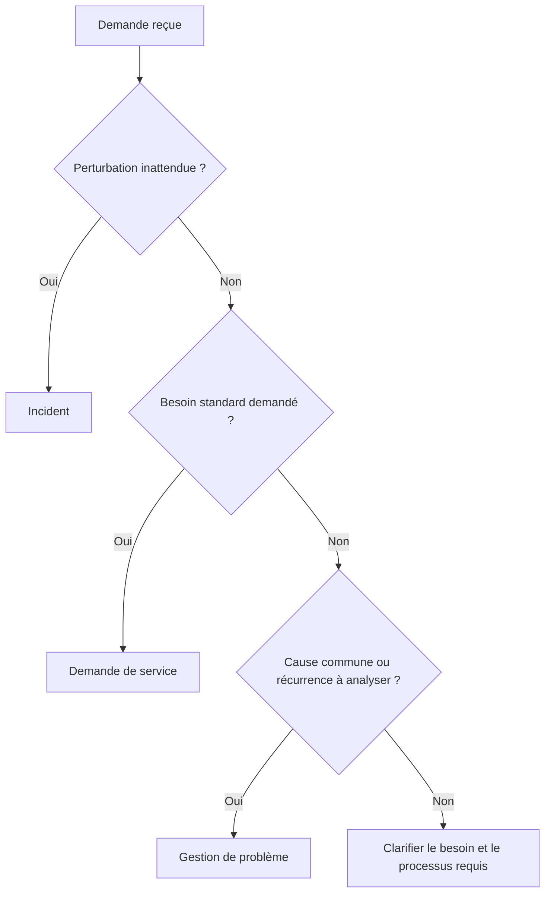
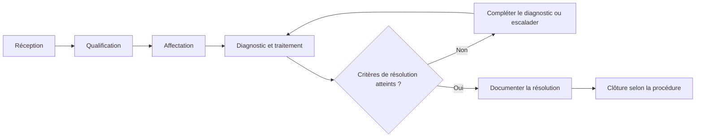
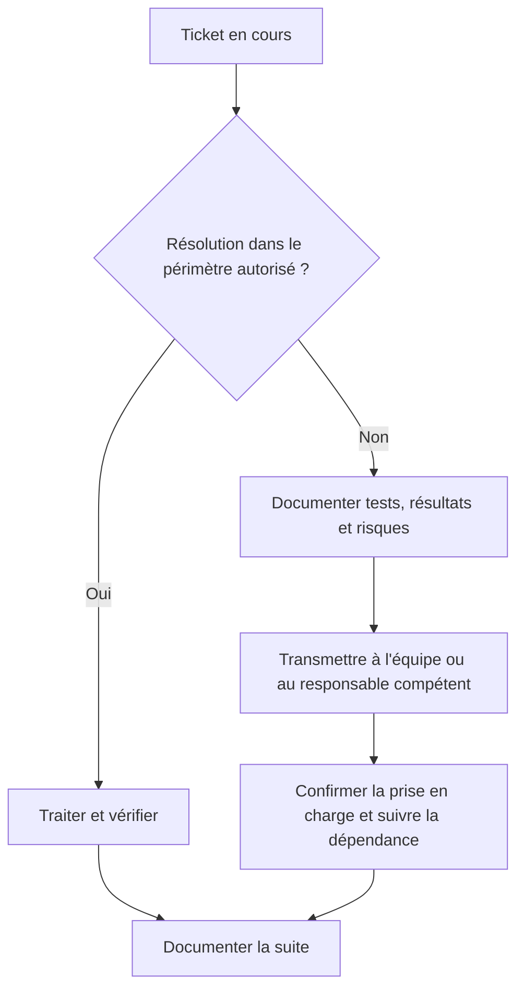

# Gestion des tickets et du helpdesk

> **Mise en contexte**
>
> Tu es technicien dans une entreprise de quarante personnes. Dès l'ouverture du service, plusieurs demandes arrivent : un collaborateur ne peut plus se connecter, une imprimante est inaccessible, un autre demande l'installation d'un logiciel et un responsable signale une interruption qui touche une équipe entière.
>
> Sans méthode commune, les demandes se perdent dans les courriels, les utilisateurs relancent plusieurs fois, les techniciens répètent les mêmes contrôles et personne ne sait clairement ce qui est en cours. Le helpdesk organise la réception, la qualification, le suivi et la résolution des demandes. Le ticket est la trace structurée de ce travail : il permet de comprendre le besoin, de prioriser les actions, de communiquer et de conserver un historique exploitable.
>
> Ce cours t'apprend à traiter une demande depuis sa réception jusqu'à sa clôture. Tu vas distinguer incident, requête et problème, construire un ticket clair, estimer l'impact et l'urgence, appliquer une priorisation cohérente, communiquer avec l'utilisateur, transférer un dossier et reconnaître les limites d'un outil de ticketing.

## 1. Objectifs pédagogiques

À la fin du cours, tu devras être capable de :

- expliquer le rôle du helpdesk dans une organisation ;
- distinguer incident, demande de service, problème et changement ;
- décrire le cycle de vie d'un ticket ;
- recueillir les informations indispensables sans demander de données inutiles ;
- rédiger un titre et une description clairs ;
- catégoriser une demande et identifier son périmètre ;
- évaluer l'impact, l'urgence et la priorité ;
- comprendre la différence entre délai de prise en charge et délai de résolution ;
- communiquer des mises à jour utiles à l'utilisateur ;
- documenter les tests et les actions de façon factuelle ;
- utiliser les procédures de transfert et d'escalade ;
- protéger les données personnelles, les identifiants et les informations d'infrastructure ;
- clôturer un ticket uniquement lorsque les critères attendus sont remplis ;
- identifier les indicateurs de base du support.

## 2. Le rôle du helpdesk

### 2.1 Qu'est-ce que le helpdesk ?

Le helpdesk est le point d'entrée du support informatique. Il reçoit les demandes, vérifie les informations, résout les cas relevant de son périmètre et transmet les autres aux équipes compétentes.

Dans certaines organisations, le helpdesk constitue le premier niveau de support. Dans d'autres, il regroupe plusieurs niveaux ou travaille avec un centre de services plus large. Le nom de l'équipe importe moins que la clarté des responsabilités.

Ses activités peuvent comprendre :

- réception des incidents et des demandes ;
- assistance à l'utilisation ;
- diagnostic de premier niveau ;
- gestion des accès selon une procédure approuvée ;
- installation autorisée de logiciels ;
- suivi des équipements et des tickets ;
- transmission aux équipes spécialisées ;
- information des utilisateurs ;
- mise à jour de la base de connaissances.

Le helpdesk ne doit pas tout résoudre lui-même. Il doit surtout s'assurer que chaque demande est comprise, priorisée, suivie et traitée par le bon acteur.

### 2.2 Pourquoi enregistrer les demandes ?

Une demande reçue uniquement à l'oral peut être oubliée ou mal transmise. Un ticket permet de conserver une référence commune, l'heure du signalement, le besoin, les actions et les décisions.

Le ticket est utile à plusieurs personnes :

- l'utilisateur peut retrouver la référence de sa demande ;
- le technicien sait ce qui a déjà été fait ;
- le responsable suit l'état de la file ;
- une autre équipe reprend le dossier sans repartir de zéro ;
- l'organisation analyse les récurrences et les délais.

Un ticket n'est pas simplement un formulaire administratif. C'est un outil de continuité du travail et de gestion du risque.

### 2.3 Helpdesk et satisfaction utilisateur

Un support de qualité ne se mesure pas uniquement au nombre de tickets fermés. Il dépend aussi de la justesse des solutions, de la communication, de la protection des données et de la capacité à éviter les incidents récurrents.

Une réponse rapide mais incorrecte peut aggraver la situation. Une bonne prise en charge explique ce qui est connu, ce qui reste à vérifier et quelle est la prochaine étape.

## 3. Distinguer les types de demandes

Les mots utilisés au moment de l'enregistrement influencent le traitement. Il est donc important de distinguer les catégories principales.

### 3.1 Incident

Un incident est une interruption ou une dégradation inattendue d'un service informatique.

Exemples :
- un utilisateur ne peut plus accéder à sa messagerie ;
- plusieurs postes perdent l'accès à une application ;
- une imprimante partagée n'imprime plus ;
- un serveur de fichiers devient indisponible ;
- une sauvegarde planifiée échoue et réduit la protection des données.

L'incident décrit une perturbation. Il ne donne pas automatiquement la cause.

### 3.2 Demande de service

Une demande de service correspond à un besoin standard, autorisé et généralement prévu par les procédures.

Exemples :
- demander l'accès à un logiciel ;
- obtenir un nouvel équipement ;
- demander l'installation d'une application approuvée ;
- créer un compte selon le processus officiel ;
- demander des instructions ou une assistance.

Une demande de service peut nécessiter une approbation, même lorsqu'elle est courante. Un technicien ne doit pas accorder un droit sensible uniquement parce qu'un ticket le demande.

### 3.3 Problème

Dans les pratiques de gestion des services, un problème est la cause réelle ou potentielle d'un ou de plusieurs incidents. Le travail de gestion des problèmes cherche à comprendre les causes, les récurrences et les mesures capables de réduire les incidents futurs.

Exemple : plusieurs utilisateurs rencontrent chaque semaine une perte de connexion à une application au même moment. Chaque occurrence peut être un incident, tandis que l'analyse de la cause commune constitue une activité de gestion de problème.

La cause profonde peut rester inconnue pendant un certain temps. Il faut alors conserver les hypothèses et les preuves sans inventer une conclusion.

### 3.4 Changement

Un changement modifie un service, un système, une configuration ou une infrastructure. Il peut être standard, planifié ou urgent selon les règles de l'organisation.

Exemples :
- modifier une configuration réseau ;
- mettre à jour un serveur de production ;
- déplacer un service ;
- modifier les permissions d'un dossier partagé ;
- changer une configuration de sauvegarde.

Un ticket d'incident ne donne pas automatiquement le droit de réaliser un changement. Les modifications qui présentent un risque doivent suivre le processus de validation prévu.

### 3.5 Comment choisir la catégorie ?

Pose-toi ces questions :

1. Un service qui fonctionnait est-il interrompu ou dégradé ? Il peut s'agir d'un incident.
2. L'utilisateur demande-t-il une action standard prévue ? Il peut s'agir d'une demande de service.
3. Observe-t-on des incidents récurrents nécessitant l'analyse d'une cause commune ? Une démarche de gestion de problème peut être appropriée.
4. Faut-il modifier un système ou une configuration selon un processus de changement ? Enregistre et fais approuver ce changement selon les règles applicables.

Les outils peuvent proposer des catégories différentes. Il faut respecter la taxonomie de l'organisation plutôt que créer librement de nouvelles catégories.

### Schéma 1 — Orienter une demande

Ce diagramme fournit une première orientation. Le ticket peut être lié à un problème ou à un changement sans que l'incident initial disparaisse du suivi.

## 4. Le cycle de vie d'un ticket

Les statuts exacts dépendent du logiciel et de l'organisation. Le principe reste le même : chaque ticket doit avoir un état compréhensible et une prochaine action identifiable.

### 4.1 Réception

La demande arrive par un portail, un courriel, un téléphone, un outil de supervision ou un autre canal autorisé. Si elle arrive oralement, le technicien doit l'enregistrer dans le système prévu.

Il faut éviter d'avoir une file officielle et une seconde file invisible dans les messages privés. Si une urgence est traitée immédiatement, les informations utiles doivent ensuite être consignées selon la procédure.

### 4.2 Qualification

La qualification consiste à préciser le besoin, le périmètre, l'impact, l'urgence, la catégorie et les informations manquantes.

Un ticket n'a pas besoin d'être parfait dès sa création, mais les champs essentiels doivent être renseignés et les inconnues importantes signalées.

### 4.3 Affectation

Le ticket est affecté à une personne ou une équipe disposant du rôle approprié. L'affectation doit tenir compte des compétences, des droits et des responsabilités.

Une demande de réinitialisation standard peut être traitée par le support de premier niveau. Une anomalie de stockage sur un serveur critique peut nécessiter une équipe spécialisée.

### 4.4 Diagnostic et traitement

Le technicien recueille des éléments, choisit les tests autorisés et consigne les résultats. Une action doit être reliée à une hypothèse ou à une procédure connue.

Si le ticket est mis en attente, précise ce qui est attendu : réponse de l'utilisateur, approbation, pièce de remplacement, action d'une autre équipe ou fenêtre de maintenance.

### 4.5 Résolution

La résolution correspond au rétablissement ou à la réponse attendue selon les critères définis. Le technicien explique l'action réalisée et la manière dont elle a été vérifiée.

Si une solution de contournement est appliquée, il faut le dire. Une solution temporaire ne doit pas être présentée comme une suppression certaine de la cause.

### 4.6 Clôture

La clôture suit les règles de l'organisation : vérification du résultat, documentation suffisante et éventuellement confirmation de l'utilisateur. Dans certains environnements, le ticket peut rester résolu pendant une période de confirmation avant de passer à l'état fermé.

Ne ferme pas un ticket uniquement pour réduire une file ou améliorer une statistique. Le statut doit représenter la réalité.

### Schéma 2 — Cycle de vie du ticket

Un ticket peut revenir au diagnostic si le problème réapparaît ou si la validation révèle qu'un critère n'est pas satisfait.

## 5. Construire un ticket de qualité

### 5.1 Titre

Le titre doit résumer le symptôme ou le besoin sans conclure prématurément à une cause.

Mauvais exemple : « Serveur cassé ».

Meilleur exemple : « Accès au dossier partagé impossible pour le service comptabilité ».

Autre mauvais exemple : « Urgent !!! ».

Meilleur exemple : « Application de facturation indisponible pour trois utilisateurs depuis 9 h 20 ».

Un bon titre permet de comprendre rapidement l'objet et le périmètre.

### 5.2 Description

La description précise les faits connus. Elle peut indiquer :
- le service ou l'équipement concerné ;
- le moment d'apparition ;
- le message exact ;
- les utilisateurs touchés ;
- les actions déjà tentées ;
- les conséquences opérationnelles ;
- les informations encore manquantes.

Il ne faut pas remplir un champ avec des suppositions comme s'il s'agissait de faits. Utilise des formulations telles que « l'utilisateur signale », « vérifié à 10 h 15 » ou « cause non confirmée ».

### 5.3 Catégorie et sous-catégorie

La catégorie aide à orienter le ticket vers la bonne équipe et à produire des statistiques utiles. Selon l'organisation, les catégories peuvent concerner poste de travail, réseau, compte, logiciel, matériel, sécurité, sauvegarde ou accès.

Choisis la catégorie qui correspond au sujet principal. Si plusieurs services sont touchés, précise-le dans le ticket et crée les liens nécessaires selon le processus prévu.

### 5.4 Équipement et utilisateur

Associer le ticket à un identifiant d'équipement évite les confusions entre machines semblables. Il est préférable d'utiliser l'inventaire officiel plutôt que de se fier uniquement au nom saisi oralement.

Collecte seulement les informations personnelles nécessaires au traitement et protège les données selon les règles de l'organisation.

### 5.5 Priorité

La priorité détermine l'ordre de traitement selon l'impact et l'urgence. Elle ne doit pas être définie uniquement par le ton de la demande ou par l'insistance de l'utilisateur.

Les règles exactes doivent être documentées pour que deux techniciens évaluent une même situation de manière cohérente.

### 5.6 Pièces jointes et preuves

Une capture d'écran, un message d'erreur ou un extrait de journal peut accélérer le diagnostic. Vérifie néanmoins que la pièce jointe ne contient pas de mots de passe, d'informations personnelles non nécessaires, de données métier sensibles ou d'informations d'infrastructure qui n'ont pas besoin d'être partagées.

Il vaut mieux conserver un extrait ciblé et contextualisé qu'un fichier complet volumineux sans explication.

### 5.7 Exemple de ticket correctement rédigé

**Titre :** Accès impossible au dossier partagé pour le bureau B.

**Description :** Depuis environ 10 h 05, trois utilisateurs du bureau B ne parviennent plus à ouvrir le dossier partagé utilisé pour le travail quotidien. Les applications locales fonctionnent. Le message exact doit être recueilli. La cause n'est pas confirmée.

**Impact :** accès aux documents communs interrompu pour les utilisateurs concernés.

**Catégorie :** stockage ou accès aux ressources partagées, selon le catalogue interne.

**Priorité :** provisoire, à confirmer après évaluation de l'urgence, de l'impact métier et des solutions de contournement.

**Contrôles :** à renseigner après exécution, avec heure et résultat.

**Prochaine action :** recueillir le message exact et effectuer les vérifications autorisées ; escalader si le service partagé est en cause.

Cet exemple ne décrit pas un incident réel. Il illustre la manière de séparer les faits connus des éléments à vérifier.

## 6. Impact, urgence et priorité

### 6.1 Impact

L'impact indique les conséquences du ticket sur les personnes, les services et l'activité. Il dépend du nombre d'utilisateurs, du rôle du service, de la tâche bloquée et des risques associés.

Un seul utilisateur peut être fortement impacté si l'incident bloque une tâche essentielle. Un grand nombre d'utilisateurs touchés ne signifie pas toujours que l'activité est totalement arrêtée : il faut comprendre le contexte.

### 6.2 Urgence

L'urgence décrit le délai dans lequel l'action doit être prise pour limiter les conséquences. Elle peut être élevée si un service essentiel est bloqué, si un risque de perte de données augmente ou si une échéance importante est proche.

### 6.3 Exemple de matrice

| Impact | Urgence | Priorité indicative |
|---|---|---|
| Élevé | Élevée | P1 — Critique |
| Élevé | Moyenne | P2 — Haute |
| Moyen | Élevée | P2 — Haute |
| Moyen | Moyenne | P3 — Normale |
| Faible | Faible | P4 — Basse |

Cette matrice est illustrative. Les niveaux, délais de réaction et règles de dérogation doivent venir de la politique de l'organisation.

### 6.4 Exemple de comparaison

**Cas A :** une souris ne fonctionne plus sur un poste secondaire, mais l'utilisateur dispose d'une solution de remplacement. L'impact est faible et le traitement peut généralement être planifié.

**Cas B :** une application utilisée par toute l'équipe commerciale est indisponible sans solution de contournement. L'impact peut être élevé et l'urgence importante.

**Cas C :** une sauvegarde échoue alors que les systèmes fonctionnent. Le problème peut être urgent si l'organisation risque de perdre sa dernière copie exploitable de données critiques.

### 6.5 Quand réévaluer la priorité ?

La priorité doit évoluer si de nouvelles informations changent l'impact ou l'urgence. Par exemple, un incident initialement limité à un poste peut se révéler affecter un service partagé.

Documente la raison d'une modification importante de priorité. Cela facilite les transmissions et évite les changements arbitraires.

## 7. Délais, SLA et attentes

### 7.1 Temps de réponse et temps de résolution

Le temps de réponse correspond au délai avant une première prise en charge conforme à la définition de l'organisation. Le temps de résolution désigne le temps nécessaire pour satisfaire les critères de résolution selon les règles de mesure utilisées.

Une première réponse automatique n'est pas nécessairement une prise en charge humaine. Il faut comprendre les règles internes avant de calculer ou d'annoncer ces délais.

### 7.2 SLA

Un accord de niveau de service, souvent appelé SLA, fixe les engagements de service entre parties : disponibilité, délais de réponse ou de résolution, périmètre et responsabilités selon le contrat ou la politique concernée.

Le technicien ne doit pas promettre un délai contractuel qu'il n'a pas vérifié. Il doit utiliser les objectifs approuvés et prévenir le responsable lorsque le risque de dépassement apparaît.

### 7.3 Files d'attente et blocages

Un ticket peut attendre une réponse, une validation, une pièce ou une action d'une autre équipe. Ces attentes doivent être visibles, avec un responsable et une prochaine étape.

Un ticket oublié dans l'état « en cours » peut fausser la vision de la charge. Le suivi doit distinguer le travail actif des dépendances externes.

### 7.4 Communication lorsque le délai évolue

Quand un délai risque de dépasser l'engagement, informe l'utilisateur avec des faits : ce qui a été vérifié, ce qui bloque encore, la prochaine action et le moment prévu du prochain point de situation si celui-ci est défini.

Évite de répéter une estimation non fiable uniquement pour rassurer. Une communication transparente est préférable à une promesse impossible à tenir.

## 8. Communication au helpdesk

### 8.1 Écouter et reformuler

L'utilisateur décrit le problème avec ses mots. Le technicien doit écouter, poser des questions ciblées et reformuler le besoin.

Par exemple, « Internet est cassé » peut signifier que tous les sites sont inaccessibles, qu'une application particulière est lente ou que la connexion au réseau interne échoue. Il faut clarifier avant de choisir les tests.

### 8.2 Adapter les mots au destinataire

Un technicien peut utiliser les termes techniques dans le journal interne, mais l'utilisateur doit recevoir une explication compréhensible.

Évite les formulations culpabilisantes. Le but est d'identifier la situation, pas d'accuser l'utilisateur d'avoir mal agi.

### 8.3 Accuser réception sans prétendre avoir résolu

Un accusé de réception doit confirmer l'enregistrement et expliquer la suite, sans affirmer que le problème est déjà pris en charge si ce n'est pas le cas.

Exemple :

« Votre demande est enregistrée sous la référence INC-2026-0142. Nous vérifions actuellement le périmètre du problème et reviendrons vers vous lorsque les premiers contrôles permettront de préciser la suite. »

### 8.4 Demander une information supplémentaire

La demande doit être précise et limiter la charge pour l'utilisateur.

Exemple :

« Pour poursuivre le diagnostic, peux-tu transmettre le texte exact du message affiché et indiquer si le problème survient également depuis un autre poste autorisé ? Merci de masquer toute information confidentielle visible dans la capture. »

### 8.5 Annoncer une solution

Une fois le test terminé, indique ce qui a été fait et ce qui a été vérifié. Si un contournement reste en place ou si une cause demeure inconnue, il faut le dire explicitement.

### 8.6 Refus et limites

Une demande peut dépasser les droits de l'utilisateur, les règles de sécurité ou le périmètre du support. Dans ce cas, explique la règle de manière neutre et indique la procédure alternative autorisée. N'expose pas de détails qui faciliteraient le contournement des contrôles.

## 9. Affectation et escalade

### 9.1 Pourquoi transférer ?

Un ticket doit être transmis lorsque la résolution nécessite un autre niveau de compétence, un privilège différent, un fournisseur ou une approbation particulière.

Une bonne escalade évite les interventions non autorisées et permet à l'équipe spécialisée de reprendre le dossier avec les preuves utiles.

### 9.2 Informations nécessaires

Prépare un transfert contenant :
- le titre et le symptôme ;
- la portée et l'impact ;
- l'heure de début ;
- la priorité et sa justification ;
- les contrôles effectués ;
- les résultats exacts ;
- les changements déjà réalisés ;
- les hypothèses restantes ;
- le risque éventuel ;
- l'action attendue de l'équipe suivante.

Ne présente pas un résultat non vérifié comme une conclusion.

### 9.3 Escalade fonctionnelle et technique

Une escalade technique transmet le problème à une équipe qui possède les compétences ou les accès nécessaires. Une escalade fonctionnelle peut concerner une approbation, une décision métier ou un responsable de service.

Un ticket d'accès, par exemple, peut être techniquement simple mais exiger l'approbation du responsable hiérarchique. Le support ne doit pas remplacer cette approbation par sa propre décision.

### 9.4 Schéma de transfert

La transmission ne signifie pas abandonner le ticket. Le responsable du suivi doit rester clair selon les règles de l'organisation.

## 10. Base de connaissances et récurrences

### 10.1 Pourquoi capitaliser ?

Une base de connaissances conserve des procédures et des solutions vérifiées. Elle permet de résoudre plus rapidement des cas connus et d'uniformiser les réponses.

Une bonne fiche de connaissance décrit le symptôme, le périmètre, les prérequis, les étapes autorisées, les résultats attendus, les limites et les conditions d'escalade.

### 10.2 Ne pas publier une solution improvisée

Une manipulation qui fonctionne une seule fois ne doit pas automatiquement devenir une procédure officielle. Il faut vérifier son efficacité, ses risques, son domaine d'application et son approbation.

Une procédure doit préciser les versions, les environnements ou les conditions lorsque ces différences peuvent modifier le résultat.

### 10.3 Identifier les incidents récurrents

Lorsque des tickets similaires reviennent, associe-les si l'outil le permet et signale le motif commun. Les récurrences peuvent révéler une cause profonde, un problème de capacité, une documentation insuffisante ou une faiblesse d'organisation.

Le helpdesk contribue ainsi à l'amélioration du service, et pas seulement à la résolution individuelle des demandes.

## 11. Confidentialité et sécurité des tickets

Les tickets peuvent contenir des informations sensibles : identité des utilisateurs, noms de serveurs, adresses IP, journaux, captures, noms d'applications et détails d'incidents de sécurité.

Respecte le principe de minimisation : enregistre uniquement ce qui est nécessaire au traitement. Vérifie les destinataires et les droits d'accès avant d'ajouter une pièce jointe ou de partager le ticket.

Ne mets jamais de mot de passe, de jeton d'accès, de clé privée ou de secret dans la description d'un ticket. Utilise le mécanisme approuvé pour les secrets et la réinitialisation des accès.

Un ticket qui concerne un incident de sécurité doit suivre les règles spécifiques de l'organisation. Il peut nécessiter une visibilité restreinte, une conservation particulière ou une transmission directe à l'équipe de sécurité.

## 12. Indicateurs simples du helpdesk

Les indicateurs aident à comprendre la charge et la qualité du service. Ils doivent être interprétés avec le contexte.

**Volume de tickets :** mesure le nombre de demandes enregistrées pendant une période. Une hausse peut venir d'une augmentation du parc, d'une meilleure remontée des incidents ou d'une dégradation de service.

**Temps de première réponse :** indique le délai avant la première prise en charge selon la définition officielle.

**Temps de résolution :** mesure le délai avant que les critères définis soient satisfaits.

**Tickets en attente :** montre le volume des demandes qui attendent une réponse, une validation ou une dépendance.

**Réouvertures :** peut signaler une résolution incomplète, un problème récurrent ou des critères de clôture insuffisamment définis.

**Respect des SLA :** mesure la part des tickets satisfaisant les engagements de service applicables, selon les règles de calcul.

**Satisfaction utilisateur :** apporte un signal sur l'expérience, mais doit être interprétée avec prudence et combinée à d'autres mesures.

Les indicateurs ne doivent pas inciter les techniciens à fermer rapidement des tickets au détriment de la qualité. Une mesure n'a de valeur que si les règles sont claires et les données fiables.

## 13. Travaux pratiques

### TP 1 — Transformer une demande vague en ticket clair

**Situation :** un utilisateur dit « le réseau est lent ».

**Mission :**
1. pose au moins cinq questions utiles ;
2. rédige un titre neutre ;
3. décris les faits connus et les informations manquantes ;
4. propose une catégorie provisoire ;
5. explique comment tu vas déterminer l'impact ;
6. indique la prochaine action.

**Résultat attendu :** un ticket qui ne suppose pas encore de cause et peut être repris par un autre technicien.

### TP 2 — Qualifier quatre demandes

Classe chaque situation : incident, demande de service, problème ou changement. Justifie la décision selon le contexte.

- une application utilisée fonctionne soudainement plus ;
- un collaborateur demande un accès à un nouveau logiciel ;
- le même incident revient chaque lundi ;
- une équipe souhaite modifier une configuration réseau de production.

Une situation peut donner lieu à des tickets liés, par exemple un incident qui révèle un problème récurrent et nécessite ensuite un changement approuvé.

### TP 3 — Prioriser une file de tickets

Prépare un tableau avec cinq tickets, leur impact, leur urgence, leur priorité provisoire, les informations manquantes et la prochaine action.

Inclus au minimum :
- une demande de périphérique ;
- une application critique indisponible ;
- un échec de sauvegarde ;
- un accès standard nécessitant une validation ;
- un incident intermittent touchant une seule personne.

Justifie chaque priorité. Ne choisis pas automatiquement le ticket le plus ancien ou celui dont l'utilisateur relance le plus souvent.

### TP 4 — Rédiger une escalade exploitable

**Situation :** un incident touche plusieurs utilisateurs, mais la cause semble dépendre d'un service central auquel tu n'as pas accès administrateur.

Prépare le transfert en décrivant les symptômes, les utilisateurs affectés, l'heure d'apparition, les tests autorisés, leurs résultats et les vérifications encore nécessaires.

**Critère de réussite :** l'équipe suivante peut comprendre le problème sans te demander immédiatement de répéter les mêmes tests.

### TP 5 — Clôture et confirmation

Crée une checklist de clôture pour un ticket d'imprimante partagée. Elle doit inclure le test fonctionnel, le contrôle du périmètre, la vérification des éventuelles conséquences, la documentation et l'information de l'utilisateur.

Précise également le cas où le service est rétabli temporairement mais où la cause reste inconnue.

## 14. Exercices avec corrections

### Exercice 1 — Reconnaître une demande de service

Un utilisateur demande l'installation d'un logiciel déjà approuvé dans le catalogue de l'entreprise. Aucun service existant n'est en panne.

**Correction :** il s'agit généralement d'une demande de service. Il faut vérifier les conditions d'éligibilité et les validations requises avant l'installation.

### Exercice 2 — Identifier un incident

Une application fonctionnelle devient inaccessible de manière inattendue à plusieurs utilisateurs.

**Correction :** il s'agit d'un incident. La cause n'est pas connue au moment du signalement et doit être recherchée.

### Exercice 3 — Distinguer incident et problème

La même erreur survient chaque semaine sur plusieurs postes.

**Correction :** chaque occurrence peut être enregistrée comme incident, tandis que l'analyse de la cause commune relève de la gestion de problème. Les tickets peuvent être reliés selon les fonctions de l'outil.

### Exercice 4 — Choisir un titre

Quel titre est le plus utile ?

A. « URGENT !!! »  
B. « Serveur détruit »  
C. « Accès à l'application comptable impossible pour plusieurs utilisateurs »  
D. « Tout est en panne »

**Correction : C.** Il indique le service et le périmètre sans inventer de cause ni exagérer l'impact.

### Exercice 5 — Priorité et insistance

Un utilisateur relance dix fois une demande non critique. Un autre incident bloque un service essentiel pour toute une équipe. Quel principe appliquer ?

**Correction :** la priorité doit refléter l'impact et l'urgence conformément aux règles de l'organisation. Le nombre de relances ne suffit pas à rendre une demande prioritaire.

### Exercice 6 — Ticket incomplet

Un ticket indique seulement « imprimante en panne ».

**Correction :** il faut recueillir le message d'erreur, le nombre d'utilisateurs concernés, l'équipement, l'heure d'apparition et les tests déjà réalisés. Le diagnostic ne doit pas supposer que le matériel est réellement défectueux.

### Exercice 7 — Résolution temporaire

Un redémarrage rétablit une application, mais elle retombe en panne quelques minutes plus tard.

**Correction :** le service a été rétabli temporairement, mais le problème n'est pas résolu durablement. Il faut documenter la récurrence, poursuivre l'analyse et mettre à jour le statut du ticket.

### Exercice 8 — Informations sensibles

Un utilisateur joint une capture contenant un mot de passe visible.

**Correction :** ne diffuse pas cette capture plus largement. Suis la procédure de protection et de suppression ou de remplacement de la pièce jointe si elle existe, puis utilise un mécanisme approuvé pour traiter le secret exposé. La procédure exacte dépend des règles de l'organisation.

### Exercice 9 — Bonne escalade

Quelle information est la plus utile lors du transfert ?

A. « J'ai tout essayé. »  
B. Une liste de tests réellement exécutés avec leurs résultats et limites.  
C. Une supposition présentée comme certaine.  
D. Le seul nom du technicien.

**Correction : B.** Les résultats documentés évitent de répéter les mêmes actions et permettent à l'équipe suivante de poursuivre le diagnostic.

### Exercice 10 — Indicateurs de performance

Pourquoi le nombre de tickets fermés par technicien ne suffit-il pas à mesurer la qualité ?

**Correction :** cet indicateur ne mesure pas la justesse des solutions, la complexité, les réouvertures, la satisfaction ou les risques évités. Il doit être interprété avec d'autres mesures et ne doit pas inciter à clôturer prématurément.

## 15. Défi final — Gérer une file de tickets sur une matinée

### Situation

À 9 h, tu prends en charge quatre demandes :

1. une personne ne peut plus imprimer, mais ses collègues impriment normalement ;
2. une application métier est indisponible pour un service entier ;
3. un collaborateur demande un accès à un répertoire sensible ;
4. un rapport indique que la dernière sauvegarde d'un serveur a échoué.

Tu dois enregistrer les demandes, définir les priorités provisoires, planifier les premières actions et assurer la communication.

### Travail demandé

1. Détermine la catégorie de chaque demande.
2. Rédige un titre et un résumé factuel pour chaque ticket.
3. Propose une priorité et justifie-la.
4. Liste les informations manquantes.
5. Définis une première action autorisée.
6. Identifie les demandes qui nécessitent une approbation ou une équipe spécialisée.
7. Prépare une communication courte pour les utilisateurs.
8. Définis les critères de résolution et de clôture.

### Correction détaillée

**1. Catégories**

- Impression : incident.
- Application métier indisponible : incident.
- Accès au répertoire : demande de service, sous réserve des règles d'accès.
- Échec de sauvegarde : incident ou anomalie d'exploitation, selon la catégorisation interne.

La répétition d'un échec de sauvegarde peut également justifier une analyse de problème.

**2. Titres possibles**

- « Impression impossible depuis un poste utilisateur ».
- « Application métier indisponible pour un service ».
- « Demande d'accès à un répertoire sensible ».
- « Échec de la dernière sauvegarde du serveur ».

Ces titres décrivent les demandes sans inventer leurs causes.

**3. Priorités provisoires**

L'application métier et l'échec de sauvegarde nécessitent une évaluation rapide, car l'un bloque le travail et l'autre peut réduire la protection des données. La priorité exacte dépend de la criticité, des alternatives et des règles établies.

L'impression peut avoir un impact plus limité si les autres postes fonctionnent. L'accès au répertoire requiert une validation et ne doit pas être accordé sans approbation.

**4. Informations manquantes**

Il faut connaître le nombre exact d'utilisateurs touchés, les messages d'erreur, les horaires, l'existence de solutions de contournement, la dernière sauvegarde exploitable, la sensibilité du répertoire et l'identité du valideur requis.

**5. Premières actions**

- Impression : recueillir le message et comparer avec un poste fonctionnel.
- Application métier : vérifier le périmètre, les alertes disponibles et les informations du service.
- Accès : vérifier la demande, la justification et l'approbation requise.
- Sauvegarde : consulter le rapport, mesurer le périmètre affecté et alerter le responsable si la protection des données est menacée.

Les actions exactes doivent respecter le niveau d'accès du technicien.

**6. Escalade**

L'application peut nécessiter l'équipe applicative. L'échec de sauvegarde peut nécessiter l'équipe de stockage ou d'exploitation. L'accès au répertoire doit suivre le processus d'approbation. Aucun droit sensible ne doit être accordé sur la seule demande orale.

**7. Communication**

Pour l'application :

« Votre incident est enregistré. Plusieurs utilisateurs semblent concernés ; nous vérifions le périmètre et consultons les informations de service. Nous vous tiendrons informés dès que les contrôles permettront de préciser le rétablissement. »

Pour la sauvegarde :

« Une anomalie a été détectée sur la dernière sauvegarde. Nous vérifions les résultats et l'existence de copies exploitables afin de déterminer les actions nécessaires. »

**8. Critères de clôture**

- Impression : un travail représentatif s'imprime et le périmètre concerné est vérifié.
- Application : les utilisateurs peuvent effectuer les opérations nécessaires, et la cause ou les limites restantes sont documentées.
- Accès : l'approbation existe, le droit requis est appliqué et l'accès est testé.
- Sauvegarde : le résultat est confirmé par les contrôles prévus et les données sont suffisamment protégées selon la politique.

### Barème indicatif

| Critère | Points |
|---|---:|
| Catégorisation correcte | 3 |
| Titres et descriptions factuels | 3 |
| Priorités justifiées | 3 |
| Informations manquantes identifiées | 2 |
| Actions adaptées et autorisées | 3 |
| Escalade et communication | 3 |
| Critères de clôture | 3 |
| **Total** | **20** |

## 16. Synthèse du cours

Le helpdesk transforme des demandes parfois imprécises en dossiers suivis et traitables. Un ticket de qualité décrit les faits, indique le périmètre, aide à établir la priorité et conserve l'historique des contrôles.

Les points à retenir :

1. Distinguer incident, demande de service, problème et changement.
2. Décrire le symptôme sans annoncer une cause non vérifiée.
3. Utiliser une catégorie et une priorité cohérentes.
4. Séparer temps de réponse et temps de résolution.
5. Informer l'utilisateur sur la prochaine étape sans promettre un délai non confirmé.
6. Documenter les tests et les actions réellement réalisés.
7. Escalader avec des résultats et des risques clairement identifiés.
8. Protéger les secrets, données personnelles et informations techniques.
9. Vérifier les critères de résolution avant de clôturer.
10. Utiliser les indicateurs pour améliorer le service plutôt que pour fermer des tickets trop rapidement.

La méthode à retenir est : **recevoir → qualifier → prioriser → affecter → diagnostiquer → traiter → vérifier → documenter → clôturer ou escalader.**
