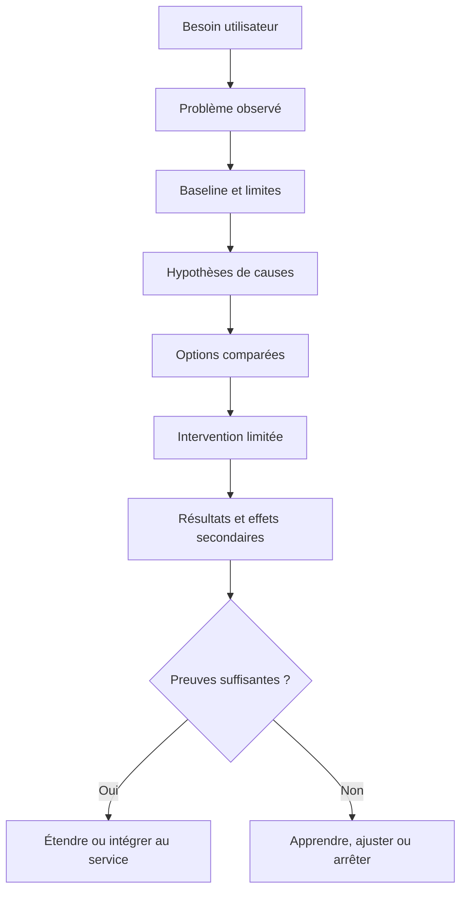
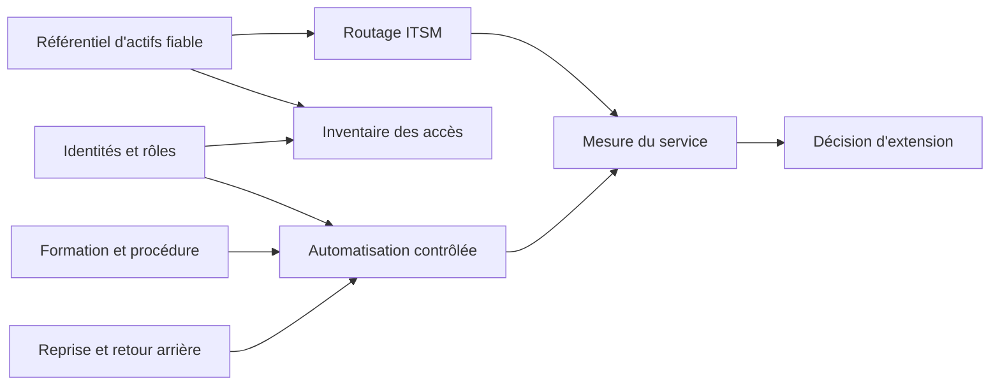
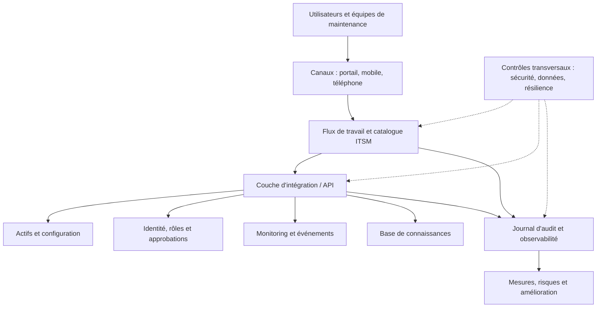
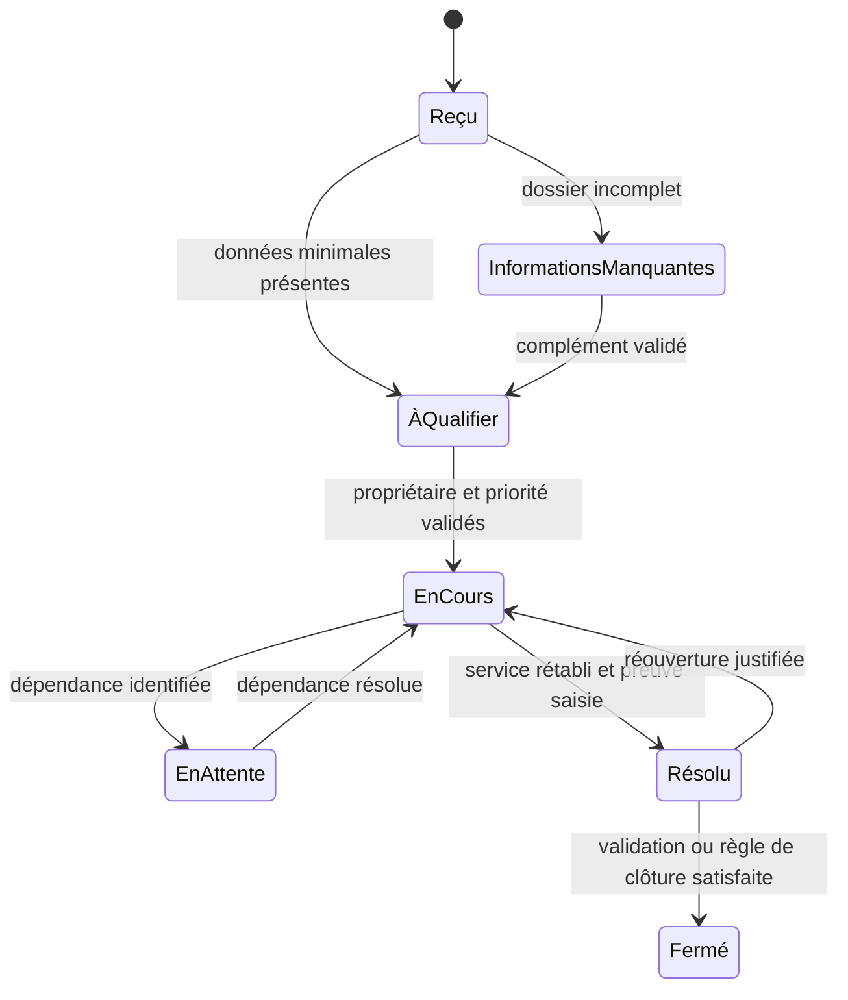
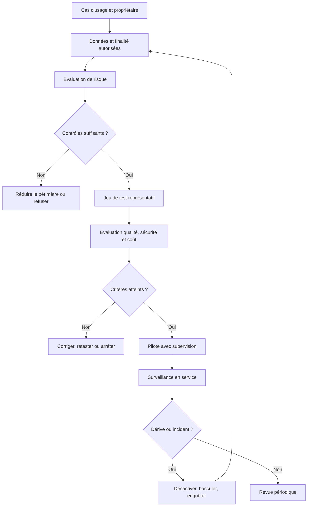
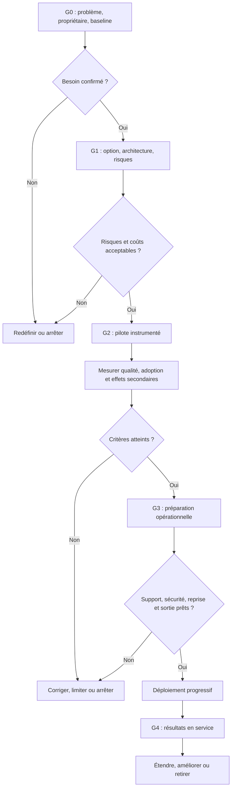

# Transformation numérique (ITSM, IA) — Expert

> **Mise en contexte** — Une équipe de maintenance peut déployer un nouvel ITSM, migrer des workloads vers le cloud, automatiser des tickets et ajouter une IA tout en conservant les mêmes retards, les mêmes données erronées et les mêmes irritants. La transformation numérique n'est donc pas un catalogue d'outils. C'est une évolution pilotée du service rendu, du modèle opérationnel, des processus, des responsabilités, des données, de l'architecture et des compétences. L'expert part du problème utilisateur et des résultats métier, explicite ses hypothèses, construit une trajectoire réaliste, protège l'exploitation et mesure les effets après la mise en service. Il sait aussi renoncer à une solution séduisante lorsque les preuves, les risques, le coût complet ou la capacité d'adoption ne justifient pas l'investissement.

## Objectifs pédagogiques

À la fin du cours, l'apprenant sera capable de :

- construire un diagnostic de maturité qui distingue symptômes, causes, contraintes et dépendances ;
- traduire des objectifs métiers en résultats mesurables et en hypothèses testables ;
- sélectionner et séquencer un portefeuille d'initiatives selon la valeur, le risque, le coût complet et la capacité de changement ;
- concevoir un modèle opérationnel cible incluant décision, responsabilités, architecture, données, sécurité et exploitation ;
- moderniser un parcours ITSM sans simplement numériser les défauts du processus existant ;
- évaluer l'opportunité d'une migration cloud, d'une intégration, d'une automatisation ou d'une IA ;
- organiser une expérimentation avec des critères d'entrée, des garde-fous, une comparaison crédible et des critères d'arrêt ;
- construire un dispositif d'adoption qui inclut les personnes, la charge, les compétences, le support et les retours terrain ;
- relier indicateurs opérationnels, résultats de service, coûts, bénéfices réalisés et décisions d'investissement ;
- préparer la mise en production, le retour arrière, la réversibilité fournisseur et l'amélioration continue.

## Prérequis et limites de responsabilité

Ce cours s'adresse à un professionnel ayant déjà étudié la gestion budgétaire et le ROI. Il ne remplace pas les pratiques de gestion de services, d'architecture, de cybersécurité, de protection des données, de finance ou de gestion du changement propres à son organisation.

Les cadres et normes cités sont des ressources de référence, pas des obligations universelles. Vérifier leur version, leur périmètre, leur éventuelle licence, leur adoption locale et les exigences réglementaires qui s'appliquent réellement. Les seuils et chiffres des études de cas sont des hypothèses pédagogiques : ils ne doivent jamais être présentés comme des benchmarks universels.

Avant un changement sensible, confirmer le propriétaire du service, l'autorité qui approuve, les données concernées, la classification des actifs, les conditions de continuité, les fenêtres de changement, les contraintes contractuelles et la procédure d'escalade. Une recommandation de l'IA ne vaut pas une autorisation. Un dossier approuvé ne vaut pas preuve d'exécution. Une exécution réussie ne démontre pas, à elle seule, l'efficacité durable.

## Vocabulaire de travail

| Terme | Sens opérationnel dans ce cours |
|---|---|
| Résultat métier | Changement concret recherché pour une personne, une équipe ou l'organisation, au-delà de la livraison d'une fonctionnalité |
| Parcours utilisateur | Ensemble des étapes, canaux, décisions et transferts nécessaires pour atteindre un résultat |
| Baseline | Mesure de départ, avec période, population, source, méthode, limites et niveau de confiance |
| Capacité numérique | Aptitude durable à concevoir, intégrer, exploiter, sécuriser et améliorer un service numérique |
| Modèle opérationnel cible | Organisation du travail, rôles, décisions, processus, produits, données et moyens permettant de tenir le service dans la durée |
| Architecture cible | Composants, données, interfaces, flux, identités, contraintes et mécanismes d'exploitation envisagés |
| Dette de changement | Coût futur lié à des changements mal adoptés, mal expliqués, insuffisamment documentés ou trop simultanés |
| Dette technique | Coût, risque ou perte d'agilité résultant de compromis techniques accumulés |
| Hypothèse de bénéfice | Relation supposée entre une intervention et un résultat, à vérifier par des preuves |
| Indicateur avancé | Signal susceptible d'annoncer le résultat futur, par exemple le taux de dossiers complets |
| Indicateur retardé | Résultat constaté après un délai, par exemple le taux de réouverture ou l'indisponibilité |
| Gate de décision | Point formel où une personne habilitée autorise, refuse, reporte ou limite l'étape suivante |
| Réversibilité | Capacité à arrêter, remplacer ou quitter une solution sans perte de contrôle inacceptable |
| Mode dégradé | Voie de service connue et contrôlée lorsque la fonction nominale ne marche plus |
| Valeur réalisée | Bénéfice constaté selon une méthode convenue, et non simple bénéfice espéré dans un dossier |

## 1. Distinguer numérisation, digitalisation et transformation

Ces mots sont parfois employés de manière différente selon les organisations. Il faut définir le sens utilisé plutôt que débattre de l'étiquette.

- **Numériser** consiste souvent à convertir une information ou un support en format numérique : papier remplacé par un formulaire en ligne.
- **Digitaliser un processus** consiste à réorganiser une partie du flux de travail avec des outils numériques : formulaire connecté à une file de triage, règles de validation, notifications et historique.
- **Transformer** consiste à faire évoluer le service, ses capacités, ses décisions et son fonctionnement global afin d'atteindre un résultat qui ne serait pas obtenu par un simple remplacement d'outil.

Exemple : déplacer un formulaire de demande d'accès vers un portail web est une numérisation d'interface. Ajouter une validation automatique, des contrôles de séparation des tâches, une traçabilité, des règles de révocation et une mesure des délais améliore le processus. Repenser les rôles, les responsabilités d'approbation, la gestion des identités, les niveaux de risque, le parcours d'arrivée et de départ des collaborateurs et l'architecture d'accès peut relever d'une transformation plus profonde.

Le test utile est le suivant : **qu'est-ce qui change concrètement pour l'utilisateur et pour l'opération, quelle preuve montrera l'amélioration et quelles capacités resteront après la livraison ?** Une nouvelle plateforme, un nombre de tickets migrés ou une fonctionnalité activée sont des livrables. Ils ne démontrent pas, seuls, une amélioration de valeur.

## 2. Définir la vision à partir des besoins

### 2.1 Formuler le problème sans nommer prématurément la solution

Une demande comme « il nous faut un assistant IA » contient déjà un choix technique. La formulation experte décrit d'abord les symptômes observables, la population touchée, les conséquences et les hypothèses explicatives.

Formulation fragile : « Acheter un nouvel outil pour accélérer le support. »

Formulation testable : « Sur les demandes d'accès des équipes de maintenance, le délai entre dépôt et qualification est long et variable, une part des dossiers arrive incomplète et les approbations sont difficiles à retracer. Nous allons mesurer ces phénomènes par type de demande, étudier leurs causes et tester des options de réduction du délai sans réduire la qualité des contrôles. »

Cette formulation ne présume pas que le logiciel existant est la cause. Le problème peut venir de règles ambiguës, d'un catalogue mal défini, d'approbateurs indisponibles, d'une absence de données de référence, d'un trop grand nombre de transferts ou d'interfaces mal comprises.

### 2.2 Construire une chaîne logique

La chaîne relie le besoin à la preuve. Si une étape manque, l'équipe risque de livrer une solution sans savoir quel problème elle résout. Si les mesures sont imprécises, le résultat final sera difficile à interpréter. Si les effets secondaires ne sont pas surveillés, une amélioration locale peut détériorer le système global.

### 2.3 Rédiger un énoncé de transformation exploitable

Un énoncé utile répond à six questions :

1. **Pour qui ?** Utilisateur final, technicien, équipe d'astreinte, responsable du service, finance ou fournisseur.
2. **Quel problème ?** Fait observable, fréquence, délai, risque ou friction.
3. **Quel résultat ?** Par exemple réduire le délai de qualification sans accroître les incidents de sécurité ni les réouvertures.
4. **Quelle mesure ?** Définition, source, période, population, propriétaire et limites de comparabilité.
5. **Quelles contraintes ?** Disponibilité, sécurité, protection des données, contrats, budgets, compétences, dépendances et continuité.
6. **Quelles conditions d'arrêt ?** Dégradation de service, risque non maîtrisé, coût dépassé, qualité insuffisante ou absence de signal crédible de bénéfice.

Éviter les objectifs qui promettent un résultat hors du contrôle de l'équipe. « Garantir zéro incident » n'est pas une cible de transformation raisonnable ; « réduire les erreurs identifiées, détecter rapidement une régression et conserver un processus de retour arrière » décrit des capacités vérifiables.

## 3. Diagnostiquer la maturité avant de définir la cible

### 3.1 Observer les faits et les conditions de collecte

Un diagnostic n'est pas une enquête de popularité ni une présentation commerciale. Il rassemble des traces, des entretiens, des observations de travail et des mesures, puis confronte les sources.

Sources possibles :

- tickets, journaux d'événements et historiques de changements ;
- catalogue de services et règles d'affectation ;
- inventaire matériel et logiciel, dépendances et propriétaires ;
- temps réellement consacré aux activités et transferts ;
- coûts, contrats, renouvellements et consommation cloud ;
- incidents de sécurité, exceptions, constats d'audit et tests de reprise ;
- retours des utilisateurs, agents, équipes d'astreinte et propriétaires métiers ;
- taux d'adoption, recours aux canaux alternatifs et demandes d'assistance ;
- documentation, formations, scripts, outils parallèles et fichiers locaux.

La présence d'une donnée dans un système ne garantit pas son exactitude. Tester les doublons, champs manquants, valeurs impossibles, changements de définition, couverture des actifs et écarts entre systèmes. Conserver la date d'extraction et les critères de sélection. Une baseline incomplète peut être utilisée si ses limites sont explicites ; elle ne doit pas être présentée comme une vérité exhaustive.

### 3.2 Séparer symptômes, causes et contraintes

| Observation | Cause possible à tester | Preuve utile | Risque d'une conclusion hâtive |
|---|---|---|---|
| Beaucoup de tickets réaffectés | Catégories ambiguës, routage incorrect, manque de compétences ou transfert de responsabilité | Historique des affectations et échantillon de dossiers | Automatiser le mauvais classement |
| Délai de résolution élevé | Attente d'une approbation, manque de pièces, dépendance externe ou diagnostic complexe | Mesure du temps actif et du temps d'attente | Accuser les techniciens sur le seul délai total |
| Coût cloud en hausse | Croissance d'usage, ressources oubliées, architecture inefficace, prix ou meilleure observabilité | Coût par service et par unité de consommation | Couper une ressource critique sur la seule facture |
| Faible usage du portail | Besoin mal compris, accès difficile, manque de confiance, canal informel plus simple ou portail inaccessible | Étude utilisateur et taux d'abandon par étape | Imposer le portail sans corriger les irritants |
| Résumé IA peu fiable | Contexte insuffisant, données hétérogènes, version du modèle, prompt, validation ou cas d'usage mal défini | Évaluation sur des cas représentatifs et analyse d'erreurs | Interpréter une démonstration comme une preuve de production |

Il faut aussi distinguer une **cause racine**, un facteur contributif et une contrainte. Une indisponibilité récurrente peut résulter d'une mauvaise configuration, mais aussi d'une dette de capacité, d'une dépendance fournisseur ou d'un processus de changement inadéquat. Les causes peuvent être multiples.

### 3.3 Une grille de maturité utile, mais non universelle

La grille suivante permet d'engager une discussion. Elle n'est ni une norme, ni une certification, ni une échelle officielle.

| Niveau indicatif | Comportement observé | Preuves recherchées |
|---|---|---|
| 1 — Réactif | Initiatives ponctuelles, responsabilités dépendantes des personnes, peu de mesure fiable | Décisions non tracées, pratiques hétérogènes, incidents récurrents |
| 2 — Répétable | Quelques processus et outils communs, documentation inégale | Procédures utilisées, rôles identifiés, quelques indicateurs |
| 3 — Maîtrisé | Propriété des services, données définies, changements contrôlés, base de comparaison | Mesures régulières, responsabilités, tests, revues de risques |
| 4 — Piloté | Portefeuille priorisé, mesures reliées aux résultats, dépendances gérées | Critères de décision, analyses d'écarts, capacités d'adoption |
| 5 — Adaptatif | Apprentissage continu, conception réversible et amélioration fondée sur les preuves | Tests réguliers, post-implémentations, décisions ajustées, retrait maîtrisé |

Ne pas calculer une moyenne unique qui masquerait un risque critique. Une organisation peut être mature en gestion des tickets et fragile en inventaire, sécurité des intégrations ou capacité de reprise. Présenter les dimensions séparément, avec niveau de confiance et points à vérifier.

### 3.4 Cartographier le parcours actuel

Représenter le parcours de bout en bout, y compris les étapes invisibles dans l'outil : appels, e-mails, validations orales, feuilles de calcul et attentes. Pour chaque étape, documenter :

- déclencheur et résultat attendu ;
- rôle responsable et autorité de décision ;
- entrée, sortie et règles de validation ;
- système maître de la donnée et identifiant de corrélation ;
- temps actif, temps d'attente et dépendances ;
- exceptions et fréquence observée ;
- contrôles, preuves, risques et contournements ;
- douleur utilisateur et éventuelles solutions de secours.

Un flux simple peut révéler que le goulot d'étranglement n'est pas l'étape que l'équipe souhaite automatiser. Le parcours devrait être confirmé avec les personnes qui l'exécutent réellement, et pas seulement avec les responsables qui l'ont conçu.

## 4. Construire un portefeuille de transformation

### 4.1 Comparer des options plutôt que des produits

Pour chaque problème important, comparer au minimum plusieurs options réalistes : simplifier le processus existant, améliorer la configuration, mieux intégrer les systèmes, remplacer une solution, externaliser une capacité ou ajouter de l'automatisation. Une option « ne rien changer maintenant » peut aussi être utile si le bénéfice est faible ou si la capacité d'absorption est insuffisante.

Un dossier d'initiative doit exposer :

- résultat visé et bénéficiaires ;
- baseline, qualité des données et hypothèses ;
- options évaluées et raisons de rejet ;
- coûts initiaux, récurrents, transition, support et retrait ;
- dépendances techniques, contractuelles, organisationnelles et données ;
- risques inhérents, contrôles, risque résiduel et propriétaire ;
- capacité nécessaire et coût d'opportunité ;
- étapes de preuve, critères de sortie et condition d'arrêt ;
- méthode d'attribution des bénéfices et calendrier de mesure.

Les hypothèses doivent être explicites. « L'IA économisera 20 % du temps » est une affirmation sans base tant que l'activité, le temps de référence, les erreurs, la relecture, les cas exclus et la conversion de ce temps en valeur ne sont pas définis.

### 4.2 Une grille indicative de priorisation

Les équipes peuvent noter les initiatives sur une échelle commune, par exemple de 1 à 5, avec des ancrages descriptifs. Les pondérations doivent être approuvées et ajustées à la stratégie. Le score ne remplace pas le jugement ni les obligations de sécurité et de continuité.

Exemple de grille pédagogique :

| Critère | Poids illustratif | Question |
|---|---:|---|
| Résultat utilisateur et métier | 25 % | Le problème important sera-t-il effectivement réduit ? |
| Confiance dans les preuves | 15 % | La baseline et le mécanisme de bénéfice sont-ils suffisamment fiables ? |
| Faisabilité et capacité | 15 % | Les compétences, disponibilités et prérequis existent-ils ? |
| Coût total et soutenabilité | 15 % | L'option reste-t-elle viable sur son cycle de vie ? |
| Réduction du risque ou de la dette | 15 % | Diminue-t-elle une fragilité documentée ? |
| Réversibilité et dépendances | 10 % | Peut-on maîtriser un changement de fournisseur ou un retour arrière ? |
| Délai d'apprentissage | 5 % | Peut-on obtenir une preuve utile rapidement ? |

La somme pondérée sert à organiser une discussion, pas à calculer une vérité objective. Une initiative avec un score moyen élevé peut rester interdite si elle enfreint un contrôle obligatoire. Une initiative de réduction d'un risque majeur peut devoir passer avant une amélioration plus rentable. Documenter les arbitrages et l'autorité qui accepte les risques.

### 4.3 Gérer les dépendances et la capacité de changement

Une feuille de route composée de projets tous prioritaires n'est pas un plan. Cartographier les dépendances communes : identités, inventaire, réseau, données, journalisation, intégrations, formation, fournisseur, disponibilité des experts et calendrier de maintenance.

Le schéma indique que plusieurs résultats dépendent de capacités transversales. Une migration peut être techniquement prête mais pas opérationnellement exploitable faute de journalisation, de procédures ou de personnes formées. Le calendrier doit inclure ces prérequis, les périodes de stabilisation et les ressources qui ne peuvent pas soutenir plusieurs changements simultanément.

## 5. Concevoir le modèle opérationnel cible

### 5.1 Produits et services plutôt que projets isolés

Un projet livre un résultat délimité ; un service doit rester disponible, sécurisé, supporté et pertinent après sa livraison. La transformation mature prévoit qui possède le service après le projet, qui finance ses évolutions, qui surveille sa qualité, qui accepte les risques, qui répond aux utilisateurs et qui peut retirer une fonction.

Le propriétaire de service est responsable du résultat global et de l'arbitrage. Il n'est pas nécessairement l'autorité technique, l'approbateur financier ou le responsable de sécurité. Ces responsabilités doivent être nommées séparément.

### 5.2 Clarifier les rôles et décisions

| Rôle | Responsabilité habituelle à confirmer dans l'organisation |
|---|---|
| Sponsor exécutif | Donne l'orientation, arbitre les conflits de priorité et garantit la capacité de décision |
| Propriétaire métier | Valide le besoin, les résultats attendus et les effets sur les utilisateurs |
| Propriétaire du service | Porte le fonctionnement de bout en bout et les résultats après la mise en production |
| Responsable produit ou transformation | Organise les priorités, la découverte, les incréments et les retours terrain |
| Architecture | Vérifie la cohérence, les dépendances, les standards et la trajectoire technique |
| Exploitation | Définit l'observabilité, les procédures, la capacité, les engagements et le support |
| Sécurité et données | Définissent les exigences, contrôles, accès, conservation et réponses aux incidents |
| Finance et achats | Vérifient le coût complet, le modèle de financement, le contrat et les dépendances fournisseurs |
| Utilisateurs et support de proximité | Testent le parcours réel et signalent les écarts d'adoption |

Une matrice RACI peut aider, mais elle échoue si tout le monde est « consulté » et que personne ne possède la décision. Pour chaque décision critique, écrire un responsable final, les avis obligatoires, les preuves attendues et le délai d'arbitrage.

### 5.3 Gouverner sans ralentir chaque décision

Distinguer les décisions réversibles et à faible risque des décisions irréversibles ou à fort impact. Un changement d'étiquette dans un environnement de test peut relever d'une procédure légère. Une migration d'identités, un changement de règles d'accès, une automatisation de réponse à incident ou la suppression d'un système maître requiert des contrôles proportionnés.

La gouvernance utile ne consiste pas à multiplier les comités. Elle met à disposition des règles connues, des décisions déléguées, un registre des exceptions, des seuils de risque approuvés et une escalade lorsqu'un critère n'est pas respecté. Les exceptions ont un propriétaire, un motif, une durée, des mesures compensatoires et une date de réexamen.

### 5.4 Architecture de service et capacités partagées

L'architecture ci-dessus est un patron de discussion, pas un diagramme d'implémentation universel. Chaque flèche doit devenir une interface documentée : propriétaire, protocole, schéma, authentification, autorisation, limites de débit, gestion des erreurs, journalisation, version et comportement en cas d'indisponibilité.

Éviter un couplage où une panne du service d'IA bloque la création d'incidents. Le chemin essentiel doit rester disponible, et les composants optionnels doivent échouer de façon contrôlée. Une architecture doit être testée par scénarios de panne, pas seulement par un schéma logique.

## 6. Reconcevoir les processus ITSM avant d'automatiser

### 6.1 Utiliser les événements et règles comme contrats opérationnels

Le processus cible doit préciser : déclencheur, états autorisés, transitions, propriétaire, données nécessaires, contrôles, délais, escalades, notifications, clôture et preuves conservées. L'outil doit refléter ces règles et ne pas les inventer en parallèle.

Exemple de cycle d'incident :

Un statut doit avoir une définition testable. « En attente » ne doit pas cacher des catégories incompatibles comme attente utilisateur, fournisseur, pièce, fenêtre de changement ou validation. Le découpage permet d'expliquer les délais et de cibler une action de réduction d'attente.

### 6.2 Éliminer les causes avant d'accélérer le flux

Pour chaque étape, se demander :

- apporte-t-elle une décision ou un contrôle nécessaire ?
- la même information est-elle saisie plusieurs fois ?
- la demande peut-elle être rejetée plus tôt avec une explication utile ?
- les règles de priorité sont-elles comprises et cohérentes ?
- l'approbation est-elle vraiment requise pour chaque niveau de risque ?
- les agents voient-ils le même contexte sans multiplier les outils ?
- les exceptions sont-elles explicites et quantifiées ?
- une voie manuelle existe-t-elle quand l'intégration est indisponible ?

La simplification n'est pas la suppression aveugle des contrôles. Il faut préserver les validations de sécurité, les responsabilités financières, les contraintes de continuité et les traces nécessaires. Une règle peut être différenciée par niveau de risque si ce découpage est justifié et testé.

### 6.3 Concevoir des intégrations fiables

Une intégration de production doit anticiper les pannes réseau, les réponses partielles, les doublons, les événements en retard et les changements de schéma.

Bonnes pratiques à évaluer :

1. utiliser un identifiant de corrélation stable ;
2. définir des contrats de données et des versions ;
3. rendre les opérations répétées sûres lorsqu'elles peuvent être rejouées ;
4. prévoir des délais d'attente, une stratégie de reprise et des limites de tentatives ;
5. distinguer erreur transitoire, erreur fonctionnelle et rejet de sécurité ;
6. mettre en quarantaine les messages non traitables au lieu de les perdre silencieusement ;
7. mesurer le retard, les échecs, les doublons et les divergences entre systèmes ;
8. prévoir une procédure de réconciliation et une personne responsable ;
9. protéger les secrets, limiter les droits et tracer les actions ;
10. tester la panne d'une dépendance, la récupération et le retour à l'état cohérent.

Une réponse HTTP positive ou une exécution sans exception ne prouve pas toujours que l'effet métier a eu lieu. Vérifier le résultat dans le système faisant autorité, selon un identifiant et une règle d'acceptation définis.

## 7. Moderniser cloud et infrastructure avec une vision de cycle de vie

### 7.1 Choisir la stratégie workload par workload

Une migration vers le cloud n'est pas une fin en soi. Selon le contexte, les options peuvent inclure conserver temporairement, retirer, remplacer par un produit, déplacer avec peu de changement, moderniser, reconstruire ou externaliser une capacité. Les noms exacts varient selon les cadres ; ce qui compte est d'expliquer la décision par charge de travail.

Pour chaque workload, examiner :

- criticité métier et objectifs de rétablissement ;
- dépendances réseau, identité, données et licences ;
- sensibilité et localisation des données ;
- exigences de disponibilité, latence, performance et sauvegarde ;
- effort de migration et période de coexistence ;
- coût récurrent, transfert de données, support, licences et supervision ;
- compétences, astreinte, incidents et responsabilités d'exploitation ;
- portabilité, export, format des données et conditions de sortie ;
- bénéfice attendu, preuve et contraintes qui pourraient invalider l'option.

Comparer le coût total de possession, pas seulement le prix de calcul affiché. Ajouter la préparation, la migration, le double fonctionnement, les compétences, les sauvegardes, l'observabilité, les contrôles, le réseau, le support, les engagements contractuels et le retrait de l'ancien système.

### 7.2 Construire des garde-fous communs

Une plateforme cloud maîtrisée doit rendre les choix conformes faciles et détecter les exceptions. La base commune peut définir comptes ou souscriptions, identité, segmentation, chiffrement, journalisation, sauvegarde, noms, tags, budget, alertes, inventaire, règles de déploiement et responsabilités.

Un garde-fou utile :

- a un propriétaire ;
- expose le risque qu'il réduit ;
- s'applique de manière cohérente ;
- permet de diagnostiquer un refus ;
- prévoit une exception contrôlée quand elle est légitime ;
- est testé lors des changements de plateforme ;
- a une mesure permettant de voir les dérives.

Éviter les politiques qui bloquent silencieusement une activité essentielle ou les exceptions permanentes. Une exception doit être révisée ou supprimée, pas devenir une voie parallèle ignorée.

### 7.3 Gérer l'optimisation des coûts sans compromettre le service

Classer les coûts par service, environnement, propriétaire et usage autant que possible. Les tags seuls ne résolvent rien s'ils sont facultatifs, mal remplis ou rarement contrôlés. Associer à chaque coût une unité métier utile : incident traité, environnement actif, utilisateur servi ou transaction réussie.

Analyser les variations par cause : volume, prix, architecture, rétention, données transférées, environnement oublié, capacité surdimensionnée ou meilleur niveau de journalisation. Ne jamais réduire la résilience ou la sécurité sans évaluer le risque. Une alerte budgétaire doit conduire à une décision, avec autorité et règles de réaction.

## 8. Gouverner les données et leur qualité

### 8.1 Identifier les systèmes faisant autorité

Pour chaque donnée clé, déterminer quelle source fait foi, qui la maintient, comment elle est mise à jour, qui peut la corriger, quelles règles de qualité s'appliquent et quel service est affecté si elle est fausse.

| Donnée | Questions de maîtrise |
|---|---|
| Actif ou configuration | Existe-t-il un identifiant stable, un propriétaire, un statut de cycle de vie et une relation aux services ? |
| Incident | La catégorie, priorité, durée, cause et résolution suivent-elles des définitions cohérentes ? |
| Utilisateur et identité | Le cycle d'arrivée, de changement de rôle et de départ est-il relié à une autorité approuvée ? |
| Coût | La dépense est-elle attribuée au bon service et reliée à une période de consommation ? |
| Connaissance | Le contenu possède-t-il un responsable, une date de révision, une source et un statut de validité ? |
| Modèle ou automatisation | Quelle version, quelles entrées, quelles règles, quel résultat et quelles approbations ont été utilisés ? |

Une donnée de mauvaise qualité peut dégrader une IA, une règle de routage, un rapport de service et une décision financière simultanément. Cartographier les consommateurs de données permet de prioriser les corrections selon leur effet, au lieu de viser une « qualité parfaite » abstraite.

### 8.2 Contrôler le cycle de vie et les accès

Inventorier les données collectées, leur finalité, leur sensibilité, leurs destinataires, leur durée de conservation, les journaux et les exports. Appliquer minimisation, droits au besoin d'en connaître, séparation des rôles, contrôle d'accès périodique et mécanismes de suppression ou d'archivage conformes aux règles locales.

Pour les données utilisées par un modèle, vérifier notamment les informations personnelles, secrets techniques, tokens, schémas réseau, identifiants de compte, informations contractuelles et données de sécurité. Ne pas copier de données réelles dans un outil public ou non approuvé pour « tester rapidement ». Utiliser un jeu de test autorisé, anonymisé ou synthétique quand cela convient et vérifier les risques de réidentification.

## 9. Évaluer l'automatisation et l'IA selon le risque

### 9.1 Sélectionner le bon problème

L'IA n'est pas adaptée à chaque problème. Une règle déterministe est souvent préférable lorsque la décision est stable, les critères sont explicites et la sortie doit être strictement vérifiable. Une recherche améliorée peut suffire lorsque la difficulté vient de documents dispersés. Une intervention humaine est nécessaire lorsqu'une décision dépend d'un jugement responsable, d'une validation réglementaire ou d'un risque qu'un système automatisé ne peut accepter.

| Besoin | Option à comparer | Point de contrôle |
|---|---|---|
| Calculer une priorité selon des critères approuvés | Règles déterministes | Version des règles, tests et trace de décision |
| Retrouver une procédure connue | Recherche structurée ou moteur documentaire | Fraîcheur de la source, pertinence et droits d'accès |
| Résumer un ticket complexe | IA générative avec validation | Fidélité des faits, omission des incertitudes et source visible |
| Suggérer une catégorie | Classification/règles/IA | Erreurs par catégorie, option de rejet et correction |
| Exécuter une action technique | API ou automatisation à droits limités | Préconditions, approbation, idempotence, journal et rollback |
| Décider d'une action à fort impact | Décision humaine habilitée, éventuellement assistée | Autorité, preuves, contestabilité et responsabilité |

Un cas d'usage doit être décrit en termes de tâche, d'utilisateur, d'entrée, de sortie, de décision assistée, d'effet possible, d'erreurs acceptables, d'erreurs inacceptables et de mécanisme de recours.

### 9.2 Construire l'inventaire des cas d'usage

L'inventaire minimal d'un cas d'usage IA peut contenir :

- identifiant et propriétaire métier ;
- finalité, population touchée et contexte d'utilisation ;
- modèle, fournisseur, version et dépendances ;
- données d'entrée et sources de vérité ;
- sorties, actions permises et système destinataire ;
- classification du risque selon la politique locale ;
- base de test et méthode d'évaluation ;
- erreurs connues, limites et cas exclus ;
- contrôles humains, permissions et journalisation ;
- seuils d'alerte, mécanisme de désactivation et repli ;
- coûts, conditions contractuelles, confidentialité et portabilité ;
- date de révision et événements déclenchant une réévaluation.

L'inventaire évite qu'une expérimentation locale se transforme discrètement en service critique sans propriétaire ni contrôle.

### 9.3 Comprendre les risques spécifiques à l'IA générative

Les risques possibles incluent la fabrication de faits, une citation non vérifiable, la perte d'une nuance importante, un contenu obsolète, une variabilité de réponse, un biais, une fuite de données, une injection de prompt, un usage hors contexte, un excès de confiance, une dépendance à un fournisseur et une dérive du comportement. La liste dépend du modèle et du cas d'usage ; elle doit être enrichie après les tests.

Une mention générale « l'IA peut se tromper » est insuffisante. Le contrôle doit être matérialisé : sources consultables, réponse limitée à des contenus approuvés, possibilité de rejet, validation obligatoire dans les cas à risque, droits minimaux, tests adversariaux et bouton ou procédure de désactivation. Mesurer l'erreur réelle et les conséquences, pas uniquement la satisfaction subjective.

### 9.4 Tester les réponses sur des cas représentatifs et défavorables

Un test doit inclure des cas fréquents, rares mais importants, incomplets, contradictoires, obsolètes et malveillants. Il faut mesurer les faux positifs et faux négatifs, les omissions critiques, les résultats non justifiés et la capacité à reconnaître une information absente. Les tests doivent être définis avant de lire les résultats, sinon l'équipe risque d'ajuster les critères pour valider ce qui a été construit.

Pour un assistant de résumé de ticket, une grille peut vérifier :

- exactitude des faits opérationnels ;
- fidélité des dates, systèmes et identifiants ;
- conservation des incertitudes ;
- absence d'invention d'une cause racine ;
- présence de la source pour les affirmations sensibles ;
- absence de données non autorisées ;
- clarté pour le destinataire prévu ;
- capacité de l'utilisateur à modifier ou rejeter le résumé ;
- stabilité entre familles de tickets et versions ;
- coût et latence compatibles avec le service.

Une note moyenne peut masquer quelques erreurs critiques. Présenter la distribution, les cas d'échec et leur gravité. La bonne cible dépend du dommage possible ; aucune valeur unique ne convient à tous les usages.

### 9.5 Maintenir une supervision humaine réelle

Une validation humaine est réelle seulement si la personne dispose du temps, du contexte, de la compétence et de l'autorité nécessaires pour contester la sortie. Cliquer systématiquement sur « approuver » sans lire le résultat est une validation nominale, pas un contrôle.

Prévoir une interface qui affiche les sources, les champs incertains et les actions proposées. Séparer suggestion et exécution. Pour une action sensible, limiter les permissions du composant, demander une confirmation liée à l'action précise, contrôler les préconditions côté serveur et journaliser le résultat. Une validation de l'utilisateur ne doit jamais permettre d'ignorer une restriction technique obligatoire.

### 9.6 Évaluer agents et automatisations qui agissent

Lorsqu'un système peut enchaîner des outils, modifier des enregistrements ou déclencher des opérations, le risque dépasse celui d'un chatbot qui ne fait que rédiger. Il faut inventorier toutes les actions disponibles, limiter leur portée, séparer lecture et écriture, fixer des plafonds, valider les paramètres, contrôler les destinations et tracer chaque étape.

Une architecture plus sûre place l'autorisation dans un service déterministe indépendant du modèle. Le modèle peut proposer une action ; le service contrôle l'identité, les droits, la politique, les préconditions et l'approbation. Le modèle ne doit pas s'auto-attribuer des privilèges ou modifier la règle qui l'autorise à agir.

## 10. Sécurité, résilience et continuité de service

La transformation change la surface d'exposition. Un nouvel outil ajoute des identités, API, journaux, données, contrats, chemins d'administration et possibilités de panne. L'évaluation doit suivre le parcours de la donnée et l'action de bout en bout, y compris les environnements de test, les comptes techniques, les sauvegardes, les intégrations et la procédure de sortie.

### 10.1 Menaces et contrôles à considérer

| Menace ou défaillance | Contrôles possibles à adapter au contexte |
|---|---|
| Compte d'intégration trop privilégié | Identité dédiée, droits minimaux, rotation des secrets et revue des accès |
| Exfiltration de données par un connecteur | Liste de destinations, filtrage, minimisation, restrictions de sortie et journalisation |
| Injection d'instructions dans un document | Séparer contenu non fiable et consignes, limiter outils et droits, tester des exemples adversariaux |
| Mauvaise action automatisée | Préconditions côté serveur, liste d'actions autorisées, approbation liée au risque, journal et arrêt |
| Indisponibilité d'une API critique | Timeout, comportement dégradé, file d'attente ou procédure manuelle, exercice de reprise |
| Changement fournisseur non maîtrisé | Inventaire des dépendances, tests de compatibilité, versionnage et procédure de sortie |
| Sauvegarde inexploitable | Test périodique de restauration et vérification des dépendances |
| Donnée de test trop réelle | Jeux synthétiques ou minimisés, accès limités et purge vérifiée |

Cette table est un point de départ, pas une analyse de risque exhaustive. Le propriétaire du service doit documenter les scénarios propres à son environnement, leur probabilité, leur conséquence, les contrôles existants, les lacunes et les risques résiduels.

### 10.2 Préparer une mise en production réversible

La réversibilité ne se résume pas à un bouton de rollback. Elle dépend de la nature de la migration et des effets irréversibles sur les données ou les utilisateurs.

Avant le changement, identifier :
- l'état de référence et les sauvegardes vérifiées ;
- les migrations de schéma et leur compatibilité arrière ;
- les modifications qui peuvent être annulées et celles qui exigent une correction ;
- la durée de coexistence et la source maître pendant cette phase ;
- les signaux de déclenchement du retour arrière ;
- la personne qui décide et la personne qui exécute ;
- le mode dégradé, les canaux d'information et la procédure de réconciliation ;
- les critères qui permettent de revenir en mode normal ;
- les données et opérations qui doivent être conciliées après un retour arrière.

Un plan qui dit uniquement « restaurer la sauvegarde » est incomplet. Il doit préciser la perte de données acceptable, la durée, la cohérence des systèmes dépendants et le test qui prouve le retour au niveau requis.

### 10.3 Pratiquer la continuité plutôt que l'affirmer

Les objectifs de reprise doivent être définis par les responsables compétents selon la criticité et les impacts. Ils ne doivent pas être inventés par l'équipe de transformation. Tester les scénarios de perte de connectivité, d'identité indisponible, de fournisseur défaillant, de saturation, de mauvaise configuration et d'échec de déploiement. Consigner les temps réels, les étapes manuelles, les écarts et les améliorations.

Une fonction auxiliaire peut être arrêtée sans arrêter le service entier si l'architecture est conçue pour l'isoler. À l'inverse, une intégration supposée optionnelle peut devenir une dépendance si les agents n'ont plus de procédure alternative. Tester le fonctionnement sans le nouveau composant fait partie de la preuve de préparation.

## 11. Conduire l'adoption et la transformation du travail

### 11.1 L'adoption n'est pas une campagne de communication

Une annonce ne compense pas un parcours compliqué, une charge excessive ou une inquiétude fondée sur les effets du changement. L'adoption exige une compréhension de la tâche réelle, des contraintes de temps, des compétences nécessaires et des comportements de contournement.

Cartographier les groupes touchés : agents de support, techniciens, managers, équipes d'astreinte, utilisateurs, sécurité, finance, fournisseurs et administrateurs. Pour chaque groupe, identifier ce qui change, ce qui reste identique, ce qui devient plus simple, ce qui peut devenir plus difficile et où demander de l'aide.

### 11.2 Construire le plan d'adoption

Le plan doit définir :

- les compétences requises et les écarts constatés ;
- les ateliers pratiques et environnements d'entraînement ;
- les guides et procédures accessibles au moment du travail ;
- les personnes de référence et le support de proximité ;
- les heures d'apprentissage réellement disponibles ;
- les retours et mécanismes de signalement ;
- les indicateurs d'utilisation, de réussite et de contournement ;
- les adaptations prévues lorsque des groupes rencontrent des difficultés ;
- l'effet sur la charge, les astreintes, les rôles et les responsabilités ;
- le suivi après la formation.

Le nombre de personnes formées ne prouve pas que la tâche est maîtrisée. Tester des scénarios de travail et observer des erreurs en contexte aide à vérifier la capacité. Les équipes doivent pouvoir signaler un problème sans être pénalisées pour la découverte d'une faiblesse.

### 11.3 Surveiller la dette de changement

Des changements simultanés consomment une capacité limitée : attention, formation, disponibilité opérationnelle, qualité des données et support. Les équipes expertes planifient une cadence réaliste, des périodes de stabilisation et les fenêtres où les personnes peuvent apprendre.

Des signaux de dette de changement peuvent être : demandes d'aide répétées, contournements, incidents liés à des incompréhensions, documentation contradictoire, backlog de formation, fatigue d'astreinte, baisse de qualité ou dépendance à quelques personnes. Définir une action de réduction : réduire le périmètre, séquencer les déploiements, renforcer le support, réviser la formation ou arrêter les changements qui n'apportent pas de valeur suffisante.

### 11.4 Organiser les retours de manière exploitable

Un feedback doit être lié à une tâche, un contexte, une fréquence et un impact observables. « Les utilisateurs n'aiment pas l'outil » est trop vague. « Sur le formulaire de demande, 30 % des dossiers de tel type sont abandonnés à l'étape de sélection, principalement parce que les libellés sont incompris » permet de tester une correction.

Éviter les mesures qui incitent à cacher les incidents ou à accélérer une étape au détriment de la qualité. Croiser métriques, observations et entretiens. Documenter les segments exclus et le volume de données manquantes.

## 12. Mesurer les résultats et gouverner la valeur

### 12.1 Définir une fiche d'indicateur

Chaque indicateur doit avoir :
1. un nom et une question de décision ;
2. une définition et une formule ;
3. une unité et un dénominateur ;
4. une source et un propriétaire ;
5. une fréquence et une période ;
6. une baseline et une cible datée, justifiée ;
7. une segmentation utile ;
8. les limites de qualité et de comparabilité ;
9. les effets secondaires possibles ;
10. l'action décidée selon les résultats.

### 12.2 Distinguer activité, livrable, résultat et impact

| Niveau | Exemple | Ce que cela démontre réellement |
|---|---|---|
| Activité | Nombre d'ateliers menés | Une activité a eu lieu |
| Livrable | Portail de demande mis en production | Une capacité a été livrée |
| Résultat opérationnel | Diminution du temps de qualification | Une mesure de service a évolué |
| Résultat utilisateur | Moins de demandes répétées et meilleure compréhension | Une friction pour les utilisateurs a diminué |
| Impact métier | Moins d'interruptions et capacité accrue de maintenance | Un résultat plus large est observé, à relier avec prudence à l'intervention |

Le lien causal n'est pas toujours direct. Les volumes, la saisonnalité, un changement d'équipe ou une évolution du périmètre peuvent influencer le résultat. Documenter ces facteurs et éviter d'attribuer automatiquement toute amélioration au projet.

### 12.3 Choisir des mesures équilibrées

Pour une transformation ITSM, le tableau de bord peut inclure :

- délai médian et percentile supérieur, avec séparation du temps actif et de l'attente ;
- taux de résolution au premier contact, si sa définition est stable ;
- taux de réouverture et dossiers incomplets ;
- incidents associés aux changements ;
- disponibilité du service et durée de dégradation ;
- satisfaction et effort utilisateur ;
- adoption par tâche et recours aux canaux alternatifs ;
- coût par unité de service, avec périmètre de coût indiqué ;
- qualité des données et taux d'exceptions ;
- incidents de sécurité, erreurs d'automatisation et actions annulées ;
- taux de réussite de restauration et écarts de reprise ;
- taux de réalisation des bénéfices par rapport au plan.

Ne pas chercher à maximiser une mesure isolée. Réduire la durée moyenne peut faire grimper les réouvertures. Améliorer un taux de résolution peut inciter à éviter les tickets complexes. Réduire le coût par ticket peut masquer la hausse du volume de demandes inutiles. Analyser les contre-indicateurs et les effets de comportement.

### 12.4 Exemple de calcul à vérifier

Hypothèse pédagogique : un flux traite 2 000 tickets par mois. Avant changement, 18 % sont réaffectés au moins une fois ; après un pilote, cette proportion est de 12 %. Le nombre observé de tickets avec réaffectation diminue donc de 360 à 240, soit 120 de moins par mois. Cette comparaison est valable uniquement si le volume, le type de tickets, la définition de réaffectation, la période et la couverture de saisie restent comparables.

Le résultat ne prouve pas automatiquement une économie de trésorerie. Pour estimer une capacité libérée, il faudrait mesurer le temps réellement consacré à chaque réaffectation, vérifier le mécanisme de réduction, retrancher la charge de contrôle supplémentaire et préciser comment le temps libéré est utilisé. Pour conclure à une économie financière, il faut documenter la dépense effectivement évitée ou réaffectée selon une méthode acceptée par la finance.

### 12.5 Combiner indicateurs et preuves qualitatives

Une mesure quantitative peut signaler une tendance sans expliquer la cause. Une étude qualitative peut révéler un problème rare mais grave que la moyenne masque. Les deux approches se complètent.

Exemple : l'adoption du nouveau portail atteint 85 %, mais les entretiens montrent que les demandes d'accès à privilèges continuent à contourner le workflow. Le taux d'adoption général semble bon ; le segment critique ne l'est pas. La décision doit porter sur le parcours et le risque concernés, pas sur la moyenne générale.

## 13. Relier transformation, coût total et bénéfices

Le cours précédent sur la budgétisation fournit les outils de TCO, ROI, VAN, scénarios et bénéfices. Ici, l'enjeu est de rendre ces calculs cohérents avec la livraison réelle et la durée de vie du service.

Inclure les coûts souvent oubliés :

- découverte, conception, nettoyage des données et migration ;
- licences, consommation, réseau et transfert de données ;
- intégration, développement, tests, sécurité et observabilité ;
- fonctionnement parallèle, support renforcé et formation ;
- maintenance, mises à niveau, gestion des incidents et compétences rares ;
- coûts de sortie, export, archivage, suppression et migration future ;
- changements contractuels, indexation et coûts liés aux volumes ;
- perte de productivité temporaire et capacité détournée d'autres priorités.

Les bénéfices doivent être reliés à un mécanisme observable. « Gain de temps » doit préciser la tâche, la fréquence, le temps avant et après, la qualité, l'adoption et la manière dont le temps est converti en résultat. Ne pas additionner des bénéfices qui décrivent deux fois le même gain. Ne pas confondre temps théorique, capacité libérée, dépense évitée et revenu encaissé.

Prévoir un propriétaire de bénéfice distinct du responsable qui livre le changement si nécessaire. Celui-ci vérifie après déploiement que l'hypothèse se réalise, explique les écarts et propose une action. Un business case doit pouvoir être corrigé ou arrêté lorsque ses hypothèses deviennent fausses.

## 14. Réussir achats, fournisseurs et réversibilité

### 14.1 Vérifier la proposition au-delà de la démonstration

La démonstration d'un fournisseur ne représente souvent qu'un chemin idéal. Préparer des scénarios réels avec données et règles représentatives, demander les limites connues, les exigences d'intégration, les droits d'administration, le fonctionnement dégradé, la procédure de support et le cycle de mise à jour.

Questions à faire trancher :
- où les données transitent-elles et sont-elles conservées ?
- qui peut accéder aux données et journaux ?
- quels sous-traitants et dépendances interviennent ?
- comment sont annoncés les changements de version ?
- quelle preuve permet de restaurer ou d'exporter les données ?
- quelles fonctionnalités cessent de marcher en cas de non-renouvellement ?
- comment sont gérés les incidents critiques et les délais de réponse ?
- quelles conditions d'utilisation concernent les données envoyées à une IA ?
- quel coût s'applique aux volumes, aux appels et à la sortie ?
- quels mécanismes préviennent la dépendance à un format ou à une API propriétaire ?

### 14.2 Écrire une stratégie de sortie vérifiable

La réversibilité doit être démontrée par des tests. Il ne suffit pas que le contrat affirme que l'export est possible. Tester les formats, identifiants, pièces jointes, horodatages, historiques, métadonnées et relations entre objets. Vérifier que les exports sont réutilisables et que les procédures de reconstruction sont documentées.

La sortie peut exiger de transférer les opérations à un autre prestataire, restaurer une solution interne, retirer des comptes, révoquer des secrets, fermer les flux réseau et confirmer la suppression des données selon les obligations applicables. Désigner le responsable, la séquence, les délais et le budget de sortie, puis décider de la fréquence des tests.

## 15. Passer de l'expérimentation à la production

Une expérimentation répond à une question limitée. Elle n'est pas une version miniature du déploiement général ni un prétexte pour négliger les contrôles.

### 15.1 Définir les critères d'entrée

Avant le pilote, réunir :
- besoin, population et cas d'usage limités ;
- baseline exploitable et règles de collecte définies ;
- propriétaire métier et autorité de décision ;
- environnement approuvé et accès limités ;
- scénarios de test, y compris les cas défavorables ;
- seuils de qualité, sécurité, coût et délai ;
- méthode de comparaison et limites connues ;
- formation et canal de retour utilisateur ;
- plan de surveillance, de désactivation et de repli ;
- procédure de traitement des incidents et données ;
- date et critères de revue.

Si le test ne peut être mené de façon sûre, réduire le périmètre ou choisir une autre méthode. Une échéance commerciale ou politique ne remplace pas la preuve de préparation.

### 15.2 Organiser les gates de décision

Un gate ne sert pas à accumuler des signatures. Le dossier de décision doit montrer la preuve, l'incertitude restante, la personne qui accepte le risque, les conditions et la prochaine date de réexamen. Pour les points non négociables, une approbation de direction ne remplace pas un contrôle technique manquant.

### 15.3 Préparer le transfert à l'exploitation

Avant la mise en production, vérifier la supervision, l'alerte, les contacts, les accès d'urgence, le runbook, la base de connaissances, le support fournisseur, les sauvegardes, les restaurations, les capacités, les procédures de changement, le mode dégradé et la formation des personnes d'astreinte.

Définir les conditions de sortie du suivi renforcé : absence d'incidents bloquants pendant la fenêtre retenue, indicateurs stables, tickets correctement routés, équipe capable de traiter les alertes et procédure de reprise testée. La durée doit tenir compte du profil du service et des événements rares ; une période courte ne prouve pas toutes les propriétés.

## 16. Architecture de la feuille de route

La feuille de route doit rendre visibles les résultats, capacités à construire, dépendances, décisions et critères de preuve. Elle peut être organisées en vagues, mais le calendrier doit être adapté à la réalité des équipes.

### Exemple indicatif

| Vague | Intention | Livrables vérifiables | Gate |
|---|---|---|---|
| 0 — Clarifier | Définir les problèmes et établir le diagnostic | Carte de parcours, baseline, registre des hypothèses, propriétaires | Le problème est-il assez clair pour choisir une option ? |
| 1 — Stabiliser | Réduire les défauts qui rendent tout changement risqué | Données prioritaires corrigées, règles clarifiées, intégrations documentées | Les prérequis et contrôles sont-ils maîtrisés ? |
| 2 — Expérimenter | Tester un périmètre ciblé | Pilote, résultats, erreurs, retour utilisateurs, coûts observés | L'hypothèse a-t-elle été confirmée avec des limites connues ? |
| 3 — Industrialiser | Intégrer le service à l'exploitation | Runbooks, supervision, sécurité, formation, reprise, support et budget | Le service peut-il être opéré et arrêté de manière contrôlée ? |
| 4 — Étendre | Étendre seulement ce qui a démontré sa valeur | Déploiement progressif, suivi de bénéfices, plan d'amélioration | Les résultats restent-ils valides pour la nouvelle population ? |
| 5 — Renouveler ou retirer | Garder le service pertinent ou sortir proprement | Revue de valeur, dette technique, sortie testée, données archivées | Le maintien de la solution est-il encore justifié ? |

Chaque vague doit pouvoir révéler que l'option initiale était mauvaise. La feuille de route reste un instrument de décision, pas un engagement à poursuivre une idée coûte que coûte.

### 16.1 Définir les critères de passage de manière observable

Éviter « architecture validée » ou « utilisateur satisfait » sans preuve. Préférer :
- les flux critiques sont documentés et testés ;
- les rôles et comptes techniques ont des propriétaires ;
- une restauration sur un environnement représentatif a réussi ;
- les cas de test prévus ont des résultats enregistrés ;
- les erreurs critiques sont sous le seuil autorisé et les exceptions sont expliquées ;
- les utilisateurs ciblés peuvent accomplir la tâche sans assistance non planifiée excessive ;
- les procédures et responsabilités sont acceptées par l'exploitation ;
- les coûts et bénéfices sont revus sur la base des données observées.

Les seuils doivent être définis selon le risque et approuvés avant l'évaluation. On évite ainsi de déplacer la barre après avoir vu les résultats.

## 17. Tableau de bord de gouvernance de transformation

Un comité de transformation ne doit pas recevoir uniquement des pourcentages de livraison. Son tableau de bord doit permettre de décider.

| Dimension | Question du comité | Preuve possible |
|---|---|---|
| Résultat métier | Le problème ciblé évolue-t-il ? | Baseline et mesure post-déploiement segmentée |
| Qualité du service | Les réouvertures, incidents et temps d'attente évoluent-ils favorablement ? | Indicateurs définis et tendances |
| Adoption | Les personnes peuvent-elles accomplir la tâche de façon fiable ? | Tests utilisateurs et usage par tâche |
| Risque | Les menaces, exceptions et contrôles sont-ils maîtrisés ? | Registre de risques, tests, incidents et décisions |
| Coût | Le coût complet observé correspond-il aux hypothèses ? | Prévision, coût réel, engagements et écarts expliqués |
| Capacité | Les équipes ont-elles le temps et les compétences nécessaires ? | Charge, formation, support et dépendances |
| Architecture | Les intégrations et dépendances sont-elles maintenables ? | Contrats d'interface, obsolescence, incidents et documentation |
| Bénéfices | Le bénéfice est-il réalisé et attribuable avec prudence ? | Propriétaire, formule, source, attribution et date de revue |
| Réversibilité | L'arrêt ou le changement de solution reste-t-il faisable ? | Export, tests de sortie et procédure de retrait |

Une alerte doit être associée à une action possible et à une autorité de décision. Les mesures rouges sans responsable ni règle d'escalade se transforment vite en décoration.

## 18. Procédure opérationnelle recommandée pour un expert

### Phase A — Cadrer

1. Nommer le sponsor, le propriétaire métier, le propriétaire de service et les autorités de contrôle.
2. Décrire le problème en termes de tâche, population, impact et fait observable.
3. Définir le périmètre inclus et les exclusions.
4. Recueillir les données existantes et documenter les limites.
5. Valider la baseline et les définitions de mesures.
6. Identifier les risques de continuité, de sécurité, de données et de contrat.

**Livrable :** une note de cadrage courte avec besoin, baseline, hypothèses, contraintes, responsables et conditions d'arrêt.

### Phase B — Diagnostiquer

1. Cartographier le parcours réel et les systèmes concernés.
2. Observer les cas standards et les exceptions.
3. Distinguer les faits, causes probables et inconnues.
4. Construire la vue des données et des dépendances.
5. Identifier les capacités partagées manquantes.
6. Prioriser les problèmes à résoudre avant l'automatisation.

**Livrable :** une carte d'état actuel et un registre des écarts classés par impact, preuve et propriétaire.

### Phase C — Concevoir

1. Produire plusieurs options techniques et non techniques.
2. Comparer valeur, TCO, bénéfices, risque, délai et réversibilité.
3. Définir le modèle opérationnel cible et les décisions.
4. Définir l'architecture et les contrats d'interface.
5. Définir les contrôles de sécurité et la maîtrise des données.
6. Préparer la mesure, la procédure de repli et la sortie.

**Livrable :** une décision argumentée avec hypothèses, coût, risques résiduels, architecture, tests et critères de passage.

### Phase D — Expérimenter

1. Limiter le périmètre à une question vérifiable.
2. Construire des tests représentatifs et défavorables.
3. Mesurer le fonctionnement avant et après avec des définitions stables.
4. Capturer les erreurs et effets secondaires, sans les masquer.
5. recueillir les retours des personnes qui réalisent la tâche.
6. Comparer aux critères établis avant le test.

**Livrable :** un rapport de pilote qui permet d'étendre, corriger, limiter ou arrêter.

### Phase E — Industrialiser

1. Valider la sécurité, l'exploitation, les coûts et le support.
2. Tester les sauvegardes, la restauration et le retour arrière.
3. Former les équipes et vérifier leurs capacités en situation.
4. Documenter alertes, runbooks, escalade et mode dégradé.
5. Déployer progressivement avec des points d'observation.
6. Réexaminer les résultats et l'état du risque.

**Livrable :** un service exploitable avec responsabilités, procédures, mesures et mécanismes d'arrêt opérationnels.

### Phase F — Améliorer ou retirer

1. Examiner les résultats et les effets secondaires à une fréquence décidée.
2. Actualiser le business case avec les coûts observés.
3. Corriger les causes récurrentes et les défauts de données.
4. Vérifier que le cas d'usage et les sources restent pertinents.
5. Réévaluer les dépendances, versions, contrats et coûts de sortie.
6. Retirer les fonctions dont la valeur ou la maîtrise n'est plus suffisante.

**Livrable :** une revue de service qui trace les actions, les bénéfices réalisés, les risques acceptés et la décision de maintien, de changement ou d'arrêt.

## 19. Atelier pratique — Transformer le processus d'incident d'un service de maintenance

### Situation de départ

Une entreprise de maintenance technique emploie 120 personnes. Son centre de support reçoit environ 2 000 tickets par mois. L'outil actuel fonctionne, mais les catégories varient selon les équipes et une partie des dossiers est réaffectée plusieurs fois. La direction veut remplacer l'ITSM, intégrer l'inventaire et utiliser une IA pour résumer les tickets. Le fournisseur annonce une résolution 30 % plus rapide. Aucun test interne ne valide cette promesse.

Les données initiales disponibles sont :
- environ 360 tickets par mois ont au moins une réaffectation ;
- 22 % des tickets de l'échantillon ne disposent pas de tous les champs jugés utiles ;
- la durée totale de traitement est calculée différemment selon les équipes ;
- le référentiel d'actifs comporte des doublons et des propriétaires absents ;
- les techniciens reçoivent aussi des demandes par téléphone et messagerie ;
- l'astreinte utilise des procédures locales non harmonisées ;
- le budget couvre l'achat mais sous-estime encore la migration, le double fonctionnement, la formation et le retrait.

Ces données ne suffisent pas à prouver la cause ni la taille du bénéfice. Le groupe doit préparer un pilote réaliste.

### Étape 1 — Reformuler le problème

Exemple de formulation : « Nous devons réduire les transferts évitables et améliorer la complétude des tickets tout en préservant les délais de réponse sur les incidents critiques. Le pilote doit mesurer les changements par type de demande, établir la contribution de la qualité des données et vérifier si l'intégration et la suggestion automatique sont plus efficaces qu'une simplification des règles seules. »

Pourquoi cette formulation est meilleure : elle décrit les résultats et garde plusieurs options ouvertes. Elle ne suppose pas que le nouvel outil ou l'IA soit la cause du gain.

### Étape 2 — Corriger les définitions de mesure

Définir au minimum :
- une réaffectation et les changements de groupe qui en sont exclus ;
- un ticket incomplet selon des champs propres à son type ;
- l'heure de départ et de fin, y compris les pauses autorisées ;
- le périmètre des tickets et les catégories critiques ;
- les cas exclus et les données manquantes ;
- la source de vérité et la méthode de déduplication.

Séparer temps actif, attente externe et attente de validation. Comparer des populations analogues et consigner les changements de règles pendant le pilote.

### Étape 3 — Comparer des options

Option A : clarifier le catalogue, normaliser les champs, revoir les règles de routage et former les équipes dans l'outil existant.

Option B : faire ces changements, puis améliorer l'intégration de l'inventaire et le suivi des données.

Option C : migrer vers un nouvel ITSM et ajouter la suggestion IA dès la première phase.

Option D : migration par étapes, d'abord processus et données, ensuite intégration et suggestions assistées, puis décision séparée sur toute action automatisée.

L'évaluation doit comparer coût complet, délai de preuve, capacité, risque de migration et possibilité de retour. L'option D peut réduire le risque de changement simultané, mais elle n'est pas automatiquement la meilleure : elle dépend des contraintes techniques et de la fenêtre de migration.

### Étape 4 — Définir les garde-fous du pilote

- commencer par une famille de tickets à risque maîtrisé ;
- conserver le système de référence pendant la période de comparaison ;
- utiliser un jeu d'évaluation autorisé ;
- afficher les champs suggérés et permettre leur modification ;
- ne pas permettre au modèle d'accorder des accès ou d'exécuter une action de production ;
- enregistrer les suggestions, corrections et erreurs selon la politique interne ;
- prévoir une voie manuelle si le modèle ou l'intégration est indisponible ;
- établir un seuil de défaut critique qui entraîne l'arrêt immédiat ;
- désigner le responsable de revue et la personne habilitée à décider ;
- évaluer l'accessibilité, la charge, la protection des données et la sécurité.

### Étape 5 — Établir les résultats

Supposons, pour illustrer la méthode, qu'après une période comparable la proportion de tickets réaffectés passe de 18 % à 12 %. Sur 2 000 tickets, cela correspond à 360 contre 240 tickets, donc 120 tickets de moins avec réaffectation. Cela représente une baisse relative d'un tiers de la proportion initiale, mais pas nécessairement un tiers du temps de traitement.

L'équipe doit vérifier les évolutions du volume, de la composition des tickets, des équipes, des règles de saisie et des canaux non observés. Le résultat doit être examiné avec le taux de réouverture, le temps actif, la qualité de résolution, la satisfaction et les incidents de contrôle.

### Étape 6 — Décider

**Extension** si les critères annoncés sont atteints, que les risques et coûts sont acceptés, que les opérations sont prêtes et que les bénéfices sont confirmés sur le périmètre visé.

**Correction et nouveau test** si le mécanisme semble utile mais que les défauts sont explicables et remédiables, par exemple des catégories encore trop larges.

**Réduction du périmètre** si le gain n'existe que pour certains types de tickets ou si une partie du processus ne doit pas être automatisée.

**Arrêt** si les données ne permettent pas d'évaluer, si les erreurs critiques dépassent les limites, si les coûts n'ont plus de justification ou si le fonctionnement en mode dégradé est insuffisant.

### Critères de réussite de l'atelier

Un dossier acceptable doit contenir la baseline, la définition des mesures, le parcours actuel et cible, la comparaison des options, l'analyse du coût complet, un registre de risques, les tests, les rôles, les critères d'arrêt, le plan d'adoption, le transfert à l'exploitation et une décision justifiée. Une présentation convaincante sans données ou sans dispositif d'arrêt ne suffit pas.

## 20. Études de cas

### Cas 1 — Automatiser la mauvaise règle

Une équipe veut router automatiquement tous les incidents à partir du texte libre. Le pilote montre un routage plus rapide, mais plusieurs demandes complexes atteignent une équipe non habilitée.

**Analyse attendue :** la vitesse de routage est un indicateur incomplet. Examiner les conséquences, les catégories d'erreurs, la qualité du référentiel, les exceptions et les règles d'escalade. Réduire le périmètre aux catégories sûres, introduire une étape de confirmation et contrôler les permissions. Garder une mesure des réaffectations, du délai et des erreurs graves. Ne pas étendre sur le seul taux de classification moyen.

### Cas 2 — Assistant IA qui invente une cause racine

Un résumé généré indique qu'une panne vient d'un routeur, alors que le ticket ne contient qu'une perte de connectivité. Des agents recopient le résumé dans le rapport d'incident.

**Analyse attendue :** distinguer observation, hypothèse et diagnostic confirmé. Le résumé doit préserver l'incertitude et identifier les sources. Tester spécifiquement les causes inventées et l'omission des réserves. Autoriser la modification, rendre la provenance visible, avertir les personnes et corriger les dossiers concernés. Si la sortie ne peut pas être rendue assez fiable pour ce contexte, retirer le champ de conclusion ou revenir à un format déterministe.

### Cas 3 — Coûts cloud qui dépassent le business case

Le service est mis en production dans les délais, mais la facture augmente rapidement. Des environnements temporaires n'ont pas de propriétaire et le transfert de données n'avait pas été estimé.

**Analyse attendue :** réconcilier les coûts avec les services et environnements, classer la hausse par cause, fixer la propriété et des alertes utiles, puis évaluer les optimisations sans réduire aveuglément la résilience. Actualiser la prévision et le business case. Le succès de livraison ne justifie pas de masquer un coût récurrent non soutenable.

### Cas 4 — Adoption apparente, contournements réels

La direction annonce 90 % d'utilisateurs activés. Pourtant, les techniciens continuent à transmettre les incidents critiques par messagerie privée parce que le nouveau formulaire est long et ne permet pas d'indiquer correctement l'urgence.

**Analyse attendue :** l'activation ne représente pas l'usage effectif de la tâche. Observer les parcours par type d'incident, corriger le formulaire, conserver un canal d'urgence maîtrisé et réconcilier les demandes parallèles. Vérifier qu'une simplification ne supprime pas les contrôles nécessaires. La mesure d'adoption doit inclure le contournement, la réussite de la tâche et les conséquences opérationnelles.

## 21. Exercices d'application avec corrigés

### Exercice 1 — Distinguer livrable et résultat

Un projet remplace 12 formulaires papier par un portail. Quelle information manque pour affirmer que le service est meilleur ?

**Corrigé :** le nombre de formulaires convertis est un livrable. Il faut connaître le problème utilisateur, la baseline, la mesure de résultat, les effets secondaires et la comparaison après mise en service. Par exemple, mesurer les demandes incomplètes, le délai, l'effort de l'utilisateur et les incidents dus à une validation incorrecte. Les mesures doivent être définies de manière stable.

### Exercice 2 — Prioriser sans masquer un risque

Deux initiatives obtiennent des scores proches. La première promet un gain de temps modeste mais confirmé. La seconde a un gain estimé supérieur, mais dépend d'un compte de service excessivement privilégié.

**Corrigé :** un score agrégé ne permet pas de compenser un contrôle de sécurité non satisfait par un bénéfice élevé. La seconde initiative doit être corrigée ou bloquée jusqu'à maîtrise du risque. Les scores et pondérations sont des aides à la discussion ; les exigences obligatoires restent des contraintes.

### Exercice 3 — Interpréter une baisse de délai

Le délai moyen passe de 10 heures à 7 heures, mais le taux de réouverture augmente de 4 % à 9 %.

**Corrigé :** ne pas conclure à un succès sur le délai uniquement. Vérifier la population, la définition de début et fin, le temps d'attente, la complexité des dossiers et la qualité de résolution. Examiner la combinaison des deux mesures et rechercher un comportement d'incitation involontaire. Définir une action correctrice puis réévaluer.

### Exercice 4 — Choisir une approche IA

Les techniciens passent beaucoup de temps à chercher des procédures approuvées. Le contenu est déjà organisé et versionné, mais les mots utilisés par les techniciens diffèrent des titres documentaires.

**Corrigé :** tester d'abord une meilleure recherche, des synonymes et un index aligné sur le vocabulaire réel. Une génération de texte peut être inutile ou augmenter le risque de sortie inventée. Si un assistant est envisagé, il doit citer les documents sources, respecter les droits et indiquer quand aucune source pertinente n'existe.

### Exercice 5 — Vérifier l'effet d'un modèle

Un modèle réussit 95 % des cas d'un jeu de test construit par l'équipe qui a écrit les règles. Quelle étape importante manque ?

**Corrigé :** vérifier la représentativité et l'indépendance du jeu de test, ajouter des cas rares et défavorables, mesurer les erreurs par catégorie, fixer les critères avant évaluation, tester les versions et évaluer la gravité des erreurs. Une précision moyenne élevée peut masquer les erreurs critiques. Le taux de réussite seul ne prouve pas l'aptitude en production.

### Exercice 6 — Analyser un coût cloud

Le coût de calcul baisse de 15 %, mais le coût total augmente de 12 % après migration.

**Corrigé :** examiner le coût total sur un périmètre cohérent : réseau, stockage, transfert, licences, supervision, sauvegarde, support, double fonctionnement, formation et coût de sortie. Chercher une explication par service et usage. Une optimisation locale ne démontre pas la baisse de coût complet.

### Exercice 7 — Planifier un rollback

Une mise à jour a modifié le schéma de données et envoyé des notifications externes. Pourquoi restaurer seulement la base n'est-il pas forcément suffisant ?

**Corrigé :** les systèmes externes ont déjà reçu des événements, des messages ou des changements. Il faut connaître les opérations irréversibles, la compatibilité de schéma, l'état de la file, la source maître, les données à réconcilier et les étapes de retour. Tester ces points sur un environnement représentatif avant la production.

### Exercice 8 — Détecter l'adoption artificielle

Tous les agents ont suivi la formation, mais les erreurs de saisie persistent.

**Corrigé :** la participation à une formation ne démontre pas la maîtrise. Observer les tâches, mesurer les erreurs par étape, tester la compréhension, améliorer le parcours et donner du temps de pratique. Vérifier aussi les causes de système : libellés ambigus, procédures contradictoires, surcharge ou manque de droits.

### Exercice 9 — Relier les bénéfices au budget

Le projet annonce 1 000 heures économisées par an. La direction veut réduire le budget correspondant immédiatement.

**Corrigé :** déterminer si les heures sont réellement libérées, si la qualité est conservée, si la capacité est utilisée pour un autre travail utile et si une dépense est évitable. Une capacité disponible n'est pas automatiquement une économie de trésorerie. Valider le mécanisme de réalisation avec les opérations et la finance.

### Exercice 10 — Prendre une décision d'extension

Le pilote a atteint ses objectifs sur les demandes simples, mais n'a pas été testé sur les incidents critiques et le taux de dossiers incomplets reste inconnu pour les demandes reçues par téléphone.

**Corrigé :** étendre seulement le périmètre prouvé, conserver les traitements critiques avec les contrôles existants et améliorer la collecte sur les canaux non observés. Documenter ce qui a été validé et ce qui reste inconnu. Ne pas généraliser une preuve limitée à une population non représentative.

## 22. Défi final — Concevoir une transformation numérique en 90 jours

### Contexte

Une entreprise de maintenance veut améliorer la gestion des incidents, moderniser l'ITSM, synchroniser le référentiel d'actifs et expérimenter l'IA pour résumer des tickets. Le sponsor souhaite des résultats visibles en 90 jours. Les fonds sont limités, la charge d'exploitation est élevée et la qualité des données n'est pas homogène.

Vous dirigez le programme. Votre mission est de proposer une trajectoire qui puisse être arrêtée ou ajustée sans gaspiller l'investissement.

### Travail demandé

**Livrable A — Note de décision**
Définir le problème, la population, la baseline, les mesures, les limites connues, les contraintes, les hypothèses de valeur et les conditions d'arrêt.

**Livrable B — Options et arbitrage**
Comparer au moins trois options, dont une amélioration du processus existant. Présenter le TCO, les bénéfices, les dépendances, les risques, le délai de preuve et la réversibilité. Distinguer économies de trésorerie, coût évité, capacité libérée et bénéfices qualitatifs.

**Livrable C — Modèle opérationnel et architecture**
Définir les propriétaires, les approbations, les systèmes faisant autorité, les interfaces, les identités, les journaux, les contrôles et les procédures en mode dégradé.

**Livrable D — Pilote et évaluation**
Définir le périmètre, un jeu de test représentatif, des critères fixés à l'avance, les erreurs critiques, la collecte des retours, les critères de passage et les critères d'arrêt.

**Livrable E — Exploitation et adoption**
Préparer les runbooks, la supervision, le support, la formation, les sauvegardes, le rollback, les responsabilités et le suivi des bénéfices après lancement.

### Feuille de route proposée

| Période indicative | Travail principal | Preuve attendue |
|---|---|---|
| Jours 1–15 | Diagnostic, observation du parcours, définitions de mesure et inventaire des risques | Baseline avec limites, propriétaire et décision documentée |
| Jours 16–30 | Simplification du processus, clarification des règles, correction des données prioritaires, comparaison des options | Flux cible, options, architecture et coût actualisé |
| Jours 31–45 | Prototype ou pilote limité sur une famille de tickets | Résultats de test et revue des erreurs |
| Jours 46–60 | Extension contrôlée si les critères sont atteints, préparation de l'exploitation | Support, formation, contrôle d'accès et retour arrière testés |
| Jours 61–75 | Déploiement progressif et suivi de l'utilisation réelle | Indicateurs opérationnels et retours des équipes |
| Jours 76–90 | Revue de valeur, revue de risques et arbitrage de la vague suivante | Décision d'étendre, corriger, limiter ou arrêter |

Le calendrier doit être adapté aux fenêtres de changement, à la criticité et à la disponibilité des personnes. L'IA peut être reportée si la qualité des données ou la maîtrise des accès ne permet pas un test crédible. Les 90 jours sont un horizon de planification, pas une obligation d'atteindre la production.

### Corrigé attendu — exemple de décision experte

L'équipe commence par clarifier la définition de réaffectation, le temps de traitement, les champs requis et la couverture des canaux. Elle établit la baseline par type d'incident et identifie les défauts de données les plus susceptibles de perturber le routage. Elle ne promet pas 30 % de gain sur la base d'une annonce fournisseur.

Elle compare le nettoyage des règles dans l'outil existant, l'intégration des actifs et une migration complète. La décision initiale retient une amélioration progressive si les contraintes contractuelles le permettent, parce qu'elle isole davantage les effets et réduit le nombre de changements simultanés. Ce choix doit être révisé si les coûts ou limites du système existant invalident cette option.

Le pilote porte d'abord sur des tickets non critiques. Les suggestions sont visibles, modifiables et non exécutoires. Les données utilisées sont autorisées ; l'assistant n'obtient aucun privilège additionnel. Les résultats sont comparés aux critères préétablis, avec contrôle des réouvertures, du temps d'attente et des erreurs graves. Les incidents critiques conservent leur circuit approuvé jusqu'à preuve et validation séparées.

L'équipe prépare une procédure de désactivation qui maintient la création et le traitement des incidents, ainsi qu'un runbook de reprise et une voie de traitement manuelle. Le propriétaire de service examine les mesures et risques à une cadence définie. La finance valide la méthode de bénéfice : une baisse de réaffectations n'est convertie en économie qu'après démonstration du mécanisme et de son effet financier.

À J90, la décision n'est pas automatiquement « déployer partout ». Elle peut être d'étendre uniquement le routage de catégories sûres, de corriger un problème de données, de conserver l'assistant en observation ou de l'arrêter. Le niveau expert réside dans la qualité de l'arbitrage, la traçabilité et la capacité de préserver la continuité, y compris lorsque les preuves ne justifient pas la solution initialement souhaitée.

### Barème indicatif d'évaluation

| Critère | Points |
|---|---:|
| Problème, baseline et qualité des données | 15 |
| Comparaison des options, TCO et mécanisme de bénéfice | 15 |
| Architecture, intégrations, responsabilités et sécurité | 20 |
| Méthode de pilote, tests et critères d'arrêt | 20 |
| Adoption, exploitation, continuité et réversibilité | 15 |
| Mesure après déploiement et capacité à ajuster ou arrêter | 15 |
| **Total** | **100** |

Un dossier ne peut pas être considéré comme maîtrisé s'il omet un risque critique, ne désigne aucune personne responsable ou n'explique pas comment maintenir le service en cas de panne. La qualité de rédaction ne compense pas l'absence de contrôles et de preuves.

## 23. Ressources techniques et références

Les ressources ci-dessous soutiennent des principes abordés dans le cours. Leur applicabilité dépend du contexte, du secteur, des contrats et des règles locales. Vérifier l'édition et les éventuelles mises à jour avant de s'en servir comme critères formels.

- [NIST — AI Risk Management Framework](https://www.nist.gov/itl/ai-risk-management-framework) : cadre volontaire pour organiser les risques associés aux systèmes d'IA, leur conception, leur utilisation et leur évaluation. NIST a indiqué que le cadre AI RMF 1.0 faisait l'objet d'une révision ; consulter la page de référence pour l'état le plus récent.
- [NIST — Artificial Intelligence Risk Management Framework: Generative Artificial Intelligence Profile (NIST AI 600-1)](https://www.nist.gov/publications/artificial-intelligence-risk-management-framework-generative-artificial-intelligence) : profil de risques et pratiques de gestion dédiés à l'IA générative.
- [Microsoft Learn — Cloud Adoption Framework](https://learn.microsoft.com/en-us/azure/cloud-adoption-framework/overview) : approche de stratégie, préparation, adoption, gouvernance, sécurité et gestion d'environnements cloud. Les mécanismes propres à Azure ne sont pas universels ; transposer les principes avec discernement.
- [GOV.UK Service Manual — Apply the Service Standard](https://www.gov.uk/service-manual/service-assessments/how-to-apply-the-service-standard) : découverte utilisateur, itération, sécurité, accessibilité et prise en compte des risques pour les services. Le cadre de service public britannique ne constitue pas une obligation globale.
- [GOV.UK Service Manual — Set performance metrics](https://www.gov.uk/service-manual/measuring-success/how-to-set-performance-metrics-for-your-service) : définition des mesures, combinaison des données et retours utilisateur, usage des indicateurs pour améliorer le service.

## Synthèse finale

La transformation numérique experte relie un besoin vérifié à une capacité durable. Elle part des parcours et des données réelles, compare les options, conçoit les responsabilités et les contrôles, teste une hypothèse limitée et mesure les résultats sans confondre activité, livraison et bénéfice. L'ITSM, le cloud, l'automatisation et l'IA sont des moyens ; ils ne sont justifiés que s'ils améliorent le service de façon soutenable.

La gouvernance efficace combine des décisions déléguées, des contrôles proportionnés, une traçabilité et des conditions d'arrêt claires. La sécurité, la qualité des données, la continuité, l'adoption et la réversibilité doivent être conçues dès le début, plutôt qu'ajoutées comme tâches finales. Les bénéfices sont suivis après la mise en production et corrigés lorsque la réalité contredit le business case.

La responsabilité d'un expert n'est pas de maximiser le nombre de fonctionnalités livrées. Elle est de rendre explicites les hypothèses, réduire les risques, construire une capacité exploitable et savoir étendre, corriger ou arrêter selon les preuves.
