# Manifeste Agile et framework Scrum

> **Encadré de mise en contexte** — Une équipe reçoit des besoins dont la priorité et les détails changent au fil des retours utilisateurs. Le plan détaillé devient rapidement obsolète, mais l’organisation a toujours besoin de prévisibilité et de contrôle.

## Introduction

La gestion de projet IT transforme une demande parfois imprécise en résultats utiles grâce à des décisions explicites. Les outils de pilotage ne suppriment pas l’incertitude : ils rendent les hypothèses, les responsabilités, les dépendances et les écarts visibles. Une pratique bien choisie aide les personnes compétentes à se coordonner, à détecter les problèmes tôt et à choisir le bon compromis entre valeur, délais, coûts, qualité, sécurité et adoption.

Ce cours sur « Manifeste Agile et framework Scrum » privilégie les méthodes applicables dans un environnement réel. Une pratique n’est utile que si elle répond à un besoin précis. Il faut calibrer le niveau de détail en fonction de la criticité, du coût de l’erreur, de la stabilité du périmètre et des obligations externes. Un petit projet réversible peut s’appuyer sur un dispositif léger, alors qu’une migration importante ou un service réglementé exigera des preuves plus formelles.

Le cas « Construire un portail de demandes en incréments » sert de fil rouge. Il permet de distinguer les faits des hypothèses, d’identifier les décisions qui conditionnent la livraison et de construire une manière de vérifier le résultat. Les outils cités sont des exemples : leurs fonctions évoluent, les offres commerciales changent et chaque organisation doit vérifier ses règles de sécurité, ses contrats et ses contraintes de conformité avant de les utiliser.

## Objectifs pédagogiques

- Expliquer les concepts de base et les limites des méthodes étudiées.
- Choisir une approche adaptée à la nature du travail et à l’incertitude.
- Décrire les étapes, livrables, responsabilités et contrôles associés.
- Mesurer les résultats avec des indicateurs reliés aux objectifs.
- Appliquer la démarche au cas proposé et justifier les arbitrages.

## Concepts clés

**Valeur.** La valeur décrit le bénéfice recherché pour un utilisateur ou l’organisation. Elle doit être reliée à une situation initiale, à un changement attendu et à une mesure raisonnable. Sans cette relation, l’équipe risque d’optimiser l’outil ou le processus sans résoudre le problème métier.

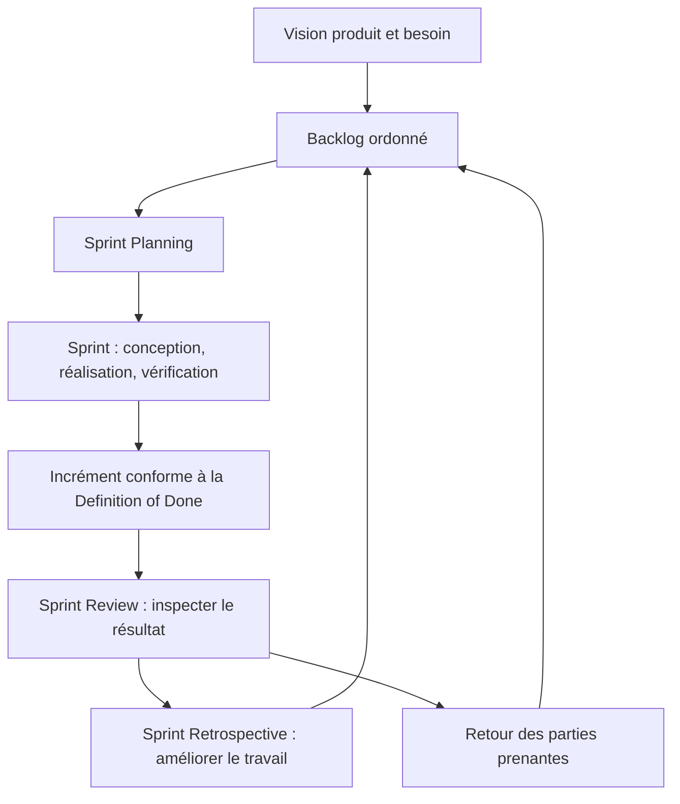

Agile et Scrum sont liés, mais ne sont pas synonymes. Agile est une orientation fondée sur des valeurs et principes ; Scrum est un cadre précis qui organise le travail complexe autour d’un Product Goal, de Sprints, de responsabilités définies, d’artefacts et d’événements. Le diagramme représente une boucle d’apprentissage : on planifie, produit un incrément, recueille du retour puis adapte le travail suivant.

**Périmètre et qualité.** Le périmètre fixe les limites du travail ; la qualité précise les caractéristiques et critères qui permettront d’accepter les livrables. Les ajouts doivent être analysés au lieu d’être acceptés implicitement. Une date ou un budget ne justifie jamais de prétendre qu’un critère obligatoire est satisfait sans preuve.

**Prévision et référence.** La référence approuvée permet d’étudier les écarts, tandis que la prévision décrit l’issue la plus probable à partir des données actuelles. On peut réviser une prévision et conserver une référence historique. La distinction préserve la transparence et aide à décider sans maquiller les évolutions.

**Gouvernance.** La gouvernance répartit les responsabilités, les pouvoirs de décision, les seuils d’escalade et les mécanismes de validation. Elle doit soutenir le travail plutôt que le bloquer. Les décisions fréquentes et réversibles sont généralement déléguées ; les décisions coûteuses, risquées ou réglementaires nécessitent une autorité et une trace explicites.

**Risque.** Un risque correspond à un événement incertain et à ses conséquences éventuelles. Il doit être décrit, évalué, attribué et surveillé. Une réponse crédible comprend une action, un propriétaire, un déclencheur et une solution de repli. Un risque connu mais sans responsable n’est pas réellement piloté.

**Dépendances.** Un projet dépend de systèmes, de personnes, d’approbations, de fournisseurs, de fenêtres de changement et d’informations. Les dépendances externes doivent être rendues visibles dans le plan. Une activité qui paraît courte peut déterminer la fin du projet si elle attend une ressource rare ou une validation obligatoire.

**Communication.** Une information est efficace quand elle permet à son destinataire de comprendre la situation et d’agir. L’équipe a besoin de détails opérationnels, le sponsor d’options d’arbitrage et les utilisateurs de connaître les impacts. Les rapports doivent distinguer les faits observés, les hypothèses, les risques et les décisions attendues.

**Adoption et transfert.** Le résultat doit pouvoir être utilisé, maintenu et supporté. Les responsabilités d’exploitation, les accès, la documentation, la formation, la supervision et le retour arrière doivent être préparés avant la mise en service. Les bénéfices peuvent nécessiter une mesure plusieurs semaines après la livraison.

## Méthodologie et outils

Commencer par formuler le problème, les bénéficiaires, le résultat attendu et les contraintes non négociables. Décrire ensuite les options, les dépendances, les responsabilités, les risques et les preuves nécessaires. La planification fournit une hypothèse structurée ; elle doit être révisée lorsque de nouveaux faits modifient le travail restant ou les conditions de réussite.

Les outils servent à externaliser la mémoire collective. Ils doivent permettre de répondre à des questions concrètes : quel résultat est attendu, qui le prend en charge, qu’est-ce qui est bloqué, quelle décision est en attente, quelle preuve existe et comment la prévision change-t-elle ? La simplicité est une qualité si les contrôles essentiels restent couverts et si les données sont maintenues.

Un reporting utile ne récompense pas seulement le volume d’activité. Il met en évidence le travail réellement terminé, les critères qui restent ouverts, les risques qui évoluent et les arbitrages nécessaires. Les estimations doivent exposer leurs hypothèses, les marges doivent être explicables et les mesures doivent être comprises par ceux qui les utilisent pour décider.

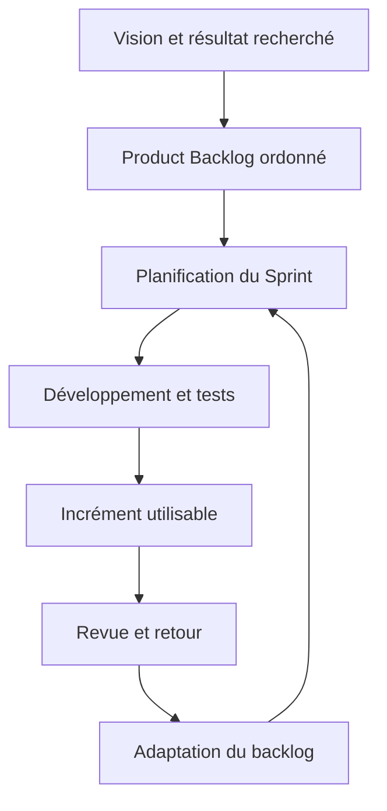

### 1. Valeurs agiles

**Comprendre le concept.** Dans « Manifeste Agile et framework Scrum », valeurs agiles constitue une pratique qui doit répondre à une intention précise. Les valeurs agiles privilégient les individus et leurs interactions, un produit opérationnel, la collaboration avec le client et l’adaptation au changement tout en reconnaissant la valeur des éléments opposés. Le responsable doit commencer par définir le résultat attendu, l’autorité concernée et les informations qui manquent encore. Une méthode ne doit pas être appliquée uniquement parce qu’elle figure dans un guide ou qu’elle est proposée par un outil. Sa valeur dépend du contexte, des personnes qui l’utilisent et de la qualité des décisions qu’elle permet de prendre.

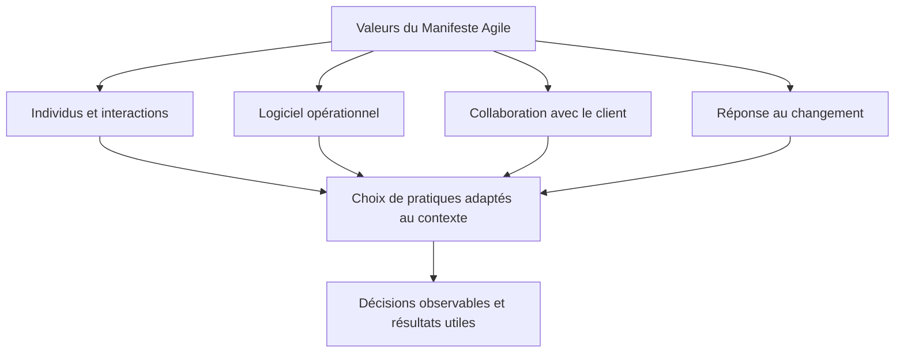

Les quatre valeurs du Manifeste Agile expriment des préférences, et non une interdiction des processus, de la documentation, des contrats ou de la planification. L’enjeu est de ne pas laisser ces moyens remplacer l’objectif : la collaboration, la livraison utile et la capacité de réponse doivent rester au centre. Source de référence : le [Manifeste Agile officiel](https://agilemanifesto.org/).

**Articuler avec les autres dimensions.** La décision peut affecter le périmètre, la capacité, les coûts, le calendrier, la sécurité et l’exploitation. Il est nécessaire de repérer les dépendances en amont, les conséquences pour les bénéficiaires et les coûts de réversibilité. Une optimisation locale peut transférer le coût vers une autre équipe ou reporter un risque après la mise en service. Une analyse complète rend explicite le compromis, indique ce qui est protégé et précise quelles limites ne peuvent pas être négociées.

**Illustration opérationnelle.** Les retours du pilote entraînent une nouvelle priorité sans traiter le plan initial comme un contrat immuable. Pour traiter ce type de situation, consigner les faits, distinguer les hypothèses, fixer une responsabilité et définir une preuve vérifiable. Lorsque plusieurs solutions sont possibles, les comparer avec des critères communs. Si les données sont incomplètes, organiser une courte investigation avec une échéance au lieu de présenter une estimation fragile comme un engagement ferme. La décision doit pouvoir être comprise par une personne qui n’a pas assisté à la discussion d’origine.

**Mise en œuvre.** Recueillir les données auprès des personnes proches du travail, examiner les contraintes, formuler des options, préciser leurs impacts et décider au niveau approprié. Après la décision, consigner le motif, informer les acteurs concernés et suivre l’effet réel. Lorsque le seuil de délégation est dépassé, préparer une escalade concise qui présente le problème, les options, les risques, une recommandation et la date à laquelle la décision devient urgente. Cette séquence protège la coordination sans imposer de lourdeur inutile.

**Mesure et preuve.** Il faut choisir un indicateur correspondant à la finalité de la pratique. Une donnée d’activité ne démontre pas nécessairement un résultat. Définir la source, la fréquence, le responsable, la valeur de référence et les limites de l’indicateur. Compléter si nécessaire les chiffres par une observation qualitative, une revue ou un test. Les mesures doivent être assez fiables pour soutenir une décision, mais pas si coûteuses qu’elles consomment une part disproportionnée du travail qu’elles sont censées aider.

**Erreurs fréquentes et correction.** Les erreurs habituelles incluent une information non actualisée, des définitions variables, une responsabilité implicite, un contrôle fait trop tard ou une exception devenue la règle. Le correctif n’est pas d’ajouter des tableaux sans fin : il faut retrouver la cause, simplifier le flux, attribuer la décision et mesurer l’amélioration. Si une pratique ne produit plus de valeur, la revoir avec les personnes concernées, tout en conservant les contrôles obligatoires et les traces nécessaires à l’audit.

**Approfondissement.** Pour un projet à forte criticité, la pratique peut exiger une validation indépendante, une séparation des tâches, une piste d’audit et un test sur un environnement représentatif. Pour un travail limité et réversible, une revue de pair peut suffire. La proportionnalité ne signifie pas l’absence de rigueur : elle cherche le meilleur rapport entre contrôle et utilité. Le test décisif est de savoir si l’équipe peut expliquer ce qu’elle fait, pourquoi elle le fait, quelle preuve confirme le résultat et comment elle réagira si l’hypothèse devient fausse.

### 2. Manifeste et principes

**Comprendre le concept.** Dans « Manifeste Agile et framework Scrum », manifeste et principes constitue une pratique qui doit répondre à une intention précise. Le Manifeste Agile propose des préférences de collaboration, de livraison fréquente, de feedback et d’amélioration ; il ne signifie ni absence de documentation ni absence de plan. Le responsable doit commencer par définir le résultat attendu, l’autorité concernée et les informations qui manquent encore. Une méthode ne doit pas être appliquée uniquement parce qu’elle figure dans un guide ou qu’elle est proposée par un outil. Sa valeur dépend du contexte, des personnes qui l’utilisent et de la qualité des décisions qu’elle permet de prendre.

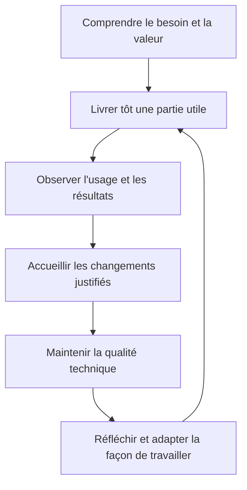

Les principes du Manifeste se traduisent par des comportements concrets : publier fréquemment, coopérer avec les utilisateurs, mesurer le progrès à partir de résultats fonctionnels et améliorer régulièrement la qualité. Une équipe ne devient pas agile simplement parce qu’elle organise des réunions courtes ou utilise un tableau de tickets ; elle doit pouvoir apprendre et modifier ses décisions à partir des faits.

**Articuler avec les autres dimensions.** La décision peut affecter le périmètre, la capacité, les coûts, le calendrier, la sécurité et l’exploitation. Il est nécessaire de repérer les dépendances en amont, les conséquences pour les bénéficiaires et les coûts de réversibilité. Une optimisation locale peut transférer le coût vers une autre équipe ou reporter un risque après la mise en service. Une analyse complète rend explicite le compromis, indique ce qui est protégé et précise quelles limites ne peuvent pas être négociées.

**Illustration opérationnelle.** Une équipe maintient les décisions d’architecture importantes et les tests, tout en livrant des incréments réguliers. Pour traiter ce type de situation, consigner les faits, distinguer les hypothèses, fixer une responsabilité et définir une preuve vérifiable. Lorsque plusieurs solutions sont possibles, les comparer avec des critères communs. Si les données sont incomplètes, organiser une courte investigation avec une échéance au lieu de présenter une estimation fragile comme un engagement ferme. La décision doit pouvoir être comprise par une personne qui n’a pas assisté à la discussion d’origine.

**Mise en œuvre.** Recueillir les données auprès des personnes proches du travail, examiner les contraintes, formuler des options, préciser leurs impacts et décider au niveau approprié. Après la décision, consigner le motif, informer les acteurs concernés et suivre l’effet réel. Lorsque le seuil de délégation est dépassé, préparer une escalade concise qui présente le problème, les options, les risques, une recommandation et la date à laquelle la décision devient urgente. Cette séquence protège la coordination sans imposer de lourdeur inutile.

**Mesure et preuve.** Il faut choisir un indicateur correspondant à la finalité de la pratique. Une donnée d’activité ne démontre pas nécessairement un résultat. Définir la source, la fréquence, le responsable, la valeur de référence et les limites de l’indicateur. Compléter si nécessaire les chiffres par une observation qualitative, une revue ou un test. Les mesures doivent être assez fiables pour soutenir une décision, mais pas si coûteuses qu’elles consomment une part disproportionnée du travail qu’elles sont censées aider.

**Erreurs fréquentes et correction.** Les erreurs habituelles incluent une information non actualisée, des définitions variables, une responsabilité implicite, un contrôle fait trop tard ou une exception devenue la règle. Le correctif n’est pas d’ajouter des tableaux sans fin : il faut retrouver la cause, simplifier le flux, attribuer la décision et mesurer l’amélioration. Si une pratique ne produit plus de valeur, la revoir avec les personnes concernées, tout en conservant les contrôles obligatoires et les traces nécessaires à l’audit.

**Approfondissement.** Pour un projet à forte criticité, la pratique peut exiger une validation indépendante, une séparation des tâches, une piste d’audit et un test sur un environnement représentatif. Pour un travail limité et réversible, une revue de pair peut suffire. La proportionnalité ne signifie pas l’absence de rigueur : elle cherche le meilleur rapport entre contrôle et utilité. Le test décisif est de savoir si l’équipe peut expliquer ce qu’elle fait, pourquoi elle le fait, quelle preuve confirme le résultat et comment elle réagira si l’hypothèse devient fausse.

### 3. Empirisme

**Comprendre le concept.** Dans « Manifeste Agile et framework Scrum », empirisme constitue une pratique qui doit répondre à une intention précise. L’empirisme utilise l’observation du travail et les résultats réels pour réduire l’incertitude plutôt que de prétendre tout savoir au départ. Le responsable doit commencer par définir le résultat attendu, l’autorité concernée et les informations qui manquent encore. Une méthode ne doit pas être appliquée uniquement parce qu’elle figure dans un guide ou qu’elle est proposée par un outil. Sa valeur dépend du contexte, des personnes qui l’utilisent et de la qualité des décisions qu’elle permet de prendre.

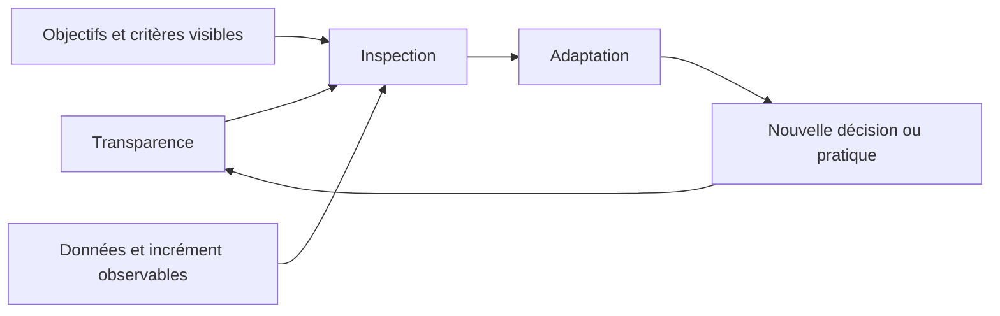

Scrum repose sur l’empirisme et la pensée Lean. La transparence permet de comprendre la situation réelle ; l’inspection révèle les écarts ; l’adaptation modifie le produit ou la manière de travailler. Si le tableau de travail, la Definition of Done ou les résultats des tests masquent la réalité, l’inspection devient trompeuse et les décisions perdent leur fondement.

**Articuler avec les autres dimensions.** La décision peut affecter le périmètre, la capacité, les coûts, le calendrier, la sécurité et l’exploitation. Il est nécessaire de repérer les dépendances en amont, les conséquences pour les bénéficiaires et les coûts de réversibilité. Une optimisation locale peut transférer le coût vers une autre équipe ou reporter un risque après la mise en service. Une analyse complète rend explicite le compromis, indique ce qui est protégé et précise quelles limites ne peuvent pas être négociées.

**Illustration opérationnelle.** Après un prototype, l’équipe révise l’ordre du backlog selon les usages observés et non les seules opinions internes. Pour traiter ce type de situation, consigner les faits, distinguer les hypothèses, fixer une responsabilité et définir une preuve vérifiable. Lorsque plusieurs solutions sont possibles, les comparer avec des critères communs. Si les données sont incomplètes, organiser une courte investigation avec une échéance au lieu de présenter une estimation fragile comme un engagement ferme. La décision doit pouvoir être comprise par une personne qui n’a pas assisté à la discussion d’origine.

**Mise en œuvre.** Recueillir les données auprès des personnes proches du travail, examiner les contraintes, formuler des options, préciser leurs impacts et décider au niveau approprié. Après la décision, consigner le motif, informer les acteurs concernés et suivre l’effet réel. Lorsque le seuil de délégation est dépassé, préparer une escalade concise qui présente le problème, les options, les risques, une recommandation et la date à laquelle la décision devient urgente. Cette séquence protège la coordination sans imposer de lourdeur inutile.

**Mesure et preuve.** Il faut choisir un indicateur correspondant à la finalité de la pratique. Une donnée d’activité ne démontre pas nécessairement un résultat. Définir la source, la fréquence, le responsable, la valeur de référence et les limites de l’indicateur. Compléter si nécessaire les chiffres par une observation qualitative, une revue ou un test. Les mesures doivent être assez fiables pour soutenir une décision, mais pas si coûteuses qu’elles consomment une part disproportionnée du travail qu’elles sont censées aider.

**Erreurs fréquentes et correction.** Les erreurs habituelles incluent une information non actualisée, des définitions variables, une responsabilité implicite, un contrôle fait trop tard ou une exception devenue la règle. Le correctif n’est pas d’ajouter des tableaux sans fin : il faut retrouver la cause, simplifier le flux, attribuer la décision et mesurer l’amélioration. Si une pratique ne produit plus de valeur, la revoir avec les personnes concernées, tout en conservant les contrôles obligatoires et les traces nécessaires à l’audit.

**Approfondissement.** Pour un projet à forte criticité, la pratique peut exiger une validation indépendante, une séparation des tâches, une piste d’audit et un test sur un environnement représentatif. Pour un travail limité et réversible, une revue de pair peut suffire. La proportionnalité ne signifie pas l’absence de rigueur : elle cherche le meilleur rapport entre contrôle et utilité. Le test décisif est de savoir si l’équipe peut expliquer ce qu’elle fait, pourquoi elle le fait, quelle preuve confirme le résultat et comment elle réagira si l’hypothèse devient fausse.

### 4. Product Goal

**Comprendre le concept.** Dans « Manifeste Agile et framework Scrum », product goal constitue une pratique qui doit répondre à une intention précise. Le Product Goal donne la direction à long terme du produit et permet de juger si les incréments contribuent à un résultat utile. Le responsable doit commencer par définir le résultat attendu, l’autorité concernée et les informations qui manquent encore. Une méthode ne doit pas être appliquée uniquement parce qu’elle figure dans un guide ou qu’elle est proposée par un outil. Sa valeur dépend du contexte, des personnes qui l’utilisent et de la qualité des décisions qu’elle permet de prendre.

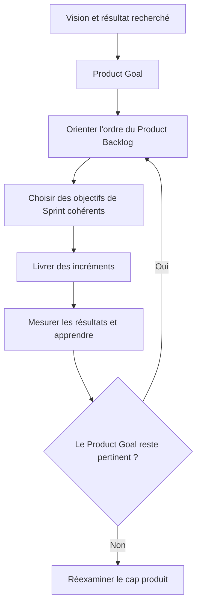

Le Product Goal donne un objectif à long terme au Scrum Team et sert de cible pour planifier le travail produit. Il ne décrit pas toutes les fonctionnalités à venir ni un calendrier détaillé immuable. Les choix de backlog doivent montrer comment ils contribuent à cet objectif, et le produit doit être réévalué lorsque des preuves suffisamment fortes remettent en cause sa pertinence.

**Articuler avec les autres dimensions.** La décision peut affecter le périmètre, la capacité, les coûts, le calendrier, la sécurité et l’exploitation. Il est nécessaire de repérer les dépendances en amont, les conséquences pour les bénéficiaires et les coûts de réversibilité. Une optimisation locale peut transférer le coût vers une autre équipe ou reporter un risque après la mise en service. Une analyse complète rend explicite le compromis, indique ce qui est protégé et précise quelles limites ne peuvent pas être négociées.

**Illustration opérationnelle.** Le but peut être d’atteindre un parcours complet de demande traçable, pas de produire un nombre arbitraire de fonctionnalités. Pour traiter ce type de situation, consigner les faits, distinguer les hypothèses, fixer une responsabilité et définir une preuve vérifiable. Lorsque plusieurs solutions sont possibles, les comparer avec des critères communs. Si les données sont incomplètes, organiser une courte investigation avec une échéance au lieu de présenter une estimation fragile comme un engagement ferme. La décision doit pouvoir être comprise par une personne qui n’a pas assisté à la discussion d’origine.

**Mise en œuvre.** Recueillir les données auprès des personnes proches du travail, examiner les contraintes, formuler des options, préciser leurs impacts et décider au niveau approprié. Après la décision, consigner le motif, informer les acteurs concernés et suivre l’effet réel. Lorsque le seuil de délégation est dépassé, préparer une escalade concise qui présente le problème, les options, les risques, une recommandation et la date à laquelle la décision devient urgente. Cette séquence protège la coordination sans imposer de lourdeur inutile.

**Mesure et preuve.** Il faut choisir un indicateur correspondant à la finalité de la pratique. Une donnée d’activité ne démontre pas nécessairement un résultat. Définir la source, la fréquence, le responsable, la valeur de référence et les limites de l’indicateur. Compléter si nécessaire les chiffres par une observation qualitative, une revue ou un test. Les mesures doivent être assez fiables pour soutenir une décision, mais pas si coûteuses qu’elles consomment une part disproportionnée du travail qu’elles sont censées aider.

**Erreurs fréquentes et correction.** Les erreurs habituelles incluent une information non actualisée, des définitions variables, une responsabilité implicite, un contrôle fait trop tard ou une exception devenue la règle. Le correctif n’est pas d’ajouter des tableaux sans fin : il faut retrouver la cause, simplifier le flux, attribuer la décision et mesurer l’amélioration. Si une pratique ne produit plus de valeur, la revoir avec les personnes concernées, tout en conservant les contrôles obligatoires et les traces nécessaires à l’audit.

**Approfondissement.** Pour un projet à forte criticité, la pratique peut exiger une validation indépendante, une séparation des tâches, une piste d’audit et un test sur un environnement représentatif. Pour un travail limité et réversible, une revue de pair peut suffire. La proportionnalité ne signifie pas l’absence de rigueur : elle cherche le meilleur rapport entre contrôle et utilité. Le test décisif est de savoir si l’équipe peut expliquer ce qu’elle fait, pourquoi elle le fait, quelle preuve confirme le résultat et comment elle réagira si l’hypothèse devient fausse.

### 5. Product Backlog

**Comprendre le concept.** Dans « Manifeste Agile et framework Scrum », product backlog constitue une pratique qui doit répondre à une intention précise. Le Product Backlog est une liste émergente, ordonnée et transparente du travail nécessaire à l’amélioration du produit. Le responsable doit commencer par définir le résultat attendu, l’autorité concernée et les informations qui manquent encore. Une méthode ne doit pas être appliquée uniquement parce qu’elle figure dans un guide ou qu’elle est proposée par un outil. Sa valeur dépend du contexte, des personnes qui l’utilisent et de la qualité des décisions qu’elle permet de prendre.

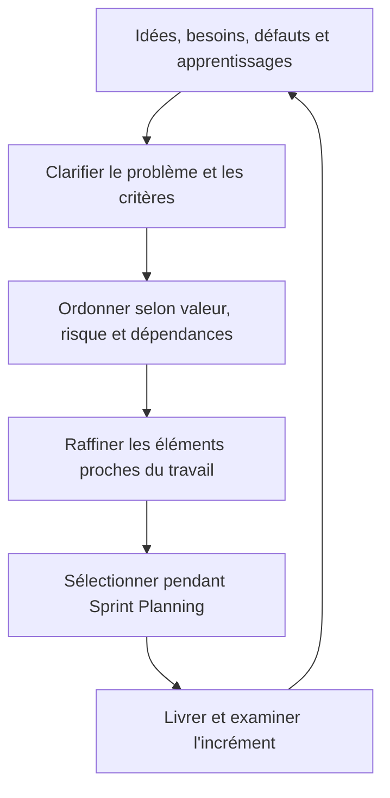

Le Product Backlog est une liste émergente et ordonnée de ce qui est nécessaire pour améliorer le produit. Le Product Owner est redevable de sa gestion efficace, même s’il peut déléguer certaines activités. Le raffinement est une activité continue de clarification et de découpage ; ce n’est pas un événement Scrum formel supplémentaire imposé par le Guide.

**Articuler avec les autres dimensions.** La décision peut affecter le périmètre, la capacité, les coûts, le calendrier, la sécurité et l’exploitation. Il est nécessaire de repérer les dépendances en amont, les conséquences pour les bénéficiaires et les coûts de réversibilité. Une optimisation locale peut transférer le coût vers une autre équipe ou reporter un risque après la mise en service. Une analyse complète rend explicite le compromis, indique ce qui est protégé et précise quelles limites ne peuvent pas être négociées.

**Illustration opérationnelle.** Les demandes sont décomposées et ordonnées selon valeur, risque, apprentissage, dépendances et effort estimé. Pour traiter ce type de situation, consigner les faits, distinguer les hypothèses, fixer une responsabilité et définir une preuve vérifiable. Lorsque plusieurs solutions sont possibles, les comparer avec des critères communs. Si les données sont incomplètes, organiser une courte investigation avec une échéance au lieu de présenter une estimation fragile comme un engagement ferme. La décision doit pouvoir être comprise par une personne qui n’a pas assisté à la discussion d’origine.

**Mise en œuvre.** Recueillir les données auprès des personnes proches du travail, examiner les contraintes, formuler des options, préciser leurs impacts et décider au niveau approprié. Après la décision, consigner le motif, informer les acteurs concernés et suivre l’effet réel. Lorsque le seuil de délégation est dépassé, préparer une escalade concise qui présente le problème, les options, les risques, une recommandation et la date à laquelle la décision devient urgente. Cette séquence protège la coordination sans imposer de lourdeur inutile.

**Mesure et preuve.** Il faut choisir un indicateur correspondant à la finalité de la pratique. Une donnée d’activité ne démontre pas nécessairement un résultat. Définir la source, la fréquence, le responsable, la valeur de référence et les limites de l’indicateur. Compléter si nécessaire les chiffres par une observation qualitative, une revue ou un test. Les mesures doivent être assez fiables pour soutenir une décision, mais pas si coûteuses qu’elles consomment une part disproportionnée du travail qu’elles sont censées aider.

**Erreurs fréquentes et correction.** Les erreurs habituelles incluent une information non actualisée, des définitions variables, une responsabilité implicite, un contrôle fait trop tard ou une exception devenue la règle. Le correctif n’est pas d’ajouter des tableaux sans fin : il faut retrouver la cause, simplifier le flux, attribuer la décision et mesurer l’amélioration. Si une pratique ne produit plus de valeur, la revoir avec les personnes concernées, tout en conservant les contrôles obligatoires et les traces nécessaires à l’audit.

**Approfondissement.** Pour un projet à forte criticité, la pratique peut exiger une validation indépendante, une séparation des tâches, une piste d’audit et un test sur un environnement représentatif. Pour un travail limité et réversible, une revue de pair peut suffire. La proportionnalité ne signifie pas l’absence de rigueur : elle cherche le meilleur rapport entre contrôle et utilité. Le test décisif est de savoir si l’équipe peut expliquer ce qu’elle fait, pourquoi elle le fait, quelle preuve confirme le résultat et comment elle réagira si l’hypothèse devient fausse.

### 6. Scrum Team

**Comprendre le concept.** Dans « Manifeste Agile et framework Scrum », scrum team constitue une pratique qui doit répondre à une intention précise. Le Scrum Team réunit un Product Owner, un Scrum Master et des Developers ; il est pluridisciplinaire et responsable du résultat collectif. Le responsable doit commencer par définir le résultat attendu, l’autorité concernée et les informations qui manquent encore. Une méthode ne doit pas être appliquée uniquement parce qu’elle figure dans un guide ou qu’elle est proposée par un outil. Sa valeur dépend du contexte, des personnes qui l’utilisent et de la qualité des décisions qu’elle permet de prendre.

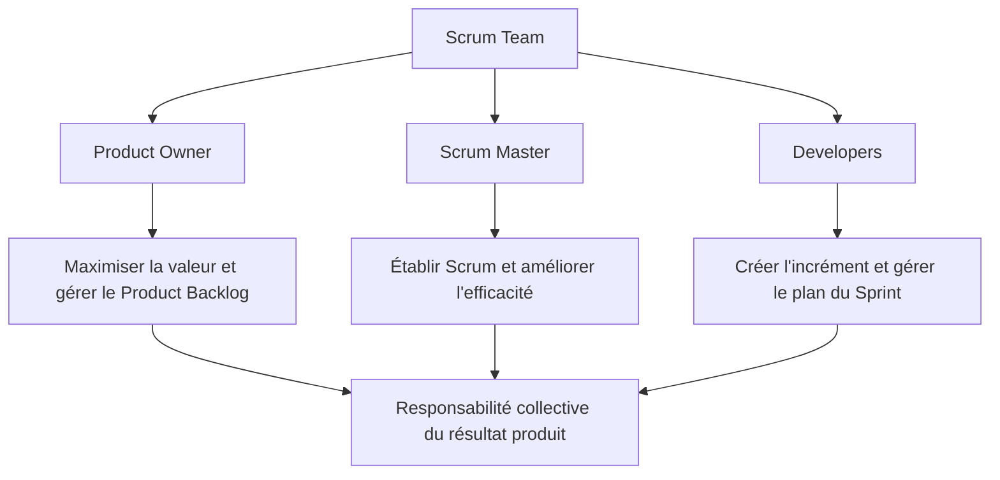

Le Scrum Guide définit trois responsabilités au sein d’une équipe sans sous-équipes ni hiérarchies internes : Product Owner, Scrum Master et Developers. Les Developers ne désignent pas uniquement les programmeurs ; ils réunissent les personnes qui créent chaque Sprint un incrément utilisable, avec les compétences nécessaires au produit. Le Scrum Master n’est pas un chef de projet traditionnel chargé d’attribuer les tâches.

**Articuler avec les autres dimensions.** La décision peut affecter le périmètre, la capacité, les coûts, le calendrier, la sécurité et l’exploitation. Il est nécessaire de repérer les dépendances en amont, les conséquences pour les bénéficiaires et les coûts de réversibilité. Une optimisation locale peut transférer le coût vers une autre équipe ou reporter un risque après la mise en service. Une analyse complète rend explicite le compromis, indique ce qui est protégé et précise quelles limites ne peuvent pas être négociées.

**Illustration opérationnelle.** Les compétences de développement, tests, UX, sécurité et exploitation collaborent au lieu de former une chaîne de silos. Pour traiter ce type de situation, consigner les faits, distinguer les hypothèses, fixer une responsabilité et définir une preuve vérifiable. Lorsque plusieurs solutions sont possibles, les comparer avec des critères communs. Si les données sont incomplètes, organiser une courte investigation avec une échéance au lieu de présenter une estimation fragile comme un engagement ferme. La décision doit pouvoir être comprise par une personne qui n’a pas assisté à la discussion d’origine.

**Mise en œuvre.** Recueillir les données auprès des personnes proches du travail, examiner les contraintes, formuler des options, préciser leurs impacts et décider au niveau approprié. Après la décision, consigner le motif, informer les acteurs concernés et suivre l’effet réel. Lorsque le seuil de délégation est dépassé, préparer une escalade concise qui présente le problème, les options, les risques, une recommandation et la date à laquelle la décision devient urgente. Cette séquence protège la coordination sans imposer de lourdeur inutile.

**Mesure et preuve.** Il faut choisir un indicateur correspondant à la finalité de la pratique. Une donnée d’activité ne démontre pas nécessairement un résultat. Définir la source, la fréquence, le responsable, la valeur de référence et les limites de l’indicateur. Compléter si nécessaire les chiffres par une observation qualitative, une revue ou un test. Les mesures doivent être assez fiables pour soutenir une décision, mais pas si coûteuses qu’elles consomment une part disproportionnée du travail qu’elles sont censées aider.

**Erreurs fréquentes et correction.** Les erreurs habituelles incluent une information non actualisée, des définitions variables, une responsabilité implicite, un contrôle fait trop tard ou une exception devenue la règle. Le correctif n’est pas d’ajouter des tableaux sans fin : il faut retrouver la cause, simplifier le flux, attribuer la décision et mesurer l’amélioration. Si une pratique ne produit plus de valeur, la revoir avec les personnes concernées, tout en conservant les contrôles obligatoires et les traces nécessaires à l’audit.

**Approfondissement.** Pour un projet à forte criticité, la pratique peut exiger une validation indépendante, une séparation des tâches, une piste d’audit et un test sur un environnement représentatif. Pour un travail limité et réversible, une revue de pair peut suffire. La proportionnalité ne signifie pas l’absence de rigueur : elle cherche le meilleur rapport entre contrôle et utilité. Le test décisif est de savoir si l’équipe peut expliquer ce qu’elle fait, pourquoi elle le fait, quelle preuve confirme le résultat et comment elle réagira si l’hypothèse devient fausse.

### 7. Sprint et objectif

**Comprendre le concept.** Dans « Manifeste Agile et framework Scrum », sprint et objectif constitue une pratique qui doit répondre à une intention précise. Le Sprint crée une cadence de livraison et d’inspection ; son objectif donne un résultat cohérent à atteindre durant l’itération. Le responsable doit commencer par définir le résultat attendu, l’autorité concernée et les informations qui manquent encore. Une méthode ne doit pas être appliquée uniquement parce qu’elle figure dans un guide ou qu’elle est proposée par un outil. Sa valeur dépend du contexte, des personnes qui l’utilisent et de la qualité des décisions qu’elle permet de prendre.

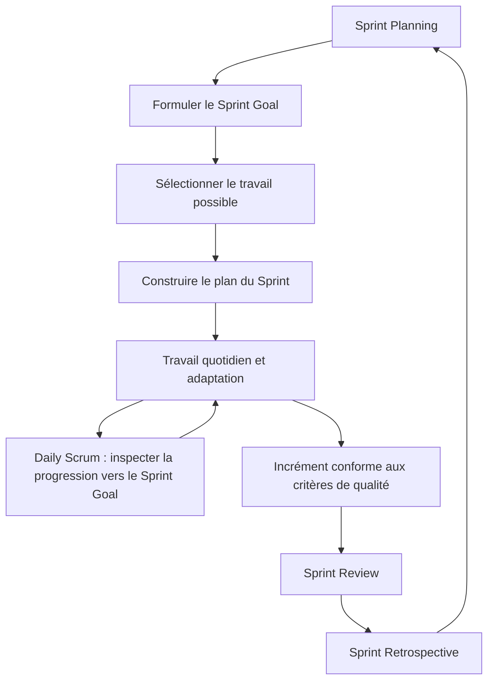

Un Sprint est un événement d’une durée fixe d’un mois ou moins, contenant les autres événements Scrum. Le Sprint Goal crée un objectif commun, mais le plan peut être adapté au fil de l’apprentissage ; la qualité ne doit pas être diminuée et le périmètre peut être clarifié et renégocié avec le Product Owner si nécessaire. Un Daily Scrum n’est pas une réunion de compte rendu au manager.

**Articuler avec les autres dimensions.** La décision peut affecter le périmètre, la capacité, les coûts, le calendrier, la sécurité et l’exploitation. Il est nécessaire de repérer les dépendances en amont, les conséquences pour les bénéficiaires et les coûts de réversibilité. Une optimisation locale peut transférer le coût vers une autre équipe ou reporter un risque après la mise en service. Une analyse complète rend explicite le compromis, indique ce qui est protégé et précise quelles limites ne peuvent pas être négociées.

**Illustration opérationnelle.** Le Sprint Goal porte sur un parcours de création de ticket fonctionnel plutôt que sur une liste de composants sans cohérence. Pour traiter ce type de situation, consigner les faits, distinguer les hypothèses, fixer une responsabilité et définir une preuve vérifiable. Lorsque plusieurs solutions sont possibles, les comparer avec des critères communs. Si les données sont incomplètes, organiser une courte investigation avec une échéance au lieu de présenter une estimation fragile comme un engagement ferme. La décision doit pouvoir être comprise par une personne qui n’a pas assisté à la discussion d’origine.

**Mise en œuvre.** Recueillir les données auprès des personnes proches du travail, examiner les contraintes, formuler des options, préciser leurs impacts et décider au niveau approprié. Après la décision, consigner le motif, informer les acteurs concernés et suivre l’effet réel. Lorsque le seuil de délégation est dépassé, préparer une escalade concise qui présente le problème, les options, les risques, une recommandation et la date à laquelle la décision devient urgente. Cette séquence protège la coordination sans imposer de lourdeur inutile.

**Mesure et preuve.** Il faut choisir un indicateur correspondant à la finalité de la pratique. Une donnée d’activité ne démontre pas nécessairement un résultat. Définir la source, la fréquence, le responsable, la valeur de référence et les limites de l’indicateur. Compléter si nécessaire les chiffres par une observation qualitative, une revue ou un test. Les mesures doivent être assez fiables pour soutenir une décision, mais pas si coûteuses qu’elles consomment une part disproportionnée du travail qu’elles sont censées aider.

**Erreurs fréquentes et correction.** Les erreurs habituelles incluent une information non actualisée, des définitions variables, une responsabilité implicite, un contrôle fait trop tard ou une exception devenue la règle. Le correctif n’est pas d’ajouter des tableaux sans fin : il faut retrouver la cause, simplifier le flux, attribuer la décision et mesurer l’amélioration. Si une pratique ne produit plus de valeur, la revoir avec les personnes concernées, tout en conservant les contrôles obligatoires et les traces nécessaires à l’audit.

**Approfondissement.** Pour un projet à forte criticité, la pratique peut exiger une validation indépendante, une séparation des tâches, une piste d’audit et un test sur un environnement représentatif. Pour un travail limité et réversible, une revue de pair peut suffire. La proportionnalité ne signifie pas l’absence de rigueur : elle cherche le meilleur rapport entre contrôle et utilité. Le test décisif est de savoir si l’équipe peut expliquer ce qu’elle fait, pourquoi elle le fait, quelle preuve confirme le résultat et comment elle réagira si l’hypothèse devient fausse.

### 8. Incrément et Definition of Done

**Comprendre le concept.** Dans « Manifeste Agile et framework Scrum », incrément et definition of done constitue une pratique qui doit répondre à une intention précise. L’incrément est une étape utilisable vers le Product Goal et doit respecter la Definition of Done convenue. Le responsable doit commencer par définir le résultat attendu, l’autorité concernée et les informations qui manquent encore. Une méthode ne doit pas être appliquée uniquement parce qu’elle figure dans un guide ou qu’elle est proposée par un outil. Sa valeur dépend du contexte, des personnes qui l’utilisent et de la qualité des décisions qu’elle permet de prendre.

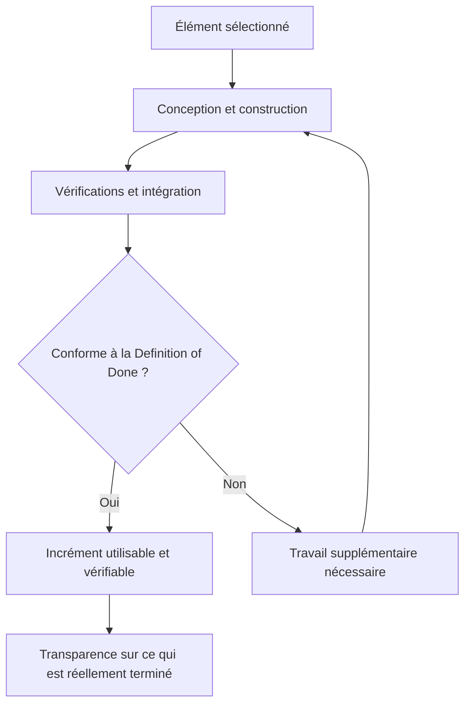

La Definition of Done est l’engagement associé à l’Increment. Elle décrit l’état de qualité requis pour qu’un travail soit considéré comme faisant partie de l’incrément. Une fonctionnalité seulement codée mais non testée, non intégrée ou non sécurisée selon les critères convenus ne doit pas être présentée comme terminée. Les critères peuvent inclure tests, revue, documentation, sécurité, performance et déployabilité selon le produit.

**Articuler avec les autres dimensions.** La décision peut affecter le périmètre, la capacité, les coûts, le calendrier, la sécurité et l’exploitation. Il est nécessaire de repérer les dépendances en amont, les conséquences pour les bénéficiaires et les coûts de réversibilité. Une optimisation locale peut transférer le coût vers une autre équipe ou reporter un risque après la mise en service. Une analyse complète rend explicite le compromis, indique ce qui est protégé et précise quelles limites ne peuvent pas être négociées.

**Illustration opérationnelle.** Les tests d’intégration, les contrôles d’accès et la documentation minimale font partie du niveau de qualité accepté. Pour traiter ce type de situation, consigner les faits, distinguer les hypothèses, fixer une responsabilité et définir une preuve vérifiable. Lorsque plusieurs solutions sont possibles, les comparer avec des critères communs. Si les données sont incomplètes, organiser une courte investigation avec une échéance au lieu de présenter une estimation fragile comme un engagement ferme. La décision doit pouvoir être comprise par une personne qui n’a pas assisté à la discussion d’origine.

**Mise en œuvre.** Recueillir les données auprès des personnes proches du travail, examiner les contraintes, formuler des options, préciser leurs impacts et décider au niveau approprié. Après la décision, consigner le motif, informer les acteurs concernés et suivre l’effet réel. Lorsque le seuil de délégation est dépassé, préparer une escalade concise qui présente le problème, les options, les risques, une recommandation et la date à laquelle la décision devient urgente. Cette séquence protège la coordination sans imposer de lourdeur inutile.

**Mesure et preuve.** Il faut choisir un indicateur correspondant à la finalité de la pratique. Une donnée d’activité ne démontre pas nécessairement un résultat. Définir la source, la fréquence, le responsable, la valeur de référence et les limites de l’indicateur. Compléter si nécessaire les chiffres par une observation qualitative, une revue ou un test. Les mesures doivent être assez fiables pour soutenir une décision, mais pas si coûteuses qu’elles consomment une part disproportionnée du travail qu’elles sont censées aider.

**Erreurs fréquentes et correction.** Les erreurs habituelles incluent une information non actualisée, des définitions variables, une responsabilité implicite, un contrôle fait trop tard ou une exception devenue la règle. Le correctif n’est pas d’ajouter des tableaux sans fin : il faut retrouver la cause, simplifier le flux, attribuer la décision et mesurer l’amélioration. Si une pratique ne produit plus de valeur, la revoir avec les personnes concernées, tout en conservant les contrôles obligatoires et les traces nécessaires à l’audit.

**Approfondissement.** Pour un projet à forte criticité, la pratique peut exiger une validation indépendante, une séparation des tâches, une piste d’audit et un test sur un environnement représentatif. Pour un travail limité et réversible, une revue de pair peut suffire. La proportionnalité ne signifie pas l’absence de rigueur : elle cherche le meilleur rapport entre contrôle et utilité. Le test décisif est de savoir si l’équipe peut expliquer ce qu’elle fait, pourquoi elle le fait, quelle preuve confirme le résultat et comment elle réagira si l’hypothèse devient fausse.

### 9. Planification adaptative

**Comprendre le concept.** Dans « Manifeste Agile et framework Scrum », planification adaptative constitue une pratique qui doit répondre à une intention précise. La planification Scrum fixe un objectif et un plan initial, puis permet aux Developers d’adapter le travail à la découverte. Le responsable doit commencer par définir le résultat attendu, l’autorité concernée et les informations qui manquent encore. Une méthode ne doit pas être appliquée uniquement parce qu’elle figure dans un guide ou qu’elle est proposée par un outil. Sa valeur dépend du contexte, des personnes qui l’utilisent et de la qualité des décisions qu’elle permet de prendre.

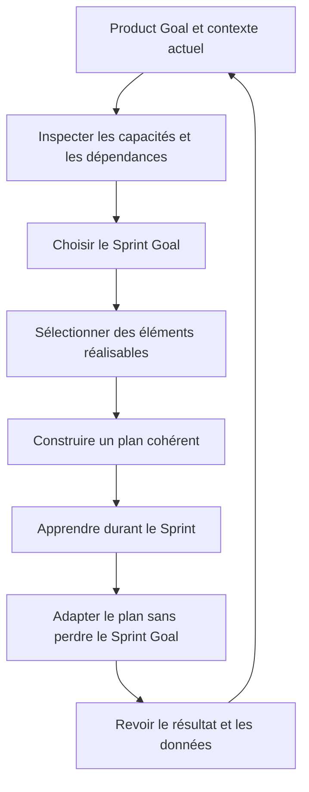

La planification adaptative ne signifie ni absence de plan ni changement arbitraire chaque jour. L’équipe choisit un objectif et construit un plan fondé sur sa capacité, les connaissances disponibles et les contraintes connues. Au fil du Sprint, le plan évolue à mesure que l’équipe apprend, en protégeant l’objectif commun et la qualité de l’incrément.

**Articuler avec les autres dimensions.** La décision peut affecter le périmètre, la capacité, les coûts, le calendrier, la sécurité et l’exploitation. Il est nécessaire de repérer les dépendances en amont, les conséquences pour les bénéficiaires et les coûts de réversibilité. Une optimisation locale peut transférer le coût vers une autre équipe ou reporter un risque après la mise en service. Une analyse complète rend explicite le compromis, indique ce qui est protégé et précise quelles limites ne peuvent pas être négociées.

**Illustration opérationnelle.** Lorsqu’un endpoint est plus complexe que prévu, l’équipe ajuste les éléments du Sprint en concertation avec le Product Owner. Pour traiter ce type de situation, consigner les faits, distinguer les hypothèses, fixer une responsabilité et définir une preuve vérifiable. Lorsque plusieurs solutions sont possibles, les comparer avec des critères communs. Si les données sont incomplètes, organiser une courte investigation avec une échéance au lieu de présenter une estimation fragile comme un engagement ferme. La décision doit pouvoir être comprise par une personne qui n’a pas assisté à la discussion d’origine.

**Mise en œuvre.** Recueillir les données auprès des personnes proches du travail, examiner les contraintes, formuler des options, préciser leurs impacts et décider au niveau approprié. Après la décision, consigner le motif, informer les acteurs concernés et suivre l’effet réel. Lorsque le seuil de délégation est dépassé, préparer une escalade concise qui présente le problème, les options, les risques, une recommandation et la date à laquelle la décision devient urgente. Cette séquence protège la coordination sans imposer de lourdeur inutile.

**Mesure et preuve.** Il faut choisir un indicateur correspondant à la finalité de la pratique. Une donnée d’activité ne démontre pas nécessairement un résultat. Définir la source, la fréquence, le responsable, la valeur de référence et les limites de l’indicateur. Compléter si nécessaire les chiffres par une observation qualitative, une revue ou un test. Les mesures doivent être assez fiables pour soutenir une décision, mais pas si coûteuses qu’elles consomment une part disproportionnée du travail qu’elles sont censées aider.

**Erreurs fréquentes et correction.** Les erreurs habituelles incluent une information non actualisée, des définitions variables, une responsabilité implicite, un contrôle fait trop tard ou une exception devenue la règle. Le correctif n’est pas d’ajouter des tableaux sans fin : il faut retrouver la cause, simplifier le flux, attribuer la décision et mesurer l’amélioration. Si une pratique ne produit plus de valeur, la revoir avec les personnes concernées, tout en conservant les contrôles obligatoires et les traces nécessaires à l’audit.

**Approfondissement.** Pour un projet à forte criticité, la pratique peut exiger une validation indépendante, une séparation des tâches, une piste d’audit et un test sur un environnement représentatif. Pour un travail limité et réversible, une revue de pair peut suffire. La proportionnalité ne signifie pas l’absence de rigueur : elle cherche le meilleur rapport entre contrôle et utilité. Le test décisif est de savoir si l’équipe peut expliquer ce qu’elle fait, pourquoi elle le fait, quelle preuve confirme le résultat et comment elle réagira si l’hypothèse devient fausse.

### 10. Feedback des parties prenantes

**Comprendre le concept.** Dans « Manifeste Agile et framework Scrum », feedback des parties prenantes constitue une pratique qui doit répondre à une intention précise. Les feedbacks vérifiables réduisent le risque de construire le mauvais produit ; ils doivent être associés à des utilisateurs et à des tâches observables. Le responsable doit commencer par définir le résultat attendu, l’autorité concernée et les informations qui manquent encore. Une méthode ne doit pas être appliquée uniquement parce qu’elle figure dans un guide ou qu’elle est proposée par un outil. Sa valeur dépend du contexte, des personnes qui l’utilisent et de la qualité des décisions qu’elle permet de prendre.

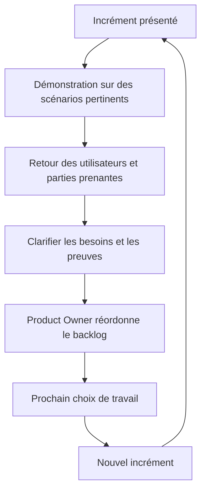

La Sprint Review est une séance de travail pour inspecter le résultat et déterminer les adaptations futures, pas simplement une démonstration commerciale en fin de Sprint. Les parties prenantes discutent de ce qui a changé dans le contexte, des résultats observés et des prochaines priorités. Le feedback devient utile lorsqu’il est relié à des décisions, plutôt que collecté sans suite.

**Articuler avec les autres dimensions.** La décision peut affecter le périmètre, la capacité, les coûts, le calendrier, la sécurité et l’exploitation. Il est nécessaire de repérer les dépendances en amont, les conséquences pour les bénéficiaires et les coûts de réversibilité. Une optimisation locale peut transférer le coût vers une autre équipe ou reporter un risque après la mise en service. Une analyse complète rend explicite le compromis, indique ce qui est protégé et précise quelles limites ne peuvent pas être négociées.

**Illustration opérationnelle.** Les utilisateurs exécutent un scénario complet du portail et signalent les étapes ambiguës avant le déploiement général. Pour traiter ce type de situation, consigner les faits, distinguer les hypothèses, fixer une responsabilité et définir une preuve vérifiable. Lorsque plusieurs solutions sont possibles, les comparer avec des critères communs. Si les données sont incomplètes, organiser une courte investigation avec une échéance au lieu de présenter une estimation fragile comme un engagement ferme. La décision doit pouvoir être comprise par une personne qui n’a pas assisté à la discussion d’origine.

**Mise en œuvre.** Recueillir les données auprès des personnes proches du travail, examiner les contraintes, formuler des options, préciser leurs impacts et décider au niveau approprié. Après la décision, consigner le motif, informer les acteurs concernés et suivre l’effet réel. Lorsque le seuil de délégation est dépassé, préparer une escalade concise qui présente le problème, les options, les risques, une recommandation et la date à laquelle la décision devient urgente. Cette séquence protège la coordination sans imposer de lourdeur inutile.

**Mesure et preuve.** Il faut choisir un indicateur correspondant à la finalité de la pratique. Une donnée d’activité ne démontre pas nécessairement un résultat. Définir la source, la fréquence, le responsable, la valeur de référence et les limites de l’indicateur. Compléter si nécessaire les chiffres par une observation qualitative, une revue ou un test. Les mesures doivent être assez fiables pour soutenir une décision, mais pas si coûteuses qu’elles consomment une part disproportionnée du travail qu’elles sont censées aider.

**Erreurs fréquentes et correction.** Les erreurs habituelles incluent une information non actualisée, des définitions variables, une responsabilité implicite, un contrôle fait trop tard ou une exception devenue la règle. Le correctif n’est pas d’ajouter des tableaux sans fin : il faut retrouver la cause, simplifier le flux, attribuer la décision et mesurer l’amélioration. Si une pratique ne produit plus de valeur, la revoir avec les personnes concernées, tout en conservant les contrôles obligatoires et les traces nécessaires à l’audit.

**Approfondissement.** Pour un projet à forte criticité, la pratique peut exiger une validation indépendante, une séparation des tâches, une piste d’audit et un test sur un environnement représentatif. Pour un travail limité et réversible, une revue de pair peut suffire. La proportionnalité ne signifie pas l’absence de rigueur : elle cherche le meilleur rapport entre contrôle et utilité. Le test décisif est de savoir si l’équipe peut expliquer ce qu’elle fait, pourquoi elle le fait, quelle preuve confirme le résultat et comment elle réagira si l’hypothèse devient fausse.

### 11. Priorisation par la valeur

**Comprendre le concept.** Dans « Manifeste Agile et framework Scrum », priorisation par la valeur constitue une pratique qui doit répondre à une intention précise. La priorité combine l’impact utilisateur, la contribution à l’objectif, le risque, les dépendances, les coûts et l’apprentissage attendu. Le responsable doit commencer par définir le résultat attendu, l’autorité concernée et les informations qui manquent encore. Une méthode ne doit pas être appliquée uniquement parce qu’elle figure dans un guide ou qu’elle est proposée par un outil. Sa valeur dépend du contexte, des personnes qui l’utilisent et de la qualité des décisions qu’elle permet de prendre.

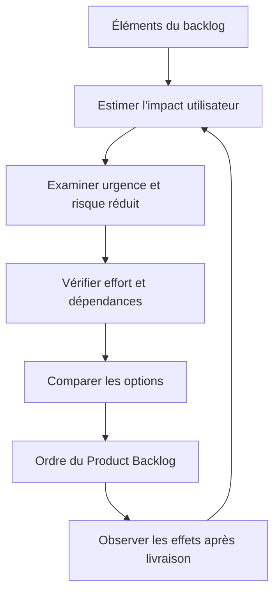

La priorité ne se réduit pas à une note de valeur ou à la demande de la personne la plus influente. Elle tient compte de l’impact attendu, de l’urgence, du risque réduit, de l’effort, des dépendances et du coût du retard. Il faut réévaluer les hypothèses avec le retour réel ; une fonctionnalité très demandée peut ne pas créer la valeur supposée une fois utilisée.

**Articuler avec les autres dimensions.** La décision peut affecter le périmètre, la capacité, les coûts, le calendrier, la sécurité et l’exploitation. Il est nécessaire de repérer les dépendances en amont, les conséquences pour les bénéficiaires et les coûts de réversibilité. Une optimisation locale peut transférer le coût vers une autre équipe ou reporter un risque après la mise en service. Une analyse complète rend explicite le compromis, indique ce qui est protégé et précise quelles limites ne peuvent pas être négociées.

**Illustration opérationnelle.** Une petite amélioration qui débloque la recette peut passer avant une fonction visuellement séduisante mais secondaire. Pour traiter ce type de situation, consigner les faits, distinguer les hypothèses, fixer une responsabilité et définir une preuve vérifiable. Lorsque plusieurs solutions sont possibles, les comparer avec des critères communs. Si les données sont incomplètes, organiser une courte investigation avec une échéance au lieu de présenter une estimation fragile comme un engagement ferme. La décision doit pouvoir être comprise par une personne qui n’a pas assisté à la discussion d’origine.

**Mise en œuvre.** Recueillir les données auprès des personnes proches du travail, examiner les contraintes, formuler des options, préciser leurs impacts et décider au niveau approprié. Après la décision, consigner le motif, informer les acteurs concernés et suivre l’effet réel. Lorsque le seuil de délégation est dépassé, préparer une escalade concise qui présente le problème, les options, les risques, une recommandation et la date à laquelle la décision devient urgente. Cette séquence protège la coordination sans imposer de lourdeur inutile.

**Mesure et preuve.** Il faut choisir un indicateur correspondant à la finalité de la pratique. Une donnée d’activité ne démontre pas nécessairement un résultat. Définir la source, la fréquence, le responsable, la valeur de référence et les limites de l’indicateur. Compléter si nécessaire les chiffres par une observation qualitative, une revue ou un test. Les mesures doivent être assez fiables pour soutenir une décision, mais pas si coûteuses qu’elles consomment une part disproportionnée du travail qu’elles sont censées aider.

**Erreurs fréquentes et correction.** Les erreurs habituelles incluent une information non actualisée, des définitions variables, une responsabilité implicite, un contrôle fait trop tard ou une exception devenue la règle. Le correctif n’est pas d’ajouter des tableaux sans fin : il faut retrouver la cause, simplifier le flux, attribuer la décision et mesurer l’amélioration. Si une pratique ne produit plus de valeur, la revoir avec les personnes concernées, tout en conservant les contrôles obligatoires et les traces nécessaires à l’audit.

**Approfondissement.** Pour un projet à forte criticité, la pratique peut exiger une validation indépendante, une séparation des tâches, une piste d’audit et un test sur un environnement représentatif. Pour un travail limité et réversible, une revue de pair peut suffire. La proportionnalité ne signifie pas l’absence de rigueur : elle cherche le meilleur rapport entre contrôle et utilité. Le test décisif est de savoir si l’équipe peut expliquer ce qu’elle fait, pourquoi elle le fait, quelle preuve confirme le résultat et comment elle réagira si l’hypothèse devient fausse.

### 12. Amélioration continue

**Comprendre le concept.** Dans « Manifeste Agile et framework Scrum », amélioration continue constitue une pratique qui doit répondre à une intention précise. L’équipe inspecte ses façons de travailler, identifie une amélioration concrète et la vérifie lors des itérations suivantes. Le responsable doit commencer par définir le résultat attendu, l’autorité concernée et les informations qui manquent encore. Une méthode ne doit pas être appliquée uniquement parce qu’elle figure dans un guide ou qu’elle est proposée par un outil. Sa valeur dépend du contexte, des personnes qui l’utilisent et de la qualité des décisions qu’elle permet de prendre.

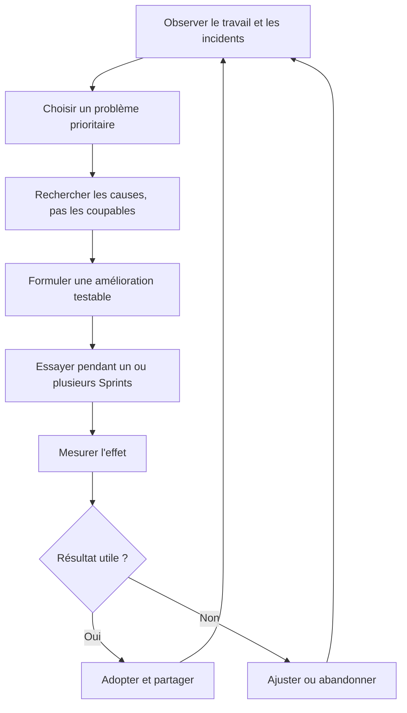

La Sprint Retrospective vise à planifier des moyens d’accroître la qualité et l’efficacité. Une rétrospective utile se concentre sur le système de travail : attentes floues, tests tardifs, interruptions, dépendances ou incidents récurrents. Elle produit une expérience concrète avec un responsable et un moyen de vérifier l’effet, au lieu de se limiter à une liste générale de souhaits.

**Articuler avec les autres dimensions.** La décision peut affecter le périmètre, la capacité, les coûts, le calendrier, la sécurité et l’exploitation. Il est nécessaire de repérer les dépendances en amont, les conséquences pour les bénéficiaires et les coûts de réversibilité. Une optimisation locale peut transférer le coût vers une autre équipe ou reporter un risque après la mise en service. Une analyse complète rend explicite le compromis, indique ce qui est protégé et précise quelles limites ne peuvent pas être négociées.

**Illustration opérationnelle.** La rétrospective teste une nouvelle règle de revue de code et mesure si le temps d’attente diminue. Pour traiter ce type de situation, consigner les faits, distinguer les hypothèses, fixer une responsabilité et définir une preuve vérifiable. Lorsque plusieurs solutions sont possibles, les comparer avec des critères communs. Si les données sont incomplètes, organiser une courte investigation avec une échéance au lieu de présenter une estimation fragile comme un engagement ferme. La décision doit pouvoir être comprise par une personne qui n’a pas assisté à la discussion d’origine.

**Mise en œuvre.** Recueillir les données auprès des personnes proches du travail, examiner les contraintes, formuler des options, préciser leurs impacts et décider au niveau approprié. Après la décision, consigner le motif, informer les acteurs concernés et suivre l’effet réel. Lorsque le seuil de délégation est dépassé, préparer une escalade concise qui présente le problème, les options, les risques, une recommandation et la date à laquelle la décision devient urgente. Cette séquence protège la coordination sans imposer de lourdeur inutile.

**Mesure et preuve.** Il faut choisir un indicateur correspondant à la finalité de la pratique. Une donnée d’activité ne démontre pas nécessairement un résultat. Définir la source, la fréquence, le responsable, la valeur de référence et les limites de l’indicateur. Compléter si nécessaire les chiffres par une observation qualitative, une revue ou un test. Les mesures doivent être assez fiables pour soutenir une décision, mais pas si coûteuses qu’elles consomment une part disproportionnée du travail qu’elles sont censées aider.

**Erreurs fréquentes et correction.** Les erreurs habituelles incluent une information non actualisée, des définitions variables, une responsabilité implicite, un contrôle fait trop tard ou une exception devenue la règle. Le correctif n’est pas d’ajouter des tableaux sans fin : il faut retrouver la cause, simplifier le flux, attribuer la décision et mesurer l’amélioration. Si une pratique ne produit plus de valeur, la revoir avec les personnes concernées, tout en conservant les contrôles obligatoires et les traces nécessaires à l’audit.

**Approfondissement.** Pour un projet à forte criticité, la pratique peut exiger une validation indépendante, une séparation des tâches, une piste d’audit et un test sur un environnement représentatif. Pour un travail limité et réversible, une revue de pair peut suffire. La proportionnalité ne signifie pas l’absence de rigueur : elle cherche le meilleur rapport entre contrôle et utilité. Le test décisif est de savoir si l’équipe peut expliquer ce qu’elle fait, pourquoi elle le fait, quelle preuve confirme le résultat et comment elle réagira si l’hypothèse devient fausse.

### 13. Adaptation et garde-fous

**Comprendre le concept.** Dans « Manifeste Agile et framework Scrum », adaptation et garde-fous constitue une pratique qui doit répondre à une intention précise. L’agilité n’excuse pas de contourner la conformité ; les contrôles doivent être intégrés à la Definition of Done et aux décisions de produit. Le responsable doit commencer par définir le résultat attendu, l’autorité concernée et les informations qui manquent encore. Une méthode ne doit pas être appliquée uniquement parce qu’elle figure dans un guide ou qu’elle est proposée par un outil. Sa valeur dépend du contexte, des personnes qui l’utilisent et de la qualité des décisions qu’elle permet de prendre.

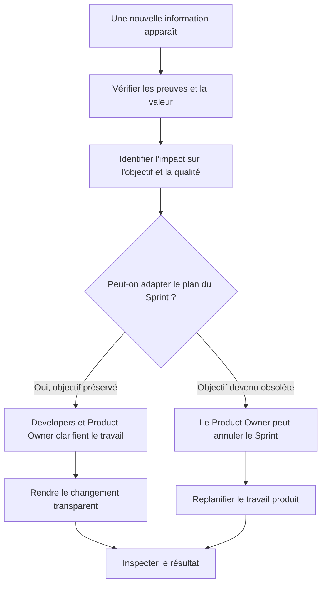

L’adaptation reste encadrée par les responsabilités et les engagements Scrum. Les changements ne doivent pas menacer le Sprint Goal sans discussion. Le Guide prévoit que le Product Owner peut annuler un Sprint si son objectif devient obsolète ; cette décision n’est pas une option quotidienne pour contourner une difficulté de livraison. La transparence du backlog, du plan et de la qualité reste essentielle.

**Articuler avec les autres dimensions.** La décision peut affecter le périmètre, la capacité, les coûts, le calendrier, la sécurité et l’exploitation. Il est nécessaire de repérer les dépendances en amont, les conséquences pour les bénéficiaires et les coûts de réversibilité. Une optimisation locale peut transférer le coût vers une autre équipe ou reporter un risque après la mise en service. Une analyse complète rend explicite le compromis, indique ce qui est protégé et précise quelles limites ne peuvent pas être négociées.

**Illustration opérationnelle.** La date peut être renégociée ou le périmètre réduit, mais les exigences de sécurité obligatoires restent testées. Pour traiter ce type de situation, consigner les faits, distinguer les hypothèses, fixer une responsabilité et définir une preuve vérifiable. Lorsque plusieurs solutions sont possibles, les comparer avec des critères communs. Si les données sont incomplètes, organiser une courte investigation avec une échéance au lieu de présenter une estimation fragile comme un engagement ferme. La décision doit pouvoir être comprise par une personne qui n’a pas assisté à la discussion d’origine.

**Mise en œuvre.** Recueillir les données auprès des personnes proches du travail, examiner les contraintes, formuler des options, préciser leurs impacts et décider au niveau approprié. Après la décision, consigner le motif, informer les acteurs concernés et suivre l’effet réel. Lorsque le seuil de délégation est dépassé, préparer une escalade concise qui présente le problème, les options, les risques, une recommandation et la date à laquelle la décision devient urgente. Cette séquence protège la coordination sans imposer de lourdeur inutile.

**Mesure et preuve.** Il faut choisir un indicateur correspondant à la finalité de la pratique. Une donnée d’activité ne démontre pas nécessairement un résultat. Définir la source, la fréquence, le responsable, la valeur de référence et les limites de l’indicateur. Compléter si nécessaire les chiffres par une observation qualitative, une revue ou un test. Les mesures doivent être assez fiables pour soutenir une décision, mais pas si coûteuses qu’elles consomment une part disproportionnée du travail qu’elles sont censées aider.

**Erreurs fréquentes et correction.** Les erreurs habituelles incluent une information non actualisée, des définitions variables, une responsabilité implicite, un contrôle fait trop tard ou une exception devenue la règle. Le correctif n’est pas d’ajouter des tableaux sans fin : il faut retrouver la cause, simplifier le flux, attribuer la décision et mesurer l’amélioration. Si une pratique ne produit plus de valeur, la revoir avec les personnes concernées, tout en conservant les contrôles obligatoires et les traces nécessaires à l’audit.

**Approfondissement.** Pour un projet à forte criticité, la pratique peut exiger une validation indépendante, une séparation des tâches, une piste d’audit et un test sur un environnement représentatif. Pour un travail limité et réversible, une revue de pair peut suffire. La proportionnalité ne signifie pas l’absence de rigueur : elle cherche le meilleur rapport entre contrôle et utilité. Le test décisif est de savoir si l’équipe peut expliquer ce qu’elle fait, pourquoi elle le fait, quelle preuve confirme le résultat et comment elle réagira si l’hypothèse devient fausse.

## Étude de cas : Construire un portail de demandes en incréments

Un service IT veut moderniser son portail. Les utilisateurs savent expliquer les irritants mais ne peuvent pas décrire parfaitement la solution. L’équipe souhaite livrer rapidement un premier parcours exploitable tout en respectant sécurité, accessibilité et intégration.

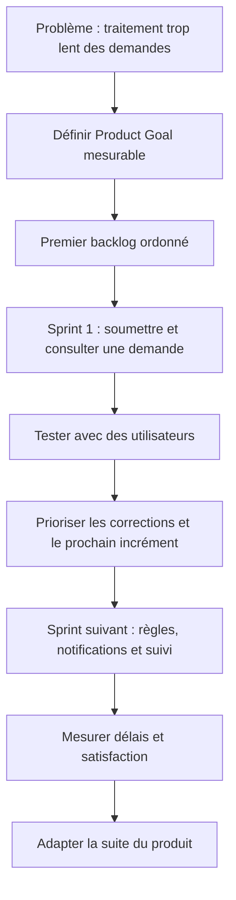

Le cas ne doit pas commencer par une liste exhaustive d’écrans. L’équipe formule d’abord l’amélioration recherchée, par exemple réduire le délai de traitement et rendre l’état des demandes visible. Un premier incrément étroit, utilisable et conforme à la Definition of Done permet de tester les hypothèses ; les priorités suivantes viennent des résultats et des contraintes découvertes.

### Cadrage et données de départ

Les acteurs commencent par décrire le problème avec des faits vérifiables, puis identifient les bénéficiaires, les exigences et les contraintes. Ils séparent les obligations impératives des préférences, écrivent les hypothèses et demandent une confirmation lorsque celles-ci conditionnent fortement le coût ou la date. Le responsable du projet désigne un propriétaire pour chaque décision majeure, fixe un mécanisme d’escalade et conserve une trace des validations. La première sortie attendue est une compréhension commune du travail, et non une liste exhaustive de tâches écrite avant d’avoir compris le besoin.

### Comparaison des options

L’équipe compare au moins deux options réalistes, dont une option limitée ou progressive. Chaque option est évaluée selon la valeur, le coût complet, le délai, les risques, la réversibilité, les dépendances et les conséquences en exploitation. Les avantages non mesurés sont explicitement identifiés comme hypothèses. Une décision est recommandée lorsque le raisonnement est clair, les compromis sont compris et la personne habilitée a accès aux éléments nécessaires. En cas d’incertitude importante, un prototype ou une estimation complémentaire peut être plus utile qu’un engagement prématuré.

### Mise en œuvre et suivi

Le plan est découpé en livrables que l’on peut vérifier. Les travaux critiques sont associés à des critères de sortie, des responsables et des preuves. Les prévisions sont actualisées en fonction du travail restant, pas uniquement par décalage des dates précédentes. Les changements sont analysés pour leurs impacts croisés. Lorsqu’un indicateur devient rouge, l’équipe expose la cause et propose une action plutôt que de modifier la définition de l’indicateur. La communication est adaptée à chaque public et les décisions qui dépassent les délégations remontent à la gouvernance.

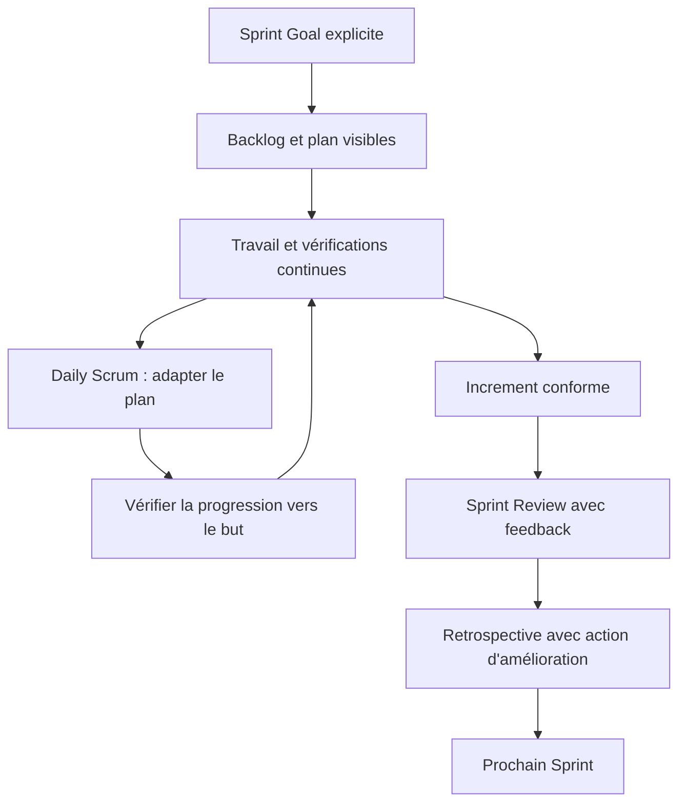

Pendant le Sprint, le suivi doit privilégier les preuves et la progression vers l’objectif plutôt que le seul pourcentage de tâches terminées. Les blocages sont rendus visibles, la qualité est construite tout au long du travail et la revue porte sur un incrément réel. Les indicateurs de flux ou de prévision peuvent aider, mais aucun indicateur isolé ne remplace la discussion empirique et le jugement de l’équipe.

### Acceptation et apprentissage

Avant la clôture, les livrables sont comparés aux critères convenus, les défauts et risques résiduels sont documentés, les responsabilités d’exploitation sont transférées et le support est préparé. Les mesures de bénéfices ont un propriétaire et une échéance de suivi. La rétrospective décrit les faits, la cause des écarts, les adaptations utiles et les pratiques à conserver. Elle ne doit pas désigner des coupables : elle cherche à rendre le système de travail plus fiable et l’organisation plus apte à apprendre.

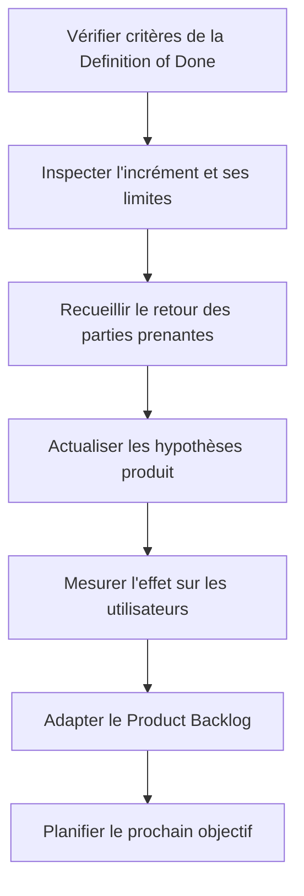

Scrum ne garantit pas à lui seul le succès d’un produit : il permet d’inspecter fréquemment ce qui est construit et de s’adapter. L’acceptation doit distinguer la conformité à la Definition of Done, les retours d’usage et les décisions de mise en production qui relèvent des règles de l’organisation. Les apprentissages doivent modifier concrètement les priorités ou les pratiques.

## Atelier pratique

**Exercice 1.** À partir du cas, écris un plan de travail d’une page. Il doit comporter les résultats attendus, les dépendances majeures, les risques, les responsables, les indicateurs et les conditions d’acceptation.

**Correction.** Une bonne réponse relie chaque activité à un livrable, chaque livrable à un critère, chaque risque à un propriétaire et chaque décision à une autorité. Elle distingue les faits des hypothèses et rend visibles les dépendances qui peuvent déplacer la date ou le coût total.

**Exercice 2.** Le sponsor demande d’avancer la livraison de plusieurs semaines. Prépare trois options avec leurs effets sur le périmètre, la capacité, le risque, la qualité et le coût.

**Correction.** Il faut expliquer les compromis sans promettre une accélération qui n’est pas étayée. Réduire un périmètre non essentiel, augmenter les moyens avec des compétences réellement disponibles ou déplacer la date sont des options possibles. Les critères de sécurité et d’acceptation obligatoires ne doivent pas être supprimés pour rendre les indicateurs artificiellement positifs.

**Exercice 3.** Une tâche semble terminée, mais aucun test ni procès-verbal ne confirme le résultat. Quelle information dois-tu demander avant de déclarer le travail accepté ?

**Correction.** Il faut retrouver le critère attendu, le test ou la preuve équivalente, le responsable de validation et le statut des écarts. Une déclaration orale peut orienter la vérification, mais ne suffit pas lorsque la gouvernance exige une preuve traçable.

## Pièges à éviter

- Confondre activité, livraison et bénéfice.
- Présenter une estimation comme une certitude sans expliquer les hypothèses.
- Masquer un écart en modifiant la référence.
- Choisir une méthode parce qu’elle est populaire plutôt que adaptée.
- Surcharger l’équipe avec un outil qui ne soutient aucune décision utile.
- Faire dépendre un livrable d’une personne ou d’un fournisseur sans plan de secours.
- Reporter les tests et la sécurité à la toute fin.
- Laisser les responsabilités d’acceptation implicites.
- Confondre indicateurs d’activité et mesures de résultat.
- Fermer le projet sans transfert, support ni mesure ultérieure des bénéfices.

## Checklist de révision

- [ ] Le besoin et les résultats attendus sont explicites.
- [ ] Les inclusions et exclusions sont visibles.
- [ ] Les hypothèses, dépendances et risques sont suivis.
- [ ] Les personnes responsables et les décideurs sont identifiés.
- [ ] Le plan décrit des livrables vérifiables.
- [ ] Les indicateurs répondent à des questions de décision.
- [ ] Les changements sont analysés et autorisés.
- [ ] La qualité et la sécurité sont intégrées au travail.
- [ ] Le transfert aux opérations est préparé.
- [ ] Les retours d’expérience sont capitalisés.

## À retenir

Un dispositif de gestion de projet n’est pas un rituel administratif : il constitue un système partagé pour comprendre le travail, prendre des décisions, observer les résultats et adapter le plan. Il doit être assez rigoureux pour protéger la valeur, la qualité et la confiance, mais assez léger pour rester utilisé. Les pratiques les plus utiles sont celles qui rendent les hypothèses visibles, les responsabilités explicites et les décisions vérifiables.

## Glossaire

- **Baseline :** référence approuvée permettant de comparer réel et prévu.
- **Dépendance :** condition qui relie deux activités ou acteurs.
- **Jalon :** événement important marquant une validation ou un point de décision.
- **Livrable :** résultat concret pouvant être vérifié.
- **Marge :** délai disponible avant qu’un retard n’affecte une autre activité ou la fin du projet.
- **Périmètre :** limites du travail et des résultats inclus.
- **Prévision :** estimation mise à jour de l’issue probable.
- **Risque :** événement incertain pouvant affecter les objectifs.
- **Critère d’acceptation :** condition observable permettant d’accepter le résultat.
- **Réserve :** enveloppe ou marge prévue pour traiter une incertitude selon les règles du projet.

## Scrum : cadre, engagements et règles de base

Scrum est un cadre empirique destiné à traiter des problèmes complexes, pas un ensemble de réunions à ajouter à un processus inchangé. Sa fondation repose sur la transparence, l’inspection et l’adaptation. L’équipe doit rendre visible le travail réel et la qualité de l’incrément ; les inspections n’ont d’intérêt que si elles peuvent déclencher une adaptation. Une équipe qui cache les défauts ou n’a pas le droit de modifier son plan limite elle-même l’apprentissage.

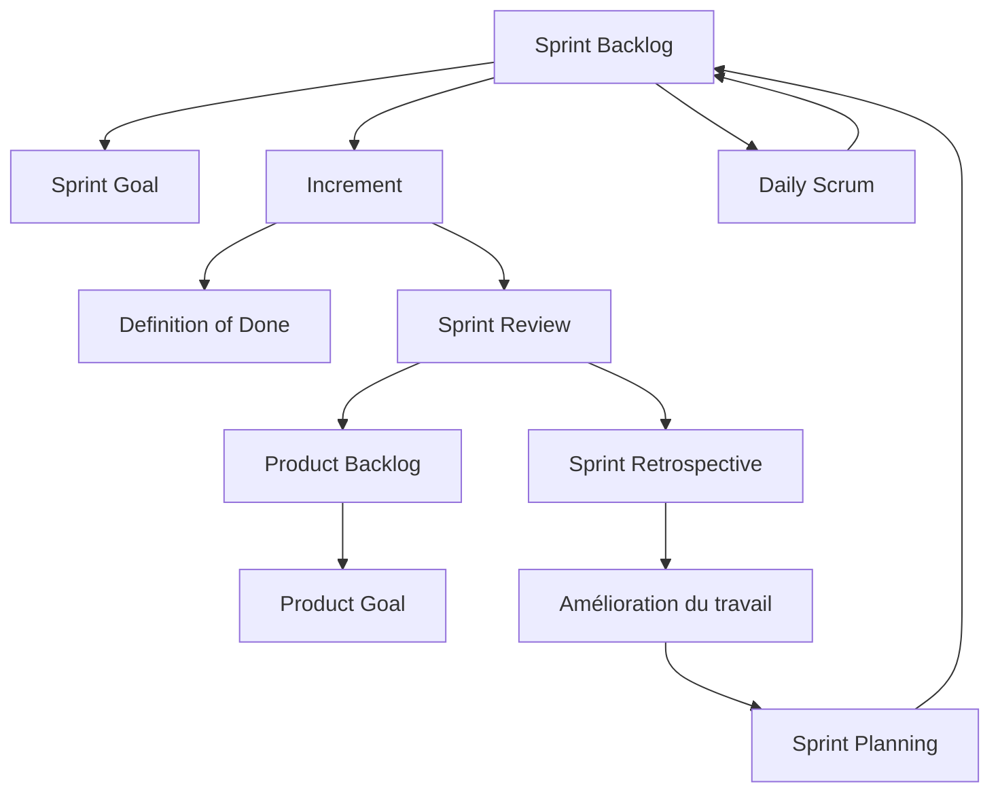

Les trois artefacts Scrum possèdent chacun un engagement associé : le Product Backlog est lié au Product Goal, le Sprint Backlog au Sprint Goal et l’Increment à la Definition of Done. Les événements sont les occasions formelles d’inspection et d’adaptation. Le Guide Scrum officiel décrit ces éléments et leurs règles ; des pratiques supplémentaires peuvent être utiles, mais elles ne doivent pas être confondues avec les exigences du cadre.

Le Scrum Team comprend un Product Owner, un Scrum Master et des Developers. Le Product Owner est redevable de la maximisation de la valeur et de la gestion efficace du Product Backlog. Le Scrum Master est redevable de l’établissement de Scrum et de l’efficacité de l’équipe. Les Developers créent un plan pour le Sprint, respectent la Definition of Done et adaptent quotidiennement leur travail vers le Sprint Goal. Ces responsabilités ne doivent pas être confondues avec des titres hiérarchiques.

Les cinq événements officiels sont le Sprint, le Sprint Planning, le Daily Scrum, la Sprint Review et la Sprint Retrospective. Le Sprint est le contenant des autres événements. Le Daily Scrum est un événement des Developers pour inspecter la progression vers le Sprint Goal et adapter le plan, pas un compte rendu au chef. La Review inspecte le résultat et les évolutions du contexte avec les parties prenantes ; la Retrospective cherche à améliorer la qualité et l’efficacité.

Les trois artefacts sont le Product Backlog, le Sprint Backlog et l’Increment, chacun associé à un engagement : Product Goal, Sprint Goal et Definition of Done. Un élément sélectionné dans un Sprint n’est pas « terminé » sans répondre à la Definition of Done. Le scope peut être clarifié et renégocié avec le Product Owner à mesure de l’apprentissage, sans compromettre le Sprint Goal. Référence officielle : https://scrumguides.org/scrum-guide
## Références pour approfondir

- PMI : https://www.pmi.org/
- Nouveau contenu d’examen PMP et ressources officielles 2026 : https://www.pmi.org/certifications/project-management-pmp/new-exam
- Guide Scrum officiel : https://scrumguides.org/scrum-guide
- ISO 21502 : https://committee.iso.org/sites/tc258/home/projects/published/iso-21502.html
