# Audit de projet et capitalisation

> **Encadré de mise en contexte** — Le projet se clôture avec des écarts non documentés, des décisions dispersées dans les messages et peu de retour sur les causes de dérive. L’organisation risque de répéter les mêmes erreurs.

## Introduction

La gestion de projet IT transforme une demande parfois imprécise en résultats utiles grâce à des décisions explicites. Les outils de pilotage ne suppriment pas l’incertitude : ils rendent les hypothèses, les responsabilités, les dépendances et les écarts visibles. Une pratique bien choisie aide les personnes compétentes à se coordonner, à détecter les problèmes tôt et à choisir le bon compromis entre valeur, délais, coûts, qualité, sécurité et adoption.

Ce cours sur « Audit de projet et capitalisation » privilégie les méthodes applicables dans un environnement réel. Une pratique n’est utile que si elle répond à un besoin précis. Il faut calibrer le niveau de détail en fonction de la criticité, du coût de l’erreur, de la stabilité du périmètre et des obligations externes. Un petit projet réversible peut s’appuyer sur un dispositif léger, alors qu’une transformation importante ou un service critique exige des preuves plus formelles.

Le cas « Auditer et clôturer une migration IT » sert de fil rouge. Il permet de distinguer les faits des hypothèses, d’identifier les décisions qui conditionnent le résultat et de construire une manière de vérifier l’effet des choix. Les outils cités sont des exemples : leurs fonctions évoluent, les offres commerciales changent et chaque organisation doit vérifier ses règles, ses contrats et ses contraintes avant de les utiliser.

## Objectifs pédagogiques

- Expliquer les concepts de base et les limites des méthodes étudiées.
- Choisir une approche adaptée à la nature du travail et à l’incertitude.
- Décrire les étapes, livrables, responsabilités et contrôles associés.
- Mesurer les résultats avec des indicateurs reliés aux objectifs.
- Appliquer la démarche au cas proposé et justifier les arbitrages.

## Concepts clés

**Valeur.** La valeur décrit le bénéfice recherché pour un utilisateur ou l’organisation. Elle doit être reliée à une situation initiale, à un changement attendu et à une mesure raisonnable. Sans cette relation, l’équipe risque d’optimiser un outil ou un processus sans résoudre le problème métier.

**Schéma directeur — de la preuve à l’apprentissage organisationnel.** Un audit utile relie les critères convenus aux faits observés, aux décisions correctives et à la vérification de leur efficacité. La capitalisation transforme ensuite les enseignements en pratiques réutilisables.

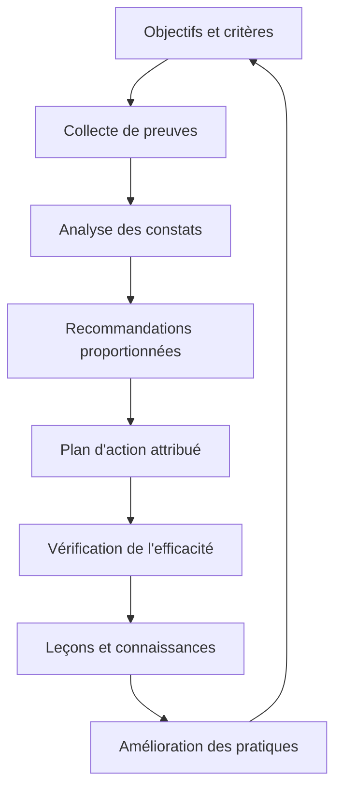

Le rapport n’est donc pas le produit final à lui seul. La valeur de l’audit se mesure aussi à la qualité des décisions qu’il permet, à la réduction des risques et à la réutilisation des connaissances dans les projets suivants.

**Périmètre et qualité.** Le périmètre fixe les limites du travail ; la qualité précise les caractéristiques et critères qui permettront d’accepter les livrables. Les ajouts doivent être analysés au lieu d’être acceptés implicitement. Une date ou un budget ne justifie jamais de prétendre qu’un critère obligatoire est satisfait sans preuve.

**Prévision et référence.** La référence approuvée permet d’étudier les écarts, tandis que la prévision décrit l’issue la plus probable à partir des données actuelles. On peut réviser une prévision et conserver une référence historique. La distinction préserve la transparence et aide à décider sans maquiller les évolutions.

**Gouvernance.** La gouvernance répartit les responsabilités, les pouvoirs de décision, les seuils d’escalade et les mécanismes de validation. Elle doit soutenir le travail plutôt que le bloquer. Les décisions fréquentes et réversibles sont généralement déléguées ; les décisions coûteuses, risquées ou réglementaires nécessitent une autorité et une trace explicites.

**Risque et dépendances.** Un risque correspond à un événement incertain et à ses conséquences éventuelles. Une dépendance relie le projet à un système, une équipe, un fournisseur ou une approbation. Les réponses doivent avoir un propriétaire, un signal et une action. Une dépendance non suivie peut transformer une activité courte en facteur de retard global.

**Communication.** Une information est efficace quand elle permet à son destinataire de comprendre la situation et d’agir. L’équipe a besoin de détails opérationnels, le sponsor d’options d’arbitrage et les utilisateurs de connaître les impacts. Les rapports doivent distinguer faits observés, hypothèses, risques et décisions attendues.

**Adoption et transfert.** Le résultat doit pouvoir être utilisé, maintenu et supporté. Les responsabilités d’exploitation, les accès, la documentation, la formation, la supervision et la continuité doivent être préparés avant la mise en service. Les bénéfices peuvent nécessiter une mesure plusieurs semaines après la livraison.

## Méthodologie et outils

Commencer par formuler le problème, les bénéficiaires, le résultat attendu et les contraintes non négociables. Décrire ensuite les options, les dépendances, les responsabilités, les risques et les preuves nécessaires. La planification fournit une hypothèse structurée ; elle doit être révisée lorsque de nouveaux faits modifient le travail restant ou les conditions de réussite.

**Schéma de conduite de mission.** Une démarche d’audit structurée reste indépendante du résultat recherché : elle définit les critères avant de tirer des conclusions, conserve les preuves et permet aux personnes concernées de répondre aux constats.

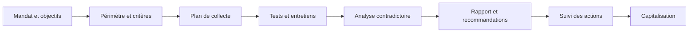

Adaptez la profondeur des contrôles à l’importance des risques, sans réduire les exigences d’intégrité, de confidentialité et de traçabilité. Pour chaque phase, conservez une trace du responsable, des décisions et des éléments examinés.

Les outils servent à externaliser la mémoire collective. Ils doivent permettre de répondre à des questions concrètes : quel résultat est attendu, qui le prend en charge, qu’est-ce qui est bloqué, quelle décision est en attente, quelle preuve existe et comment la prévision change-t-elle ? La simplicité est une qualité si les contrôles essentiels restent couverts et si les données sont maintenues.

Un reporting utile ne récompense pas seulement le volume d’activité. Il met en évidence le travail réellement terminé, les critères qui restent ouverts, les risques qui évoluent et les arbitrages nécessaires. Les estimations doivent exposer leurs hypothèses, les marges doivent être explicables et les mesures doivent être comprises par ceux qui les utilisent pour décider.

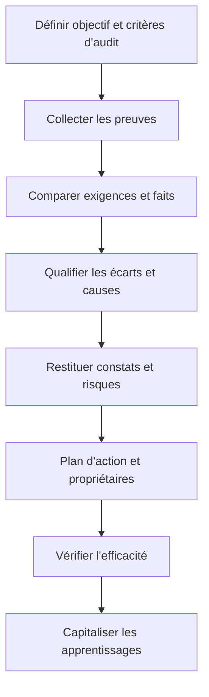

### 1. Finalité de l’audit

**Comprendre le concept.** Dans « Audit de projet et capitalisation », finalité de l’audit constitue une pratique qui doit répondre à une intention précise. Un audit évalue des faits par rapport à des critères définis et vise des conclusions fiables sur la maîtrise, la conformité ou la performance. Le responsable doit définir le résultat attendu, l’autorité concernée et les informations qui manquent encore. Une méthode ne doit pas être appliquée uniquement parce qu’elle figure dans un guide ou qu’elle est proposée par un outil. Sa valeur dépend du contexte, des personnes qui l’utilisent et de la qualité des décisions qu’elle permet de prendre.

**Schéma — aligner l’audit sur des questions concrètes.** Un objectif comme « vérifier que le projet est bien géré » est trop vague. Transformez-le en questions vérifiables qui répondent à une décision ou à un risque réel.

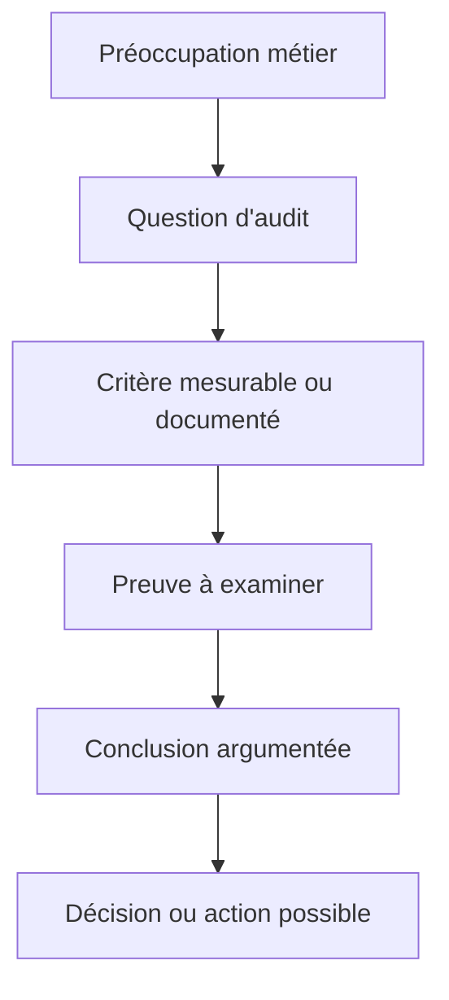

Précisez ce que l’audit peut conclure et ce qui dépasse son mandat. Un échantillon limité, des données manquantes ou un accès restreint doivent être mentionnés pour que les lecteurs comprennent le niveau de confiance associé aux conclusions.

**Articuler avec les autres dimensions.** La décision peut affecter le périmètre, la capacité, les coûts, le calendrier, la sécurité et l’exploitation. Il est nécessaire de repérer les dépendances en amont, les conséquences pour les bénéficiaires et les coûts de réversibilité. Une optimisation locale peut transférer le coût vers une autre équipe ou reporter un risque après la mise en service. Une analyse complète rend explicite le compromis, indique ce qui est protégé et précise quelles limites ne peuvent pas être négociées.

**Illustration opérationnelle.** L’audit compare les décisions de changement aux règles convenues et identifie les écarts justifiés ou non. Pour traiter ce type de situation, consigner les faits, distinguer les hypothèses, fixer une responsabilité et définir une preuve vérifiable. Lorsque plusieurs solutions sont possibles, les comparer avec des critères communs. Si les données sont incomplètes, organiser une courte investigation avec une échéance au lieu de présenter une estimation fragile comme un engagement ferme. La décision doit pouvoir être comprise par une personne qui n’a pas assisté à la discussion d’origine.

**Mise en œuvre.** Recueillir les données auprès des personnes proches du travail, examiner les contraintes, formuler des options, préciser leurs impacts et décider au niveau approprié. Après la décision, consigner le motif, informer les acteurs concernés et suivre l’effet réel. Lorsque le seuil de délégation est dépassé, préparer une escalade concise qui présente le problème, les options, les risques, une recommandation et la date à laquelle la décision devient urgente.

**Mesure et preuve.** Il faut choisir un indicateur correspondant à la finalité de la pratique. Une donnée d’activité ne démontre pas nécessairement un résultat. Définir la source, la fréquence, le responsable, la valeur de référence et les limites de l’indicateur. Compléter si nécessaire les chiffres par une observation qualitative, une revue ou un test. Les mesures doivent être assez fiables pour soutenir une décision, mais pas si coûteuses qu’elles consomment une part disproportionnée du travail.

**Erreurs fréquentes et correction.** Les erreurs habituelles incluent une information non actualisée, des définitions variables, une responsabilité implicite, un contrôle fait trop tard ou une exception devenue la règle. Le correctif n’est pas d’ajouter des tableaux sans fin : il faut retrouver la cause, simplifier le flux, attribuer la décision et mesurer l’amélioration. Si une pratique ne produit plus de valeur, la revoir avec les personnes concernées, tout en conservant les contrôles obligatoires et les traces nécessaires à l’audit.

**Approfondissement.** Pour un projet à forte criticité, la pratique peut exiger une validation indépendante, une séparation des tâches, une piste d’audit et un test sur un environnement représentatif. Pour un travail limité et réversible, une revue de pair peut suffire. La proportionnalité ne signifie pas l’absence de rigueur : elle cherche le meilleur rapport entre contrôle et utilité. Le test décisif est de savoir si l’équipe peut expliquer ce qu’elle fait, pourquoi elle le fait, quelle preuve confirme le résultat et comment elle réagira si l’hypothèse devient fausse.

### 2. Périmètre, critères et indépendance

**Comprendre le concept.** Dans « Audit de projet et capitalisation », périmètre, critères et indépendance constitue une pratique qui doit répondre à une intention précise. Le plan d’audit fixe objectifs, périmètre, critères, méthode, accès aux preuves et éventuels conflits d’intérêts. Le responsable doit définir le résultat attendu, l’autorité concernée et les informations qui manquent encore. Une méthode ne doit pas être appliquée uniquement parce qu’elle figure dans un guide ou qu’elle est proposée par un outil. Sa valeur dépend du contexte, des personnes qui l’utilisent et de la qualité des décisions qu’elle permet de prendre.

**Schéma — fixer les limites de la mission.** Le périmètre évite les attentes contradictoires ; les critères rendent l’évaluation transparente ; l’indépendance protège la crédibilité de la conclusion.

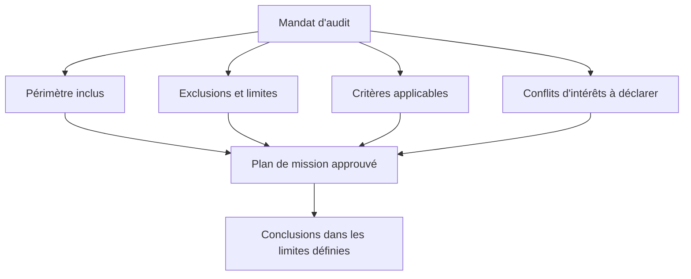

Lorsque l’auditeur a participé à la décision examinée, le risque de conflit doit être signalé et traité. Si l’indépendance complète est impossible, une revue complémentaire par une personne non impliquée peut renforcer la confiance, sans masquer cette limite.

**Articuler avec les autres dimensions.** La décision peut affecter le périmètre, la capacité, les coûts, le calendrier, la sécurité et l’exploitation. Il est nécessaire de repérer les dépendances en amont, les conséquences pour les bénéficiaires et les coûts de réversibilité. Une optimisation locale peut transférer le coût vers une autre équipe ou reporter un risque après la mise en service. Une analyse complète rend explicite le compromis, indique ce qui est protégé et précise quelles limites ne peuvent pas être négociées.

**Illustration opérationnelle.** L’auditeur annonce qu’il évaluera la traçabilité des approbations et les tests, sans réinventer les critères en cours de revue. Pour traiter ce type de situation, consigner les faits, distinguer les hypothèses, fixer une responsabilité et définir une preuve vérifiable. Lorsque plusieurs solutions sont possibles, les comparer avec des critères communs. Si les données sont incomplètes, organiser une courte investigation avec une échéance au lieu de présenter une estimation fragile comme un engagement ferme. La décision doit pouvoir être comprise par une personne qui n’a pas assisté à la discussion d’origine.

**Mise en œuvre.** Recueillir les données auprès des personnes proches du travail, examiner les contraintes, formuler des options, préciser leurs impacts et décider au niveau approprié. Après la décision, consigner le motif, informer les acteurs concernés et suivre l’effet réel. Lorsque le seuil de délégation est dépassé, préparer une escalade concise qui présente le problème, les options, les risques, une recommandation et la date à laquelle la décision devient urgente.

**Mesure et preuve.** Il faut choisir un indicateur correspondant à la finalité de la pratique. Une donnée d’activité ne démontre pas nécessairement un résultat. Définir la source, la fréquence, le responsable, la valeur de référence et les limites de l’indicateur. Compléter si nécessaire les chiffres par une observation qualitative, une revue ou un test. Les mesures doivent être assez fiables pour soutenir une décision, mais pas si coûteuses qu’elles consomment une part disproportionnée du travail.

**Erreurs fréquentes et correction.** Les erreurs habituelles incluent une information non actualisée, des définitions variables, une responsabilité implicite, un contrôle fait trop tard ou une exception devenue la règle. Le correctif n’est pas d’ajouter des tableaux sans fin : il faut retrouver la cause, simplifier le flux, attribuer la décision et mesurer l’amélioration. Si une pratique ne produit plus de valeur, la revoir avec les personnes concernées, tout en conservant les contrôles obligatoires et les traces nécessaires à l’audit.

**Approfondissement.** Pour un projet à forte criticité, la pratique peut exiger une validation indépendante, une séparation des tâches, une piste d’audit et un test sur un environnement représentatif. Pour un travail limité et réversible, une revue de pair peut suffire. La proportionnalité ne signifie pas l’absence de rigueur : elle cherche le meilleur rapport entre contrôle et utilité. Le test décisif est de savoir si l’équipe peut expliquer ce qu’elle fait, pourquoi elle le fait, quelle preuve confirme le résultat et comment elle réagira si l’hypothèse devient fausse.

### 3. Collecte des preuves

**Comprendre le concept.** Dans « Audit de projet et capitalisation », collecte des preuves constitue une pratique qui doit répondre à une intention précise. Une preuve doit être pertinente, suffisante, authentique, compréhensible et reliée à un fait ; une capture seule peut être ambiguë. Le responsable doit définir le résultat attendu, l’autorité concernée et les informations qui manquent encore. Une méthode ne doit pas être appliquée uniquement parce qu’elle figure dans un guide ou qu’elle est proposée par un outil. Sa valeur dépend du contexte, des personnes qui l’utilisent et de la qualité des décisions qu’elle permet de prendre.

**Schéma — trianguler les sources.** Aucun type de preuve n’est parfait isolément. La convergence des journaux, documents, observations, tests et entretiens réduit le risque de conclure à partir d’un témoignage ou d’une capture incomplets.

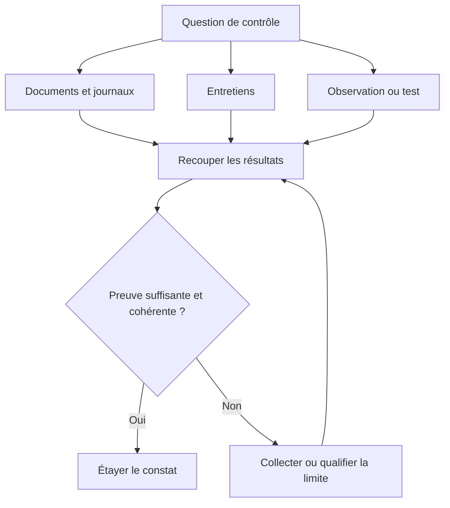

Pour une preuve importante, notez l’origine, la date, le contexte, la personne qui l’a collectée et les transformations appliquées. Conservez uniquement les informations nécessaires et protégez les données confidentielles selon les règles de l’organisation.

**Articuler avec les autres dimensions.** La décision peut affecter le périmètre, la capacité, les coûts, le calendrier, la sécurité et l’exploitation. Il est nécessaire de repérer les dépendances en amont, les conséquences pour les bénéficiaires et les coûts de réversibilité. Une optimisation locale peut transférer le coût vers une autre équipe ou reporter un risque après la mise en service. Une analyse complète rend explicite le compromis, indique ce qui est protégé et précise quelles limites ne peuvent pas être négociées.

**Illustration opérationnelle.** Le dossier contient version, date, environnement, résultat de test, auteur et lien vers la décision. Pour traiter ce type de situation, consigner les faits, distinguer les hypothèses, fixer une responsabilité et définir une preuve vérifiable. Lorsque plusieurs solutions sont possibles, les comparer avec des critères communs. Si les données sont incomplètes, organiser une courte investigation avec une échéance au lieu de présenter une estimation fragile comme un engagement ferme. La décision doit pouvoir être comprise par une personne qui n’a pas assisté à la discussion d’origine.

**Mise en œuvre.** Recueillir les données auprès des personnes proches du travail, examiner les contraintes, formuler des options, préciser leurs impacts et décider au niveau approprié. Après la décision, consigner le motif, informer les acteurs concernés et suivre l’effet réel. Lorsque le seuil de délégation est dépassé, préparer une escalade concise qui présente le problème, les options, les risques, une recommandation et la date à laquelle la décision devient urgente.

**Mesure et preuve.** Il faut choisir un indicateur correspondant à la finalité de la pratique. Une donnée d’activité ne démontre pas nécessairement un résultat. Définir la source, la fréquence, le responsable, la valeur de référence et les limites de l’indicateur. Compléter si nécessaire les chiffres par une observation qualitative, une revue ou un test. Les mesures doivent être assez fiables pour soutenir une décision, mais pas si coûteuses qu’elles consomment une part disproportionnée du travail.

**Erreurs fréquentes et correction.** Les erreurs habituelles incluent une information non actualisée, des définitions variables, une responsabilité implicite, un contrôle fait trop tard ou une exception devenue la règle. Le correctif n’est pas d’ajouter des tableaux sans fin : il faut retrouver la cause, simplifier le flux, attribuer la décision et mesurer l’amélioration. Si une pratique ne produit plus de valeur, la revoir avec les personnes concernées, tout en conservant les contrôles obligatoires et les traces nécessaires à l’audit.

**Approfondissement.** Pour un projet à forte criticité, la pratique peut exiger une validation indépendante, une séparation des tâches, une piste d’audit et un test sur un environnement représentatif. Pour un travail limité et réversible, une revue de pair peut suffire. La proportionnalité ne signifie pas l’absence de rigueur : elle cherche le meilleur rapport entre contrôle et utilité. Le test décisif est de savoir si l’équipe peut expliquer ce qu’elle fait, pourquoi elle le fait, quelle preuve confirme le résultat et comment elle réagira si l’hypothèse devient fausse.

### 4. Traçabilité des décisions

**Comprendre le concept.** Dans « Audit de projet et capitalisation », traçabilité des décisions constitue une pratique qui doit répondre à une intention précise. Le journal des décisions explique le contexte, les options, le décideur, le motif, la date et les conditions de réexamen. Le responsable doit définir le résultat attendu, l’autorité concernée et les informations qui manquent encore. Une méthode ne doit pas être appliquée uniquement parce qu’elle figure dans un guide ou qu’elle est proposée par un outil. Sa valeur dépend du contexte, des personnes qui l’utilisent et de la qualité des décisions qu’elle permet de prendre.

**Schéma — reconstruire le raisonnement.** Une décision auditable permet de comprendre le contexte du choix, les options examinées, les hypothèses, l’autorité décisionnaire et les conditions de réexamen.

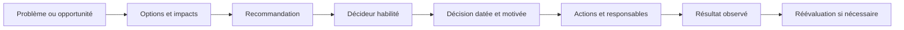

Le journal des décisions ne doit pas être réécrit rétrospectivement pour rendre le choix plus convaincant. Les corrections doivent conserver une piste d’audit, et une décision urgente doit tout de même être documentée dès que la situation le permet.

**Articuler avec les autres dimensions.** La décision peut affecter le périmètre, la capacité, les coûts, le calendrier, la sécurité et l’exploitation. Il est nécessaire de repérer les dépendances en amont, les conséquences pour les bénéficiaires et les coûts de réversibilité. Une optimisation locale peut transférer le coût vers une autre équipe ou reporter un risque après la mise en service. Une analyse complète rend explicite le compromis, indique ce qui est protégé et précise quelles limites ne peuvent pas être négociées.

**Illustration opérationnelle.** Une dérogation de sécurité précise l’autorité, la durée, les compensations et la date d’expiration. Pour traiter ce type de situation, consigner les faits, distinguer les hypothèses, fixer une responsabilité et définir une preuve vérifiable. Lorsque plusieurs solutions sont possibles, les comparer avec des critères communs. Si les données sont incomplètes, organiser une courte investigation avec une échéance au lieu de présenter une estimation fragile comme un engagement ferme. La décision doit pouvoir être comprise par une personne qui n’a pas assisté à la discussion d’origine.

**Mise en œuvre.** Recueillir les données auprès des personnes proches du travail, examiner les contraintes, formuler des options, préciser leurs impacts et décider au niveau approprié. Après la décision, consigner le motif, informer les acteurs concernés et suivre l’effet réel. Lorsque le seuil de délégation est dépassé, préparer une escalade concise qui présente le problème, les options, les risques, une recommandation et la date à laquelle la décision devient urgente.

**Mesure et preuve.** Il faut choisir un indicateur correspondant à la finalité de la pratique. Une donnée d’activité ne démontre pas nécessairement un résultat. Définir la source, la fréquence, le responsable, la valeur de référence et les limites de l’indicateur. Compléter si nécessaire les chiffres par une observation qualitative, une revue ou un test. Les mesures doivent être assez fiables pour soutenir une décision, mais pas si coûteuses qu’elles consomment une part disproportionnée du travail.

**Erreurs fréquentes et correction.** Les erreurs habituelles incluent une information non actualisée, des définitions variables, une responsabilité implicite, un contrôle fait trop tard ou une exception devenue la règle. Le correctif n’est pas d’ajouter des tableaux sans fin : il faut retrouver la cause, simplifier le flux, attribuer la décision et mesurer l’amélioration. Si une pratique ne produit plus de valeur, la revoir avec les personnes concernées, tout en conservant les contrôles obligatoires et les traces nécessaires à l’audit.

**Approfondissement.** Pour un projet à forte criticité, la pratique peut exiger une validation indépendante, une séparation des tâches, une piste d’audit et un test sur un environnement représentatif. Pour un travail limité et réversible, une revue de pair peut suffire. La proportionnalité ne signifie pas l’absence de rigueur : elle cherche le meilleur rapport entre contrôle et utilité. Le test décisif est de savoir si l’équipe peut expliquer ce qu’elle fait, pourquoi elle le fait, quelle preuve confirme le résultat et comment elle réagira si l’hypothèse devient fausse.

### 5. Analyse des écarts

**Comprendre le concept.** Dans « Audit de projet et capitalisation », analyse des écarts constitue une pratique qui doit répondre à une intention précise. Un écart est comparé à un critère explicite ; il faut distinguer non-conformité, exception autorisée, problème de données et amélioration possible. Le responsable doit définir le résultat attendu, l’autorité concernée et les informations qui manquent encore. Une méthode ne doit pas être appliquée uniquement parce qu’elle figure dans un guide ou qu’elle est proposée par un outil. Sa valeur dépend du contexte, des personnes qui l’utilisent et de la qualité des décisions qu’elle permet de prendre.

**Schéma — passer du critère au constat.** Un constat solide montre la différence entre ce qui était attendu et ce qui a été observé, puis explique l’importance de cet écart.

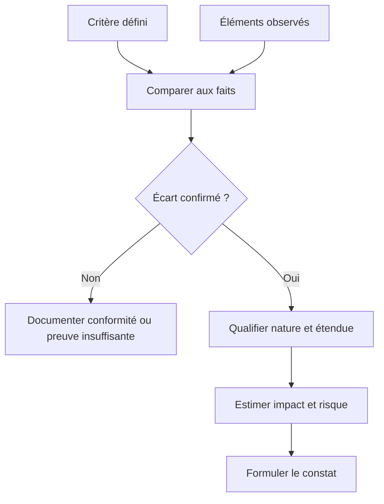

Distinguez une non-conformité, une exception autorisée, un défaut de documentation et un manque de preuve. Une absence de document ne prouve pas toujours que l’action n’a pas eu lieu ; elle peut toutefois révéler une faiblesse de contrôle ou de traçabilité.

**Articuler avec les autres dimensions.** La décision peut affecter le périmètre, la capacité, les coûts, le calendrier, la sécurité et l’exploitation. Il est nécessaire de repérer les dépendances en amont, les conséquences pour les bénéficiaires et les coûts de réversibilité. Une optimisation locale peut transférer le coût vers une autre équipe ou reporter un risque après la mise en service. Une analyse complète rend explicite le compromis, indique ce qui est protégé et précise quelles limites ne peuvent pas être négociées.

**Illustration opérationnelle.** Une date modifiée avec approbation n’est pas traitée comme une falsification de baseline, mais l’absence de décision peut être une faiblesse. Pour traiter ce type de situation, consigner les faits, distinguer les hypothèses, fixer une responsabilité et définir une preuve vérifiable. Lorsque plusieurs solutions sont possibles, les comparer avec des critères communs. Si les données sont incomplètes, organiser une courte investigation avec une échéance au lieu de présenter une estimation fragile comme un engagement ferme. La décision doit pouvoir être comprise par une personne qui n’a pas assisté à la discussion d’origine.

**Mise en œuvre.** Recueillir les données auprès des personnes proches du travail, examiner les contraintes, formuler des options, préciser leurs impacts et décider au niveau approprié. Après la décision, consigner le motif, informer les acteurs concernés et suivre l’effet réel. Lorsque le seuil de délégation est dépassé, préparer une escalade concise qui présente le problème, les options, les risques, une recommandation et la date à laquelle la décision devient urgente.

**Mesure et preuve.** Il faut choisir un indicateur correspondant à la finalité de la pratique. Une donnée d’activité ne démontre pas nécessairement un résultat. Définir la source, la fréquence, le responsable, la valeur de référence et les limites de l’indicateur. Compléter si nécessaire les chiffres par une observation qualitative, une revue ou un test. Les mesures doivent être assez fiables pour soutenir une décision, mais pas si coûteuses qu’elles consomment une part disproportionnée du travail.

**Erreurs fréquentes et correction.** Les erreurs habituelles incluent une information non actualisée, des définitions variables, une responsabilité implicite, un contrôle fait trop tard ou une exception devenue la règle. Le correctif n’est pas d’ajouter des tableaux sans fin : il faut retrouver la cause, simplifier le flux, attribuer la décision et mesurer l’amélioration. Si une pratique ne produit plus de valeur, la revoir avec les personnes concernées, tout en conservant les contrôles obligatoires et les traces nécessaires à l’audit.

**Approfondissement.** Pour un projet à forte criticité, la pratique peut exiger une validation indépendante, une séparation des tâches, une piste d’audit et un test sur un environnement représentatif. Pour un travail limité et réversible, une revue de pair peut suffire. La proportionnalité ne signifie pas l’absence de rigueur : elle cherche le meilleur rapport entre contrôle et utilité. Le test décisif est de savoir si l’équipe peut expliquer ce qu’elle fait, pourquoi elle le fait, quelle preuve confirme le résultat et comment elle réagira si l’hypothèse devient fausse.

### 6. Causes racines

**Comprendre le concept.** Dans « Audit de projet et capitalisation », causes racines constitue une pratique qui doit répondre à une intention précise. L’analyse de cause cherche les mécanismes qui ont produit l’écart plutôt qu’une personne à blâmer. Le responsable doit définir le résultat attendu, l’autorité concernée et les informations qui manquent encore. Une méthode ne doit pas être appliquée uniquement parce qu’elle figure dans un guide ou qu’elle est proposée par un outil. Sa valeur dépend du contexte, des personnes qui l’utilisent et de la qualité des décisions qu’elle permet de prendre.

**Schéma — chercher les mécanismes qui rendent l’écart possible.** L’analyse des causes racines évite de conclure trop vite à une erreur individuelle lorsque des facteurs de processus, d’outillage, de gouvernance ou de capacité ont contribué au résultat.

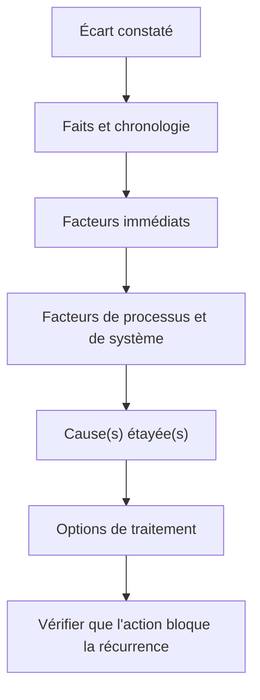

La méthode des cinq pourquoi ou un diagramme causes-effets peut aider, mais ne remplace pas la preuve. Plusieurs causes peuvent interagir ; consignez celles qui sont démontrées et celles qui restent des hypothèses à valider.

**Articuler avec les autres dimensions.** La décision peut affecter le périmètre, la capacité, les coûts, le calendrier, la sécurité et l’exploitation. Il est nécessaire de repérer les dépendances en amont, les conséquences pour les bénéficiaires et les coûts de réversibilité. Une optimisation locale peut transférer le coût vers une autre équipe ou reporter un risque après la mise en service. Une analyse complète rend explicite le compromis, indique ce qui est protégé et précise quelles limites ne peuvent pas être négociées.

**Illustration opérationnelle.** Des retards récurrents viennent d’une validation fournisseur non incluse au planning, pas d’une seule mauvaise estimation. Pour traiter ce type de situation, consigner les faits, distinguer les hypothèses, fixer une responsabilité et définir une preuve vérifiable. Lorsque plusieurs solutions sont possibles, les comparer avec des critères communs. Si les données sont incomplètes, organiser une courte investigation avec une échéance au lieu de présenter une estimation fragile comme un engagement ferme. La décision doit pouvoir être comprise par une personne qui n’a pas assisté à la discussion d’origine.

**Mise en œuvre.** Recueillir les données auprès des personnes proches du travail, examiner les contraintes, formuler des options, préciser leurs impacts et décider au niveau approprié. Après la décision, consigner le motif, informer les acteurs concernés et suivre l’effet réel. Lorsque le seuil de délégation est dépassé, préparer une escalade concise qui présente le problème, les options, les risques, une recommandation et la date à laquelle la décision devient urgente.

**Mesure et preuve.** Il faut choisir un indicateur correspondant à la finalité de la pratique. Une donnée d’activité ne démontre pas nécessairement un résultat. Définir la source, la fréquence, le responsable, la valeur de référence et les limites de l’indicateur. Compléter si nécessaire les chiffres par une observation qualitative, une revue ou un test. Les mesures doivent être assez fiables pour soutenir une décision, mais pas si coûteuses qu’elles consomment une part disproportionnée du travail.

**Erreurs fréquentes et correction.** Les erreurs habituelles incluent une information non actualisée, des définitions variables, une responsabilité implicite, un contrôle fait trop tard ou une exception devenue la règle. Le correctif n’est pas d’ajouter des tableaux sans fin : il faut retrouver la cause, simplifier le flux, attribuer la décision et mesurer l’amélioration. Si une pratique ne produit plus de valeur, la revoir avec les personnes concernées, tout en conservant les contrôles obligatoires et les traces nécessaires à l’audit.

**Approfondissement.** Pour un projet à forte criticité, la pratique peut exiger une validation indépendante, une séparation des tâches, une piste d’audit et un test sur un environnement représentatif. Pour un travail limité et réversible, une revue de pair peut suffire. La proportionnalité ne signifie pas l’absence de rigueur : elle cherche le meilleur rapport entre contrôle et utilité. Le test décisif est de savoir si l’équipe peut expliquer ce qu’elle fait, pourquoi elle le fait, quelle preuve confirme le résultat et comment elle réagira si l’hypothèse devient fausse.

### 7. Constats et recommandations

**Comprendre le concept.** Dans « Audit de projet et capitalisation », constats et recommandations constitue une pratique qui doit répondre à une intention précise. Un constat utile relie critère, preuve, condition observée, conséquence et recommandation proportionnée. Le responsable doit définir le résultat attendu, l’autorité concernée et les informations qui manquent encore. Une méthode ne doit pas être appliquée uniquement parce qu’elle figure dans un guide ou qu’elle est proposée par un outil. Sa valeur dépend du contexte, des personnes qui l’utilisent et de la qualité des décisions qu’elle permet de prendre.

**Schéma — formuler un constat exploitable.** Un constat doit être assez précis pour être discuté et corrigé, sans dramatiser le risque ni proposer une solution disproportionnée.

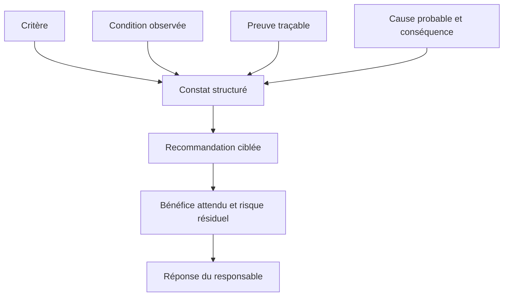

Évitez les recommandations génériques comme « améliorer la communication ». Une recommandation utile nomme une capacité à renforcer, le problème auquel elle répond et le résultat qui permettra de juger l’amélioration ; le propriétaire de l’action reste responsable de sa mise en œuvre.

**Articuler avec les autres dimensions.** La décision peut affecter le périmètre, la capacité, les coûts, le calendrier, la sécurité et l’exploitation. Il est nécessaire de repérer les dépendances en amont, les conséquences pour les bénéficiaires et les coûts de réversibilité. Une optimisation locale peut transférer le coût vers une autre équipe ou reporter un risque après la mise en service. Une analyse complète rend explicite le compromis, indique ce qui est protégé et précise quelles limites ne peuvent pas être négociées.

**Illustration opérationnelle.** L’audit identifie un accès privilégié non revu, explique le risque et recommande une revue périodique avec un propriétaire. Pour traiter ce type de situation, consigner les faits, distinguer les hypothèses, fixer une responsabilité et définir une preuve vérifiable. Lorsque plusieurs solutions sont possibles, les comparer avec des critères communs. Si les données sont incomplètes, organiser une courte investigation avec une échéance au lieu de présenter une estimation fragile comme un engagement ferme. La décision doit pouvoir être comprise par une personne qui n’a pas assisté à la discussion d’origine.

**Mise en œuvre.** Recueillir les données auprès des personnes proches du travail, examiner les contraintes, formuler des options, préciser leurs impacts et décider au niveau approprié. Après la décision, consigner le motif, informer les acteurs concernés et suivre l’effet réel. Lorsque le seuil de délégation est dépassé, préparer une escalade concise qui présente le problème, les options, les risques, une recommandation et la date à laquelle la décision devient urgente.

**Mesure et preuve.** Il faut choisir un indicateur correspondant à la finalité de la pratique. Une donnée d’activité ne démontre pas nécessairement un résultat. Définir la source, la fréquence, le responsable, la valeur de référence et les limites de l’indicateur. Compléter si nécessaire les chiffres par une observation qualitative, une revue ou un test. Les mesures doivent être assez fiables pour soutenir une décision, mais pas si coûteuses qu’elles consomment une part disproportionnée du travail.

**Erreurs fréquentes et correction.** Les erreurs habituelles incluent une information non actualisée, des définitions variables, une responsabilité implicite, un contrôle fait trop tard ou une exception devenue la règle. Le correctif n’est pas d’ajouter des tableaux sans fin : il faut retrouver la cause, simplifier le flux, attribuer la décision et mesurer l’amélioration. Si une pratique ne produit plus de valeur, la revoir avec les personnes concernées, tout en conservant les contrôles obligatoires et les traces nécessaires à l’audit.

**Approfondissement.** Pour un projet à forte criticité, la pratique peut exiger une validation indépendante, une séparation des tâches, une piste d’audit et un test sur un environnement représentatif. Pour un travail limité et réversible, une revue de pair peut suffire. La proportionnalité ne signifie pas l’absence de rigueur : elle cherche le meilleur rapport entre contrôle et utilité. Le test décisif est de savoir si l’équipe peut expliquer ce qu’elle fait, pourquoi elle le fait, quelle preuve confirme le résultat et comment elle réagira si l’hypothèse devient fausse.

### 8. Plan d’action

**Comprendre le concept.** Dans « Audit de projet et capitalisation », plan d’action constitue une pratique qui doit répondre à une intention précise. Une action corrective précise responsable, date, résultat attendu, ressource et preuve qui démontrera son efficacité. Le responsable doit définir le résultat attendu, l’autorité concernée et les informations qui manquent encore. Une méthode ne doit pas être appliquée uniquement parce qu’elle figure dans un guide ou qu’elle est proposée par un outil. Sa valeur dépend du contexte, des personnes qui l’utilisent et de la qualité des décisions qu’elle permet de prendre.

**Schéma — attribuer et contrôler la correction.** Une recommandation sans responsable, échéance et preuve de réussite est difficile à suivre et risque de rester une intention.

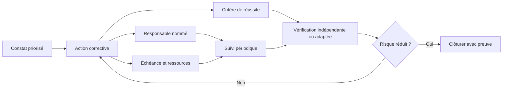

Priorisez selon la gravité, la probabilité, l’exposition et les obligations applicables. Si une date doit être repoussée, exigez une justification, une acceptation explicite du risque résiduel et des mesures temporaires quand elles sont nécessaires.

**Articuler avec les autres dimensions.** La décision peut affecter le périmètre, la capacité, les coûts, le calendrier, la sécurité et l’exploitation. Il est nécessaire de repérer les dépendances en amont, les conséquences pour les bénéficiaires et les coûts de réversibilité. Une optimisation locale peut transférer le coût vers une autre équipe ou reporter un risque après la mise en service. Une analyse complète rend explicite le compromis, indique ce qui est protégé et précise quelles limites ne peuvent pas être négociées.

**Illustration opérationnelle.** Le responsable sécurité ferme l’action seulement après la vérification des permissions et l’examen des journaux. Pour traiter ce type de situation, consigner les faits, distinguer les hypothèses, fixer une responsabilité et définir une preuve vérifiable. Lorsque plusieurs solutions sont possibles, les comparer avec des critères communs. Si les données sont incomplètes, organiser une courte investigation avec une échéance au lieu de présenter une estimation fragile comme un engagement ferme. La décision doit pouvoir être comprise par une personne qui n’a pas assisté à la discussion d’origine.

**Mise en œuvre.** Recueillir les données auprès des personnes proches du travail, examiner les contraintes, formuler des options, préciser leurs impacts et décider au niveau approprié. Après la décision, consigner le motif, informer les acteurs concernés et suivre l’effet réel. Lorsque le seuil de délégation est dépassé, préparer une escalade concise qui présente le problème, les options, les risques, une recommandation et la date à laquelle la décision devient urgente.

**Mesure et preuve.** Il faut choisir un indicateur correspondant à la finalité de la pratique. Une donnée d’activité ne démontre pas nécessairement un résultat. Définir la source, la fréquence, le responsable, la valeur de référence et les limites de l’indicateur. Compléter si nécessaire les chiffres par une observation qualitative, une revue ou un test. Les mesures doivent être assez fiables pour soutenir une décision, mais pas si coûteuses qu’elles consomment une part disproportionnée du travail.

**Erreurs fréquentes et correction.** Les erreurs habituelles incluent une information non actualisée, des définitions variables, une responsabilité implicite, un contrôle fait trop tard ou une exception devenue la règle. Le correctif n’est pas d’ajouter des tableaux sans fin : il faut retrouver la cause, simplifier le flux, attribuer la décision et mesurer l’amélioration. Si une pratique ne produit plus de valeur, la revoir avec les personnes concernées, tout en conservant les contrôles obligatoires et les traces nécessaires à l’audit.

**Approfondissement.** Pour un projet à forte criticité, la pratique peut exiger une validation indépendante, une séparation des tâches, une piste d’audit et un test sur un environnement représentatif. Pour un travail limité et réversible, une revue de pair peut suffire. La proportionnalité ne signifie pas l’absence de rigueur : elle cherche le meilleur rapport entre contrôle et utilité. Le test décisif est de savoir si l’équipe peut expliquer ce qu’elle fait, pourquoi elle le fait, quelle preuve confirme le résultat et comment elle réagira si l’hypothèse devient fausse.

### 9. Clôture du projet

**Comprendre le concept.** Dans « Audit de projet et capitalisation », clôture du projet constitue une pratique qui doit répondre à une intention précise. La clôture confirme l’acceptation, les responsabilités résiduelles, les contrats, les actifs, la documentation et les bénéfices futurs. Le responsable doit définir le résultat attendu, l’autorité concernée et les informations qui manquent encore. Une méthode ne doit pas être appliquée uniquement parce qu’elle figure dans un guide ou qu’elle est proposée par un outil. Sa valeur dépend du contexte, des personnes qui l’utilisent et de la qualité des décisions qu’elle permet de prendre.

**Schéma — une clôture est une décision étayée.** Le projet peut être administrativement terminé alors que des risques, défauts, engagements ou tâches de transfert restent ouverts. Ces points doivent avoir un propriétaire après la clôture.

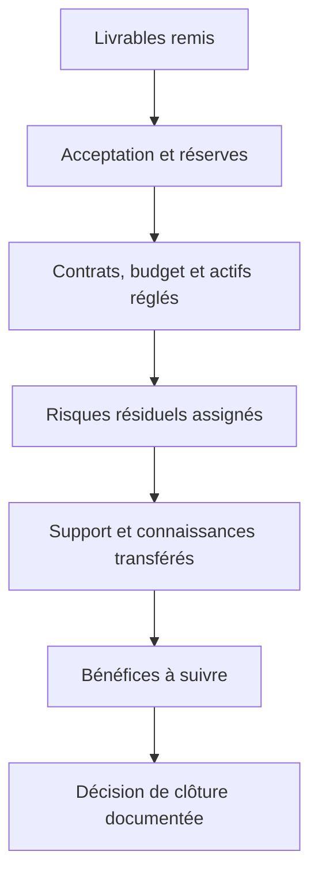

Un report n’est pas toujours nécessaire pour chaque réserve, mais une réserve critique ne doit pas être dissimulée pour respecter une date. Consignez les responsabilités, la date de résolution et l’autorité qui accepte explicitement le risque.

**Articuler avec les autres dimensions.** La décision peut affecter le périmètre, la capacité, les coûts, le calendrier, la sécurité et l’exploitation. Il est nécessaire de repérer les dépendances en amont, les conséquences pour les bénéficiaires et les coûts de réversibilité. Une optimisation locale peut transférer le coût vers une autre équipe ou reporter un risque après la mise en service. Une analyse complète rend explicite le compromis, indique ce qui est protégé et précise quelles limites ne peuvent pas être négociées.

**Illustration opérationnelle.** Le sponsor accepte explicitement un risque résiduel et attribue les actions qui restent à l’exploitation. Pour traiter ce type de situation, consigner les faits, distinguer les hypothèses, fixer une responsabilité et définir une preuve vérifiable. Lorsque plusieurs solutions sont possibles, les comparer avec des critères communs. Si les données sont incomplètes, organiser une courte investigation avec une échéance au lieu de présenter une estimation fragile comme un engagement ferme. La décision doit pouvoir être comprise par une personne qui n’a pas assisté à la discussion d’origine.

**Mise en œuvre.** Recueillir les données auprès des personnes proches du travail, examiner les contraintes, formuler des options, préciser leurs impacts et décider au niveau approprié. Après la décision, consigner le motif, informer les acteurs concernés et suivre l’effet réel. Lorsque le seuil de délégation est dépassé, préparer une escalade concise qui présente le problème, les options, les risques, une recommandation et la date à laquelle la décision devient urgente.

**Mesure et preuve.** Il faut choisir un indicateur correspondant à la finalité de la pratique. Une donnée d’activité ne démontre pas nécessairement un résultat. Définir la source, la fréquence, le responsable, la valeur de référence et les limites de l’indicateur. Compléter si nécessaire les chiffres par une observation qualitative, une revue ou un test. Les mesures doivent être assez fiables pour soutenir une décision, mais pas si coûteuses qu’elles consomment une part disproportionnée du travail.

**Erreurs fréquentes et correction.** Les erreurs habituelles incluent une information non actualisée, des définitions variables, une responsabilité implicite, un contrôle fait trop tard ou une exception devenue la règle. Le correctif n’est pas d’ajouter des tableaux sans fin : il faut retrouver la cause, simplifier le flux, attribuer la décision et mesurer l’amélioration. Si une pratique ne produit plus de valeur, la revoir avec les personnes concernées, tout en conservant les contrôles obligatoires et les traces nécessaires à l’audit.

**Approfondissement.** Pour un projet à forte criticité, la pratique peut exiger une validation indépendante, une séparation des tâches, une piste d’audit et un test sur un environnement représentatif. Pour un travail limité et réversible, une revue de pair peut suffire. La proportionnalité ne signifie pas l’absence de rigueur : elle cherche le meilleur rapport entre contrôle et utilité. Le test décisif est de savoir si l’équipe peut expliquer ce qu’elle fait, pourquoi elle le fait, quelle preuve confirme le résultat et comment elle réagira si l’hypothèse devient fausse.

### 10. Leçons apprises

**Comprendre le concept.** Dans « Audit de projet et capitalisation », leçons apprises constitue une pratique qui doit répondre à une intention précise. La capitalisation décrit le contexte, les faits, la cause, la décision et les conditions de réutilisation, sans enregistrer de conseils vagues. Le responsable doit définir le résultat attendu, l’autorité concernée et les informations qui manquent encore. Une méthode ne doit pas être appliquée uniquement parce qu’elle figure dans un guide ou qu’elle est proposée par un outil. Sa valeur dépend du contexte, des personnes qui l’utilisent et de la qualité des décisions qu’elle permet de prendre.

**Schéma — convertir une expérience en connaissance réutilisable.** Une rétrospective produit une valeur durable lorsque les enseignements sont formulés dans leur contexte, reliés à des faits et traduits en changements applicables.

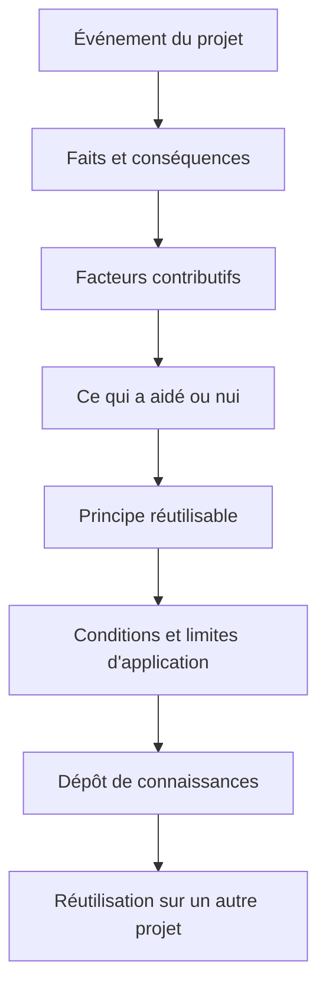

Séparez le constat de l’interprétation. Un résultat réussi dans un contexte précis n’est pas nécessairement reproductible ailleurs ; l’enseignement doit indiquer les conditions, dépendances et limites qui conditionnent sa réutilisation.

**Articuler avec les autres dimensions.** La décision peut affecter le périmètre, la capacité, les coûts, le calendrier, la sécurité et l’exploitation. Il est nécessaire de repérer les dépendances en amont, les conséquences pour les bénéficiaires et les coûts de réversibilité. Une optimisation locale peut transférer le coût vers une autre équipe ou reporter un risque après la mise en service. Une analyse complète rend explicite le compromis, indique ce qui est protégé et précise quelles limites ne peuvent pas être négociées.

**Illustration opérationnelle.** Une leçon précise quand prévoir une répétition générale de migration et comment vérifier les résultats de rapprochement. Pour traiter ce type de situation, consigner les faits, distinguer les hypothèses, fixer une responsabilité et définir une preuve vérifiable. Lorsque plusieurs solutions sont possibles, les comparer avec des critères communs. Si les données sont incomplètes, organiser une courte investigation avec une échéance au lieu de présenter une estimation fragile comme un engagement ferme. La décision doit pouvoir être comprise par une personne qui n’a pas assisté à la discussion d’origine.

**Mise en œuvre.** Recueillir les données auprès des personnes proches du travail, examiner les contraintes, formuler des options, préciser leurs impacts et décider au niveau approprié. Après la décision, consigner le motif, informer les acteurs concernés et suivre l’effet réel. Lorsque le seuil de délégation est dépassé, préparer une escalade concise qui présente le problème, les options, les risques, une recommandation et la date à laquelle la décision devient urgente.

**Mesure et preuve.** Il faut choisir un indicateur correspondant à la finalité de la pratique. Une donnée d’activité ne démontre pas nécessairement un résultat. Définir la source, la fréquence, le responsable, la valeur de référence et les limites de l’indicateur. Compléter si nécessaire les chiffres par une observation qualitative, une revue ou un test. Les mesures doivent être assez fiables pour soutenir une décision, mais pas si coûteuses qu’elles consomment une part disproportionnée du travail.

**Erreurs fréquentes et correction.** Les erreurs habituelles incluent une information non actualisée, des définitions variables, une responsabilité implicite, un contrôle fait trop tard ou une exception devenue la règle. Le correctif n’est pas d’ajouter des tableaux sans fin : il faut retrouver la cause, simplifier le flux, attribuer la décision et mesurer l’amélioration. Si une pratique ne produit plus de valeur, la revoir avec les personnes concernées, tout en conservant les contrôles obligatoires et les traces nécessaires à l’audit.

**Approfondissement.** Pour un projet à forte criticité, la pratique peut exiger une validation indépendante, une séparation des tâches, une piste d’audit et un test sur un environnement représentatif. Pour un travail limité et réversible, une revue de pair peut suffire. La proportionnalité ne signifie pas l’absence de rigueur : elle cherche le meilleur rapport entre contrôle et utilité. Le test décisif est de savoir si l’équipe peut expliquer ce qu’elle fait, pourquoi elle le fait, quelle preuve confirme le résultat et comment elle réagira si l’hypothèse devient fausse.

### 11. Transfert de connaissances

**Comprendre le concept.** Dans « Audit de projet et capitalisation », transfert de connaissances constitue une pratique qui doit répondre à une intention précise. Les connaissances doivent être accessibles et compréhensibles par les équipes qui continueront le service après le départ du projet. Le responsable doit définir le résultat attendu, l’autorité concernée et les informations qui manquent encore. Une méthode ne doit pas être appliquée uniquement parce qu’elle figure dans un guide ou qu’elle est proposée par un outil. Sa valeur dépend du contexte, des personnes qui l’utilisent et de la qualité des décisions qu’elle permet de prendre.

**Schéma — le transfert se vérifie par la capacité à agir.** Envoyer un document ne garantit pas que la personne destinataire peut effectuer une tâche. La démonstration, la pratique accompagnée et la récupération autonome d’informations rendent le transfert plus fiable.

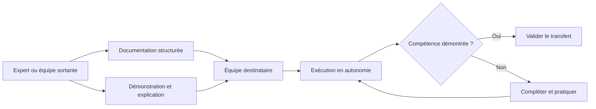

Identifiez les connaissances tacites, les accès nécessaires, les procédures de secours et les contacts d’escalade. Protégez les secrets et les informations sensibles : une base de connaissances accessible ne doit jamais contenir de mots de passe ni de clés privées.

**Articuler avec les autres dimensions.** La décision peut affecter le périmètre, la capacité, les coûts, le calendrier, la sécurité et l’exploitation. Il est nécessaire de repérer les dépendances en amont, les conséquences pour les bénéficiaires et les coûts de réversibilité. Une optimisation locale peut transférer le coût vers une autre équipe ou reporter un risque après la mise en service. Une analyse complète rend explicite le compromis, indique ce qui est protégé et précise quelles limites ne peuvent pas être négociées.

**Illustration opérationnelle.** Les procédures sont testées par le support qui devra les utiliser, plutôt que considérées terminées après leur publication. Pour traiter ce type de situation, consigner les faits, distinguer les hypothèses, fixer une responsabilité et définir une preuve vérifiable. Lorsque plusieurs solutions sont possibles, les comparer avec des critères communs. Si les données sont incomplètes, organiser une courte investigation avec une échéance au lieu de présenter une estimation fragile comme un engagement ferme. La décision doit pouvoir être comprise par une personne qui n’a pas assisté à la discussion d’origine.

**Mise en œuvre.** Recueillir les données auprès des personnes proches du travail, examiner les contraintes, formuler des options, préciser leurs impacts et décider au niveau approprié. Après la décision, consigner le motif, informer les acteurs concernés et suivre l’effet réel. Lorsque le seuil de délégation est dépassé, préparer une escalade concise qui présente le problème, les options, les risques, une recommandation et la date à laquelle la décision devient urgente.

**Mesure et preuve.** Il faut choisir un indicateur correspondant à la finalité de la pratique. Une donnée d’activité ne démontre pas nécessairement un résultat. Définir la source, la fréquence, le responsable, la valeur de référence et les limites de l’indicateur. Compléter si nécessaire les chiffres par une observation qualitative, une revue ou un test. Les mesures doivent être assez fiables pour soutenir une décision, mais pas si coûteuses qu’elles consomment une part disproportionnée du travail.

**Erreurs fréquentes et correction.** Les erreurs habituelles incluent une information non actualisée, des définitions variables, une responsabilité implicite, un contrôle fait trop tard ou une exception devenue la règle. Le correctif n’est pas d’ajouter des tableaux sans fin : il faut retrouver la cause, simplifier le flux, attribuer la décision et mesurer l’amélioration. Si une pratique ne produit plus de valeur, la revoir avec les personnes concernées, tout en conservant les contrôles obligatoires et les traces nécessaires à l’audit.

**Approfondissement.** Pour un projet à forte criticité, la pratique peut exiger une validation indépendante, une séparation des tâches, une piste d’audit et un test sur un environnement représentatif. Pour un travail limité et réversible, une revue de pair peut suffire. La proportionnalité ne signifie pas l’absence de rigueur : elle cherche le meilleur rapport entre contrôle et utilité. Le test décisif est de savoir si l’équipe peut expliquer ce qu’elle fait, pourquoi elle le fait, quelle preuve confirme le résultat et comment elle réagira si l’hypothèse devient fausse.

### 12. Mesure de l’efficacité

**Comprendre le concept.** Dans « Audit de projet et capitalisation », mesure de l’efficacité constitue une pratique qui doit répondre à une intention précise. Une action n’est pas efficace parce qu’elle est déclarée fermée ; il faut vérifier si elle réduit la récurrence ou le risque. Le responsable doit définir le résultat attendu, l’autorité concernée et les informations qui manquent encore. Une méthode ne doit pas être appliquée uniquement parce qu’elle figure dans un guide ou qu’elle est proposée par un outil. Sa valeur dépend du contexte, des personnes qui l’utilisent et de la qualité des décisions qu’elle permet de prendre.

**Schéma — contrôler l’effet, pas le statut de l’action.** Une action peut être exécutée sans supprimer la cause du problème. La vérification doit comparer une situation de référence à des observations après mise en œuvre.

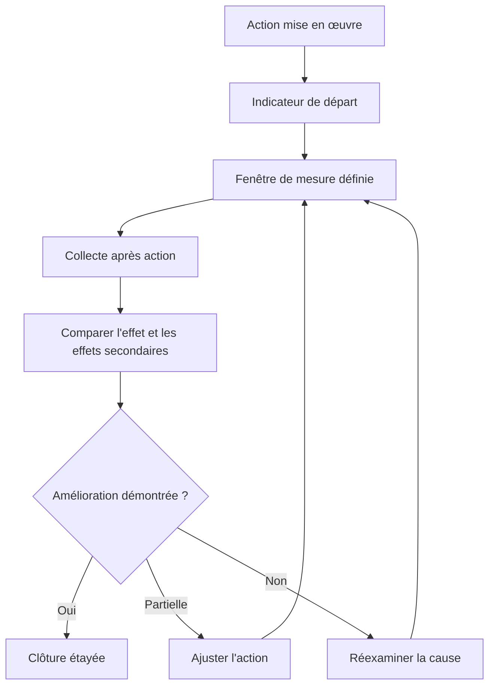

Choisissez un indicateur sensible au risque traité : récurrence d’incidents, erreurs de migration, délai de validation ou complétude des preuves, par exemple. Fixez une fenêtre adaptée au phénomène observé et précisez les autres facteurs qui peuvent expliquer le changement.

**Articuler avec les autres dimensions.** La décision peut affecter le périmètre, la capacité, les coûts, le calendrier, la sécurité et l’exploitation. Il est nécessaire de repérer les dépendances en amont, les conséquences pour les bénéficiaires et les coûts de réversibilité. Une optimisation locale peut transférer le coût vers une autre équipe ou reporter un risque après la mise en service. Une analyse complète rend explicite le compromis, indique ce qui est protégé et précise quelles limites ne peuvent pas être négociées.

**Illustration opérationnelle.** Trois mois plus tard, une revue contrôle la fréquence des incidents visés et l’usage réel du nouveau contrôle. Pour traiter ce type de situation, consigner les faits, distinguer les hypothèses, fixer une responsabilité et définir une preuve vérifiable. Lorsque plusieurs solutions sont possibles, les comparer avec des critères communs. Si les données sont incomplètes, organiser une courte investigation avec une échéance au lieu de présenter une estimation fragile comme un engagement ferme. La décision doit pouvoir être comprise par une personne qui n’a pas assisté à la discussion d’origine.

**Mise en œuvre.** Recueillir les données auprès des personnes proches du travail, examiner les contraintes, formuler des options, préciser leurs impacts et décider au niveau approprié. Après la décision, consigner le motif, informer les acteurs concernés et suivre l’effet réel. Lorsque le seuil de délégation est dépassé, préparer une escalade concise qui présente le problème, les options, les risques, une recommandation et la date à laquelle la décision devient urgente.

**Mesure et preuve.** Il faut choisir un indicateur correspondant à la finalité de la pratique. Une donnée d’activité ne démontre pas nécessairement un résultat. Définir la source, la fréquence, le responsable, la valeur de référence et les limites de l’indicateur. Compléter si nécessaire les chiffres par une observation qualitative, une revue ou un test. Les mesures doivent être assez fiables pour soutenir une décision, mais pas si coûteuses qu’elles consomment une part disproportionnée du travail.

**Erreurs fréquentes et correction.** Les erreurs habituelles incluent une information non actualisée, des définitions variables, une responsabilité implicite, un contrôle fait trop tard ou une exception devenue la règle. Le correctif n’est pas d’ajouter des tableaux sans fin : il faut retrouver la cause, simplifier le flux, attribuer la décision et mesurer l’amélioration. Si une pratique ne produit plus de valeur, la revoir avec les personnes concernées, tout en conservant les contrôles obligatoires et les traces nécessaires à l’audit.

**Approfondissement.** Pour un projet à forte criticité, la pratique peut exiger une validation indépendante, une séparation des tâches, une piste d’audit et un test sur un environnement représentatif. Pour un travail limité et réversible, une revue de pair peut suffire. La proportionnalité ne signifie pas l’absence de rigueur : elle cherche le meilleur rapport entre contrôle et utilité. Le test décisif est de savoir si l’équipe peut expliquer ce qu’elle fait, pourquoi elle le fait, quelle preuve confirme le résultat et comment elle réagira si l’hypothèse devient fausse.

### 13. Culture d’apprentissage

**Comprendre le concept.** Dans « Audit de projet et capitalisation », culture d’apprentissage constitue une pratique qui doit répondre à une intention précise. Une culture juste encourage le signalement de faits et l’amélioration des systèmes tout en maintenant une responsabilité claire. Le responsable doit définir le résultat attendu, l’autorité concernée et les informations qui manquent encore. Une méthode ne doit pas être appliquée uniquement parce qu’elle figure dans un guide ou qu’elle est proposée par un outil. Sa valeur dépend du contexte, des personnes qui l’utilisent et de la qualité des décisions qu’elle permet de prendre.

**Schéma — sécurité psychologique et responsabilité.** Une culture d’apprentissage facilite le signalement des erreurs et des risques, sans effacer la responsabilité individuelle lorsqu’une obligation ou une règle claire a été délibérément ignorée.

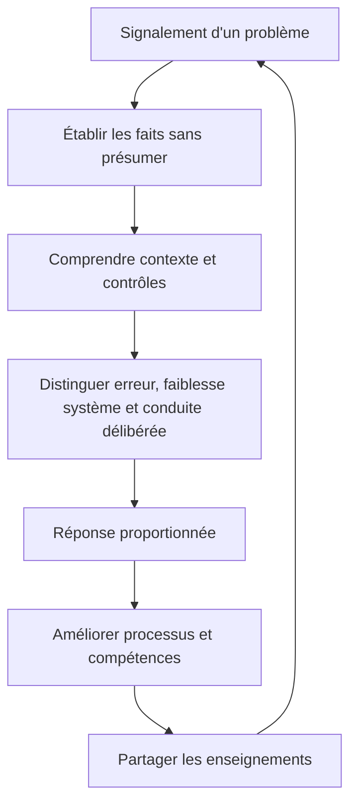

Évitez une culture punitive qui pousse les équipes à cacher les signaux faibles. Évitez aussi l’absence de responsabilité. Les décisions doivent s’appuyer sur les faits, la clarté des règles, les moyens disponibles et la proportionnalité de la réponse.

**Articuler avec les autres dimensions.** La décision peut affecter le périmètre, la capacité, les coûts, le calendrier, la sécurité et l’exploitation. Il est nécessaire de repérer les dépendances en amont, les conséquences pour les bénéficiaires et les coûts de réversibilité. Une optimisation locale peut transférer le coût vers une autre équipe ou reporter un risque après la mise en service. Une analyse complète rend explicite le compromis, indique ce qui est protégé et précise quelles limites ne peuvent pas être négociées.

**Illustration opérationnelle.** La rétrospective sépare une erreur involontaire d’une violation consciente des contrôles et traite chacune de façon adaptée. Pour traiter ce type de situation, consigner les faits, distinguer les hypothèses, fixer une responsabilité et définir une preuve vérifiable. Lorsque plusieurs solutions sont possibles, les comparer avec des critères communs. Si les données sont incomplètes, organiser une courte investigation avec une échéance au lieu de présenter une estimation fragile comme un engagement ferme. La décision doit pouvoir être comprise par une personne qui n’a pas assisté à la discussion d’origine.

**Mise en œuvre.** Recueillir les données auprès des personnes proches du travail, examiner les contraintes, formuler des options, préciser leurs impacts et décider au niveau approprié. Après la décision, consigner le motif, informer les acteurs concernés et suivre l’effet réel. Lorsque le seuil de délégation est dépassé, préparer une escalade concise qui présente le problème, les options, les risques, une recommandation et la date à laquelle la décision devient urgente.

**Mesure et preuve.** Il faut choisir un indicateur correspondant à la finalité de la pratique. Une donnée d’activité ne démontre pas nécessairement un résultat. Définir la source, la fréquence, le responsable, la valeur de référence et les limites de l’indicateur. Compléter si nécessaire les chiffres par une observation qualitative, une revue ou un test. Les mesures doivent être assez fiables pour soutenir une décision, mais pas si coûteuses qu’elles consomment une part disproportionnée du travail.

**Erreurs fréquentes et correction.** Les erreurs habituelles incluent une information non actualisée, des définitions variables, une responsabilité implicite, un contrôle fait trop tard ou une exception devenue la règle. Le correctif n’est pas d’ajouter des tableaux sans fin : il faut retrouver la cause, simplifier le flux, attribuer la décision et mesurer l’amélioration. Si une pratique ne produit plus de valeur, la revoir avec les personnes concernées, tout en conservant les contrôles obligatoires et les traces nécessaires à l’audit.

**Approfondissement.** Pour un projet à forte criticité, la pratique peut exiger une validation indépendante, une séparation des tâches, une piste d’audit et un test sur un environnement représentatif. Pour un travail limité et réversible, une revue de pair peut suffire. La proportionnalité ne signifie pas l’absence de rigueur : elle cherche le meilleur rapport entre contrôle et utilité. Le test décisif est de savoir si l’équipe peut expliquer ce qu’elle fait, pourquoi elle le fait, quelle preuve confirme le résultat et comment elle réagira si l’hypothèse devient fausse.

## Étude de cas : Auditer et clôturer une migration IT

Une migration est mise en service après plusieurs écarts de planning, un changement de budget et quelques anomalies reportées. La direction souhaite évaluer la gouvernance, confirmer les transferts et apprendre sans transformer l’audit en recherche de coupables.

### Cadrage et analyse

Les acteurs commencent par décrire le problème avec des faits vérifiables, puis identifient les bénéficiaires, les exigences et les contraintes. Ils séparent les obligations impératives des préférences, écrivent les hypothèses et demandent confirmation lorsque celles-ci conditionnent fortement le coût ou la date. Le responsable désigne un propriétaire pour chaque décision majeure, fixe un mécanisme d’escalade et conserve une trace des validations.

**Schéma — auditer une migration à partir des risques majeurs.** Le plan doit couvrir les décisions et contrôles dont la défaillance pourrait affecter l’intégrité des données, la continuité, la sécurité ou la conformité.

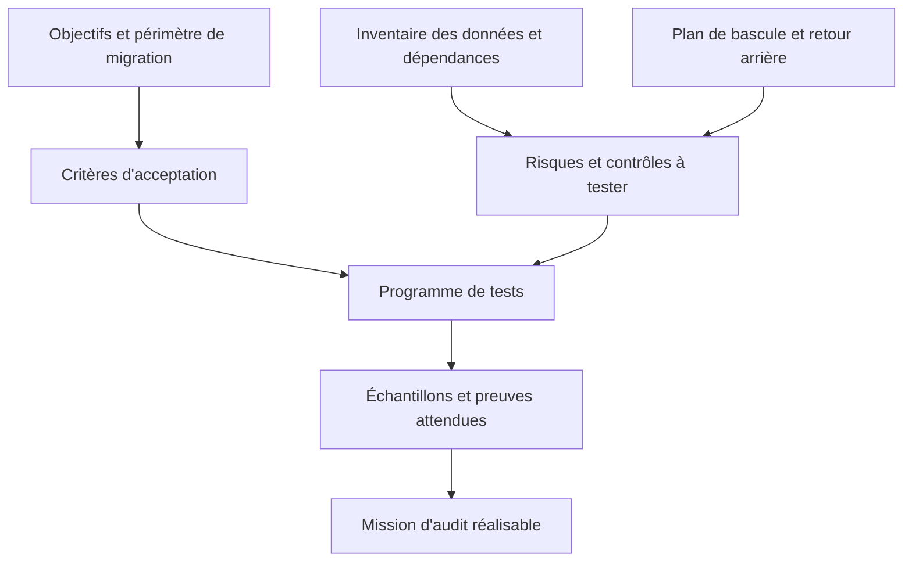

Avant les tests, définissez les populations, les échantillons, les critères d’intégrité et la protection des données utilisées. L’audit doit pouvoir identifier les limites de couverture et ne pas transformer une vérification partielle en assurance absolue.

### Comparaison des options

L’équipe compare au moins deux options réalistes, dont une option limitée ou progressive. Chaque option est évaluée selon valeur, coût complet, délai, risques, réversibilité, dépendances et conséquences en exploitation. Les avantages non mesurés sont explicitement identifiés comme hypothèses. Une décision est recommandée lorsque le raisonnement est clair, les compromis sont compris et la personne habilitée dispose des éléments nécessaires.

**Schéma — choisir une stratégie de vérification proportionnée.** Les options d’audit peuvent différer par leur couverture, leur coût, leur délai et le risque non détecté ; le choix doit être justifié par la criticité du service.

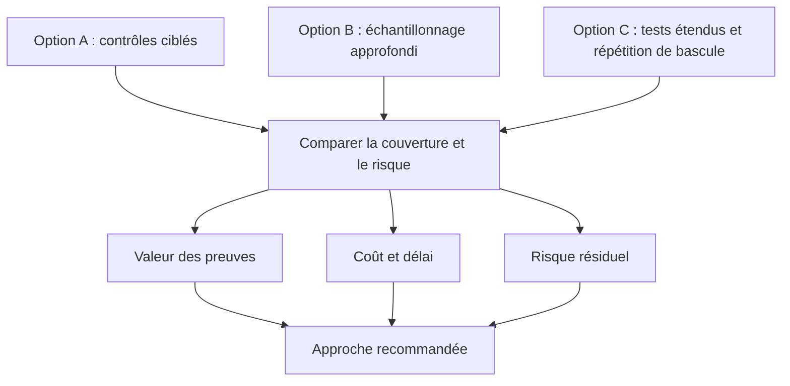

L’échantillonnage peut être efficace, mais il laisse un risque de non-détection. Pour les données et opérations critiques, combinez des rapprochements automatisés, des échantillons ciblés, des tests négatifs et la revue des exceptions plutôt que de vous reposer sur une seule source.

### Mise en œuvre et suivi

Le plan est découpé en livrables vérifiables. Les travaux critiques sont associés à des critères de sortie, des responsables et des preuves. Les prévisions sont actualisées en fonction du travail restant, pas uniquement par décalage des dates précédentes. Les changements sont analysés pour leurs impacts croisés. Lorsqu’un indicateur devient rouge, l’équipe expose la cause et propose une action plutôt que de modifier sa définition.

**Schéma — suivre les preuves au fil de la bascule.** Il est plus efficace de préparer la collecte pendant les répétitions et la mise en production que de reconstituer les événements après incident.

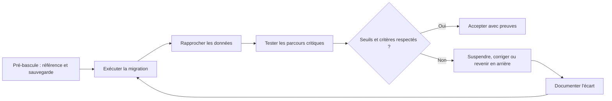

Les journaux doivent permettre de relier les opérations, les versions, les approbations et les résultats. Préservez leur intégrité et leur horodatage, et assurez-vous que le plan de retour arrière est réaliste, testé et compatible avec les changements survenus depuis la sauvegarde.

### Acceptation et apprentissage

Avant la clôture, les livrables sont comparés aux critères convenus, les défauts et risques résiduels sont documentés, les responsabilités sont transférées et le support est préparé. Les mesures de bénéfices ont un propriétaire et une échéance de suivi. La rétrospective décrit les faits, les causes des écarts, les adaptations utiles et les pratiques à conserver.

**Schéma — transformer les constats en amélioration après migration.** L’audit ne s’achève pas lorsque le rapport est envoyé : le suivi confirme le traitement des écarts et les leçons alimentent les projets de migration futurs.

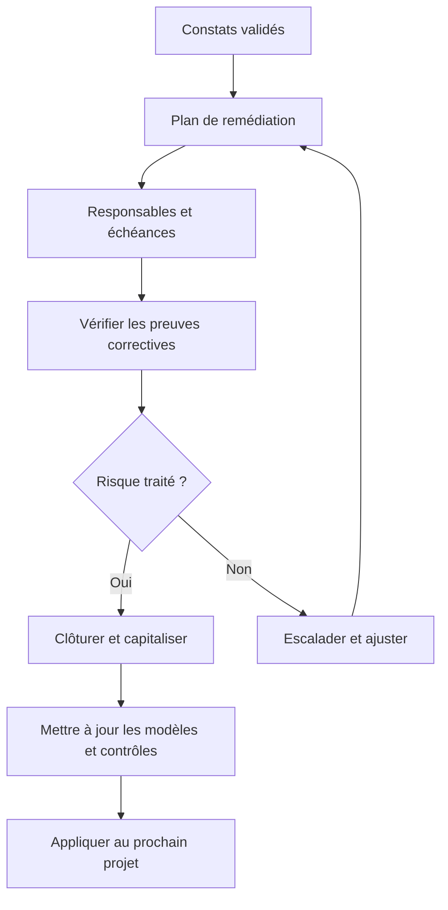

Dans le rapport de clôture, distinguez les constats fermés, les risques acceptés, les actions encore ouvertes et les enseignements à réutiliser. Conservez aussi les décisions qui ont bien fonctionné afin que la capitalisation ne soit pas limitée aux échecs.

## Atelier pratique

**Exercice 1.** À partir du cas, écris une note de pilotage d’une page : résultat attendu, contraintes, options, risques, responsables, indicateurs et décisions nécessaires.

**Correction.** Une bonne réponse relie chaque recommandation à un fait ou une hypothèse clairement identifiée. Elle présente les conséquences de plusieurs options, distingue les décisions réversibles des engagements difficiles à défaire et identifie qui possède l’autorité requise. Les mesures de résultat doivent être observables, avec une source et une date de revue.

**Exercice 2.** Un dirigeant demande une action immédiate, mais les données disponibles ne suffisent pas à comparer ses conséquences. Prépare une réponse transparente et un plan de réduction d’incertitude.

**Correction.** Il faut dire ce qui est connu, ce qui ne l’est pas et pourquoi cette information compte. Proposer une mesure réversible, un pilote ou une courte investigation peut permettre d’agir sans prétendre que les inconnues ont disparu. Le plan doit définir l’échéance de retour et les critères qui permettront de poursuivre ou de changer d’option.

**Exercice 3.** Un indicateur est favorable mais un groupe d’utilisateurs signale une difficulté majeure. Explique comment traiter l’écart entre mesure et observation.

**Correction.** Il faut vérifier si l’indicateur mesure vraiment le résultat recherché, examiner le groupe concerné et rechercher une explication à l’écart. Une moyenne peut masquer des impacts inégaux. Compléter la mesure par des tests ou des entretiens ciblés permet de décider si le processus doit être adapté.

## Pièges à éviter

- Confondre activité, livraison et bénéfice.
- Présenter une estimation comme une certitude sans expliquer les hypothèses.
- Masquer un écart en modifiant la référence.
- Choisir une méthode parce qu’elle est populaire plutôt que adaptée.
- Surcharger l’équipe d’outils qui ne soutiennent aucune décision utile.
- Faire dépendre un résultat d’une personne ou d’un fournisseur sans plan de secours.
- Reporter les contrôles obligatoires à la toute fin.
- Laisser les responsabilités d’acceptation implicites.
- Confondre indicateurs d’activité et mesures de résultat.
- Clore un projet sans transfert, support ni mesure des bénéfices.

## Checklist de révision

- [ ] Le besoin et les résultats attendus sont explicites.
- [ ] Les inclusions et exclusions sont visibles.
- [ ] Les hypothèses, dépendances et risques sont suivis.
- [ ] Les responsables et les décideurs sont identifiés.
- [ ] Les choix et arbitrages sont tracés.
- [ ] Les indicateurs répondent à des questions de décision.
- [ ] Les changements sont analysés et autorisés.
- [ ] La qualité, la sécurité et l’adoption sont intégrées.
- [ ] Le transfert aux opérations est préparé.
- [ ] Les apprentissages sont capitalisés.

## À retenir

Un dispositif de gestion de projet est un système partagé pour comprendre le travail, prendre des décisions, observer les résultats et adapter le plan. Il doit être assez rigoureux pour protéger la valeur, la qualité et la confiance, mais assez léger pour rester utilisé. Les pratiques les plus utiles rendent les hypothèses visibles, les responsabilités explicites et les décisions vérifiables.

## Glossaire

- **Bénéfice :** amélioration mesurable obtenue grâce à un résultat.
- **Dépendance :** condition qui relie plusieurs activités ou équipes.
- **Gouvernance :** répartition des responsabilités, décisions et contrôles.
- **Indicateur :** mesure qui aide à comprendre un résultat ou à décider.
- **Partie prenante :** personne ou organisation influençant le projet ou affectée par lui.
- **Portefeuille :** ensemble d’initiatives arbitrées en fonction des objectifs et capacités.
- **Risque :** événement incertain susceptible d’affecter les objectifs.
- **Scénario :** option décrivant des hypothèses et conséquences possibles.
- **Valeur :** utilité obtenue par le bénéficiaire et l’organisation.
- **Réversibilité :** capacité à revenir sur une décision avec un coût contrôlé.

## Références pour approfondir

- ISO 21502 : https://committee.iso.org/sites/tc258/home/projects/published/iso-21502.html
- PMI : https://www.pmi.org/
- ITIL 4 Foundation et ITSM : https://www.peoplecert.org/browse-certifications/it-governance-and-service-management/ITIL-1/itil-4-foundation-2565
- ITIL Qualification Scheme : https://www.peoplecert.org/ITIL-4
- Guide Scrum officiel : https://scrumguides.org/scrum-guide
- PRINCE2 7 : https://www.peoplecert.org/browse-certifications/project-programme-and-portfolio-management/PRINCE2-2/prince2-7-foundation-3579
