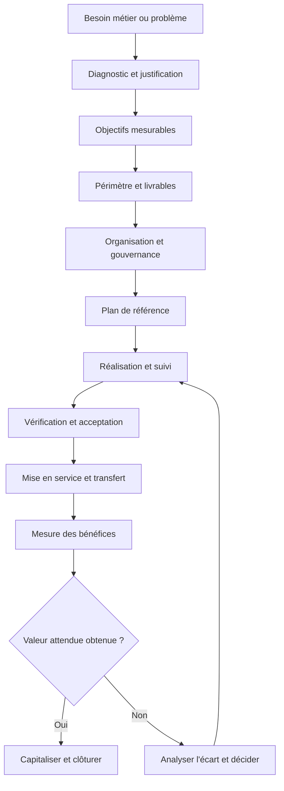
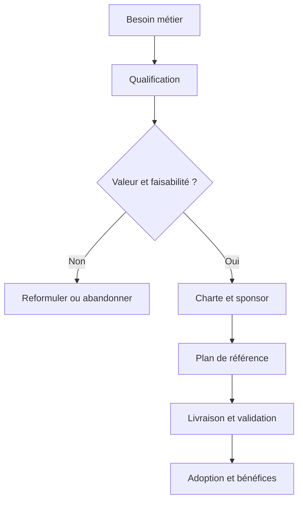
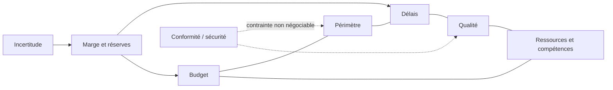
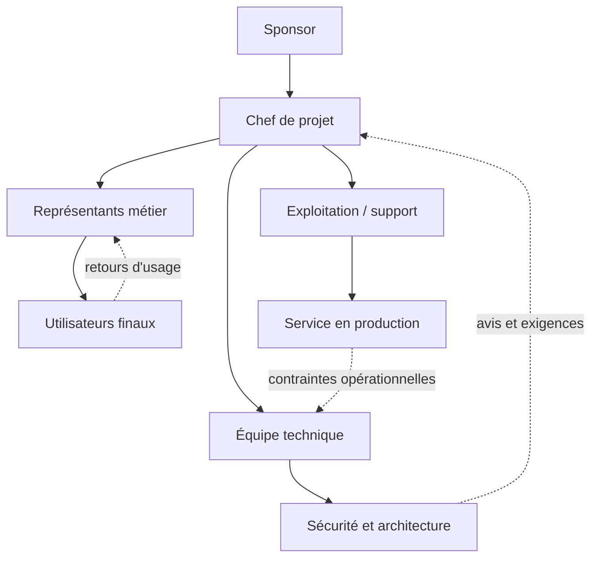
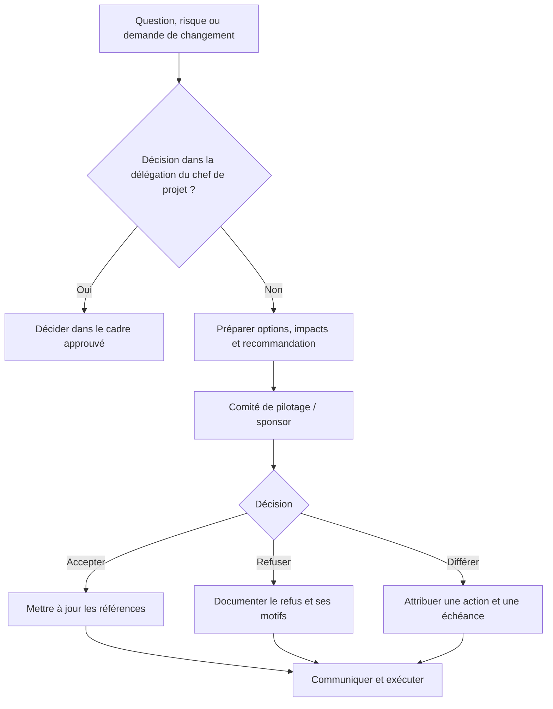
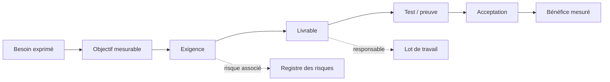

# Introduction à la gestion de projet IT

> **Encadré de mise en contexte** — Une organisation veut lancer un portail de services numériques, mais les demandes des métiers, les contraintes de sécurité et les capacités de l’équipe ne sont pas encore alignées.

## Introduction

La gestion de projet IT consiste à organiser un changement technique et humain afin de produire un résultat utile dans un environnement où les besoins, les technologies, les contraintes de sécurité et les capacités évoluent. Elle ne se réduit ni à remplir un planning ni à surveiller les personnes. Elle relie une intention métier à des livrables vérifiables, à des décisions explicites et à une adoption effective. Le responsable du projet doit rendre les incertitudes visibles assez tôt pour que l’organisation puisse choisir en connaissance de cause.

Ce cours traite le sujet « Introduction à la gestion de projet IT » sous l’angle pratique. L’objectif n’est pas d’appliquer mécaniquement un modèle universel, mais de comprendre les principes, de reconnaître le contexte et de choisir une méthode proportionnée. Un projet réglementé, une migration d’infrastructure, un produit numérique en exploration et une amélioration interne n’ont pas les mêmes contraintes. Le bon dispositif de pilotage dépend du coût de l’erreur, de la stabilité du besoin, des dépendances, de la taille de l’équipe et de la fréquence à laquelle un résultat exploitable peut être livré.

Le fil rouge du cours est le cas « Le portail de support interne ». Il permet de relier les concepts à une situation plausible, de formaliser les hypothèses, de raisonner sur les compromis et d’expliquer comment une décision sera contrôlée. Les exemples restent adaptables : les termes contractuels, les exigences de sécurité, le droit applicable et les règles internes doivent être confirmés dans chaque organisation avant une mise en œuvre réelle.

## Objectifs pédagogiques

À la fin de cette leçon, tu devrais pouvoir expliquer les concepts essentiels avec tes propres mots, choisir un outil ou une méthode en fonction d’un besoin concret, construire des preuves de progression, identifier les risques et communiquer une décision aux personnes concernées. Tu devrais également savoir reconnaître les situations où il faut interrompre le travail, solliciter un arbitrage ou réviser une hypothèse plutôt que masquer un écart.

- Définir les termes clés et distinguer les notions souvent confondues.
- Décrire une démarche reproductible et les livrables utiles.
- Relier chaque décision à une personne habilitée, une preuve et un critère.
- Détecter les signaux d’alerte avant qu’ils ne deviennent des incidents majeurs.
- Appliquer les concepts au cas fil rouge et expliquer les limites de la solution choisie.

## Concepts clés

## Carte générale : du besoin à la valeur

Cette vue rappelle qu’un projet ne se résume pas à produire une fonctionnalité : il relie un besoin à un résultat accepté, puis à des bénéfices mesurés. Le retour de la mesure vers la décision évite de confondre livraison technique et création de valeur.

**Résultat et livrable.** Un livrable est un élément produit et vérifiable : application, procédure, modèle, environnement, formation ou rapport. Le résultat décrit ce qui change grâce à ce livrable. Le bénéfice mesure l’amélioration obtenue dans la durée. La distinction évite de déclarer un projet réussi parce qu’un logiciel a été installé alors que personne ne l’utilise ou que le processus reste inefficace.

**Valeur et critères de succès.** La valeur doit être reliée à un besoin réel, à un bénéficiaire identifiable et à un effet attendu. Un objectif vague comme « moderniser le système » doit être traduit en résultats observables : réduction du délai, diminution d’erreurs, meilleure disponibilité, baisse d’un coût ou amélioration de l’expérience. Les indicateurs doivent être définis avant la livraison, avec une valeur de référence et un horizon de mesure.

**Périmètre et exigences.** Le périmètre définit ce que le projet prend en charge et ce qu’il ne prend pas en charge. Les exigences expriment les comportements attendus, les contraintes non fonctionnelles et les règles d’acceptation. Une demande nouvelle n’est pas automatiquement mauvaise, mais elle doit être analysée. Il faut décider si elle remplace une exigence, s’ajoute au périmètre, devient un lot ultérieur ou n’est pas retenue.

**Référence et prévision.** Une référence approuvée sert à mesurer l’écart ; une prévision décrit l’état le plus probable à partir de la situation connue. Une équipe peut conserver une baseline et prévoir une date différente sans manipuler les chiffres. Un écart n’est pas nécessairement une faute : l’absence d’explication, la répétition de surprises et la non-escalade des conséquences sont en revanche des problèmes de gouvernance.

**Gouvernance et transparence.** La gouvernance précise les rôles, les droits de décision, les seuils d’escalade et la manière de traiter les changements. Elle ne doit pas imposer une réunion de comité pour chaque détail. Les décisions fréquentes et réversibles peuvent être déléguées à l’équipe, alors que les décisions coûteuses, réglementaires ou difficiles à inverser exigent une autorité définie et une trace exploitable.

**Risque et incertitude.** Un risque est un événement incertain susceptible d’affecter les objectifs. Un problème est déjà survenu ; une hypothèse reste à confirmer ; une dépendance associe le projet à un acteur ou à un autre travail. Les confondre rend les plans moins utiles. Les risques doivent avoir des propriétaires, des signaux de déclenchement et des réponses proportionnées à leur probabilité et à leur impact.

**Qualité intégrée.** La qualité ne se vérifie pas uniquement à la fin. Elle se construit par des critères, des revues, des tests, des environnements de validation et des contrôles de sécurité adaptés. Un projet qui accélère en supprimant les tests obligatoires peut simplement déplacer son coût vers l’exploitation. Les critères d’acceptation doivent être compris par le métier et techniquement réalisables.

**Adoption et transition.** Une livraison réussie doit être exploitable, supportable et comprise. La transition inclut l’appropriation, les procédures, le support, les habilitations, la supervision, les sauvegardes, le retour arrière et la formation. Les bénéficiaires ne sont pas de simples destinataires d’un changement : leurs retours peuvent révéler des contraintes non identifiées et orienter l’ordre des priorités.

## Méthodologie et outils

La démarche de pilotage peut être prédictive lorsque les exigences sont relativement stables et qu’une planification détaillée est utile, adaptative lorsque le besoin est incertain et que l’apprentissage doit se faire par petits incréments, ou hybride lorsque des composants présentent des niveaux d’incertitude différents. Choisir une méthode ne dispense jamais de clarifier la valeur, les responsabilités, les risques, la qualité et les critères de décision.

Les outils sont au service d’une pratique, pas l’inverse. Un tableau peut rendre le travail visible, un diagramme de Gantt montrer les dépendances calendaires, un registre expliciter les risques et un journal de décisions préserver la mémoire des arbitrages. Aucun outil ne compense des données inexactes, un périmètre flou ou l’absence de responsable. Avant d’adopter un outil, définir les décisions qu’il doit soutenir et qui maintiendra les informations.

L’information doit être adaptée à son public. L’équipe a besoin de détails opérationnels et de blocages immédiats ; le sponsor a besoin des résultats, risques majeurs, options d’arbitrage et conséquences ; les utilisateurs ont besoin de connaître l’impact, les dates, les changements de processus et l’aide disponible. Une communication efficace associe un message compréhensible, un canal adapté, une fréquence raisonnable et une voie de retour.

Voici un modèle de raisonnement à utiliser pour chaque décision importante : constater la situation, vérifier les faits, comparer des options, évaluer les effets sur la valeur et les contraintes, désigner une personne habilitée, décider, consigner puis vérifier le résultat. Il évite les décisions prises uniquement sous pression et permet de revenir sur une hypothèse lorsque de nouvelles informations apparaissent.

### 1. Définir un projet

**Comprendre le sujet.** Dans le cadre de « Introduction à la gestion de projet IT », définir un projet doit être traité comme un élément de décision et non comme une formalité isolée. Un projet est une entreprise temporaire destinée à produire un résultat singulier, avec des objectifs, un début, une fin et des contraintes explicites. La bonne pratique consiste à expliciter le but recherché, l’autorité concernée, les hypothèses encore ouvertes, les contraintes applicables et la preuve qui permettra de conclure. Sans cette explicitation, deux personnes peuvent utiliser les mêmes mots tout en poursuivant des résultats différents. Le responsable doit demander ce qui est attendu, pourquoi cela compte et quelle conséquence aurait une décision erronée.

**Relier le principe à l’ensemble du projet.** Un élément de gestion n’agit jamais seul. Il influence le périmètre, la date, le budget, la qualité, la charge et l’acceptation du résultat. Avant d’agir, vérifier les dépendances en amont et en aval, identifier les équipes qui seront touchées et repérer les décisions qui pourraient être difficiles à inverser. Une solution locale apparemment efficace peut créer une dette opérationnelle, un défaut de conformité ou un coût de support durable. Une décision solide rend ces effets visibles et explique les compromis.

**Application au terrain.** Le portail support doit remplacer un processus précis, avec des critères d’acceptation et une date cible. Pour transformer cet exemple en action, commencer par écrire une description courte de la situation, puis distinguer les faits observés des hypothèses. Identifier un responsable, convenir d’un résultat attendu et fixer le moment où la preuve sera examinée. Si une information manque, créer une tâche d’investigation avec une échéance plutôt que présenter une supposition comme une certitude. Si plusieurs options sont acceptables, comparer explicitement leurs impacts, leurs coûts de réversibilité et leurs conséquences pour les utilisateurs.

**Déroulement recommandé.** Premièrement, recueillir les données utiles auprès des personnes les plus proches du travail. Deuxièmement, vérifier la cohérence des informations avec les documents déjà approuvés. Troisièmement, décrire les options réalistes et leurs limites. Quatrièmement, décider au niveau approprié, en précisant les seuils qui nécessiteraient une escalade. Cinquièmement, consigner la décision, informer les personnes concernées et suivre son effet. Cette séquence réduit les retours en arrière et rend la démarche reproductible, même si les outils ou l’organisation changent.

**Mesures et éléments de preuve.** Une affirmation telle que « le travail avance » doit être étayée par une preuve pertinente : un livrable relu, un test passé, une décision approuvée, une dépendance levée, une mesure comparée à sa référence ou un utilisateur ayant réalisé une tâche. Choisir un indicateur directement relié à l’objectif et préciser sa source, sa fréquence, son propriétaire et ses limites. Les indicateurs quantitatifs gagnent à être complétés par une observation qualitative, particulièrement lorsqu’il est question d’adoption, de satisfaction ou de risque humain.

**Signaux d’alerte et correction.** Les signaux typiques sont une définition contradictoire, une décision repoussée sans propriétaire, des changements non évalués, une preuve difficile à retrouver, une estimation donnée sans hypothèse ou un résultat déclaré acceptable sans critères. Face à ces signaux, ne pas multiplier les tableaux ni demander une mise à jour cosmétique. Revenir au besoin, vérifier les faits, attribuer la responsabilité manquante et réduire le problème à une décision explicite. Si l’impact dépasse la délégation prévue, alerter rapidement avec des options et une recommandation argumentée.

**Approfondissement.** Pour les projets à forte criticité, la rigueur doit augmenter avec le coût d’une erreur : revue indépendante, approbation formelle, contrôle des accès, traçabilité renforcée ou répétition en environnement représentatif. Pour un petit projet réversible, la même intention peut être satisfaite par un contrôle plus léger. Le principe est de calibrer les pratiques sans abolir les contrôles essentiels. À chaque étape, demander : « Quelle preuve rend cette décision défendable, qui peut l’accepter et qu’est-ce qui nous ferait changer d’avis ? »

### 2. Opérations et projet

**Comprendre le sujet.** Dans le cadre de « Introduction à la gestion de projet IT », opérations et projet doit être traité comme un élément de décision et non comme une formalité isolée. Les opérations maintiennent un service récurrent ; le projet introduit un changement qui doit ensuite être transféré aux opérations. La bonne pratique consiste à expliciter le but recherché, l’autorité concernée, les hypothèses encore ouvertes, les contraintes applicables et la preuve qui permettra de conclure. Sans cette explicitation, deux personnes peuvent utiliser les mêmes mots tout en poursuivant des résultats différents. Le responsable doit demander ce qui est attendu, pourquoi cela compte et quelle conséquence aurait une décision erronée.

**Relier le principe à l’ensemble du projet.** Un élément de gestion n’agit jamais seul. Il influence le périmètre, la date, le budget, la qualité, la charge et l’acceptation du résultat. Avant d’agir, vérifier les dépendances en amont et en aval, identifier les équipes qui seront touchées et repérer les décisions qui pourraient être difficiles à inverser. Une solution locale apparemment efficace peut créer une dette opérationnelle, un défaut de conformité ou un coût de support durable. Une décision solide rend ces effets visibles et explique les compromis.

**Application au terrain.** Le traitement quotidien des tickets relève de l’exploitation, tandis que la création du portail est le projet. Pour transformer cet exemple en action, commencer par écrire une description courte de la situation, puis distinguer les faits observés des hypothèses. Identifier un responsable, convenir d’un résultat attendu et fixer le moment où la preuve sera examinée. Si une information manque, créer une tâche d’investigation avec une échéance plutôt que présenter une supposition comme une certitude. Si plusieurs options sont acceptables, comparer explicitement leurs impacts, leurs coûts de réversibilité et leurs conséquences pour les utilisateurs.

**Déroulement recommandé.** Premièrement, recueillir les données utiles auprès des personnes les plus proches du travail. Deuxièmement, vérifier la cohérence des informations avec les documents déjà approuvés. Troisièmement, décrire les options réalistes et leurs limites. Quatrièmement, décider au niveau approprié, en précisant les seuils qui nécessiteraient une escalade. Cinquièmement, consigner la décision, informer les personnes concernées et suivre son effet. Cette séquence réduit les retours en arrière et rend la démarche reproductible, même si les outils ou l’organisation changent.

**Mesures et éléments de preuve.** Une affirmation telle que « le travail avance » doit être étayée par une preuve pertinente : un livrable relu, un test passé, une décision approuvée, une dépendance levée, une mesure comparée à sa référence ou un utilisateur ayant réalisé une tâche. Choisir un indicateur directement relié à l’objectif et préciser sa source, sa fréquence, son propriétaire et ses limites. Les indicateurs quantitatifs gagnent à être complétés par une observation qualitative, particulièrement lorsqu’il est question d’adoption, de satisfaction ou de risque humain.

**Signaux d’alerte et correction.** Les signaux typiques sont une définition contradictoire, une décision repoussée sans propriétaire, des changements non évalués, une preuve difficile à retrouver, une estimation donnée sans hypothèse ou un résultat déclaré acceptable sans critères. Face à ces signaux, ne pas multiplier les tableaux ni demander une mise à jour cosmétique. Revenir au besoin, vérifier les faits, attribuer la responsabilité manquante et réduire le problème à une décision explicite. Si l’impact dépasse la délégation prévue, alerter rapidement avec des options et une recommandation argumentée.

**Approfondissement.** Pour les projets à forte criticité, la rigueur doit augmenter avec le coût d’une erreur : revue indépendante, approbation formelle, contrôle des accès, traçabilité renforcée ou répétition en environnement représentatif. Pour un petit projet réversible, la même intention peut être satisfaite par un contrôle plus léger. Le principe est de calibrer les pratiques sans abolir les contrôles essentiels. À chaque étape, demander : « Quelle preuve rend cette décision défendable, qui peut l’accepter et qu’est-ce qui nous ferait changer d’avis ? »

### 3. Objectifs SMART

**Comprendre le sujet.** Dans le cadre de « Introduction à la gestion de projet IT », objectifs smart doit être traité comme un élément de décision et non comme une formalité isolée. Un objectif utile décrit un résultat spécifique, mesurable, atteignable, pertinent et inscrit dans le temps. La bonne pratique consiste à expliciter le but recherché, l’autorité concernée, les hypothèses encore ouvertes, les contraintes applicables et la preuve qui permettra de conclure. Sans cette explicitation, deux personnes peuvent utiliser les mêmes mots tout en poursuivant des résultats différents. Le responsable doit demander ce qui est attendu, pourquoi cela compte et quelle conséquence aurait une décision erronée.

**Relier le principe à l’ensemble du projet.** Un élément de gestion n’agit jamais seul. Il influence le périmètre, la date, le budget, la qualité, la charge et l’acceptation du résultat. Avant d’agir, vérifier les dépendances en amont et en aval, identifier les équipes qui seront touchées et repérer les décisions qui pourraient être difficiles à inverser. Une solution locale apparemment efficace peut créer une dette opérationnelle, un défaut de conformité ou un coût de support durable. Une décision solide rend ces effets visibles et explique les compromis.

**Application au terrain.** Réduire de 30 % les e-mails de support trois mois après la mise en service. Pour transformer cet exemple en action, commencer par écrire une description courte de la situation, puis distinguer les faits observés des hypothèses. Identifier un responsable, convenir d’un résultat attendu et fixer le moment où la preuve sera examinée. Si une information manque, créer une tâche d’investigation avec une échéance plutôt que présenter une supposition comme une certitude. Si plusieurs options sont acceptables, comparer explicitement leurs impacts, leurs coûts de réversibilité et leurs conséquences pour les utilisateurs.

**Déroulement recommandé.** Premièrement, recueillir les données utiles auprès des personnes les plus proches du travail. Deuxièmement, vérifier la cohérence des informations avec les documents déjà approuvés. Troisièmement, décrire les options réalistes et leurs limites. Quatrièmement, décider au niveau approprié, en précisant les seuils qui nécessiteraient une escalade. Cinquièmement, consigner la décision, informer les personnes concernées et suivre son effet. Cette séquence réduit les retours en arrière et rend la démarche reproductible, même si les outils ou l’organisation changent.

**Mesures et éléments de preuve.** Une affirmation telle que « le travail avance » doit être étayée par une preuve pertinente : un livrable relu, un test passé, une décision approuvée, une dépendance levée, une mesure comparée à sa référence ou un utilisateur ayant réalisé une tâche. Choisir un indicateur directement relié à l’objectif et préciser sa source, sa fréquence, son propriétaire et ses limites. Les indicateurs quantitatifs gagnent à être complétés par une observation qualitative, particulièrement lorsqu’il est question d’adoption, de satisfaction ou de risque humain.

**Signaux d’alerte et correction.** Les signaux typiques sont une définition contradictoire, une décision repoussée sans propriétaire, des changements non évalués, une preuve difficile à retrouver, une estimation donnée sans hypothèse ou un résultat déclaré acceptable sans critères. Face à ces signaux, ne pas multiplier les tableaux ni demander une mise à jour cosmétique. Revenir au besoin, vérifier les faits, attribuer la responsabilité manquante et réduire le problème à une décision explicite. Si l’impact dépasse la délégation prévue, alerter rapidement avec des options et une recommandation argumentée.

**Approfondissement.** Pour les projets à forte criticité, la rigueur doit augmenter avec le coût d’une erreur : revue indépendante, approbation formelle, contrôle des accès, traçabilité renforcée ou répétition en environnement représentatif. Pour un petit projet réversible, la même intention peut être satisfaite par un contrôle plus léger. Le principe est de calibrer les pratiques sans abolir les contrôles essentiels. À chaque étape, demander : « Quelle preuve rend cette décision défendable, qui peut l’accepter et qu’est-ce qui nous ferait changer d’avis ? »

### 4. Valeur métier

**Comprendre le sujet.** Dans le cadre de « Introduction à la gestion de projet IT », valeur métier doit être traité comme un élément de décision et non comme une formalité isolée. La valeur exprime le changement utile attendu, pas uniquement la livraison d’un produit technique. La bonne pratique consiste à expliciter le but recherché, l’autorité concernée, les hypothèses encore ouvertes, les contraintes applicables et la preuve qui permettra de conclure. Sans cette explicitation, deux personnes peuvent utiliser les mêmes mots tout en poursuivant des résultats différents. Le responsable doit demander ce qui est attendu, pourquoi cela compte et quelle conséquence aurait une décision erronée.

**Relier le principe à l’ensemble du projet.** Un élément de gestion n’agit jamais seul. Il influence le périmètre, la date, le budget, la qualité, la charge et l’acceptation du résultat. Avant d’agir, vérifier les dépendances en amont et en aval, identifier les équipes qui seront touchées et repérer les décisions qui pourraient être difficiles à inverser. Une solution locale apparemment efficace peut créer une dette opérationnelle, un défaut de conformité ou un coût de support durable. Une décision solide rend ces effets visibles et explique les compromis.

**Application au terrain.** Le portail n’a de valeur que si les utilisateurs trouvent plus rapidement le bon canal et si les équipes peuvent suivre les demandes. Pour transformer cet exemple en action, commencer par écrire une description courte de la situation, puis distinguer les faits observés des hypothèses. Identifier un responsable, convenir d’un résultat attendu et fixer le moment où la preuve sera examinée. Si une information manque, créer une tâche d’investigation avec une échéance plutôt que présenter une supposition comme une certitude. Si plusieurs options sont acceptables, comparer explicitement leurs impacts, leurs coûts de réversibilité et leurs conséquences pour les utilisateurs.

**Déroulement recommandé.** Premièrement, recueillir les données utiles auprès des personnes les plus proches du travail. Deuxièmement, vérifier la cohérence des informations avec les documents déjà approuvés. Troisièmement, décrire les options réalistes et leurs limites. Quatrièmement, décider au niveau approprié, en précisant les seuils qui nécessiteraient une escalade. Cinquièmement, consigner la décision, informer les personnes concernées et suivre son effet. Cette séquence réduit les retours en arrière et rend la démarche reproductible, même si les outils ou l’organisation changent.

**Mesures et éléments de preuve.** Une affirmation telle que « le travail avance » doit être étayée par une preuve pertinente : un livrable relu, un test passé, une décision approuvée, une dépendance levée, une mesure comparée à sa référence ou un utilisateur ayant réalisé une tâche. Choisir un indicateur directement relié à l’objectif et préciser sa source, sa fréquence, son propriétaire et ses limites. Les indicateurs quantitatifs gagnent à être complétés par une observation qualitative, particulièrement lorsqu’il est question d’adoption, de satisfaction ou de risque humain.

**Signaux d’alerte et correction.** Les signaux typiques sont une définition contradictoire, une décision repoussée sans propriétaire, des changements non évalués, une preuve difficile à retrouver, une estimation donnée sans hypothèse ou un résultat déclaré acceptable sans critères. Face à ces signaux, ne pas multiplier les tableaux ni demander une mise à jour cosmétique. Revenir au besoin, vérifier les faits, attribuer la responsabilité manquante et réduire le problème à une décision explicite. Si l’impact dépasse la délégation prévue, alerter rapidement avec des options et une recommandation argumentée.

**Approfondissement.** Pour les projets à forte criticité, la rigueur doit augmenter avec le coût d’une erreur : revue indépendante, approbation formelle, contrôle des accès, traçabilité renforcée ou répétition en environnement représentatif. Pour un petit projet réversible, la même intention peut être satisfaite par un contrôle plus léger. Le principe est de calibrer les pratiques sans abolir les contrôles essentiels. À chaque étape, demander : « Quelle preuve rend cette décision défendable, qui peut l’accepter et qu’est-ce qui nous ferait changer d’avis ? »

### 5. Périmètre

**Comprendre le sujet.** Dans le cadre de « Introduction à la gestion de projet IT », périmètre doit être traité comme un élément de décision et non comme une formalité isolée. Le périmètre délimite ce qui est inclus et exclu pour limiter les interprétations contradictoires. La bonne pratique consiste à expliciter le but recherché, l’autorité concernée, les hypothèses encore ouvertes, les contraintes applicables et la preuve qui permettra de conclure. Sans cette explicitation, deux personnes peuvent utiliser les mêmes mots tout en poursuivant des résultats différents. Le responsable doit demander ce qui est attendu, pourquoi cela compte et quelle conséquence aurait une décision erronée.

**Relier le principe à l’ensemble du projet.** Un élément de gestion n’agit jamais seul. Il influence le périmètre, la date, le budget, la qualité, la charge et l’acceptation du résultat. Avant d’agir, vérifier les dépendances en amont et en aval, identifier les équipes qui seront touchées et repérer les décisions qui pourraient être difficiles à inverser. Une solution locale apparemment efficace peut créer une dette opérationnelle, un défaut de conformité ou un coût de support durable. Une décision solide rend ces effets visibles et explique les compromis.

**Application au terrain.** Le premier lot couvre la création, l’affectation et le suivi des demandes, mais pas encore la gestion des actifs. Pour transformer cet exemple en action, commencer par écrire une description courte de la situation, puis distinguer les faits observés des hypothèses. Identifier un responsable, convenir d’un résultat attendu et fixer le moment où la preuve sera examinée. Si une information manque, créer une tâche d’investigation avec une échéance plutôt que présenter une supposition comme une certitude. Si plusieurs options sont acceptables, comparer explicitement leurs impacts, leurs coûts de réversibilité et leurs conséquences pour les utilisateurs.

**Déroulement recommandé.** Premièrement, recueillir les données utiles auprès des personnes les plus proches du travail. Deuxièmement, vérifier la cohérence des informations avec les documents déjà approuvés. Troisièmement, décrire les options réalistes et leurs limites. Quatrièmement, décider au niveau approprié, en précisant les seuils qui nécessiteraient une escalade. Cinquièmement, consigner la décision, informer les personnes concernées et suivre son effet. Cette séquence réduit les retours en arrière et rend la démarche reproductible, même si les outils ou l’organisation changent.

**Mesures et éléments de preuve.** Une affirmation telle que « le travail avance » doit être étayée par une preuve pertinente : un livrable relu, un test passé, une décision approuvée, une dépendance levée, une mesure comparée à sa référence ou un utilisateur ayant réalisé une tâche. Choisir un indicateur directement relié à l’objectif et préciser sa source, sa fréquence, son propriétaire et ses limites. Les indicateurs quantitatifs gagnent à être complétés par une observation qualitative, particulièrement lorsqu’il est question d’adoption, de satisfaction ou de risque humain.

**Signaux d’alerte et correction.** Les signaux typiques sont une définition contradictoire, une décision repoussée sans propriétaire, des changements non évalués, une preuve difficile à retrouver, une estimation donnée sans hypothèse ou un résultat déclaré acceptable sans critères. Face à ces signaux, ne pas multiplier les tableaux ni demander une mise à jour cosmétique. Revenir au besoin, vérifier les faits, attribuer la responsabilité manquante et réduire le problème à une décision explicite. Si l’impact dépasse la délégation prévue, alerter rapidement avec des options et une recommandation argumentée.

**Approfondissement.** Pour les projets à forte criticité, la rigueur doit augmenter avec le coût d’une erreur : revue indépendante, approbation formelle, contrôle des accès, traçabilité renforcée ou répétition en environnement représentatif. Pour un petit projet réversible, la même intention peut être satisfaite par un contrôle plus léger. Le principe est de calibrer les pratiques sans abolir les contrôles essentiels. À chaque étape, demander : « Quelle preuve rend cette décision défendable, qui peut l’accepter et qu’est-ce qui nous ferait changer d’avis ? »

### 6. Contraintes

### Visualiser les contraintes et leurs arbitrages

Les contraintes sont interdépendantes : ajouter des fonctionnalités peut augmenter la charge, repousser une date ou nécessiter des ressources supplémentaires. La sécurité, la conformité et les obligations contractuelles ne doivent pas être traitées comme de simples variables d’ajustement.

**Comprendre le sujet.** Dans le cadre de « Introduction à la gestion de projet IT », contraintes doit être traité comme un élément de décision et non comme une formalité isolée. Le triangle coût-délai-périmètre doit être complété par la qualité, les risques, les ressources et les obligations de conformité. La bonne pratique consiste à expliciter le but recherché, l’autorité concernée, les hypothèses encore ouvertes, les contraintes applicables et la preuve qui permettra de conclure. Sans cette explicitation, deux personnes peuvent utiliser les mêmes mots tout en poursuivant des résultats différents. Le responsable doit demander ce qui est attendu, pourquoi cela compte et quelle conséquence aurait une décision erronée.

**Relier le principe à l’ensemble du projet.** Un élément de gestion n’agit jamais seul. Il influence le périmètre, la date, le budget, la qualité, la charge et l’acceptation du résultat. Avant d’agir, vérifier les dépendances en amont et en aval, identifier les équipes qui seront touchées et repérer les décisions qui pourraient être difficiles à inverser. Une solution locale apparemment efficace peut créer une dette opérationnelle, un défaut de conformité ou un coût de support durable. Une décision solide rend ces effets visibles et explique les compromis.

**Application au terrain.** Une date de lancement imposée peut conduire à réduire le périmètre initial, mais pas à supprimer les tests de sécurité indispensables. Pour transformer cet exemple en action, commencer par écrire une description courte de la situation, puis distinguer les faits observés des hypothèses. Identifier un responsable, convenir d’un résultat attendu et fixer le moment où la preuve sera examinée. Si une information manque, créer une tâche d’investigation avec une échéance plutôt que présenter une supposition comme une certitude. Si plusieurs options sont acceptables, comparer explicitement leurs impacts, leurs coûts de réversibilité et leurs conséquences pour les utilisateurs.

**Déroulement recommandé.** Premièrement, recueillir les données utiles auprès des personnes les plus proches du travail. Deuxièmement, vérifier la cohérence des informations avec les documents déjà approuvés. Troisièmement, décrire les options réalistes et leurs limites. Quatrièmement, décider au niveau approprié, en précisant les seuils qui nécessiteraient une escalade. Cinquièmement, consigner la décision, informer les personnes concernées et suivre son effet. Cette séquence réduit les retours en arrière et rend la démarche reproductible, même si les outils ou l’organisation changent.

**Mesures et éléments de preuve.** Une affirmation telle que « le travail avance » doit être étayée par une preuve pertinente : un livrable relu, un test passé, une décision approuvée, une dépendance levée, une mesure comparée à sa référence ou un utilisateur ayant réalisé une tâche. Choisir un indicateur directement relié à l’objectif et préciser sa source, sa fréquence, son propriétaire et ses limites. Les indicateurs quantitatifs gagnent à être complétés par une observation qualitative, particulièrement lorsqu’il est question d’adoption, de satisfaction ou de risque humain.

**Signaux d’alerte et correction.** Les signaux typiques sont une définition contradictoire, une décision repoussée sans propriétaire, des changements non évalués, une preuve difficile à retrouver, une estimation donnée sans hypothèse ou un résultat déclaré acceptable sans critères. Face à ces signaux, ne pas multiplier les tableaux ni demander une mise à jour cosmétique. Revenir au besoin, vérifier les faits, attribuer la responsabilité manquante et réduire le problème à une décision explicite. Si l’impact dépasse la délégation prévue, alerter rapidement avec des options et une recommandation argumentée.

**Approfondissement.** Pour les projets à forte criticité, la rigueur doit augmenter avec le coût d’une erreur : revue indépendante, approbation formelle, contrôle des accès, traçabilité renforcée ou répétition en environnement représentatif. Pour un petit projet réversible, la même intention peut être satisfaite par un contrôle plus léger. Le principe est de calibrer les pratiques sans abolir les contrôles essentiels. À chaque étape, demander : « Quelle preuve rend cette décision défendable, qui peut l’accepter et qu’est-ce qui nous ferait changer d’avis ? »

### 7. Parties prenantes

### Cartographier les parties prenantes

Cette carte est un exemple à adapter, pas un organigramme universel. Elle met en évidence les interfaces souvent oubliées : sécurité, exploitation et utilisateurs finaux. Une partie prenante peut conseiller, décider, réaliser, valider ou subir les impacts ; ces rôles doivent être clarifiés.

**Comprendre le sujet.** Dans le cadre de « Introduction à la gestion de projet IT », parties prenantes doit être traité comme un élément de décision et non comme une formalité isolée. Les parties prenantes influencent le projet ou subissent ses effets ; leurs attentes peuvent être contradictoires. La bonne pratique consiste à expliciter le but recherché, l’autorité concernée, les hypothèses encore ouvertes, les contraintes applicables et la preuve qui permettra de conclure. Sans cette explicitation, deux personnes peuvent utiliser les mêmes mots tout en poursuivant des résultats différents. Le responsable doit demander ce qui est attendu, pourquoi cela compte et quelle conséquence aurait une décision erronée.

**Relier le principe à l’ensemble du projet.** Un élément de gestion n’agit jamais seul. Il influence le périmètre, la date, le budget, la qualité, la charge et l’acceptation du résultat. Avant d’agir, vérifier les dépendances en amont et en aval, identifier les équipes qui seront touchées et repérer les décisions qui pourraient être difficiles à inverser. Une solution locale apparemment efficace peut créer une dette opérationnelle, un défaut de conformité ou un coût de support durable. Une décision solide rend ces effets visibles et explique les compromis.

**Application au terrain.** Le support, les RH, la sécurité, le fournisseur cloud et les salariés ont des attentes différentes envers le portail. Pour transformer cet exemple en action, commencer par écrire une description courte de la situation, puis distinguer les faits observés des hypothèses. Identifier un responsable, convenir d’un résultat attendu et fixer le moment où la preuve sera examinée. Si une information manque, créer une tâche d’investigation avec une échéance plutôt que présenter une supposition comme une certitude. Si plusieurs options sont acceptables, comparer explicitement leurs impacts, leurs coûts de réversibilité et leurs conséquences pour les utilisateurs.

**Déroulement recommandé.** Premièrement, recueillir les données utiles auprès des personnes les plus proches du travail. Deuxièmement, vérifier la cohérence des informations avec les documents déjà approuvés. Troisièmement, décrire les options réalistes et leurs limites. Quatrièmement, décider au niveau approprié, en précisant les seuils qui nécessiteraient une escalade. Cinquièmement, consigner la décision, informer les personnes concernées et suivre son effet. Cette séquence réduit les retours en arrière et rend la démarche reproductible, même si les outils ou l’organisation changent.

**Mesures et éléments de preuve.** Une affirmation telle que « le travail avance » doit être étayée par une preuve pertinente : un livrable relu, un test passé, une décision approuvée, une dépendance levée, une mesure comparée à sa référence ou un utilisateur ayant réalisé une tâche. Choisir un indicateur directement relié à l’objectif et préciser sa source, sa fréquence, son propriétaire et ses limites. Les indicateurs quantitatifs gagnent à être complétés par une observation qualitative, particulièrement lorsqu’il est question d’adoption, de satisfaction ou de risque humain.

**Signaux d’alerte et correction.** Les signaux typiques sont une définition contradictoire, une décision repoussée sans propriétaire, des changements non évalués, une preuve difficile à retrouver, une estimation donnée sans hypothèse ou un résultat déclaré acceptable sans critères. Face à ces signaux, ne pas multiplier les tableaux ni demander une mise à jour cosmétique. Revenir au besoin, vérifier les faits, attribuer la responsabilité manquante et réduire le problème à une décision explicite. Si l’impact dépasse la délégation prévue, alerter rapidement avec des options et une recommandation argumentée.

**Approfondissement.** Pour les projets à forte criticité, la rigueur doit augmenter avec le coût d’une erreur : revue indépendante, approbation formelle, contrôle des accès, traçabilité renforcée ou répétition en environnement représentatif. Pour un petit projet réversible, la même intention peut être satisfaite par un contrôle plus léger. Le principe est de calibrer les pratiques sans abolir les contrôles essentiels. À chaque étape, demander : « Quelle preuve rend cette décision défendable, qui peut l’accepter et qu’est-ce qui nous ferait changer d’avis ? »

### 8. Sponsor et gouvernance

### Circuit de décision et escalade

Une gouvernance saine ne signifie pas faire valider chaque détail par un comité. Elle définit à l’avance qui peut décider, avec quelles limites, sous quel délai et avec quelles informations.

**Comprendre le sujet.** Dans le cadre de « Introduction à la gestion de projet IT », sponsor et gouvernance doit être traité comme un élément de décision et non comme une formalité isolée. Le sponsor porte la justification, débloque les arbitrages et accepte le risque métier résiduel dans les limites de son autorité. La bonne pratique consiste à expliciter le but recherché, l’autorité concernée, les hypothèses encore ouvertes, les contraintes applicables et la preuve qui permettra de conclure. Sans cette explicitation, deux personnes peuvent utiliser les mêmes mots tout en poursuivant des résultats différents. Le responsable doit demander ce qui est attendu, pourquoi cela compte et quelle conséquence aurait une décision erronée.

**Relier le principe à l’ensemble du projet.** Un élément de gestion n’agit jamais seul. Il influence le périmètre, la date, le budget, la qualité, la charge et l’acceptation du résultat. Avant d’agir, vérifier les dépendances en amont et en aval, identifier les équipes qui seront touchées et repérer les décisions qui pourraient être difficiles à inverser. Une solution locale apparemment efficace peut créer une dette opérationnelle, un défaut de conformité ou un coût de support durable. Une décision solide rend ces effets visibles et explique les compromis.

**Application au terrain.** Lorsque le budget d’intégration dépasse le seuil convenu, le chef de projet prépare les options et le sponsor décide. Pour transformer cet exemple en action, commencer par écrire une description courte de la situation, puis distinguer les faits observés des hypothèses. Identifier un responsable, convenir d’un résultat attendu et fixer le moment où la preuve sera examinée. Si une information manque, créer une tâche d’investigation avec une échéance plutôt que présenter une supposition comme une certitude. Si plusieurs options sont acceptables, comparer explicitement leurs impacts, leurs coûts de réversibilité et leurs conséquences pour les utilisateurs.

**Déroulement recommandé.** Premièrement, recueillir les données utiles auprès des personnes les plus proches du travail. Deuxièmement, vérifier la cohérence des informations avec les documents déjà approuvés. Troisièmement, décrire les options réalistes et leurs limites. Quatrièmement, décider au niveau approprié, en précisant les seuils qui nécessiteraient une escalade. Cinquièmement, consigner la décision, informer les personnes concernées et suivre son effet. Cette séquence réduit les retours en arrière et rend la démarche reproductible, même si les outils ou l’organisation changent.

**Mesures et éléments de preuve.** Une affirmation telle que « le travail avance » doit être étayée par une preuve pertinente : un livrable relu, un test passé, une décision approuvée, une dépendance levée, une mesure comparée à sa référence ou un utilisateur ayant réalisé une tâche. Choisir un indicateur directement relié à l’objectif et préciser sa source, sa fréquence, son propriétaire et ses limites. Les indicateurs quantitatifs gagnent à être complétés par une observation qualitative, particulièrement lorsqu’il est question d’adoption, de satisfaction ou de risque humain.

**Signaux d’alerte et correction.** Les signaux typiques sont une définition contradictoire, une décision repoussée sans propriétaire, des changements non évalués, une preuve difficile à retrouver, une estimation donnée sans hypothèse ou un résultat déclaré acceptable sans critères. Face à ces signaux, ne pas multiplier les tableaux ni demander une mise à jour cosmétique. Revenir au besoin, vérifier les faits, attribuer la responsabilité manquante et réduire le problème à une décision explicite. Si l’impact dépasse la délégation prévue, alerter rapidement avec des options et une recommandation argumentée.

**Approfondissement.** Pour les projets à forte criticité, la rigueur doit augmenter avec le coût d’une erreur : revue indépendante, approbation formelle, contrôle des accès, traçabilité renforcée ou répétition en environnement représentatif. Pour un petit projet réversible, la même intention peut être satisfaite par un contrôle plus léger. Le principe est de calibrer les pratiques sans abolir les contrôles essentiels. À chaque étape, demander : « Quelle preuve rend cette décision défendable, qui peut l’accepter et qu’est-ce qui nous ferait changer d’avis ? »

### 9. Livrables et résultats

**Comprendre le sujet.** Dans le cadre de « Introduction à la gestion de projet IT », livrables et résultats doit être traité comme un élément de décision et non comme une formalité isolée. Un livrable est un produit vérifiable ; un résultat est un changement obtenu par son utilisation ; un bénéfice est une amélioration mesurable. La bonne pratique consiste à expliciter le but recherché, l’autorité concernée, les hypothèses encore ouvertes, les contraintes applicables et la preuve qui permettra de conclure. Sans cette explicitation, deux personnes peuvent utiliser les mêmes mots tout en poursuivant des résultats différents. Le responsable doit demander ce qui est attendu, pourquoi cela compte et quelle conséquence aurait une décision erronée.

**Relier le principe à l’ensemble du projet.** Un élément de gestion n’agit jamais seul. Il influence le périmètre, la date, le budget, la qualité, la charge et l’acceptation du résultat. Avant d’agir, vérifier les dépendances en amont et en aval, identifier les équipes qui seront touchées et repérer les décisions qui pourraient être difficiles à inverser. Une solution locale apparemment efficace peut créer une dette opérationnelle, un défaut de conformité ou un coût de support durable. Une décision solide rend ces effets visibles et explique les compromis.

**Application au terrain.** Le portail est un livrable, l’usage du libre-service un résultat et la baisse du temps de traitement un bénéfice. Pour transformer cet exemple en action, commencer par écrire une description courte de la situation, puis distinguer les faits observés des hypothèses. Identifier un responsable, convenir d’un résultat attendu et fixer le moment où la preuve sera examinée. Si une information manque, créer une tâche d’investigation avec une échéance plutôt que présenter une supposition comme une certitude. Si plusieurs options sont acceptables, comparer explicitement leurs impacts, leurs coûts de réversibilité et leurs conséquences pour les utilisateurs.

**Déroulement recommandé.** Premièrement, recueillir les données utiles auprès des personnes les plus proches du travail. Deuxièmement, vérifier la cohérence des informations avec les documents déjà approuvés. Troisièmement, décrire les options réalistes et leurs limites. Quatrièmement, décider au niveau approprié, en précisant les seuils qui nécessiteraient une escalade. Cinquièmement, consigner la décision, informer les personnes concernées et suivre son effet. Cette séquence réduit les retours en arrière et rend la démarche reproductible, même si les outils ou l’organisation changent.

**Mesures et éléments de preuve.** Une affirmation telle que « le travail avance » doit être étayée par une preuve pertinente : un livrable relu, un test passé, une décision approuvée, une dépendance levée, une mesure comparée à sa référence ou un utilisateur ayant réalisé une tâche. Choisir un indicateur directement relié à l’objectif et préciser sa source, sa fréquence, son propriétaire et ses limites. Les indicateurs quantitatifs gagnent à être complétés par une observation qualitative, particulièrement lorsqu’il est question d’adoption, de satisfaction ou de risque humain.

**Signaux d’alerte et correction.** Les signaux typiques sont une définition contradictoire, une décision repoussée sans propriétaire, des changements non évalués, une preuve difficile à retrouver, une estimation donnée sans hypothèse ou un résultat déclaré acceptable sans critères. Face à ces signaux, ne pas multiplier les tableaux ni demander une mise à jour cosmétique. Revenir au besoin, vérifier les faits, attribuer la responsabilité manquante et réduire le problème à une décision explicite. Si l’impact dépasse la délégation prévue, alerter rapidement avec des options et une recommandation argumentée.

**Approfondissement.** Pour les projets à forte criticité, la rigueur doit augmenter avec le coût d’une erreur : revue indépendante, approbation formelle, contrôle des accès, traçabilité renforcée ou répétition en environnement représentatif. Pour un petit projet réversible, la même intention peut être satisfaite par un contrôle plus léger. Le principe est de calibrer les pratiques sans abolir les contrôles essentiels. À chaque étape, demander : « Quelle preuve rend cette décision défendable, qui peut l’accepter et qu’est-ce qui nous ferait changer d’avis ? »

### 10. Hypothèses et dépendances

**Comprendre le sujet.** Dans le cadre de « Introduction à la gestion de projet IT », hypothèses et dépendances doit être traité comme un élément de décision et non comme une formalité isolée. Une hypothèse est tenue pour vraie jusqu’à vérification ; une dépendance relie le projet à une décision, un service ou un acteur externe. La bonne pratique consiste à expliciter le but recherché, l’autorité concernée, les hypothèses encore ouvertes, les contraintes applicables et la preuve qui permettra de conclure. Sans cette explicitation, deux personnes peuvent utiliser les mêmes mots tout en poursuivant des résultats différents. Le responsable doit demander ce qui est attendu, pourquoi cela compte et quelle conséquence aurait une décision erronée.

**Relier le principe à l’ensemble du projet.** Un élément de gestion n’agit jamais seul. Il influence le périmètre, la date, le budget, la qualité, la charge et l’acceptation du résultat. Avant d’agir, vérifier les dépendances en amont et en aval, identifier les équipes qui seront touchées et repérer les décisions qui pourraient être difficiles à inverser. Une solution locale apparemment efficace peut créer une dette opérationnelle, un défaut de conformité ou un coût de support durable. Une décision solide rend ces effets visibles et explique les compromis.

**Application au terrain.** La disponibilité de l’API du fournisseur doit être confirmée avant d’engager l’intégration. Pour transformer cet exemple en action, commencer par écrire une description courte de la situation, puis distinguer les faits observés des hypothèses. Identifier un responsable, convenir d’un résultat attendu et fixer le moment où la preuve sera examinée. Si une information manque, créer une tâche d’investigation avec une échéance plutôt que présenter une supposition comme une certitude. Si plusieurs options sont acceptables, comparer explicitement leurs impacts, leurs coûts de réversibilité et leurs conséquences pour les utilisateurs.

**Déroulement recommandé.** Premièrement, recueillir les données utiles auprès des personnes les plus proches du travail. Deuxièmement, vérifier la cohérence des informations avec les documents déjà approuvés. Troisièmement, décrire les options réalistes et leurs limites. Quatrièmement, décider au niveau approprié, en précisant les seuils qui nécessiteraient une escalade. Cinquièmement, consigner la décision, informer les personnes concernées et suivre son effet. Cette séquence réduit les retours en arrière et rend la démarche reproductible, même si les outils ou l’organisation changent.

**Mesures et éléments de preuve.** Une affirmation telle que « le travail avance » doit être étayée par une preuve pertinente : un livrable relu, un test passé, une décision approuvée, une dépendance levée, une mesure comparée à sa référence ou un utilisateur ayant réalisé une tâche. Choisir un indicateur directement relié à l’objectif et préciser sa source, sa fréquence, son propriétaire et ses limites. Les indicateurs quantitatifs gagnent à être complétés par une observation qualitative, particulièrement lorsqu’il est question d’adoption, de satisfaction ou de risque humain.

**Signaux d’alerte et correction.** Les signaux typiques sont une définition contradictoire, une décision repoussée sans propriétaire, des changements non évalués, une preuve difficile à retrouver, une estimation donnée sans hypothèse ou un résultat déclaré acceptable sans critères. Face à ces signaux, ne pas multiplier les tableaux ni demander une mise à jour cosmétique. Revenir au besoin, vérifier les faits, attribuer la responsabilité manquante et réduire le problème à une décision explicite. Si l’impact dépasse la délégation prévue, alerter rapidement avec des options et une recommandation argumentée.

**Approfondissement.** Pour les projets à forte criticité, la rigueur doit augmenter avec le coût d’une erreur : revue indépendante, approbation formelle, contrôle des accès, traçabilité renforcée ou répétition en environnement représentatif. Pour un petit projet réversible, la même intention peut être satisfaite par un contrôle plus léger. Le principe est de calibrer les pratiques sans abolir les contrôles essentiels. À chaque étape, demander : « Quelle preuve rend cette décision défendable, qui peut l’accepter et qu’est-ce qui nous ferait changer d’avis ? »

### 11. Indicateurs de réussite

**Comprendre le sujet.** Dans le cadre de « Introduction à la gestion de projet IT », indicateurs de réussite doit être traité comme un élément de décision et non comme une formalité isolée. Les indicateurs doivent combiner livraison, qualité, adoption et valeur métier, avec une référence de départ. La bonne pratique consiste à expliciter le but recherché, l’autorité concernée, les hypothèses encore ouvertes, les contraintes applicables et la preuve qui permettra de conclure. Sans cette explicitation, deux personnes peuvent utiliser les mêmes mots tout en poursuivant des résultats différents. Le responsable doit demander ce qui est attendu, pourquoi cela compte et quelle conséquence aurait une décision erronée.

**Relier le principe à l’ensemble du projet.** Un élément de gestion n’agit jamais seul. Il influence le périmètre, la date, le budget, la qualité, la charge et l’acceptation du résultat. Avant d’agir, vérifier les dépendances en amont et en aval, identifier les équipes qui seront touchées et repérer les décisions qui pourraient être difficiles à inverser. Une solution locale apparemment efficace peut créer une dette opérationnelle, un défaut de conformité ou un coût de support durable. Une décision solide rend ces effets visibles et explique les compromis.

**Application au terrain.** Le taux d’adoption seul ne suffit pas si les tickets restent mal orientés ou si les délais de réponse augmentent. Pour transformer cet exemple en action, commencer par écrire une description courte de la situation, puis distinguer les faits observés des hypothèses. Identifier un responsable, convenir d’un résultat attendu et fixer le moment où la preuve sera examinée. Si une information manque, créer une tâche d’investigation avec une échéance plutôt que présenter une supposition comme une certitude. Si plusieurs options sont acceptables, comparer explicitement leurs impacts, leurs coûts de réversibilité et leurs conséquences pour les utilisateurs.

**Déroulement recommandé.** Premièrement, recueillir les données utiles auprès des personnes les plus proches du travail. Deuxièmement, vérifier la cohérence des informations avec les documents déjà approuvés. Troisièmement, décrire les options réalistes et leurs limites. Quatrièmement, décider au niveau approprié, en précisant les seuils qui nécessiteraient une escalade. Cinquièmement, consigner la décision, informer les personnes concernées et suivre son effet. Cette séquence réduit les retours en arrière et rend la démarche reproductible, même si les outils ou l’organisation changent.

**Mesures et éléments de preuve.** Une affirmation telle que « le travail avance » doit être étayée par une preuve pertinente : un livrable relu, un test passé, une décision approuvée, une dépendance levée, une mesure comparée à sa référence ou un utilisateur ayant réalisé une tâche. Choisir un indicateur directement relié à l’objectif et préciser sa source, sa fréquence, son propriétaire et ses limites. Les indicateurs quantitatifs gagnent à être complétés par une observation qualitative, particulièrement lorsqu’il est question d’adoption, de satisfaction ou de risque humain.

**Signaux d’alerte et correction.** Les signaux typiques sont une définition contradictoire, une décision repoussée sans propriétaire, des changements non évalués, une preuve difficile à retrouver, une estimation donnée sans hypothèse ou un résultat déclaré acceptable sans critères. Face à ces signaux, ne pas multiplier les tableaux ni demander une mise à jour cosmétique. Revenir au besoin, vérifier les faits, attribuer la responsabilité manquante et réduire le problème à une décision explicite. Si l’impact dépasse la délégation prévue, alerter rapidement avec des options et une recommandation argumentée.

**Approfondissement.** Pour les projets à forte criticité, la rigueur doit augmenter avec le coût d’une erreur : revue indépendante, approbation formelle, contrôle des accès, traçabilité renforcée ou répétition en environnement représentatif. Pour un petit projet réversible, la même intention peut être satisfaite par un contrôle plus léger. Le principe est de calibrer les pratiques sans abolir les contrôles essentiels. À chaque étape, demander : « Quelle preuve rend cette décision défendable, qui peut l’accepter et qu’est-ce qui nous ferait changer d’avis ? »

### 12. Éthique et transparence

**Comprendre le sujet.** Dans le cadre de « Introduction à la gestion de projet IT », éthique et transparence doit être traité comme un élément de décision et non comme une formalité isolée. Le pilotage responsable rend visibles les mauvaises nouvelles, protège les données et évite de présenter une estimation comme une certitude. La bonne pratique consiste à expliciter le but recherché, l’autorité concernée, les hypothèses encore ouvertes, les contraintes applicables et la preuve qui permettra de conclure. Sans cette explicitation, deux personnes peuvent utiliser les mêmes mots tout en poursuivant des résultats différents. Le responsable doit demander ce qui est attendu, pourquoi cela compte et quelle conséquence aurait une décision erronée.

**Relier le principe à l’ensemble du projet.** Un élément de gestion n’agit jamais seul. Il influence le périmètre, la date, le budget, la qualité, la charge et l’acceptation du résultat. Avant d’agir, vérifier les dépendances en amont et en aval, identifier les équipes qui seront touchées et repérer les décisions qui pourraient être difficiles à inverser. Une solution locale apparemment efficace peut créer une dette opérationnelle, un défaut de conformité ou un coût de support durable. Une décision solide rend ces effets visibles et explique les compromis.

**Application au terrain.** Le chef de projet signale un risque d’accès excessif aux dossiers sans attendre la revue de fin de projet. Pour transformer cet exemple en action, commencer par écrire une description courte de la situation, puis distinguer les faits observés des hypothèses. Identifier un responsable, convenir d’un résultat attendu et fixer le moment où la preuve sera examinée. Si une information manque, créer une tâche d’investigation avec une échéance plutôt que présenter une supposition comme une certitude. Si plusieurs options sont acceptables, comparer explicitement leurs impacts, leurs coûts de réversibilité et leurs conséquences pour les utilisateurs.

**Déroulement recommandé.** Premièrement, recueillir les données utiles auprès des personnes les plus proches du travail. Deuxièmement, vérifier la cohérence des informations avec les documents déjà approuvés. Troisièmement, décrire les options réalistes et leurs limites. Quatrièmement, décider au niveau approprié, en précisant les seuils qui nécessiteraient une escalade. Cinquièmement, consigner la décision, informer les personnes concernées et suivre son effet. Cette séquence réduit les retours en arrière et rend la démarche reproductible, même si les outils ou l’organisation changent.

**Mesures et éléments de preuve.** Une affirmation telle que « le travail avance » doit être étayée par une preuve pertinente : un livrable relu, un test passé, une décision approuvée, une dépendance levée, une mesure comparée à sa référence ou un utilisateur ayant réalisé une tâche. Choisir un indicateur directement relié à l’objectif et préciser sa source, sa fréquence, son propriétaire et ses limites. Les indicateurs quantitatifs gagnent à être complétés par une observation qualitative, particulièrement lorsqu’il est question d’adoption, de satisfaction ou de risque humain.

**Signaux d’alerte et correction.** Les signaux typiques sont une définition contradictoire, une décision repoussée sans propriétaire, des changements non évalués, une preuve difficile à retrouver, une estimation donnée sans hypothèse ou un résultat déclaré acceptable sans critères. Face à ces signaux, ne pas multiplier les tableaux ni demander une mise à jour cosmétique. Revenir au besoin, vérifier les faits, attribuer la responsabilité manquante et réduire le problème à une décision explicite. Si l’impact dépasse la délégation prévue, alerter rapidement avec des options et une recommandation argumentée.

**Approfondissement.** Pour les projets à forte criticité, la rigueur doit augmenter avec le coût d’une erreur : revue indépendante, approbation formelle, contrôle des accès, traçabilité renforcée ou répétition en environnement représentatif. Pour un petit projet réversible, la même intention peut être satisfaite par un contrôle plus léger. Le principe est de calibrer les pratiques sans abolir les contrôles essentiels. À chaque étape, demander : « Quelle preuve rend cette décision défendable, qui peut l’accepter et qu’est-ce qui nous ferait changer d’avis ? »

### 13. Clôture et transition

**Comprendre le sujet.** Dans le cadre de « Introduction à la gestion de projet IT », clôture et transition doit être traité comme un élément de décision et non comme une formalité isolée. La fin du projet exige une acceptation explicite, un transfert de responsabilité et une mesure ultérieure des bénéfices. La bonne pratique consiste à expliciter le but recherché, l’autorité concernée, les hypothèses encore ouvertes, les contraintes applicables et la preuve qui permettra de conclure. Sans cette explicitation, deux personnes peuvent utiliser les mêmes mots tout en poursuivant des résultats différents. Le responsable doit demander ce qui est attendu, pourquoi cela compte et quelle conséquence aurait une décision erronée.

**Relier le principe à l’ensemble du projet.** Un élément de gestion n’agit jamais seul. Il influence le périmètre, la date, le budget, la qualité, la charge et l’acceptation du résultat. Avant d’agir, vérifier les dépendances en amont et en aval, identifier les équipes qui seront touchées et repérer les décisions qui pourraient être difficiles à inverser. Une solution locale apparemment efficace peut créer une dette opérationnelle, un défaut de conformité ou un coût de support durable. Une décision solide rend ces effets visibles et explique les compromis.

**Application au terrain.** Le support reçoit les procédures, les habilitations et le plan de retour arrière avant l’ouverture générale. Pour transformer cet exemple en action, commencer par écrire une description courte de la situation, puis distinguer les faits observés des hypothèses. Identifier un responsable, convenir d’un résultat attendu et fixer le moment où la preuve sera examinée. Si une information manque, créer une tâche d’investigation avec une échéance plutôt que présenter une supposition comme une certitude. Si plusieurs options sont acceptables, comparer explicitement leurs impacts, leurs coûts de réversibilité et leurs conséquences pour les utilisateurs.

**Déroulement recommandé.** Premièrement, recueillir les données utiles auprès des personnes les plus proches du travail. Deuxièmement, vérifier la cohérence des informations avec les documents déjà approuvés. Troisièmement, décrire les options réalistes et leurs limites. Quatrièmement, décider au niveau approprié, en précisant les seuils qui nécessiteraient une escalade. Cinquièmement, consigner la décision, informer les personnes concernées et suivre son effet. Cette séquence réduit les retours en arrière et rend la démarche reproductible, même si les outils ou l’organisation changent.

**Mesures et éléments de preuve.** Une affirmation telle que « le travail avance » doit être étayée par une preuve pertinente : un livrable relu, un test passé, une décision approuvée, une dépendance levée, une mesure comparée à sa référence ou un utilisateur ayant réalisé une tâche. Choisir un indicateur directement relié à l’objectif et préciser sa source, sa fréquence, son propriétaire et ses limites. Les indicateurs quantitatifs gagnent à être complétés par une observation qualitative, particulièrement lorsqu’il est question d’adoption, de satisfaction ou de risque humain.

**Signaux d’alerte et correction.** Les signaux typiques sont une définition contradictoire, une décision repoussée sans propriétaire, des changements non évalués, une preuve difficile à retrouver, une estimation donnée sans hypothèse ou un résultat déclaré acceptable sans critères. Face à ces signaux, ne pas multiplier les tableaux ni demander une mise à jour cosmétique. Revenir au besoin, vérifier les faits, attribuer la responsabilité manquante et réduire le problème à une décision explicite. Si l’impact dépasse la délégation prévue, alerter rapidement avec des options et une recommandation argumentée.

**Approfondissement.** Pour les projets à forte criticité, la rigueur doit augmenter avec le coût d’une erreur : revue indépendante, approbation formelle, contrôle des accès, traçabilité renforcée ou répétition en environnement représentatif. Pour un petit projet réversible, la même intention peut être satisfaite par un contrôle plus léger. Le principe est de calibrer les pratiques sans abolir les contrôles essentiels. À chaque étape, demander : « Quelle preuve rend cette décision défendable, qui peut l’accepter et qu’est-ce qui nous ferait changer d’avis ? »

## Étude de cas : Le portail de support interne

## Du dossier initial au pilotage : chaîne de traçabilité

La traçabilité relie la raison d’agir aux preuves de réalisation et au bénéfice recherché. Elle permet de répondre à des questions concrètes : pourquoi ce livrable existe-t-il, qui le vérifie, comment sera-t-il accepté et quel résultat doit-il produire ?

Une entreprise de 180 personnes veut remplacer les demandes envoyées par e-mail par un portail de support. La direction attend une mise en service rapide, les équipes IT craignent une intégration complexe et les utilisateurs demandent une expérience simple.

### 1. Clarifier la demande

L’équipe commence par reformuler le problème du point de vue des bénéficiaires, les résultats attendus et les contraintes non négociables. Elle distingue les faits, les hypothèses et les préférences. Elle identifie ensuite le sponsor, le propriétaire métier, le responsable technique, les personnes chargées de la sécurité et l’exploitant qui recevra la solution. Ce travail empêche de supposer que la personne qui demande une fonctionnalité possède automatiquement le budget, l’autorité ou la connaissance nécessaires pour valider toutes les décisions.

### 2. Définir une base de travail

Le groupe rédige une courte charte, délimite un premier périmètre, formule des critères d’acceptation et estime le travail en indiquant l’incertitude. Il établit une première liste de dépendances, prépare une analyse de risques et fixe la fréquence de pilotage. Les estimations sont présentées comme des fourchettes lorsque les informations sont incomplètes. Le plan comporte aussi les activités souvent oubliées : préparation des environnements, validation de sécurité, transfert aux opérations, communication, formation et retour arrière.

### 3. Comparer les options

Trois options plausibles sont comparées : livrer tout le périmètre en une seule bascule, livrer un premier lot limité, ou reporter pour résoudre les incertitudes critiques. La comparaison porte sur la valeur obtenue, le coût, la durée, la complexité, les risques et la réversibilité. Une option ne doit pas être retenue uniquement parce qu’elle paraît plus rapide sur le calendrier. Il faut mesurer les conséquences des incidents, les besoins de support et la capacité réelle de l’organisation à absorber le changement.

### 4. Piloter l’exécution et l’acceptation

L’équipe suit des résultats vérifiables, pas uniquement le pourcentage de tâches déclarées terminées. Les critères d’acceptation sont associés à des tests et à des preuves dont les responsables sont désignés. Les écarts sont analysés par rapport à la référence et accompagnés d’une prévision actualisée. Si une décision dépasse l’autorité du chef de projet, le comité reçoit une note concise présentant la situation, les options, les impacts, la recommandation et la date limite de décision.

### 5. Tirer les leçons

La clôture vérifie que les livrables ont été acceptés, que les responsabilités d’exploitation sont formalisées, que la documentation est accessible et que les risques résiduels sont acceptés par une personne autorisée. Les bénéfices qui ne peuvent être mesurés qu’après plusieurs semaines sont confiés à un responsable métier avec une date de mesure. Une courte rétrospective identifie ce qu’il faut conserver, arrêter ou expérimenter au prochain projet.

## Atelier pratique

**Exercice.** Rédige une fiche de cadrage d’une page pour le cas étudié. Elle doit contenir : le problème, les bénéficiaires, les objectifs mesurables, les inclusions et exclusions, les contraintes, cinq parties prenantes, trois risques, trois critères d’acceptation et la personne qui décide lorsqu’un seuil est dépassé.

**Correction attendue.** Une bonne réponse ne se limite pas à une liste de fonctionnalités. Elle établit un lien vérifiable entre problème et bénéfice, précise une référence de départ, distingue les exigences obligatoires des options, attribue les risques à des propriétaires et fixe des critères que le métier peut comprendre. Chaque décision majeure doit avoir un responsable et une voie d’escalade. Les données manquantes sont clairement notées comme hypothèses à confirmer, avec un propriétaire et une échéance.

**Exercice avancé.** Le sponsor demande d’avancer la date de livraison de trois semaines alors que deux contrôles ne sont pas terminés. Prépare trois options avec leurs conséquences : conserver la date en réduisant un périmètre non essentiel, renforcer les moyens si les compétences sont disponibles, ou déplacer la date. La correction doit refuser de présenter une validation non réalisée comme acquise. Les contrôles de sécurité et les critères obligatoires ne doivent pas être supprimés pour rendre artificiellement le planning vert.

## Pièges à éviter

- Confondre activité, livrable et bénéfice : terminer des tâches ne prouve pas que le besoin est résolu.
- Définir le succès après la livraison : cela ouvre la voie à des critères changeants et à des déclarations invérifiables.
- Croire qu’un outil remplace la gouvernance : un tableau bien rempli ne clarifie pas qui décide.
- Cacher les incertitudes : une fourchette honnête vaut mieux qu’une date précise sans justification.
- Valider seulement le scénario idéal : les cas limites, la sécurité et le retour arrière doivent être considérés.
- Laisser la responsabilité implicite : les sujets sans propriétaire ont tendance à être ignorés.
- Traiter les utilisateurs comme de simples destinataires : leur préparation conditionne l’adoption.
- Faire évoluer le périmètre sans analyser les impacts : le coût peut apparaître tardivement.
- Escalader sans recommandation : présenter des faits, options, impacts et une date limite de décision.
- Fermer le projet au moment de la mise en production : le support, la stabilisation et les bénéfices ont aussi besoin d’un propriétaire.

## Checklist de révision

- [ ] Le besoin et les bénéficiaires sont formulés clairement.
- [ ] Les objectifs sont mesurables et associés à une référence.
- [ ] Le périmètre et les exclusions sont visibles.
- [ ] Les rôles, pouvoirs de décision et escalades sont explicites.
- [ ] Les hypothèses, risques et dépendances possèdent des propriétaires.
- [ ] Le planning et le budget exposent leurs hypothèses.
- [ ] Les critères d’acceptation sont testables.
- [ ] Les décisions et changements sont tracés.
- [ ] L’exploitation, la sécurité et l’adoption sont préparées.
- [ ] La clôture inclut transfert, leçons et mesure des bénéfices.

## À retenir

Le pilotage de projet est un exercice d’alignement, de décision et d’apprentissage. Une méthode efficace apporte juste assez de structure pour rendre le travail prévisible sans prétendre supprimer l’incertitude. Les livrables, les rôles, les estimations, les risques et les critères de réussite doivent former un système cohérent. Le chef de projet crée de la valeur lorsqu’il aide les personnes compétentes à prendre les bonnes décisions au bon moment, en disposant de faits compréhensibles et d’une trace utile.

## Glossaire

- **Baseline :** référence approuvée utilisée pour comparer les résultats.
- **Bénéfice :** amélioration mesurable obtenue grâce au résultat.
- **Dépendance :** lien qui conditionne l’ordre ou la faisabilité du travail.
- **Jalon :** événement important permettant de vérifier une étape.
- **Livrable :** résultat concret pouvant être vérifié et accepté.
- **Partie prenante :** personne ou organisation qui influence le projet ou en subit les effets.
- **Périmètre :** limites des travaux et des résultats inclus.
- **Risque :** événement incertain pouvant modifier les objectifs.
- **Sponsor :** responsable exécutif qui porte la justification et les arbitrages majeurs.
- **Critère d’acceptation :** condition observable permettant de déclarer un résultat acceptable.

## Références pour approfondir

- ISO 21502, lignes directrices sur le management de projet : https://committee.iso.org/sites/tc258/home/projects/published/iso-21502.html
- Project Management Institute (PMI) : https://www.pmi.org/
- Scrum Guide officiel : https://scrumguides.org/scrum-guide
- PRINCE2 7, présentation officielle : https://www.peoplecert.org/browse-certifications/project-programme-and-portfolio-management/PRINCE2-2/prince2-7-foundation-3579
