# Estimation des coûts et budget

> **Encadré de mise en contexte** — Une proposition de projet a été acceptée sur la base d’un montant unique ; les licences, les environnements, la sécurité, la formation et l’exploitation n’ont pas été chiffrés.

## Introduction

La gestion de projet IT transforme une demande parfois imprécise en résultats utiles grâce à des décisions explicites. Les outils de pilotage ne suppriment pas l’incertitude : ils rendent les hypothèses, les responsabilités, les dépendances et les écarts visibles. Une pratique bien choisie aide les personnes compétentes à se coordonner, à détecter les problèmes tôt et à choisir le bon compromis entre valeur, délais, coûts, qualité, sécurité et adoption.

Ce cours sur « Estimation des coûts et budget » privilégie les méthodes applicables dans un environnement réel. Une pratique n’est utile que si elle répond à un besoin précis. Il faut calibrer le niveau de détail en fonction de la criticité, du coût de l’erreur, de la stabilité du périmètre et des obligations externes. Un petit projet réversible peut s’appuyer sur un dispositif léger, alors qu’une migration importante ou un service réglementé exigera des preuves plus formelles.

Le cas « Le budget d’un portail numérique » sert de fil rouge. Il permet de distinguer les faits des hypothèses, d’identifier les décisions qui conditionnent la livraison et de construire une manière de vérifier le résultat. Les outils cités sont des exemples : leurs fonctions évoluent, les offres commerciales changent et chaque organisation doit vérifier ses règles de sécurité, ses contrats et ses contraintes de conformité avant de les utiliser.

## Objectifs pédagogiques

- Expliquer les concepts de base et les limites des méthodes étudiées.
- Choisir une approche adaptée à la nature du travail et à l’incertitude.
- Décrire les étapes, livrables, responsabilités et contrôles associés.
- Mesurer les résultats avec des indicateurs reliés aux objectifs.
- Appliquer la démarche au cas proposé et justifier les arbitrages.

## Concepts clés

**Valeur.** La valeur décrit le bénéfice recherché pour un utilisateur ou l’organisation. Elle doit être reliée à une situation initiale, à un changement attendu et à une mesure raisonnable. Sans cette relation, l’équipe risque d’optimiser l’outil ou le processus sans résoudre le problème métier.

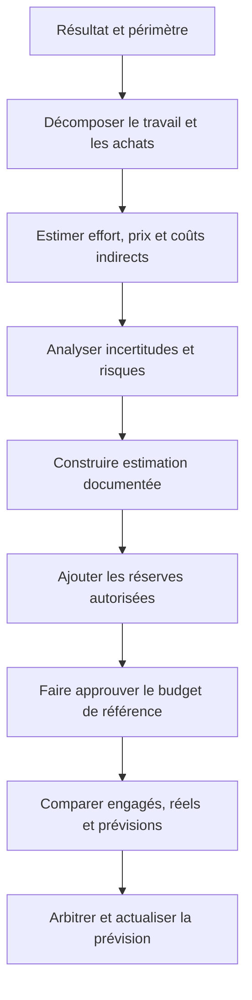

Le budget n’est pas un chiffre isolé : il résulte du périmètre, des hypothèses d’estimation, des coûts internes et externes, des risques et des règles de gouvernance. Une référence approuvée sert ensuite de point de comparaison. Les dépenses observées et les nouvelles informations doivent alimenter une prévision actualisée sans effacer l’historique des engagements.

**Périmètre et qualité.** Le périmètre fixe les limites du travail ; la qualité précise les caractéristiques et critères qui permettront d’accepter les livrables. Les ajouts doivent être analysés au lieu d’être acceptés implicitement. Une date ou un budget ne justifie jamais de prétendre qu’un critère obligatoire est satisfait sans preuve.

**Prévision et référence.** La référence approuvée permet d’étudier les écarts, tandis que la prévision décrit l’issue la plus probable à partir des données actuelles. On peut réviser une prévision et conserver une référence historique. La distinction préserve la transparence et aide à décider sans maquiller les évolutions.

**Gouvernance.** La gouvernance répartit les responsabilités, les pouvoirs de décision, les seuils d’escalade et les mécanismes de validation. Elle doit soutenir le travail plutôt que le bloquer. Les décisions fréquentes et réversibles sont généralement déléguées ; les décisions coûteuses, risquées ou réglementaires nécessitent une autorité et une trace explicites.

**Risque.** Un risque correspond à un événement incertain et à ses conséquences éventuelles. Il doit être décrit, évalué, attribué et surveillé. Une réponse crédible comprend une action, un propriétaire, un déclencheur et une solution de repli. Un risque connu mais sans responsable n’est pas réellement piloté.

**Dépendances.** Un projet dépend de systèmes, de personnes, d’approbations, de fournisseurs, de fenêtres de changement et d’informations. Les dépendances externes doivent être rendues visibles dans le plan. Une activité qui paraît courte peut déterminer la fin du projet si elle attend une ressource rare ou une validation obligatoire.

**Communication.** Une information est efficace quand elle permet à son destinataire de comprendre la situation et d’agir. L’équipe a besoin de détails opérationnels, le sponsor d’options d’arbitrage et les utilisateurs de connaître les impacts. Les rapports doivent distinguer les faits observés, les hypothèses, les risques et les décisions attendues.

**Adoption et transfert.** Le résultat doit pouvoir être utilisé, maintenu et supporté. Les responsabilités d’exploitation, les accès, la documentation, la formation, la supervision et le retour arrière doivent être préparés avant la mise en service. Les bénéfices peuvent nécessiter une mesure plusieurs semaines après la livraison.

## Méthodologie et outils

Commencer par formuler le problème, les bénéficiaires, le résultat attendu et les contraintes non négociables. Décrire ensuite les options, les dépendances, les responsabilités, les risques et les preuves nécessaires. La planification fournit une hypothèse structurée ; elle doit être révisée lorsque de nouveaux faits modifient le travail restant ou les conditions de réussite.

Les outils servent à externaliser la mémoire collective. Ils doivent permettre de répondre à des questions concrètes : quel résultat est attendu, qui le prend en charge, qu’est-ce qui est bloqué, quelle décision est en attente, quelle preuve existe et comment la prévision change-t-elle ? La simplicité est une qualité si les contrôles essentiels restent couverts et si les données sont maintenues.

Un reporting utile ne récompense pas seulement le volume d’activité. Il met en évidence le travail réellement terminé, les critères qui restent ouverts, les risques qui évoluent et les arbitrages nécessaires. Les estimations doivent exposer leurs hypothèses, les marges doivent être explicables et les mesures doivent être comprises par ceux qui les utilisent pour décider.

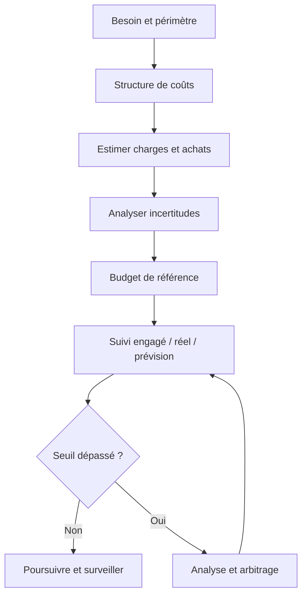

### 1. Coût total de possession

**Comprendre le concept.** Dans « Estimation des coûts et budget », coût total de possession constitue une pratique qui doit répondre à une intention précise. Le coût total de possession inclut l’acquisition, l’intégration, l’exploitation, la maintenance, les licences, les compétences et la sortie de service. Le responsable doit commencer par définir le résultat attendu, l’autorité concernée et les informations qui manquent encore. Une méthode ne doit pas être appliquée uniquement parce qu’elle figure dans un guide ou qu’elle est proposée par un outil. Sa valeur dépend du contexte, des personnes qui l’utilisent et de la qualité des décisions qu’elle permet de prendre.

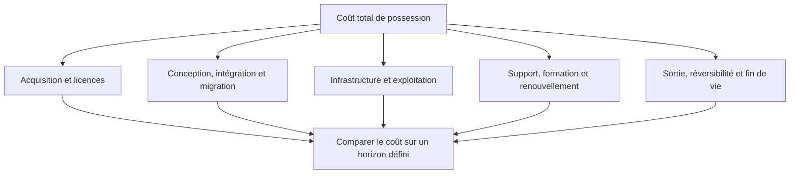

Comparer deux solutions uniquement sur leur prix d’achat peut masquer les coûts récurrents, les efforts d’intégration, le support, la montée en compétence et la sortie de solution. Le coût total de possession doit donc préciser un horizon temporel, un volume d’usage, les hypothèses de renouvellement et les coûts de fin de vie. Les bénéfices attendus peuvent être comparés séparément ou dans une analyse économique plus large.

**Articuler avec les autres dimensions.** La décision peut affecter le périmètre, la capacité, les coûts, le calendrier, la sécurité et l’exploitation. Il est nécessaire de repérer les dépendances en amont, les conséquences pour les bénéficiaires et les coûts de réversibilité. Une optimisation locale peut transférer le coût vers une autre équipe ou reporter un risque après la mise en service. Une analyse complète rend explicite le compromis, indique ce qui est protégé et précise quelles limites ne peuvent pas être négociées.

**Illustration opérationnelle.** Une licence SaaS semble économique jusqu’à ce que l’on chiffre les environnements, les connecteurs, le support et les coûts de sortie. Pour traiter ce type de situation, consigner les faits, distinguer les hypothèses, fixer une responsabilité et définir une preuve vérifiable. Lorsque plusieurs solutions sont possibles, les comparer avec des critères communs. Si les données sont incomplètes, organiser une courte investigation avec une échéance au lieu de présenter une estimation fragile comme un engagement ferme. La décision doit pouvoir être comprise par une personne qui n’a pas assisté à la discussion d’origine.

**Mise en œuvre.** Recueillir les données auprès des personnes proches du travail, examiner les contraintes, formuler des options, préciser leurs impacts et décider au niveau approprié. Après la décision, consigner le motif, informer les acteurs concernés et suivre l’effet réel. Lorsque le seuil de délégation est dépassé, préparer une escalade concise qui présente le problème, les options, les risques, une recommandation et la date à laquelle la décision devient urgente. Cette séquence protège la coordination sans imposer de lourdeur inutile.

**Mesure et preuve.** Il faut choisir un indicateur correspondant à la finalité de la pratique. Une donnée d’activité ne démontre pas nécessairement un résultat. Définir la source, la fréquence, le responsable, la valeur de référence et les limites de l’indicateur. Compléter si nécessaire les chiffres par une observation qualitative, une revue ou un test. Les mesures doivent être assez fiables pour soutenir une décision, mais pas si coûteuses qu’elles consomment une part disproportionnée du travail qu’elles sont censées aider.

**Erreurs fréquentes et correction.** Les erreurs habituelles incluent une information non actualisée, des définitions variables, une responsabilité implicite, un contrôle fait trop tard ou une exception devenue la règle. Le correctif n’est pas d’ajouter des tableaux sans fin : il faut retrouver la cause, simplifier le flux, attribuer la décision et mesurer l’amélioration. Si une pratique ne produit plus de valeur, la revoir avec les personnes concernées, tout en conservant les contrôles obligatoires et les traces nécessaires à l’audit.

**Approfondissement.** Pour un projet à forte criticité, la pratique peut exiger une validation indépendante, une séparation des tâches, une piste d’audit et un test sur un environnement représentatif. Pour un travail limité et réversible, une revue de pair peut suffire. La proportionnalité ne signifie pas l’absence de rigueur : elle cherche le meilleur rapport entre contrôle et utilité. Le test décisif est de savoir si l’équipe peut expliquer ce qu’elle fait, pourquoi elle le fait, quelle preuve confirme le résultat et comment elle réagira si l’hypothèse devient fausse.

### 2. Estimation paramétrique

**Comprendre le concept.** Dans « Estimation des coûts et budget », estimation paramétrique constitue une pratique qui doit répondre à une intention précise. Une estimation paramétrique utilise une relation mesurable, par exemple coût par interface ou coût par environnement, à condition que la comparaison soit pertinente. Le responsable doit commencer par définir le résultat attendu, l’autorité concernée et les informations qui manquent encore. Une méthode ne doit pas être appliquée uniquement parce qu’elle figure dans un guide ou qu’elle est proposée par un outil. Sa valeur dépend du contexte, des personnes qui l’utilisent et de la qualité des décisions qu’elle permet de prendre.

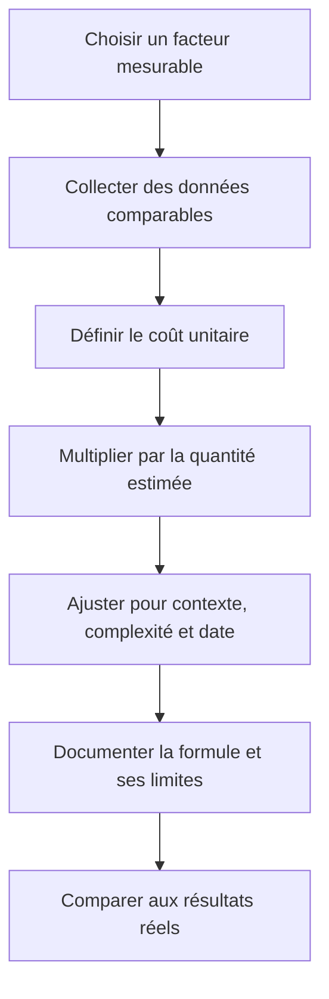

Exemple : si une migration a historiquement coûté en moyenne 180 unités monétaires par poste et que 120 postes sont concernés, une première estimation paramétrique vaut 21 600 unités. Ce chiffre ne devient crédible qu’après vérification de la comparabilité des postes, des licences, des déplacements, du volume de données et des exigences de sécurité. Un coût unitaire moyen ne doit pas être traité comme une constante universelle.

**Articuler avec les autres dimensions.** La décision peut affecter le périmètre, la capacité, les coûts, le calendrier, la sécurité et l’exploitation. Il est nécessaire de repérer les dépendances en amont, les conséquences pour les bénéficiaires et les coûts de réversibilité. Une optimisation locale peut transférer le coût vers une autre équipe ou reporter un risque après la mise en service. Une analyse complète rend explicite le compromis, indique ce qui est protégé et précise quelles limites ne peuvent pas être négociées.

**Illustration opérationnelle.** Le coût prévisionnel des interfaces est calculé sur la base de réalisations passées, puis ajusté pour la complexité actuelle. Pour traiter ce type de situation, consigner les faits, distinguer les hypothèses, fixer une responsabilité et définir une preuve vérifiable. Lorsque plusieurs solutions sont possibles, les comparer avec des critères communs. Si les données sont incomplètes, organiser une courte investigation avec une échéance au lieu de présenter une estimation fragile comme un engagement ferme. La décision doit pouvoir être comprise par une personne qui n’a pas assisté à la discussion d’origine.

**Mise en œuvre.** Recueillir les données auprès des personnes proches du travail, examiner les contraintes, formuler des options, préciser leurs impacts et décider au niveau approprié. Après la décision, consigner le motif, informer les acteurs concernés et suivre l’effet réel. Lorsque le seuil de délégation est dépassé, préparer une escalade concise qui présente le problème, les options, les risques, une recommandation et la date à laquelle la décision devient urgente. Cette séquence protège la coordination sans imposer de lourdeur inutile.

**Mesure et preuve.** Il faut choisir un indicateur correspondant à la finalité de la pratique. Une donnée d’activité ne démontre pas nécessairement un résultat. Définir la source, la fréquence, le responsable, la valeur de référence et les limites de l’indicateur. Compléter si nécessaire les chiffres par une observation qualitative, une revue ou un test. Les mesures doivent être assez fiables pour soutenir une décision, mais pas si coûteuses qu’elles consomment une part disproportionnée du travail qu’elles sont censées aider.

**Erreurs fréquentes et correction.** Les erreurs habituelles incluent une information non actualisée, des définitions variables, une responsabilité implicite, un contrôle fait trop tard ou une exception devenue la règle. Le correctif n’est pas d’ajouter des tableaux sans fin : il faut retrouver la cause, simplifier le flux, attribuer la décision et mesurer l’amélioration. Si une pratique ne produit plus de valeur, la revoir avec les personnes concernées, tout en conservant les contrôles obligatoires et les traces nécessaires à l’audit.

**Approfondissement.** Pour un projet à forte criticité, la pratique peut exiger une validation indépendante, une séparation des tâches, une piste d’audit et un test sur un environnement représentatif. Pour un travail limité et réversible, une revue de pair peut suffire. La proportionnalité ne signifie pas l’absence de rigueur : elle cherche le meilleur rapport entre contrôle et utilité. Le test décisif est de savoir si l’équipe peut expliquer ce qu’elle fait, pourquoi elle le fait, quelle preuve confirme le résultat et comment elle réagira si l’hypothèse devient fausse.

### 3. Estimation analogique

**Comprendre le concept.** Dans « Estimation des coûts et budget », estimation analogique constitue une pratique qui doit répondre à une intention précise. L’estimation analogique compare avec un projet similaire et corrige les différences de taille, de technologie, de risque et de contexte. Le responsable doit commencer par définir le résultat attendu, l’autorité concernée et les informations qui manquent encore. Une méthode ne doit pas être appliquée uniquement parce qu’elle figure dans un guide ou qu’elle est proposée par un outil. Sa valeur dépend du contexte, des personnes qui l’utilisent et de la qualité des décisions qu’elle permet de prendre.

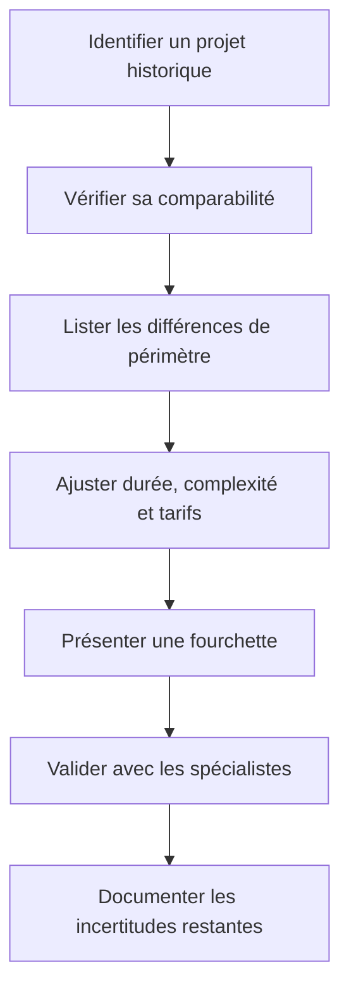

L’analogie est utile au début, lorsque le détail du travail est encore limité. Elle ne consiste pas à recopier le budget précédent : il faut tenir compte des différences de taille, de technologie, de maturité de l’équipe, de conditions contractuelles et de taux de change éventuels. Conserver le projet de référence et les ajustements permet de discuter la pertinence de l’estimation.

**Articuler avec les autres dimensions.** La décision peut affecter le périmètre, la capacité, les coûts, le calendrier, la sécurité et l’exploitation. Il est nécessaire de repérer les dépendances en amont, les conséquences pour les bénéficiaires et les coûts de réversibilité. Une optimisation locale peut transférer le coût vers une autre équipe ou reporter un risque après la mise en service. Une analyse complète rend explicite le compromis, indique ce qui est protégé et précise quelles limites ne peuvent pas être négociées.

**Illustration opérationnelle.** Un précédent déploiement donne un ordre de grandeur, mais l’équipe ajuste l’estimation car ce projet comporte des données plus sensibles. Pour traiter ce type de situation, consigner les faits, distinguer les hypothèses, fixer une responsabilité et définir une preuve vérifiable. Lorsque plusieurs solutions sont possibles, les comparer avec des critères communs. Si les données sont incomplètes, organiser une courte investigation avec une échéance au lieu de présenter une estimation fragile comme un engagement ferme. La décision doit pouvoir être comprise par une personne qui n’a pas assisté à la discussion d’origine.

**Mise en œuvre.** Recueillir les données auprès des personnes proches du travail, examiner les contraintes, formuler des options, préciser leurs impacts et décider au niveau approprié. Après la décision, consigner le motif, informer les acteurs concernés et suivre l’effet réel. Lorsque le seuil de délégation est dépassé, préparer une escalade concise qui présente le problème, les options, les risques, une recommandation et la date à laquelle la décision devient urgente. Cette séquence protège la coordination sans imposer de lourdeur inutile.

**Mesure et preuve.** Il faut choisir un indicateur correspondant à la finalité de la pratique. Une donnée d’activité ne démontre pas nécessairement un résultat. Définir la source, la fréquence, le responsable, la valeur de référence et les limites de l’indicateur. Compléter si nécessaire les chiffres par une observation qualitative, une revue ou un test. Les mesures doivent être assez fiables pour soutenir une décision, mais pas si coûteuses qu’elles consomment une part disproportionnée du travail qu’elles sont censées aider.

**Erreurs fréquentes et correction.** Les erreurs habituelles incluent une information non actualisée, des définitions variables, une responsabilité implicite, un contrôle fait trop tard ou une exception devenue la règle. Le correctif n’est pas d’ajouter des tableaux sans fin : il faut retrouver la cause, simplifier le flux, attribuer la décision et mesurer l’amélioration. Si une pratique ne produit plus de valeur, la revoir avec les personnes concernées, tout en conservant les contrôles obligatoires et les traces nécessaires à l’audit.

**Approfondissement.** Pour un projet à forte criticité, la pratique peut exiger une validation indépendante, une séparation des tâches, une piste d’audit et un test sur un environnement représentatif. Pour un travail limité et réversible, une revue de pair peut suffire. La proportionnalité ne signifie pas l’absence de rigueur : elle cherche le meilleur rapport entre contrôle et utilité. Le test décisif est de savoir si l’équipe peut expliquer ce qu’elle fait, pourquoi elle le fait, quelle preuve confirme le résultat et comment elle réagira si l’hypothèse devient fausse.

### 4. Estimation bottom-up

**Comprendre le concept.** Dans « Estimation des coûts et budget », estimation bottom-up constitue une pratique qui doit répondre à une intention précise. L’estimation ascendante décompose le travail en éléments détaillés puis agrège coûts et efforts, avec un coût de coordination explicite. Le responsable doit commencer par définir le résultat attendu, l’autorité concernée et les informations qui manquent encore. Une méthode ne doit pas être appliquée uniquement parce qu’elle figure dans un guide ou qu’elle est proposée par un outil. Sa valeur dépend du contexte, des personnes qui l’utilisent et de la qualité des décisions qu’elle permet de prendre.

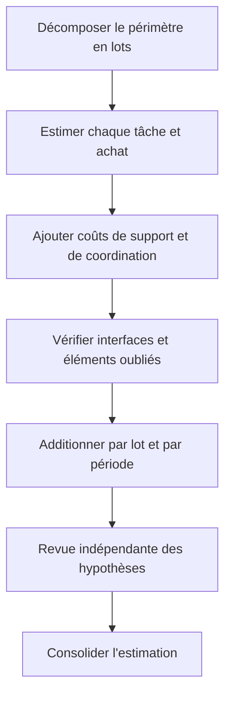

Une estimation ascendante est plus détaillée, mais elle n’est pas automatiquement exacte. Son risque classique est l’omission : coordination, environnement de test, migration, sécurité, formation, support au démarrage ou travaux de fournisseur peuvent manquer. La revue doit rechercher les dépendances, doubles comptes et coûts laissés hors périmètre avant de consolider les lots.

**Articuler avec les autres dimensions.** La décision peut affecter le périmètre, la capacité, les coûts, le calendrier, la sécurité et l’exploitation. Il est nécessaire de repérer les dépendances en amont, les conséquences pour les bénéficiaires et les coûts de réversibilité. Une optimisation locale peut transférer le coût vers une autre équipe ou reporter un risque après la mise en service. Une analyse complète rend explicite le compromis, indique ce qui est protégé et précise quelles limites ne peuvent pas être négociées.

**Illustration opérationnelle.** Les tâches d’architecture, configuration, tests, migration, formation et transfert sont chiffrées séparément avant consolidation. Pour traiter ce type de situation, consigner les faits, distinguer les hypothèses, fixer une responsabilité et définir une preuve vérifiable. Lorsque plusieurs solutions sont possibles, les comparer avec des critères communs. Si les données sont incomplètes, organiser une courte investigation avec une échéance au lieu de présenter une estimation fragile comme un engagement ferme. La décision doit pouvoir être comprise par une personne qui n’a pas assisté à la discussion d’origine.

**Mise en œuvre.** Recueillir les données auprès des personnes proches du travail, examiner les contraintes, formuler des options, préciser leurs impacts et décider au niveau approprié. Après la décision, consigner le motif, informer les acteurs concernés et suivre l’effet réel. Lorsque le seuil de délégation est dépassé, préparer une escalade concise qui présente le problème, les options, les risques, une recommandation et la date à laquelle la décision devient urgente. Cette séquence protège la coordination sans imposer de lourdeur inutile.

**Mesure et preuve.** Il faut choisir un indicateur correspondant à la finalité de la pratique. Une donnée d’activité ne démontre pas nécessairement un résultat. Définir la source, la fréquence, le responsable, la valeur de référence et les limites de l’indicateur. Compléter si nécessaire les chiffres par une observation qualitative, une revue ou un test. Les mesures doivent être assez fiables pour soutenir une décision, mais pas si coûteuses qu’elles consomment une part disproportionnée du travail qu’elles sont censées aider.

**Erreurs fréquentes et correction.** Les erreurs habituelles incluent une information non actualisée, des définitions variables, une responsabilité implicite, un contrôle fait trop tard ou une exception devenue la règle. Le correctif n’est pas d’ajouter des tableaux sans fin : il faut retrouver la cause, simplifier le flux, attribuer la décision et mesurer l’amélioration. Si une pratique ne produit plus de valeur, la revoir avec les personnes concernées, tout en conservant les contrôles obligatoires et les traces nécessaires à l’audit.

**Approfondissement.** Pour un projet à forte criticité, la pratique peut exiger une validation indépendante, une séparation des tâches, une piste d’audit et un test sur un environnement représentatif. Pour un travail limité et réversible, une revue de pair peut suffire. La proportionnalité ne signifie pas l’absence de rigueur : elle cherche le meilleur rapport entre contrôle et utilité. Le test décisif est de savoir si l’équipe peut expliquer ce qu’elle fait, pourquoi elle le fait, quelle preuve confirme le résultat et comment elle réagira si l’hypothèse devient fausse.

### 5. Effort et coût

**Comprendre le concept.** Dans « Estimation des coûts et budget », effort et coût constitue une pratique qui doit répondre à une intention précise. L’effort en jours-personnes n’est pas le coût complet : il faut considérer tarifs, coûts employeur, fournisseurs et frais de coordination. Le responsable doit commencer par définir le résultat attendu, l’autorité concernée et les informations qui manquent encore. Une méthode ne doit pas être appliquée uniquement parce qu’elle figure dans un guide ou qu’elle est proposée par un outil. Sa valeur dépend du contexte, des personnes qui l’utilisent et de la qualité des décisions qu’elle permet de prendre.

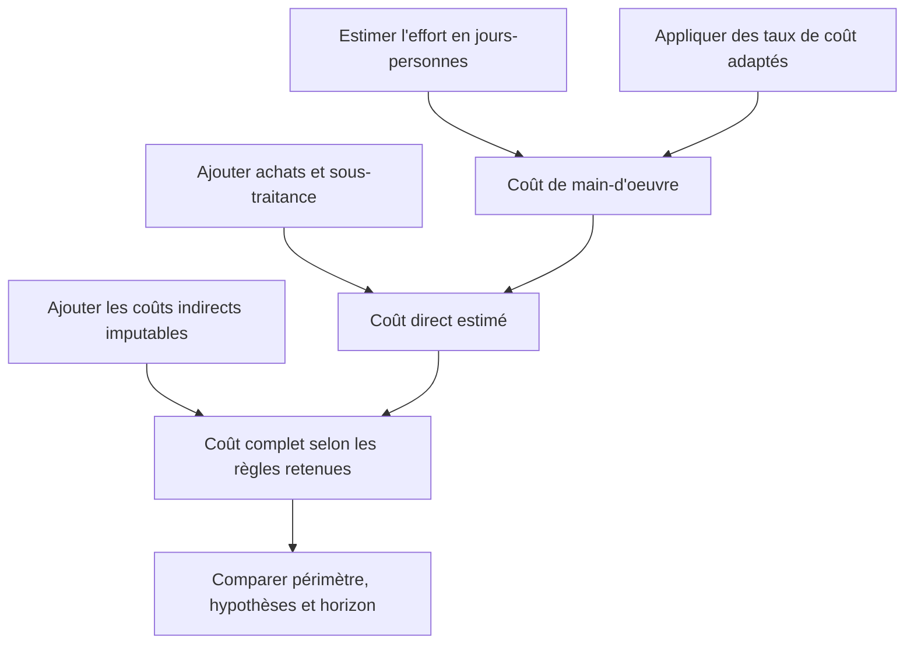

Une formule de travail peut être : coût de main-d’œuvre = effort estimé × taux journalier pertinent, auquel s’ajoutent les achats, les frais imputables et les coûts indirects selon la méthode de l’organisation. Le taux doit préciser ce qu’il inclut : salaire, charges, frais de structure ou seulement une base tarifaire. Il faut éviter d’ajouter deux fois une charge déjà comprise dans un tarif complet.

**Articuler avec les autres dimensions.** La décision peut affecter le périmètre, la capacité, les coûts, le calendrier, la sécurité et l’exploitation. Il est nécessaire de repérer les dépendances en amont, les conséquences pour les bénéficiaires et les coûts de réversibilité. Une optimisation locale peut transférer le coût vers une autre équipe ou reporter un risque après la mise en service. Une analyse complète rend explicite le compromis, indique ce qui est protégé et précise quelles limites ne peuvent pas être négociées.

**Illustration opérationnelle.** Quatre jours d’un consultant externe et quatre jours d’un salarié peuvent représenter des montants très différents. Pour traiter ce type de situation, consigner les faits, distinguer les hypothèses, fixer une responsabilité et définir une preuve vérifiable. Lorsque plusieurs solutions sont possibles, les comparer avec des critères communs. Si les données sont incomplètes, organiser une courte investigation avec une échéance au lieu de présenter une estimation fragile comme un engagement ferme. La décision doit pouvoir être comprise par une personne qui n’a pas assisté à la discussion d’origine.

**Mise en œuvre.** Recueillir les données auprès des personnes proches du travail, examiner les contraintes, formuler des options, préciser leurs impacts et décider au niveau approprié. Après la décision, consigner le motif, informer les acteurs concernés et suivre l’effet réel. Lorsque le seuil de délégation est dépassé, préparer une escalade concise qui présente le problème, les options, les risques, une recommandation et la date à laquelle la décision devient urgente. Cette séquence protège la coordination sans imposer de lourdeur inutile.

**Mesure et preuve.** Il faut choisir un indicateur correspondant à la finalité de la pratique. Une donnée d’activité ne démontre pas nécessairement un résultat. Définir la source, la fréquence, le responsable, la valeur de référence et les limites de l’indicateur. Compléter si nécessaire les chiffres par une observation qualitative, une revue ou un test. Les mesures doivent être assez fiables pour soutenir une décision, mais pas si coûteuses qu’elles consomment une part disproportionnée du travail qu’elles sont censées aider.

**Erreurs fréquentes et correction.** Les erreurs habituelles incluent une information non actualisée, des définitions variables, une responsabilité implicite, un contrôle fait trop tard ou une exception devenue la règle. Le correctif n’est pas d’ajouter des tableaux sans fin : il faut retrouver la cause, simplifier le flux, attribuer la décision et mesurer l’amélioration. Si une pratique ne produit plus de valeur, la revoir avec les personnes concernées, tout en conservant les contrôles obligatoires et les traces nécessaires à l’audit.

**Approfondissement.** Pour un projet à forte criticité, la pratique peut exiger une validation indépendante, une séparation des tâches, une piste d’audit et un test sur un environnement représentatif. Pour un travail limité et réversible, une revue de pair peut suffire. La proportionnalité ne signifie pas l’absence de rigueur : elle cherche le meilleur rapport entre contrôle et utilité. Le test décisif est de savoir si l’équipe peut expliquer ce qu’elle fait, pourquoi elle le fait, quelle preuve confirme le résultat et comment elle réagira si l’hypothèse devient fausse.

### 6. Coûts fixes et variables

**Comprendre le concept.** Dans « Estimation des coûts et budget », coûts fixes et variables constitue une pratique qui doit répondre à une intention précise. Les coûts fixes ne varient pas directement avec le volume dans une plage donnée ; les coûts variables évoluent avec l’usage ou la quantité. Le responsable doit commencer par définir le résultat attendu, l’autorité concernée et les informations qui manquent encore. Une méthode ne doit pas être appliquée uniquement parce qu’elle figure dans un guide ou qu’elle est proposée par un outil. Sa valeur dépend du contexte, des personnes qui l’utilisent et de la qualité des décisions qu’elle permet de prendre.

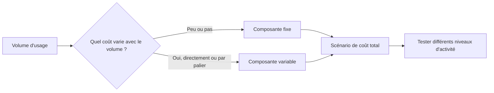

Un coût fixe reste relativement stable sur une plage d’activité et un horizon donnés ; un coût variable évolue avec le volume ou l’usage. Un abonnement peut être fixe jusqu’à un seuil puis changer par palier, et un coût réputé fixe peut augmenter lorsqu’il faut ajouter une capacité. L’analyse doit décrire les seuils, unités de facturation et conditions contractuelles.

**Articuler avec les autres dimensions.** La décision peut affecter le périmètre, la capacité, les coûts, le calendrier, la sécurité et l’exploitation. Il est nécessaire de repérer les dépendances en amont, les conséquences pour les bénéficiaires et les coûts de réversibilité. Une optimisation locale peut transférer le coût vers une autre équipe ou reporter un risque après la mise en service. Une analyse complète rend explicite le compromis, indique ce qui est protégé et précise quelles limites ne peuvent pas être négociées.

**Illustration opérationnelle.** Le frais de mise en place peut être fixe alors que les coûts d’hébergement et de transactions augmentent avec le nombre d’utilisateurs. Pour traiter ce type de situation, consigner les faits, distinguer les hypothèses, fixer une responsabilité et définir une preuve vérifiable. Lorsque plusieurs solutions sont possibles, les comparer avec des critères communs. Si les données sont incomplètes, organiser une courte investigation avec une échéance au lieu de présenter une estimation fragile comme un engagement ferme. La décision doit pouvoir être comprise par une personne qui n’a pas assisté à la discussion d’origine.

**Mise en œuvre.** Recueillir les données auprès des personnes proches du travail, examiner les contraintes, formuler des options, préciser leurs impacts et décider au niveau approprié. Après la décision, consigner le motif, informer les acteurs concernés et suivre l’effet réel. Lorsque le seuil de délégation est dépassé, préparer une escalade concise qui présente le problème, les options, les risques, une recommandation et la date à laquelle la décision devient urgente. Cette séquence protège la coordination sans imposer de lourdeur inutile.

**Mesure et preuve.** Il faut choisir un indicateur correspondant à la finalité de la pratique. Une donnée d’activité ne démontre pas nécessairement un résultat. Définir la source, la fréquence, le responsable, la valeur de référence et les limites de l’indicateur. Compléter si nécessaire les chiffres par une observation qualitative, une revue ou un test. Les mesures doivent être assez fiables pour soutenir une décision, mais pas si coûteuses qu’elles consomment une part disproportionnée du travail qu’elles sont censées aider.

**Erreurs fréquentes et correction.** Les erreurs habituelles incluent une information non actualisée, des définitions variables, une responsabilité implicite, un contrôle fait trop tard ou une exception devenue la règle. Le correctif n’est pas d’ajouter des tableaux sans fin : il faut retrouver la cause, simplifier le flux, attribuer la décision et mesurer l’amélioration. Si une pratique ne produit plus de valeur, la revoir avec les personnes concernées, tout en conservant les contrôles obligatoires et les traces nécessaires à l’audit.

**Approfondissement.** Pour un projet à forte criticité, la pratique peut exiger une validation indépendante, une séparation des tâches, une piste d’audit et un test sur un environnement représentatif. Pour un travail limité et réversible, une revue de pair peut suffire. La proportionnalité ne signifie pas l’absence de rigueur : elle cherche le meilleur rapport entre contrôle et utilité. Le test décisif est de savoir si l’équipe peut expliquer ce qu’elle fait, pourquoi elle le fait, quelle preuve confirme le résultat et comment elle réagira si l’hypothèse devient fausse.

### 7. CAPEX et OPEX

**Comprendre le concept.** Dans « Estimation des coûts et budget », capex et opex constitue une pratique qui doit répondre à une intention précise. La classification comptable dépend des règles applicables et du contexte ; le chef de projet fournit les informations sans décider seul du traitement comptable. Le responsable doit commencer par définir le résultat attendu, l’autorité concernée et les informations qui manquent encore. Une méthode ne doit pas être appliquée uniquement parce qu’elle figure dans un guide ou qu’elle est proposée par un outil. Sa valeur dépend du contexte, des personnes qui l’utilisent et de la qualité des décisions qu’elle permet de prendre.

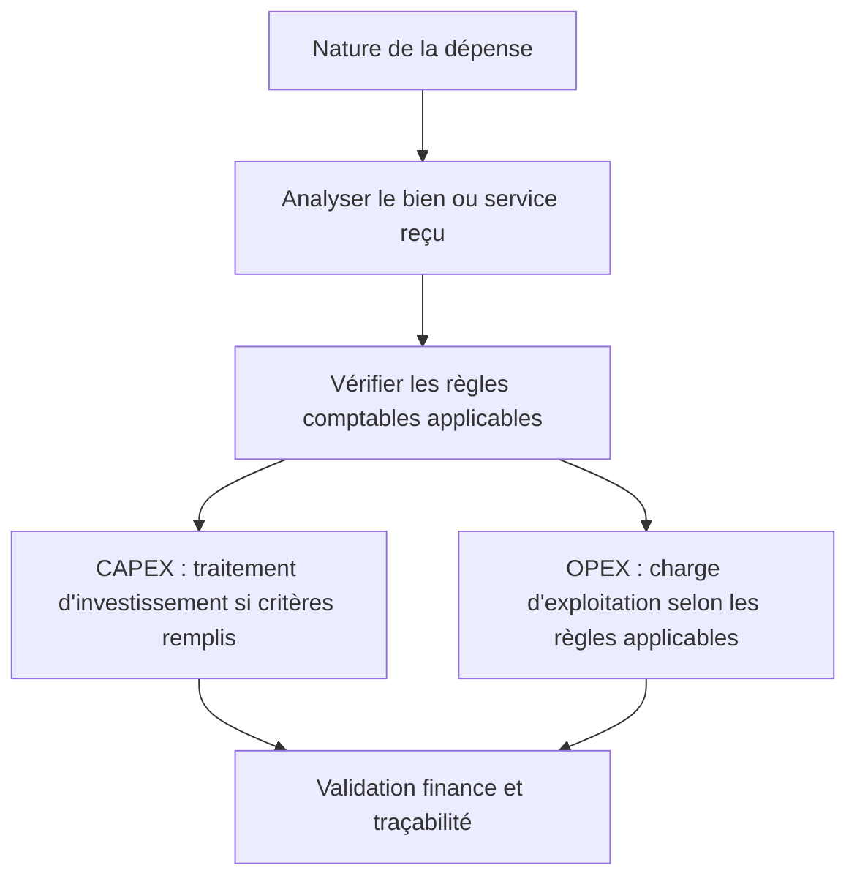

CAPEX et OPEX sont des catégories de gestion et de comptabilisation dont l’application dépend du référentiel comptable, de la juridiction, du contrat et de la nature des dépenses. Il ne faut pas affirmer que toute dépense de développement est automatiquement un investissement, ni que tout abonnement est traité de la même façon dans chaque organisation. Le responsable projet fournit les faits et hypothèses ; la fonction finance valide le traitement.

**Articuler avec les autres dimensions.** La décision peut affecter le périmètre, la capacité, les coûts, le calendrier, la sécurité et l’exploitation. Il est nécessaire de repérer les dépendances en amont, les conséquences pour les bénéficiaires et les coûts de réversibilité. Une optimisation locale peut transférer le coût vers une autre équipe ou reporter un risque après la mise en service. Une analyse complète rend explicite le compromis, indique ce qui est protégé et précise quelles limites ne peuvent pas être négociées.

**Illustration opérationnelle.** Le développement interne ou l’abonnement ne doit pas être classé automatiquement : finance doit examiner les critères propres à l’organisation. Pour traiter ce type de situation, consigner les faits, distinguer les hypothèses, fixer une responsabilité et définir une preuve vérifiable. Lorsque plusieurs solutions sont possibles, les comparer avec des critères communs. Si les données sont incomplètes, organiser une courte investigation avec une échéance au lieu de présenter une estimation fragile comme un engagement ferme. La décision doit pouvoir être comprise par une personne qui n’a pas assisté à la discussion d’origine.

**Mise en œuvre.** Recueillir les données auprès des personnes proches du travail, examiner les contraintes, formuler des options, préciser leurs impacts et décider au niveau approprié. Après la décision, consigner le motif, informer les acteurs concernés et suivre l’effet réel. Lorsque le seuil de délégation est dépassé, préparer une escalade concise qui présente le problème, les options, les risques, une recommandation et la date à laquelle la décision devient urgente. Cette séquence protège la coordination sans imposer de lourdeur inutile.

**Mesure et preuve.** Il faut choisir un indicateur correspondant à la finalité de la pratique. Une donnée d’activité ne démontre pas nécessairement un résultat. Définir la source, la fréquence, le responsable, la valeur de référence et les limites de l’indicateur. Compléter si nécessaire les chiffres par une observation qualitative, une revue ou un test. Les mesures doivent être assez fiables pour soutenir une décision, mais pas si coûteuses qu’elles consomment une part disproportionnée du travail qu’elles sont censées aider.

**Erreurs fréquentes et correction.** Les erreurs habituelles incluent une information non actualisée, des définitions variables, une responsabilité implicite, un contrôle fait trop tard ou une exception devenue la règle. Le correctif n’est pas d’ajouter des tableaux sans fin : il faut retrouver la cause, simplifier le flux, attribuer la décision et mesurer l’amélioration. Si une pratique ne produit plus de valeur, la revoir avec les personnes concernées, tout en conservant les contrôles obligatoires et les traces nécessaires à l’audit.

**Approfondissement.** Pour un projet à forte criticité, la pratique peut exiger une validation indépendante, une séparation des tâches, une piste d’audit et un test sur un environnement représentatif. Pour un travail limité et réversible, une revue de pair peut suffire. La proportionnalité ne signifie pas l’absence de rigueur : elle cherche le meilleur rapport entre contrôle et utilité. Le test décisif est de savoir si l’équipe peut expliquer ce qu’elle fait, pourquoi elle le fait, quelle preuve confirme le résultat et comment elle réagira si l’hypothèse devient fausse.

### 8. Réserve pour risques

**Comprendre le concept.** Dans « Estimation des coûts et budget », réserve pour risques constitue une pratique qui doit répondre à une intention précise. Une réserve de contingence répond à des risques identifiés ; la réserve de management couvre des incertitudes relevant de la gouvernance selon la politique retenue. Le responsable doit commencer par définir le résultat attendu, l’autorité concernée et les informations qui manquent encore. Une méthode ne doit pas être appliquée uniquement parce qu’elle figure dans un guide ou qu’elle est proposée par un outil. Sa valeur dépend du contexte, des personnes qui l’utilisent et de la qualité des décisions qu’elle permet de prendre.

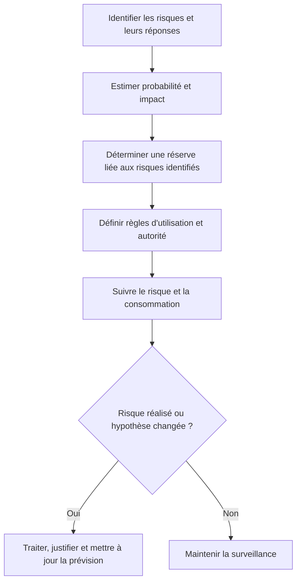

La réserve de contingence vise les risques identifiés et doit avoir une justification ainsi qu’une règle d’utilisation. Elle ne doit pas devenir une enveloppe disponible sans contrôle. Certaines organisations gèrent aussi une réserve de management pour les imprévus non spécifiés, sous une autorité distincte : les deux réserves ne doivent pas être confondues ni ajoutées sans expliquer comment elles s’articulent avec le budget de référence.

**Articuler avec les autres dimensions.** La décision peut affecter le périmètre, la capacité, les coûts, le calendrier, la sécurité et l’exploitation. Il est nécessaire de repérer les dépendances en amont, les conséquences pour les bénéficiaires et les coûts de réversibilité. Une optimisation locale peut transférer le coût vers une autre équipe ou reporter un risque après la mise en service. Une analyse complète rend explicite le compromis, indique ce qui est protégé et précise quelles limites ne peuvent pas être négociées.

**Illustration opérationnelle.** Une hausse probable d’un connecteur est évaluée avec son propriétaire et sa réponse, au lieu d’être cachée dans un pourcentage arbitraire. Pour traiter ce type de situation, consigner les faits, distinguer les hypothèses, fixer une responsabilité et définir une preuve vérifiable. Lorsque plusieurs solutions sont possibles, les comparer avec des critères communs. Si les données sont incomplètes, organiser une courte investigation avec une échéance au lieu de présenter une estimation fragile comme un engagement ferme. La décision doit pouvoir être comprise par une personne qui n’a pas assisté à la discussion d’origine.

**Mise en œuvre.** Recueillir les données auprès des personnes proches du travail, examiner les contraintes, formuler des options, préciser leurs impacts et décider au niveau approprié. Après la décision, consigner le motif, informer les acteurs concernés et suivre l’effet réel. Lorsque le seuil de délégation est dépassé, préparer une escalade concise qui présente le problème, les options, les risques, une recommandation et la date à laquelle la décision devient urgente. Cette séquence protège la coordination sans imposer de lourdeur inutile.

**Mesure et preuve.** Il faut choisir un indicateur correspondant à la finalité de la pratique. Une donnée d’activité ne démontre pas nécessairement un résultat. Définir la source, la fréquence, le responsable, la valeur de référence et les limites de l’indicateur. Compléter si nécessaire les chiffres par une observation qualitative, une revue ou un test. Les mesures doivent être assez fiables pour soutenir une décision, mais pas si coûteuses qu’elles consomment une part disproportionnée du travail qu’elles sont censées aider.

**Erreurs fréquentes et correction.** Les erreurs habituelles incluent une information non actualisée, des définitions variables, une responsabilité implicite, un contrôle fait trop tard ou une exception devenue la règle. Le correctif n’est pas d’ajouter des tableaux sans fin : il faut retrouver la cause, simplifier le flux, attribuer la décision et mesurer l’amélioration. Si une pratique ne produit plus de valeur, la revoir avec les personnes concernées, tout en conservant les contrôles obligatoires et les traces nécessaires à l’audit.

**Approfondissement.** Pour un projet à forte criticité, la pratique peut exiger une validation indépendante, une séparation des tâches, une piste d’audit et un test sur un environnement représentatif. Pour un travail limité et réversible, une revue de pair peut suffire. La proportionnalité ne signifie pas l’absence de rigueur : elle cherche le meilleur rapport entre contrôle et utilité. Le test décisif est de savoir si l’équipe peut expliquer ce qu’elle fait, pourquoi elle le fait, quelle preuve confirme le résultat et comment elle réagira si l’hypothèse devient fausse.

### 9. Budget de référence

**Comprendre le concept.** Dans « Estimation des coûts et budget », budget de référence constitue une pratique qui doit répondre à une intention précise. Le budget de référence est approuvé et sert au suivi ; sa modification doit être tracée et autorisée selon la gouvernance. Le responsable doit commencer par définir le résultat attendu, l’autorité concernée et les informations qui manquent encore. Une méthode ne doit pas être appliquée uniquement parce qu’elle figure dans un guide ou qu’elle est proposée par un outil. Sa valeur dépend du contexte, des personnes qui l’utilisent et de la qualité des décisions qu’elle permet de prendre.

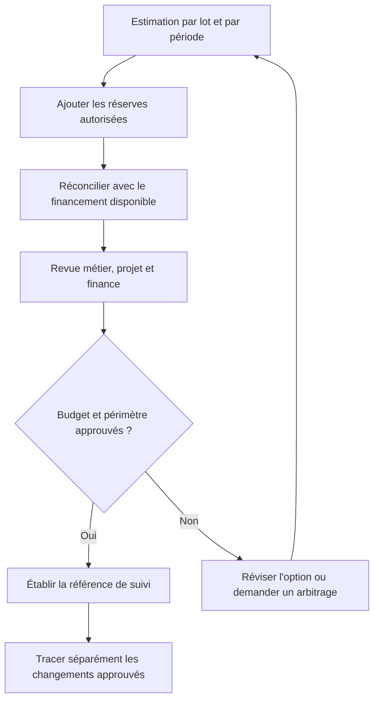

Le budget de référence correspond à une version approuvée utilisée pour comparer les performances et expliquer les écarts. Si le périmètre change, la procédure de changement doit préciser qui peut autoriser la modification, les impacts et la date d’effet. Modifier discrètement la référence pour faire disparaître un dépassement détruit la capacité d’apprentissage et la transparence de pilotage.

**Articuler avec les autres dimensions.** La décision peut affecter le périmètre, la capacité, les coûts, le calendrier, la sécurité et l’exploitation. Il est nécessaire de repérer les dépendances en amont, les conséquences pour les bénéficiaires et les coûts de réversibilité. Une optimisation locale peut transférer le coût vers une autre équipe ou reporter un risque après la mise en service. Une analyse complète rend explicite le compromis, indique ce qui est protégé et précise quelles limites ne peuvent pas être négociées.

**Illustration opérationnelle.** Une nouvelle exigence n’entraîne pas une réécriture silencieuse du budget initial mais un dossier de changement. Pour traiter ce type de situation, consigner les faits, distinguer les hypothèses, fixer une responsabilité et définir une preuve vérifiable. Lorsque plusieurs solutions sont possibles, les comparer avec des critères communs. Si les données sont incomplètes, organiser une courte investigation avec une échéance au lieu de présenter une estimation fragile comme un engagement ferme. La décision doit pouvoir être comprise par une personne qui n’a pas assisté à la discussion d’origine.

**Mise en œuvre.** Recueillir les données auprès des personnes proches du travail, examiner les contraintes, formuler des options, préciser leurs impacts et décider au niveau approprié. Après la décision, consigner le motif, informer les acteurs concernés et suivre l’effet réel. Lorsque le seuil de délégation est dépassé, préparer une escalade concise qui présente le problème, les options, les risques, une recommandation et la date à laquelle la décision devient urgente. Cette séquence protège la coordination sans imposer de lourdeur inutile.

**Mesure et preuve.** Il faut choisir un indicateur correspondant à la finalité de la pratique. Une donnée d’activité ne démontre pas nécessairement un résultat. Définir la source, la fréquence, le responsable, la valeur de référence et les limites de l’indicateur. Compléter si nécessaire les chiffres par une observation qualitative, une revue ou un test. Les mesures doivent être assez fiables pour soutenir une décision, mais pas si coûteuses qu’elles consomment une part disproportionnée du travail qu’elles sont censées aider.

**Erreurs fréquentes et correction.** Les erreurs habituelles incluent une information non actualisée, des définitions variables, une responsabilité implicite, un contrôle fait trop tard ou une exception devenue la règle. Le correctif n’est pas d’ajouter des tableaux sans fin : il faut retrouver la cause, simplifier le flux, attribuer la décision et mesurer l’amélioration. Si une pratique ne produit plus de valeur, la revoir avec les personnes concernées, tout en conservant les contrôles obligatoires et les traces nécessaires à l’audit.

**Approfondissement.** Pour un projet à forte criticité, la pratique peut exiger une validation indépendante, une séparation des tâches, une piste d’audit et un test sur un environnement représentatif. Pour un travail limité et réversible, une revue de pair peut suffire. La proportionnalité ne signifie pas l’absence de rigueur : elle cherche le meilleur rapport entre contrôle et utilité. Le test décisif est de savoir si l’équipe peut expliquer ce qu’elle fait, pourquoi elle le fait, quelle preuve confirme le résultat et comment elle réagira si l’hypothèse devient fausse.

### 10. Coûts engagés et réels

**Comprendre le concept.** Dans « Estimation des coûts et budget », coûts engagés et réels constitue une pratique qui doit répondre à une intention précise. Les coûts engagés correspondent à des obligations contractées, les coûts réels aux dépenses constatées, et les prévisions aux dépenses attendues. Le responsable doit commencer par définir le résultat attendu, l’autorité concernée et les informations qui manquent encore. Une méthode ne doit pas être appliquée uniquement parce qu’elle figure dans un guide ou qu’elle est proposée par un outil. Sa valeur dépend du contexte, des personnes qui l’utilisent et de la qualité des décisions qu’elle permet de prendre.

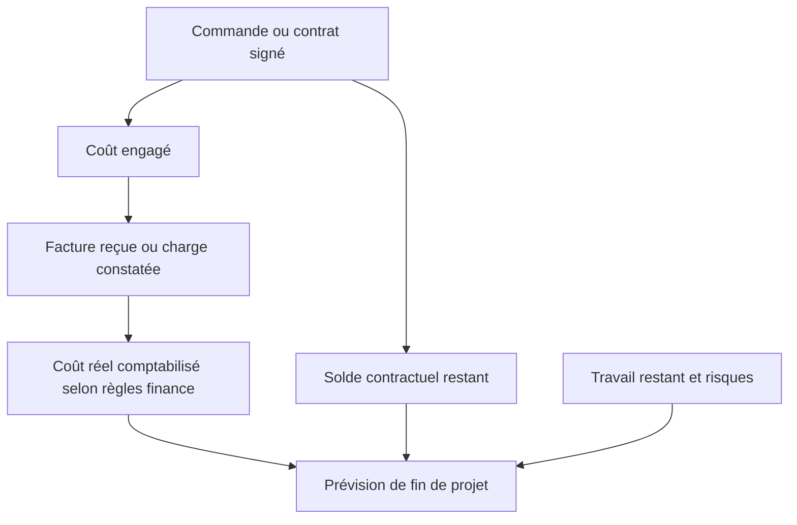

Le coût engagé indique une obligation ou un engagement, alors que le coût réel correspond à une dépense enregistrée selon les règles financières de l’organisation. Une commande peut être engagée sans être entièrement facturée ; l’absence de facture ne signifie donc pas que le budget est encore libre. Une prévision à terminaison doit considérer les dépenses réelles, les engagements restants et le coût du travail qui reste à accomplir.

**Articuler avec les autres dimensions.** La décision peut affecter le périmètre, la capacité, les coûts, le calendrier, la sécurité et l’exploitation. Il est nécessaire de repérer les dépendances en amont, les conséquences pour les bénéficiaires et les coûts de réversibilité. Une optimisation locale peut transférer le coût vers une autre équipe ou reporter un risque après la mise en service. Une analyse complète rend explicite le compromis, indique ce qui est protégé et précise quelles limites ne peuvent pas être négociées.

**Illustration opérationnelle.** Un bon de commande non facturé reste visible dans le suivi des engagements pour éviter une sous-estimation de la dépense finale. Pour traiter ce type de situation, consigner les faits, distinguer les hypothèses, fixer une responsabilité et définir une preuve vérifiable. Lorsque plusieurs solutions sont possibles, les comparer avec des critères communs. Si les données sont incomplètes, organiser une courte investigation avec une échéance au lieu de présenter une estimation fragile comme un engagement ferme. La décision doit pouvoir être comprise par une personne qui n’a pas assisté à la discussion d’origine.

**Mise en œuvre.** Recueillir les données auprès des personnes proches du travail, examiner les contraintes, formuler des options, préciser leurs impacts et décider au niveau approprié. Après la décision, consigner le motif, informer les acteurs concernés et suivre l’effet réel. Lorsque le seuil de délégation est dépassé, préparer une escalade concise qui présente le problème, les options, les risques, une recommandation et la date à laquelle la décision devient urgente. Cette séquence protège la coordination sans imposer de lourdeur inutile.

**Mesure et preuve.** Il faut choisir un indicateur correspondant à la finalité de la pratique. Une donnée d’activité ne démontre pas nécessairement un résultat. Définir la source, la fréquence, le responsable, la valeur de référence et les limites de l’indicateur. Compléter si nécessaire les chiffres par une observation qualitative, une revue ou un test. Les mesures doivent être assez fiables pour soutenir une décision, mais pas si coûteuses qu’elles consomment une part disproportionnée du travail qu’elles sont censées aider.

**Erreurs fréquentes et correction.** Les erreurs habituelles incluent une information non actualisée, des définitions variables, une responsabilité implicite, un contrôle fait trop tard ou une exception devenue la règle. Le correctif n’est pas d’ajouter des tableaux sans fin : il faut retrouver la cause, simplifier le flux, attribuer la décision et mesurer l’amélioration. Si une pratique ne produit plus de valeur, la revoir avec les personnes concernées, tout en conservant les contrôles obligatoires et les traces nécessaires à l’audit.

**Approfondissement.** Pour un projet à forte criticité, la pratique peut exiger une validation indépendante, une séparation des tâches, une piste d’audit et un test sur un environnement représentatif. Pour un travail limité et réversible, une revue de pair peut suffire. La proportionnalité ne signifie pas l’absence de rigueur : elle cherche le meilleur rapport entre contrôle et utilité. Le test décisif est de savoir si l’équipe peut expliquer ce qu’elle fait, pourquoi elle le fait, quelle preuve confirme le résultat et comment elle réagira si l’hypothèse devient fausse.

### 11. Écarts et prévision à terminaison

**Comprendre le concept.** Dans « Estimation des coûts et budget », écarts et prévision à terminaison constitue une pratique qui doit répondre à une intention précise. Le suivi doit expliquer la cause des écarts et prévoir le coût final, plutôt que comparer seulement le montant facturé au budget consommé. Le responsable doit commencer par définir le résultat attendu, l’autorité concernée et les informations qui manquent encore. Une méthode ne doit pas être appliquée uniquement parce qu’elle figure dans un guide ou qu’elle est proposée par un outil. Sa valeur dépend du contexte, des personnes qui l’utilisent et de la qualité des décisions qu’elle permet de prendre.

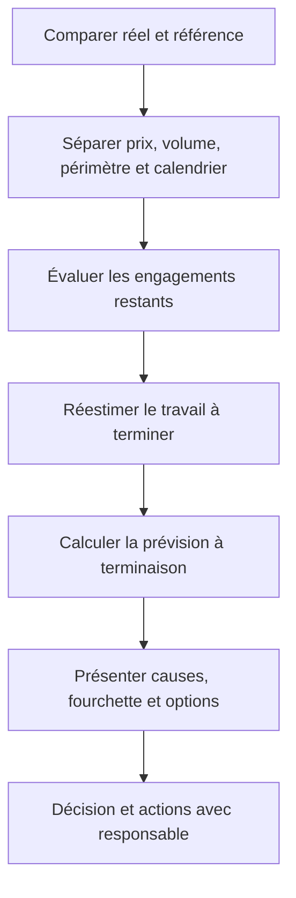

Un écart budgétaire est un signal à expliquer, pas seulement un feu rouge. Il peut venir d’un prix fournisseur, d’une quantité plus élevée, d’un changement de périmètre, d’un retard, d’un défaut qualité ou d’une hypothèse irréaliste. La prévision à terminaison doit être reconstruite à partir des coûts observés et du reste à faire, et non simplement reprendre le budget initial.

**Articuler avec les autres dimensions.** La décision peut affecter le périmètre, la capacité, les coûts, le calendrier, la sécurité et l’exploitation. Il est nécessaire de repérer les dépendances en amont, les conséquences pour les bénéficiaires et les coûts de réversibilité. Une optimisation locale peut transférer le coût vers une autre équipe ou reporter un risque après la mise en service. Une analyse complète rend explicite le compromis, indique ce qui est protégé et précise quelles limites ne peuvent pas être négociées.

**Illustration opérationnelle.** Une consommation faible peut signaler une activité en retard et non une économie durable. Pour traiter ce type de situation, consigner les faits, distinguer les hypothèses, fixer une responsabilité et définir une preuve vérifiable. Lorsque plusieurs solutions sont possibles, les comparer avec des critères communs. Si les données sont incomplètes, organiser une courte investigation avec une échéance au lieu de présenter une estimation fragile comme un engagement ferme. La décision doit pouvoir être comprise par une personne qui n’a pas assisté à la discussion d’origine.

**Mise en œuvre.** Recueillir les données auprès des personnes proches du travail, examiner les contraintes, formuler des options, préciser leurs impacts et décider au niveau approprié. Après la décision, consigner le motif, informer les acteurs concernés et suivre l’effet réel. Lorsque le seuil de délégation est dépassé, préparer une escalade concise qui présente le problème, les options, les risques, une recommandation et la date à laquelle la décision devient urgente. Cette séquence protège la coordination sans imposer de lourdeur inutile.

**Mesure et preuve.** Il faut choisir un indicateur correspondant à la finalité de la pratique. Une donnée d’activité ne démontre pas nécessairement un résultat. Définir la source, la fréquence, le responsable, la valeur de référence et les limites de l’indicateur. Compléter si nécessaire les chiffres par une observation qualitative, une revue ou un test. Les mesures doivent être assez fiables pour soutenir une décision, mais pas si coûteuses qu’elles consomment une part disproportionnée du travail qu’elles sont censées aider.

**Erreurs fréquentes et correction.** Les erreurs habituelles incluent une information non actualisée, des définitions variables, une responsabilité implicite, un contrôle fait trop tard ou une exception devenue la règle. Le correctif n’est pas d’ajouter des tableaux sans fin : il faut retrouver la cause, simplifier le flux, attribuer la décision et mesurer l’amélioration. Si une pratique ne produit plus de valeur, la revoir avec les personnes concernées, tout en conservant les contrôles obligatoires et les traces nécessaires à l’audit.

**Approfondissement.** Pour un projet à forte criticité, la pratique peut exiger une validation indépendante, une séparation des tâches, une piste d’audit et un test sur un environnement représentatif. Pour un travail limité et réversible, une revue de pair peut suffire. La proportionnalité ne signifie pas l’absence de rigueur : elle cherche le meilleur rapport entre contrôle et utilité. Le test décisif est de savoir si l’équipe peut expliquer ce qu’elle fait, pourquoi elle le fait, quelle preuve confirme le résultat et comment elle réagira si l’hypothèse devient fausse.

### 12. Valeur acquise

**Comprendre le concept.** Dans « Estimation des coûts et budget », valeur acquise constitue une pratique qui doit répondre à une intention précise. La valeur acquise compare valeur planifiée, valeur du travail réalisé selon des règles et coût réel ; elle est utile seulement si les mesures sont fiables. Le responsable doit commencer par définir le résultat attendu, l’autorité concernée et les informations qui manquent encore. Une méthode ne doit pas être appliquée uniquement parce qu’elle figure dans un guide ou qu’elle est proposée par un outil. Sa valeur dépend du contexte, des personnes qui l’utilisent et de la qualité des décisions qu’elle permet de prendre.

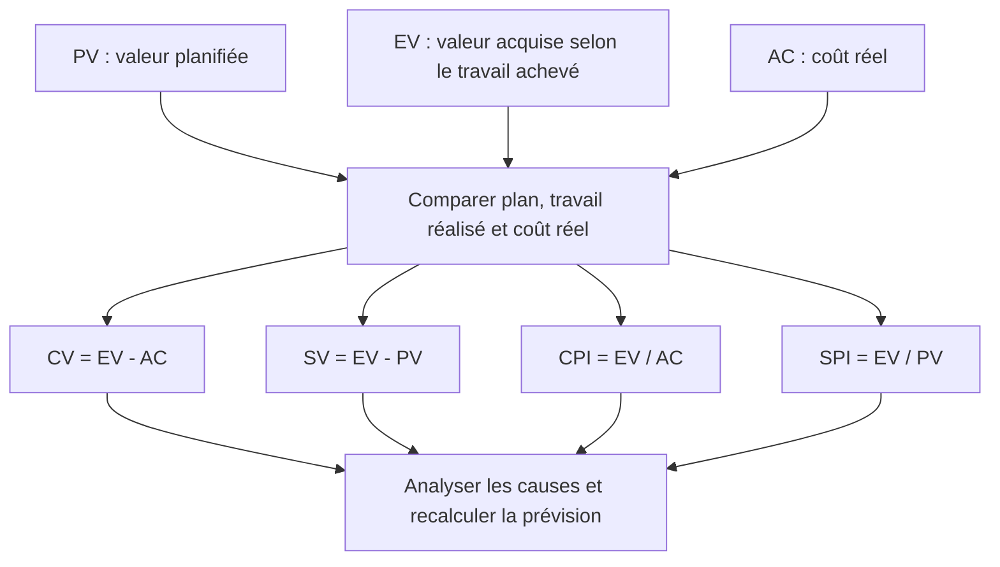

La méthode de la valeur acquise met en relation trois quantités : PV, valeur planifiée du travail prévu à date ; EV, valeur budgétée du travail réellement achevé ; AC, coût réel de ce travail. Par exemple, EV = 40 000 et AC = 50 000 donnent CV = -10 000 et CPI = 0,8 : le travail achevé a coûté plus que sa valeur budgétée. Les conclusions doivent tenir compte de la qualité des mesures et du contexte ; les indicateurs ne disent pas à eux seuls pourquoi un écart existe.

**Articuler avec les autres dimensions.** La décision peut affecter le périmètre, la capacité, les coûts, le calendrier, la sécurité et l’exploitation. Il est nécessaire de repérer les dépendances en amont, les conséquences pour les bénéficiaires et les coûts de réversibilité. Une optimisation locale peut transférer le coût vers une autre équipe ou reporter un risque après la mise en service. Une analyse complète rend explicite le compromis, indique ce qui est protégé et précise quelles limites ne peuvent pas être négociées.

**Illustration opérationnelle.** Un lot à 80 % de dépense mais seulement 40 % de valeur acquise appelle une analyse de dérive et de valeur réellement terminée. Pour traiter ce type de situation, consigner les faits, distinguer les hypothèses, fixer une responsabilité et définir une preuve vérifiable. Lorsque plusieurs solutions sont possibles, les comparer avec des critères communs. Si les données sont incomplètes, organiser une courte investigation avec une échéance au lieu de présenter une estimation fragile comme un engagement ferme. La décision doit pouvoir être comprise par une personne qui n’a pas assisté à la discussion d’origine.

**Mise en œuvre.** Recueillir les données auprès des personnes proches du travail, examiner les contraintes, formuler des options, préciser leurs impacts et décider au niveau approprié. Après la décision, consigner le motif, informer les acteurs concernés et suivre l’effet réel. Lorsque le seuil de délégation est dépassé, préparer une escalade concise qui présente le problème, les options, les risques, une recommandation et la date à laquelle la décision devient urgente. Cette séquence protège la coordination sans imposer de lourdeur inutile.

**Mesure et preuve.** Il faut choisir un indicateur correspondant à la finalité de la pratique. Une donnée d’activité ne démontre pas nécessairement un résultat. Définir la source, la fréquence, le responsable, la valeur de référence et les limites de l’indicateur. Compléter si nécessaire les chiffres par une observation qualitative, une revue ou un test. Les mesures doivent être assez fiables pour soutenir une décision, mais pas si coûteuses qu’elles consomment une part disproportionnée du travail qu’elles sont censées aider.

**Erreurs fréquentes et correction.** Les erreurs habituelles incluent une information non actualisée, des définitions variables, une responsabilité implicite, un contrôle fait trop tard ou une exception devenue la règle. Le correctif n’est pas d’ajouter des tableaux sans fin : il faut retrouver la cause, simplifier le flux, attribuer la décision et mesurer l’amélioration. Si une pratique ne produit plus de valeur, la revoir avec les personnes concernées, tout en conservant les contrôles obligatoires et les traces nécessaires à l’audit.

**Approfondissement.** Pour un projet à forte criticité, la pratique peut exiger une validation indépendante, une séparation des tâches, une piste d’audit et un test sur un environnement représentatif. Pour un travail limité et réversible, une revue de pair peut suffire. La proportionnalité ne signifie pas l’absence de rigueur : elle cherche le meilleur rapport entre contrôle et utilité. Le test décisif est de savoir si l’équipe peut expliquer ce qu’elle fait, pourquoi elle le fait, quelle preuve confirme le résultat et comment elle réagira si l’hypothèse devient fausse.

### 13. Scénarios et arbitrages

**Comprendre le concept.** Dans « Estimation des coûts et budget », scénarios et arbitrages constitue une pratique qui doit répondre à une intention précise. Les scénarios présentent les effets d’un changement de périmètre, de délai, de capacité ou de risque sur le coût total. Le responsable doit commencer par définir le résultat attendu, l’autorité concernée et les informations qui manquent encore. Une méthode ne doit pas être appliquée uniquement parce qu’elle figure dans un guide ou qu’elle est proposée par un outil. Sa valeur dépend du contexte, des personnes qui l’utilisent et de la qualité des décisions qu’elle permet de prendre.

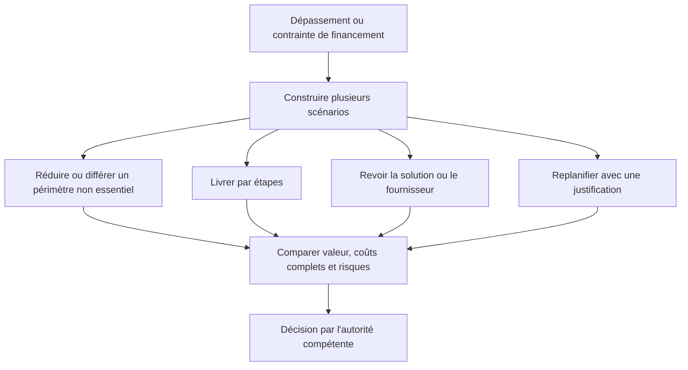

Un arbitrage budgétaire compare des options complètes et non des économies apparentes. Réduire une dépense peut déplacer le coût vers le support, augmenter le risque, réduire la valeur ou retarder les bénéfices. Toute option doit expliciter les éléments abandonnés, les impacts sur la qualité et la sécurité, les coûts ultérieurs, les risques résiduels et la personne habilitée à décider.

**Articuler avec les autres dimensions.** La décision peut affecter le périmètre, la capacité, les coûts, le calendrier, la sécurité et l’exploitation. Il est nécessaire de repérer les dépendances en amont, les conséquences pour les bénéficiaires et les coûts de réversibilité. Une optimisation locale peut transférer le coût vers une autre équipe ou reporter un risque après la mise en service. Une analyse complète rend explicite le compromis, indique ce qui est protégé et précise quelles limites ne peuvent pas être négociées.

**Illustration opérationnelle.** Le sponsor compare une livraison limitée dans les temps, un renfort externe et un report, en tenant compte du coût d’exploitation. Pour traiter ce type de situation, consigner les faits, distinguer les hypothèses, fixer une responsabilité et définir une preuve vérifiable. Lorsque plusieurs solutions sont possibles, les comparer avec des critères communs. Si les données sont incomplètes, organiser une courte investigation avec une échéance au lieu de présenter une estimation fragile comme un engagement ferme. La décision doit pouvoir être comprise par une personne qui n’a pas assisté à la discussion d’origine.

**Mise en œuvre.** Recueillir les données auprès des personnes proches du travail, examiner les contraintes, formuler des options, préciser leurs impacts et décider au niveau approprié. Après la décision, consigner le motif, informer les acteurs concernés et suivre l’effet réel. Lorsque le seuil de délégation est dépassé, préparer une escalade concise qui présente le problème, les options, les risques, une recommandation et la date à laquelle la décision devient urgente. Cette séquence protège la coordination sans imposer de lourdeur inutile.

**Mesure et preuve.** Il faut choisir un indicateur correspondant à la finalité de la pratique. Une donnée d’activité ne démontre pas nécessairement un résultat. Définir la source, la fréquence, le responsable, la valeur de référence et les limites de l’indicateur. Compléter si nécessaire les chiffres par une observation qualitative, une revue ou un test. Les mesures doivent être assez fiables pour soutenir une décision, mais pas si coûteuses qu’elles consomment une part disproportionnée du travail qu’elles sont censées aider.

**Erreurs fréquentes et correction.** Les erreurs habituelles incluent une information non actualisée, des définitions variables, une responsabilité implicite, un contrôle fait trop tard ou une exception devenue la règle. Le correctif n’est pas d’ajouter des tableaux sans fin : il faut retrouver la cause, simplifier le flux, attribuer la décision et mesurer l’amélioration. Si une pratique ne produit plus de valeur, la revoir avec les personnes concernées, tout en conservant les contrôles obligatoires et les traces nécessaires à l’audit.

**Approfondissement.** Pour un projet à forte criticité, la pratique peut exiger une validation indépendante, une séparation des tâches, une piste d’audit et un test sur un environnement représentatif. Pour un travail limité et réversible, une revue de pair peut suffire. La proportionnalité ne signifie pas l’absence de rigueur : elle cherche le meilleur rapport entre contrôle et utilité. Le test décisif est de savoir si l’équipe peut expliquer ce qu’elle fait, pourquoi elle le fait, quelle preuve confirme le résultat et comment elle réagira si l’hypothèse devient fausse.

## Étude de cas : Le budget d’un portail numérique

Une entreprise prévoit un portail de service avec licences, intégration, migration, sécurité, formation et support. Le sponsor exige une enveloppe stable, mais les intégrations sont encore mal connues et plusieurs coûts récurrents restent à identifier.

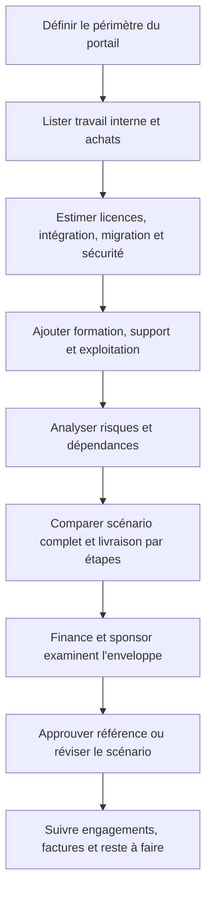

Dans le cas du portail, l’équipe doit éviter de budgéter uniquement la configuration logicielle. La migration des données, les tests de sécurité, la recette, la formation, l’assistance au démarrage et l’exploitation ont aussi un coût. Les estimations doivent montrer les hypothèses et les éléments encore incertains afin que le sponsor puisse choisir entre plusieurs scénarios sur la base d’un coût complet.

### Cadrage et données de départ

Les acteurs commencent par décrire le problème avec des faits vérifiables, puis identifient les bénéficiaires, les exigences et les contraintes. Ils séparent les obligations impératives des préférences, écrivent les hypothèses et demandent une confirmation lorsque celles-ci conditionnent fortement le coût ou la date. Le responsable du projet désigne un propriétaire pour chaque décision majeure, fixe un mécanisme d’escalade et conserve une trace des validations. La première sortie attendue est une compréhension commune du travail, et non une liste exhaustive de tâches écrite avant d’avoir compris le besoin.

### Comparaison des options

L’équipe compare au moins deux options réalistes, dont une option limitée ou progressive. Chaque option est évaluée selon la valeur, le coût complet, le délai, les risques, la réversibilité, les dépendances et les conséquences en exploitation. Les avantages non mesurés sont explicitement identifiés comme hypothèses. Une décision est recommandée lorsque le raisonnement est clair, les compromis sont compris et la personne habilitée a accès aux éléments nécessaires. En cas d’incertitude importante, un prototype ou une estimation complémentaire peut être plus utile qu’un engagement prématuré.

### Mise en œuvre et suivi

Le plan est découpé en livrables que l’on peut vérifier. Les travaux critiques sont associés à des critères de sortie, des responsables et des preuves. Les prévisions sont actualisées en fonction du travail restant, pas uniquement par décalage des dates précédentes. Les changements sont analysés pour leurs impacts croisés. Lorsqu’un indicateur devient rouge, l’équipe expose la cause et propose une action plutôt que de modifier la définition de l’indicateur. La communication est adaptée à chaque public et les décisions qui dépassent les délégations remontent à la gouvernance.

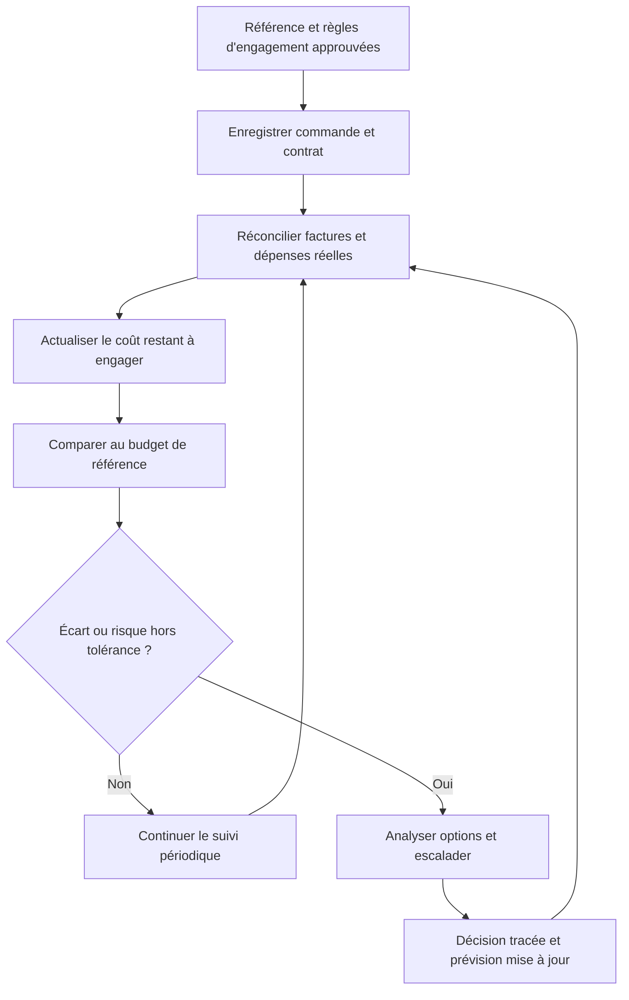

Le suivi régulier associe le responsable projet, les acheteurs et la fonction finance selon les pratiques internes. Il faut concilier commandes, factures, charges constatées, paiements lorsque pertinents, prévisions de consommation et travail restant. Le rapport explique les écarts et les actions décidées ; il ne se contente pas de montrer le solde restant au budget.

### Acceptation et apprentissage

Avant la clôture, les livrables sont comparés aux critères convenus, les défauts et risques résiduels sont documentés, les responsabilités d’exploitation sont transférées et le support est préparé. Les mesures de bénéfices ont un propriétaire et une échéance de suivi. La rétrospective décrit les faits, la cause des écarts, les adaptations utiles et les pratiques à conserver. Elle ne doit pas désigner des coupables : elle cherche à rendre le système de travail plus fiable et l’organisation plus apte à apprendre.

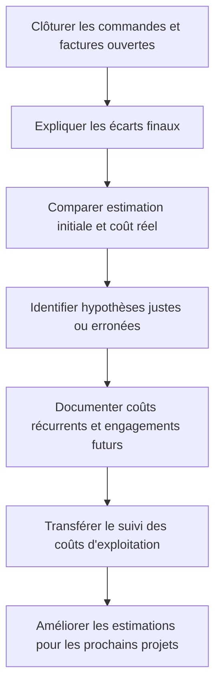

À la clôture, le coût final doit être expliqué avec ses écarts, ses réserves consommées et les coûts qui se poursuivront après le projet. Les contrats non terminés, garanties, licences, opérations de support et obligations de conservation peuvent générer des coûts futurs. La comparaison entre estimation et résultat sert à améliorer les modèles d’estimation et les hypothèses de risque.

## Atelier pratique

**Exercice 1.** À partir du cas, écris un plan de travail d’une page. Il doit comporter les résultats attendus, les dépendances majeures, les risques, les responsables, les indicateurs et les conditions d’acceptation.

**Correction.** Une bonne réponse relie chaque activité à un livrable, chaque livrable à un critère, chaque risque à un propriétaire et chaque décision à une autorité. Elle distingue les faits des hypothèses et rend visibles les dépendances qui peuvent déplacer la date ou le coût total.

**Exercice 2.** Le sponsor demande d’avancer la livraison de plusieurs semaines. Prépare trois options avec leurs effets sur le périmètre, la capacité, le risque, la qualité et le coût.

**Correction.** Il faut expliquer les compromis sans promettre une accélération qui n’est pas étayée. Réduire un périmètre non essentiel, augmenter les moyens avec des compétences réellement disponibles ou déplacer la date sont des options possibles. Les critères de sécurité et d’acceptation obligatoires ne doivent pas être supprimés pour rendre les indicateurs artificiellement positifs.

**Exercice 3.** Une tâche semble terminée, mais aucun test ni procès-verbal ne confirme le résultat. Quelle information dois-tu demander avant de déclarer le travail accepté ?

**Correction.** Il faut retrouver le critère attendu, le test ou la preuve équivalente, le responsable de validation et le statut des écarts. Une déclaration orale peut orienter la vérification, mais ne suffit pas lorsque la gouvernance exige une preuve traçable.

## Pièges à éviter

- Confondre activité, livraison et bénéfice.
- Présenter une estimation comme une certitude sans expliquer les hypothèses.
- Masquer un écart en modifiant la référence.
- Choisir une méthode parce qu’elle est populaire plutôt que adaptée.
- Surcharger l’équipe avec un outil qui ne soutient aucune décision utile.
- Faire dépendre un livrable d’une personne ou d’un fournisseur sans plan de secours.
- Reporter les tests et la sécurité à la toute fin.
- Laisser les responsabilités d’acceptation implicites.
- Confondre indicateurs d’activité et mesures de résultat.
- Fermer le projet sans transfert, support ni mesure ultérieure des bénéfices.

## Checklist de révision

- [ ] Le besoin et les résultats attendus sont explicites.
- [ ] Les inclusions et exclusions sont visibles.
- [ ] Les hypothèses, dépendances et risques sont suivis.
- [ ] Les personnes responsables et les décideurs sont identifiés.
- [ ] Le plan décrit des livrables vérifiables.
- [ ] Les indicateurs répondent à des questions de décision.
- [ ] Les changements sont analysés et autorisés.
- [ ] La qualité et la sécurité sont intégrées au travail.
- [ ] Le transfert aux opérations est préparé.
- [ ] Les retours d’expérience sont capitalisés.

## À retenir

Un dispositif de gestion de projet n’est pas un rituel administratif : il constitue un système partagé pour comprendre le travail, prendre des décisions, observer les résultats et adapter le plan. Il doit être assez rigoureux pour protéger la valeur, la qualité et la confiance, mais assez léger pour rester utilisé. Les pratiques les plus utiles sont celles qui rendent les hypothèses visibles, les responsabilités explicites et les décisions vérifiables.

## Glossaire

- **Baseline :** référence approuvée permettant de comparer réel et prévu.
- **Dépendance :** condition qui relie deux activités ou acteurs.
- **Jalon :** événement important marquant une validation ou un point de décision.
- **Livrable :** résultat concret pouvant être vérifié.
- **Marge :** délai disponible avant qu’un retard n’affecte une autre activité ou la fin du projet.
- **Périmètre :** limites du travail et des résultats inclus.
- **Prévision :** estimation mise à jour de l’issue probable.
- **Risque :** événement incertain pouvant affecter les objectifs.
- **Critère d’acceptation :** condition observable permettant d’accepter le résultat.
- **Réserve :** enveloppe ou marge prévue pour traiter une incertitude selon les règles du projet.

## Références pour approfondir

- ISO 21502, lignes directrices de management de projet : https://committee.iso.org/sites/tc258/home/projects/published/iso-21502.html
- PMI et référentiels de gestion de projet : https://www.pmi.org/
- Guide Scrum officiel : https://scrumguides.org/scrum-guide
- Tutoriels officiels Jira/Agile : https://www.atlassian.com/agile/tutorials/
