# Phases d'un projet (Initiation, Planification)

> **Encadré de mise en contexte** — Une équipe a reçu une demande de migration applicative sans dossier initial, sans définition du succès ni plan de validation partagé.

## Introduction

La gestion de projet IT consiste à organiser un changement technique et humain afin de produire un résultat utile dans un environnement où les besoins, les technologies, les contraintes de sécurité et les capacités évoluent. Elle ne se réduit ni à remplir un planning ni à surveiller les personnes. Elle relie une intention métier à des livrables vérifiables, à des décisions explicites et à une adoption effective. Le responsable du projet doit rendre les incertitudes visibles assez tôt pour que l’organisation puisse choisir en connaissance de cause.

Ce cours traite le sujet « Phases d'un projet (Initiation, Planification) » sous l’angle pratique. L’objectif n’est pas d’appliquer mécaniquement un modèle universel, mais de comprendre les principes, de reconnaître le contexte et de choisir une méthode proportionnée. Un projet réglementé, une migration d’infrastructure, un produit numérique en exploration et une amélioration interne n’ont pas les mêmes contraintes. Le bon dispositif de pilotage dépend du coût de l’erreur, de la stabilité du besoin, des dépendances, de la taille de l’équipe et de la fréquence à laquelle un résultat exploitable peut être livré.

Le fil rouge du cours est le cas « La migration de l’application RH ». Il permet de relier les concepts à une situation plausible, de formaliser les hypothèses, de raisonner sur les compromis et d’expliquer comment une décision sera contrôlée. Les exemples restent adaptables : les termes contractuels, les exigences de sécurité, le droit applicable et les règles internes doivent être confirmés dans chaque organisation avant une mise en œuvre réelle.

## Objectifs pédagogiques

À la fin de cette leçon, tu devrais pouvoir expliquer les concepts essentiels avec tes propres mots, choisir un outil ou une méthode en fonction d’un besoin concret, construire des preuves de progression, identifier les risques et communiquer une décision aux personnes concernées. Tu devrais également savoir reconnaître les situations où il faut interrompre le travail, solliciter un arbitrage ou réviser une hypothèse plutôt que masquer un écart.

- Définir les termes clés et distinguer les notions souvent confondues.
- Décrire une démarche reproductible et les livrables utiles.
- Relier chaque décision à une personne habilitée, une preuve et un critère.
- Détecter les signaux d’alerte avant qu’ils ne deviennent des incidents majeurs.
- Appliquer les concepts au cas fil rouge et expliquer les limites de la solution choisie.

## Concepts clés

**Résultat et livrable.** Un livrable est un élément produit et vérifiable : application, procédure, modèle, environnement, formation ou rapport. Le résultat décrit ce qui change grâce à ce livrable. Le bénéfice mesure l’amélioration obtenue dans la durée. La distinction évite de déclarer un projet réussi parce qu’un logiciel a été installé alors que personne ne l’utilise ou que le processus reste inefficace.

**Valeur et critères de succès.** La valeur doit être reliée à un besoin réel, à un bénéficiaire identifiable et à un effet attendu. Un objectif vague comme « moderniser le système » doit être traduit en résultats observables : réduction du délai, diminution d’erreurs, meilleure disponibilité, baisse d’un coût ou amélioration de l’expérience. Les indicateurs doivent être définis avant la livraison, avec une valeur de référence et un horizon de mesure.

**Périmètre et exigences.** Le périmètre définit ce que le projet prend en charge et ce qu’il ne prend pas en charge. Les exigences expriment les comportements attendus, les contraintes non fonctionnelles et les règles d’acceptation. Une demande nouvelle n’est pas automatiquement mauvaise, mais elle doit être analysée. Il faut décider si elle remplace une exigence, s’ajoute au périmètre, devient un lot ultérieur ou n’est pas retenue.

**Référence et prévision.** Une référence approuvée sert à mesurer l’écart ; une prévision décrit l’état le plus probable à partir de la situation connue. Une équipe peut conserver une baseline et prévoir une date différente sans manipuler les chiffres. Un écart n’est pas nécessairement une faute : l’absence d’explication, la répétition de surprises et la non-escalade des conséquences sont en revanche des problèmes de gouvernance.

**Gouvernance et transparence.** La gouvernance précise les rôles, les droits de décision, les seuils d’escalade et la manière de traiter les changements. Elle ne doit pas imposer une réunion de comité pour chaque détail. Les décisions fréquentes et réversibles peuvent être déléguées à l’équipe, alors que les décisions coûteuses, réglementaires ou difficiles à inverser exigent une autorité définie et une trace exploitable.

**Risque et incertitude.** Un risque est un événement incertain susceptible d’affecter les objectifs. Un problème est déjà survenu ; une hypothèse reste à confirmer ; une dépendance associe le projet à un acteur ou à un autre travail. Les confondre rend les plans moins utiles. Les risques doivent avoir des propriétaires, des signaux de déclenchement et des réponses proportionnées à leur probabilité et à leur impact.

**Qualité intégrée.** La qualité ne se vérifie pas uniquement à la fin. Elle se construit par des critères, des revues, des tests, des environnements de validation et des contrôles de sécurité adaptés. Un projet qui accélère en supprimant les tests obligatoires peut simplement déplacer son coût vers l’exploitation. Les critères d’acceptation doivent être compris par le métier et techniquement réalisables.

**Adoption et transition.** Une livraison réussie doit être exploitable, supportable et comprise. La transition inclut l’appropriation, les procédures, le support, les habilitations, la supervision, les sauvegardes, le retour arrière et la formation. Les bénéficiaires ne sont pas de simples destinataires d’un changement : leurs retours peuvent révéler des contraintes non identifiées et orienter l’ordre des priorités.

## Méthodologie et outils

La démarche de pilotage peut être prédictive lorsque les exigences sont relativement stables et qu’une planification détaillée est utile, adaptative lorsque le besoin est incertain et que l’apprentissage doit se faire par petits incréments, ou hybride lorsque des composants présentent des niveaux d’incertitude différents. Choisir une méthode ne dispense jamais de clarifier la valeur, les responsabilités, les risques, la qualité et les critères de décision.

Les outils sont au service d’une pratique, pas l’inverse. Un tableau peut rendre le travail visible, un diagramme de Gantt montrer les dépendances calendaires, un registre expliciter les risques et un journal de décisions préserver la mémoire des arbitrages. Aucun outil ne compense des données inexactes, un périmètre flou ou l’absence de responsable. Avant d’adopter un outil, définir les décisions qu’il doit soutenir et qui maintiendra les informations.

L’information doit être adaptée à son public. L’équipe a besoin de détails opérationnels et de blocages immédiats ; le sponsor a besoin des résultats, risques majeurs, options d’arbitrage et conséquences ; les utilisateurs ont besoin de connaître l’impact, les dates, les changements de processus et l’aide disponible. Une communication efficace associe un message compréhensible, un canal adapté, une fréquence raisonnable et une voie de retour.

Voici un modèle de raisonnement à utiliser pour chaque décision importante : constater la situation, vérifier les faits, comparer des options, évaluer les effets sur la valeur et les contraintes, désigner une personne habilitée, décider, consigner puis vérifier le résultat. Il évite les décisions prises uniquement sous pression et permet de revenir sur une hypothèse lorsque de nouvelles informations apparaissent.

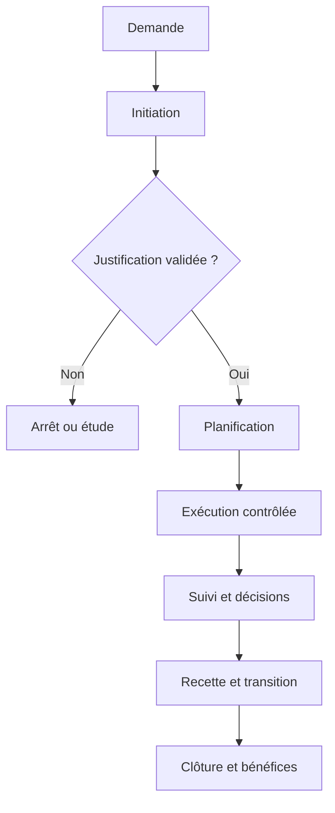

### 1. Initiation

**Comprendre le sujet.** Dans le cadre de « Phases d'un projet (Initiation, Planification) », initiation doit être traité comme un élément de décision et non comme une formalité isolée. L’initiation vérifie que le besoin mérite une réponse organisée et que des conditions minimales permettent d’engager la planification. La bonne pratique consiste à expliciter le but recherché, l’autorité concernée, les hypothèses encore ouvertes, les contraintes applicables et la preuve qui permettra de conclure. Sans cette explicitation, deux personnes peuvent utiliser les mêmes mots tout en poursuivant des résultats différents. Le responsable doit demander ce qui est attendu, pourquoi cela compte et quelle conséquence aurait une décision erronée.

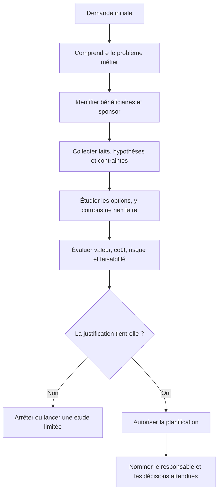

**Comment lire le schéma.** L’initiation n’est pas une planification détaillée miniature : elle sert à décider si l’organisation doit investir davantage. Son résultat est une décision explicite, assortie d’un responsable, d’une justification initiale et des questions qu’il reste à résoudre. Une réponse « pas encore » peut être professionnelle si elle définit les informations à obtenir et la date à laquelle la décision sera reprise.

**Relier le principe à l’ensemble du projet.** Un élément de gestion n’agit jamais seul. Il influence le périmètre, la date, le budget, la qualité, la charge et l’acceptation du résultat. Avant d’agir, vérifier les dépendances en amont et en aval, identifier les équipes qui seront touchées et repérer les décisions qui pourraient être difficiles à inverser. Une solution locale apparemment efficace peut créer une dette opérationnelle, un défaut de conformité ou un coût de support durable. Une décision solide rend ces effets visibles et explique les compromis.

**Application au terrain.** Une étude courte clarifie les risques de migration, les obligations de sécurité et l’échéance du support éditeur. Pour transformer cet exemple en action, commencer par écrire une description courte de la situation, puis distinguer les faits observés des hypothèses. Identifier un responsable, convenir d’un résultat attendu et fixer le moment où la preuve sera examinée. Si une information manque, créer une tâche d’investigation avec une échéance plutôt que présenter une supposition comme une certitude. Si plusieurs options sont acceptables, comparer explicitement leurs impacts, leurs coûts de réversibilité et leurs conséquences pour les utilisateurs.

**Déroulement recommandé.** Premièrement, recueillir les données utiles auprès des personnes les plus proches du travail. Deuxièmement, vérifier la cohérence des informations avec les documents déjà approuvés. Troisièmement, décrire les options réalistes et leurs limites. Quatrièmement, décider au niveau approprié, en précisant les seuils qui nécessiteraient une escalade. Cinquièmement, consigner la décision, informer les personnes concernées et suivre son effet. Cette séquence réduit les retours en arrière et rend la démarche reproductible, même si les outils ou l’organisation changent.

**Mesures et éléments de preuve.** Une affirmation telle que « le travail avance » doit être étayée par une preuve pertinente : un livrable relu, un test passé, une décision approuvée, une dépendance levée, une mesure comparée à sa référence ou un utilisateur ayant réalisé une tâche. Choisir un indicateur directement relié à l’objectif et préciser sa source, sa fréquence, son propriétaire et ses limites. Les indicateurs quantitatifs gagnent à être complétés par une observation qualitative, particulièrement lorsqu’il est question d’adoption, de satisfaction ou de risque humain.

**Signaux d’alerte et correction.** Les signaux typiques sont une définition contradictoire, une décision repoussée sans propriétaire, des changements non évalués, une preuve difficile à retrouver, une estimation donnée sans hypothèse ou un résultat déclaré acceptable sans critères. Face à ces signaux, ne pas multiplier les tableaux ni demander une mise à jour cosmétique. Revenir au besoin, vérifier les faits, attribuer la responsabilité manquante et réduire le problème à une décision explicite. Si l’impact dépasse la délégation prévue, alerter rapidement avec des options et une recommandation argumentée.

**Approfondissement.** Pour les projets à forte criticité, la rigueur doit augmenter avec le coût d’une erreur : revue indépendante, approbation formelle, contrôle des accès, traçabilité renforcée ou répétition en environnement représentatif. Pour un petit projet réversible, la même intention peut être satisfaite par un contrôle plus léger. Le principe est de calibrer les pratiques sans abolir les contrôles essentiels. À chaque étape, demander : « Quelle preuve rend cette décision défendable, qui peut l’accepter et qu’est-ce qui nous ferait changer d’avis ? »

### 2. Business case

**Comprendre le sujet.** Dans le cadre de « Phases d'un projet (Initiation, Planification) », business case doit être traité comme un élément de décision et non comme une formalité isolée. La justification compare bénéfices, coûts, risques et options, y compris l’option de ne pas lancer le projet. La bonne pratique consiste à expliciter le but recherché, l’autorité concernée, les hypothèses encore ouvertes, les contraintes applicables et la preuve qui permettra de conclure. Sans cette explicitation, deux personnes peuvent utiliser les mêmes mots tout en poursuivant des résultats différents. Le responsable doit demander ce qui est attendu, pourquoi cela compte et quelle conséquence aurait une décision erronée.

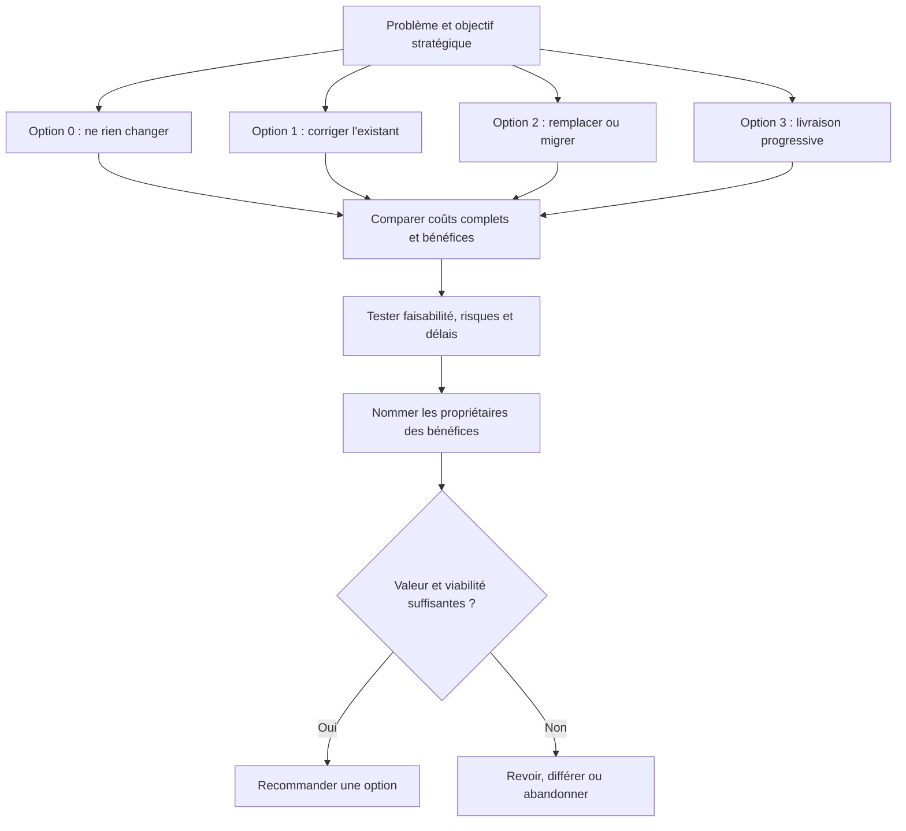

Le business case compare de vraies options, y compris le statu quo. Le coût complet comprend notamment la migration, les licences, la sécurité, la formation, le support, l’exploitation, la sortie du fournisseur et le coût des interruptions. Un bénéfice doit avoir un propriétaire, une mesure de départ, une cible et une date d’observation ; sinon, il reste une promesse non vérifiable.

**Relier le principe à l’ensemble du projet.** Un élément de gestion n’agit jamais seul. Il influence le périmètre, la date, le budget, la qualité, la charge et l’acceptation du résultat. Avant d’agir, vérifier les dépendances en amont et en aval, identifier les équipes qui seront touchées et repérer les décisions qui pourraient être difficiles à inverser. Une solution locale apparemment efficace peut créer une dette opérationnelle, un défaut de conformité ou un coût de support durable. Une décision solide rend ces effets visibles et explique les compromis.

**Application au terrain.** La migration peut être comparée à une mise à niveau temporaire, à un remplacement du produit ou à un maintien risqué. Pour transformer cet exemple en action, commencer par écrire une description courte de la situation, puis distinguer les faits observés des hypothèses. Identifier un responsable, convenir d’un résultat attendu et fixer le moment où la preuve sera examinée. Si une information manque, créer une tâche d’investigation avec une échéance plutôt que présenter une supposition comme une certitude. Si plusieurs options sont acceptables, comparer explicitement leurs impacts, leurs coûts de réversibilité et leurs conséquences pour les utilisateurs.

**Déroulement recommandé.** Premièrement, recueillir les données utiles auprès des personnes les plus proches du travail. Deuxièmement, vérifier la cohérence des informations avec les documents déjà approuvés. Troisièmement, décrire les options réalistes et leurs limites. Quatrièmement, décider au niveau approprié, en précisant les seuils qui nécessiteraient une escalade. Cinquièmement, consigner la décision, informer les personnes concernées et suivre son effet. Cette séquence réduit les retours en arrière et rend la démarche reproductible, même si les outils ou l’organisation changent.

**Mesures et éléments de preuve.** Une affirmation telle que « le travail avance » doit être étayée par une preuve pertinente : un livrable relu, un test passé, une décision approuvée, une dépendance levée, une mesure comparée à sa référence ou un utilisateur ayant réalisé une tâche. Choisir un indicateur directement relié à l’objectif et préciser sa source, sa fréquence, son propriétaire et ses limites. Les indicateurs quantitatifs gagnent à être complétés par une observation qualitative, particulièrement lorsqu’il est question d’adoption, de satisfaction ou de risque humain.

**Signaux d’alerte et correction.** Les signaux typiques sont une définition contradictoire, une décision repoussée sans propriétaire, des changements non évalués, une preuve difficile à retrouver, une estimation donnée sans hypothèse ou un résultat déclaré acceptable sans critères. Face à ces signaux, ne pas multiplier les tableaux ni demander une mise à jour cosmétique. Revenir au besoin, vérifier les faits, attribuer la responsabilité manquante et réduire le problème à une décision explicite. Si l’impact dépasse la délégation prévue, alerter rapidement avec des options et une recommandation argumentée.

**Approfondissement.** Pour les projets à forte criticité, la rigueur doit augmenter avec le coût d’une erreur : revue indépendante, approbation formelle, contrôle des accès, traçabilité renforcée ou répétition en environnement représentatif. Pour un petit projet réversible, la même intention peut être satisfaite par un contrôle plus léger. Le principe est de calibrer les pratiques sans abolir les contrôles essentiels. À chaque étape, demander : « Quelle preuve rend cette décision défendable, qui peut l’accepter et qu’est-ce qui nous ferait changer d’avis ? »

### 3. Charte de projet

**Comprendre le sujet.** Dans le cadre de « Phases d'un projet (Initiation, Planification) », charte de projet doit être traité comme un élément de décision et non comme une formalité isolée. La charte autorise le projet, nomme les responsables et fixe l’objectif, les contraintes majeures et les limites initiales. La bonne pratique consiste à expliciter le but recherché, l’autorité concernée, les hypothèses encore ouvertes, les contraintes applicables et la preuve qui permettra de conclure. Sans cette explicitation, deux personnes peuvent utiliser les mêmes mots tout en poursuivant des résultats différents. Le responsable doit demander ce qui est attendu, pourquoi cela compte et quelle conséquence aurait une décision erronée.

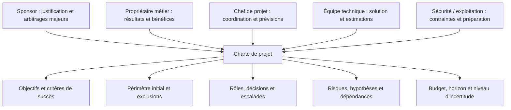

La charte rassemble les éléments de référence nécessaires pour commencer à organiser le travail, sans prétendre remplacer tous les plans détaillés. Elle autorise le projet selon les règles de l’organisation et précise ce qui pourra être décidé par le chef de projet, ce qui exige le sponsor et ce qui relève d’une validation spécialisée. Les limites de la délégation doivent être écrites, pas seulement supposées.

**Relier le principe à l’ensemble du projet.** Un élément de gestion n’agit jamais seul. Il influence le périmètre, la date, le budget, la qualité, la charge et l’acceptation du résultat. Avant d’agir, vérifier les dépendances en amont et en aval, identifier les équipes qui seront touchées et repérer les décisions qui pourraient être difficiles à inverser. Une solution locale apparemment efficace peut créer une dette opérationnelle, un défaut de conformité ou un coût de support durable. Une décision solide rend ces effets visibles et explique les compromis.

**Application au terrain.** La charte identifie le sponsor, le chef de projet, l’enveloppe d’étude et l’instance d’arbitrage. Pour transformer cet exemple en action, commencer par écrire une description courte de la situation, puis distinguer les faits observés des hypothèses. Identifier un responsable, convenir d’un résultat attendu et fixer le moment où la preuve sera examinée. Si une information manque, créer une tâche d’investigation avec une échéance plutôt que présenter une supposition comme une certitude. Si plusieurs options sont acceptables, comparer explicitement leurs impacts, leurs coûts de réversibilité et leurs conséquences pour les utilisateurs.

**Déroulement recommandé.** Premièrement, recueillir les données utiles auprès des personnes les plus proches du travail. Deuxièmement, vérifier la cohérence des informations avec les documents déjà approuvés. Troisièmement, décrire les options réalistes et leurs limites. Quatrièmement, décider au niveau approprié, en précisant les seuils qui nécessiteraient une escalade. Cinquièmement, consigner la décision, informer les personnes concernées et suivre son effet. Cette séquence réduit les retours en arrière et rend la démarche reproductible, même si les outils ou l’organisation changent.

**Mesures et éléments de preuve.** Une affirmation telle que « le travail avance » doit être étayée par une preuve pertinente : un livrable relu, un test passé, une décision approuvée, une dépendance levée, une mesure comparée à sa référence ou un utilisateur ayant réalisé une tâche. Choisir un indicateur directement relié à l’objectif et préciser sa source, sa fréquence, son propriétaire et ses limites. Les indicateurs quantitatifs gagnent à être complétés par une observation qualitative, particulièrement lorsqu’il est question d’adoption, de satisfaction ou de risque humain.

**Signaux d’alerte et correction.** Les signaux typiques sont une définition contradictoire, une décision repoussée sans propriétaire, des changements non évalués, une preuve difficile à retrouver, une estimation donnée sans hypothèse ou un résultat déclaré acceptable sans critères. Face à ces signaux, ne pas multiplier les tableaux ni demander une mise à jour cosmétique. Revenir au besoin, vérifier les faits, attribuer la responsabilité manquante et réduire le problème à une décision explicite. Si l’impact dépasse la délégation prévue, alerter rapidement avec des options et une recommandation argumentée.

**Approfondissement.** Pour les projets à forte criticité, la rigueur doit augmenter avec le coût d’une erreur : revue indépendante, approbation formelle, contrôle des accès, traçabilité renforcée ou répétition en environnement représentatif. Pour un petit projet réversible, la même intention peut être satisfaite par un contrôle plus léger. Le principe est de calibrer les pratiques sans abolir les contrôles essentiels. À chaque étape, demander : « Quelle preuve rend cette décision défendable, qui peut l’accepter et qu’est-ce qui nous ferait changer d’avis ? »

### 4. Périmètre préliminaire

**Comprendre le sujet.** Dans le cadre de « Phases d'un projet (Initiation, Planification) », périmètre préliminaire doit être traité comme un élément de décision et non comme une formalité isolée. Le périmètre initial précise les inclusions, exclusions, limites et critères de réussite à confirmer pendant la planification. La bonne pratique consiste à expliciter le but recherché, l’autorité concernée, les hypothèses encore ouvertes, les contraintes applicables et la preuve qui permettra de conclure. Sans cette explicitation, deux personnes peuvent utiliser les mêmes mots tout en poursuivant des résultats différents. Le responsable doit demander ce qui est attendu, pourquoi cela compte et quelle conséquence aurait une décision erronée.

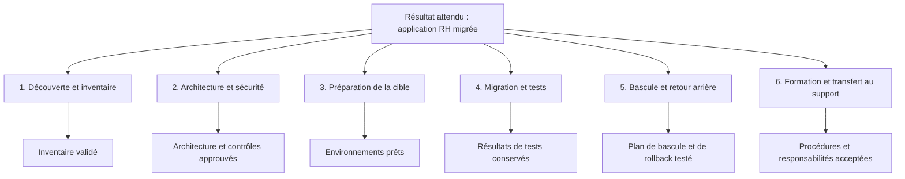

Cette décomposition hiérarchique du travail (WBS ou structure de découpage) transforme une intention générale en lots et livrables contrôlables. Elle décrit les résultats à produire, pas uniquement une succession de réunions. Chaque lot doit être assez clair pour estimer l’effort, attribuer un responsable et définir une preuve d’achèvement. Le dictionnaire WBS complète le dessin lorsque le nom d’un lot pourrait être interprété de plusieurs façons.

**Relier le principe à l’ensemble du projet.** Un élément de gestion n’agit jamais seul. Il influence le périmètre, la date, le budget, la qualité, la charge et l’acceptation du résultat. Avant d’agir, vérifier les dépendances en amont et en aval, identifier les équipes qui seront touchées et repérer les décisions qui pourraient être difficiles à inverser. Une solution locale apparemment efficace peut créer une dette opérationnelle, un défaut de conformité ou un coût de support durable. Une décision solide rend ces effets visibles et explique les compromis.

**Application au terrain.** La migration inclut les données RH et les interfaces critiques, mais exclut une refonte ergonomique complète. Pour transformer cet exemple en action, commencer par écrire une description courte de la situation, puis distinguer les faits observés des hypothèses. Identifier un responsable, convenir d’un résultat attendu et fixer le moment où la preuve sera examinée. Si une information manque, créer une tâche d’investigation avec une échéance plutôt que présenter une supposition comme une certitude. Si plusieurs options sont acceptables, comparer explicitement leurs impacts, leurs coûts de réversibilité et leurs conséquences pour les utilisateurs.

**Déroulement recommandé.** Premièrement, recueillir les données utiles auprès des personnes les plus proches du travail. Deuxièmement, vérifier la cohérence des informations avec les documents déjà approuvés. Troisièmement, décrire les options réalistes et leurs limites. Quatrièmement, décider au niveau approprié, en précisant les seuils qui nécessiteraient une escalade. Cinquièmement, consigner la décision, informer les personnes concernées et suivre son effet. Cette séquence réduit les retours en arrière et rend la démarche reproductible, même si les outils ou l’organisation changent.

**Mesures et éléments de preuve.** Une affirmation telle que « le travail avance » doit être étayée par une preuve pertinente : un livrable relu, un test passé, une décision approuvée, une dépendance levée, une mesure comparée à sa référence ou un utilisateur ayant réalisé une tâche. Choisir un indicateur directement relié à l’objectif et préciser sa source, sa fréquence, son propriétaire et ses limites. Les indicateurs quantitatifs gagnent à être complétés par une observation qualitative, particulièrement lorsqu’il est question d’adoption, de satisfaction ou de risque humain.

**Signaux d’alerte et correction.** Les signaux typiques sont une définition contradictoire, une décision repoussée sans propriétaire, des changements non évalués, une preuve difficile à retrouver, une estimation donnée sans hypothèse ou un résultat déclaré acceptable sans critères. Face à ces signaux, ne pas multiplier les tableaux ni demander une mise à jour cosmétique. Revenir au besoin, vérifier les faits, attribuer la responsabilité manquante et réduire le problème à une décision explicite. Si l’impact dépasse la délégation prévue, alerter rapidement avec des options et une recommandation argumentée.

**Approfondissement.** Pour les projets à forte criticité, la rigueur doit augmenter avec le coût d’une erreur : revue indépendante, approbation formelle, contrôle des accès, traçabilité renforcée ou répétition en environnement représentatif. Pour un petit projet réversible, la même intention peut être satisfaite par un contrôle plus léger. Le principe est de calibrer les pratiques sans abolir les contrôles essentiels. À chaque étape, demander : « Quelle preuve rend cette décision défendable, qui peut l’accepter et qu’est-ce qui nous ferait changer d’avis ? »

### 5. Décomposition du travail

**Comprendre le sujet.** Dans le cadre de « Phases d'un projet (Initiation, Planification) », décomposition du travail doit être traité comme un élément de décision et non comme une formalité isolée. La structure de découpage organise les livrables et le travail en éléments contrôlables plutôt qu’en liste de souhaits. La bonne pratique consiste à expliciter le but recherché, l’autorité concernée, les hypothèses encore ouvertes, les contraintes applicables et la preuve qui permettra de conclure. Sans cette explicitation, deux personnes peuvent utiliser les mêmes mots tout en poursuivant des résultats différents. Le responsable doit demander ce qui est attendu, pourquoi cela compte et quelle conséquence aurait une décision erronée.

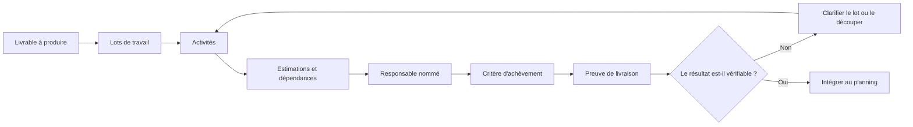

Une bonne décomposition a une couverture suffisante : le travail requis pour produire, vérifier, sécuriser, déployer, former et transférer la solution ne doit pas être invisible. Elle évite aussi le découpage excessif qui rend le plan coûteux à maintenir. Une tâche est prête à être planifiée quand son résultat attendu, son responsable, ses dépendances et son critère de terminaison sont compris.

**Relier le principe à l’ensemble du projet.** Un élément de gestion n’agit jamais seul. Il influence le périmètre, la date, le budget, la qualité, la charge et l’acceptation du résultat. Avant d’agir, vérifier les dépendances en amont et en aval, identifier les équipes qui seront touchées et repérer les décisions qui pourraient être difficiles à inverser. Une solution locale apparemment efficace peut créer une dette opérationnelle, un défaut de conformité ou un coût de support durable. Une décision solide rend ces effets visibles et explique les compromis.

**Application au terrain.** Les lots couvrent inventaire, environnement cible, migration pilote, tests, formation et mise en production. Pour transformer cet exemple en action, commencer par écrire une description courte de la situation, puis distinguer les faits observés des hypothèses. Identifier un responsable, convenir d’un résultat attendu et fixer le moment où la preuve sera examinée. Si une information manque, créer une tâche d’investigation avec une échéance plutôt que présenter une supposition comme une certitude. Si plusieurs options sont acceptables, comparer explicitement leurs impacts, leurs coûts de réversibilité et leurs conséquences pour les utilisateurs.

**Déroulement recommandé.** Premièrement, recueillir les données utiles auprès des personnes les plus proches du travail. Deuxièmement, vérifier la cohérence des informations avec les documents déjà approuvés. Troisièmement, décrire les options réalistes et leurs limites. Quatrièmement, décider au niveau approprié, en précisant les seuils qui nécessiteraient une escalade. Cinquièmement, consigner la décision, informer les personnes concernées et suivre son effet. Cette séquence réduit les retours en arrière et rend la démarche reproductible, même si les outils ou l’organisation changent.

**Mesures et éléments de preuve.** Une affirmation telle que « le travail avance » doit être étayée par une preuve pertinente : un livrable relu, un test passé, une décision approuvée, une dépendance levée, une mesure comparée à sa référence ou un utilisateur ayant réalisé une tâche. Choisir un indicateur directement relié à l’objectif et préciser sa source, sa fréquence, son propriétaire et ses limites. Les indicateurs quantitatifs gagnent à être complétés par une observation qualitative, particulièrement lorsqu’il est question d’adoption, de satisfaction ou de risque humain.

**Signaux d’alerte et correction.** Les signaux typiques sont une définition contradictoire, une décision repoussée sans propriétaire, des changements non évalués, une preuve difficile à retrouver, une estimation donnée sans hypothèse ou un résultat déclaré acceptable sans critères. Face à ces signaux, ne pas multiplier les tableaux ni demander une mise à jour cosmétique. Revenir au besoin, vérifier les faits, attribuer la responsabilité manquante et réduire le problème à une décision explicite. Si l’impact dépasse la délégation prévue, alerter rapidement avec des options et une recommandation argumentée.

**Approfondissement.** Pour les projets à forte criticité, la rigueur doit augmenter avec le coût d’une erreur : revue indépendante, approbation formelle, contrôle des accès, traçabilité renforcée ou répétition en environnement représentatif. Pour un petit projet réversible, la même intention peut être satisfaite par un contrôle plus léger. Le principe est de calibrer les pratiques sans abolir les contrôles essentiels. À chaque étape, demander : « Quelle preuve rend cette décision défendable, qui peut l’accepter et qu’est-ce qui nous ferait changer d’avis ? »

### 6. Estimation des tâches

**Comprendre le sujet.** Dans le cadre de « Phases d'un projet (Initiation, Planification) », estimation des tâches doit être traité comme un élément de décision et non comme une formalité isolée. Les estimations s’appuient sur des hypothèses, des données comparables, des experts et une fourchette d’incertitude. La bonne pratique consiste à expliciter le but recherché, l’autorité concernée, les hypothèses encore ouvertes, les contraintes applicables et la preuve qui permettra de conclure. Sans cette explicitation, deux personnes peuvent utiliser les mêmes mots tout en poursuivant des résultats différents. Le responsable doit demander ce qui est attendu, pourquoi cela compte et quelle conséquence aurait une décision erronée.

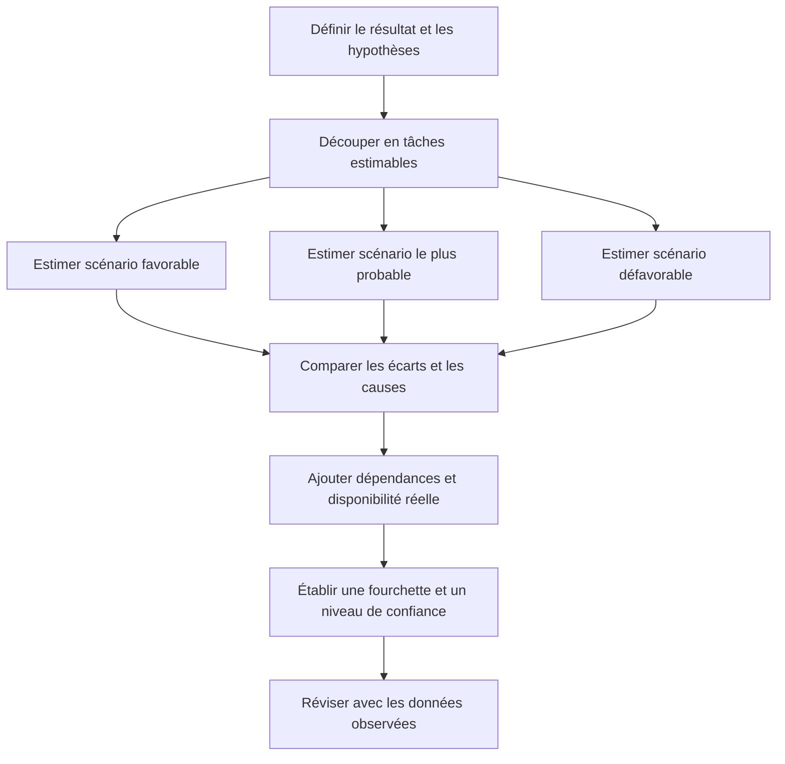

Lorsque l’incertitude est importante, une fourchette est plus honnête qu’un nombre présenté comme certain. Les estimations doivent distinguer la durée calendaire de l’effort : trois jours de travail répartis entre des personnes partiellement disponibles peuvent prendre deux semaines. Les hypothèses, les exclusions, les risques et la disponibilité des experts font partie de l’estimation et doivent être conservés.

**Relier le principe à l’ensemble du projet.** Un élément de gestion n’agit jamais seul. Il influence le périmètre, la date, le budget, la qualité, la charge et l’acceptation du résultat. Avant d’agir, vérifier les dépendances en amont et en aval, identifier les équipes qui seront touchées et repérer les décisions qui pourraient être difficiles à inverser. Une solution locale apparemment efficace peut créer une dette opérationnelle, un défaut de conformité ou un coût de support durable. Une décision solide rend ces effets visibles et explique les compromis.

**Application au terrain.** L’équipe distingue le temps d’exécution des tâches, les délais d’approbation et le temps d’attente d’un fournisseur. Pour transformer cet exemple en action, commencer par écrire une description courte de la situation, puis distinguer les faits observés des hypothèses. Identifier un responsable, convenir d’un résultat attendu et fixer le moment où la preuve sera examinée. Si une information manque, créer une tâche d’investigation avec une échéance plutôt que présenter une supposition comme une certitude. Si plusieurs options sont acceptables, comparer explicitement leurs impacts, leurs coûts de réversibilité et leurs conséquences pour les utilisateurs.

**Déroulement recommandé.** Premièrement, recueillir les données utiles auprès des personnes les plus proches du travail. Deuxièmement, vérifier la cohérence des informations avec les documents déjà approuvés. Troisièmement, décrire les options réalistes et leurs limites. Quatrièmement, décider au niveau approprié, en précisant les seuils qui nécessiteraient une escalade. Cinquièmement, consigner la décision, informer les personnes concernées et suivre son effet. Cette séquence réduit les retours en arrière et rend la démarche reproductible, même si les outils ou l’organisation changent.

**Mesures et éléments de preuve.** Une affirmation telle que « le travail avance » doit être étayée par une preuve pertinente : un livrable relu, un test passé, une décision approuvée, une dépendance levée, une mesure comparée à sa référence ou un utilisateur ayant réalisé une tâche. Choisir un indicateur directement relié à l’objectif et préciser sa source, sa fréquence, son propriétaire et ses limites. Les indicateurs quantitatifs gagnent à être complétés par une observation qualitative, particulièrement lorsqu’il est question d’adoption, de satisfaction ou de risque humain.

**Signaux d’alerte et correction.** Les signaux typiques sont une définition contradictoire, une décision repoussée sans propriétaire, des changements non évalués, une preuve difficile à retrouver, une estimation donnée sans hypothèse ou un résultat déclaré acceptable sans critères. Face à ces signaux, ne pas multiplier les tableaux ni demander une mise à jour cosmétique. Revenir au besoin, vérifier les faits, attribuer la responsabilité manquante et réduire le problème à une décision explicite. Si l’impact dépasse la délégation prévue, alerter rapidement avec des options et une recommandation argumentée.

**Approfondissement.** Pour les projets à forte criticité, la rigueur doit augmenter avec le coût d’une erreur : revue indépendante, approbation formelle, contrôle des accès, traçabilité renforcée ou répétition en environnement représentatif. Pour un petit projet réversible, la même intention peut être satisfaite par un contrôle plus léger. Le principe est de calibrer les pratiques sans abolir les contrôles essentiels. À chaque étape, demander : « Quelle preuve rend cette décision défendable, qui peut l’accepter et qu’est-ce qui nous ferait changer d’avis ? »

### 7. Dépendances et chemin critique

**Comprendre le sujet.** Dans le cadre de « Phases d'un projet (Initiation, Planification) », dépendances et chemin critique doit être traité comme un élément de décision et non comme une formalité isolée. Les dépendances déterminent l’ordre possible du travail ; le chemin critique relie les tâches sans marge totale disponible. La bonne pratique consiste à expliciter le but recherché, l’autorité concernée, les hypothèses encore ouvertes, les contraintes applicables et la preuve qui permettra de conclure. Sans cette explicitation, deux personnes peuvent utiliser les mêmes mots tout en poursuivant des résultats différents. Le responsable doit demander ce qui est attendu, pourquoi cela compte et quelle conséquence aurait une décision erronée.

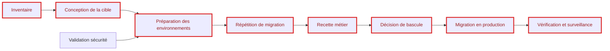

Le schéma montre un exemple de dépendances, pas un calcul universel du chemin critique : les durées doivent être ajoutées puis analysées pour identifier les séquences qui déterminent la date de fin. Une tâche de sécurité ou une validation fournisseur peut devenir critique même si son effort est court. La marge ne doit pas être consommée sans comprendre l’effet sur les activités suivantes. Toute dépendance externe importante mérite un propriétaire, une date de confirmation et un scénario de repli.

**Relier le principe à l’ensemble du projet.** Un élément de gestion n’agit jamais seul. Il influence le périmètre, la date, le budget, la qualité, la charge et l’acceptation du résultat. Avant d’agir, vérifier les dépendances en amont et en aval, identifier les équipes qui seront touchées et repérer les décisions qui pourraient être difficiles à inverser. Une solution locale apparemment efficace peut créer une dette opérationnelle, un défaut de conformité ou un coût de support durable. Une décision solide rend ces effets visibles et explique les compromis.

**Application au terrain.** La validation du modèle de données doit précéder la répétition générale de migration et conditionne la date de bascule. Pour transformer cet exemple en action, commencer par écrire une description courte de la situation, puis distinguer les faits observés des hypothèses. Identifier un responsable, convenir d’un résultat attendu et fixer le moment où la preuve sera examinée. Si une information manque, créer une tâche d’investigation avec une échéance plutôt que présenter une supposition comme une certitude. Si plusieurs options sont acceptables, comparer explicitement leurs impacts, leurs coûts de réversibilité et leurs conséquences pour les utilisateurs.

**Déroulement recommandé.** Premièrement, recueillir les données utiles auprès des personnes les plus proches du travail. Deuxièmement, vérifier la cohérence des informations avec les documents déjà approuvés. Troisièmement, décrire les options réalistes et leurs limites. Quatrièmement, décider au niveau approprié, en précisant les seuils qui nécessiteraient une escalade. Cinquièmement, consigner la décision, informer les personnes concernées et suivre son effet. Cette séquence réduit les retours en arrière et rend la démarche reproductible, même si les outils ou l’organisation changent.

**Mesures et éléments de preuve.** Une affirmation telle que « le travail avance » doit être étayée par une preuve pertinente : un livrable relu, un test passé, une décision approuvée, une dépendance levée, une mesure comparée à sa référence ou un utilisateur ayant réalisé une tâche. Choisir un indicateur directement relié à l’objectif et préciser sa source, sa fréquence, son propriétaire et ses limites. Les indicateurs quantitatifs gagnent à être complétés par une observation qualitative, particulièrement lorsqu’il est question d’adoption, de satisfaction ou de risque humain.

**Signaux d’alerte et correction.** Les signaux typiques sont une définition contradictoire, une décision repoussée sans propriétaire, des changements non évalués, une preuve difficile à retrouver, une estimation donnée sans hypothèse ou un résultat déclaré acceptable sans critères. Face à ces signaux, ne pas multiplier les tableaux ni demander une mise à jour cosmétique. Revenir au besoin, vérifier les faits, attribuer la responsabilité manquante et réduire le problème à une décision explicite. Si l’impact dépasse la délégation prévue, alerter rapidement avec des options et une recommandation argumentée.

**Approfondissement.** Pour les projets à forte criticité, la rigueur doit augmenter avec le coût d’une erreur : revue indépendante, approbation formelle, contrôle des accès, traçabilité renforcée ou répétition en environnement représentatif. Pour un petit projet réversible, la même intention peut être satisfaite par un contrôle plus léger. Le principe est de calibrer les pratiques sans abolir les contrôles essentiels. À chaque étape, demander : « Quelle preuve rend cette décision défendable, qui peut l’accepter et qu’est-ce qui nous ferait changer d’avis ? »

### 8. Plan de ressources

**Comprendre le sujet.** Dans le cadre de « Phases d'un projet (Initiation, Planification) », plan de ressources doit être traité comme un élément de décision et non comme une formalité isolée. Le plan vérifie disponibilité, compétences, calendriers, fournisseurs et arbitrages de capacité. La bonne pratique consiste à expliciter le but recherché, l’autorité concernée, les hypothèses encore ouvertes, les contraintes applicables et la preuve qui permettra de conclure. Sans cette explicitation, deux personnes peuvent utiliser les mêmes mots tout en poursuivant des résultats différents. Le responsable doit demander ce qui est attendu, pourquoi cela compte et quelle conséquence aurait une décision erronée.

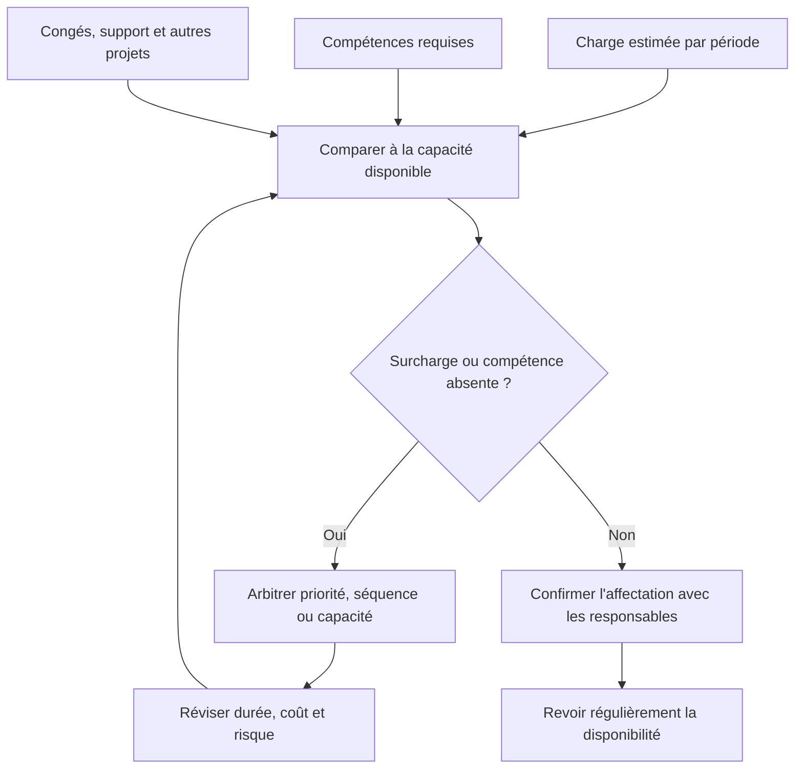

La capacité théorique n’est pas la capacité réellement disponible. Les interruptions de production, astreintes, congés, revues de sécurité et autres engagements doivent être inclus. Une personne affectée à 50 % ne fournit pas automatiquement la moitié de sa capacité chaque jour si les tâches exigent une continuité. Quand une ressource est rare, arbitrer les priorités et la séquence est souvent plus réaliste que supposer qu’elle fera tout en parallèle.

**Relier le principe à l’ensemble du projet.** Un élément de gestion n’agit jamais seul. Il influence le périmètre, la date, le budget, la qualité, la charge et l’acceptation du résultat. Avant d’agir, vérifier les dépendances en amont et en aval, identifier les équipes qui seront touchées et repérer les décisions qui pourraient être difficiles à inverser. Une solution locale apparemment efficace peut créer une dette opérationnelle, un défaut de conformité ou un coût de support durable. Une décision solide rend ces effets visibles et explique les compromis.

**Application au terrain.** Le même DBA ne peut pas réaliser la migration et assurer seul l’exploitation pendant la fenêtre de bascule. Pour transformer cet exemple en action, commencer par écrire une description courte de la situation, puis distinguer les faits observés des hypothèses. Identifier un responsable, convenir d’un résultat attendu et fixer le moment où la preuve sera examinée. Si une information manque, créer une tâche d’investigation avec une échéance plutôt que présenter une supposition comme une certitude. Si plusieurs options sont acceptables, comparer explicitement leurs impacts, leurs coûts de réversibilité et leurs conséquences pour les utilisateurs.

**Déroulement recommandé.** Premièrement, recueillir les données utiles auprès des personnes les plus proches du travail. Deuxièmement, vérifier la cohérence des informations avec les documents déjà approuvés. Troisièmement, décrire les options réalistes et leurs limites. Quatrièmement, décider au niveau approprié, en précisant les seuils qui nécessiteraient une escalade. Cinquièmement, consigner la décision, informer les personnes concernées et suivre son effet. Cette séquence réduit les retours en arrière et rend la démarche reproductible, même si les outils ou l’organisation changent.

**Mesures et éléments de preuve.** Une affirmation telle que « le travail avance » doit être étayée par une preuve pertinente : un livrable relu, un test passé, une décision approuvée, une dépendance levée, une mesure comparée à sa référence ou un utilisateur ayant réalisé une tâche. Choisir un indicateur directement relié à l’objectif et préciser sa source, sa fréquence, son propriétaire et ses limites. Les indicateurs quantitatifs gagnent à être complétés par une observation qualitative, particulièrement lorsqu’il est question d’adoption, de satisfaction ou de risque humain.

**Signaux d’alerte et correction.** Les signaux typiques sont une définition contradictoire, une décision repoussée sans propriétaire, des changements non évalués, une preuve difficile à retrouver, une estimation donnée sans hypothèse ou un résultat déclaré acceptable sans critères. Face à ces signaux, ne pas multiplier les tableaux ni demander une mise à jour cosmétique. Revenir au besoin, vérifier les faits, attribuer la responsabilité manquante et réduire le problème à une décision explicite. Si l’impact dépasse la délégation prévue, alerter rapidement avec des options et une recommandation argumentée.

**Approfondissement.** Pour les projets à forte criticité, la rigueur doit augmenter avec le coût d’une erreur : revue indépendante, approbation formelle, contrôle des accès, traçabilité renforcée ou répétition en environnement représentatif. Pour un petit projet réversible, la même intention peut être satisfaite par un contrôle plus léger. Le principe est de calibrer les pratiques sans abolir les contrôles essentiels. À chaque étape, demander : « Quelle preuve rend cette décision défendable, qui peut l’accepter et qu’est-ce qui nous ferait changer d’avis ? »

### 9. Plan de qualité

**Comprendre le sujet.** Dans le cadre de « Phases d'un projet (Initiation, Planification) », plan de qualité doit être traité comme un élément de décision et non comme une formalité isolée. Le plan de qualité transforme les attentes en critères testables, méthodes de preuve, responsabilités et points de contrôle. La bonne pratique consiste à expliciter le but recherché, l’autorité concernée, les hypothèses encore ouvertes, les contraintes applicables et la preuve qui permettra de conclure. Sans cette explicitation, deux personnes peuvent utiliser les mêmes mots tout en poursuivant des résultats différents. Le responsable doit demander ce qui est attendu, pourquoi cela compte et quelle conséquence aurait une décision erronée.

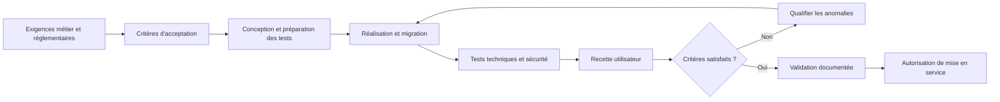

La qualité doit être planifiée avant la réalisation. Chaque exigence importante doit avoir un moyen de vérification, un propriétaire et une preuve acceptable. Des tests techniques réussis ne remplacent pas la recette métier ; de même, une recette fonctionnelle ne prouve pas à elle seule que les accès, la restauration, la performance et la sécurité sont maîtrisés. Les critères obligatoires ne doivent pas être effacés pour rendre la date de livraison artificiellement favorable.

**Relier le principe à l’ensemble du projet.** Un élément de gestion n’agit jamais seul. Il influence le périmètre, la date, le budget, la qualité, la charge et l’acceptation du résultat. Avant d’agir, vérifier les dépendances en amont et en aval, identifier les équipes qui seront touchées et repérer les décisions qui pourraient être difficiles à inverser. Une solution locale apparemment efficace peut créer une dette opérationnelle, un défaut de conformité ou un coût de support durable. Une décision solide rend ces effets visibles et explique les compromis.

**Application au terrain.** Chaque lot de données est rapproché du total source et cible selon des règles définies avant le transfert. Pour transformer cet exemple en action, commencer par écrire une description courte de la situation, puis distinguer les faits observés des hypothèses. Identifier un responsable, convenir d’un résultat attendu et fixer le moment où la preuve sera examinée. Si une information manque, créer une tâche d’investigation avec une échéance plutôt que présenter une supposition comme une certitude. Si plusieurs options sont acceptables, comparer explicitement leurs impacts, leurs coûts de réversibilité et leurs conséquences pour les utilisateurs.

**Déroulement recommandé.** Premièrement, recueillir les données utiles auprès des personnes les plus proches du travail. Deuxièmement, vérifier la cohérence des informations avec les documents déjà approuvés. Troisièmement, décrire les options réalistes et leurs limites. Quatrièmement, décider au niveau approprié, en précisant les seuils qui nécessiteraient une escalade. Cinquièmement, consigner la décision, informer les personnes concernées et suivre son effet. Cette séquence réduit les retours en arrière et rend la démarche reproductible, même si les outils ou l’organisation changent.

**Mesures et éléments de preuve.** Une affirmation telle que « le travail avance » doit être étayée par une preuve pertinente : un livrable relu, un test passé, une décision approuvée, une dépendance levée, une mesure comparée à sa référence ou un utilisateur ayant réalisé une tâche. Choisir un indicateur directement relié à l’objectif et préciser sa source, sa fréquence, son propriétaire et ses limites. Les indicateurs quantitatifs gagnent à être complétés par une observation qualitative, particulièrement lorsqu’il est question d’adoption, de satisfaction ou de risque humain.

**Signaux d’alerte et correction.** Les signaux typiques sont une définition contradictoire, une décision repoussée sans propriétaire, des changements non évalués, une preuve difficile à retrouver, une estimation donnée sans hypothèse ou un résultat déclaré acceptable sans critères. Face à ces signaux, ne pas multiplier les tableaux ni demander une mise à jour cosmétique. Revenir au besoin, vérifier les faits, attribuer la responsabilité manquante et réduire le problème à une décision explicite. Si l’impact dépasse la délégation prévue, alerter rapidement avec des options et une recommandation argumentée.

**Approfondissement.** Pour les projets à forte criticité, la rigueur doit augmenter avec le coût d’une erreur : revue indépendante, approbation formelle, contrôle des accès, traçabilité renforcée ou répétition en environnement représentatif. Pour un petit projet réversible, la même intention peut être satisfaite par un contrôle plus léger. Le principe est de calibrer les pratiques sans abolir les contrôles essentiels. À chaque étape, demander : « Quelle preuve rend cette décision défendable, qui peut l’accepter et qu’est-ce qui nous ferait changer d’avis ? »

### 10. Plan de communication

**Comprendre le sujet.** Dans le cadre de « Phases d'un projet (Initiation, Planification) », plan de communication doit être traité comme un élément de décision et non comme une formalité isolée. Le plan précise qui reçoit quelle information, à quel rythme, sous quelle forme et pour quelle décision. La bonne pratique consiste à expliciter le but recherché, l’autorité concernée, les hypothèses encore ouvertes, les contraintes applicables et la preuve qui permettra de conclure. Sans cette explicitation, deux personnes peuvent utiliser les mêmes mots tout en poursuivant des résultats différents. Le responsable doit demander ce qui est attendu, pourquoi cela compte et quelle conséquence aurait une décision erronée.

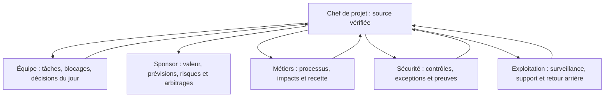

Une communication n’est complète que si un destinataire comprend ce qui change, ce qu’il doit faire, la date à laquelle il doit agir et la personne à contacter. La fréquence peut varier selon le public : une synchronisation courte pour les blocages, un rapport périodique pour le sponsor, des points de validation pour la sécurité et des consignes opérationnelles pour le support. Les décisions, leur auteur et leur date doivent rester consultables.

**Relier le principe à l’ensemble du projet.** Un élément de gestion n’agit jamais seul. Il influence le périmètre, la date, le budget, la qualité, la charge et l’acceptation du résultat. Avant d’agir, vérifier les dépendances en amont et en aval, identifier les équipes qui seront touchées et repérer les décisions qui pourraient être difficiles à inverser. Une solution locale apparemment efficace peut créer une dette opérationnelle, un défaut de conformité ou un coût de support durable. Une décision solide rend ces effets visibles et explique les compromis.

**Application au terrain.** Les utilisateurs reçoivent une notice de changement, tandis que le comité reçoit les risques, options et écarts. Pour transformer cet exemple en action, commencer par écrire une description courte de la situation, puis distinguer les faits observés des hypothèses. Identifier un responsable, convenir d’un résultat attendu et fixer le moment où la preuve sera examinée. Si une information manque, créer une tâche d’investigation avec une échéance plutôt que présenter une supposition comme une certitude. Si plusieurs options sont acceptables, comparer explicitement leurs impacts, leurs coûts de réversibilité et leurs conséquences pour les utilisateurs.

**Déroulement recommandé.** Premièrement, recueillir les données utiles auprès des personnes les plus proches du travail. Deuxièmement, vérifier la cohérence des informations avec les documents déjà approuvés. Troisièmement, décrire les options réalistes et leurs limites. Quatrièmement, décider au niveau approprié, en précisant les seuils qui nécessiteraient une escalade. Cinquièmement, consigner la décision, informer les personnes concernées et suivre son effet. Cette séquence réduit les retours en arrière et rend la démarche reproductible, même si les outils ou l’organisation changent.

**Mesures et éléments de preuve.** Une affirmation telle que « le travail avance » doit être étayée par une preuve pertinente : un livrable relu, un test passé, une décision approuvée, une dépendance levée, une mesure comparée à sa référence ou un utilisateur ayant réalisé une tâche. Choisir un indicateur directement relié à l’objectif et préciser sa source, sa fréquence, son propriétaire et ses limites. Les indicateurs quantitatifs gagnent à être complétés par une observation qualitative, particulièrement lorsqu’il est question d’adoption, de satisfaction ou de risque humain.

**Signaux d’alerte et correction.** Les signaux typiques sont une définition contradictoire, une décision repoussée sans propriétaire, des changements non évalués, une preuve difficile à retrouver, une estimation donnée sans hypothèse ou un résultat déclaré acceptable sans critères. Face à ces signaux, ne pas multiplier les tableaux ni demander une mise à jour cosmétique. Revenir au besoin, vérifier les faits, attribuer la responsabilité manquante et réduire le problème à une décision explicite. Si l’impact dépasse la délégation prévue, alerter rapidement avec des options et une recommandation argumentée.

**Approfondissement.** Pour les projets à forte criticité, la rigueur doit augmenter avec le coût d’une erreur : revue indépendante, approbation formelle, contrôle des accès, traçabilité renforcée ou répétition en environnement représentatif. Pour un petit projet réversible, la même intention peut être satisfaite par un contrôle plus léger. Le principe est de calibrer les pratiques sans abolir les contrôles essentiels. À chaque étape, demander : « Quelle preuve rend cette décision défendable, qui peut l’accepter et qu’est-ce qui nous ferait changer d’avis ? »

### 11. Référentiel de planification

**Comprendre le sujet.** Dans le cadre de « Phases d'un projet (Initiation, Planification) », référentiel de planification doit être traité comme un élément de décision et non comme une formalité isolée. La référence de plan permet de comparer le réel à une version approuvée et de traiter les changements sans réécrire l’histoire. La bonne pratique consiste à expliciter le but recherché, l’autorité concernée, les hypothèses encore ouvertes, les contraintes applicables et la preuve qui permettra de conclure. Sans cette explicitation, deux personnes peuvent utiliser les mêmes mots tout en poursuivant des résultats différents. Le responsable doit demander ce qui est attendu, pourquoi cela compte et quelle conséquence aurait une décision erronée.

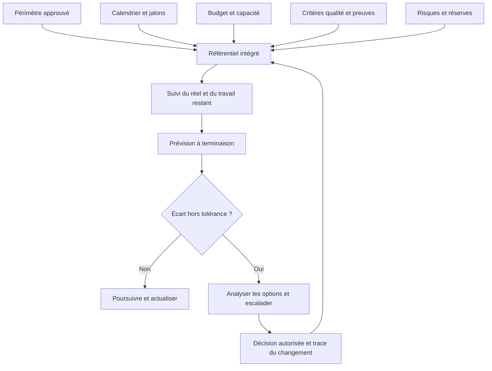

Le référentiel est cohérent lorsque périmètre, délais, coûts, qualité et ressources racontent la même histoire. Le plan initial approuvé ne doit pas être réécrit en silence à chaque retard : on conserve la référence pour comprendre l’écart et on met à jour la prévision pour décrire l’issue la plus probable. Un changement autorisé peut modifier la référence, mais la décision, le motif et les conséquences doivent être traçables.

**Relier le principe à l’ensemble du projet.** Un élément de gestion n’agit jamais seul. Il influence le périmètre, la date, le budget, la qualité, la charge et l’acceptation du résultat. Avant d’agir, vérifier les dépendances en amont et en aval, identifier les équipes qui seront touchées et repérer les décisions qui pourraient être difficiles à inverser. Une solution locale apparemment efficace peut créer une dette opérationnelle, un défaut de conformité ou un coût de support durable. Une décision solide rend ces effets visibles et explique les compromis.

**Application au terrain.** Une nouvelle date cible est approuvée et tracée au lieu de modifier rétroactivement la baseline. Pour transformer cet exemple en action, commencer par écrire une description courte de la situation, puis distinguer les faits observés des hypothèses. Identifier un responsable, convenir d’un résultat attendu et fixer le moment où la preuve sera examinée. Si une information manque, créer une tâche d’investigation avec une échéance plutôt que présenter une supposition comme une certitude. Si plusieurs options sont acceptables, comparer explicitement leurs impacts, leurs coûts de réversibilité et leurs conséquences pour les utilisateurs.

**Déroulement recommandé.** Premièrement, recueillir les données utiles auprès des personnes les plus proches du travail. Deuxièmement, vérifier la cohérence des informations avec les documents déjà approuvés. Troisièmement, décrire les options réalistes et leurs limites. Quatrièmement, décider au niveau approprié, en précisant les seuils qui nécessiteraient une escalade. Cinquièmement, consigner la décision, informer les personnes concernées et suivre son effet. Cette séquence réduit les retours en arrière et rend la démarche reproductible, même si les outils ou l’organisation changent.

**Mesures et éléments de preuve.** Une affirmation telle que « le travail avance » doit être étayée par une preuve pertinente : un livrable relu, un test passé, une décision approuvée, une dépendance levée, une mesure comparée à sa référence ou un utilisateur ayant réalisé une tâche. Choisir un indicateur directement relié à l’objectif et préciser sa source, sa fréquence, son propriétaire et ses limites. Les indicateurs quantitatifs gagnent à être complétés par une observation qualitative, particulièrement lorsqu’il est question d’adoption, de satisfaction ou de risque humain.

**Signaux d’alerte et correction.** Les signaux typiques sont une définition contradictoire, une décision repoussée sans propriétaire, des changements non évalués, une preuve difficile à retrouver, une estimation donnée sans hypothèse ou un résultat déclaré acceptable sans critères. Face à ces signaux, ne pas multiplier les tableaux ni demander une mise à jour cosmétique. Revenir au besoin, vérifier les faits, attribuer la responsabilité manquante et réduire le problème à une décision explicite. Si l’impact dépasse la délégation prévue, alerter rapidement avec des options et une recommandation argumentée.

**Approfondissement.** Pour les projets à forte criticité, la rigueur doit augmenter avec le coût d’une erreur : revue indépendante, approbation formelle, contrôle des accès, traçabilité renforcée ou répétition en environnement représentatif. Pour un petit projet réversible, la même intention peut être satisfaite par un contrôle plus léger. Le principe est de calibrer les pratiques sans abolir les contrôles essentiels. À chaque étape, demander : « Quelle preuve rend cette décision défendable, qui peut l’accepter et qu’est-ce qui nous ferait changer d’avis ? »

### 12. Jalons et portes de décision

**Comprendre le sujet.** Dans le cadre de « Phases d'un projet (Initiation, Planification) », jalons et portes de décision doit être traité comme un élément de décision et non comme une formalité isolée. Un jalon représente un événement de vérification, et une porte exige une décision explicite avant de poursuivre. La bonne pratique consiste à expliciter le but recherché, l’autorité concernée, les hypothèses encore ouvertes, les contraintes applicables et la preuve qui permettra de conclure. Sans cette explicitation, deux personnes peuvent utiliser les mêmes mots tout en poursuivant des résultats différents. Le responsable doit demander ce qui est attendu, pourquoi cela compte et quelle conséquence aurait une décision erronée.

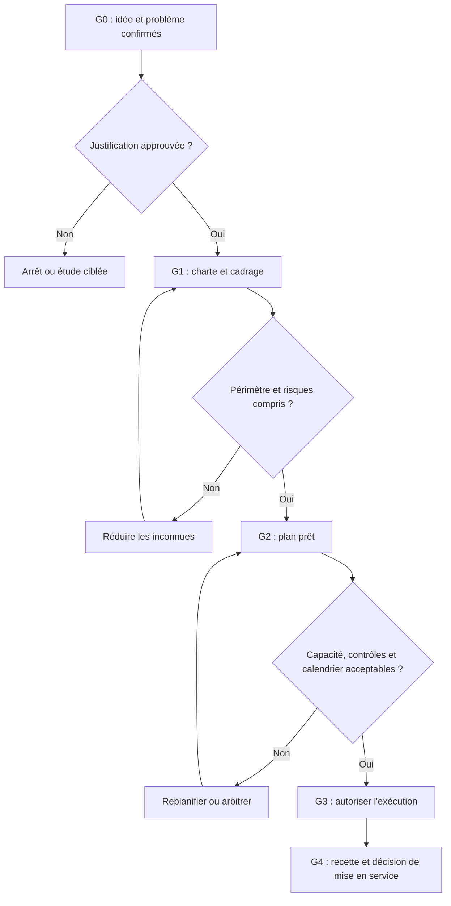

Un jalon marque un événement observable ; une porte de décision ajoute une décision formelle sur la base de critères. Il faut éviter les validations cérémonielles où le comité signe sans examiner les preuves. Pour chaque porte, préciser les documents requis, les personnes habilitées, les critères de passage, les conditions de report et les risques qui doivent être explicitement acceptés.

**Relier le principe à l’ensemble du projet.** Un élément de gestion n’agit jamais seul. Il influence le périmètre, la date, le budget, la qualité, la charge et l’acceptation du résultat. Avant d’agir, vérifier les dépendances en amont et en aval, identifier les équipes qui seront touchées et repérer les décisions qui pourraient être difficiles à inverser. Une solution locale apparemment efficace peut créer une dette opérationnelle, un défaut de conformité ou un coût de support durable. Une décision solide rend ces effets visibles et explique les compromis.

**Application au terrain.** Le comité autorise la bascule seulement si tests, restauration et disponibilité des responsables sont confirmés. Pour transformer cet exemple en action, commencer par écrire une description courte de la situation, puis distinguer les faits observés des hypothèses. Identifier un responsable, convenir d’un résultat attendu et fixer le moment où la preuve sera examinée. Si une information manque, créer une tâche d’investigation avec une échéance plutôt que présenter une supposition comme une certitude. Si plusieurs options sont acceptables, comparer explicitement leurs impacts, leurs coûts de réversibilité et leurs conséquences pour les utilisateurs.

**Déroulement recommandé.** Premièrement, recueillir les données utiles auprès des personnes les plus proches du travail. Deuxièmement, vérifier la cohérence des informations avec les documents déjà approuvés. Troisièmement, décrire les options réalistes et leurs limites. Quatrièmement, décider au niveau approprié, en précisant les seuils qui nécessiteraient une escalade. Cinquièmement, consigner la décision, informer les personnes concernées et suivre son effet. Cette séquence réduit les retours en arrière et rend la démarche reproductible, même si les outils ou l’organisation changent.

**Mesures et éléments de preuve.** Une affirmation telle que « le travail avance » doit être étayée par une preuve pertinente : un livrable relu, un test passé, une décision approuvée, une dépendance levée, une mesure comparée à sa référence ou un utilisateur ayant réalisé une tâche. Choisir un indicateur directement relié à l’objectif et préciser sa source, sa fréquence, son propriétaire et ses limites. Les indicateurs quantitatifs gagnent à être complétés par une observation qualitative, particulièrement lorsqu’il est question d’adoption, de satisfaction ou de risque humain.

**Signaux d’alerte et correction.** Les signaux typiques sont une définition contradictoire, une décision repoussée sans propriétaire, des changements non évalués, une preuve difficile à retrouver, une estimation donnée sans hypothèse ou un résultat déclaré acceptable sans critères. Face à ces signaux, ne pas multiplier les tableaux ni demander une mise à jour cosmétique. Revenir au besoin, vérifier les faits, attribuer la responsabilité manquante et réduire le problème à une décision explicite. Si l’impact dépasse la délégation prévue, alerter rapidement avec des options et une recommandation argumentée.

**Approfondissement.** Pour les projets à forte criticité, la rigueur doit augmenter avec le coût d’une erreur : revue indépendante, approbation formelle, contrôle des accès, traçabilité renforcée ou répétition en environnement représentatif. Pour un petit projet réversible, la même intention peut être satisfaite par un contrôle plus léger. Le principe est de calibrer les pratiques sans abolir les contrôles essentiels. À chaque étape, demander : « Quelle preuve rend cette décision défendable, qui peut l’accepter et qu’est-ce qui nous ferait changer d’avis ? »

### 13. Suivi et contrôle

**Comprendre le sujet.** Dans le cadre de « Phases d'un projet (Initiation, Planification) », suivi et contrôle doit être traité comme un élément de décision et non comme une formalité isolée. Le suivi compare les résultats aux références et prédit les conséquences avant que les écarts ne deviennent irréversibles. La bonne pratique consiste à expliciter le but recherché, l’autorité concernée, les hypothèses encore ouvertes, les contraintes applicables et la preuve qui permettra de conclure. Sans cette explicitation, deux personnes peuvent utiliser les mêmes mots tout en poursuivant des résultats différents. Le responsable doit demander ce qui est attendu, pourquoi cela compte et quelle conséquence aurait une décision erronée.

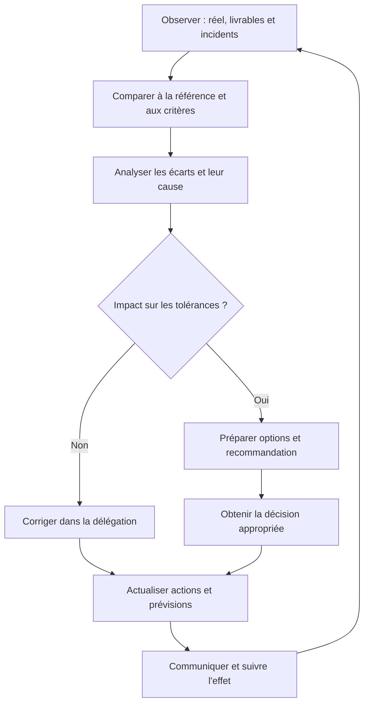

Le contrôle est une boucle d’apprentissage, pas une collecte de feux verts et rouges. Une mesure utile indique son état à une date donnée, sa tendance, son seuil, son propriétaire et la décision qu’elle peut déclencher. Un indicateur rouge doit conduire à une analyse et à une action ; il ne doit pas être rendu vert en modifiant son seuil sans justification.

**Relier le principe à l’ensemble du projet.** Un élément de gestion n’agit jamais seul. Il influence le périmètre, la date, le budget, la qualité, la charge et l’acceptation du résultat. Avant d’agir, vérifier les dépendances en amont et en aval, identifier les équipes qui seront touchées et repérer les décisions qui pourraient être difficiles à inverser. Une solution locale apparemment efficace peut créer une dette opérationnelle, un défaut de conformité ou un coût de support durable. Une décision solide rend ces effets visibles et explique les compromis.

**Application au terrain.** Une dérive de test déclenche une analyse d’impact sur les ressources, la fenêtre et la date de bascule. Pour transformer cet exemple en action, commencer par écrire une description courte de la situation, puis distinguer les faits observés des hypothèses. Identifier un responsable, convenir d’un résultat attendu et fixer le moment où la preuve sera examinée. Si une information manque, créer une tâche d’investigation avec une échéance plutôt que présenter une supposition comme une certitude. Si plusieurs options sont acceptables, comparer explicitement leurs impacts, leurs coûts de réversibilité et leurs conséquences pour les utilisateurs.

**Déroulement recommandé.** Premièrement, recueillir les données utiles auprès des personnes les plus proches du travail. Deuxièmement, vérifier la cohérence des informations avec les documents déjà approuvés. Troisièmement, décrire les options réalistes et leurs limites. Quatrièmement, décider au niveau approprié, en précisant les seuils qui nécessiteraient une escalade. Cinquièmement, consigner la décision, informer les personnes concernées et suivre son effet. Cette séquence réduit les retours en arrière et rend la démarche reproductible, même si les outils ou l’organisation changent.

**Mesures et éléments de preuve.** Une affirmation telle que « le travail avance » doit être étayée par une preuve pertinente : un livrable relu, un test passé, une décision approuvée, une dépendance levée, une mesure comparée à sa référence ou un utilisateur ayant réalisé une tâche. Choisir un indicateur directement relié à l’objectif et préciser sa source, sa fréquence, son propriétaire et ses limites. Les indicateurs quantitatifs gagnent à être complétés par une observation qualitative, particulièrement lorsqu’il est question d’adoption, de satisfaction ou de risque humain.

**Signaux d’alerte et correction.** Les signaux typiques sont une définition contradictoire, une décision repoussée sans propriétaire, des changements non évalués, une preuve difficile à retrouver, une estimation donnée sans hypothèse ou un résultat déclaré acceptable sans critères. Face à ces signaux, ne pas multiplier les tableaux ni demander une mise à jour cosmétique. Revenir au besoin, vérifier les faits, attribuer la responsabilité manquante et réduire le problème à une décision explicite. Si l’impact dépasse la délégation prévue, alerter rapidement avec des options et une recommandation argumentée.

**Approfondissement.** Pour les projets à forte criticité, la rigueur doit augmenter avec le coût d’une erreur : revue indépendante, approbation formelle, contrôle des accès, traçabilité renforcée ou répétition en environnement représentatif. Pour un petit projet réversible, la même intention peut être satisfaite par un contrôle plus léger. Le principe est de calibrer les pratiques sans abolir les contrôles essentiels. À chaque étape, demander : « Quelle preuve rend cette décision défendable, qui peut l’accepter et qu’est-ce qui nous ferait changer d’avis ? »

## Étude de cas : La migration de l’application RH

Une application RH doit migrer vers un hébergement maintenu. Les données sont sensibles, une échéance contractuelle existe et les utilisateurs ont besoin d’une période de recette et de formation.

### 1. Clarifier la demande

L’équipe commence par reformuler le problème du point de vue des bénéficiaires, les résultats attendus et les contraintes non négociables. Elle distingue les faits, les hypothèses et les préférences. Elle identifie ensuite le sponsor, le propriétaire métier, le responsable technique, les personnes chargées de la sécurité et l’exploitant qui recevra la solution. Ce travail empêche de supposer que la personne qui demande une fonctionnalité possède automatiquement le budget, l’autorité ou la connaissance nécessaires pour valider toutes les décisions.

### 2. Définir une base de travail

Le groupe rédige une courte charte, délimite un premier périmètre, formule des critères d’acceptation et estime le travail en indiquant l’incertitude. Il établit une première liste de dépendances, prépare une analyse de risques et fixe la fréquence de pilotage. Les estimations sont présentées comme des fourchettes lorsque les informations sont incomplètes. Le plan comporte aussi les activités souvent oubliées : préparation des environnements, validation de sécurité, transfert aux opérations, communication, formation et retour arrière.

### 3. Comparer les options

Trois options plausibles sont comparées : livrer tout le périmètre en une seule bascule, livrer un premier lot limité, ou reporter pour résoudre les incertitudes critiques. La comparaison porte sur la valeur obtenue, le coût, la durée, la complexité, les risques et la réversibilité. Une option ne doit pas être retenue uniquement parce qu’elle paraît plus rapide sur le calendrier. Il faut mesurer les conséquences des incidents, les besoins de support et la capacité réelle de l’organisation à absorber le changement.

### 4. Piloter l’exécution et l’acceptation

L’équipe suit des résultats vérifiables, pas uniquement le pourcentage de tâches déclarées terminées. Les critères d’acceptation sont associés à des tests et à des preuves dont les responsables sont désignés. Les écarts sont analysés par rapport à la référence et accompagnés d’une prévision actualisée. Si une décision dépasse l’autorité du chef de projet, le comité reçoit une note concise présentant la situation, les options, les impacts, la recommandation et la date limite de décision.

### 5. Tirer les leçons

La clôture vérifie que les livrables ont été acceptés, que les responsabilités d’exploitation sont formalisées, que la documentation est accessible et que les risques résiduels sont acceptés par une personne autorisée. Les bénéfices qui ne peuvent être mesurés qu’après plusieurs semaines sont confiés à un responsable métier avec une date de mesure. Une courte rétrospective identifie ce qu’il faut conserver, arrêter ou expérimenter au prochain projet.

## Atelier pratique

**Exercice.** Rédige une fiche de cadrage d’une page pour le cas étudié. Elle doit contenir : le problème, les bénéficiaires, les objectifs mesurables, les inclusions et exclusions, les contraintes, cinq parties prenantes, trois risques, trois critères d’acceptation et la personne qui décide lorsqu’un seuil est dépassé.

**Correction attendue.** Une bonne réponse ne se limite pas à une liste de fonctionnalités. Elle établit un lien vérifiable entre problème et bénéfice, précise une référence de départ, distingue les exigences obligatoires des options, attribue les risques à des propriétaires et fixe des critères que le métier peut comprendre. Chaque décision majeure doit avoir un responsable et une voie d’escalade. Les données manquantes sont clairement notées comme hypothèses à confirmer, avec un propriétaire et une échéance.

**Exercice avancé.** Le sponsor demande d’avancer la date de livraison de trois semaines alors que deux contrôles ne sont pas terminés. Prépare trois options avec leurs conséquences : conserver la date en réduisant un périmètre non essentiel, renforcer les moyens si les compétences sont disponibles, ou déplacer la date. La correction doit refuser de présenter une validation non réalisée comme acquise. Les contrôles de sécurité et les critères obligatoires ne doivent pas être supprimés pour rendre artificiellement le planning vert.

## Pièges à éviter

- Confondre activité, livrable et bénéfice : terminer des tâches ne prouve pas que le besoin est résolu.
- Définir le succès après la livraison : cela ouvre la voie à des critères changeants et à des déclarations invérifiables.
- Croire qu’un outil remplace la gouvernance : un tableau bien rempli ne clarifie pas qui décide.
- Cacher les incertitudes : une fourchette honnête vaut mieux qu’une date précise sans justification.
- Valider seulement le scénario idéal : les cas limites, la sécurité et le retour arrière doivent être considérés.
- Laisser la responsabilité implicite : les sujets sans propriétaire ont tendance à être ignorés.
- Traiter les utilisateurs comme de simples destinataires : leur préparation conditionne l’adoption.
- Faire évoluer le périmètre sans analyser les impacts : le coût peut apparaître tardivement.
- Escalader sans recommandation : présenter des faits, options, impacts et une date limite de décision.
- Fermer le projet au moment de la mise en production : le support, la stabilisation et les bénéfices ont aussi besoin d’un propriétaire.

## Checklist de révision

- [ ] Le besoin et les bénéficiaires sont formulés clairement.
- [ ] Les objectifs sont mesurables et associés à une référence.
- [ ] Le périmètre et les exclusions sont visibles.
- [ ] Les rôles, pouvoirs de décision et escalades sont explicites.
- [ ] Les hypothèses, risques et dépendances possèdent des propriétaires.
- [ ] Le planning et le budget exposent leurs hypothèses.
- [ ] Les critères d’acceptation sont testables.
- [ ] Les décisions et changements sont tracés.
- [ ] L’exploitation, la sécurité et l’adoption sont préparées.
- [ ] La clôture inclut transfert, leçons et mesure des bénéfices.

## À retenir

Le pilotage de projet est un exercice d’alignement, de décision et d’apprentissage. Une méthode efficace apporte juste assez de structure pour rendre le travail prévisible sans prétendre supprimer l’incertitude. Les livrables, les rôles, les estimations, les risques et les critères de réussite doivent former un système cohérent. Le chef de projet crée de la valeur lorsqu’il aide les personnes compétentes à prendre les bonnes décisions au bon moment, en disposant de faits compréhensibles et d’une trace utile.

## Glossaire

- **Baseline :** référence approuvée utilisée pour comparer les résultats.
- **Bénéfice :** amélioration mesurable obtenue grâce au résultat.
- **Dépendance :** lien qui conditionne l’ordre ou la faisabilité du travail.
- **Jalon :** événement important permettant de vérifier une étape.
- **Livrable :** résultat concret pouvant être vérifié et accepté.
- **Partie prenante :** personne ou organisation qui influence le projet ou en subit les effets.
- **Périmètre :** limites des travaux et des résultats inclus.
- **Risque :** événement incertain pouvant modifier les objectifs.
- **Sponsor :** responsable exécutif qui porte la justification et les arbitrages majeurs.
- **Critère d’acceptation :** condition observable permettant de déclarer un résultat acceptable.

## Références pour approfondir

- ISO 21502, lignes directrices sur le management de projet : https://committee.iso.org/sites/tc258/home/projects/published/iso-21502.html
- Project Management Institute (PMI) : https://www.pmi.org/
- Scrum Guide officiel : https://scrumguides.org/scrum-guide
- PRINCE2 7, présentation officielle : https://www.peoplecert.org/browse-certifications/project-programme-and-portfolio-management/PRINCE2-2/prince2-7-foundation-3579
