# Direction de programme et portefeuille

> **Encadré de mise en contexte** — Plusieurs projets IT se disputent les mêmes experts, tandis que les bénéfices attendus sont décrits séparément et que la direction ne sait pas quelles initiatives prioriser.

## Introduction

La gestion de projet IT transforme une demande parfois imprécise en résultats utiles grâce à des décisions explicites. Les outils de pilotage ne suppriment pas l’incertitude : ils rendent les hypothèses, les responsabilités, les dépendances et les écarts visibles. Une pratique bien choisie aide les personnes compétentes à se coordonner, à détecter les problèmes tôt et à choisir le bon compromis entre valeur, délais, coûts, qualité, sécurité et adoption.

Ce cours sur « Direction de programme et portefeuille » privilégie les méthodes applicables dans un environnement réel. Une pratique n’est utile que si elle répond à un besoin précis. Il faut calibrer le niveau de détail en fonction de la criticité, du coût de l’erreur, de la stabilité du périmètre et des obligations externes. Un petit projet réversible peut s’appuyer sur un dispositif léger, alors qu’une transformation importante ou un programme réglementé exige des preuves plus formelles.

Le cas « Arbitrer un portefeuille numérique » sert de fil rouge. Il permet de distinguer les faits des hypothèses, d’identifier les décisions qui conditionnent le résultat et de construire une manière de vérifier l’effet des choix. Les outils cités sont des exemples : leurs fonctions évoluent, les offres commerciales changent et chaque organisation doit vérifier ses règles, ses contrats et ses contraintes de conformité avant de les utiliser.

## Objectifs pédagogiques

- Expliquer les concepts de base et les limites des méthodes étudiées.
- Choisir une approche adaptée à la nature du travail et à l’incertitude.
- Décrire les étapes, livrables, responsabilités et contrôles associés.
- Mesurer les résultats avec des indicateurs reliés aux objectifs.
- Appliquer la démarche au cas proposé et justifier les arbitrages.

## Concepts clés

**Valeur.** La valeur décrit le bénéfice recherché pour un utilisateur ou l’organisation. Elle doit être reliée à une situation initiale, à un changement attendu et à une mesure raisonnable. Sans cette relation, l’équipe risque d’optimiser un outil ou un processus sans résoudre le problème métier.

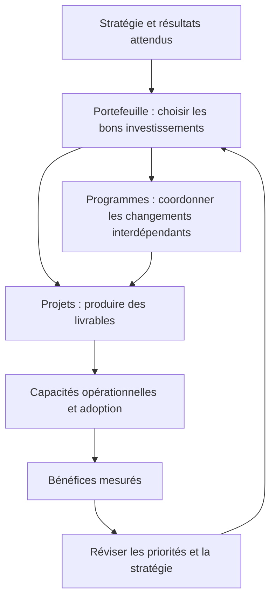

La direction de portefeuille, la direction de programme et la gestion de projet sont complémentaires, mais elles ne répondent pas à la même question. Le portefeuille cherche à choisir et équilibrer les bons investissements au regard de la stratégie ; le programme coordonne des changements liés pour obtenir des bénéfices intégrés ; chaque projet réalise des produits ou capacités qui contribuent à ces résultats. Le succès se mesure donc au-delà de la livraison : il faut s’assurer que les changements sont adoptés et que les bénéfices attendus se matérialisent.

**Périmètre et qualité.** Le périmètre fixe les limites du travail ; la qualité précise les caractéristiques et critères qui permettront d’accepter les livrables. Les ajouts doivent être analysés au lieu d’être acceptés implicitement. Une date ou un budget ne justifie jamais de prétendre qu’un critère obligatoire est satisfait sans preuve.

**Prévision et référence.** La référence approuvée permet d’étudier les écarts, tandis que la prévision décrit l’issue la plus probable à partir des données actuelles. On peut réviser une prévision et conserver une référence historique. La distinction préserve la transparence et aide à décider sans maquiller les évolutions.

**Gouvernance.** La gouvernance répartit les responsabilités, les pouvoirs de décision, les seuils d’escalade et les mécanismes de validation. Elle doit soutenir le travail plutôt que le bloquer. Les décisions fréquentes et réversibles sont généralement déléguées ; les décisions coûteuses, risquées ou réglementaires nécessitent une autorité et une trace explicites.

**Risque et dépendances.** Un risque correspond à un événement incertain et à ses conséquences éventuelles. Une dépendance relie le projet à un système, une équipe, un fournisseur ou une approbation. Les réponses doivent avoir un propriétaire, un signal et une action. Une dépendance non suivie peut transformer une activité courte en facteur de retard global.

**Communication.** Une information est efficace quand elle permet à son destinataire de comprendre la situation et d’agir. L’équipe a besoin de détails opérationnels, le sponsor d’options d’arbitrage et les utilisateurs de connaître les impacts. Les rapports doivent distinguer faits observés, hypothèses, risques et décisions attendues.

**Adoption et transfert.** Le résultat doit pouvoir être utilisé, maintenu et supporté. Les responsabilités d’exploitation, les accès, la documentation, la formation, la supervision et la continuité doivent être préparés avant la mise en service. Les bénéfices peuvent nécessiter une mesure plusieurs semaines après la livraison.

## Méthodologie et outils

Commencer par formuler le problème, les bénéficiaires, le résultat attendu et les contraintes non négociables. Décrire ensuite les options, les dépendances, les responsabilités, les risques et les preuves nécessaires. La planification fournit une hypothèse structurée ; elle doit être révisée lorsque de nouveaux faits modifient le travail restant ou les conditions de réussite.

Les outils servent à externaliser la mémoire collective. Ils doivent permettre de répondre à des questions concrètes : quel résultat est attendu, qui le prend en charge, qu’est-ce qui est bloqué, quelle décision est en attente, quelle preuve existe et comment la prévision change-t-elle ? La simplicité est une qualité si les contrôles essentiels restent couverts et si les données sont maintenues.

Un reporting utile ne récompense pas seulement le volume d’activité. Il met en évidence le travail réellement terminé, les critères qui restent ouverts, les risques qui évoluent et les arbitrages nécessaires. Les estimations doivent exposer leurs hypothèses, les marges doivent être explicables et les mesures doivent être comprises par ceux qui les utilisent pour décider.

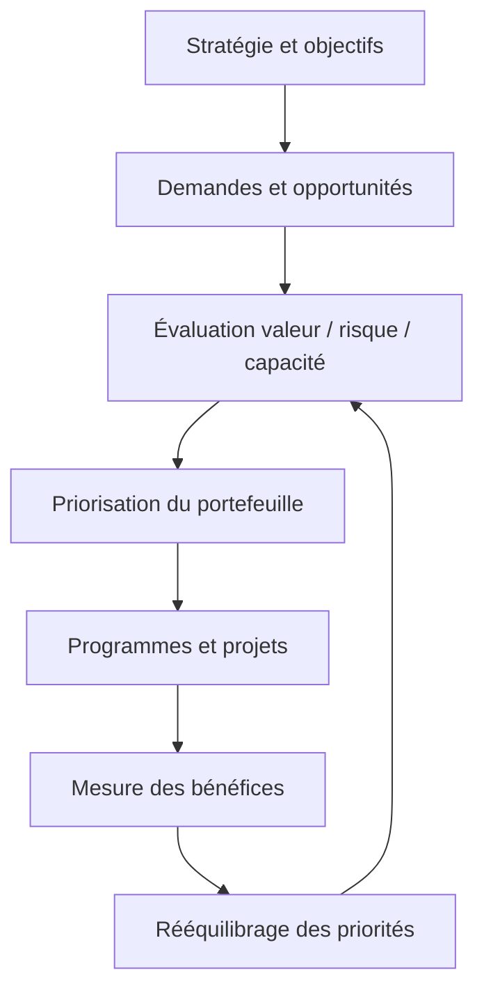

### 1. Stratégie et alignement

**Comprendre le concept.** Dans « Direction de programme et portefeuille », stratégie et alignement constitue une pratique qui doit répondre à une intention précise. Le portefeuille traduit les objectifs stratégiques en initiatives finançables, mesurables et cohérentes. Le responsable doit définir le résultat attendu, l’autorité concernée et les informations qui manquent encore. Une méthode ne doit pas être appliquée uniquement parce qu’elle figure dans un guide ou qu’elle est proposée par un outil. Sa valeur dépend du contexte, des personnes qui l’utilisent et de la qualité des décisions qu’elle permet de prendre.

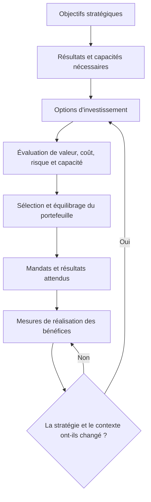

L’alignement stratégique ne consiste pas à ajouter le nom d’un objectif dans une fiche d’initiative. Il faut pouvoir montrer comment un investissement contribue à un résultat mesurable, quelles capacités il exige, quelles hypothèses le justifient et comment sa contribution sera suivie. Une initiative qui ne soutient plus une priorité peut devoir être reconfigurée ou arrêtée, même si elle a déjà consommé une partie de son budget.

**Articuler avec les autres dimensions.** La décision peut affecter le périmètre, la capacité, les coûts, le calendrier, la sécurité et l’exploitation. Il est nécessaire de repérer les dépendances en amont, les conséquences pour les bénéficiaires et les coûts de réversibilité. Une optimisation locale peut transférer le coût vers une autre équipe ou reporter un risque après la mise en service. Une analyse complète rend explicite le compromis, indique ce qui est protégé et précise quelles limites ne peuvent pas être négociées.

**Illustration opérationnelle.** Le programme cyber réduit un risque majeur mais doit s’articuler avec la migration cloud qui change les contrôles. Pour traiter ce type de situation, consigner les faits, distinguer les hypothèses, fixer une responsabilité et définir une preuve vérifiable. Lorsque plusieurs solutions sont possibles, les comparer avec des critères communs. Si les données sont incomplètes, organiser une courte investigation avec une échéance au lieu de présenter une estimation fragile comme un engagement ferme. La décision doit pouvoir être comprise par une personne qui n’a pas assisté à la discussion d’origine.

**Mise en œuvre.** Recueillir les données auprès des personnes proches du travail, examiner les contraintes, formuler des options, préciser leurs impacts et décider au niveau approprié. Après la décision, consigner le motif, informer les acteurs concernés et suivre l’effet réel. Lorsque le seuil de délégation est dépassé, préparer une escalade concise qui présente le problème, les options, les risques, une recommandation et la date à laquelle la décision devient urgente.

**Mesure et preuve.** Il faut choisir un indicateur correspondant à la finalité de la pratique. Une donnée d’activité ne démontre pas nécessairement un résultat. Définir la source, la fréquence, le responsable, la valeur de référence et les limites de l’indicateur. Compléter si nécessaire les chiffres par une observation qualitative, une revue ou un test. Les mesures doivent être assez fiables pour soutenir une décision, mais pas si coûteuses qu’elles consomment une part disproportionnée du travail.

**Erreurs fréquentes et correction.** Les erreurs habituelles incluent une information non actualisée, des définitions variables, une responsabilité implicite, un contrôle fait trop tard ou une exception devenue la règle. Le correctif n’est pas d’ajouter des tableaux sans fin : il faut retrouver la cause, simplifier le flux, attribuer la décision et mesurer l’amélioration. Si une pratique ne produit plus de valeur, la revoir avec les personnes concernées, tout en conservant les contrôles obligatoires et les traces nécessaires à l’audit.

**Approfondissement.** Pour un projet à forte criticité, la pratique peut exiger une validation indépendante, une séparation des tâches, une piste d’audit et un test sur un environnement représentatif. Pour un travail limité et réversible, une revue de pair peut suffire. La proportionnalité ne signifie pas l’absence de rigueur : elle cherche le meilleur rapport entre contrôle et utilité. Le test décisif est de savoir si l’équipe peut expliquer ce qu’elle fait, pourquoi elle le fait, quelle preuve confirme le résultat et comment elle réagira si l’hypothèse devient fausse.

### 2. Projet, programme et portefeuille

**Comprendre le concept.** Dans « Direction de programme et portefeuille », projet, programme et portefeuille constitue une pratique qui doit répondre à une intention précise. Un projet livre un résultat singulier, un programme coordonne des projets interdépendants et un portefeuille arbitre les investissements. Le responsable doit définir le résultat attendu, l’autorité concernée et les informations qui manquent encore. Une méthode ne doit pas être appliquée uniquement parce qu’elle figure dans un guide ou qu’elle est proposée par un outil. Sa valeur dépend du contexte, des personnes qui l’utilisent et de la qualité des décisions qu’elle permet de prendre.

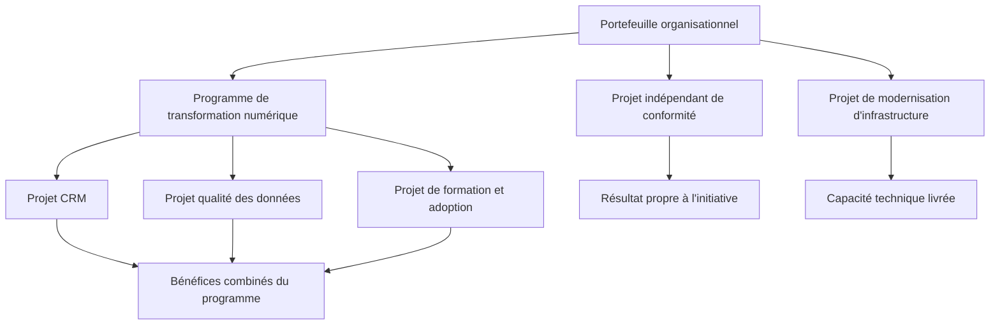

Un programme réunit des projets et d’autres travaux liés qui sont coordonnés pour obtenir des bénéfices qu’ils ne produiraient pas aussi efficacement séparément. Un portefeuille peut inclure des initiatives qui ne sont pas directement interdépendantes, dès lors qu’elles se disputent des ressources ou contribuent aux objectifs de l’organisation. Les projets restent responsables de livrables définis, mais le programme gère leurs dépendances et le portefeuille arbitre les investissements globaux. Voir les ressources PMI sur le [management de programme](https://www.pmi.org/standards/program-management-fifth-edition) et le [management de portefeuille](https://www.pmi.org/standards/for-portfolio-management).

**Articuler avec les autres dimensions.** La décision peut affecter le périmètre, la capacité, les coûts, le calendrier, la sécurité et l’exploitation. Il est nécessaire de repérer les dépendances en amont, les conséquences pour les bénéficiaires et les coûts de réversibilité. Une optimisation locale peut transférer le coût vers une autre équipe ou reporter un risque après la mise en service. Une analyse complète rend explicite le compromis, indique ce qui est protégé et précise quelles limites ne peuvent pas être négociées.

**Illustration opérationnelle.** La migration cloud et la modernisation des données sont coordonnées comme programme lorsque leurs bénéfices et dépendances sont communs. Pour traiter ce type de situation, consigner les faits, distinguer les hypothèses, fixer une responsabilité et définir une preuve vérifiable. Lorsque plusieurs solutions sont possibles, les comparer avec des critères communs. Si les données sont incomplètes, organiser une courte investigation avec une échéance au lieu de présenter une estimation fragile comme un engagement ferme. La décision doit pouvoir être comprise par une personne qui n’a pas assisté à la discussion d’origine.

**Mise en œuvre.** Recueillir les données auprès des personnes proches du travail, examiner les contraintes, formuler des options, préciser leurs impacts et décider au niveau approprié. Après la décision, consigner le motif, informer les acteurs concernés et suivre l’effet réel. Lorsque le seuil de délégation est dépassé, préparer une escalade concise qui présente le problème, les options, les risques, une recommandation et la date à laquelle la décision devient urgente.

**Mesure et preuve.** Il faut choisir un indicateur correspondant à la finalité de la pratique. Une donnée d’activité ne démontre pas nécessairement un résultat. Définir la source, la fréquence, le responsable, la valeur de référence et les limites de l’indicateur. Compléter si nécessaire les chiffres par une observation qualitative, une revue ou un test. Les mesures doivent être assez fiables pour soutenir une décision, mais pas si coûteuses qu’elles consomment une part disproportionnée du travail.

**Erreurs fréquentes et correction.** Les erreurs habituelles incluent une information non actualisée, des définitions variables, une responsabilité implicite, un contrôle fait trop tard ou une exception devenue la règle. Le correctif n’est pas d’ajouter des tableaux sans fin : il faut retrouver la cause, simplifier le flux, attribuer la décision et mesurer l’amélioration. Si une pratique ne produit plus de valeur, la revoir avec les personnes concernées, tout en conservant les contrôles obligatoires et les traces nécessaires à l’audit.

**Approfondissement.** Pour un projet à forte criticité, la pratique peut exiger une validation indépendante, une séparation des tâches, une piste d’audit et un test sur un environnement représentatif. Pour un travail limité et réversible, une revue de pair peut suffire. La proportionnalité ne signifie pas l’absence de rigueur : elle cherche le meilleur rapport entre contrôle et utilité. Le test décisif est de savoir si l’équipe peut expliquer ce qu’elle fait, pourquoi elle le fait, quelle preuve confirme le résultat et comment elle réagira si l’hypothèse devient fausse.

### 3. Gestion des bénéfices

**Comprendre le concept.** Dans « Direction de programme et portefeuille », gestion des bénéfices constitue une pratique qui doit répondre à une intention précise. Les bénéfices décrivent des changements mesurables et doivent avoir un propriétaire métier après la livraison. Le responsable doit définir le résultat attendu, l’autorité concernée et les informations qui manquent encore. Une méthode ne doit pas être appliquée uniquement parce qu’elle figure dans un guide ou qu’elle est proposée par un outil. Sa valeur dépend du contexte, des personnes qui l’utilisent et de la qualité des décisions qu’elle permet de prendre.

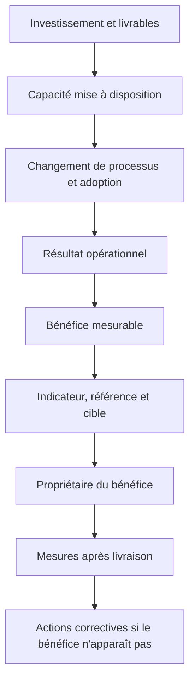

Un bénéfice est une amélioration mesurable, et non le simple fait de déployer une application ou de terminer un projet. Pour chaque bénéfice, précise une situation de référence, une cible, une méthode de mesure, un horizon et une personne responsable. Le programme doit relier les livrables aux changements organisationnels nécessaires à la réalisation du bénéfice ; si l’adoption ou la modification de processus ne se produit pas, la valeur attendue peut ne jamais apparaître.

**Articuler avec les autres dimensions.** La décision peut affecter le périmètre, la capacité, les coûts, le calendrier, la sécurité et l’exploitation. Il est nécessaire de repérer les dépendances en amont, les conséquences pour les bénéficiaires et les coûts de réversibilité. Une optimisation locale peut transférer le coût vers une autre équipe ou reporter un risque après la mise en service. Une analyse complète rend explicite le compromis, indique ce qui est protégé et précise quelles limites ne peuvent pas être négociées.

**Illustration opérationnelle.** Le sponsor nomme un responsable pour mesurer la diminution des incidents six mois après les contrôles cyber. Pour traiter ce type de situation, consigner les faits, distinguer les hypothèses, fixer une responsabilité et définir une preuve vérifiable. Lorsque plusieurs solutions sont possibles, les comparer avec des critères communs. Si les données sont incomplètes, organiser une courte investigation avec une échéance au lieu de présenter une estimation fragile comme un engagement ferme. La décision doit pouvoir être comprise par une personne qui n’a pas assisté à la discussion d’origine.

**Mise en œuvre.** Recueillir les données auprès des personnes proches du travail, examiner les contraintes, formuler des options, préciser leurs impacts et décider au niveau approprié. Après la décision, consigner le motif, informer les acteurs concernés et suivre l’effet réel. Lorsque le seuil de délégation est dépassé, préparer une escalade concise qui présente le problème, les options, les risques, une recommandation et la date à laquelle la décision devient urgente.

**Mesure et preuve.** Il faut choisir un indicateur correspondant à la finalité de la pratique. Une donnée d’activité ne démontre pas nécessairement un résultat. Définir la source, la fréquence, le responsable, la valeur de référence et les limites de l’indicateur. Compléter si nécessaire les chiffres par une observation qualitative, une revue ou un test. Les mesures doivent être assez fiables pour soutenir une décision, mais pas si coûteuses qu’elles consomment une part disproportionnée du travail.

**Erreurs fréquentes et correction.** Les erreurs habituelles incluent une information non actualisée, des définitions variables, une responsabilité implicite, un contrôle fait trop tard ou une exception devenue la règle. Le correctif n’est pas d’ajouter des tableaux sans fin : il faut retrouver la cause, simplifier le flux, attribuer la décision et mesurer l’amélioration. Si une pratique ne produit plus de valeur, la revoir avec les personnes concernées, tout en conservant les contrôles obligatoires et les traces nécessaires à l’audit.

**Approfondissement.** Pour un projet à forte criticité, la pratique peut exiger une validation indépendante, une séparation des tâches, une piste d’audit et un test sur un environnement représentatif. Pour un travail limité et réversible, une revue de pair peut suffire. La proportionnalité ne signifie pas l’absence de rigueur : elle cherche le meilleur rapport entre contrôle et utilité. Le test décisif est de savoir si l’équipe peut expliquer ce qu’elle fait, pourquoi elle le fait, quelle preuve confirme le résultat et comment elle réagira si l’hypothèse devient fausse.

### 4. Priorisation multicritère

**Comprendre le concept.** Dans « Direction de programme et portefeuille », priorisation multicritère constitue une pratique qui doit répondre à une intention précise. L’arbitrage combine valeur, urgence, risque, conformité, coût, capacité, dépendances et réversibilité. Le responsable doit définir le résultat attendu, l’autorité concernée et les informations qui manquent encore. Une méthode ne doit pas être appliquée uniquement parce qu’elle figure dans un guide ou qu’elle est proposée par un outil. Sa valeur dépend du contexte, des personnes qui l’utilisent et de la qualité des décisions qu’elle permet de prendre.

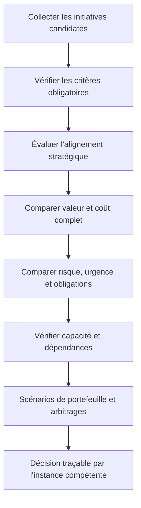

Une méthode multicritère rend les décisions plus transparentes, mais elle ne remplace pas le jugement et ne doit pas créer une fausse précision. Les critères, pondérations et seuils d’exclusion doivent être définis avant de connaître le classement final. Une initiative obligatoire pour la sécurité ou la conformité peut être traitée comme une contrainte plutôt que mise en concurrence uniquement sur son rendement financier. Conserve les hypothèses, les incertitudes et les arbitrages non capturés par le score.

**Articuler avec les autres dimensions.** La décision peut affecter le périmètre, la capacité, les coûts, le calendrier, la sécurité et l’exploitation. Il est nécessaire de repérer les dépendances en amont, les conséquences pour les bénéficiaires et les coûts de réversibilité. Une optimisation locale peut transférer le coût vers une autre équipe ou reporter un risque après la mise en service. Une analyse complète rend explicite le compromis, indique ce qui est protégé et précise quelles limites ne peuvent pas être négociées.

**Illustration opérationnelle.** Une obligation réglementaire peut être prioritaire même si son retour financier direct semble faible. Pour traiter ce type de situation, consigner les faits, distinguer les hypothèses, fixer une responsabilité et définir une preuve vérifiable. Lorsque plusieurs solutions sont possibles, les comparer avec des critères communs. Si les données sont incomplètes, organiser une courte investigation avec une échéance au lieu de présenter une estimation fragile comme un engagement ferme. La décision doit pouvoir être comprise par une personne qui n’a pas assisté à la discussion d’origine.

**Mise en œuvre.** Recueillir les données auprès des personnes proches du travail, examiner les contraintes, formuler des options, préciser leurs impacts et décider au niveau approprié. Après la décision, consigner le motif, informer les acteurs concernés et suivre l’effet réel. Lorsque le seuil de délégation est dépassé, préparer une escalade concise qui présente le problème, les options, les risques, une recommandation et la date à laquelle la décision devient urgente.

**Mesure et preuve.** Il faut choisir un indicateur correspondant à la finalité de la pratique. Une donnée d’activité ne démontre pas nécessairement un résultat. Définir la source, la fréquence, le responsable, la valeur de référence et les limites de l’indicateur. Compléter si nécessaire les chiffres par une observation qualitative, une revue ou un test. Les mesures doivent être assez fiables pour soutenir une décision, mais pas si coûteuses qu’elles consomment une part disproportionnée du travail.

**Erreurs fréquentes et correction.** Les erreurs habituelles incluent une information non actualisée, des définitions variables, une responsabilité implicite, un contrôle fait trop tard ou une exception devenue la règle. Le correctif n’est pas d’ajouter des tableaux sans fin : il faut retrouver la cause, simplifier le flux, attribuer la décision et mesurer l’amélioration. Si une pratique ne produit plus de valeur, la revoir avec les personnes concernées, tout en conservant les contrôles obligatoires et les traces nécessaires à l’audit.

**Approfondissement.** Pour un projet à forte criticité, la pratique peut exiger une validation indépendante, une séparation des tâches, une piste d’audit et un test sur un environnement représentatif. Pour un travail limité et réversible, une revue de pair peut suffire. La proportionnalité ne signifie pas l’absence de rigueur : elle cherche le meilleur rapport entre contrôle et utilité. Le test décisif est de savoir si l’équipe peut expliquer ce qu’elle fait, pourquoi elle le fait, quelle preuve confirme le résultat et comment elle réagira si l’hypothèse devient fausse.

### 5. Capacité et goulots

**Comprendre le concept.** Dans « Direction de programme et portefeuille », capacité et goulots constitue une pratique qui doit répondre à une intention précise. Le portefeuille doit tenir compte de la capacité réelle des équipes rares, des fournisseurs et des fenêtres de changement. Le responsable doit définir le résultat attendu, l’autorité concernée et les informations qui manquent encore. Une méthode ne doit pas être appliquée uniquement parce qu’elle figure dans un guide ou qu’elle est proposée par un outil. Sa valeur dépend du contexte, des personnes qui l’utilisent et de la qualité des décisions qu’elle permet de prendre.

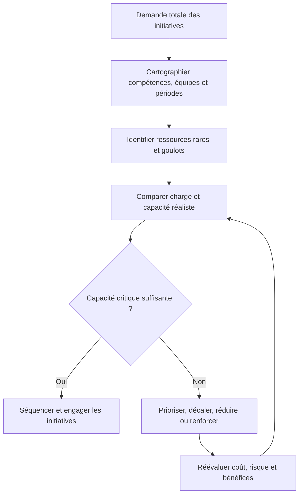

Un portefeuille est limité autant par la capacité de livraison que par l’argent disponible. Un expert sécurité, une équipe de migration ou une fenêtre de changement peut devenir le goulot qui retarde plusieurs initiatives. La capacité doit être estimée par compétences et par période, en incluant l’exploitation courante, la dette technique, le support et les changements déjà engagés. Ajouter des projets au portefeuille sans capacité réelle augmente le travail en cours et la durée de toutes les initiatives.

**Articuler avec les autres dimensions.** La décision peut affecter le périmètre, la capacité, les coûts, le calendrier, la sécurité et l’exploitation. Il est nécessaire de repérer les dépendances en amont, les conséquences pour les bénéficiaires et les coûts de réversibilité. Une optimisation locale peut transférer le coût vers une autre équipe ou reporter un risque après la mise en service. Une analyse complète rend explicite le compromis, indique ce qui est protégé et précise quelles limites ne peuvent pas être négociées.

**Illustration opérationnelle.** Deux projets ne peuvent pas supposer que le même architecte sécurité est disponible à temps plein sur chacun. Pour traiter ce type de situation, consigner les faits, distinguer les hypothèses, fixer une responsabilité et définir une preuve vérifiable. Lorsque plusieurs solutions sont possibles, les comparer avec des critères communs. Si les données sont incomplètes, organiser une courte investigation avec une échéance au lieu de présenter une estimation fragile comme un engagement ferme. La décision doit pouvoir être comprise par une personne qui n’a pas assisté à la discussion d’origine.

**Mise en œuvre.** Recueillir les données auprès des personnes proches du travail, examiner les contraintes, formuler des options, préciser leurs impacts et décider au niveau approprié. Après la décision, consigner le motif, informer les acteurs concernés et suivre l’effet réel. Lorsque le seuil de délégation est dépassé, préparer une escalade concise qui présente le problème, les options, les risques, une recommandation et la date à laquelle la décision devient urgente.

**Mesure et preuve.** Il faut choisir un indicateur correspondant à la finalité de la pratique. Une donnée d’activité ne démontre pas nécessairement un résultat. Définir la source, la fréquence, le responsable, la valeur de référence et les limites de l’indicateur. Compléter si nécessaire les chiffres par une observation qualitative, une revue ou un test. Les mesures doivent être assez fiables pour soutenir une décision, mais pas si coûteuses qu’elles consomment une part disproportionnée du travail.

**Erreurs fréquentes et correction.** Les erreurs habituelles incluent une information non actualisée, des définitions variables, une responsabilité implicite, un contrôle fait trop tard ou une exception devenue la règle. Le correctif n’est pas d’ajouter des tableaux sans fin : il faut retrouver la cause, simplifier le flux, attribuer la décision et mesurer l’amélioration. Si une pratique ne produit plus de valeur, la revoir avec les personnes concernées, tout en conservant les contrôles obligatoires et les traces nécessaires à l’audit.

**Approfondissement.** Pour un projet à forte criticité, la pratique peut exiger une validation indépendante, une séparation des tâches, une piste d’audit et un test sur un environnement représentatif. Pour un travail limité et réversible, une revue de pair peut suffire. La proportionnalité ne signifie pas l’absence de rigueur : elle cherche le meilleur rapport entre contrôle et utilité. Le test décisif est de savoir si l’équipe peut expliquer ce qu’elle fait, pourquoi elle le fait, quelle preuve confirme le résultat et comment elle réagira si l’hypothèse devient fausse.

### 6. Cartographie des dépendances

**Comprendre le concept.** Dans « Direction de programme et portefeuille », cartographie des dépendances constitue une pratique qui doit répondre à une intention précise. La vision portefeuille rend visibles les interfaces, jalons communs, prérequis et risques de synchronisation. Le responsable doit définir le résultat attendu, l’autorité concernée et les informations qui manquent encore. Une méthode ne doit pas être appliquée uniquement parce qu’elle figure dans un guide ou qu’elle est proposée par un outil. Sa valeur dépend du contexte, des personnes qui l’utilisent et de la qualité des décisions qu’elle permet de prendre.

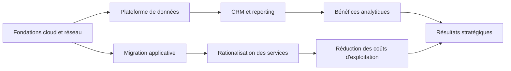

La cartographie des dépendances doit rendre visibles les décisions et capacités partagées entre projets. Une dépendance comporte un fournisseur, une date ou condition d’entrée, un livrable attendu et une conséquence si elle n’est pas satisfaite. Le responsable de programme synchronise les plans et arbitre les conflits ; le portefeuille tient compte des effets si une dépendance critique impose de changer l’ordre des investissements.

**Articuler avec les autres dimensions.** La décision peut affecter le périmètre, la capacité, les coûts, le calendrier, la sécurité et l’exploitation. Il est nécessaire de repérer les dépendances en amont, les conséquences pour les bénéficiaires et les coûts de réversibilité. Une optimisation locale peut transférer le coût vers une autre équipe ou reporter un risque après la mise en service. Une analyse complète rend explicite le compromis, indique ce qui est protégé et précise quelles limites ne peuvent pas être négociées.

**Illustration opérationnelle.** La migration cloud doit livrer l’identité cible avant que le CRM active son modèle d’accès. Pour traiter ce type de situation, consigner les faits, distinguer les hypothèses, fixer une responsabilité et définir une preuve vérifiable. Lorsque plusieurs solutions sont possibles, les comparer avec des critères communs. Si les données sont incomplètes, organiser une courte investigation avec une échéance au lieu de présenter une estimation fragile comme un engagement ferme. La décision doit pouvoir être comprise par une personne qui n’a pas assisté à la discussion d’origine.

**Mise en œuvre.** Recueillir les données auprès des personnes proches du travail, examiner les contraintes, formuler des options, préciser leurs impacts et décider au niveau approprié. Après la décision, consigner le motif, informer les acteurs concernés et suivre l’effet réel. Lorsque le seuil de délégation est dépassé, préparer une escalade concise qui présente le problème, les options, les risques, une recommandation et la date à laquelle la décision devient urgente.

**Mesure et preuve.** Il faut choisir un indicateur correspondant à la finalité de la pratique. Une donnée d’activité ne démontre pas nécessairement un résultat. Définir la source, la fréquence, le responsable, la valeur de référence et les limites de l’indicateur. Compléter si nécessaire les chiffres par une observation qualitative, une revue ou un test. Les mesures doivent être assez fiables pour soutenir une décision, mais pas si coûteuses qu’elles consomment une part disproportionnée du travail.

**Erreurs fréquentes et correction.** Les erreurs habituelles incluent une information non actualisée, des définitions variables, une responsabilité implicite, un contrôle fait trop tard ou une exception devenue la règle. Le correctif n’est pas d’ajouter des tableaux sans fin : il faut retrouver la cause, simplifier le flux, attribuer la décision et mesurer l’amélioration. Si une pratique ne produit plus de valeur, la revoir avec les personnes concernées, tout en conservant les contrôles obligatoires et les traces nécessaires à l’audit.

**Approfondissement.** Pour un projet à forte criticité, la pratique peut exiger une validation indépendante, une séparation des tâches, une piste d’audit et un test sur un environnement représentatif. Pour un travail limité et réversible, une revue de pair peut suffire. La proportionnalité ne signifie pas l’absence de rigueur : elle cherche le meilleur rapport entre contrôle et utilité. Le test décisif est de savoir si l’équipe peut expliquer ce qu’elle fait, pourquoi elle le fait, quelle preuve confirme le résultat et comment elle réagira si l’hypothèse devient fausse.

### 7. Comité portefeuille

**Comprendre le concept.** Dans « Direction de programme et portefeuille », comité portefeuille constitue une pratique qui doit répondre à une intention précise. Une instance portefeuille décide des priorités, financements et arrêts avec des critères cohérents. Le responsable doit définir le résultat attendu, l’autorité concernée et les informations qui manquent encore. Une méthode ne doit pas être appliquée uniquement parce qu’elle figure dans un guide ou qu’elle est proposée par un outil. Sa valeur dépend du contexte, des personnes qui l’utilisent et de la qualité des décisions qu’elle permet de prendre.

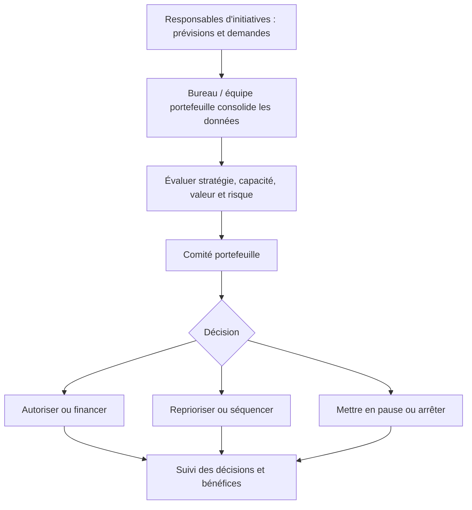

Le comité portefeuille doit prendre des décisions de sélection, de financement, de priorité et d’équilibrage, pas seulement recevoir un tableau de statut. Son dossier doit présenter les options comparables, les conséquences sur les autres initiatives, les risques acceptés et les ressources nécessaires. Chaque arbitrage reçoit un responsable, une date d’effet et des critères de réexamen pour éviter que les décisions ne soient oubliées après la réunion.

**Articuler avec les autres dimensions.** La décision peut affecter le périmètre, la capacité, les coûts, le calendrier, la sécurité et l’exploitation. Il est nécessaire de repérer les dépendances en amont, les conséquences pour les bénéficiaires et les coûts de réversibilité. Une optimisation locale peut transférer le coût vers une autre équipe ou reporter un risque après la mise en service. Une analyse complète rend explicite le compromis, indique ce qui est protégé et précise quelles limites ne peuvent pas être négociées.

**Illustration opérationnelle.** Le comité finance un pilote avant le déploiement complet car il réduit une incertitude importante. Pour traiter ce type de situation, consigner les faits, distinguer les hypothèses, fixer une responsabilité et définir une preuve vérifiable. Lorsque plusieurs solutions sont possibles, les comparer avec des critères communs. Si les données sont incomplètes, organiser une courte investigation avec une échéance au lieu de présenter une estimation fragile comme un engagement ferme. La décision doit pouvoir être comprise par une personne qui n’a pas assisté à la discussion d’origine.

**Mise en œuvre.** Recueillir les données auprès des personnes proches du travail, examiner les contraintes, formuler des options, préciser leurs impacts et décider au niveau approprié. Après la décision, consigner le motif, informer les acteurs concernés et suivre l’effet réel. Lorsque le seuil de délégation est dépassé, préparer une escalade concise qui présente le problème, les options, les risques, une recommandation et la date à laquelle la décision devient urgente.

**Mesure et preuve.** Il faut choisir un indicateur correspondant à la finalité de la pratique. Une donnée d’activité ne démontre pas nécessairement un résultat. Définir la source, la fréquence, le responsable, la valeur de référence et les limites de l’indicateur. Compléter si nécessaire les chiffres par une observation qualitative, une revue ou un test. Les mesures doivent être assez fiables pour soutenir une décision, mais pas si coûteuses qu’elles consomment une part disproportionnée du travail.

**Erreurs fréquentes et correction.** Les erreurs habituelles incluent une information non actualisée, des définitions variables, une responsabilité implicite, un contrôle fait trop tard ou une exception devenue la règle. Le correctif n’est pas d’ajouter des tableaux sans fin : il faut retrouver la cause, simplifier le flux, attribuer la décision et mesurer l’amélioration. Si une pratique ne produit plus de valeur, la revoir avec les personnes concernées, tout en conservant les contrôles obligatoires et les traces nécessaires à l’audit.

**Approfondissement.** Pour un projet à forte criticité, la pratique peut exiger une validation indépendante, une séparation des tâches, une piste d’audit et un test sur un environnement représentatif. Pour un travail limité et réversible, une revue de pair peut suffire. La proportionnalité ne signifie pas l’absence de rigueur : elle cherche le meilleur rapport entre contrôle et utilité. Le test décisif est de savoir si l’équipe peut expliquer ce qu’elle fait, pourquoi elle le fait, quelle preuve confirme le résultat et comment elle réagira si l’hypothèse devient fausse.

### 8. Analyse d’investissement

**Comprendre le concept.** Dans « Direction de programme et portefeuille », analyse d’investissement constitue une pratique qui doit répondre à une intention précise. Les business cases comparent coûts, bénéfices, risques, options et coût d’opportunité. Le responsable doit définir le résultat attendu, l’autorité concernée et les informations qui manquent encore. Une méthode ne doit pas être appliquée uniquement parce qu’elle figure dans un guide ou qu’elle est proposée par un outil. Sa valeur dépend du contexte, des personnes qui l’utilisent et de la qualité des décisions qu’elle permet de prendre.

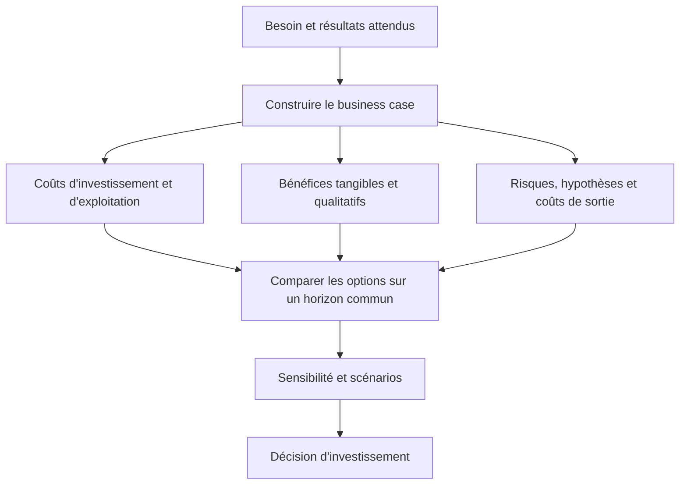

L’analyse d’investissement doit comparer les options sur un horizon cohérent, y compris les coûts de mise en œuvre, d’exploitation, de support et de sortie. Les bénéfices qualitatifs et les obligations stratégiques peuvent être importants même lorsqu’ils ne se convertissent pas facilement en argent. Les indicateurs financiers comme la valeur actuelle nette ou le délai de retour dépendent d’hypothèses ; présente les scénarios optimiste, central et défavorable, ainsi que les éléments qui changeraient la décision.

**Articuler avec les autres dimensions.** La décision peut affecter le périmètre, la capacité, les coûts, le calendrier, la sécurité et l’exploitation. Il est nécessaire de repérer les dépendances en amont, les conséquences pour les bénéficiaires et les coûts de réversibilité. Une optimisation locale peut transférer le coût vers une autre équipe ou reporter un risque après la mise en service. Une analyse complète rend explicite le compromis, indique ce qui est protégé et précise quelles limites ne peuvent pas être négociées.

**Illustration opérationnelle.** Le maintien d’un ancien système est chiffré comme option avec risques et coûts de support, pas comme option gratuite. Pour traiter ce type de situation, consigner les faits, distinguer les hypothèses, fixer une responsabilité et définir une preuve vérifiable. Lorsque plusieurs solutions sont possibles, les comparer avec des critères communs. Si les données sont incomplètes, organiser une courte investigation avec une échéance au lieu de présenter une estimation fragile comme un engagement ferme. La décision doit pouvoir être comprise par une personne qui n’a pas assisté à la discussion d’origine.

**Mise en œuvre.** Recueillir les données auprès des personnes proches du travail, examiner les contraintes, formuler des options, préciser leurs impacts et décider au niveau approprié. Après la décision, consigner le motif, informer les acteurs concernés et suivre l’effet réel. Lorsque le seuil de délégation est dépassé, préparer une escalade concise qui présente le problème, les options, les risques, une recommandation et la date à laquelle la décision devient urgente.

**Mesure et preuve.** Il faut choisir un indicateur correspondant à la finalité de la pratique. Une donnée d’activité ne démontre pas nécessairement un résultat. Définir la source, la fréquence, le responsable, la valeur de référence et les limites de l’indicateur. Compléter si nécessaire les chiffres par une observation qualitative, une revue ou un test. Les mesures doivent être assez fiables pour soutenir une décision, mais pas si coûteuses qu’elles consomment une part disproportionnée du travail.

**Erreurs fréquentes et correction.** Les erreurs habituelles incluent une information non actualisée, des définitions variables, une responsabilité implicite, un contrôle fait trop tard ou une exception devenue la règle. Le correctif n’est pas d’ajouter des tableaux sans fin : il faut retrouver la cause, simplifier le flux, attribuer la décision et mesurer l’amélioration. Si une pratique ne produit plus de valeur, la revoir avec les personnes concernées, tout en conservant les contrôles obligatoires et les traces nécessaires à l’audit.

**Approfondissement.** Pour un projet à forte criticité, la pratique peut exiger une validation indépendante, une séparation des tâches, une piste d’audit et un test sur un environnement représentatif. Pour un travail limité et réversible, une revue de pair peut suffire. La proportionnalité ne signifie pas l’absence de rigueur : elle cherche le meilleur rapport entre contrôle et utilité. Le test décisif est de savoir si l’équipe peut expliquer ce qu’elle fait, pourquoi elle le fait, quelle preuve confirme le résultat et comment elle réagira si l’hypothèse devient fausse.

### 9. Financement par étapes

**Comprendre le concept.** Dans « Direction de programme et portefeuille », financement par étapes constitue une pratique qui doit répondre à une intention précise. Le financement progressif libère l’investissement lorsque valeur et faisabilité sont confirmées. Le responsable doit définir le résultat attendu, l’autorité concernée et les informations qui manquent encore. Une méthode ne doit pas être appliquée uniquement parce qu’elle figure dans un guide ou qu’elle est proposée par un outil. Sa valeur dépend du contexte, des personnes qui l’utilisent et de la qualité des décisions qu’elle permet de prendre.

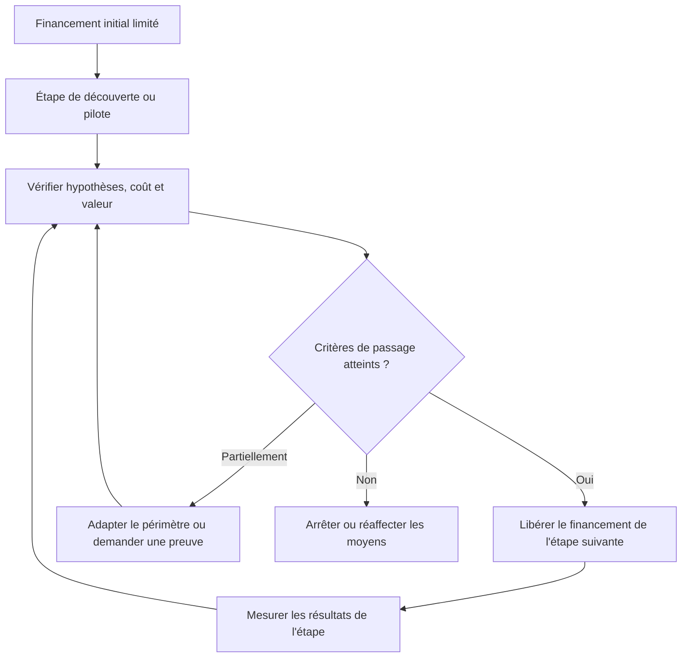

Le financement par étapes évite d’engager tout le capital avant d’avoir testé les hypothèses majeures. Chaque tranche de financement est associée à des critères de passage vérifiables : preuves techniques, adoption, conformité, coût actualisé, capacité ou résultats commerciaux. La méthode doit également définir qui peut autoriser la tranche suivante et ce qui arrive aux contrats, données et équipes si l’initiative est arrêtée.

**Articuler avec les autres dimensions.** La décision peut affecter le périmètre, la capacité, les coûts, le calendrier, la sécurité et l’exploitation. Il est nécessaire de repérer les dépendances en amont, les conséquences pour les bénéficiaires et les coûts de réversibilité. Une optimisation locale peut transférer le coût vers une autre équipe ou reporter un risque après la mise en service. Une analyse complète rend explicite le compromis, indique ce qui est protégé et précise quelles limites ne peuvent pas être négociées.

**Illustration opérationnelle.** Une phase d’architecture vérifie la faisabilité avant l’engagement du budget de construction. Pour traiter ce type de situation, consigner les faits, distinguer les hypothèses, fixer une responsabilité et définir une preuve vérifiable. Lorsque plusieurs solutions sont possibles, les comparer avec des critères communs. Si les données sont incomplètes, organiser une courte investigation avec une échéance au lieu de présenter une estimation fragile comme un engagement ferme. La décision doit pouvoir être comprise par une personne qui n’a pas assisté à la discussion d’origine.

**Mise en œuvre.** Recueillir les données auprès des personnes proches du travail, examiner les contraintes, formuler des options, préciser leurs impacts et décider au niveau approprié. Après la décision, consigner le motif, informer les acteurs concernés et suivre l’effet réel. Lorsque le seuil de délégation est dépassé, préparer une escalade concise qui présente le problème, les options, les risques, une recommandation et la date à laquelle la décision devient urgente.

**Mesure et preuve.** Il faut choisir un indicateur correspondant à la finalité de la pratique. Une donnée d’activité ne démontre pas nécessairement un résultat. Définir la source, la fréquence, le responsable, la valeur de référence et les limites de l’indicateur. Compléter si nécessaire les chiffres par une observation qualitative, une revue ou un test. Les mesures doivent être assez fiables pour soutenir une décision, mais pas si coûteuses qu’elles consomment une part disproportionnée du travail.

**Erreurs fréquentes et correction.** Les erreurs habituelles incluent une information non actualisée, des définitions variables, une responsabilité implicite, un contrôle fait trop tard ou une exception devenue la règle. Le correctif n’est pas d’ajouter des tableaux sans fin : il faut retrouver la cause, simplifier le flux, attribuer la décision et mesurer l’amélioration. Si une pratique ne produit plus de valeur, la revoir avec les personnes concernées, tout en conservant les contrôles obligatoires et les traces nécessaires à l’audit.

**Approfondissement.** Pour un projet à forte criticité, la pratique peut exiger une validation indépendante, une séparation des tâches, une piste d’audit et un test sur un environnement représentatif. Pour un travail limité et réversible, une revue de pair peut suffire. La proportionnalité ne signifie pas l’absence de rigueur : elle cherche le meilleur rapport entre contrôle et utilité. Le test décisif est de savoir si l’équipe peut expliquer ce qu’elle fait, pourquoi elle le fait, quelle preuve confirme le résultat et comment elle réagira si l’hypothèse devient fausse.

### 10. Indicateurs et tableaux de bord

**Comprendre le concept.** Dans « Direction de programme et portefeuille », indicateurs et tableaux de bord constitue une pratique qui doit répondre à une intention précise. Un tableau de portefeuille doit montrer état, prévision, capacité, risques, bénéfices et décisions attendues. Le responsable doit définir le résultat attendu, l’autorité concernée et les informations qui manquent encore. Une méthode ne doit pas être appliquée uniquement parce qu’elle figure dans un guide ou qu’elle est proposée par un outil. Sa valeur dépend du contexte, des personnes qui l’utilisent et de la qualité des décisions qu’elle permet de prendre.

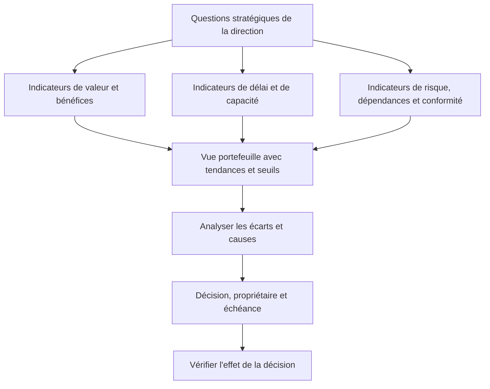

Un tableau de bord portefeuille doit aider à décider plutôt qu’à juxtaposer des feux rouges et verts. Les indicateurs courants peuvent inclure la valeur prévue et réalisée, les bénéfices à risque, l’exposition agrégée, la demande et la capacité, les dépendances critiques, les coûts à terminaison et les retards de décision. Chaque indicateur a une définition, une source, une fréquence, un seuil et un propriétaire. Les données doivent être accompagnées de leurs limites et de leur fraîcheur.

**Articuler avec les autres dimensions.** La décision peut affecter le périmètre, la capacité, les coûts, le calendrier, la sécurité et l’exploitation. Il est nécessaire de repérer les dépendances en amont, les conséquences pour les bénéficiaires et les coûts de réversibilité. Une optimisation locale peut transférer le coût vers une autre équipe ou reporter un risque après la mise en service. Une analyse complète rend explicite le compromis, indique ce qui est protégé et précise quelles limites ne peuvent pas être négociées.

**Illustration opérationnelle.** Le retard d’un projet est évalué aussi par son effet sur les objectifs et les autres projets. Pour traiter ce type de situation, consigner les faits, distinguer les hypothèses, fixer une responsabilité et définir une preuve vérifiable. Lorsque plusieurs solutions sont possibles, les comparer avec des critères communs. Si les données sont incomplètes, organiser une courte investigation avec une échéance au lieu de présenter une estimation fragile comme un engagement ferme. La décision doit pouvoir être comprise par une personne qui n’a pas assisté à la discussion d’origine.

**Mise en œuvre.** Recueillir les données auprès des personnes proches du travail, examiner les contraintes, formuler des options, préciser leurs impacts et décider au niveau approprié. Après la décision, consigner le motif, informer les acteurs concernés et suivre l’effet réel. Lorsque le seuil de délégation est dépassé, préparer une escalade concise qui présente le problème, les options, les risques, une recommandation et la date à laquelle la décision devient urgente.

**Mesure et preuve.** Il faut choisir un indicateur correspondant à la finalité de la pratique. Une donnée d’activité ne démontre pas nécessairement un résultat. Définir la source, la fréquence, le responsable, la valeur de référence et les limites de l’indicateur. Compléter si nécessaire les chiffres par une observation qualitative, une revue ou un test. Les mesures doivent être assez fiables pour soutenir une décision, mais pas si coûteuses qu’elles consomment une part disproportionnée du travail.

**Erreurs fréquentes et correction.** Les erreurs habituelles incluent une information non actualisée, des définitions variables, une responsabilité implicite, un contrôle fait trop tard ou une exception devenue la règle. Le correctif n’est pas d’ajouter des tableaux sans fin : il faut retrouver la cause, simplifier le flux, attribuer la décision et mesurer l’amélioration. Si une pratique ne produit plus de valeur, la revoir avec les personnes concernées, tout en conservant les contrôles obligatoires et les traces nécessaires à l’audit.

**Approfondissement.** Pour un projet à forte criticité, la pratique peut exiger une validation indépendante, une séparation des tâches, une piste d’audit et un test sur un environnement représentatif. Pour un travail limité et réversible, une revue de pair peut suffire. La proportionnalité ne signifie pas l’absence de rigueur : elle cherche le meilleur rapport entre contrôle et utilité. Le test décisif est de savoir si l’équipe peut expliquer ce qu’elle fait, pourquoi elle le fait, quelle preuve confirme le résultat et comment elle réagira si l’hypothèse devient fausse.

### 11. Changements stratégiques

**Comprendre le concept.** Dans « Direction de programme et portefeuille », changements stratégiques constitue une pratique qui doit répondre à une intention précise. Quand les hypothèses stratégiques changent, le portefeuille doit réévaluer la pertinence des initiatives en cours. Le responsable doit définir le résultat attendu, l’autorité concernée et les informations qui manquent encore. Une méthode ne doit pas être appliquée uniquement parce qu’elle figure dans un guide ou qu’elle est proposée par un outil. Sa valeur dépend du contexte, des personnes qui l’utilisent et de la qualité des décisions qu’elle permet de prendre.

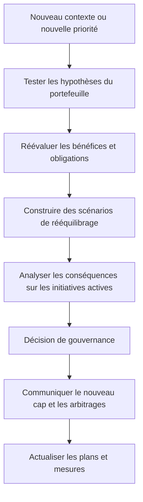

Un changement stratégique peut modifier la pertinence relative des investissements, même si les projets sont exécutés correctement. Réévalue les hypothèses, les obligations, les coûts de sortie, les bénéfices non encore réalisés et les effets sur les ressources. Une réorientation responsable ne se limite pas à ajouter une nouvelle priorité : elle indique aussi ce qui sera ralenti, réduit ou arrêté et explique les conséquences pour les équipes et les parties prenantes.

**Articuler avec les autres dimensions.** La décision peut affecter le périmètre, la capacité, les coûts, le calendrier, la sécurité et l’exploitation. Il est nécessaire de repérer les dépendances en amont, les conséquences pour les bénéficiaires et les coûts de réversibilité. Une optimisation locale peut transférer le coût vers une autre équipe ou reporter un risque après la mise en service. Une analyse complète rend explicite le compromis, indique ce qui est protégé et précise quelles limites ne peuvent pas être négociées.

**Illustration opérationnelle.** Une acquisition modifie les priorités et impose de revoir les projets d’intégration avant le prochain cycle de financement. Pour traiter ce type de situation, consigner les faits, distinguer les hypothèses, fixer une responsabilité et définir une preuve vérifiable. Lorsque plusieurs solutions sont possibles, les comparer avec des critères communs. Si les données sont incomplètes, organiser une courte investigation avec une échéance au lieu de présenter une estimation fragile comme un engagement ferme. La décision doit pouvoir être comprise par une personne qui n’a pas assisté à la discussion d’origine.

**Mise en œuvre.** Recueillir les données auprès des personnes proches du travail, examiner les contraintes, formuler des options, préciser leurs impacts et décider au niveau approprié. Après la décision, consigner le motif, informer les acteurs concernés et suivre l’effet réel. Lorsque le seuil de délégation est dépassé, préparer une escalade concise qui présente le problème, les options, les risques, une recommandation et la date à laquelle la décision devient urgente.

**Mesure et preuve.** Il faut choisir un indicateur correspondant à la finalité de la pratique. Une donnée d’activité ne démontre pas nécessairement un résultat. Définir la source, la fréquence, le responsable, la valeur de référence et les limites de l’indicateur. Compléter si nécessaire les chiffres par une observation qualitative, une revue ou un test. Les mesures doivent être assez fiables pour soutenir une décision, mais pas si coûteuses qu’elles consomment une part disproportionnée du travail.

**Erreurs fréquentes et correction.** Les erreurs habituelles incluent une information non actualisée, des définitions variables, une responsabilité implicite, un contrôle fait trop tard ou une exception devenue la règle. Le correctif n’est pas d’ajouter des tableaux sans fin : il faut retrouver la cause, simplifier le flux, attribuer la décision et mesurer l’amélioration. Si une pratique ne produit plus de valeur, la revoir avec les personnes concernées, tout en conservant les contrôles obligatoires et les traces nécessaires à l’audit.

**Approfondissement.** Pour un projet à forte criticité, la pratique peut exiger une validation indépendante, une séparation des tâches, une piste d’audit et un test sur un environnement représentatif. Pour un travail limité et réversible, une revue de pair peut suffire. La proportionnalité ne signifie pas l’absence de rigueur : elle cherche le meilleur rapport entre contrôle et utilité. Le test décisif est de savoir si l’équipe peut expliquer ce qu’elle fait, pourquoi elle le fait, quelle preuve confirme le résultat et comment elle réagira si l’hypothèse devient fausse.

### 12. Arrêt et réallocation

**Comprendre le concept.** Dans « Direction de programme et portefeuille », arrêt et réallocation constitue une pratique qui doit répondre à une intention précise. Arrêter une initiative qui ne justifie plus son coût peut libérer des ressources pour des options plus utiles. Le responsable doit définir le résultat attendu, l’autorité concernée et les informations qui manquent encore. Une méthode ne doit pas être appliquée uniquement parce qu’elle figure dans un guide ou qu’elle est proposée par un outil. Sa valeur dépend du contexte, des personnes qui l’utilisent et de la qualité des décisions qu’elle permet de prendre.

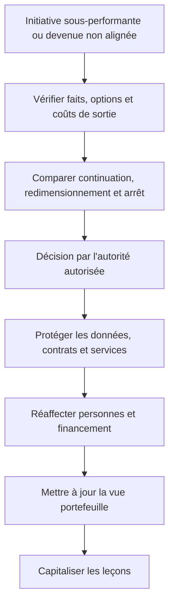

Arrêter une initiative n’est pas nécessairement un échec de gouvernance ; poursuivre un investissement qui ne justifie plus ses coûts peut être plus dommageable. La décision doit considérer les coûts déjà irrécupérables sans les laisser dicter à eux seuls l’avenir, mais aussi les frais de sortie, les obligations contractuelles, les dépendances et la valeur qui pourrait encore être obtenue. La réallocation des compétences doit être préparée pour éviter de perdre des capacités rares.

**Articuler avec les autres dimensions.** La décision peut affecter le périmètre, la capacité, les coûts, le calendrier, la sécurité et l’exploitation. Il est nécessaire de repérer les dépendances en amont, les conséquences pour les bénéficiaires et les coûts de réversibilité. Une optimisation locale peut transférer le coût vers une autre équipe ou reporter un risque après la mise en service. Une analyse complète rend explicite le compromis, indique ce qui est protégé et précise quelles limites ne peuvent pas être négociées.

**Illustration opérationnelle.** Un prototype qui ne confirme pas l’hypothèse métier est arrêté selon les critères prévus, puis les experts sont réaffectés. Pour traiter ce type de situation, consigner les faits, distinguer les hypothèses, fixer une responsabilité et définir une preuve vérifiable. Lorsque plusieurs solutions sont possibles, les comparer avec des critères communs. Si les données sont incomplètes, organiser une courte investigation avec une échéance au lieu de présenter une estimation fragile comme un engagement ferme. La décision doit pouvoir être comprise par une personne qui n’a pas assisté à la discussion d’origine.

**Mise en œuvre.** Recueillir les données auprès des personnes proches du travail, examiner les contraintes, formuler des options, préciser leurs impacts et décider au niveau approprié. Après la décision, consigner le motif, informer les acteurs concernés et suivre l’effet réel. Lorsque le seuil de délégation est dépassé, préparer une escalade concise qui présente le problème, les options, les risques, une recommandation et la date à laquelle la décision devient urgente.

**Mesure et preuve.** Il faut choisir un indicateur correspondant à la finalité de la pratique. Une donnée d’activité ne démontre pas nécessairement un résultat. Définir la source, la fréquence, le responsable, la valeur de référence et les limites de l’indicateur. Compléter si nécessaire les chiffres par une observation qualitative, une revue ou un test. Les mesures doivent être assez fiables pour soutenir une décision, mais pas si coûteuses qu’elles consomment une part disproportionnée du travail.

**Erreurs fréquentes et correction.** Les erreurs habituelles incluent une information non actualisée, des définitions variables, une responsabilité implicite, un contrôle fait trop tard ou une exception devenue la règle. Le correctif n’est pas d’ajouter des tableaux sans fin : il faut retrouver la cause, simplifier le flux, attribuer la décision et mesurer l’amélioration. Si une pratique ne produit plus de valeur, la revoir avec les personnes concernées, tout en conservant les contrôles obligatoires et les traces nécessaires à l’audit.

**Approfondissement.** Pour un projet à forte criticité, la pratique peut exiger une validation indépendante, une séparation des tâches, une piste d’audit et un test sur un environnement représentatif. Pour un travail limité et réversible, une revue de pair peut suffire. La proportionnalité ne signifie pas l’absence de rigueur : elle cherche le meilleur rapport entre contrôle et utilité. Le test décisif est de savoir si l’équipe peut expliquer ce qu’elle fait, pourquoi elle le fait, quelle preuve confirme le résultat et comment elle réagira si l’hypothèse devient fausse.

### 13. Gouvernance des données

**Comprendre le concept.** Dans « Direction de programme et portefeuille », gouvernance des données constitue une pratique qui doit répondre à une intention précise. Les décisions portefeuille s’appuient sur des définitions comparables, des sources fiables et une responsabilité sur les données. Le responsable doit définir le résultat attendu, l’autorité concernée et les informations qui manquent encore. Une méthode ne doit pas être appliquée uniquement parce qu’elle figure dans un guide ou qu’elle est proposée par un outil. Sa valeur dépend du contexte, des personnes qui l’utilisent et de la qualité des décisions qu’elle permet de prendre.

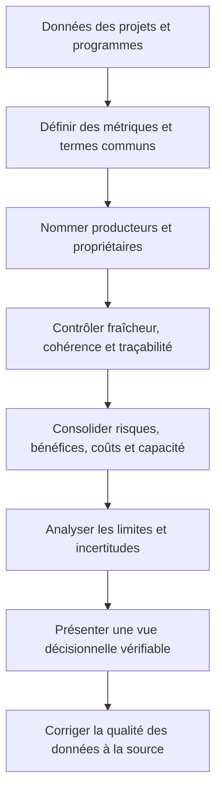

La gouvernance des données de portefeuille cherche à rendre les comparaisons fiables. Si une équipe mesure la progression par tâches terminées et une autre par dépenses, leurs pourcentages ne sont pas comparables. Les définitions des coûts, bénéfices, risques, statuts et dates doivent être harmonisées ; les données sensibles sont limitées aux personnes qui en ont besoin et les calculs critiques restent auditables.

**Articuler avec les autres dimensions.** La décision peut affecter le périmètre, la capacité, les coûts, le calendrier, la sécurité et l’exploitation. Il est nécessaire de repérer les dépendances en amont, les conséquences pour les bénéficiaires et les coûts de réversibilité. Une optimisation locale peut transférer le coût vers une autre équipe ou reporter un risque après la mise en service. Une analyse complète rend explicite le compromis, indique ce qui est protégé et précise quelles limites ne peuvent pas être négociées.

**Illustration opérationnelle.** Les projets utilisent la même définition de coût à terminaison et de bénéfice attendu pour éviter une comparaison artificielle. Pour traiter ce type de situation, consigner les faits, distinguer les hypothèses, fixer une responsabilité et définir une preuve vérifiable. Lorsque plusieurs solutions sont possibles, les comparer avec des critères communs. Si les données sont incomplètes, organiser une courte investigation avec une échéance au lieu de présenter une estimation fragile comme un engagement ferme. La décision doit pouvoir être comprise par une personne qui n’a pas assisté à la discussion d’origine.

**Mise en œuvre.** Recueillir les données auprès des personnes proches du travail, examiner les contraintes, formuler des options, préciser leurs impacts et décider au niveau approprié. Après la décision, consigner le motif, informer les acteurs concernés et suivre l’effet réel. Lorsque le seuil de délégation est dépassé, préparer une escalade concise qui présente le problème, les options, les risques, une recommandation et la date à laquelle la décision devient urgente.

**Mesure et preuve.** Il faut choisir un indicateur correspondant à la finalité de la pratique. Une donnée d’activité ne démontre pas nécessairement un résultat. Définir la source, la fréquence, le responsable, la valeur de référence et les limites de l’indicateur. Compléter si nécessaire les chiffres par une observation qualitative, une revue ou un test. Les mesures doivent être assez fiables pour soutenir une décision, mais pas si coûteuses qu’elles consomment une part disproportionnée du travail.

**Erreurs fréquentes et correction.** Les erreurs habituelles incluent une information non actualisée, des définitions variables, une responsabilité implicite, un contrôle fait trop tard ou une exception devenue la règle. Le correctif n’est pas d’ajouter des tableaux sans fin : il faut retrouver la cause, simplifier le flux, attribuer la décision et mesurer l’amélioration. Si une pratique ne produit plus de valeur, la revoir avec les personnes concernées, tout en conservant les contrôles obligatoires et les traces nécessaires à l’audit.

**Approfondissement.** Pour un projet à forte criticité, la pratique peut exiger une validation indépendante, une séparation des tâches, une piste d’audit et un test sur un environnement représentatif. Pour un travail limité et réversible, une revue de pair peut suffire. La proportionnalité ne signifie pas l’absence de rigueur : elle cherche le meilleur rapport entre contrôle et utilité. Le test décisif est de savoir si l’équipe peut expliquer ce qu’elle fait, pourquoi elle le fait, quelle preuve confirme le résultat et comment elle réagira si l’hypothèse devient fausse.

## Étude de cas : Arbitrer un portefeuille numérique

Une entreprise mène simultanément une migration cloud, un programme de cybersécurité, un projet CRM et une modernisation de données. Le budget est limité, les compétences sont rares et les initiatives ont des dépendances croisées.

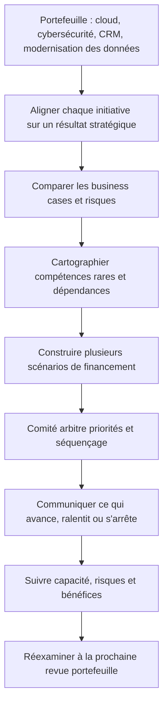

Le portefeuille numérique du cas comporte des initiatives de nature différente : certaines réduisent un risque de sécurité, d’autres modernisent l’infrastructure ou cherchent de nouveaux bénéfices commerciaux. Les comparer uniquement sur un taux de retour serait insuffisant. Le comité doit prendre en compte les obligations, les risques, les dépendances, la capacité, les coûts de transition et les résultats attendus, puis expliquer l’équilibre retenu.

### Cadrage et analyse

Les acteurs commencent par décrire le problème avec des faits vérifiables, puis identifient les bénéficiaires, les exigences et les contraintes. Ils séparent les obligations impératives des préférences, écrivent les hypothèses et demandent confirmation lorsque celles-ci conditionnent fortement le coût ou la date. Le responsable désigne un propriétaire pour chaque décision majeure, fixe un mécanisme d’escalade et conserve une trace des validations.

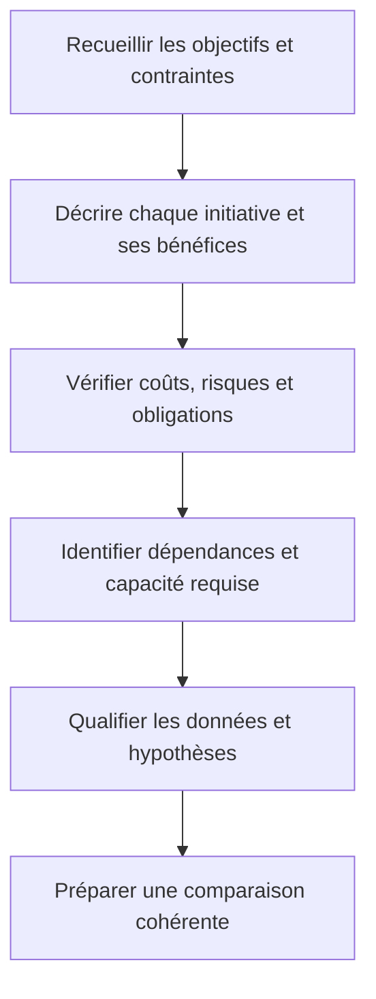

Avant de classer les projets, l’équipe portefeuille établit une base comparable. Chaque initiative présente un résultat attendu, un propriétaire du bénéfice, un coût complet, une estimation de capacité par période, les risques et les dépendances clés. Les données manquantes sont clairement signalées et une décision de financement peut être conditionnée à une preuve complémentaire plutôt que fondée sur une précision artificielle.

### Comparaison des options

L’équipe compare au moins deux options réalistes, dont une option limitée ou progressive. Chaque option est évaluée selon valeur, coût complet, délai, risques, réversibilité, dépendances et conséquences en exploitation. Les avantages non mesurés sont explicitement identifiés comme hypothèses. Une décision est recommandée lorsque le raisonnement est clair, les compromis sont compris et la personne habilitée dispose des éléments nécessaires.

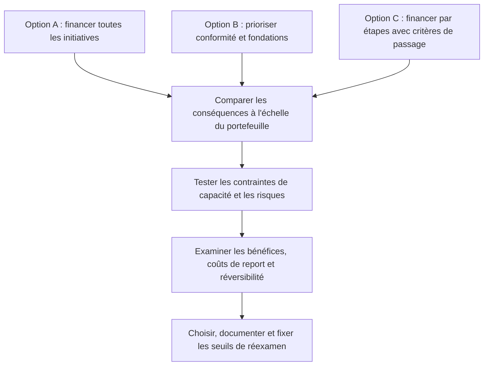

Le scénario qui finance toutes les initiatives peut sembler ambitieux mais dépasser la capacité et ralentir les livraisons. Prioriser les fondations peut réduire des risques communs mais retarder certains bénéfices commerciaux. Un financement par étapes peut améliorer l’apprentissage tout en maintenant des décisions réversibles. L’analyse doit montrer les coûts de report, les effets sur les dépendances et les critères qui pourraient changer le classement.

### Mise en œuvre et suivi

Le plan est découpé en livrables vérifiables. Les travaux critiques sont associés à des critères de sortie, des responsables et des preuves. Les prévisions sont actualisées en fonction du travail restant, pas uniquement par décalage des dates précédentes. Les changements sont analysés pour leurs impacts croisés. Lorsqu’un indicateur devient rouge, l’équipe expose la cause et propose une action plutôt que de modifier sa définition.

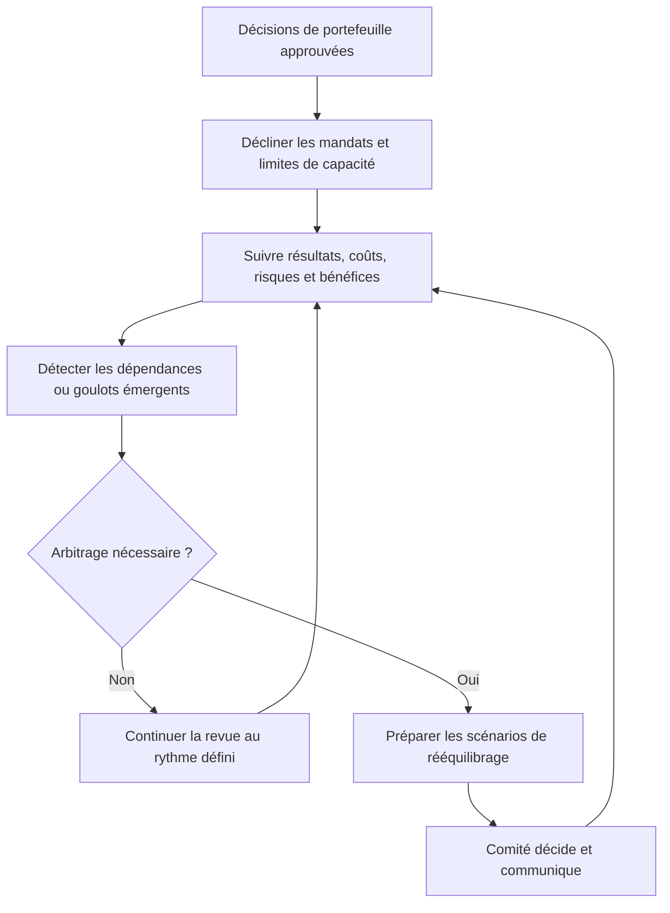

Après l’arbitrage, chaque décision doit être traduite en budgets, capacité, responsables et mesures. Une revue régulière doit faire apparaître les écarts par rapport aux hypothèses, les bénéfices à risque et les nouvelles contraintes. Il faut distinguer une variation temporaire qui peut être gérée dans le mandat d’un changement structurel qui nécessite une reconfiguration du portefeuille.

### Acceptation et apprentissage

Avant la clôture, les livrables sont comparés aux critères convenus, les défauts et risques résiduels sont documentés, les responsabilités sont transférées et le support est préparé. Les mesures de bénéfices ont un propriétaire et une échéance de suivi. La rétrospective décrit les faits, les causes des écarts, les adaptations utiles et les pratiques à conserver.

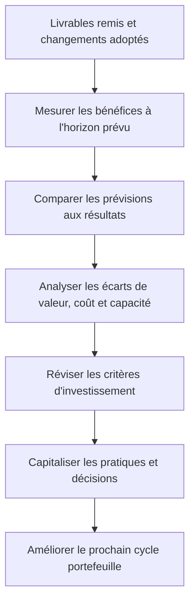

L’apprentissage du portefeuille compare les résultats aux hypothèses initiales, y compris après la clôture des projets. Les bénéfices peuvent se manifester tardivement et dépendent parfois de l’adoption ou du changement de processus. Les mesures doivent rester attribuées à un propriétaire opérationnel ; les écarts servent ensuite à améliorer l’estimation, la sélection des initiatives, les règles de gouvernance et les prochains arbitrages.

## Atelier pratique

**Exercice 1.** À partir du cas, écris une note de pilotage d’une page : résultat attendu, contraintes, options, risques, responsables, indicateurs et décisions nécessaires.

**Correction.** Une bonne réponse relie chaque recommandation à un fait ou une hypothèse clairement identifiée. Elle présente les conséquences de plusieurs options, distingue les décisions réversibles des engagements difficiles à défaire et identifie qui possède l’autorité requise. Les mesures de résultat doivent être observables, avec une source et une date de revue.

**Exercice 2.** Un dirigeant demande une action immédiate, mais les données disponibles ne suffisent pas à comparer ses conséquences. Prépare une réponse transparente et un plan de réduction d’incertitude.

**Correction.** Il faut dire ce qui est connu, ce qui ne l’est pas et pourquoi cette information compte. Proposer une mesure réversible, un pilote ou une courte investigation peut permettre d’agir sans prétendre que les inconnues ont disparu. Le plan doit définir l’échéance de retour et les critères qui permettront de poursuivre ou de changer d’option.

**Exercice 3.** Un indicateur est favorable mais un groupe d’utilisateurs signale une difficulté majeure. Explique comment traiter l’écart entre mesure et observation.

**Correction.** Il faut vérifier si l’indicateur mesure vraiment le résultat recherché, examiner le groupe concerné et rechercher une explication à l’écart. Une moyenne peut masquer des impacts inégaux. Compléter la mesure par des tests ou des entretiens ciblés permet de décider si le processus doit être adapté.

## Pièges à éviter

- Confondre activité, livraison et bénéfice.
- Présenter une estimation comme une certitude sans expliquer les hypothèses.
- Masquer un écart en modifiant la référence.
- Choisir une méthode parce qu’elle est populaire plutôt que adaptée.
- Surcharger l’équipe d’outils qui ne soutiennent aucune décision utile.
- Faire dépendre un résultat d’une personne ou d’un fournisseur sans plan de secours.
- Reporter les contrôles obligatoires à la toute fin.
- Laisser les responsabilités d’acceptation implicites.
- Confondre indicateurs d’activité et mesures de résultat.
- Clore un projet sans transfert, support ni mesure des bénéfices.

## Checklist de révision

- [ ] Le besoin et les résultats attendus sont explicites.
- [ ] Les inclusions et exclusions sont visibles.
- [ ] Les hypothèses, dépendances et risques sont suivis.
- [ ] Les responsables et les décideurs sont identifiés.
- [ ] Les choix et arbitrages sont tracés.
- [ ] Les indicateurs répondent à des questions de décision.
- [ ] Les changements sont analysés et autorisés.
- [ ] La qualité, la sécurité et l’adoption sont intégrées.
- [ ] Le transfert aux opérations est préparé.
- [ ] Les apprentissages sont capitalisés.

## À retenir

Un dispositif de gestion de projet est un système partagé pour comprendre le travail, prendre des décisions, observer les résultats et adapter le plan. Il doit être assez rigoureux pour protéger la valeur, la qualité et la confiance, mais assez léger pour rester utilisé. Les pratiques les plus utiles rendent les hypothèses visibles, les responsabilités explicites et les décisions vérifiables.

## Glossaire

- **Bénéfice :** amélioration mesurable obtenue grâce à un résultat.
- **Dépendance :** condition qui relie plusieurs activités ou équipes.
- **Gouvernance :** répartition des responsabilités, décisions et contrôles.
- **Indicateur :** mesure qui aide à comprendre un résultat ou à décider.
- **Partie prenante :** personne ou organisation influençant le projet ou affectée par lui.
- **Portefeuille :** ensemble d’initiatives arbitrées en fonction des objectifs et capacités.
- **Risque :** événement incertain susceptible d’affecter les objectifs.
- **Scénario :** option décrivant des hypothèses et conséquences possibles.
- **Valeur :** utilité obtenue par le bénéficiaire et l’organisation.
- **Réversibilité :** capacité à revenir sur une décision avec un coût contrôlé.

## Références pour approfondir

- ISO 21502 : https://committee.iso.org/sites/tc258/home/projects/published/iso-21502.html
- PMI : https://www.pmi.org/
- Guide Scrum officiel : https://scrumguides.org/scrum-guide
- PRINCE2 7 : https://www.peoplecert.org/browse-certifications/project-programme-and-portfolio-management/PRINCE2-2/prince2-7-foundation-3579
