# Identification et mitigation des risques

> **Encadré de mise en contexte** — Le registre des risques contient une longue liste sans propriétaires ni actions. Plusieurs incidents sont découverts au moment où les options de réponse sont déjà coûteuses.

## Introduction

La gestion de projet IT transforme une demande parfois imprécise en résultats utiles grâce à des décisions explicites. Les outils de pilotage ne suppriment pas l’incertitude : ils rendent les hypothèses, les responsabilités, les dépendances et les écarts visibles. Une pratique bien choisie aide les personnes compétentes à se coordonner, à détecter les problèmes tôt et à choisir le bon compromis entre valeur, délais, coûts, qualité, sécurité et adoption.

Ce cours sur « Identification et mitigation des risques » privilégie les méthodes applicables dans un environnement réel. Une pratique n’est utile que si elle répond à un besoin précis. Il faut calibrer le niveau de détail en fonction de la criticité, du coût de l’erreur, de la stabilité du périmètre et des obligations externes. Un petit projet réversible peut s’appuyer sur un dispositif léger, alors qu’une migration importante ou un service réglementé exigera des preuves plus formelles.

Le cas « Prévenir les risques d’une migration » sert de fil rouge. Il permet de distinguer les faits des hypothèses, d’identifier les décisions qui conditionnent la livraison et de construire une manière de vérifier le résultat. Les outils cités sont des exemples : leurs fonctions évoluent, les offres commerciales changent et chaque organisation doit vérifier ses règles de sécurité, ses contrats et ses contraintes de conformité avant de les utiliser.

## Objectifs pédagogiques

- Expliquer les concepts de base et les limites des méthodes étudiées.
- Choisir une approche adaptée à la nature du travail et à l’incertitude.
- Décrire les étapes, livrables, responsabilités et contrôles associés.
- Mesurer les résultats avec des indicateurs reliés aux objectifs.
- Appliquer la démarche au cas proposé et justifier les arbitrages.

## Concepts clés

**Valeur.** La valeur décrit le bénéfice recherché pour un utilisateur ou l’organisation. Elle doit être reliée à une situation initiale, à un changement attendu et à une mesure raisonnable. Sans cette relation, l’équipe risque d’optimiser l’outil ou le processus sans résoudre le problème métier.

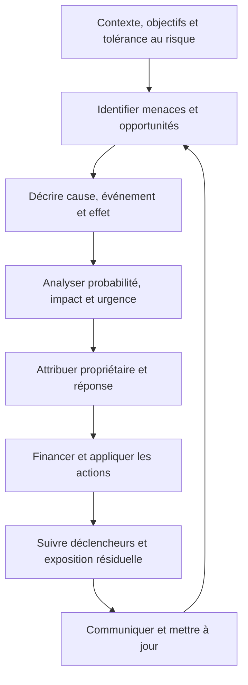

La gestion des risques est un processus continu qui aide à prendre des décisions sous incertitude. Elle ne se réduit pas à remplir un registre au démarrage : il faut définir le contexte et les seuils de tolérance, identifier menaces et opportunités, choisir des réponses, suivre leur exécution et réexaminer l’exposition. Cette logique correspond à l’approche intégrée décrite par ISO 31000 ; ISO indique que l’édition publiée est ISO 31000:2018 et qu’une révision est en développement, donc vérifier la version avant de figer une référence de gouvernance : [ISO 31000](https://www.iso.org/standard/31000).

**Périmètre et qualité.** Le périmètre fixe les limites du travail ; la qualité précise les caractéristiques et critères qui permettront d’accepter les livrables. Les ajouts doivent être analysés au lieu d’être acceptés implicitement. Une date ou un budget ne justifie jamais de prétendre qu’un critère obligatoire est satisfait sans preuve.

**Prévision et référence.** La référence approuvée permet d’étudier les écarts, tandis que la prévision décrit l’issue la plus probable à partir des données actuelles. On peut réviser une prévision et conserver une référence historique. La distinction préserve la transparence et aide à décider sans maquiller les évolutions.

**Gouvernance.** La gouvernance répartit les responsabilités, les pouvoirs de décision, les seuils d’escalade et les mécanismes de validation. Elle doit soutenir le travail plutôt que le bloquer. Les décisions fréquentes et réversibles sont généralement déléguées ; les décisions coûteuses, risquées ou réglementaires nécessitent une autorité et une trace explicites.

**Risque.** Un risque correspond à un événement incertain et à ses conséquences éventuelles. Il doit être décrit, évalué, attribué et surveillé. Une réponse crédible comprend une action, un propriétaire, un déclencheur et une solution de repli. Un risque connu mais sans responsable n’est pas réellement piloté.

**Dépendances.** Un projet dépend de systèmes, de personnes, d’approbations, de fournisseurs, de fenêtres de changement et d’informations. Les dépendances externes doivent être rendues visibles dans le plan. Une activité qui paraît courte peut déterminer la fin du projet si elle attend une ressource rare ou une validation obligatoire.

**Communication.** Une information est efficace quand elle permet à son destinataire de comprendre la situation et d’agir. L’équipe a besoin de détails opérationnels, le sponsor d’options d’arbitrage et les utilisateurs de connaître les impacts. Les rapports doivent distinguer les faits observés, les hypothèses, les risques et les décisions attendues.

**Adoption et transfert.** Le résultat doit pouvoir être utilisé, maintenu et supporté. Les responsabilités d’exploitation, les accès, la documentation, la formation, la supervision et le retour arrière doivent être préparés avant la mise en service. Les bénéfices peuvent nécessiter une mesure plusieurs semaines après la livraison.

## Méthodologie et outils

Commencer par formuler le problème, les bénéficiaires, le résultat attendu et les contraintes non négociables. Décrire ensuite les options, les dépendances, les responsabilités, les risques et les preuves nécessaires. La planification fournit une hypothèse structurée ; elle doit être révisée lorsque de nouveaux faits modifient le travail restant ou les conditions de réussite.

Les outils servent à externaliser la mémoire collective. Ils doivent permettre de répondre à des questions concrètes : quel résultat est attendu, qui le prend en charge, qu’est-ce qui est bloqué, quelle décision est en attente, quelle preuve existe et comment la prévision change-t-elle ? La simplicité est une qualité si les contrôles essentiels restent couverts et si les données sont maintenues.

Un reporting utile ne récompense pas seulement le volume d’activité. Il met en évidence le travail réellement terminé, les critères qui restent ouverts, les risques qui évoluent et les arbitrages nécessaires. Les estimations doivent exposer leurs hypothèses, les marges doivent être explicables et les mesures doivent être comprises par ceux qui les utilisent pour décider.

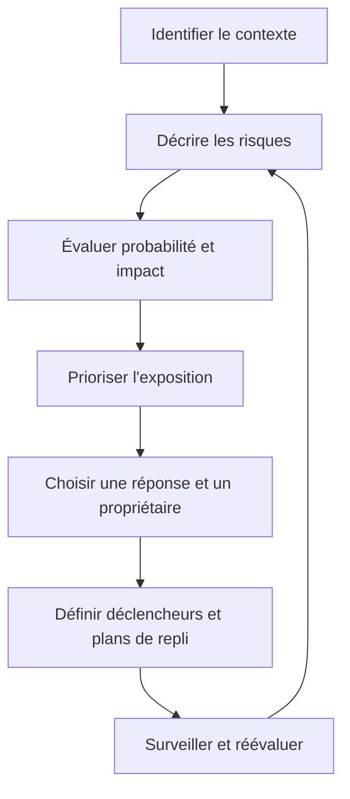

### 1. Risque, problème, hypothèse

**Comprendre le concept.** Dans « Identification et mitigation des risques », risque, problème, hypothèse constitue une pratique qui doit répondre à une intention précise. Le risque est incertain, le problème est survenu, l’hypothèse doit être vérifiée et la dépendance relie le projet à une condition externe. Le responsable doit commencer par définir le résultat attendu, l’autorité concernée et les informations qui manquent encore. Une méthode ne doit pas être appliquée uniquement parce qu’elle figure dans un guide ou qu’elle est proposée par un outil. Sa valeur dépend du contexte, des personnes qui l’utilisent et de la qualité des décisions qu’elle permet de prendre.

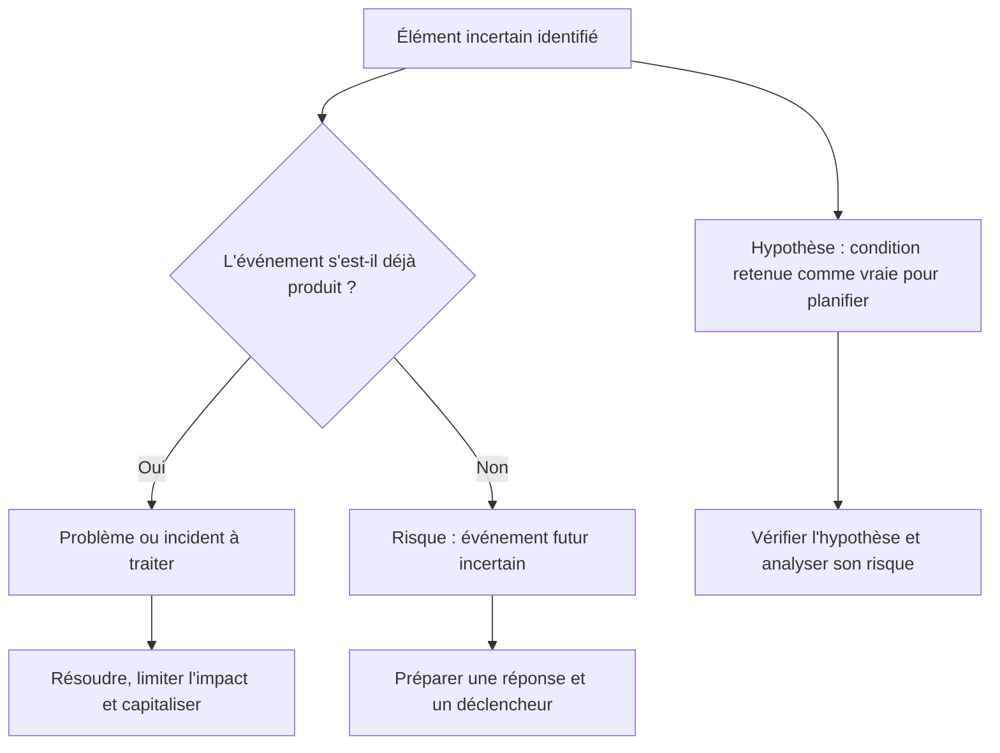

Ces notions doivent rester distinctes. Un risque décrit une incertitude future, un problème ou incident est déjà survenu, et une hypothèse est une condition retenue pour avancer malgré l’absence de certitude. Une hypothèse peut devenir source de risque si elle est fausse. Exemple : « le fournisseur livrera avant le 15 » est une hypothèse tant qu’elle n’est pas confirmée ; un retard constaté devient ensuite un problème concret.

**Articuler avec les autres dimensions.** La décision peut affecter le périmètre, la capacité, les coûts, le calendrier, la sécurité et l’exploitation. Il est nécessaire de repérer les dépendances en amont, les conséquences pour les bénéficiaires et les coûts de réversibilité. Une optimisation locale peut transférer le coût vers une autre équipe ou reporter un risque après la mise en service. Une analyse complète rend explicite le compromis, indique ce qui est protégé et précise quelles limites ne peuvent pas être négociées.

**Illustration opérationnelle.** Un fournisseur peut ne pas livrer l’API : risque ; l’API est déjà indisponible : problème ; le format de date supposé : hypothèse. Pour traiter ce type de situation, consigner les faits, distinguer les hypothèses, fixer une responsabilité et définir une preuve vérifiable. Lorsque plusieurs solutions sont possibles, les comparer avec des critères communs. Si les données sont incomplètes, organiser une courte investigation avec une échéance au lieu de présenter une estimation fragile comme un engagement ferme. La décision doit pouvoir être comprise par une personne qui n’a pas assisté à la discussion d’origine.

**Mise en œuvre.** Recueillir les données auprès des personnes proches du travail, examiner les contraintes, formuler des options, préciser leurs impacts et décider au niveau approprié. Après la décision, consigner le motif, informer les acteurs concernés et suivre l’effet réel. Lorsque le seuil de délégation est dépassé, préparer une escalade concise qui présente le problème, les options, les risques, une recommandation et la date à laquelle la décision devient urgente. Cette séquence protège la coordination sans imposer de lourdeur inutile.

**Mesure et preuve.** Il faut choisir un indicateur correspondant à la finalité de la pratique. Une donnée d’activité ne démontre pas nécessairement un résultat. Définir la source, la fréquence, le responsable, la valeur de référence et les limites de l’indicateur. Compléter si nécessaire les chiffres par une observation qualitative, une revue ou un test. Les mesures doivent être assez fiables pour soutenir une décision, mais pas si coûteuses qu’elles consomment une part disproportionnée du travail qu’elles sont censées aider.

**Erreurs fréquentes et correction.** Les erreurs habituelles incluent une information non actualisée, des définitions variables, une responsabilité implicite, un contrôle fait trop tard ou une exception devenue la règle. Le correctif n’est pas d’ajouter des tableaux sans fin : il faut retrouver la cause, simplifier le flux, attribuer la décision et mesurer l’amélioration. Si une pratique ne produit plus de valeur, la revoir avec les personnes concernées, tout en conservant les contrôles obligatoires et les traces nécessaires à l’audit.

**Approfondissement.** Pour un projet à forte criticité, la pratique peut exiger une validation indépendante, une séparation des tâches, une piste d’audit et un test sur un environnement représentatif. Pour un travail limité et réversible, une revue de pair peut suffire. La proportionnalité ne signifie pas l’absence de rigueur : elle cherche le meilleur rapport entre contrôle et utilité. Le test décisif est de savoir si l’équipe peut expliquer ce qu’elle fait, pourquoi elle le fait, quelle preuve confirme le résultat et comment elle réagira si l’hypothèse devient fausse.

### 2. Identification structurée

**Comprendre le concept.** Dans « Identification et mitigation des risques », identification structurée constitue une pratique qui doit répondre à une intention précise. L’identification combine ateliers, listes de contrôle, incidents passés, architecture, contrats, menaces et retours des équipes. Le responsable doit commencer par définir le résultat attendu, l’autorité concernée et les informations qui manquent encore. Une méthode ne doit pas être appliquée uniquement parce qu’elle figure dans un guide ou qu’elle est proposée par un outil. Sa valeur dépend du contexte, des personnes qui l’utilisent et de la qualité des décisions qu’elle permet de prendre.

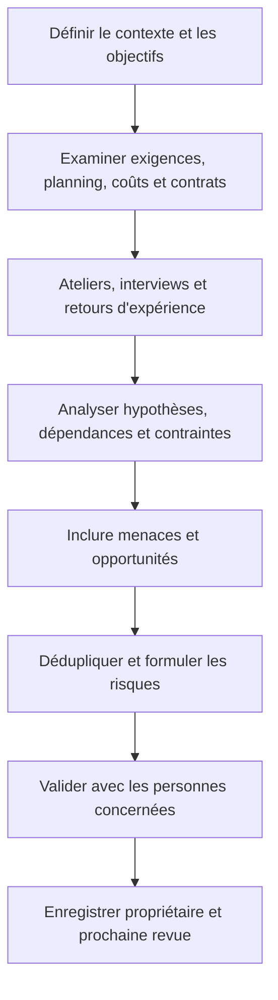

La qualité d’une identification vient de la diversité des sources et des perspectives. Les ateliers d’équipe seuls peuvent manquer des risques réglementaires, opérationnels ou contractuels. Examine aussi les décisions de conception, les changements récents, les incidents historiques, les résultats des tests, les contraintes de capacité et les dépendances externes. La liste initiale est un inventaire à vérifier, pas une preuve que tous les risques importants sont connus.

**Articuler avec les autres dimensions.** La décision peut affecter le périmètre, la capacité, les coûts, le calendrier, la sécurité et l’exploitation. Il est nécessaire de repérer les dépendances en amont, les conséquences pour les bénéficiaires et les coûts de réversibilité. Une optimisation locale peut transférer le coût vers une autre équipe ou reporter un risque après la mise en service. Une analyse complète rend explicite le compromis, indique ce qui est protégé et précise quelles limites ne peuvent pas être négociées.

**Illustration opérationnelle.** Un atelier regroupe métier, sécurité, exploitation et fournisseur pour repérer des risques que chaque silo ne verrait pas seul. Pour traiter ce type de situation, consigner les faits, distinguer les hypothèses, fixer une responsabilité et définir une preuve vérifiable. Lorsque plusieurs solutions sont possibles, les comparer avec des critères communs. Si les données sont incomplètes, organiser une courte investigation avec une échéance au lieu de présenter une estimation fragile comme un engagement ferme. La décision doit pouvoir être comprise par une personne qui n’a pas assisté à la discussion d’origine.

**Mise en œuvre.** Recueillir les données auprès des personnes proches du travail, examiner les contraintes, formuler des options, préciser leurs impacts et décider au niveau approprié. Après la décision, consigner le motif, informer les acteurs concernés et suivre l’effet réel. Lorsque le seuil de délégation est dépassé, préparer une escalade concise qui présente le problème, les options, les risques, une recommandation et la date à laquelle la décision devient urgente. Cette séquence protège la coordination sans imposer de lourdeur inutile.

**Mesure et preuve.** Il faut choisir un indicateur correspondant à la finalité de la pratique. Une donnée d’activité ne démontre pas nécessairement un résultat. Définir la source, la fréquence, le responsable, la valeur de référence et les limites de l’indicateur. Compléter si nécessaire les chiffres par une observation qualitative, une revue ou un test. Les mesures doivent être assez fiables pour soutenir une décision, mais pas si coûteuses qu’elles consomment une part disproportionnée du travail qu’elles sont censées aider.

**Erreurs fréquentes et correction.** Les erreurs habituelles incluent une information non actualisée, des définitions variables, une responsabilité implicite, un contrôle fait trop tard ou une exception devenue la règle. Le correctif n’est pas d’ajouter des tableaux sans fin : il faut retrouver la cause, simplifier le flux, attribuer la décision et mesurer l’amélioration. Si une pratique ne produit plus de valeur, la revoir avec les personnes concernées, tout en conservant les contrôles obligatoires et les traces nécessaires à l’audit.

**Approfondissement.** Pour un projet à forte criticité, la pratique peut exiger une validation indépendante, une séparation des tâches, une piste d’audit et un test sur un environnement représentatif. Pour un travail limité et réversible, une revue de pair peut suffire. La proportionnalité ne signifie pas l’absence de rigueur : elle cherche le meilleur rapport entre contrôle et utilité. Le test décisif est de savoir si l’équipe peut expliquer ce qu’elle fait, pourquoi elle le fait, quelle preuve confirme le résultat et comment elle réagira si l’hypothèse devient fausse.

### 3. Cause, événement et effet

**Comprendre le concept.** Dans « Identification et mitigation des risques », cause, événement et effet constitue une pratique qui doit répondre à une intention précise. Une formulation claire indique une cause, un événement incertain et l’effet potentiel sur un objectif. Le responsable doit commencer par définir le résultat attendu, l’autorité concernée et les informations qui manquent encore. Une méthode ne doit pas être appliquée uniquement parce qu’elle figure dans un guide ou qu’elle est proposée par un outil. Sa valeur dépend du contexte, des personnes qui l’utilisent et de la qualité des décisions qu’elle permet de prendre.

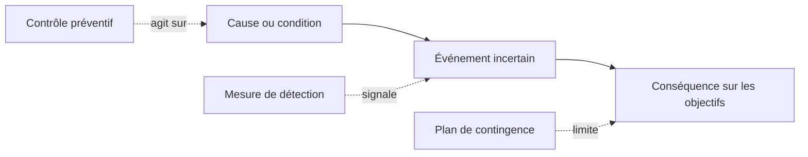

Une formulation utile suit la chaîne « en raison de [cause], il pourrait se produire [événement], ce qui entraînerait [effet sur un objectif] ». Par exemple : « en raison d’une documentation de données incomplète, la migration pourrait échouer à valider certains enregistrements, ce qui retarderait la mise en service et augmenterait le coût de correction ». Cette forme évite les expressions vagues comme « risque de migration » qui ne guident aucune action.

**Articuler avec les autres dimensions.** La décision peut affecter le périmètre, la capacité, les coûts, le calendrier, la sécurité et l’exploitation. Il est nécessaire de repérer les dépendances en amont, les conséquences pour les bénéficiaires et les coûts de réversibilité. Une optimisation locale peut transférer le coût vers une autre équipe ou reporter un risque après la mise en service. Une analyse complète rend explicite le compromis, indique ce qui est protégé et précise quelles limites ne peuvent pas être négociées.

**Illustration opérationnelle.** À cause d’un test de migration incomplet, des données peuvent être incohérentes à la bascule et provoquer des corrections manuelles. Pour traiter ce type de situation, consigner les faits, distinguer les hypothèses, fixer une responsabilité et définir une preuve vérifiable. Lorsque plusieurs solutions sont possibles, les comparer avec des critères communs. Si les données sont incomplètes, organiser une courte investigation avec une échéance au lieu de présenter une estimation fragile comme un engagement ferme. La décision doit pouvoir être comprise par une personne qui n’a pas assisté à la discussion d’origine.

**Mise en œuvre.** Recueillir les données auprès des personnes proches du travail, examiner les contraintes, formuler des options, préciser leurs impacts et décider au niveau approprié. Après la décision, consigner le motif, informer les acteurs concernés et suivre l’effet réel. Lorsque le seuil de délégation est dépassé, préparer une escalade concise qui présente le problème, les options, les risques, une recommandation et la date à laquelle la décision devient urgente. Cette séquence protège la coordination sans imposer de lourdeur inutile.

**Mesure et preuve.** Il faut choisir un indicateur correspondant à la finalité de la pratique. Une donnée d’activité ne démontre pas nécessairement un résultat. Définir la source, la fréquence, le responsable, la valeur de référence et les limites de l’indicateur. Compléter si nécessaire les chiffres par une observation qualitative, une revue ou un test. Les mesures doivent être assez fiables pour soutenir une décision, mais pas si coûteuses qu’elles consomment une part disproportionnée du travail qu’elles sont censées aider.

**Erreurs fréquentes et correction.** Les erreurs habituelles incluent une information non actualisée, des définitions variables, une responsabilité implicite, un contrôle fait trop tard ou une exception devenue la règle. Le correctif n’est pas d’ajouter des tableaux sans fin : il faut retrouver la cause, simplifier le flux, attribuer la décision et mesurer l’amélioration. Si une pratique ne produit plus de valeur, la revoir avec les personnes concernées, tout en conservant les contrôles obligatoires et les traces nécessaires à l’audit.

**Approfondissement.** Pour un projet à forte criticité, la pratique peut exiger une validation indépendante, une séparation des tâches, une piste d’audit et un test sur un environnement représentatif. Pour un travail limité et réversible, une revue de pair peut suffire. La proportionnalité ne signifie pas l’absence de rigueur : elle cherche le meilleur rapport entre contrôle et utilité. Le test décisif est de savoir si l’équipe peut expliquer ce qu’elle fait, pourquoi elle le fait, quelle preuve confirme le résultat et comment elle réagira si l’hypothèse devient fausse.

### 4. Probabilité et impact

**Comprendre le concept.** Dans « Identification et mitigation des risques », probabilité et impact constitue une pratique qui doit répondre à une intention précise. La probabilité et l’impact aident à prioriser mais doivent être calibrés ; une matrice ne remplace pas le jugement ni le contexte. Le responsable doit commencer par définir le résultat attendu, l’autorité concernée et les informations qui manquent encore. Une méthode ne doit pas être appliquée uniquement parce qu’elle figure dans un guide ou qu’elle est proposée par un outil. Sa valeur dépend du contexte, des personnes qui l’utilisent et de la qualité des décisions qu’elle permet de prendre.

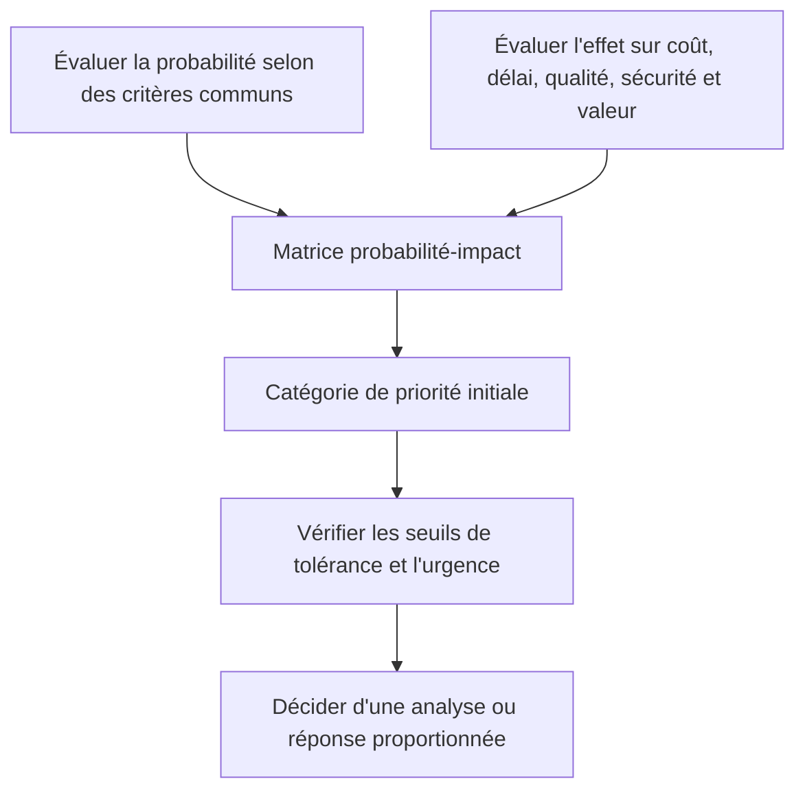

Une matrice probabilité-impact aide à classer les risques avec des critères communs, mais elle ne remplace pas le jugement professionnel. Il faut définir les échelles, l’horizon d’analyse et les effets pris en compte ; la même conséquence peut être mineure pour un projet et inacceptable pour un service critique. Les risques liés à la sécurité, à la conformité ou à la continuité peuvent exiger une escalade même si leur score numérique est modéré.

**Articuler avec les autres dimensions.** La décision peut affecter le périmètre, la capacité, les coûts, le calendrier, la sécurité et l’exploitation. Il est nécessaire de repérer les dépendances en amont, les conséquences pour les bénéficiaires et les coûts de réversibilité. Une optimisation locale peut transférer le coût vers une autre équipe ou reporter un risque après la mise en service. Une analyse complète rend explicite le compromis, indique ce qui est protégé et précise quelles limites ne peuvent pas être négociées.

**Illustration opérationnelle.** Un risque rare mais susceptible d’exposer des données médicales ne peut être ignoré au seul motif de sa faible fréquence. Pour traiter ce type de situation, consigner les faits, distinguer les hypothèses, fixer une responsabilité et définir une preuve vérifiable. Lorsque plusieurs solutions sont possibles, les comparer avec des critères communs. Si les données sont incomplètes, organiser une courte investigation avec une échéance au lieu de présenter une estimation fragile comme un engagement ferme. La décision doit pouvoir être comprise par une personne qui n’a pas assisté à la discussion d’origine.

**Mise en œuvre.** Recueillir les données auprès des personnes proches du travail, examiner les contraintes, formuler des options, préciser leurs impacts et décider au niveau approprié. Après la décision, consigner le motif, informer les acteurs concernés et suivre l’effet réel. Lorsque le seuil de délégation est dépassé, préparer une escalade concise qui présente le problème, les options, les risques, une recommandation et la date à laquelle la décision devient urgente. Cette séquence protège la coordination sans imposer de lourdeur inutile.

**Mesure et preuve.** Il faut choisir un indicateur correspondant à la finalité de la pratique. Une donnée d’activité ne démontre pas nécessairement un résultat. Définir la source, la fréquence, le responsable, la valeur de référence et les limites de l’indicateur. Compléter si nécessaire les chiffres par une observation qualitative, une revue ou un test. Les mesures doivent être assez fiables pour soutenir une décision, mais pas si coûteuses qu’elles consomment une part disproportionnée du travail qu’elles sont censées aider.

**Erreurs fréquentes et correction.** Les erreurs habituelles incluent une information non actualisée, des définitions variables, une responsabilité implicite, un contrôle fait trop tard ou une exception devenue la règle. Le correctif n’est pas d’ajouter des tableaux sans fin : il faut retrouver la cause, simplifier le flux, attribuer la décision et mesurer l’amélioration. Si une pratique ne produit plus de valeur, la revoir avec les personnes concernées, tout en conservant les contrôles obligatoires et les traces nécessaires à l’audit.

**Approfondissement.** Pour un projet à forte criticité, la pratique peut exiger une validation indépendante, une séparation des tâches, une piste d’audit et un test sur un environnement représentatif. Pour un travail limité et réversible, une revue de pair peut suffire. La proportionnalité ne signifie pas l’absence de rigueur : elle cherche le meilleur rapport entre contrôle et utilité. Le test décisif est de savoir si l’équipe peut expliquer ce qu’elle fait, pourquoi elle le fait, quelle preuve confirme le résultat et comment elle réagira si l’hypothèse devient fausse.

### 5. Exposition et urgence

**Comprendre le concept.** Dans « Identification et mitigation des risques », exposition et urgence constitue une pratique qui doit répondre à une intention précise. La priorité tient compte de la gravité, de l’horizon, du déclenchement, des dépendances et du coût d’action différée. Le responsable doit commencer par définir le résultat attendu, l’autorité concernée et les informations qui manquent encore. Une méthode ne doit pas être appliquée uniquement parce qu’elle figure dans un guide ou qu’elle est proposée par un outil. Sa valeur dépend du contexte, des personnes qui l’utilisent et de la qualité des décisions qu’elle permet de prendre.

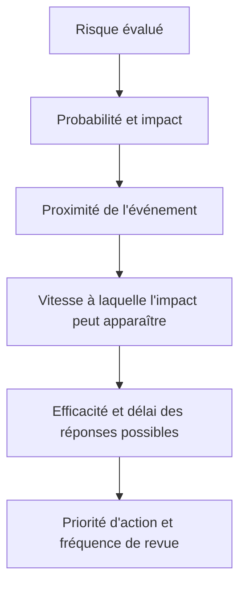

Deux risques ayant le même score probabilité-impact ne méritent pas toujours la même priorité. Un événement possible demain et nécessitant plusieurs semaines de préparation appelle une action plus urgente qu’un risque similaire susceptible de se manifester dans six mois. Considère la proximité, le délai de réaction, la vitesse d’apparition des effets, la détectabilité et le coût d’une réponse tardive.

**Articuler avec les autres dimensions.** La décision peut affecter le périmètre, la capacité, les coûts, le calendrier, la sécurité et l’exploitation. Il est nécessaire de repérer les dépendances en amont, les conséquences pour les bénéficiaires et les coûts de réversibilité. Une optimisation locale peut transférer le coût vers une autre équipe ou reporter un risque après la mise en service. Une analyse complète rend explicite le compromis, indique ce qui est protégé et précise quelles limites ne peuvent pas être négociées.

**Illustration opérationnelle.** Un problème contractuel dont la décision est due dans trois jours peut exiger une action immédiate même si sa note n’est pas maximale. Pour traiter ce type de situation, consigner les faits, distinguer les hypothèses, fixer une responsabilité et définir une preuve vérifiable. Lorsque plusieurs solutions sont possibles, les comparer avec des critères communs. Si les données sont incomplètes, organiser une courte investigation avec une échéance au lieu de présenter une estimation fragile comme un engagement ferme. La décision doit pouvoir être comprise par une personne qui n’a pas assisté à la discussion d’origine.

**Mise en œuvre.** Recueillir les données auprès des personnes proches du travail, examiner les contraintes, formuler des options, préciser leurs impacts et décider au niveau approprié. Après la décision, consigner le motif, informer les acteurs concernés et suivre l’effet réel. Lorsque le seuil de délégation est dépassé, préparer une escalade concise qui présente le problème, les options, les risques, une recommandation et la date à laquelle la décision devient urgente. Cette séquence protège la coordination sans imposer de lourdeur inutile.

**Mesure et preuve.** Il faut choisir un indicateur correspondant à la finalité de la pratique. Une donnée d’activité ne démontre pas nécessairement un résultat. Définir la source, la fréquence, le responsable, la valeur de référence et les limites de l’indicateur. Compléter si nécessaire les chiffres par une observation qualitative, une revue ou un test. Les mesures doivent être assez fiables pour soutenir une décision, mais pas si coûteuses qu’elles consomment une part disproportionnée du travail qu’elles sont censées aider.

**Erreurs fréquentes et correction.** Les erreurs habituelles incluent une information non actualisée, des définitions variables, une responsabilité implicite, un contrôle fait trop tard ou une exception devenue la règle. Le correctif n’est pas d’ajouter des tableaux sans fin : il faut retrouver la cause, simplifier le flux, attribuer la décision et mesurer l’amélioration. Si une pratique ne produit plus de valeur, la revoir avec les personnes concernées, tout en conservant les contrôles obligatoires et les traces nécessaires à l’audit.

**Approfondissement.** Pour un projet à forte criticité, la pratique peut exiger une validation indépendante, une séparation des tâches, une piste d’audit et un test sur un environnement représentatif. Pour un travail limité et réversible, une revue de pair peut suffire. La proportionnalité ne signifie pas l’absence de rigueur : elle cherche le meilleur rapport entre contrôle et utilité. Le test décisif est de savoir si l’équipe peut expliquer ce qu’elle fait, pourquoi elle le fait, quelle preuve confirme le résultat et comment elle réagira si l’hypothèse devient fausse.

### 6. Propriétaire et action

**Comprendre le concept.** Dans « Identification et mitigation des risques », propriétaire et action constitue une pratique qui doit répondre à une intention précise. Chaque risque prioritaire a un propriétaire capable d’organiser la réponse et une action qui réduit la probabilité ou l’impact. Le responsable doit commencer par définir le résultat attendu, l’autorité concernée et les informations qui manquent encore. Une méthode ne doit pas être appliquée uniquement parce qu’elle figure dans un guide ou qu’elle est proposée par un outil. Sa valeur dépend du contexte, des personnes qui l’utilisent et de la qualité des décisions qu’elle permet de prendre.

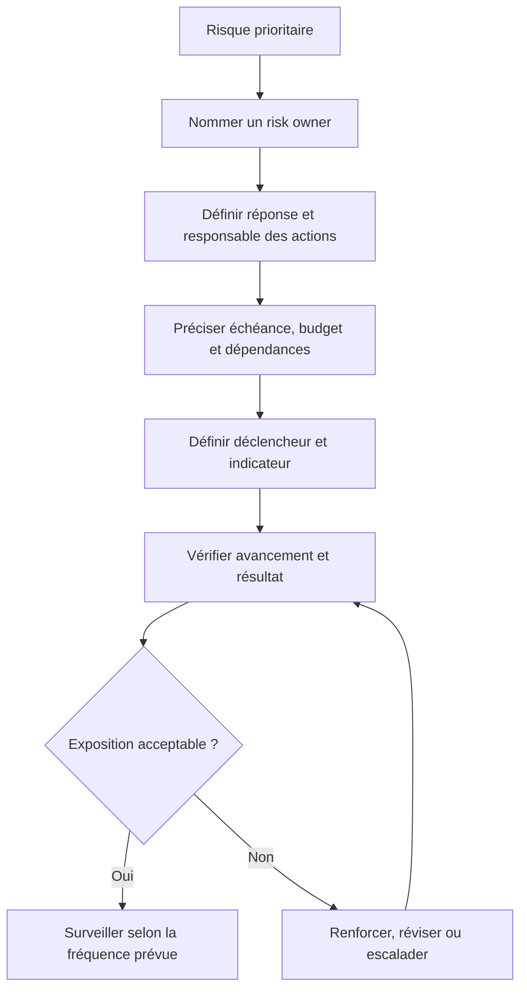

Le propriétaire du risque est responsable de surveiller l’exposition et de s’assurer qu’une stratégie appropriée est choisie ; il n’effectue pas nécessairement lui-même toutes les actions. Une action de réponse doit avoir un responsable, une échéance, des ressources, une preuve de réalisation et un moyen de juger si elle a réellement réduit le risque. « Surveiller » sans préciser qui, quand et à partir de quel signal n’est pas un plan suffisant.

**Articuler avec les autres dimensions.** La décision peut affecter le périmètre, la capacité, les coûts, le calendrier, la sécurité et l’exploitation. Il est nécessaire de repérer les dépendances en amont, les conséquences pour les bénéficiaires et les coûts de réversibilité. Une optimisation locale peut transférer le coût vers une autre équipe ou reporter un risque après la mise en service. Une analyse complète rend explicite le compromis, indique ce qui est protégé et précise quelles limites ne peuvent pas être négociées.

**Illustration opérationnelle.** Le responsable intégration obtient une preuve de compatibilité et une date de confirmation du fournisseur. Pour traiter ce type de situation, consigner les faits, distinguer les hypothèses, fixer une responsabilité et définir une preuve vérifiable. Lorsque plusieurs solutions sont possibles, les comparer avec des critères communs. Si les données sont incomplètes, organiser une courte investigation avec une échéance au lieu de présenter une estimation fragile comme un engagement ferme. La décision doit pouvoir être comprise par une personne qui n’a pas assisté à la discussion d’origine.

**Mise en œuvre.** Recueillir les données auprès des personnes proches du travail, examiner les contraintes, formuler des options, préciser leurs impacts et décider au niveau approprié. Après la décision, consigner le motif, informer les acteurs concernés et suivre l’effet réel. Lorsque le seuil de délégation est dépassé, préparer une escalade concise qui présente le problème, les options, les risques, une recommandation et la date à laquelle la décision devient urgente. Cette séquence protège la coordination sans imposer de lourdeur inutile.

**Mesure et preuve.** Il faut choisir un indicateur correspondant à la finalité de la pratique. Une donnée d’activité ne démontre pas nécessairement un résultat. Définir la source, la fréquence, le responsable, la valeur de référence et les limites de l’indicateur. Compléter si nécessaire les chiffres par une observation qualitative, une revue ou un test. Les mesures doivent être assez fiables pour soutenir une décision, mais pas si coûteuses qu’elles consomment une part disproportionnée du travail qu’elles sont censées aider.

**Erreurs fréquentes et correction.** Les erreurs habituelles incluent une information non actualisée, des définitions variables, une responsabilité implicite, un contrôle fait trop tard ou une exception devenue la règle. Le correctif n’est pas d’ajouter des tableaux sans fin : il faut retrouver la cause, simplifier le flux, attribuer la décision et mesurer l’amélioration. Si une pratique ne produit plus de valeur, la revoir avec les personnes concernées, tout en conservant les contrôles obligatoires et les traces nécessaires à l’audit.

**Approfondissement.** Pour un projet à forte criticité, la pratique peut exiger une validation indépendante, une séparation des tâches, une piste d’audit et un test sur un environnement représentatif. Pour un travail limité et réversible, une revue de pair peut suffire. La proportionnalité ne signifie pas l’absence de rigueur : elle cherche le meilleur rapport entre contrôle et utilité. Le test décisif est de savoir si l’équipe peut expliquer ce qu’elle fait, pourquoi elle le fait, quelle preuve confirme le résultat et comment elle réagira si l’hypothèse devient fausse.

### 7. Éviter, réduire, transférer, accepter

**Comprendre le concept.** Dans « Identification et mitigation des risques », éviter, réduire, transférer, accepter constitue une pratique qui doit répondre à une intention précise. Les stratégies de réponse doivent correspondre à la cause et à l’appétence au risque ; le transfert ne supprime pas la responsabilité de l’organisation. Le responsable doit commencer par définir le résultat attendu, l’autorité concernée et les informations qui manquent encore. Une méthode ne doit pas être appliquée uniquement parce qu’elle figure dans un guide ou qu’elle est proposée par un outil. Sa valeur dépend du contexte, des personnes qui l’utilisent et de la qualité des décisions qu’elle permet de prendre.

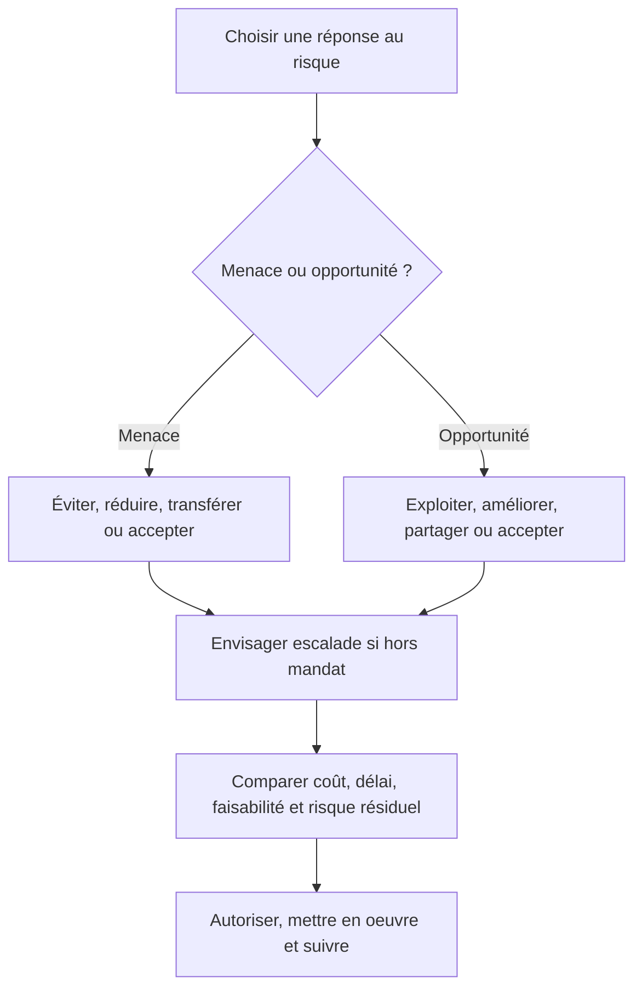

Les réponses aux menaces et aux opportunités ne sont pas identiques. Une menace peut être évitée en changeant le plan, réduite par la prévention ou la diminution de l’impact, transférée contractuellement ou acceptée avec une décision explicite. Une opportunité peut être exploitée pour la rendre certaine, améliorée pour augmenter sa probabilité ou son bénéfice, partagée avec un partenaire ou acceptée. L’escalade est appropriée lorsque le risque dépasse le mandat ou les tolérances de l’équipe.

**Articuler avec les autres dimensions.** La décision peut affecter le périmètre, la capacité, les coûts, le calendrier, la sécurité et l’exploitation. Il est nécessaire de repérer les dépendances en amont, les conséquences pour les bénéficiaires et les coûts de réversibilité. Une optimisation locale peut transférer le coût vers une autre équipe ou reporter un risque après la mise en service. Une analyse complète rend explicite le compromis, indique ce qui est protégé et précise quelles limites ne peuvent pas être négociées.

**Illustration opérationnelle.** Une assurance peut couvrir certaines conséquences financières, mais ne rend pas acceptable une exposition réglementaire incontrôlée. Pour traiter ce type de situation, consigner les faits, distinguer les hypothèses, fixer une responsabilité et définir une preuve vérifiable. Lorsque plusieurs solutions sont possibles, les comparer avec des critères communs. Si les données sont incomplètes, organiser une courte investigation avec une échéance au lieu de présenter une estimation fragile comme un engagement ferme. La décision doit pouvoir être comprise par une personne qui n’a pas assisté à la discussion d’origine.

**Mise en œuvre.** Recueillir les données auprès des personnes proches du travail, examiner les contraintes, formuler des options, préciser leurs impacts et décider au niveau approprié. Après la décision, consigner le motif, informer les acteurs concernés et suivre l’effet réel. Lorsque le seuil de délégation est dépassé, préparer une escalade concise qui présente le problème, les options, les risques, une recommandation et la date à laquelle la décision devient urgente. Cette séquence protège la coordination sans imposer de lourdeur inutile.

**Mesure et preuve.** Il faut choisir un indicateur correspondant à la finalité de la pratique. Une donnée d’activité ne démontre pas nécessairement un résultat. Définir la source, la fréquence, le responsable, la valeur de référence et les limites de l’indicateur. Compléter si nécessaire les chiffres par une observation qualitative, une revue ou un test. Les mesures doivent être assez fiables pour soutenir une décision, mais pas si coûteuses qu’elles consomment une part disproportionnée du travail qu’elles sont censées aider.

**Erreurs fréquentes et correction.** Les erreurs habituelles incluent une information non actualisée, des définitions variables, une responsabilité implicite, un contrôle fait trop tard ou une exception devenue la règle. Le correctif n’est pas d’ajouter des tableaux sans fin : il faut retrouver la cause, simplifier le flux, attribuer la décision et mesurer l’amélioration. Si une pratique ne produit plus de valeur, la revoir avec les personnes concernées, tout en conservant les contrôles obligatoires et les traces nécessaires à l’audit.

**Approfondissement.** Pour un projet à forte criticité, la pratique peut exiger une validation indépendante, une séparation des tâches, une piste d’audit et un test sur un environnement représentatif. Pour un travail limité et réversible, une revue de pair peut suffire. La proportionnalité ne signifie pas l’absence de rigueur : elle cherche le meilleur rapport entre contrôle et utilité. Le test décisif est de savoir si l’équipe peut expliquer ce qu’elle fait, pourquoi elle le fait, quelle preuve confirme le résultat et comment elle réagira si l’hypothèse devient fausse.

### 8. Déclencheurs et indicateurs

**Comprendre le concept.** Dans « Identification et mitigation des risques », déclencheurs et indicateurs constitue une pratique qui doit répondre à une intention précise. Un déclencheur observable aide à agir avant que l’événement ne se réalise ; les indicateurs doivent avoir une source et une fréquence. Le responsable doit commencer par définir le résultat attendu, l’autorité concernée et les informations qui manquent encore. Une méthode ne doit pas être appliquée uniquement parce qu’elle figure dans un guide ou qu’elle est proposée par un outil. Sa valeur dépend du contexte, des personnes qui l’utilisent et de la qualité des décisions qu’elle permet de prendre.

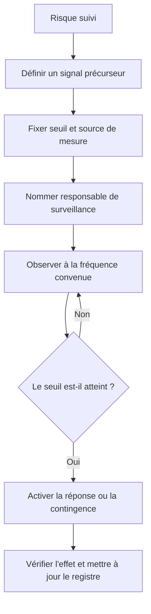

Un déclencheur doit être observable et assez précis pour provoquer une action. « Le fournisseur paraît en difficulté » est trop vague ; « deux jalons intermédiaires consécutifs sont manqués » peut être un signal exploitable. Le registre précise la source de la mesure, le seuil, la personne qui surveille, le délai de réaction et le plan qui sera activé si le seuil est franchi.

**Articuler avec les autres dimensions.** La décision peut affecter le périmètre, la capacité, les coûts, le calendrier, la sécurité et l’exploitation. Il est nécessaire de repérer les dépendances en amont, les conséquences pour les bénéficiaires et les coûts de réversibilité. Une optimisation locale peut transférer le coût vers une autre équipe ou reporter un risque après la mise en service. Une analyse complète rend explicite le compromis, indique ce qui est protégé et précise quelles limites ne peuvent pas être négociées.

**Illustration opérationnelle.** L’absence de version testable à la date convenue déclenche le plan alternatif d’intégration. Pour traiter ce type de situation, consigner les faits, distinguer les hypothèses, fixer une responsabilité et définir une preuve vérifiable. Lorsque plusieurs solutions sont possibles, les comparer avec des critères communs. Si les données sont incomplètes, organiser une courte investigation avec une échéance au lieu de présenter une estimation fragile comme un engagement ferme. La décision doit pouvoir être comprise par une personne qui n’a pas assisté à la discussion d’origine.

**Mise en œuvre.** Recueillir les données auprès des personnes proches du travail, examiner les contraintes, formuler des options, préciser leurs impacts et décider au niveau approprié. Après la décision, consigner le motif, informer les acteurs concernés et suivre l’effet réel. Lorsque le seuil de délégation est dépassé, préparer une escalade concise qui présente le problème, les options, les risques, une recommandation et la date à laquelle la décision devient urgente. Cette séquence protège la coordination sans imposer de lourdeur inutile.

**Mesure et preuve.** Il faut choisir un indicateur correspondant à la finalité de la pratique. Une donnée d’activité ne démontre pas nécessairement un résultat. Définir la source, la fréquence, le responsable, la valeur de référence et les limites de l’indicateur. Compléter si nécessaire les chiffres par une observation qualitative, une revue ou un test. Les mesures doivent être assez fiables pour soutenir une décision, mais pas si coûteuses qu’elles consomment une part disproportionnée du travail qu’elles sont censées aider.

**Erreurs fréquentes et correction.** Les erreurs habituelles incluent une information non actualisée, des définitions variables, une responsabilité implicite, un contrôle fait trop tard ou une exception devenue la règle. Le correctif n’est pas d’ajouter des tableaux sans fin : il faut retrouver la cause, simplifier le flux, attribuer la décision et mesurer l’amélioration. Si une pratique ne produit plus de valeur, la revoir avec les personnes concernées, tout en conservant les contrôles obligatoires et les traces nécessaires à l’audit.

**Approfondissement.** Pour un projet à forte criticité, la pratique peut exiger une validation indépendante, une séparation des tâches, une piste d’audit et un test sur un environnement représentatif. Pour un travail limité et réversible, une revue de pair peut suffire. La proportionnalité ne signifie pas l’absence de rigueur : elle cherche le meilleur rapport entre contrôle et utilité. Le test décisif est de savoir si l’équipe peut expliquer ce qu’elle fait, pourquoi elle le fait, quelle preuve confirme le résultat et comment elle réagira si l’hypothèse devient fausse.

### 9. Réserves et contingence

**Comprendre le concept.** Dans « Identification et mitigation des risques », réserves et contingence constitue une pratique qui doit répondre à une intention précise. Les réserves doivent être liées à une incertitude ou à une autorité de gouvernance ; elles ne remplacent pas la réponse au risque. Le responsable doit commencer par définir le résultat attendu, l’autorité concernée et les informations qui manquent encore. Une méthode ne doit pas être appliquée uniquement parce qu’elle figure dans un guide ou qu’elle est proposée par un outil. Sa valeur dépend du contexte, des personnes qui l’utilisent et de la qualité des décisions qu’elle permet de prendre.

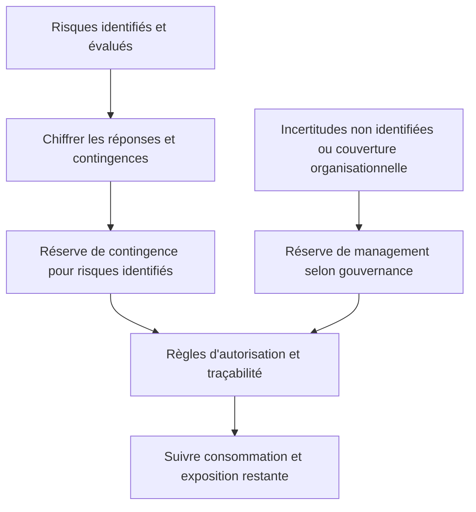

La réserve de contingence sert à financer des réponses ou coûts associés aux risques identifiés ; sa consommation doit être liée à un événement ou une action documentée. La réserve de management peut être définie séparément pour des imprévus non couverts par la réserve de contingence et reste soumise aux règles de gouvernance de l’organisation. Les appellations et modalités varient : le plan doit clairement préciser ce que chaque réserve couvre et qui peut autoriser son utilisation.

**Articuler avec les autres dimensions.** La décision peut affecter le périmètre, la capacité, les coûts, le calendrier, la sécurité et l’exploitation. Il est nécessaire de repérer les dépendances en amont, les conséquences pour les bénéficiaires et les coûts de réversibilité. Une optimisation locale peut transférer le coût vers une autre équipe ou reporter un risque après la mise en service. Une analyse complète rend explicite le compromis, indique ce qui est protégé et précise quelles limites ne peuvent pas être négociées.

**Illustration opérationnelle.** Une marge de bascule existe pour une incertitude définie, avec des règles d’utilisation et d’escalade claires. Pour traiter ce type de situation, consigner les faits, distinguer les hypothèses, fixer une responsabilité et définir une preuve vérifiable. Lorsque plusieurs solutions sont possibles, les comparer avec des critères communs. Si les données sont incomplètes, organiser une courte investigation avec une échéance au lieu de présenter une estimation fragile comme un engagement ferme. La décision doit pouvoir être comprise par une personne qui n’a pas assisté à la discussion d’origine.

**Mise en œuvre.** Recueillir les données auprès des personnes proches du travail, examiner les contraintes, formuler des options, préciser leurs impacts et décider au niveau approprié. Après la décision, consigner le motif, informer les acteurs concernés et suivre l’effet réel. Lorsque le seuil de délégation est dépassé, préparer une escalade concise qui présente le problème, les options, les risques, une recommandation et la date à laquelle la décision devient urgente. Cette séquence protège la coordination sans imposer de lourdeur inutile.

**Mesure et preuve.** Il faut choisir un indicateur correspondant à la finalité de la pratique. Une donnée d’activité ne démontre pas nécessairement un résultat. Définir la source, la fréquence, le responsable, la valeur de référence et les limites de l’indicateur. Compléter si nécessaire les chiffres par une observation qualitative, une revue ou un test. Les mesures doivent être assez fiables pour soutenir une décision, mais pas si coûteuses qu’elles consomment une part disproportionnée du travail qu’elles sont censées aider.

**Erreurs fréquentes et correction.** Les erreurs habituelles incluent une information non actualisée, des définitions variables, une responsabilité implicite, un contrôle fait trop tard ou une exception devenue la règle. Le correctif n’est pas d’ajouter des tableaux sans fin : il faut retrouver la cause, simplifier le flux, attribuer la décision et mesurer l’amélioration. Si une pratique ne produit plus de valeur, la revoir avec les personnes concernées, tout en conservant les contrôles obligatoires et les traces nécessaires à l’audit.

**Approfondissement.** Pour un projet à forte criticité, la pratique peut exiger une validation indépendante, une séparation des tâches, une piste d’audit et un test sur un environnement représentatif. Pour un travail limité et réversible, une revue de pair peut suffire. La proportionnalité ne signifie pas l’absence de rigueur : elle cherche le meilleur rapport entre contrôle et utilité. Le test décisif est de savoir si l’équipe peut expliquer ce qu’elle fait, pourquoi elle le fait, quelle preuve confirme le résultat et comment elle réagira si l’hypothèse devient fausse.

### 10. Risques techniques et cybersécurité

**Comprendre le concept.** Dans « Identification et mitigation des risques », risques techniques et cybersécurité constitue une pratique qui doit répondre à une intention précise. Les risques techniques couvrent compatibilité, capacité, disponibilité et dette ; les cyberrisques exigent analyse de menace et contrôles adaptés. Le responsable doit commencer par définir le résultat attendu, l’autorité concernée et les informations qui manquent encore. Une méthode ne doit pas être appliquée uniquement parce qu’elle figure dans un guide ou qu’elle est proposée par un outil. Sa valeur dépend du contexte, des personnes qui l’utilisent et de la qualité des décisions qu’elle permet de prendre.

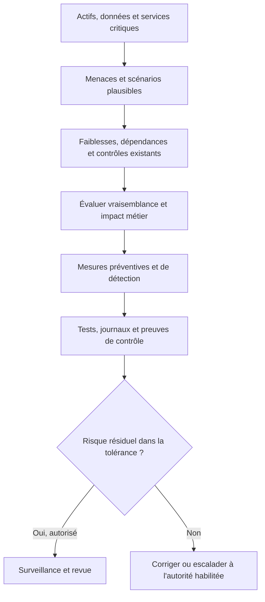

Pour un projet IT, les risques techniques doivent être reliés aux actifs et conséquences métier : confidentialité, intégrité, disponibilité, conformité, continuité et réputation. Évalue aussi les erreurs de configuration, dépendances logicielles, sauvegardes, privilèges, secrets, mises à jour et capacité de restauration. Une mesure de sécurité n’est pas considérée comme efficace parce qu’elle figure dans un document ; il faut des preuves adaptées, comme des tests et des journaux examinés.

**Articuler avec les autres dimensions.** La décision peut affecter le périmètre, la capacité, les coûts, le calendrier, la sécurité et l’exploitation. Il est nécessaire de repérer les dépendances en amont, les conséquences pour les bénéficiaires et les coûts de réversibilité. Une optimisation locale peut transférer le coût vers une autre équipe ou reporter un risque après la mise en service. Une analyse complète rend explicite le compromis, indique ce qui est protégé et précise quelles limites ne peuvent pas être négociées.

**Illustration opérationnelle.** L’équipe teste les droits, la journalisation, les secrets et la restauration dans un environnement représentatif. Pour traiter ce type de situation, consigner les faits, distinguer les hypothèses, fixer une responsabilité et définir une preuve vérifiable. Lorsque plusieurs solutions sont possibles, les comparer avec des critères communs. Si les données sont incomplètes, organiser une courte investigation avec une échéance au lieu de présenter une estimation fragile comme un engagement ferme. La décision doit pouvoir être comprise par une personne qui n’a pas assisté à la discussion d’origine.

**Mise en œuvre.** Recueillir les données auprès des personnes proches du travail, examiner les contraintes, formuler des options, préciser leurs impacts et décider au niveau approprié. Après la décision, consigner le motif, informer les acteurs concernés et suivre l’effet réel. Lorsque le seuil de délégation est dépassé, préparer une escalade concise qui présente le problème, les options, les risques, une recommandation et la date à laquelle la décision devient urgente. Cette séquence protège la coordination sans imposer de lourdeur inutile.

**Mesure et preuve.** Il faut choisir un indicateur correspondant à la finalité de la pratique. Une donnée d’activité ne démontre pas nécessairement un résultat. Définir la source, la fréquence, le responsable, la valeur de référence et les limites de l’indicateur. Compléter si nécessaire les chiffres par une observation qualitative, une revue ou un test. Les mesures doivent être assez fiables pour soutenir une décision, mais pas si coûteuses qu’elles consomment une part disproportionnée du travail qu’elles sont censées aider.

**Erreurs fréquentes et correction.** Les erreurs habituelles incluent une information non actualisée, des définitions variables, une responsabilité implicite, un contrôle fait trop tard ou une exception devenue la règle. Le correctif n’est pas d’ajouter des tableaux sans fin : il faut retrouver la cause, simplifier le flux, attribuer la décision et mesurer l’amélioration. Si une pratique ne produit plus de valeur, la revoir avec les personnes concernées, tout en conservant les contrôles obligatoires et les traces nécessaires à l’audit.

**Approfondissement.** Pour un projet à forte criticité, la pratique peut exiger une validation indépendante, une séparation des tâches, une piste d’audit et un test sur un environnement représentatif. Pour un travail limité et réversible, une revue de pair peut suffire. La proportionnalité ne signifie pas l’absence de rigueur : elle cherche le meilleur rapport entre contrôle et utilité. Le test décisif est de savoir si l’équipe peut expliquer ce qu’elle fait, pourquoi elle le fait, quelle preuve confirme le résultat et comment elle réagira si l’hypothèse devient fausse.

### 11. Dépendances fournisseur

**Comprendre le concept.** Dans « Identification et mitigation des risques », dépendances fournisseur constitue une pratique qui doit répondre à une intention précise. Les obligations contractuelles, les délais de réponse, les interfaces et les plans de sortie doivent être inclus au pilotage. Le responsable doit commencer par définir le résultat attendu, l’autorité concernée et les informations qui manquent encore. Une méthode ne doit pas être appliquée uniquement parce qu’elle figure dans un guide ou qu’elle est proposée par un outil. Sa valeur dépend du contexte, des personnes qui l’utilisent et de la qualité des décisions qu’elle permet de prendre.

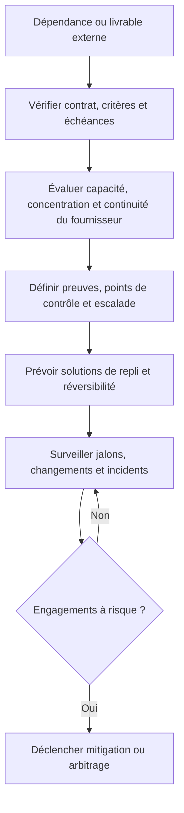

Un fournisseur peut être essentiel sans que son risque soit éliminé par la présence d’un contrat. Évalue la dépendance à des compétences rares, aux délais de support, aux licences, aux chaînes de sous-traitance, à la disponibilité des données et à la possibilité de migrer vers une autre solution. Des critères de livraison mesurables, des preuves intermédiaires, des droits d’audit proportionnés et un plan de sortie réduisent les surprises.

**Articuler avec les autres dimensions.** La décision peut affecter le périmètre, la capacité, les coûts, le calendrier, la sécurité et l’exploitation. Il est nécessaire de repérer les dépendances en amont, les conséquences pour les bénéficiaires et les coûts de réversibilité. Une optimisation locale peut transférer le coût vers une autre équipe ou reporter un risque après la mise en service. Une analyse complète rend explicite le compromis, indique ce qui est protégé et précise quelles limites ne peuvent pas être négociées.

**Illustration opérationnelle.** Le contrat précise le délai de notification, les critères de recette de l’API et la procédure en cas de retard. Pour traiter ce type de situation, consigner les faits, distinguer les hypothèses, fixer une responsabilité et définir une preuve vérifiable. Lorsque plusieurs solutions sont possibles, les comparer avec des critères communs. Si les données sont incomplètes, organiser une courte investigation avec une échéance au lieu de présenter une estimation fragile comme un engagement ferme. La décision doit pouvoir être comprise par une personne qui n’a pas assisté à la discussion d’origine.

**Mise en œuvre.** Recueillir les données auprès des personnes proches du travail, examiner les contraintes, formuler des options, préciser leurs impacts et décider au niveau approprié. Après la décision, consigner le motif, informer les acteurs concernés et suivre l’effet réel. Lorsque le seuil de délégation est dépassé, préparer une escalade concise qui présente le problème, les options, les risques, une recommandation et la date à laquelle la décision devient urgente. Cette séquence protège la coordination sans imposer de lourdeur inutile.

**Mesure et preuve.** Il faut choisir un indicateur correspondant à la finalité de la pratique. Une donnée d’activité ne démontre pas nécessairement un résultat. Définir la source, la fréquence, le responsable, la valeur de référence et les limites de l’indicateur. Compléter si nécessaire les chiffres par une observation qualitative, une revue ou un test. Les mesures doivent être assez fiables pour soutenir une décision, mais pas si coûteuses qu’elles consomment une part disproportionnée du travail qu’elles sont censées aider.

**Erreurs fréquentes et correction.** Les erreurs habituelles incluent une information non actualisée, des définitions variables, une responsabilité implicite, un contrôle fait trop tard ou une exception devenue la règle. Le correctif n’est pas d’ajouter des tableaux sans fin : il faut retrouver la cause, simplifier le flux, attribuer la décision et mesurer l’amélioration. Si une pratique ne produit plus de valeur, la revoir avec les personnes concernées, tout en conservant les contrôles obligatoires et les traces nécessaires à l’audit.

**Approfondissement.** Pour un projet à forte criticité, la pratique peut exiger une validation indépendante, une séparation des tâches, une piste d’audit et un test sur un environnement représentatif. Pour un travail limité et réversible, une revue de pair peut suffire. La proportionnalité ne signifie pas l’absence de rigueur : elle cherche le meilleur rapport entre contrôle et utilité. Le test décisif est de savoir si l’équipe peut expliquer ce qu’elle fait, pourquoi elle le fait, quelle preuve confirme le résultat et comment elle réagira si l’hypothèse devient fausse.

### 12. Risque résiduel et acceptation

**Comprendre le concept.** Dans « Identification et mitigation des risques », risque résiduel et acceptation constitue une pratique qui doit répondre à une intention précise. Après traitement, un risque reste parfois présent ; son acceptation doit relever de l’autorité pertinente et être documentée. Le responsable doit commencer par définir le résultat attendu, l’autorité concernée et les informations qui manquent encore. Une méthode ne doit pas être appliquée uniquement parce qu’elle figure dans un guide ou qu’elle est proposée par un outil. Sa valeur dépend du contexte, des personnes qui l’utilisent et de la qualité des décisions qu’elle permet de prendre.

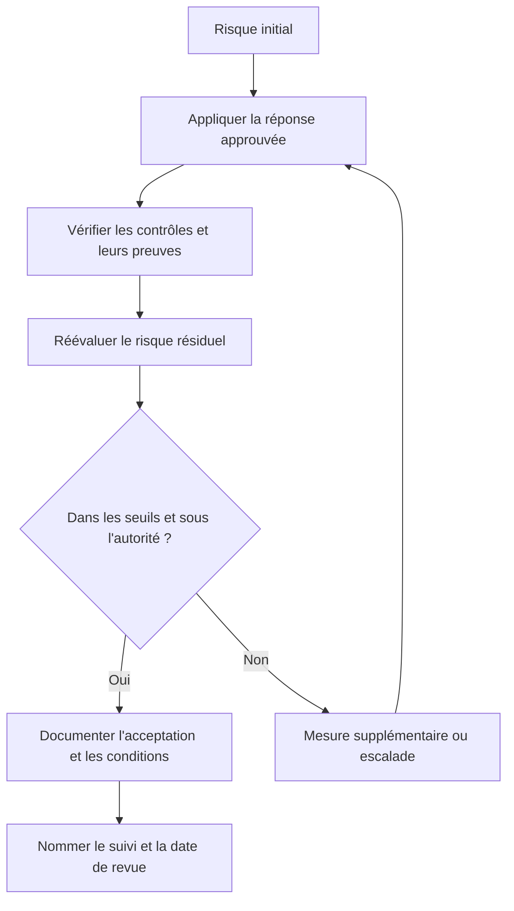

Le risque résiduel est ce qui demeure après traitement ; il peut rester significatif même lorsque les actions prévues sont terminées. L’acceptation doit être donnée par une personne habilitée à accepter ce niveau d’exposition, avec justification, conditions, durée et mécanisme de surveillance. Une acceptation temporaire peut expirer ou être réexaminée lorsque le contexte, la menace ou les mesures de contrôle changent.

**Articuler avec les autres dimensions.** La décision peut affecter le périmètre, la capacité, les coûts, le calendrier, la sécurité et l’exploitation. Il est nécessaire de repérer les dépendances en amont, les conséquences pour les bénéficiaires et les coûts de réversibilité. Une optimisation locale peut transférer le coût vers une autre équipe ou reporter un risque après la mise en service. Une analyse complète rend explicite le compromis, indique ce qui est protégé et précise quelles limites ne peuvent pas être négociées.

**Illustration opérationnelle.** Le sponsor et le responsable sécurité acceptent explicitement le risque résiduel dans les limites de leur mandat. Pour traiter ce type de situation, consigner les faits, distinguer les hypothèses, fixer une responsabilité et définir une preuve vérifiable. Lorsque plusieurs solutions sont possibles, les comparer avec des critères communs. Si les données sont incomplètes, organiser une courte investigation avec une échéance au lieu de présenter une estimation fragile comme un engagement ferme. La décision doit pouvoir être comprise par une personne qui n’a pas assisté à la discussion d’origine.

**Mise en œuvre.** Recueillir les données auprès des personnes proches du travail, examiner les contraintes, formuler des options, préciser leurs impacts et décider au niveau approprié. Après la décision, consigner le motif, informer les acteurs concernés et suivre l’effet réel. Lorsque le seuil de délégation est dépassé, préparer une escalade concise qui présente le problème, les options, les risques, une recommandation et la date à laquelle la décision devient urgente. Cette séquence protège la coordination sans imposer de lourdeur inutile.

**Mesure et preuve.** Il faut choisir un indicateur correspondant à la finalité de la pratique. Une donnée d’activité ne démontre pas nécessairement un résultat. Définir la source, la fréquence, le responsable, la valeur de référence et les limites de l’indicateur. Compléter si nécessaire les chiffres par une observation qualitative, une revue ou un test. Les mesures doivent être assez fiables pour soutenir une décision, mais pas si coûteuses qu’elles consomment une part disproportionnée du travail qu’elles sont censées aider.

**Erreurs fréquentes et correction.** Les erreurs habituelles incluent une information non actualisée, des définitions variables, une responsabilité implicite, un contrôle fait trop tard ou une exception devenue la règle. Le correctif n’est pas d’ajouter des tableaux sans fin : il faut retrouver la cause, simplifier le flux, attribuer la décision et mesurer l’amélioration. Si une pratique ne produit plus de valeur, la revoir avec les personnes concernées, tout en conservant les contrôles obligatoires et les traces nécessaires à l’audit.

**Approfondissement.** Pour un projet à forte criticité, la pratique peut exiger une validation indépendante, une séparation des tâches, une piste d’audit et un test sur un environnement représentatif. Pour un travail limité et réversible, une revue de pair peut suffire. La proportionnalité ne signifie pas l’absence de rigueur : elle cherche le meilleur rapport entre contrôle et utilité. Le test décisif est de savoir si l’équipe peut expliquer ce qu’elle fait, pourquoi elle le fait, quelle preuve confirme le résultat et comment elle réagira si l’hypothèse devient fausse.

### 13. Communication et crise

**Comprendre le concept.** Dans « Identification et mitigation des risques », communication et crise constitue une pratique qui doit répondre à une intention précise. La communication de crise doit privilégier la vérité, les faits connus, les inconnues, les actions en cours et le prochain point de situation. Le responsable doit commencer par définir le résultat attendu, l’autorité concernée et les informations qui manquent encore. Une méthode ne doit pas être appliquée uniquement parce qu’elle figure dans un guide ou qu’elle est proposée par un outil. Sa valeur dépend du contexte, des personnes qui l’utilisent et de la qualité des décisions qu’elle permet de prendre.

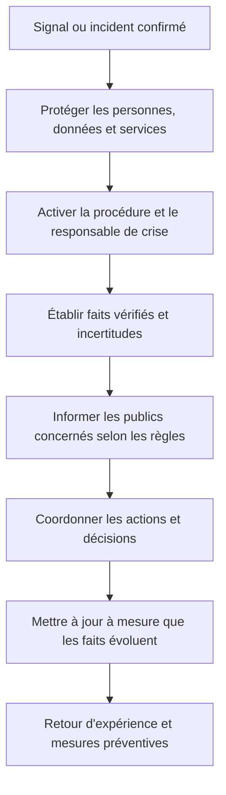

La communication de crise doit distinguer les faits confirmés, les hypothèses et les informations encore inconnues. Il faut respecter les plans internes de réponse, les obligations légales et les règles de notification applicables, sans spéculer ni promettre une résolution non vérifiée. Désigne les rôles de communication et de décision à l’avance ; après stabilisation, mène un retour d’expérience centré sur les causes et les améliorations.

**Articuler avec les autres dimensions.** La décision peut affecter le périmètre, la capacité, les coûts, le calendrier, la sécurité et l’exploitation. Il est nécessaire de repérer les dépendances en amont, les conséquences pour les bénéficiaires et les coûts de réversibilité. Une optimisation locale peut transférer le coût vers une autre équipe ou reporter un risque après la mise en service. Une analyse complète rend explicite le compromis, indique ce qui est protégé et précise quelles limites ne peuvent pas être négociées.

**Illustration opérationnelle.** Après une fuite de données, l’équipe suit le plan d’incident et évite les annonces spéculatives qui pourraient induire en erreur. Pour traiter ce type de situation, consigner les faits, distinguer les hypothèses, fixer une responsabilité et définir une preuve vérifiable. Lorsque plusieurs solutions sont possibles, les comparer avec des critères communs. Si les données sont incomplètes, organiser une courte investigation avec une échéance au lieu de présenter une estimation fragile comme un engagement ferme. La décision doit pouvoir être comprise par une personne qui n’a pas assisté à la discussion d’origine.

**Mise en œuvre.** Recueillir les données auprès des personnes proches du travail, examiner les contraintes, formuler des options, préciser leurs impacts et décider au niveau approprié. Après la décision, consigner le motif, informer les acteurs concernés et suivre l’effet réel. Lorsque le seuil de délégation est dépassé, préparer une escalade concise qui présente le problème, les options, les risques, une recommandation et la date à laquelle la décision devient urgente. Cette séquence protège la coordination sans imposer de lourdeur inutile.

**Mesure et preuve.** Il faut choisir un indicateur correspondant à la finalité de la pratique. Une donnée d’activité ne démontre pas nécessairement un résultat. Définir la source, la fréquence, le responsable, la valeur de référence et les limites de l’indicateur. Compléter si nécessaire les chiffres par une observation qualitative, une revue ou un test. Les mesures doivent être assez fiables pour soutenir une décision, mais pas si coûteuses qu’elles consomment une part disproportionnée du travail qu’elles sont censées aider.

**Erreurs fréquentes et correction.** Les erreurs habituelles incluent une information non actualisée, des définitions variables, une responsabilité implicite, un contrôle fait trop tard ou une exception devenue la règle. Le correctif n’est pas d’ajouter des tableaux sans fin : il faut retrouver la cause, simplifier le flux, attribuer la décision et mesurer l’amélioration. Si une pratique ne produit plus de valeur, la revoir avec les personnes concernées, tout en conservant les contrôles obligatoires et les traces nécessaires à l’audit.

**Approfondissement.** Pour un projet à forte criticité, la pratique peut exiger une validation indépendante, une séparation des tâches, une piste d’audit et un test sur un environnement représentatif. Pour un travail limité et réversible, une revue de pair peut suffire. La proportionnalité ne signifie pas l’absence de rigueur : elle cherche le meilleur rapport entre contrôle et utilité. Le test décisif est de savoir si l’équipe peut expliquer ce qu’elle fait, pourquoi elle le fait, quelle preuve confirme le résultat et comment elle réagira si l’hypothèse devient fausse.

## Étude de cas : Prévenir les risques d’une migration

Une migration comprend des données sensibles, un fournisseur externe, une fenêtre d’arrêt limitée et une équipe d’exploitation qui doit reprendre le service. Il faut distinguer les événements incertains, les problèmes déjà présents et les dépendances critiques.

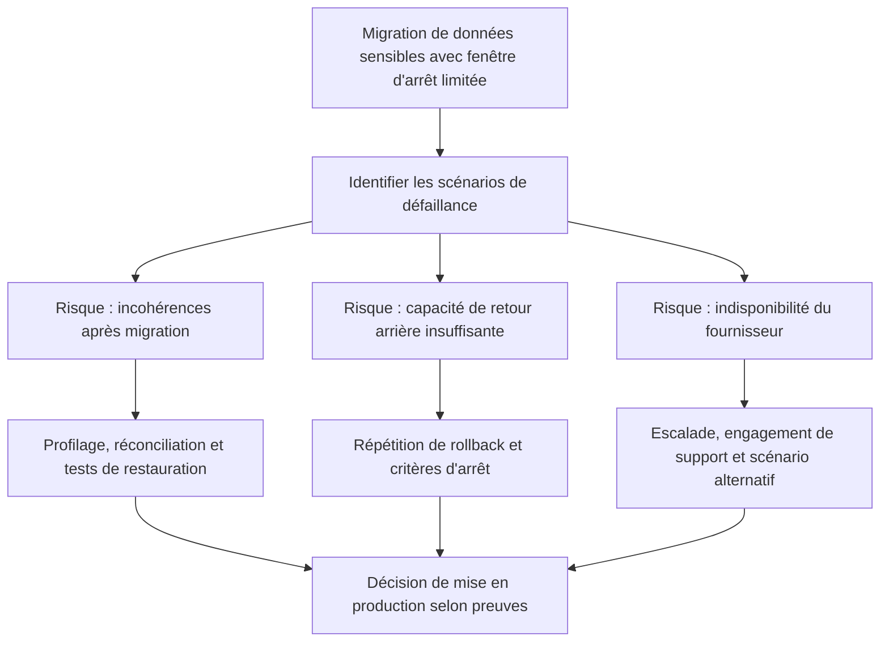

Le cas montre pourquoi les risques doivent être reliés à des scénarios précis et à des contrôles vérifiables. Des mesures de mitigation peuvent comprendre un pilote, une comparaison des données avant et après transfert, des sauvegardes restaurées en test, une fenêtre de changement avec critères d’arrêt et un contact d’escalade fournisseur. Chaque contrôle possède un propriétaire et une preuve d’exécution.

### Cadrage et données de départ

Les acteurs commencent par décrire le problème avec des faits vérifiables, puis identifient les bénéficiaires, les exigences et les contraintes. Ils séparent les obligations impératives des préférences, écrivent les hypothèses et demandent une confirmation lorsque celles-ci conditionnent fortement le coût ou la date. Le responsable du projet désigne un propriétaire pour chaque décision majeure, fixe un mécanisme d’escalade et conserve une trace des validations. La première sortie attendue est une compréhension commune du travail, et non une liste exhaustive de tâches écrite avant d’avoir compris le besoin.

### Comparaison des options

L’équipe compare au moins deux options réalistes, dont une option limitée ou progressive. Chaque option est évaluée selon la valeur, le coût complet, le délai, les risques, la réversibilité, les dépendances et les conséquences en exploitation. Les avantages non mesurés sont explicitement identifiés comme hypothèses. Une décision est recommandée lorsque le raisonnement est clair, les compromis sont compris et la personne habilitée a accès aux éléments nécessaires. En cas d’incertitude importante, un prototype ou une estimation complémentaire peut être plus utile qu’un engagement prématuré.

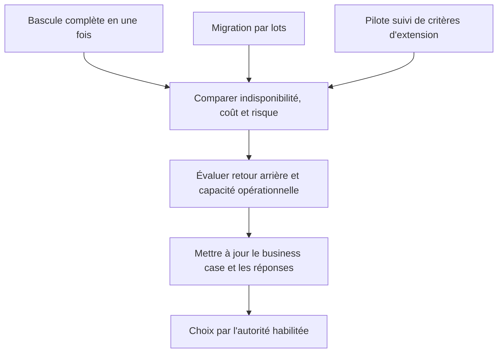

Comparer les options en termes de durée seule est insuffisant. Une bascule totale peut raccourcir le calendrier mais augmente la concentration du risque ; les lots permettent d’apprendre progressivement mais ajoutent des opérations de coordination ; un pilote peut retarder le déploiement complet tout en donnant des preuves qui rendent la décision plus robuste. La recommandation doit expliciter les conditions d’arrêt, les coûts de repli et la tolérance acceptable.

### Mise en œuvre et suivi

Le plan est découpé en livrables que l’on peut vérifier. Les travaux critiques sont associés à des critères de sortie, des responsables et des preuves. Les prévisions sont actualisées en fonction du travail restant, pas uniquement par décalage des dates précédentes. Les changements sont analysés pour leurs impacts croisés. Lorsqu’un indicateur devient rouge, l’équipe expose la cause et propose une action plutôt que de modifier la définition de l’indicateur. La communication est adaptée à chaque public et les décisions qui dépassent les délégations remontent à la gouvernance.

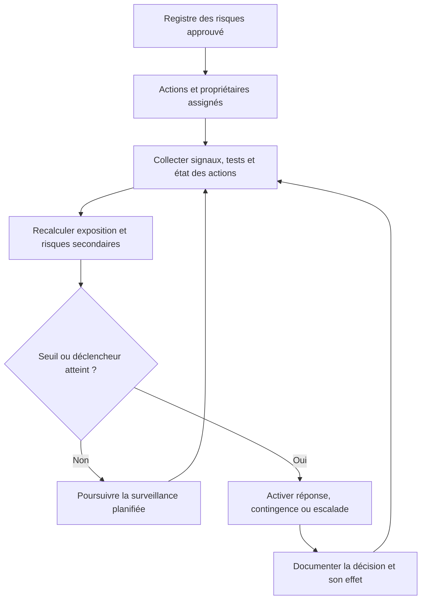

Le registre doit refléter l’état actuel, pas seulement la gravité estimée au lancement. Lors de chaque revue, vérifie les nouvelles menaces, l’efficacité des réponses, les risques secondaires, les déclencheurs et les délais d’action. Un risque peut être clôturé lorsque les conditions définies sont réunies et que la décision est documentée ; il ne doit pas disparaître simplement parce que la personne responsable a quitté l’équipe.

### Acceptation et apprentissage

Avant la clôture, les livrables sont comparés aux critères convenus, les défauts et risques résiduels sont documentés, les responsabilités d’exploitation sont transférées et le support est préparé. Les mesures de bénéfices ont un propriétaire et une échéance de suivi. La rétrospective décrit les faits, la cause des écarts, les adaptations utiles et les pratiques à conserver. Elle ne doit pas désigner des coupables : elle cherche à rendre le système de travail plus fiable et l’organisation plus apte à apprendre.

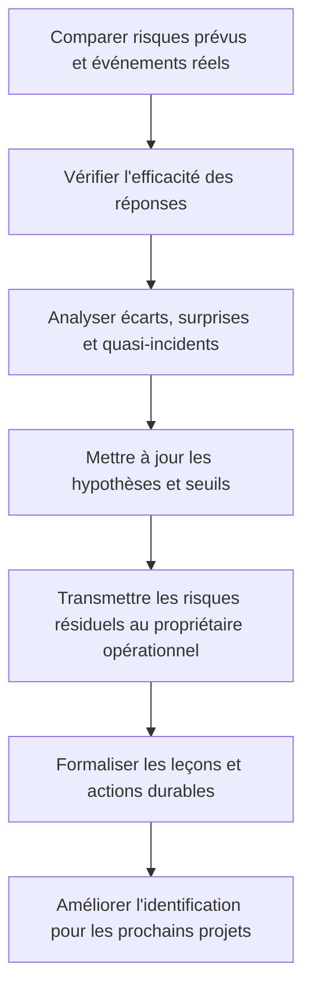

La clôture ne consiste pas à effacer le registre. Les risques transférés à l’exploitation gardent un propriétaire, une réponse et un calendrier de surveillance. Compare aussi les risques anticipés aux événements réellement survenus afin d’identifier les hypothèses inadéquates, les angles morts et les contrôles qui ont fonctionné. Ces observations améliorent le processus d’identification du prochain projet.

## Atelier pratique

**Exercice 1.** À partir du cas, écris un plan de travail d’une page. Il doit comporter les résultats attendus, les dépendances majeures, les risques, les responsables, les indicateurs et les conditions d’acceptation.

**Correction.** Une bonne réponse relie chaque activité à un livrable, chaque livrable à un critère, chaque risque à un propriétaire et chaque décision à une autorité. Elle distingue les faits des hypothèses et rend visibles les dépendances qui peuvent déplacer la date ou le coût total.

**Exercice 2.** Le sponsor demande d’avancer la livraison de plusieurs semaines. Prépare trois options avec leurs effets sur le périmètre, la capacité, le risque, la qualité et le coût.

**Correction.** Il faut expliquer les compromis sans promettre une accélération qui n’est pas étayée. Réduire un périmètre non essentiel, augmenter les moyens avec des compétences réellement disponibles ou déplacer la date sont des options possibles. Les critères de sécurité et d’acceptation obligatoires ne doivent pas être supprimés pour rendre les indicateurs artificiellement positifs.

**Exercice 3.** Une tâche semble terminée, mais aucun test ni procès-verbal ne confirme le résultat. Quelle information dois-tu demander avant de déclarer le travail accepté ?

**Correction.** Il faut retrouver le critère attendu, le test ou la preuve équivalente, le responsable de validation et le statut des écarts. Une déclaration orale peut orienter la vérification, mais ne suffit pas lorsque la gouvernance exige une preuve traçable.

## Pièges à éviter

- Confondre activité, livraison et bénéfice.
- Présenter une estimation comme une certitude sans expliquer les hypothèses.
- Masquer un écart en modifiant la référence.
- Choisir une méthode parce qu’elle est populaire plutôt que adaptée.
- Surcharger l’équipe avec un outil qui ne soutient aucune décision utile.
- Faire dépendre un livrable d’une personne ou d’un fournisseur sans plan de secours.
- Reporter les tests et la sécurité à la toute fin.
- Laisser les responsabilités d’acceptation implicites.
- Confondre indicateurs d’activité et mesures de résultat.
- Fermer le projet sans transfert, support ni mesure ultérieure des bénéfices.

## Checklist de révision

- [ ] Le besoin et les résultats attendus sont explicites.
- [ ] Les inclusions et exclusions sont visibles.
- [ ] Les hypothèses, dépendances et risques sont suivis.
- [ ] Les personnes responsables et les décideurs sont identifiés.
- [ ] Le plan décrit des livrables vérifiables.
- [ ] Les indicateurs répondent à des questions de décision.
- [ ] Les changements sont analysés et autorisés.
- [ ] La qualité et la sécurité sont intégrées au travail.
- [ ] Le transfert aux opérations est préparé.
- [ ] Les retours d’expérience sont capitalisés.

## À retenir

Un dispositif de gestion de projet n’est pas un rituel administratif : il constitue un système partagé pour comprendre le travail, prendre des décisions, observer les résultats et adapter le plan. Il doit être assez rigoureux pour protéger la valeur, la qualité et la confiance, mais assez léger pour rester utilisé. Les pratiques les plus utiles sont celles qui rendent les hypothèses visibles, les responsabilités explicites et les décisions vérifiables.

## Glossaire

- **Baseline :** référence approuvée permettant de comparer réel et prévu.
- **Dépendance :** condition qui relie deux activités ou acteurs.
- **Jalon :** événement important marquant une validation ou un point de décision.
- **Livrable :** résultat concret pouvant être vérifié.
- **Marge :** délai disponible avant qu’un retard n’affecte une autre activité ou la fin du projet.
- **Périmètre :** limites du travail et des résultats inclus.
- **Prévision :** estimation mise à jour de l’issue probable.
- **Risque :** événement incertain pouvant affecter les objectifs.
- **Critère d’acceptation :** condition observable permettant d’accepter le résultat.
- **Réserve :** enveloppe ou marge prévue pour traiter une incertitude selon les règles du projet.

## Références pour approfondir

- ISO 21502, lignes directrices de management de projet : https://committee.iso.org/sites/tc258/home/projects/published/iso-21502.html
- PMI et référentiels de gestion de projet : https://www.pmi.org/
- PRINCE2 7, présentation officielle : https://www.peoplecert.org/browse-certifications/project-programme-and-portfolio-management/PRINCE2-2/prince2-7-foundation-3579
- Guide Scrum officiel : https://scrumguides.org/scrum-guide
