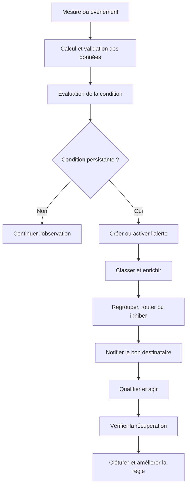
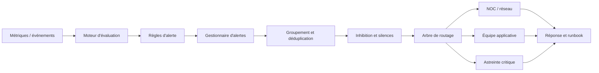
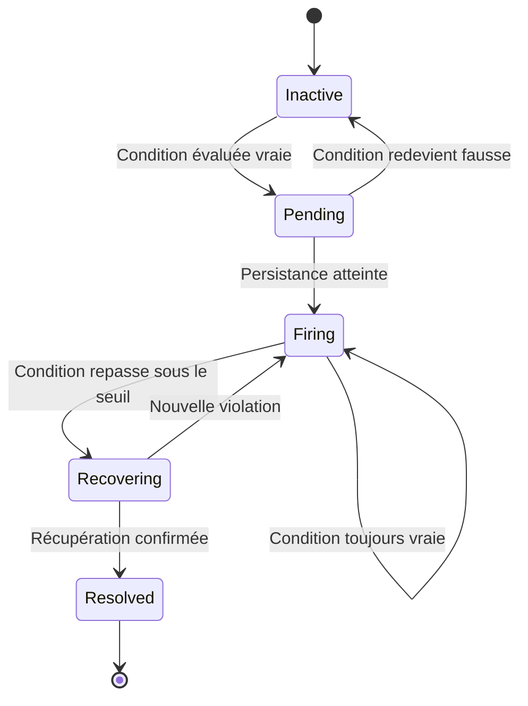
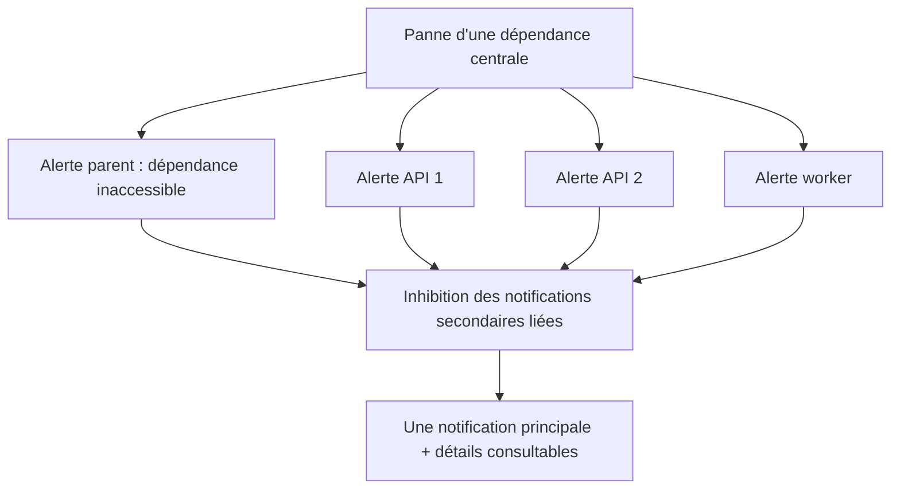

# Notions d'alerting et de seuils

## 1. Introduction

### 1.1. Pourquoi une supervision sans alertes ne suffit pas

Une plateforme de supervision peut recueillir des milliers de mesures, conserver des millions de journaux et afficher des tableaux de bord détaillés. Pourtant, si personne ne regarde ces écrans au bon moment, une panne peut durer longtemps avant d'être détectée. L'alerting transforme une observation en signal opérationnel adressé à une personne ou à un système chargé de réagir. Sa qualité influence directement le délai de détection, la fatigue des équipes, la durée des incidents et la confiance accordée à l'outil.

Une alerte mal conçue peut être presque aussi nuisible qu'une absence d'alerte. Si un seuil déclenche une notification à chaque petite fluctuation, les opérateurs reçoivent un flot de messages et finissent par les ignorer. Quand une vraie panne se produit, son signal se perd au milieu du bruit. À l'inverse, un seuil trop permissif, une fenêtre de détection trop longue ou une dépendance mal surveillée peut retarder l'alerte jusqu'à ce que les utilisateurs aient déjà subi un impact important. Une bonne politique ne vise donc ni le maximum d'alertes ni le minimum absolu : elle vise les alertes pertinentes, précoces et actionnables.

L'alerting doit répondre à une question simple : **quelle situation exige une action humaine ou automatisée, dans quel délai, et quelle action est attendue ?** Une métrique qui franchit un seuil n'est pas automatiquement un incident. Une hausse de CPU peut être normale lors d'un traitement intensif prévu ; une hausse du temps de réponse peut être préoccupante si elle affecte toutes les requêtes d'une fonction métier. Le seuil technique, le contexte du service et les conséquences de la situation doivent être considérés ensemble.

### 1.2. Encadré de mise en contexte : des alertes à l'action

> **Situation professionnelle.** À 08 h 42, une application interne commence à répondre lentement. Le tableau de bord affiche une utilisation CPU de 85 %, mais cette valeur est habituelle pendant la préparation quotidienne des rapports. À 08 h 47, le taux de réponses HTTP 5xx double et le P95 du temps de réponse dépasse l'objectif du service. Une alerte fondée sur l'expérience utilisateur se déclenche après confirmation sur plusieurs évaluations. Elle contient le service touché, la fenêtre concernée, le lien vers le tableau de bord et le runbook. En parallèle, une alerte de capacité de file indique une cause possible, sans générer une notification critique séparée pour chaque instance.

Cet exemple illustre quatre dimensions différentes. Le **signal** est la mesure utilisée pour évaluer la situation. La **condition** détermine à partir de quelles valeurs et sur quelle fenêtre un état est considéré comme anormal. La **politique de notification** décide si, quand et à qui transmettre l'alerte. Le **runbook** explique quoi vérifier et comment agir. Si une de ces dimensions manque, l'alerte peut être techniquement correcte mais opérationnellement inutile.

### 1.3. Objectifs pédagogiques

À la fin de ce cours, vous devrez pouvoir distinguer une métrique, un seuil, une règle d'alerte, une notification et un incident ; choisir un indicateur cohérent avec le risque ; calculer un taux à partir d'un numérateur et d'un dénominateur ; utiliser des fenêtres temporelles et une condition de persistance ; comprendre les états d'une alerte ; concevoir l'hystérésis et la temporisation de récupération ; classer la gravité ; éviter les tempêtes de notifications ; et relier chaque alerte à une action définie.

Vous apprendrez également à différencier les alertes basées sur les symptômes et celles basées sur les causes techniques, à prioriser les alertes selon l'impact et l'urgence, à regrouper et inhiber les notifications redondantes, à utiliser les périodes de silence de manière contrôlée et à valider une règle avec des données historiques ou des essais supervisés. Enfin, vous construirez un petit laboratoire de règles avec des exemples inspirés de Prometheus et Alertmanager.

### 1.4. Vocabulaire fondamental

Un **signal** est une donnée utilisée pour caractériser un système : taux d'erreur, latence, nombre de sessions, état d'un processus, file d'attente ou événement de sécurité. Un **seuil** est une limite ou un critère comparatif, par exemple un taux supérieur à 3 % ou une file qui contient plus de 500 tâches. Un **prédicat** ou une **condition** combine le seuil avec un contexte, une fenêtre, un état et parfois plusieurs métriques.

Une **règle d'alerte** formalise une condition qui doit être évaluée régulièrement. Elle peut rester inactive, passer en attente de confirmation, puis déclencher une alerte active. Une **notification** est un message transmis à un canal ou à une équipe ; plusieurs alertes peuvent être regroupées dans une seule notification. Un **incident** est une situation nécessitant une réponse coordonnée, en général en raison d'une interruption ou d'un risque significatif pour un service ou une activité. Les concepts sont liés, mais ne sont pas interchangeables.

Une **condition de récupération** définit quand considérer qu'un problème est terminé. Une **hystérésis** crée un écart entre les critères d'entrée et de sortie d'un état afin d'éviter des transitions répétées lorsque la mesure oscille autour d'une limite. Une **fenêtre** détermine la période utilisée pour calculer une moyenne, un taux, un percentile ou un nombre d'événements. Une **temporisation** est un délai appliqué avant le déclenchement, la répétition ou la résolution d'une notification.

Une **gravité** décrit la priorité opérationnelle estimée. Une **destination** ou un **receveur** est le canal ou l'intégration vers lesquels les notifications sont transmises. Une **route** de notifications choisit le destinataire selon des attributs tels que la gravité, l'équipe, l'environnement ou le service. Une **inhibition** empêche certaines alertes secondaires d'envoyer des notifications lorsqu'une alerte parente indique déjà un incident plus large. Un **silence** met temporairement en sourdine les alertes qui correspondent à des critères précis, par exemple pendant une maintenance autorisée.

### 1.5. Monitoring, alerting et réponse aux incidents

Le monitoring produit des observations : métriques, états, journaux et graphiques. L'alerting analyse certains de ces signaux pour identifier des situations qui demandent une action. La réponse aux incidents organise cette action : qualification, communication, mitigation, restauration, vérification et apprentissage. Une plateforme peut avoir des tableaux de bord excellents et des alertes médiocres, ou des alertes qui se déclenchent mais ne contiennent pas assez d'informations pour agir. Il faut concevoir les trois dimensions ensemble.

La recommandation générale des pratiques de supervision modernes consiste à privilégier les symptômes qui affectent les utilisateurs plutôt que de créer une alerte urgente pour chaque cause interne possible. Une hausse de CPU est utile comme indicateur de diagnostic ou de capacité imminente ; un taux d'erreur métier anormal signale plus directement une dégradation du service. Les deux peuvent être surveillés, mais ils ne doivent pas nécessairement générer la même urgence. Les recommandations officielles de Prometheus sur l'alerting insistent sur la simplicité, les symptômes et l'actionnabilité : https://prometheus.io/docs/practices/alerting/.

### 1.6. La chaîne complète de l'alerte



Ce schéma commence par une mesure, mais une alerte sérieuse est plus qu'une comparaison numérique. Elle doit s'appuyer sur des données valides et suffisamment récentes, passer par une condition compréhensible, être orientée vers une personne qui peut faire quelque chose et contenir un chemin de diagnostic. Après la mitigation, l'équipe vérifie le rétablissement et examine si la règle a réagi au bon moment, avec la bonne intensité et un volume acceptable de notifications.

### 1.7. Pourquoi le nombre d'alertes n'est pas un indicateur de qualité

Un système qui génère 10 000 notifications par jour peut être moins utile qu'un système qui en envoie dix, si les dix notifications correspondent à des incidents réellement actionnables et que les autres sont du bruit. À l'inverse, un faible volume de notifications ne prouve pas que le service est bien surveillé : il peut résulter d'un seuil trop élevé ou d'un collecteur qui ne fournit plus de mesures. Il faut mesurer le signal utile, les faux positifs, les incidents manqués et les délais de détection.

La qualité s'évalue à partir de plusieurs questions : quelle part des alertes nécessite une action ? Combien de notifications sont répétitives ? Les bonnes équipes sont-elles contactées ? L'alerte arrive-t-elle avant ou après les plaintes des utilisateurs ? Le runbook aide-t-il à identifier les premières vérifications ? Les périodes de silence ont-elles une justification ? La réponse est-elle plus rapide après amélioration de la règle ? Un programme d'alerting mature révise et supprime les règles inutiles aussi régulièrement qu'il en ajoute.

## 2. Concepts clés

### 2.1. Choisir le bon signal : symptôme ou cause

Un symptôme décrit ce que subit le service ou l'utilisateur : erreurs de requête, latence excessive, absence de réponse ou incapacité à terminer une opération. Une cause potentielle peut être une CPU élevée, un pool épuisé, une interface réseau avec des erreurs ou une file d'attente trop grande. Les métriques de cause sont utiles pour expliquer les symptômes et parfois pour prévenir une panne imminente, mais elles ne doivent pas être confondues avec la preuve d'un impact.

Par exemple, une CPU à 95 % ne signifie pas forcément qu'un service est inutilisable. Un processus de compression planifiée peut consommer beaucoup de CPU sans affecter les appels interactifs. À l'inverse, une API peut répondre lentement alors que le CPU reste bas, parce qu'elle attend une base de données ou une dépendance réseau. Une règle qui signale une CPU élevée peut être pertinente comme avertissement de capacité ; elle ne devrait pas automatiquement être traitée comme une panne critique de service sans contexte supplémentaire.

Une règle fondée sur un symptôme peut surveiller le taux d'erreurs d'une fonction métier et le percentile de latence. Si ces valeurs dépassent les objectifs pendant une période significative, une alerte se déclenche. Des dashboards associés présentent les ressources, les files d'attente et les erreurs internes pour aider à localiser la cause. Ce modèle réduit la tentation de paginer l'équipe pour chaque variation de ressource, tout en gardant les métriques techniques accessibles à l'analyse.

Il existe des exceptions. Une ressource peut franchir un seuil dur avant qu'un symptôme ne soit visible : un disque qui approche de 100 % peut arrêter instantanément une base de données ; un certificat bientôt expiré peut interrompre les connexions TLS ; une capacité restante insuffisante peut annoncer une panne prochaine. Une alerte préventive est légitime lorsque le lien entre le signal et le risque est documenté, que le délai d'action est connu et que le destinataire sait quoi faire.

### 2.2. Seuil absolu : simple, mais pas universel

Un seuil absolu compare une mesure à une valeur fixe. Exemple : déclencher un avertissement lorsque la mémoire utilisée dépasse 85 %, ou une alerte quand le taux d'erreur dépasse 5 %. Ce modèle est facile à expliquer et à tester. Il fonctionne bien lorsque la limite représente une contrainte physique ou contractuelle, comme l'espace disque, un quota, un délai maximum ou un nombre maximal de connexions.

Le problème est qu'une même valeur ne signifie pas toujours la même chose. Un taux d'erreur de 2 % peut être inacceptable pour une fonction de paiement, mais acceptable pendant une opération de migration si les requêtes concernées sont explicitement exclues et que le contrat le permet. Une CPU à 80 % peut être habituelle sur un serveur de calcul ; une file de messages qui passe de 20 à 80 peut être normale à midi et alarmante à 3 heures du matin. Le contexte, le service et le moment doivent guider le seuil.

Un seuil absolu doit préciser la mesure, son unité, les labels qui identifient la population, la fenêtre temporelle, la durée de persistance, les éventuelles exclusions et la condition de récupération. « CPU supérieure à 85 % » est incomplet si l'on ne sait pas si la mesure est une moyenne sur 10 secondes, sur 5 minutes ou sur un quart d'heure. La valeur ne devient exploitable que lorsque l'on connaît la façon dont elle est calculée et l'action attendue.

Avant de déployer un seuil, observez l'historique. Vérifiez la distribution normale, la saisonnalité, les périodes de charge, les maintenances et les incidents connus. Un seuil placé juste au-dessus de la moyenne déclenchera probablement des alertes répétées ; un seuil bien au-dessus de toute valeur observée peut ne se déclencher qu'après l'épuisement de la ressource. Le réglage doit être évalué sur des événements réels ou des essais contrôlés, et non choisi uniquement parce qu'un nombre paraît raisonnable.

### 2.3. Seuil relatif, base de référence et anomalies

Un seuil relatif compare le comportement à une référence. Une hausse de 300 % du volume d'erreurs par rapport à la moyenne des dernières semaines peut être utile même si la valeur absolue reste sous un seuil fixe. Une baisse brutale du débit d'une chaîne de traitement peut être significative lorsqu'une activité régulière est attendue. Ces alertes peuvent détecter des écarts que les seuils statiques ne voient pas.

Cependant, une comparaison relative est fragile si la référence est mauvaise. Un service dont le volume habituel est proche de zéro peut déclencher une hausse de plusieurs centaines de pour cent à cause de deux événements. Une référence calculée pendant une période déjà dégradée peut considérer le problème comme normal. Les cycles journaliers et hebdomadaires doivent être pris en compte ; comparer un lundi matin à un dimanche soir n'est pas nécessairement pertinent. Il faut également décider comment traiter les changements de trafic intentionnels, les lancements de fonctionnalités et les migrations.

Les méthodes d'anomalie statistiques peuvent détecter des changements plus subtils, mais elles ne dispensent pas de définir l'impact et l'action. Un score d'anomalie élevé peut signaler que le comportement diffère de la référence sans signifier que les utilisateurs subissent un problème. Pour générer une notification urgente, il faut une relation claire entre l'écart, le risque et la réponse attendue. Les alertes d'anomalie sont souvent plus utiles lorsqu'elles sont combinées avec des seuils minimaux, des contextes de service et une période de confirmation.

### 2.4. Fenêtres de temps et agrégations

Une mesure instantanée peut être bruyante. Si le CPU passe une seconde à 96 % puis retourne à 40 %, une alerte immédiate peut créer un faux positif. Une fenêtre glissante de cinq minutes peut calculer une moyenne, une proportion ou un percentile qui représente mieux le comportement récent. Mais une fenêtre trop longue retarde la détection et peut masquer une panne courte. Il faut choisir la fenêtre selon la vitesse à laquelle l'équipe doit réagir et le niveau de bruit normal.

La fenêtre d'une règle ne doit pas être confondue avec la fréquence d'évaluation. Une règle peut être évaluée toutes les 30 secondes tout en calculant le taux sur les cinq dernières minutes. Les évaluations successives partagent alors une grande partie des données. La fréquence d'évaluation contrôle la rapidité avec laquelle la règle examine la condition ; la fenêtre définit la période d'observation utilisée dans le calcul. Les deux paramètres doivent être documentés.

Une moyenne peut être appropriée pour une charge stable, mais elle peut cacher des pointes. Pour la latence, un percentile ou une distribution peut mieux représenter l'expérience des requêtes lentes. Pour un taux d'erreur, la somme des erreurs divisée par la somme des requêtes est généralement plus cohérente que la moyenne non pondérée de taux par instance, lorsque les instances ont des volumes différents. Les agrégations doivent correspondre au phénomène mesuré et à la population concernée.

Les petits échantillons doivent être traités avec prudence. Si une instance ne reçoit qu'une requête pendant une minute et qu'elle échoue, son taux local est de 100 %, mais la situation peut ne pas représenter un impact significatif sur le service global. Si cette instance héberge une opération critique, l'événement peut malgré tout être important. Le choix d'une fenêtre et d'un dénominateur doit donc refléter les risques, et pas uniquement les propriétés statistiques du graphe.

### 2.5. Persistance : exiger que la condition dure

La persistance évite qu'une seule évaluation anormale déclenche immédiatement une alerte. Dans Prometheus, la clause **for** permet d'attendre qu'une condition reste active pendant la durée spécifiée avant de passer de l'état pending à firing. La documentation décrit ce comportement : https://prometheus.io/docs/prometheus/latest/configuration/alerting_rules/. Le principe est commun à de nombreuses plateformes, même si le nom du paramètre varie.

Supposons que le taux d'erreur dépasse 5 % une fois, puis revienne à la normale à l'évaluation suivante. Une règle exigeant cinq minutes de persistance ne déclenchera pas de notification. Si la condition continue à être vraie durant toute la période, l'alerte devient active. Cela donne un compromis entre sensibilité et stabilité. La durée exacte dépend du service : une alerte de certificat imminent peut être calculée sur des jours, alors qu'une panne d'authentification peut nécessiter une réaction en quelques dizaines de secondes.

La persistance ne doit pas être utilisée pour masquer un incident brutal. Pour certains risques, une seule observation peut exiger une réaction immédiate : une erreur de sécurité critique confirmée, une perte d'un composant redondant lorsque le dernier composant restant est déjà en danger, ou une température qui dépasse une limite matérielle stricte. Dans ces situations, une alerte immédiate peut être appropriée, tandis que les métriques de bruit ou de latence utilisent une durée de confirmation.

La persistance se teste à l'aide de séquences connues : une pointe très courte, une condition qui dépasse le seuil puis se rétablit avant la durée, une condition qui reste vraie, une panne de données et un redémarrage de l'évaluateur. Vérifiez que l'alerte se déclenche au moment attendu et que son état ne change pas à cause d'une simple perte d'échantillons. Les comportements de données manquantes varient selon les systèmes : ils doivent être compris et documentés.

### 2.6. États pending, firing et resolved

Dans les règles d'alerte qui prennent en charge ces états, une condition peut être active mais pas encore confirmée : c'est l'état pending. Lorsque la durée de persistance est atteinte, l'alerte passe à firing et devient admissible à une notification selon la politique. Lorsque la condition cesse d'être vraie et que les règles de récupération sont satisfaites, l'alerte peut être résolue. Ces états permettent de séparer la détection du bruit, l'incident confirmé et le retour à la normale.

Les interfaces de monitoring peuvent afficher d'autres états, tels que normal, inconnu, no data ou error. Il faut les distinguer. « Normal » signifie que la mesure et la règle ont été évaluées et que la condition n'est pas satisfaite. « Aucune donnée » signifie que la règle ne dispose pas de l'observation attendue. « Erreur d'évaluation » signifie que l'expression n'a pas été calculée correctement ou que le backend est défaillant. Transformer toutes ces situations en normalité masque un problème de supervision.

La résolution est un événement opérationnel. Elle indique que la condition associée à cette alerte n'est plus considérée comme active ; elle ne garantit pas à elle seule que tous les impacts sont terminés. Une application peut revenir sous le seuil tout en ayant une file accumulée ou des commandes bloquées. Pour les services critiques, vérifiez aussi les conséquences et les signaux de bout en bout, puis documentez la clôture de l'incident.

La notification de récupération doit être utile. Si chaque petite oscillation produit un message « OK » puis un message d'incident, l'équipe reçoit encore du bruit. Une condition de récupération persistante, un délai avant de notifier la résolution ou l'agrégation d'événements proches peut améliorer la lisibilité. La solution doit toutefois éviter de retarder une information dont les opérateurs ont besoin pour coordonner leurs actions.

### 2.7. Hystérésis et oscillation autour d'un seuil

L'hystérésis utilise des conditions d'entrée et de sortie différentes pour stabiliser un état. Par exemple, une alerte de température peut s'activer lorsque la valeur dépasse 90 °C et ne se résoudre que lorsqu'elle redescend sous 85 °C. Sans cet écart, une mesure qui oscille entre 89,9 et 90,1 °C peut provoquer des transitions répétées. En réseau, le principe peut s'appliquer à la qualité de lien, à la taille des files ou à la latence.

La persistance et l'hystérésis sont différentes. La persistance exige que la condition dure ; l'hystérésis crée une zone de retour distincte. Elles peuvent être utilisées ensemble. Une alerte peut exiger que le taux d'erreur dépasse 5 % pendant trois minutes, puis attendre que le taux reste sous 2 % pendant deux minutes avant de se résoudre. Cette politique filtre les pointes et stabilise le rétablissement, mais elle ajoute du délai ; il faut l'évaluer contre les objectifs du service.

Un seuil d'entrée trop haut peut retarder l'alerte, tandis qu'un seuil de sortie trop bas peut maintenir une alerte longtemps après le rétablissement réel. L'écart doit correspondre à la fluctuation normale et au risque de l'indicateur. Ne choisissez pas une valeur d'hystérésis uniquement pour rendre le graphe plus lisse ; le paramètre doit refléter le comportement du système et le délai acceptable pour confirmer une récupération.

Documentez les seuils d'entrée et de sortie dans la règle ou le runbook. Lorsqu'un incident se répète, examinez si la règle oscille autour du seuil, si le signal est mal choisi ou si le service connaît des fluctuations réelles qui nécessitent une correction. Une alerte qui oscille souvent peut révéler un défaut de capacité ou une configuration incorrecte, et pas seulement une mauvaise valeur de seuil.

### 2.8. Gravité : info, avertissement, critique

Une classification simple peut distinguer **information**, **avertissement** et **critique**. L'information permet de consulter un événement sans exiger une action immédiate. L'avertissement indique une dégradation ou un risque qui mérite examen dans un délai défini. Le critique exige une réaction rapide parce que le service est significativement affecté ou qu'une panne imminente présente un risque élevé.

La gravité doit être liée à l'impact et à l'urgence, pas seulement à la valeur technique. Un disque à 80 % peut être un avertissement si l'espace restante correspond à plusieurs jours de charge et une alerte critique si le système est en écriture rapide et qu'il ne reste que quelques minutes. Une panne d'un nœud redondant peut être un avertissement tant que le service fonctionne, puis devenir critique si le dernier nœud restant présente des symptômes de saturation. Les règles peuvent intégrer la topologie, le rôle et la redondance.

Le niveau doit être cohérent avec le canal de notification. Une alerte d'information peut rester dans un tableau de bord ou un canal d'équipe ; un critique peut déclencher une page à l'astreinte. Évitez d'envoyer des notifications critiques par le même canal peu visible que les messages informatifs. Inversement, ne déclenchez pas un appel d'astreinte pour une alerte qui peut attendre une revue ouvrée, sauf si une obligation opérationnelle l'exige.

La gravité source et la gravité de notification peuvent être conservées séparément. Un journal peut déclarer une sévérité « error », mais l'alerting peut la classer comme information après un regroupement connu ; un symptôme de service peut devenir critique même si l'événement déclencheur était un message de niveau warning. Conservez le contexte d'origine pour l'audit et expliquez comment la politique de service transforme les observations en priorité d'action.

### 2.9. Fréquence d'évaluation, intervalle de collecte et délai de détection

Trois durées sont souvent confondues. L'intervalle de collecte détermine à quelle fréquence les données sont observées ou récupérées. L'intervalle d'évaluation détermine quand les règles sont recalculées. La durée de persistance détermine combien de temps une condition doit rester active. Le délai de notification ajoute parfois la période de regroupement et le temps de transmission. Le temps total de détection est donc une combinaison de ces paramètres et du temps nécessaire à la mesure.

Supposons que les données soient collectées toutes les 30 secondes, que la règle soit évaluée toutes les 30 secondes et qu'une persistance de deux minutes soit requise. Selon le moment où l'événement commence par rapport à la dernière collecte, l'alerte peut nécessiter plusieurs évaluations avant d'être confirmée. Une règle avec la même persistance mais une collecte toutes les cinq minutes ne produira pas le même délai réel. Il faut mesurer l'ensemble du chemin plutôt que regarder uniquement la valeur de la clause de persistance.

Une collecte trop fréquente peut augmenter le coût et la charge ; une fréquence trop faible manque les incidents courts et retarde les alertes. La fréquence doit être choisie selon la dynamique du phénomène et l'impact d'une panne. Les événements de sécurité et les limites physiques critiques peuvent demander une surveillance plus rapide que les tendances de capacité à long terme. Les règles doivent aussi tenir compte des retards de transport et du fonctionnement de l'évaluateur.

Le temps de notification inclut parfois une période de regroupement pour réunir plusieurs alertes liées avant l'envoi. Une fenêtre courte envoie plus vite, mais le premier message peut ne pas contenir toutes les alertes qui apparaissent lors d'une panne globale. Une fenêtre longue réduit le bruit, mais peut retarder l'action. Il faut choisir la temporisation en fonction de la nature de l'événement, puis vérifier la latence de bout en bout au moyen de tests.

### 2.10. Ratio d'erreur et seuil de faible trafic

Une règle qui déclenche sur un pourcentage d'erreur peut devenir instable lorsque le trafic est faible. Si une seule requête arrive durant une période et échoue, le taux est de 100 %. Pour un service à faible trafic, cette valeur peut être importante si chaque requête correspond à une opération métier critique. Pour une plateforme très utilisée, un seul échec isolé ne devrait peut-être pas réveiller l'astreinte. Les règles doivent associer le ratio à un minimum de volume, à la criticité ou à une autre mesure de confiance.

Une stratégie peut exiger à la fois un taux d'erreur élevé et un nombre minimum d'échecs dans la fenêtre. Une autre peut appliquer des règles spécifiques aux opérations critiques, même avec un faible trafic. Il n'existe pas une seule formule adaptée à tous les services : définissez la population, le risque, l'impact et le délai acceptable. Testez les cas de trafic très faible, de trafic nul, de rafale de requêtes et de redémarrage des compteurs.

N'utilisez pas le ratio seul si le numérateur ou le dénominateur devient absent. Un système qui ne reçoit plus de requêtes peut afficher un taux d'erreur nul par absence de dénominateur, alors que le service est inaccessible. Il faut surveiller le volume ou la disponibilité de bout en bout séparément. La logique de requête doit distinguer un service sans trafic prévu, un service dont la collecte est en panne et un service dont les requêtes attendues ne parviennent plus.

### 2.11. Alertes de seuil, alertes de taux et alertes de durée

Une alerte de seuil examine une valeur : mémoire, CPU, température, espace disque ou file d'attente. Une alerte de taux examine l'évolution ou la proportion d'événements : erreurs par requête, débit d'entrées, pertes ou échecs d'authentification par fenêtre. Une alerte de durée examine depuis combien de temps un état demeure présent, comme un job en cours depuis plus longtemps que prévu ou une tâche qui n'a pas avancé. Chacune nécessite une sémantique et une unité spécifiques.

Pour un seuil, demandez si la mesure est instantanée ou agrégée et quelle valeur doit déclencher l'action. Pour un taux, définissez le numérateur, le dénominateur, la fenêtre et la manière de traiter les faibles volumes. Pour une durée, définissez le début de la période, les états qui comptent comme progression, et si une pause ou une maintenance suspend le chronomètre. Une règle qui ne définit pas ces détails risque de déclencher sur des données incompatibles avec le besoin.

Les alertes peuvent aussi être composites. On peut avertir lorsque le CPU est élevé et que la latence se dégrade, ou signaler une capacité faible lorsqu'un disque approche de sa limite et que son taux de croissance prévoit un épuisement avant la prochaine intervention. Une logique composite réduit certains faux positifs, mais elle peut aussi manquer une panne si une des conditions n'est jamais disponible. Gardez les règles lisibles et évitez les combinaisons si complexes que personne ne peut expliquer pourquoi l'alerte s'est déclenchée.

### 2.12. Définir une alerte actionnable

Une alerte actionnable indique qui doit agir, pourquoi la situation compte, quel périmètre est touché, depuis quand, quelle preuve justifie le signal et où trouver les vérifications pertinentes. Elle comporte généralement un nom stable, une gravité, le service ou l'actif, une description concise, un lien vers le dashboard, un lien vers le runbook et les labels nécessaires au routage. Il faut éviter les notifications qui disent simplement « seuil dépassé » sans préciser la mesure, la fenêtre ou l'action attendue.

Le runbook n'a pas besoin d'être un document énorme. Il doit expliquer les premières vérifications, les causes courantes, les commandes ou dashboards utiles, les risques à éviter et les critères d'escalade. Il est préférable de fournir une action de diagnostic sûre plutôt que recommander automatiquement un redémarrage ou une modification en production. Les actions de mitigation doivent être approuvées, réversibles lorsque possible, et adaptées au niveau de risque.

Testez l'alerte comme un produit. Demandez à une personne qui n'a pas créé la règle de la recevoir en simulation et de suivre le runbook. Peut-elle identifier l'impact ? Sait-elle si elle doit intervenir immédiatement ? Peut-elle distinguer le symptôme de la cause probable ? A-t-elle accès aux tableaux de bord ? Si la notification contient des informations non pertinentes, la description doit être améliorée. La qualité des messages influence la rapidité de réponse aussi fortement que la précision du seuil.

### 2.13. Groupement, déduplication et gestion des tempêtes

Une panne de dépendance peut provoquer une avalanche de signaux : chaque service, chaque instance et chaque route se met à générer une alerte. Si toutes les alertes sont envoyées individuellement, les personnes d'astreinte peuvent être submergées. Le groupement réunit des alertes de nature similaire en une notification compacte. La déduplication évite de renvoyer continuellement la même alerte inchangée ; le routage distribue les groupes aux bons destinataires. Alertmanager décrit ces fonctions dans sa documentation : https://prometheus.io/docs/alerting/latest/alertmanager/.

Le groupement doit préserver les détails utiles. Une seule notification pour un cluster entier peut être appropriée, mais l'opérateur doit encore pouvoir savoir quelles instances sont affectées. Grouper toutes les alertes par gravité uniquement peut rassembler des incidents sans rapport. À l'inverse, grouper par instance individuelle peut annuler l'intérêt du regroupement. Le choix des clés de groupe doit correspondre au modèle de service : cluster, service, zone, type d'alerte ou dépendance.

La déduplication ne doit pas effacer un changement significatif. Si la gravité passe d'avertissement à critique, si le nombre d'instances touchées augmente ou si la portée s'étend à un autre site, la politique doit permettre de communiquer cette évolution. La fréquence des rappels doit également être ajustée : une alerte non résolue doit continuer à être visible, mais elle ne doit pas envoyer le même message chaque seconde. Les temporisations de regroupement et de répétition doivent être choisies selon l'urgence et les habitudes d'exploitation.

### 2.14. Routage, inhibition et silence

Le **routage** choisit un destinataire selon des attributs. Par exemple, les incidents réseau peuvent aller à l'équipe NOC, les erreurs de base de données à l'équipe plateforme, les alertes du développement à une équipe applicative et les alertes critiques en production à l'astreinte. Des routes par environnement empêchent un test de développement de réveiller l'équipe de production. Les labels de routage doivent être normalisés et maintenus, car une valeur manquante ou erronée peut envoyer l'alerte au mauvais endroit.

L'**inhibition** supprime certaines notifications secondaires lorsqu'une alerte source plus importante est active. Si un cluster entier est confirmé inaccessible, des alertes de chaque service hébergé peuvent être inhibées pour éviter un flot de notifications. Les alertes restent cependant disponibles pour consultation selon le système. Une mauvaise règle d'inhibition peut masquer une panne indépendante ; il faut définir précisément les correspondances de service, de cluster ou de site qui rendent les alertes réellement dépendantes. Documentation officielle : https://prometheus.io/docs/alerting/latest/alertmanager/.

Un **silence** met temporairement des alertes correspondantes en sourdine, souvent lors d'une maintenance connue ou d'une fenêtre de changement. Il doit avoir une justification, une durée, un propriétaire et un ensemble de critères précis. Un silence trop large peut masquer une panne réelle qui survient pendant la maintenance ; un silence sans expiration est particulièrement dangereux. Ne remplacez pas une suppression permanente d'alertes inutiles par un silence indéfini : corrigez ou retirez la règle devenue inutile.

Les trois mécanismes ont des buts distincts. Le routage détermine qui reçoit ; le groupement réduit le nombre de notifications tout en conservant la portée ; l'inhibition supprime les messages secondaires liés à un incident parent ; le silence suspend temporairement certaines notifications selon un calendrier ou une action autorisée. Ces mécanismes doivent être testés en combinaison, car une règle de silence ou d'inhibition peut interagir avec le routage et créer une zone aveugle.

### 2.15. Éviter les alertes orphelines et les alertes sans propriétaire

Une règle sans équipe responsable peut rester active pendant des semaines sans action. Chaque alerte doit posséder un propriétaire opérationnel, un service ou un périmètre, un canal de notification et un chemin d'escalade. L'inventaire doit préciser le propriétaire courant, le niveau de criticité et la documentation associée. Lorsque le service change d'équipe ou de nom, les labels et les destinataires doivent être mis à jour.

Un inventaire d'alertes doit contenir au minimum le nom de la règle, son objectif, l'expression ou le signal utilisé, les labels et annotations, la gravité, le destinataire, le runbook, les exclusions, la date de dernière revue et le propriétaire. Les règles qui ne sont jamais déclenchées peuvent être utiles si elles protègent un risque rare, mais il faut vérifier qu'elles fonctionnent. Les règles qui se déclenchent en permanence ou dont personne ne comprend l'utilité doivent être revues.

Une alerte critique ne doit pas dépendre de la seule disponibilité d'un canal de notification. Si un service de messagerie tombe en panne, l'équipe peut manquer l'alerte. Pour les fonctions critiques, examinez les mécanismes de redondance, les accusés de réception éventuels et le contrôle indépendant de la chaîne de notification. Il n'est pas nécessaire d'avoir une duplication maximale pour tous les événements ; la résilience du canal doit être proportionnée au risque et au délai de réponse attendu.

### 2.16. Données manquantes et erreurs d'évaluation

Une mesure absente peut signifier que l'exporteur est arrêté, que la collecte est en retard, qu'un service n'est plus découvert, que la série n'existe pas pour cette dimension ou que l'évaluateur rencontre une erreur. Elle ne doit pas être automatiquement assimilée à une valeur nulle. Une alerte peut avoir une condition de récupération apparemment vraie si l'expression ne retourne plus de série ; selon le système et la règle, cela peut masquer l'état d'alerte ou créer une résolution inattendue.

Il faut distinguer quatre situations : la mesure existe et est normale ; la mesure existe et franchit le seuil ; la mesure n'existe plus ; l'évaluation elle-même échoue. Une politique peut déclencher une alerte séparée de collecte lorsque la donnée attendue n'arrive plus depuis une durée définie. La supervision du collecteur, de l'exporteur, du stockage et des évaluateurs est essentielle pour savoir quand le système n'est plus capable de mesurer son service.

Dans Prometheus, l'expression d'alerte est évaluée périodiquement et les éléments retournés par l'expression deviennent des alertes selon leurs labels. Si une série disparaît, il faut comprendre la sémantique de l'expression et du moteur d'évaluation. Les règles de recording et d'alerting ont des champs distincts pour l'expression, la persistance, les labels et les annotations. La documentation officielle est utile pour valider les détails de syntaxe : https://prometheus.io/docs/prometheus/latest/configuration/alerting_rules/.

### 2.17. Alertes de sécurité et alertes de disponibilité

Une alerte de disponibilité cherche généralement à détecter un impact sur un service, une dégradation ou une ressource qui risque de s'épuiser. Une alerte de sécurité peut réagir à un événement rare mais très important, à une combinaison de signaux ou à une séquence qui suggère une activité malveillante. Les deux familles partagent des principes de qualité, mais elles n'ont pas toujours le même comportement attendu. Une alerte de sécurité peut nécessiter une conservation détaillée des preuves et une notification immédiate, même si le nombre d'événements est faible.

Un seul échec d'authentification ne signifie pas forcément une attaque. Plusieurs centaines d'échecs distribués sur de nombreux comptes peuvent être significatifs ; une connexion privilégiée depuis un contexte inattendu peut également l'être. Les règles doivent incorporer les valeurs de référence, la criticité, les sources et le contexte, puis conserver les événements qui permettront d'enquêter. Évitez de construire des alertes qui supposent une culpabilité à partir d'un seul indice ; une alerte indique qu'un motif mérite examen.

Pour les systèmes sensibles, documentez qui a le droit de supprimer ou de mettre en silence une alerte de sécurité, comment le silence est audité et quelles preuves doivent être conservées. Les fenêtres de maintenance réseau peuvent générer des événements inhabituels légitimes, mais elles ne devraient pas annuler aveuglément toutes les alertes de sécurité. Séparez les catégories et définissez des exceptions justifiées. Toute suppression doit avoir une portée limitée, une durée et une trace d'audit.

### 2.18. Alerting orienté SLO et consommation du budget d'erreur

Un objectif de niveau de service (SLO) définit une cible de qualité sur une période, par exemple une proportion de requêtes qui réussissent ou répondent sous un délai donné. Le budget d'erreur représente la quantité d'indisponibilité ou d'erreurs compatible avec cet objectif. Les alertes orientées SLO surveillent non seulement un seuil instantané, mais aussi la vitesse à laquelle ce budget est consommé. Cela permet de distinguer un incident bref sans impact durable d'une dégradation qui risque de faire échouer l'objectif.

Une consommation rapide du budget d'erreur peut justifier une notification critique même si un taux d'erreur absolu semble modéré. À l'inverse, une courte hausse peut être tolérable si l'objectif reste largement respecté et que l'impact est faible. Le calcul doit utiliser un SLI fiable avec un numérateur, un dénominateur et des critères d'exclusion clairs. Les traces et les logs aident à expliquer les violations ; ils ne doivent pas remplacer les métriques servant à quantifier la population globale.

Les pratiques SRE décrivent des méthodes d'alerting sur SLO et sur la consommation du budget : https://sre.google/workbook/alerting-on-slos/. Ces méthodes peuvent être complexes, et une équipe débutante peut commencer avec un indicateur simple de taux d'erreur ou de latence, puis évoluer vers des fenêtres multi-échelles à mesure que ses données et son fonctionnement se stabilisent. Il vaut mieux une règle simple comprise et testée qu'un système mathématique difficile à expliquer et que personne n'ose modifier.

### 2.19. Maintenir les règles au fil du temps

Une règle d'alerte est du code opérationnel. Elle doit être versionnée, examinée, testée et reliée à un propriétaire. Les modifications de seuil, de labels ou de temporisation peuvent changer le volume de notifications et le délai de détection. Une validation syntaxique ne suffit pas : il faut également tester la logique avec des données représentatives, des cas de bord et des scénarios d'échec.

Le test doit couvrir les cas normaux, les pointes courtes, les violations persistantes, le trafic faible, les données absentes, la récupération et les défaillances du canal. Si possible, rejouez des données historiques pour estimer les déclenchements avant de déployer une nouvelle règle. Mesurez le temps de détection et le nombre de notifications qu'elle aurait générées. Une règle qui semble correcte dans un exemple synthétique peut se comporter très différemment sur un mois de données de production.

Après un incident, analysez si l'alerte a été trop tardive, trop bruyante, mal routée ou dépourvue de contexte. Chaque incident peut mener à une modification, mais ne changez pas le seuil sans comprendre la cause des déclenchements. Une alerte qui se déclenche pendant un incident réel n'est pas automatiquement une bonne alerte si elle n'a pas permis de réagir ; une alerte qui n'a pas déclenché peut être appropriée si la situation n'a pas réellement affecté le service. L'évaluation doit se fonder sur le risque et les faits.

## 3. Architecture et Schémas

### 3.1. Architecture logique : de la règle au destinataire

Dans une architecture courante avec Prometheus, le moteur évalue les expressions de règle et produit les alertes. Alertmanager prend ensuite en charge des fonctions telles que le groupement, la déduplication, le routage, le silence et l'inhibition avant d'envoyer les notifications aux systèmes destinataires. D'autres plateformes réunissent certaines fonctions ou les nomment différemment, mais la séparation logique entre évaluation de la condition et orchestration de la notification reste utile.



L'évaluateur devrait rester concentré sur la logique de condition et sur les attributs nécessaires à identifier l'alerte. Le gestionnaire de notifications décide comment la distribuer, à quel rythme et dans quel regroupement. Séparer les rôles rend la configuration plus compréhensible et permet de changer de canal sans réécrire chaque règle. Il reste cependant nécessaire de garantir que les labels et attributs utilisés par le routage sont produits de manière cohérente.

La chaîne doit être observée de bout en bout. Une règle peut être active mais sa notification bloquée par une route ou un silence ; le gestionnaire peut être indisponible ; le destinataire peut rejeter le message. Les alertes de santé doivent couvrir le moteur, le gestionnaire, les files, les erreurs d'intégration et le canal. Pour une fonction critique, un test périodique peut confirmer qu'une notification synthétique atteint bien le récepteur attendu.

### 3.2. Cycle de vie d'une alerte



Ce cycle est conceptuel et représente un modèle possible. Les noms et transitions exacts diffèrent selon les outils ; certains systèmes n'exposent pas d'état recovering distinct. Le point important est de comprendre que la condition détectée, la durée de confirmation, la notification et la récupération sont différentes étapes. Les règles devraient définir ce qui arrive lorsqu'une condition disparaît brièvement puis revient, et les notifications devraient être testées sur l'ensemble du cycle.

### 3.3. Exemple de règle Prometheus : taux d'erreur persistant

L'extrait ci-dessous illustre le principe d'une règle de taux d'erreur et de persistance. Il utilise des noms de métriques génériques ; ils doivent correspondre à l'instrumentation réelle du service, et la requête doit être testée dans la version de Prometheus déployée. L'exemple ne doit pas être copié en production sans vérifier le sens des métriques, le dénominateur, les labels et le comportement des données absentes.

```yaml
groups:
  - name: application-alerts
    rules:
      - alert: HighHttpErrorRate
        expr: |
          (
            sum(rate(http_requests_total{status=~"5.."}[5m]))
            /
            sum(rate(http_requests_total[5m]))
          ) > 0.05
        for: 5m
        labels:
          severity: page
          team: application
        annotations:
          summary: "Taux d'erreurs HTTP élevé"
          description: "Le taux de réponses 5xx dépasse 5 % de façon persistante."
          runbook_url: "https://example.invalid/runbooks/high-http-error-rate"
```

Cette règle exprime le principe suivant : calculer le taux de réponses classées 5xx sur une fenêtre de cinq minutes, puis exiger que la condition dépasse le seuil pendant cinq minutes avant de déclencher. Les noms de labels HTTP diffèrent selon les bibliothèques et les conventions ; il faut les adapter au schéma réellement exporté. Il faut également traiter le cas où le trafic est nul ou absent, car une division par zéro ou une absence de série peut modifier le comportement. L'expression doit être validée avec les données du service, pas seulement avec le YAML.

Le champ severity sert ici au routage, tandis que team identifie une équipe responsable. Les annotations fournissent une description humaine et un lien de runbook. Les labels identifient l'alerte et peuvent influencer son regroupement ; les annotations donnent du contexte et ne doivent pas servir inutilement à créer des identités variables. Évitez d'inscrire une URL complète par requête, un identifiant individuel ou une phrase qui change à chaque évaluation dans les labels d'une alerte, car cela peut empêcher la déduplication.

### 3.4. Exemple d'avertissement de capacité

Un avertissement de capacité doit être relié à un délai d'action. Un disque à 85 % n'a pas la même urgence selon le rythme d'écriture et la quantité de données prévue. Une règle plus informative peut calculer la croissance de l'espace utilisé et estimer le temps restant avant épuisement, à condition que l'historique soit suffisant et que la consommation future soit relativement prévisible. Cette estimation doit être traitée comme un indicateur avec incertitude, pas comme une heure garantie de panne.

Pour un premier déploiement, il peut être préférable de commencer par des seuils absolus accompagnés d'une durée et d'un propriétaire. Ajoutez ensuite une alerte sur la vitesse de croissance si elle améliore la capacité de planifier une action. Un runbook peut recommander de vérifier la tendance, les plus grands répertoires, la rotation des journaux et les sauvegardes avant de supprimer des fichiers. L'alerte ne doit pas recommander automatiquement d'effacer des données en production.

Les seuils d'avertissement et critique doivent être coordonnés. Par exemple, le seuil d'avertissement laisse assez de temps pour enquêter, tandis que le seuil critique indique que l'espace restant ne permet plus d'attendre la prochaine période de maintenance. Les valeurs exactes se déterminent à partir de la capacité, du débit d'écriture, de la possibilité d'extension et du délai d'intervention. La gravité n'est donc pas un simple reflet du pourcentage : elle exprime le risque et la fenêtre de réponse.

### 3.5. Routage par équipe et gravité

Les labels de règle permettent de sélectionner la bonne équipe. Une alerte réseau peut être dirigée vers le NOC, une alerte sur le moteur SQL vers l'équipe base de données et une alerte applicative vers l'équipe du service. Les alertes critiques en production peuvent être envoyées à l'astreinte, tandis que les avertissements sont regroupés dans un canal d'équipe ou un ticket. Le routage doit être simple à expliquer et fondé sur un inventaire de responsabilités maintenu.

```yaml
route:
  receiver: default-team
  group_by: ["alertname", "service", "cluster"]
  group_wait: 30s
  group_interval: 5m
  repeat_interval: 4h
  routes:
    - matchers:
        - severity="page"
        - environment="production"
      receiver: oncall-production
    - matchers:
        - team="network"
      receiver: noc-network
    - matchers:
        - severity="warning"
      receiver: team-chat
```

Cet exemple est schématique : la syntaxe exacte doit être vérifiée contre la version d'Alertmanager installée et sa configuration complète. Dans une configuration réelle, les routes peuvent être imbriquées, continuer ou arrêter le parcours selon les options, et nécessiter des receveurs définis. Le but de l'extrait est de montrer que le routage se base sur des labels stables, non de fournir un fichier prêt à déployer sans test.

Les durées de groupement déterminent quand envoyer la première notification, quand regrouper les changements suivants et quand répéter une alerte persistante. Une première notification trop rapide peut arriver avant que les alertes qui auraient permis une inhibition ne soient reçues ; une temporisation trop longue peut retarder une alerte urgente. La configuration doit refléter la vitesse d'incident attendue et être testée avec des événements simultanés.

### 3.6. Grouper les alertes sans perdre le contexte



Le groupement regroupe des alertes qui partagent une nature ou un périmètre ; l'inhibition empêche les alertes secondaires dépendantes d'envoyer des notifications lorsque l'incident parent est actif. Le tableau de bord doit toujours permettre d'examiner les alertes secondaires. Une inhibition ne devrait pas effacer les données ni déclarer les composants sains ; elle contrôle la notification, pas la réalité du signal.

Les règles d'inhibition doivent être précises et revues. Si elles reposent sur un label manquant, elles peuvent correspondre plus largement que prévu. Si deux alertes peuvent correspondre à la fois à la source et à la cible d'une règle, il faut vérifier le comportement particulier et réécrire les critères pour éviter une auto-inhibition involontaire. Les exemples de configuration officiels expliquent les conditions de correspondance et les champs utilisés : https://prometheus.io/docs/alerting/latest/configuration/.

### 3.7. Tests de règles avant mise en production

Chaque règle devrait avoir une intention, des exemples de données et des résultats attendus. Les tests doivent inclure une période normale, une excursion brève, une violation durable, des données manquantes, un changement de label, un trafic faible et un rétablissement. Pour une règle SLO, il faut également vérifier le calcul des populations et des exclusions. Pour un seuil de ressource, vérifiez les valeurs de bord et la fenêtre utilisée.

Une règle Prometheus peut être évaluée par des outils de validation et par les tests de règles prévus dans son écosystème. Même sans infrastructure de test complète, vous pouvez rejouer les valeurs historiques dans un environnement de validation et vérifier les instants de transition. Documentez le résultat attendu : « l'alerte passe en pending après la première évaluation qui franchit le seuil ; elle passe en firing après cinq minutes de persistance ; elle se résout selon la condition de récupération ». Cette description rend la règle contrôlable par un autre opérateur.

Les tests doivent aussi couvrir la notification. Une alerte qui passe correctement à firing mais qui est bloquée par un silence ou routée vers un canal inutilisé n'est pas une chaîne fonctionnelle. Utilisez un canal de test, un récepteur de démonstration ou un environnement isolé et vérifiez l'arrivée du message, son contenu, son groupement et la résolution. Ne testez pas en provoquant volontairement une panne sur le système de production sans plan et autorisation.

### 3.8. Mettre en place une stratégie d'alerte à plusieurs niveaux

Une stratégie courante sépare les alertes à réaction immédiate des avertissements à traiter dans un délai défini et des événements purement informatifs. Les alertes critiques doivent correspondre à une perte de service, une dégradation grave ou un risque imminent clairement établi. Les avertissements indiquent une tendance ou une situation qui exige une action planifiée. Les informations enrichissent la connaissance opérationnelle sans déclencher une réponse urgente.

Le canal de notification doit correspondre à cette classification. Une alerte critique en production peut envoyer une notification à l'astreinte et être répétée selon une politique si elle reste non résolue. Un avertissement peut créer un ticket ou un message dans le canal de l'équipe. Une information peut simplement apparaître dans un tableau de bord. Le choix exact dépend de l'organisation, des horaires, des engagements de service et des règles d'escalade. Ne considérez pas qu'un canal plus bruyant rend la réponse plus rapide si les personnes ne peuvent pas agir.

La stratégie doit contenir un mécanisme de secours pour les alertes qui n'ont pas été acquittées, si le processus d'incident le prévoit. Le délai d'escalade doit être défini par gravité et par rôle. Il faut également traiter les alertes qui se résolvent avant qu'une personne ne réponde : elles peuvent justifier une notification récapitulative ou rester consultables sans appel supplémentaire, selon leur importance. L'objectif est une réponse adaptée, pas une escalade automatique de chaque fluctuation.

### 3.9. Surveiller la chaîne d'alerting

Le moteur de règles, le gestionnaire de notifications, le système de messagerie, l'intégration de tickets et l'astreinte peuvent eux-mêmes tomber en panne. Il faut surveiller les erreurs d'évaluation, les notifications échouées, le retard de routage, les files en attente, les certificats et les réponses des intégrations. Un tableau de bord doit afficher les alertes actives et les erreurs de distribution afin qu'un incident ne reste pas invisible à cause du composant chargé de le signaler.

Un test synthétique périodique peut produire une alerte de test non critique et vérifier qu'elle atteint le destinataire prévu. Ce test doit être identifiable pour éviter qu'il soit confondu avec un incident réel. Les éventuelles suppressions par silence, inhibition ou déduplication doivent faire partie de la vérification. Si la notification ne peut pas être livrée, la plateforme doit exposer une erreur et un chemin d'escalade adapté.

Surveillez aussi la santé de la source de données. Si Prometheus n'a plus de métriques, l'absence de règle active peut donner l'impression que tout va bien. Une alerte de collecte absente, un exporter qui ne répond plus et une erreur d'évaluation doivent avoir des règles dédiées. Le système doit distinguer « les conditions évaluées sont normales » de « l'évaluateur n'a pas pu constater l'état du service ».

## 4. Étude de cas

### 4.1. Contexte : une PME reçoit trop de notifications

Une PME héberge une application de gestion, une base de données et plusieurs services réseau. Les équipes ont créé des alertes sur CPU supérieure à 80 %, mémoire au-dessus de 85 %, ping manquant, erreurs HTTP et durée de requête. Les alertes sont envoyées individuellement par courriel, et certaines sont répétées toutes les minutes. En période de charge normale, les opérateurs reçoivent plusieurs dizaines de messages ; lors d'une panne du routeur principal, ils en reçoivent des centaines.

Les techniciens ont commencé à ignorer certains canaux parce que beaucoup de messages se résolvent seuls. Lors d'une dégradation de l'application, l'alerte pertinente du taux d'erreur est passée inaperçue au milieu de notifications CPU. La direction demande de supprimer le bruit sans rendre la supervision aveugle. Il faut revoir les signaux, les seuils, les durées, les gravités, les routes et les relations entre composants.

### 4.2. Étape 1 : inventorier les règles

L'équipe exporte la liste des règles et associe à chacune un propriétaire, une intention, la métrique utilisée, la fréquence, la persistance, la gravité, le destinataire et la date de dernière revue. Plusieurs alertes n'ont ni runbook ni équipe identifiée. Certaines répètent un même symptôme sur chaque instance ; d'autres utilisent une valeur CPU fixe sans regarder l'impact sur le service. Une règle de ping se déclenche à la première absence de réponse, même sur des équipements configurés pour filtrer Echo.

L'inventaire permet de classer les règles en quatre catégories : alertes de service à réaction immédiate, avertissements de capacité, événements informatifs et règles redondantes ou invalides. L'équipe ne supprime pas toutes les alertes CPU ; elle les requalifie lorsque le signal représente un risque avant saturation. Les alertes d'impact utilisateur sont placées au premier plan. Les règles non actionnables sont retravaillées ou retirées après vérification, plutôt que simplement mises en silence pour toujours.

### 4.3. Étape 2 : revoir les seuils et les fenêtres

L'équipe observe trois semaines de métriques. La CPU dépasse régulièrement 80 % pendant les traitements de fin de journée, sans hausse d'erreurs ou de latence. Le seuil est donc transformé en avertissement si la valeur reste élevée longtemps et si la capacité restante devient faible, plutôt qu'en alerte critique dès un seul échantillon. Pour l'application, le taux d'erreur et le P95 sont suivis sur des fenêtres de cinq minutes, avec une persistance choisie à partir des besoins de détection et des comportements observés.

La règle de ping est également revue. Les équipements doivent être autorisés à répondre depuis la sonde et le contrat du contrôle doit indiquer la famille IP et le point de mesure. Une condition exige plusieurs échecs consécutifs avant l'alerte, tandis qu'une alerte distincte signale la perte du collecteur. La configuration est testée sur des simulations afin de confirmer le délai de détection et le comportement lorsque seule une sonde perd la connectivité.

### 4.4. Étape 3 : grouper et router les alertes

L'équipe ajoute des labels de service, site, cluster, environnement et équipe propriétaire. Les alertes de production critiques sont routées vers l'astreinte appropriée ; les avertissements de capacité sont envoyés à l'équipe de support ; les informations sont conservées dans le tableau de bord. Les pannes globales génèrent un groupe de notifications avec les détails des systèmes concernés, au lieu d'une notification indépendante pour chaque instance.

L'inhibition est configurée pour que l'alerte d'une passerelle de site inaccessible puisse réduire les notifications secondaires dépendantes, mais les règles préservent les détails disponibles. Une alerte de base de données sur un autre site ne doit pas être inhibée par erreur. Les silences sont utilisés uniquement pour des maintenances identifiées et ont une date d'expiration. L'équipe documente les critères de correspondance et teste les interactions entre groupement, routage et inhibition.

### 4.5. Étape 4 : ajouter un contenu opérationnel

Chaque notification critique indique le service, la zone ou l'instance concernée, le début observé, la valeur mesurée, le seuil, la fenêtre, le lien vers le tableau de bord et le runbook. Le runbook présente les premières vérifications sûres, les causes fréquentes, les dépendances à examiner et les conditions d'escalade. Il évite les commandes destructives ou les redémarrages automatiques sans vérification.

Les avertissements affichent l'horizon d'action. Pour un disque, le message indique non seulement le pourcentage utilisé, mais aussi une tendance et le temps estimé avant le seuil critique lorsque le calcul est fiable. Pour la latence, la notification précise la route ou le service affecté et ne prétend pas que la CPU est la cause. L'opérateur sait où commencer sans que l'alerte tente de produire un diagnostic définitif à partir d'un seul indicateur.

### 4.6. Étape 5 : valider avec un incident simulé

Dans un environnement autorisé, l'équipe fait varier le taux d'erreur au-dessus du seuil pendant une période courte puis pendant une période durable. La première séquence ne doit pas déclencher l'alerte critique si elle est conçue pour filtrer les pointes ; la seconde doit la déclencher après le délai prévu. Elle teste ensuite la récupération, un silence de maintenance, une indisponibilité du collecteur et la panne d'une intégration de notification.

Le test montre que la règle d'alerte fonctionne, mais que le canal de messagerie rejette un destinataire à cause d'une configuration incorrecte. Cette découverte confirme qu'une règle correcte ne suffit pas. L'équipe corrige l'intégration, refait le test de bout en bout et garde une preuve du résultat. La validation inclut la création de l'alerte, le passage à firing, la réception, le contenu et la résolution.

### 4.7. Résultat et mesure de réussite

Après la refonte, les notifications urgentes sont moins nombreuses et mieux ciblées. Les avertissements restent disponibles sans réveiller systématiquement l'astreinte. Les pannes globales génèrent un groupe de notifications avec les détails des systèmes concernés, au lieu d'une rafale de messages. La qualité ne se juge cependant pas uniquement par la baisse du volume : l'équipe suit également les incidents détectés, les alertes manquées, le délai de notification, les réouvertures et le temps de qualification.

Un mois plus tard, l'équipe revoit les alertes qui n'ont conduit à aucune action et celles qui ont été déclenchées tardivement. Certaines règles sont supprimées car elles ne mesurent plus une fonction existante ; d'autres reçoivent un seuil corrigé après un changement de capacité. Les runbooks sont mis à jour. L'alerting devient un cycle de maintenance continu plutôt qu'une configuration initiale figée.

### 4.8. Modèle de fiche de règle

**Nom :** HighHttpErrorRate.

**Objectif :** détecter une dégradation significative de la réussite des requêtes du service en production.

**Signal :** proportion des réponses HTTP 5xx par rapport à l'ensemble des requêtes pertinentes.

**Fenêtre :** cinq minutes, avec agrégation cohérente sur le service et les routes attendues.

**Condition :** taux supérieur au seuil défini pendant une durée de persistance validée.

**Gravité :** critique lorsque l'impact estimé justifie une action immédiate ; avertissement si le volume ou le contexte indique un risque plus limité.

**Destinataire :** équipe propriétaire du service, puis astreinte selon la gravité et les horaires.

**Runbook :** vérifier le taux par route, ouvrir les traces lentes, consulter les logs structurés, examiner les dépendances et les changements récents.

**Récupération :** le taux retourne dans la plage définie pendant la durée prévue, puis la stabilité est confirmée à partir d'autres signaux utiles.

**Test :** un scénario normal, un dépassement bref, un dépassement persistant, un manque de données et une récupération.

Cette fiche rend l'alerte compréhensible pour une personne qui n'a pas participé à sa création. Elle permet aussi de comparer la règle à d'autres alertes et de vérifier que le signal, la gravité, le destinataire et la procédure sont cohérents.

## 5. Pièges à éviter

### 5.1. Alerter sur chaque dépassement instantané

Un seul échantillon peut être affecté par un pic ponctuel, une latence de collecte ou un bruit normal. Si la règle n'a aucune fenêtre ni persistance, elle peut déclencher et se résoudre plusieurs fois pendant une période courte. La conséquence est un bruit qui pousse les opérateurs à ignorer le signal. Utilisez une fenêtre adaptée, une persistance ou une condition de confirmation, sauf lorsque le risque exige une réaction immédiate à une seule observation.

Ne réglez toutefois pas toutes les alertes avec le même délai. Une hausse CPU tolérable pendant quelques minutes et une panne d'authentification peuvent demander des temps de réaction très différents. La persistance doit être justifiée par la dynamique du service et par les conséquences d'un retard. Validez les règles sur des séquences réelles plutôt que de copier une durée uniforme.

### 5.2. Choisir un seuil sans connaître la distribution normale

Un seuil trop proche de la variation ordinaire déclenche continuellement ; un seuil trop élevé se déclenche trop tard. Analysez les mesures historiques, les cycles de charge, les périodes de maintenance et les incidents connus. Pour les services nouveaux, définissez une période d'observation ou une règle conservatrice, puis réévaluez-la après avoir vu les comportements réels. La valeur doit être reliée à une limite ou un objectif explicite.

Un seuil relatif peut détecter des écarts, mais il ne corrige pas automatiquement le mauvais calibrage. Une référence polluée par une panne rend le comportement dégradé normal ; une activité très faible rend les pourcentages instables. Documentez les références, la fenêtre de comparaison et le traitement des changements intentionnels. Une règle statistique doit être compréhensible et reliée à une action utile, même si sa formule est complexe.

### 5.3. Confondre symptôme et cause

Une CPU élevée, une mémoire forte ou une interface saturée peuvent expliquer une dégradation, mais elles ne sont pas toujours des symptômes de l'expérience utilisateur. Une alerte fondée sur un symptôme de service indique qu'un résultat attendu n'est plus respecté. Les causes internes restent utiles pour la prévention et le diagnostic, mais ne doivent pas forcément recevoir le même traitement de notification.

Cette distinction évite les alertes qui nécessitent une action alors que le service fonctionne normalement. Elle permet aussi d'éviter des fausses conclusions pendant un incident. Si le taux d'erreur augmente, il faut examiner les traces et les logs pour établir le mécanisme ; ne déclarez pas que la CPU est la cause simplement parce qu'elle est élevée au même moment. La corrélation temporelle constitue un indice, pas une preuve complète.

### 5.4. Alerter sur un ratio sans vérifier le volume

Un taux de 100 % basé sur une seule requête peut avoir une importance très différente d'un taux de 5 % sur un million de requêtes. Pour les services à faible trafic, définissez des critères de volume ou des règles spécifiques aux opérations critiques. Pour les systèmes à fort trafic, un petit pourcentage peut représenter un nombre important d'échecs. Le taux et le nombre absolu d'événements doivent souvent être examinés ensemble.

Faites également attention au dénominateur nul ou absent. Si aucune requête n'est comptée, le taux peut ne pas être défini, et il ne doit pas être interprété automatiquement comme zéro erreur. Un service peut être inaccessible justement parce que le trafic n'atteint plus l'instrumentation. Une alerte de disponibilité ou de volume attendu peut compléter le taux pour détecter ce cas.

### 5.5. Créer des notifications non actionnables

Une notification qui ne précise ni la portée ni le contexte demande à l'opérateur de commencer par rechercher ce que la plateforme aurait pu fournir. Ajoutez une description, la fenêtre, la valeur mesurée, le seuil, le service, la gravité, le propriétaire, les liens et un runbook. Les détails exacts dépendent du canal, mais les informations essentielles doivent rester disponibles quelque part.

N'encombrez pas l'alerte de dizaines de champs dont aucun n'aide à agir. La notification doit être concise, tandis que le tableau de bord et le runbook peuvent fournir les détails. Évitez aussi d'inscrire des données sensibles dans un canal trop largement accessible. Le contexte d'une alerte est utile, mais il doit respecter le principe de moindre privilège.

### 5.6. Envoyer toutes les alertes par tous les canaux

Envoyer un même événement par courriel, SMS, chat et appel à chaque personne ne garantit pas une meilleure réaction. Cela peut créer une fatigue, rendre les responsabilités confuses et générer plusieurs tickets. Le routage doit choisir un destinataire et un canal selon la gravité, le service, l'environnement, les horaires et les règles d'escalade.

Pour les alertes critiques, définissez un mécanisme d'escalade si personne ne répond dans le délai attendu. Pour les avertissements, un ticket ou un canal d'équipe peut être plus adapté. Le canal doit être testé et surveillé ; un message qui n'arrive jamais n'est pas sauvé par une règle parfaitement définie. La politique doit préciser ce qu'il se passe lorsque le destinataire est indisponible.

### 5.7. Mettre un silence permanent sur une alerte gênante

Un silence est prévu pour une période ou un contexte spécifique, pas pour remplacer une maintenance de règle. Un silence sans expiration peut masquer un futur incident qui correspond aux mêmes critères. Chaque silence doit posséder une raison, un propriétaire, une portée et une expiration. Si l'alerte n'est pas utile, corrigez-la ou retirez-la après validation plutôt que de maintenir une suppression indéfinie.

Avant une fenêtre de maintenance, vérifiez quelles alertes seront silencées et quels contrôles resteront actifs. Une intervention peut introduire une panne qui dépasse le périmètre prévu ou durer plus longtemps que la fenêtre. À la fin, confirmez la suppression automatique du silence et le retour des notifications. Les opérations de silence doivent être auditées dans les environnements critiques.

### 5.8. Inhiber trop largement

L'inhibition réduit le bruit lorsque des alertes secondaires sont une conséquence attendue d'un incident parent. Elle devient dangereuse si les règles sont trop générales ou si des labels de rapprochement manquent. Une alerte d'un cluster ne devrait pas automatiquement masquer un incident indépendant sur un autre site. Concevez les règles avec des correspondances précises et testez des cas où plusieurs pannes indépendantes surviennent simultanément.

La suppression de notification ne doit pas supprimer l'information de diagnostic. Les alertes secondaires doivent rester consultables, et l'équipe doit pouvoir voir la portée réelle du problème. Revoyez régulièrement les règles d'inhibition à partir d'incidents réels : si une panne indépendante a été masquée, corrigez la condition et testez à nouveau.

### 5.9. Oublier la collecte et les données absentes

Si l'exporteur est arrêté, l'alerte de CPU élevée peut ne jamais apparaître, ce qui ne signifie pas que le CPU est normal. La chaîne de mesure doit avoir ses propres alertes de fraîcheur et de santé. Distinguez état normal, état dépassant le seuil, données absentes et erreur d'évaluation. Les systèmes doivent aussi vérifier l'arrivée des données depuis les sources critiques.

Un tableau de bord affichant la dernière valeur connue comme si elle était actuelle peut donner une fausse impression de stabilité. Indiquez l'horodatage de la mesure et définissez la fraîcheur maximale. Si la donnée dépasse cette limite, affichez un état inconnu et ouvrez une alerte sur le système de collecte. La bonne règle ne peut fonctionner que si la mesure qu'elle utilise est valide.

### 5.10. Ne jamais tester une règle en conditions représentatives

Une règle évaluée uniquement avec une valeur synthétique ne révèle pas les problèmes de faible trafic, de séries qui disparaissent, de redémarrage, de changement de labels ou de récupération. Testez les cas limites et faites un rejeu historique lorsque c'est possible. Vérifiez également le message envoyé au destinataire, la route et les délais de notification. Une erreur de configuration dans un système de routage peut empêcher la livraison alors que l'alerte elle-même est correcte.

Après un changement de métrique, de label, de collecte ou de backend, relancez les tests. Une règle peut cesser de fonctionner silencieusement si le nom d'une métrique change ou si une nouvelle dimension modifie le résultat de l'expression. Les tests de règles devraient faire partie du processus de revue et de déploiement comme les tests applicatifs.

### 5.11. Ignorer l'évolution de la charge et du service

Les seuils sont liés au comportement du système. Une nouvelle fonctionnalité, un changement de trafic, une migration ou une augmentation de capacité peut rendre une règle ancienne trop bruyante ou trop lente. Les règles doivent être revues après les changements majeurs et périodiquement. Conservez l'historique des modifications, les résultats d'évaluation et les raisons du nouveau seuil.

Ne changez pas les seuils uniquement pour faire disparaître des alertes. Si une règle signale une saturation régulière, la bonne action peut être de résoudre un problème de capacité ou de conception. Un seuil plus haut peut masquer le symptôme sans réduire le risque. La revue d'alertes doit distinguer un mauvais signal, un seuil mal calibré et un problème réel du service.

### 5.12. Confondre résolution de l'alerte et fin de l'incident

Une alerte peut se résoudre dès que sa condition de mesure retourne sous le seuil. Les impacts métier peuvent durer plus longtemps : tâches bloquées, transactions à vérifier, files accumulées ou clients qui doivent relancer une opération. La clôture de l'incident doit vérifier le rétablissement fonctionnel et la stabilité des signaux, puis confirmer que les conséquences résiduelles ont été traitées.

Le message de récupération est utile, mais il ne doit pas se substituer à la validation. Le runbook devrait indiquer quels signaux confirment la fin : retour de taux d'erreur, latence stable, file résorbée, succès d'un test synthétique ou confirmation de l'équipe métier. Les critères varient selon le service. Une bonne procédure indique aussi quand escalader si la mesure s'améliore mais que les utilisateurs signalent encore des problèmes.

### 5.13. Laisser la notification elle-même sans supervision

Un fournisseur de notification peut être en panne, une clé API peut expirer, un webhook peut renvoyer une erreur ou un receveur peut être mal configuré. Surveillez les échecs d'envoi et testez périodiquement toute la chaîne. Pour les alertes critiques, réfléchissez à un canal de secours et à la procédure à suivre si les outils habituels sont indisponibles.

La redondance doit être proportionnée. Multiplier les intégrations sans test peut créer des chemins qui échouent différemment et rend le diagnostic plus complexe. Maintenez un inventaire des receveurs, propriétaires, certificats, identifiants et dates de révision. Les secrets des intégrations doivent être gérés de façon sécurisée et ne pas être stockés dans les fichiers accessibles à tout le monde.

### 5.14. Construire des règles impossibles à expliquer

Une expression très complexe, composée d'exceptions et de transformations imbriquées, peut être difficile à maintenir et à tester. Découpez la logique en règles ou en métriques intermédiaires nommées lorsqu'elles représentent des concepts réutilisables. Documentez le signal, l'objectif, le seuil, la fenêtre et les exclusions. Une règle doit pouvoir être expliquée par une personne qui n'a pas participé à sa création.

Une complexité peut être nécessaire pour exprimer un SLO, une consommation de budget d'erreur ou une dépendance multi-composants. Dans ce cas, fournissez des exemples chiffrés et un test de référence. La sophistication n'est utile que si les données, les propriétaires et la procédure de validation sont suffisamment matures. Une logique moins complexe mais comprise par l'équipe peut offrir une meilleure fiabilité opérationnelle.

### 5.15. Faire de l'alerte un diagnostic automatique non vérifié

Une alerte peut suggérer une cause probable, mais elle ne devrait pas déclarer une cause racine à partir d'un seul indicateur. Une CPU élevée et une latence en hausse peuvent être corrélées sans que l'une explique l'autre. La notification devrait indiquer les observations et des hypothèses de vérification. Les outils d'automatisation peuvent effectuer des actions sûres et réversibles, mais elles doivent être encadrées par des critères de sécurité, des limites et une procédure de retour arrière.

Lorsqu'une action automatique est envisagée, testez les conditions de déclenchement, les faux positifs, les dépendances et le comportement en répétition. Un redémarrage automatique peut masquer une fuite mémoire, provoquer une interruption plus large ou faire perdre des preuves. Une automatisation doit avoir un objectif clair, des conditions d'arrêt et un historique de chaque action effectuée.

### 5.16. Négliger les bonnes pratiques de sécurité

Les alertes peuvent exposer des noms d'utilisateur, des adresses internes, des fragments de requête, des secrets ou des informations sur les vulnérabilités. Limitez le contenu des notifications, contrôlez les droits d'accès aux tableaux de bord et aux runbooks, et évitez de placer des informations sensibles dans les labels qui sont répliqués dans plusieurs systèmes. Les notifications envoyées par email ou chat peuvent avoir une politique de rétention différente du backend d'observabilité.

Les silences et les modifications de règles sont également des actions sensibles. Un acteur non autorisé pourrait mettre en sourdine une alerte critique ou détourner le routage. Appliquez le moindre privilège, enregistrez les modifications et revoyez les accès. La politique de réponse doit permettre de savoir qui a modifié une règle, pourquoi, quand elle a été rétablie et quel effet le changement a eu sur les alertes reçues.

## 6. Checklist / À retenir

### 6.1. Checklist de création d'une règle

- [ ] L'objectif de l'alerte est formulé en une phrase opérationnelle.
- [ ] Le signal représente un symptôme ou un risque dont le lien avec l'impact est compris.
- [ ] Le nom de la métrique, son unité et ses labels correspondent aux données réelles.
- [ ] Le numérateur et le dénominateur sont définis lorsque la règle porte sur un taux.
- [ ] Le seuil a été justifié à partir d'un objectif, d'une contrainte ou de l'historique.
- [ ] La fenêtre de calcul est distincte de la fréquence d'évaluation.
- [ ] La persistance est choisie selon le délai de réponse exigé.
- [ ] La récupération et l'hystérésis sont définies pour éviter les oscillations.
- [ ] Le comportement en cas de faible trafic, de données absentes et d'erreur d'évaluation est connu.
- [ ] La gravité est alignée avec l'impact et le délai d'action.
- [ ] L'alerte possède une équipe propriétaire, un destinataire et un runbook.
- [ ] La règle et les routes ont été testées sur des scénarios normaux et anormaux.
- [ ] La chaîne de notification a été testée de bout en bout.
- [ ] La règle est versionnée et possède une date de revue.

### 6.2. Checklist de réduction du bruit

- [ ] Les alertes redondantes ont été identifiées et regroupées de manière pertinente.
- [ ] Les clés de groupement préservent le service, le site ou la dépendance utiles au diagnostic.
- [ ] La déduplication ne masque pas une augmentation de gravité ou de portée.
- [ ] Les règles d'inhibition sont précises et testées avec plusieurs incidents simultanés.
- [ ] Les silences ont une justification, un propriétaire et une expiration.
- [ ] Les alertes non actionnables sont corrigées ou retirées, plutôt que masquées indéfiniment.
- [ ] Les messages répétés ont une fréquence de rappel adaptée.
- [ ] Les métriques de santé du collecteur et du gestionnaire sont suivies.
- [ ] Les alertes critiques ne dépendent pas uniquement d'un canal non testé.
- [ ] Le taux d'alertes réellement actionnées et les faux positifs sont revus.

### 6.3. Checklist lors de la réception d'une alerte

1. Confirmer le service, le périmètre, l'heure de début et la fenêtre mesurée.
2. Lire le seuil et la persistance avant de supposer que l'alerte est erronée.
3. Vérifier que les données sont fraîches et que le collecteur est sain.
4. Évaluer l'impact utilisateur ou métier à partir de métriques de symptôme.
5. Ouvrir le dashboard et le runbook indiqués dans la notification.
6. Examiner les dépendances, les logs, les traces et les changements récents.
7. Séparer observations, hypothèses et cause confirmée.
8. Choisir une action sûre, proportionnée et conforme à la procédure d'exploitation.
9. Mesurer l'effet de l'action et vérifier plusieurs observations après récupération.
10. Documenter le résultat et proposer une amélioration si l'alerte était tardive, bruyante ou incomplète.

### 6.4. Parcours pratique du débutant

**Étape 1 — Choisir un signal représentatif.** Dans un environnement de test, sélectionnez une métrique de service, par exemple le taux de réponses 5xx, la durée d'une opération ou la taille d'une file. Décrivez la mesure et sa signification. Vérifiez son unité, la population représentée et l'existence d'un dénominateur lorsque nécessaire. N'utilisez pas un indicateur uniquement parce qu'il est facile à récupérer.

**Étape 2 — Observer le comportement normal.** Collectez suffisamment d'historique pour observer les variations habituelles, les cycles et les pointes. Notez la moyenne, les percentiles ou les distributions selon le signal, ainsi que le volume d'échantillons. Choisissez une limite initiale et écrivez pourquoi elle paraît pertinente. Distinguez la limite d'avertissement du seuil critique si les actions et délais d'intervention sont différents.

**Étape 3 — Ajouter une fenêtre et une persistance.** Définissez à quelle fréquence la règle est évaluée et quelle fenêtre est utilisée pour calculer la valeur. Choisissez une durée de persistance permettant de filtrer les pointes sans rendre la détection trop lente. Notez l'heure attendue à laquelle la règle devrait passer en état actif. Vérifiez si le moteur continue à considérer la condition vraie lorsque les valeurs manquent.

**Étape 4 — Définir gravité et destinataire.** Reliez le service à une équipe et choisissez un canal cohérent avec le risque. Rédigez un résumé, une description, un lien vers le dashboard et un runbook. Ne mettez pas une alerte critique en production si personne n'est désigné pour y répondre. Ajoutez une règle de test pour valider la chaîne de notification.

**Étape 5 — Tester les transitions.** Créez une séquence normale, une pointe courte, une condition persistante, un cas de faible trafic, une absence de données et une récupération. Vérifiez l'entrée en pending, le passage à firing, l'envoi du message et la résolution. Si le système ne montre pas ces états, mesurez au moins les temps réels de déclenchement et de notification.

**Étape 6 — Tester le bruit.** Déclenchez plusieurs alertes liées à un même incident simulé. Vérifiez le groupement, la déduplication, l'inhibition et le routage. Confirmez que les détails secondaires restent consultables et qu'une panne indépendante ne se fait pas inhiber par erreur. Créez un silence temporaire, puis vérifiez sa date d'expiration.

**Étape 7 — Rédiger le rapport d'essai.** Notez le scénario, les données, la règle, le délai mesuré, le message reçu, les écarts et les corrections apportées. Le rapport doit permettre à une autre personne de reproduire le test. Ne déclarez pas la règle « validée » uniquement parce qu'elle a envoyé une notification une fois.

### 6.5. Mini-laboratoire avec données chiffrées

Supposons un service qui traite 10 000 requêtes par minute. En situation normale, 20 réponses sont classées en 5xx, soit 20 / 10 000 = 0,2 %. Pendant un incident, 600 requêtes échouent sur la même minute, soit 600 / 10 000 = 6 %. Une règle exige que le taux calculé sur une fenêtre de cinq minutes dépasse 5 % pendant deux minutes avant de déclencher. Le taux instantané dépasse le seuil, mais la règle doit accumuler les évaluations et atteindre la durée de persistance prévue.

Si le taux redescend après 40 secondes, la règle ne devrait pas devenir critique lorsque la persistance requise est supérieure à cette durée. Si le taux reste au-dessus de 5 % durant toute la période de confirmation, l'alerte passe à l'état actif. La durée exacte dépend de la fréquence d'évaluation et du moment où la condition commence par rapport au prochain calcul. Le test doit mesurer le délai réel plutôt que supposer que la durée configurée est exactement le temps entre l'incident et le premier message reçu.

Supposons maintenant que la charge ne soit que de 10 requêtes par minute et qu'une seule échoue. Le taux instantané est de 10 %. Il peut être nécessaire d'exiger aussi un nombre minimal d'échecs ou de définir une règle spéciale pour une opération critique à faible trafic. Il ne faut pas ignorer automatiquement l'erreur, car elle peut être importante ; il faut expliquer la politique et éviter que le ratio seul soit interprété sans contexte.

Enfin, supposons que l'exporteur s'arrête et que la série de requêtes disparaisse. Une règle qui se contente de tester le taux peut ne plus retourner de résultat. Une alerte séparée de fraîcheur ou de disponibilité de l'exporteur doit rendre cette situation visible. L'absence de mesure ne doit pas être convertie en un taux d'erreur égal à zéro, car ce zéro donnerait une impression trompeuse de service sain.

### 6.6. Exercices avec corrections

**Exercice 1 — Choix du seuil.** Une CPU dépasse 90 % pendant quelques secondes chaque matin, mais aucun symptôme utilisateur n'est observé. Faut-il forcément créer une alerte critique immédiate ?

**Correction :** Non. Il faut vérifier la distribution historique, le rôle du processus, les symptômes utilisateur, la durée des pointes et la marge de capacité. Un avertissement de capacité peut être utile si la tendance indique un risque, mais une notification critique sur chaque pointe serait probablement bruyante. Si la ressource approche d'une limite dure dont la panne serait immédiate, une alerte préventive peut être justifiée avec une action définie.

**Exercice 2 — Persistance.** Une condition reste vraie pendant 90 secondes. La règle exige 3 minutes de persistance. Que doit-il se passer ?

**Correction :** Dans une politique de persistance continue, la condition ne devrait pas passer à firing au terme des 90 secondes. Si elle redevient normale avant les 3 minutes, le compteur de persistance est généralement réinitialisé selon le moteur utilisé. Il faut consulter la sémantique de la plateforme et tester les transitions exactes. Une règle sans persistance ou avec une durée plus courte aurait un comportement différent.

**Exercice 3 — Taux d'erreur à faible trafic.** Une application reçoit 5 requêtes et en perd une. Le taux d'erreur est de 20 %. Comment éviter une conclusion hâtive tout en surveillant l'opération ?

**Correction :** Afficher le taux et le volume, définir un minimum d'échantillons ou des règles spécifiques à la fonction critique, puis utiliser des contrôles complémentaires si le service doit répondre même en période de faible trafic. Ne remplacez pas le taux par zéro et ne supprimez pas systématiquement le signal. La règle doit exprimer le risque et la réponse attendue.

**Exercice 4 — Alertes en rafale.** Une panne de base de données déclenche 200 alertes sur les API qui en dépendent. Quelles fonctions peuvent réduire le bruit sans perdre le détail ?

**Correction :** Le groupement peut réunir des alertes de même nature ; l'inhibition peut réduire les notifications secondaires lorsqu'une alerte parent signale la panne de la base ; la déduplication limite les répétitions ; les tableaux de bord gardent les détails des instances. Les règles doivent être précises afin de ne pas inhiber des incidents indépendants. Le choix des clés de groupe et des labels doit être testé.

**Exercice 5 — Silence de maintenance.** Une alerte est silencée pour 2 heures pendant une intervention. L'intervention se prolonge au-delà de cette fenêtre. Quelle procédure faut-il suivre ?

**Correction :** Le silence doit avoir un propriétaire et une expiration explicite. Si la maintenance est toujours autorisée, il faut réévaluer et prolonger le silence avec justification, sans masquer plus largement que nécessaire. Après l'intervention, vérifiez la suppression du silence et le retour des notifications. Un silence permanent ne doit pas remplacer la correction d'une alerte inutile.

**Exercice 6 — Condition vraie mais aucune notification.** L'expression semble dépasser le seuil, mais personne ne reçoit de message. Quelles couches faut-il examiner ?

**Correction :** Vérifier d'abord l'évaluation et l'état de l'alerte, puis les labels de routage, les routes et receveurs, le groupement, les silences, l'inhibition et les erreurs du canal de notification. Vérifier enfin la livraison de bout en bout avec une alerte contrôlée. Une alerte qui passe à firing ne garantit pas que sa notification a été remise au destinataire.

**Exercice 7 — Service normal, données absentes.** Le tableau de bord n'affiche plus de valeur de latence, mais aucune alerte ne se déclenche. Quel risque cela révèle-t-il ?

**Correction :** La règle peut dépendre de séries disparues, ou la collecte et l'évaluation peuvent être en panne. Il faut distinguer l'état normal d'une absence de données et surveiller la fraîcheur de la source, l'exporteur, le collecteur et le backend. Un contrôle indépendant peut confirmer que le service reste disponible. Une série absente ne signifie pas une latence égale à zéro.

**Exercice 8 — Alerte critique contre avertissement.** Un nœud redondant est perdu, mais le service reste disponible et les autres nœuds ont une capacité suffisante. Comment classer la situation ?

**Correction :** Souvent comme avertissement ou dégradation de redondance, parce qu'une capacité de secours a disparu mais que le service reste disponible. Elle peut devenir critique si la perte réduit la capacité sous le besoin, si les autres nœuds sont dégradés ou si la prochaine panne entraînerait un impact immédiat. La gravité doit refléter le risque, la redondance restante et le délai d'action.

**Exercice 9 — CPU et latence.** La CPU augmente au même moment que le P95. Peut-on conclure que la CPU cause la latence ?

**Correction :** Pas à partir de la seule corrélation temporelle. Il faut examiner les traces, les files, les dépendances, les métriques de saturation et les changements. La CPU peut contribuer au délai, mais un service peut aussi être en attente réseau ou base de données. La cause doit être confirmée par des preuves cohérentes.

**Exercice 10 — Qualité d'une alerte.** Une alerte arrive rapidement, mais le technicien doit chercher manuellement le service, le propriétaire et la procédure. Comment l'améliorer ?

**Correction :** Ajouter des labels d'identification stables, le propriétaire ou l'équipe, une gravité cohérente, l'heure et la fenêtre, la mesure et le seuil, un lien vers le dashboard et un runbook. Tester la notification avec une personne qui ne l'a pas créée. Une alerte est actionnable si elle réduit le temps nécessaire pour comprendre l'impact et choisir une première vérification sûre.

### 6.7. Dix principes à retenir

1. **Une alerte doit déclencher une action définie.** Sans propriétaire ni réponse attendue, elle n'est qu'un message de plus.
2. **Privilégiez les symptômes pour l'urgence.** Les métriques internes aident au diagnostic et à la prévention, mais ne reflètent pas toujours l'impact utilisateur.
3. **Un seuil ne suffit pas.** Il faut définir l'unité, la fenêtre, la fréquence d'évaluation et la persistance.
4. **Persistance et hystérésis sont différentes.** La première confirme la durée d'un dépassement ; la seconde stabilise l'entrée et la sortie d'un état.
5. **Le taux a besoin d'un dénominateur.** Les faibles volumes et les séries absentes doivent être traités explicitement.
6. **La gravité reflète impact et urgence.** Une ressource élevée n'est pas automatiquement un incident critique.
7. **Le groupement et la déduplication réduisent le bruit.** L'inhibition contrôle les notifications secondaires ; le silence doit rester temporaire et audité.
8. **La chaîne de notification doit être testée.** Une règle active ne garantit pas que le bon destinataire a reçu le message.
9. **Les données manquantes ne sont pas des zéros.** La santé des exporteurs, collecteurs et évaluateurs doit être surveillée.
10. **Les règles sont du code opérationnel.** Versionnez-les, testez-les, relisez-les après les incidents et supprimez celles qui ne servent plus.

### 6.8. Modèle de compte rendu de validation

**Règle testée :** nom stable et version de configuration.

**Objectif :** symptôme ou risque couvert et service concerné.

**Données utilisées :** métrique, unité, labels, fenêtre et source.

**Seuil et temporalité :** valeur, fréquence d'évaluation, persistance, critères de récupération et hystérésis.

**Scénarios :** normal, pointe courte, violation persistante, faible trafic, perte de données, récupération et panne du canal.

**Résultats :** états observés, délai avant firing, délai de notification, contenu reçu, regroupement et résolution.

**Anomalies :** faux positif, notification manquée, destinataire incorrect, données absentes ou comportement inattendu.

**Décision :** validation, correction nécessaire ou retrait de la règle.

**Responsable et révision :** propriétaire, date et prochain examen.

Ce compte rendu permet de comparer les versions et d'expliquer pourquoi un seuil a changé. Il évite que les alertes soient réglées à partir d'impressions ou d'une succession de modifications non documentées. Conservez les preuves de test sans inclure de données sensibles inutiles.

### 6.9. Références techniques

- Prometheus, **Alerting practices** : https://prometheus.io/docs/practices/alerting/ — principes de simplicité, d'actionnabilité et d'alerting orienté symptômes.
- Prometheus, **Alerting rules** : https://prometheus.io/docs/prometheus/latest/configuration/alerting_rules/ — expressions, persistance, labels et annotations.
- Prometheus, **Alertmanager** : https://prometheus.io/docs/alerting/latest/alertmanager/ — groupement, déduplication, routage, silences et inhibition.
- Prometheus, **Alertmanager configuration** : https://prometheus.io/docs/alerting/latest/configuration/ — receveurs, routes, correspondances et règles d'inhibition.
- Google SRE Workbook, **Alerting on SLOs** : https://sre.google/workbook/alerting-on-slos/ — alertes liées aux indicateurs et objectifs de niveau de service.
- Google SRE, **Incident Management Guide** : https://sre.google/resources/practices-and-processes/incident-management-guide/ — critères d'un mécanisme d'alerte utile et actionnable.

Ces références décrivent les mécanismes et pratiques générales. Vérifiez la version des outils réellement installés, la syntaxe complète de la configuration et les comportements liés aux données manquantes. Les exemples de ce cours sont pédagogiques ; avant le déploiement en production, adaptez les noms de métriques, labels, seuils, destinataires et runbooks à votre environnement, puis testez la chaîne entière.

### 6.10. Conclusion : transformer une mesure en décision fiable

L'alerting est une fonction d'exploitation à part entière. Il faut d'abord définir l'impact ou le risque, choisir un signal de bonne qualité, fixer un seuil et une fenêtre cohérents, puis organiser la confirmation, la gravité, le routage et la réponse. Le traitement de la récupération et de l'absence de données importe autant que le déclenchement initial. Un système qui détecte un problème mais ne sait pas envoyer une notification fiable n'a pas terminé sa chaîne d'alerte.

La maintenance continue est essentielle. Les services évoluent, les charges changent, les équipes se réorganisent et les métriques peuvent être renommées. Les règles doivent être revues après les incidents et les changements importants. Les alertes non actionnables doivent être corrigées ou retirées, et les silences doivent rester précis et temporaires. Mesurez non seulement le nombre d'alertes, mais leur pertinence, leur délai, leur destinataire et leur contribution à une réponse efficace.

Lorsqu'une alerte se déclenche, partez des faits : quelle mesure a franchi quelle condition, sur quelle fenêtre, depuis quel point d'observation ? Vérifiez ensuite l'impact et utilisez le dashboard et le runbook pour approfondir. Ne transformez pas un seuil en diagnostic automatique ; utilisez les métriques, les logs, les traces et les événements de changement pour confirmer la cause. Une bonne alerte permet à l'équipe de commencer au bon endroit et de prendre la bonne décision avec moins d'incertitude.
