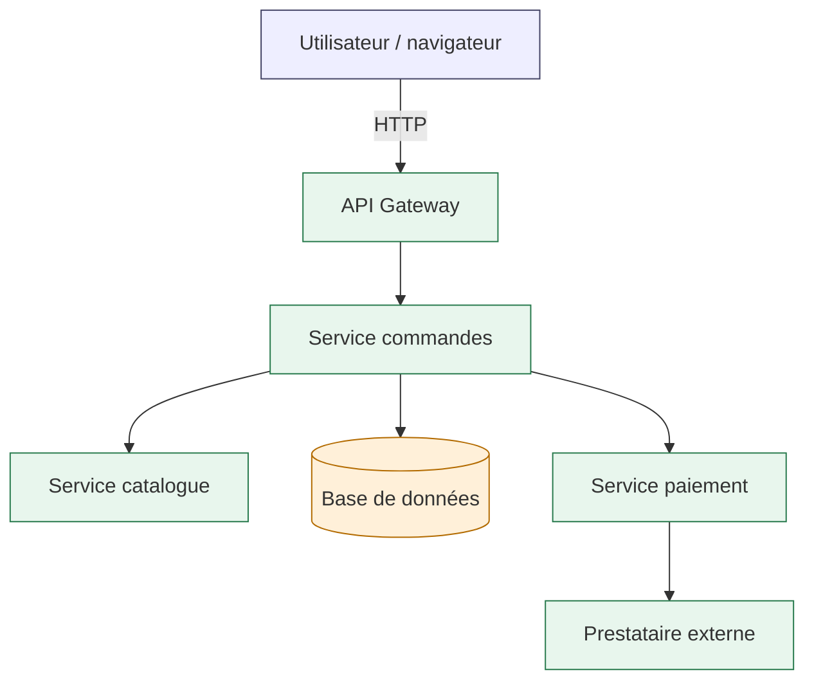
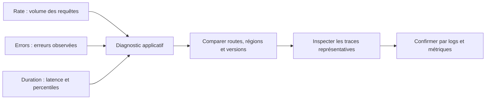
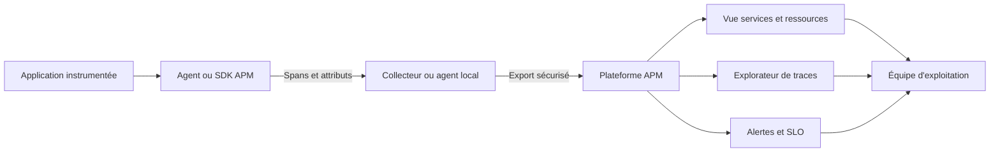
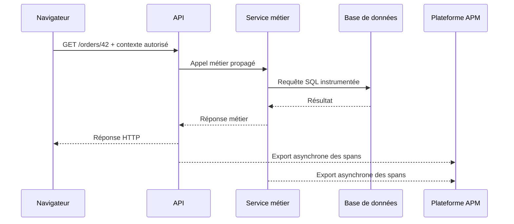
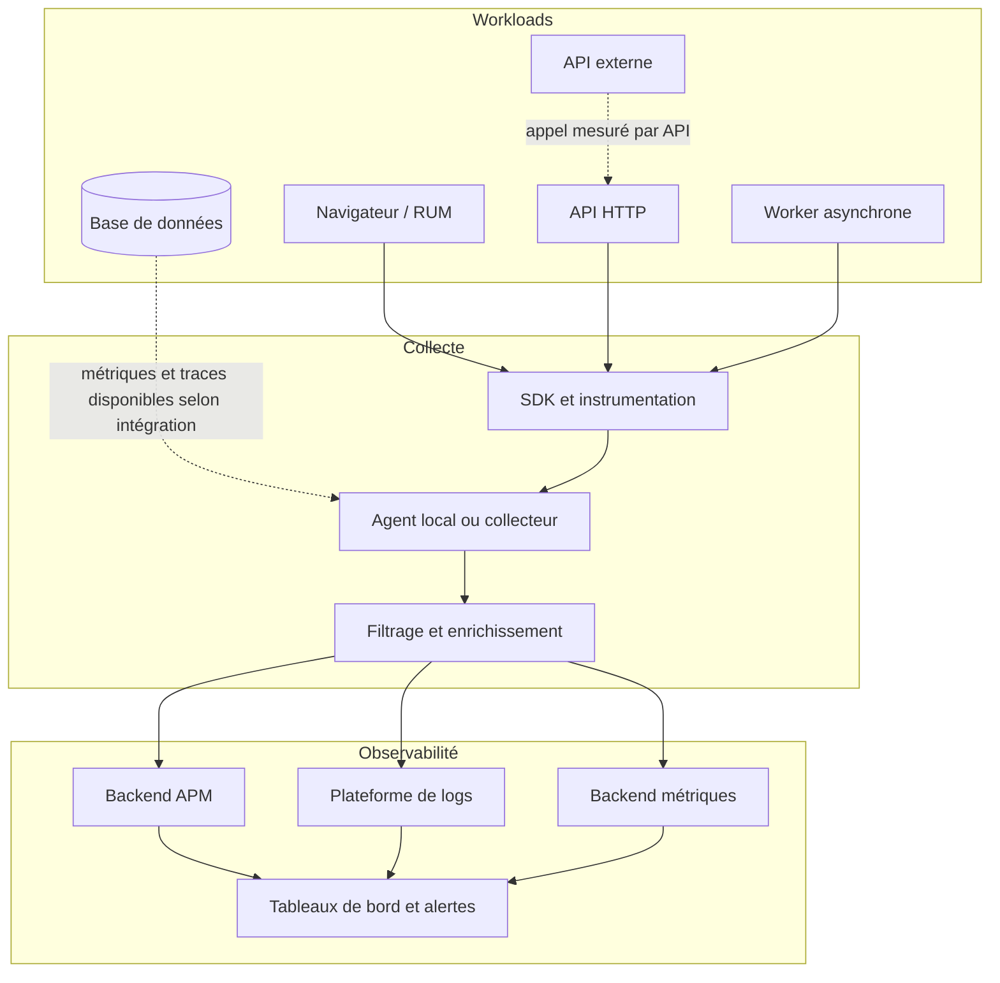
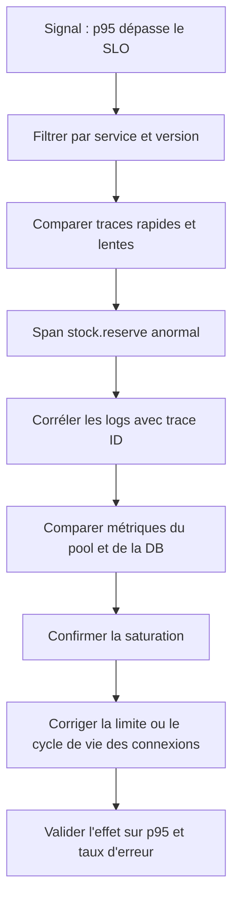

# APM (Datadog, New Relic)

L’Application Performance Monitoring (APM), ou supervision des performances applicatives, permet de comprendre comment une application se comporte réellement lorsqu’un utilisateur l’utilise. Au niveau intermédiaire, l’objectif n’est plus seulement de constater qu’un serveur répond ou qu’un processus consomme du CPU : il faut suivre une requête complète, mesurer le temps passé dans chaque composant, repérer la dépendance qui dégrade le service et relier les observations à un changement récent. Les plateformes Datadog APM et New Relic offrent des fonctions de collecte, de recherche, de cartographie et d’analyse des traces. Les principes abordés dans ce cours restent applicables à d’autres outils compatibles avec OpenTelemetry et les standards de traçage distribué.

## 1. Introduction

### 1.1 Pourquoi la supervision de l’infrastructure ne suffit plus

Considérons une application de commerce électronique. Les machines virtuelles sont disponibles, les interfaces réseau ne présentent aucune erreur, le processeur reste à 35 % et la mémoire est stable. Pourtant, les utilisateurs signalent que la consultation d’un produit prend cinq secondes et que le paiement échoue parfois. Une supervision limitée à l’infrastructure pourrait afficher un état vert, alors que l’expérience réelle est dégradée.

La cause peut se situer à plusieurs endroits : un appel au service de catalogue est lent, une requête SQL effectue un balayage coûteux, un service de paiement attend une API externe, un pool de connexions est épuisé, un verrou bloque une transaction ou un nouveau déploiement a introduit un appel supplémentaire. La métrique d’une machine ne suffit pas toujours à distinguer ces hypothèses.

L’APM observe l’application depuis son exécution. Il répond à des questions opérationnelles concrètes : quelles routes prennent le plus de temps, quelle part du délai est passée dans la base de données, quels types d’erreurs augmentent, quelles dépendances sont appelées, quelle version applicative a commencé à ralentir le service et si un problème touche toutes les requêtes ou seulement un parcours particulier.

L’APM ne remplace ni la supervision système, ni les journaux, ni les métriques métier. Il les complète et les relie. Une investigation efficace commence souvent par un signal agrégé, s’appuie ensuite sur une trace représentative, puis consulte les logs et les métriques du composant en cause.

### 1.2 Objectifs pédagogiques

À la fin du cours, l’apprenant doit savoir :

- expliquer la différence entre métrique, événement, log, transaction et trace ;
- identifier un span, ses attributs, son parent et ses enfants ;
- reconstituer le chemin d’une requête entre navigateur, API, service métier et base de données ;
- interpréter les indicateurs de latence, de débit, d’erreur et de saturation ;
- comparer les approches d’instrumentation automatique et manuelle ;
- comprendre le rôle des agents, SDK, collecteurs et en-têtes de contexte ;
- utiliser une démarche méthodique pour analyser une régression ;
- relier une trace à sa version de déploiement, à ses logs et aux métriques de service ;
- appliquer des principes de sécurité, de confidentialité et de maîtrise des coûts ;
- construire une stratégie de déploiement progressif et vérifier que les données recueillies sont utiles.

### 1.3 Ce que signifie une bonne observabilité applicative

Une application est observable lorsque les données qu’elle produit permettent de formuler et de tester des hypothèses sur son fonctionnement interne. La simple accumulation de données n’est pas un objectif. Des millions de spans mal nommés, des labels instables et des traces sans contexte peuvent rendre le diagnostic plus difficile et augmenter les coûts.

Une bonne implémentation offre une vision assez précise pour localiser un problème, mais assez maîtrisée pour être exploitable. Elle doit permettre de répondre à trois questions : que se passe-t-il, où se situe le problème et quel élément observable permet de confirmer l’hypothèse ? Une quatrième question est tout aussi importante : quelles informations ne faut-il pas collecter pour des raisons de sécurité ou de minimisation des données ?

L’APM est donc à la fois une technique d’instrumentation, une méthode d’investigation et une pratique d’exploitation. Le succès ne se mesure pas au nombre de graphiques configurés, mais au temps nécessaire pour détecter, comprendre et corriger un incident, ainsi qu’à la capacité à prévenir sa répétition.

### 1.4 Les deux plateformes et les concepts transférables

Datadog APM fournit notamment des vues de services et de ressources, un explorateur de traces et des possibilités de corrélation avec d’autres signaux de télémétrie. New Relic Distributed Tracing permet de suivre une requête à travers plusieurs services et d’examiner les spans qui composent sa trace. Les interfaces, les noms des fonctions, les mécanismes de licence et certaines options de configuration évoluent avec les produits ; il faut vérifier les réglages correspondant à la version effectivement utilisée.

Les concepts essentiels sont néanmoins communs : instrumenter l’application, créer des spans, propager le contexte à travers les frontières de service, exporter la télémétrie, conserver un ensemble de traces représentatif, agréger les données et fournir une interface de recherche. OpenTelemetry constitue une option d’instrumentation et de transport interopérable ; elle ne rend pas toutes les fonctions des plateformes identiques, et la compatibilité doit être vérifiée pour chaque langage, bibliothèque et backend.

Documentation de référence :
- Datadog APM : https://docs.datadoghq.com/tracing/
- New Relic Distributed Tracing : https://docs.newrelic.com/docs/distributed-tracing/concepts/introduction-distributed-tracing/
- Détails du traçage distribué New Relic : https://docs.newrelic.com/docs/distributed-tracing/concepts/how-new-relic-distributed-tracing-works/
- Spécification W3C Trace Context : https://www.w3.org/TR/trace-context/
- Documentation OpenTelemetry : https://opentelemetry.io/docs/

## 2. Concepts clés

### 2.1 APM, observabilité et supervision : des notions proches, mais différentes

La supervision classique vérifie généralement des états connus : port ouvert, processus actif, CPU, mémoire, disque, disponibilité HTTP ou certificat proche de l’expiration. Elle est indispensable pour détecter les symptômes et les conditions techniques prévisibles.

L’APM mesure le comportement de l’application et de ses transactions : temps de réponse par route, volume de requêtes, erreurs par service, durée des opérations de dépendance et traces d’appels distribués. Il aide à comprendre le parcours de la requête et l’endroit exact où le délai est consommé.

L’observabilité est une approche plus large. Elle consiste à rendre un système compréhensible grâce aux signaux qu’il émet et aux relations entre ces signaux. Selon l’architecture, elle inclut les métriques, les logs, les traces, les profils de performance, les événements de déploiement, les signaux du navigateur et des tests synthétiques.

Il ne faut pas choisir entre l’APM et les métriques systèmes. Une application lente peut être victime d’un service dépendant, mais aussi d’un manque de CPU, d’un ralentissement du stockage, d’une saturation du réseau ou d’une limite de ressources dans un conteneur. Le diagnostic est plus solide lorsque les perspectives applicative et infrastructure sont corrélées dans le temps.

### 2.2 Métriques, logs, traces et profils

Une métrique est une valeur numérique agrégée dans le temps. Exemples : nombre de requêtes par seconde, durée au 95e percentile, pourcentage d’erreurs, nombre de connexions actives ou utilisation CPU. Les métriques sont efficaces pour détecter une tendance et comparer des périodes.

Un log est un événement horodaté qui décrit quelque chose qui s’est produit. Il peut inclure le niveau, le message, le nom du service, l’identifiant de requête et des champs de contexte. Un log d’erreur bien corrélé aide à comprendre la cause d’un échec, à condition que le message et les attributs soient utiles et que les données sensibles soient exclues.

Une trace représente le parcours d’une opération à travers un ou plusieurs composants. Elle relie des spans portant le même identifiant de trace. La trace répond à la question « où le temps a-t-il été consommé dans cette requête précise ? ». Elle peut être détaillée, mais ne suffit pas à estimer seule la santé de toute une population de requêtes.

Un profil de performance échantillonne généralement l’activité d’exécution pour comprendre où le code consomme du temps CPU ou de la mémoire. Il peut compléter une trace lorsqu’un span coûteux est localisé dans une fonction et qu’il faut expliquer pourquoi cette fonction est lente. Les profils peuvent toutefois recueillir des informations sensibles ou présenter un surcoût ; ils doivent être configurés et consultés avec les mêmes exigences de gouvernance que les autres signaux.

On peut résumer le rôle de ces données ainsi : une métrique dit qu’une tendance est anormale, une trace montre le parcours d’un cas concret, un log apporte un événement détaillé et un profil révèle la répartition du travail à l’intérieur du code. Un événement de déploiement indique, quant à lui, qu’un changement a eu lieu au moment où le comportement a évolué.

### 2.3 Transaction, trace, span et ressource

Le vocabulaire varie légèrement selon les outils et les agents. Dans ce cours, une transaction désigne une unité de travail vue par une application instrumentée, par exemple une requête HTTP traitée par une API. Une trace distribuée est le graphe de spans associés à une opération logique de bout en bout. Un span est une durée mesurée, associée à une opération précise, avec un début, une fin, un nom, des attributs et parfois un statut d’erreur.

Une trace peut contenir un span racine représentant l’opération initiale. Des spans enfants représentent des étapes internes ou des appels à des dépendances. Le lien parent-enfant exprime la causalité instrumentée, pas nécessairement une relation d’exécution strictement séquentielle : certaines opérations s’exécutent en parallèle, et les durées peuvent se chevaucher.

Les attributs décrivent le contexte : méthode HTTP, route normalisée, statut, nom de service distant, type de base de données, environnement, version du logiciel ou résultat d’une opération. La ressource est souvent le nom d’une opération regroupée dans les vues d’un service, par exemple une route telle que /orders/{order_id}, plutôt que la valeur concrète /orders/93821.

Une trace n’est pas obligatoirement une liste parfaitement complète. L’échantillonnage, les limites de collecte, une bibliothèque non instrumentée ou la perte du contexte de propagation peuvent produire une trace partielle. Il faut donc éviter de conclure qu’un composant n’a pas été exécuté simplement parce qu’aucun span ne le représente.

### 2.4 Anatomie d’une trace distribuée

Considérons un parcours de paiement. Le navigateur envoie une requête à la passerelle d’API. Celle-ci appelle le service de commande, qui vérifie le stock, interroge la base de données et transmet une demande au fournisseur de paiement. Chaque composant instrumenté ajoute des spans à la trace, et les identifiants de contexte relient les segments.



Chaque rectangle n’est observable que si des données pertinentes sont émises. Si le fournisseur de paiement est externe et ne peut pas être instrumenté, l’appel sortant du service paiement peut malgré tout être mesuré comme un span client. On peut alors connaître sa latence et son statut HTTP même sans visibilité interne chez le fournisseur.

Une trace utile doit montrer les frontières et les coûts. Elle doit identifier le service, l’opération, la durée, le statut et les dépendances. Les attributs de diagnostic doivent rester suffisamment génériques pour éviter l’explosion des cardinalités. En particulier, une URL avec un identifiant de commande différent pour chaque utilisateur ne devrait pas devenir un nom de ressource unique pour chaque requête.

### 2.5 Lire la chronologie : la durée n’est pas une somme mécanique

Une trace est souvent présentée en cascade, avec des barres de durée. La longueur de chaque barre correspond au temps entre le début et la fin du span. Il faut examiner son emplacement dans le temps, sa relation avec les spans parents et enfants, et le fait que certaines opérations puissent se chevaucher.

Supposons qu’un span racine dure 1 200 ms. Un appel à la base dure 700 ms et un appel HTTP externe dure 300 ms. Si ces appels sont séquentiels, ils peuvent expliquer ensemble une part importante du délai. S’ils se déroulent en parallèle, additionner leurs durées surestime le temps de réponse perçu. Une trace représente une chronologie, et non uniquement une addition de durées.

Un span enfant peut aussi afficher une durée presque identique à celle du span parent si le parent attend essentiellement cet enfant. Cela ne signifie pas nécessairement que les deux opérations ont été exécutées deux fois. Le parent inclut naturellement le travail déclenché par ses enfants, ainsi que le temps passé en dehors des segments instrumentés.

La durée de bout en bout peut dépasser la somme des principaux spans visibles lorsque du temps n’est pas instrumenté, par exemple une attente avant l’exécution du code, une file d’attente, du travail interne non mesuré ou une opération dont la télémétrie a été perdue. L’écart entre la durée du span racine et celle des enfants est lui-même un indice, pas une preuve immédiate de la cause.

### 2.6 Latence : moyenne, médiane et percentiles

La moyenne est utile pour certains calculs, mais elle cache la distribution des temps de réponse. Dans un service recevant des milliers de requêtes, la plupart peuvent répondre en 100 ms alors qu’une petite fraction prend plusieurs secondes. Une moyenne de 180 ms ne révèle pas nécessairement la gravité de cette longue traîne.

La médiane, ou p50, indique le point sous lequel se trouvent 50 % des observations. Le p95 est la valeur sous laquelle se situent 95 % des observations, et le p99 celle sous laquelle se situent 99 %. Un p95 de 800 ms signifie que 95 % des observations utilisées pour ce calcul sont à 800 ms ou moins ; il ne signifie pas que 95 % des utilisateurs ont nécessairement perçu exactement ce délai, puisque la définition de l’observation, la fenêtre temporelle et l’échantillonnage comptent.

Les percentiles exigent une taille d’échantillon suffisante et une interprétation cohérente. Un p99 calculé sur dix requêtes est instable. Les percentiles de fenêtres différentes ne peuvent pas être combinés en faisant simplement la moyenne de leurs valeurs p95. Il faut également distinguer les distributions agrégées d’un service et celles d’une route particulièrement lente.

Exemple : le p50 reste proche de 120 ms, mais le p95 passe de 500 ms à 1,8 seconde. Cela peut indiquer une régression concentrée sur certaines requêtes, un sous-ensemble de clients, une partition de base de données ou un appel externe intermittent. Une analyse par ressource, statut, région et version permet d’affiner l’hypothèse.

### 2.7 Débit, erreurs et saturation : les signaux RED et USE

Pour un service orienté requêtes, l’approche RED examine généralement le Rate, les Errors et la Duration : volume de requêtes, erreurs et latence. Elle fournit une vue simple et directement liée au comportement de l’application. Le débit doit être mesuré sur une fenêtre claire et interprété en fonction du trafic habituel.

L’approche USE, souvent utilisée pour les ressources, examine l’Utilization, la Saturation et les Errors : utilisation, files d’attente ou saturation et erreurs. Elle est utile pour un processeur, un pool de connexions, un serveur de base de données ou un système de stockage. RED et USE ne s’excluent pas : un service peut présenter un mauvais p95 parce qu’une ressource atteint sa limite et accumule des demandes en attente.

Les codes HTTP ne décrivent pas toujours à eux seuls le succès métier. Un endpoint peut renvoyer HTTP 200 tout en signalant une commande refusée dans son contenu. À l’inverse, un statut 4xx peut être un comportement attendu du parcours utilisateur et non une panne du service. Il faut définir les erreurs en cohérence avec le contrat applicatif et le SLO.



Une augmentation d’erreurs peut coïncider avec une hausse du débit sans indiquer une régression. Il faut examiner les taux plutôt que les seuls nombres absolus : 50 erreurs sur 1 000 requêtes représentent un taux de 5 %, tandis que 100 erreurs sur 100 000 représentent 0,1 %. Le contexte reste essentiel, car le coût métier des deux situations peut être différent.

### 2.8 Instrumentation automatique, manuelle et hybride

L’instrumentation automatique utilise un agent ou une intégration qui intercepte les opérations reconnues par le langage et ses bibliothèques : serveurs HTTP, clients HTTP, pilotes de bases de données, frameworks ou systèmes de messagerie. Elle permet de démarrer plus rapidement et fournit une base cohérente pour les traces.

L’instrumentation manuelle ajoute des spans autour d’opérations propres au métier. Elle peut suivre le calcul d’un tarif, l’évaluation d’une règle, une phase d’import, la validation d’un panier ou l’exécution d’une étape de traitement. Les spans personnalisés doivent exprimer une opération utile à l’investigation et non chaque fonction du code.

L’approche hybride est souvent la plus efficace : instrumentation automatique pour les opérations standard, spans manuels pour les étapes métier invisibles et enrichissement contrôlé par des attributs utiles. Une instrumentation trop détaillée peut augmenter le volume, ralentir des chemins critiques et rendre les traces illisibles. À l’inverse, une instrumentation trop grossière masque la cause d’un problème dans un long bloc de traitement.

L’instrumentation n’est pas une raison pour changer le comportement métier. Elle doit éviter de bloquer le chemin de requête en attendant l’export d’une trace. Les SDK modernes s’appuient généralement sur des mécanismes de traitement et d’export asynchrones, mais leurs réglages, files d’attente et politiques en cas de saturation doivent être compris et testés.

### 2.9 Agents, SDK, collecteurs et backend

Dans une installation classique, l’application instrumentée produit des spans au moyen d’un agent, d’un SDK ou d’une bibliothèque. Le contexte se propage entre les composants. Les données sont ensuite envoyées à un endpoint ou à un collecteur, qui les transmet vers la plateforme choisie. Le backend stocke, indexe, agrège ou échantillonne ces données selon les fonctionnalités activées et le modèle de coût.



Le collecteur peut être utile pour standardiser des attributs, filtrer les données, contrôler les destinations et isoler l’application de la configuration du fournisseur. Il ajoute cependant une brique à exploiter : version, mémoire, files, certificat, accès réseau, limites de débit et supervision de sa propre santé.

Il faut distinguer les composants de collecte locaux des services de traitement du backend. La présence d’un agent opérationnel ne prouve pas que les traces atteignent la plateforme, et la présence de données dans la plateforme ne prouve pas que toutes les requêtes sont couvertes. La chaîne complète doit être testée : création des spans, propagation du contexte, export, réception, association au bon service et recherche dans l’interface.

### 2.10 Propagation du contexte et traçage distribué

Une trace ne se reconstitue pas uniquement à partir des noms de service et des horodatages. Les services doivent se transmettre le contexte de trace, souvent au moyen d’en-têtes HTTP standardisés tels que ceux de W3C Trace Context. Le contexte permet d’associer le span d’un service appelant au span du service appelé.

Si le service A crée une trace puis appelle le service B sans transmettre le contexte, le service B peut démarrer une trace indépendante. Chaque service peut sembler instrumenté, mais l’investigation de bout en bout est fragmentée. Ce cas se produit notamment lorsque des middlewares suppriment les en-têtes, quand une bibliothèque n’est pas instrumentée ou quand les paramètres de propagation diffèrent entre services.

La confiance doit être prise en compte. Une application ne doit pas forcément accepter tous les en-têtes de trace provenant d’Internet comme une source fiable. La politique de propagation, l’échantillonnage et les attributs entrants doivent être adaptés aux frontières de sécurité. Le contexte de trace est un outil de corrélation, pas un mécanisme d’authentification ni une preuve d’identité.

Les files de messages, tâches en arrière-plan et traitements asynchrones demandent une attention particulière. L’opération qui publie un message et celle qui le consomme peuvent s’exécuter à des moments différents. Selon le modèle, les liens entre spans ou contextes peuvent être plus appropriés qu’une simple relation parent-enfant. L’objectif est d’exprimer correctement la causalité, sans forcer une hiérarchie qui ne correspond pas à l’exécution réelle.

### 2.11 Identité de service et conventions de nommage

Les noms de service doivent être stables, compréhensibles et homogènes. Un service appelé api-orders en production ne devrait pas apparaître sous dix noms différents en fonction de la route, du pod ou de la requête. Les environnements, versions et régions doivent plutôt être portés par des attributs dédiés, selon les conventions supportées par la plateforme.

Les ressources doivent également être normalisées. Une ressource nommée /customer/1001 puis /customer/1002 peut créer un groupe par identifiant, compliquer les tableaux de bord et augmenter la cardinalité. Préférer /customer/{customer_id} lorsque cette forme représente réellement la route. Il est généralement pertinent de regrouper par méthode HTTP et route normalisée, tout en gardant le statut et les dimensions utiles pour l’analyse.

Le nommage de services est une convention d’exploitation, pas seulement une question esthétique. Il détermine la capacité à filtrer par domaine métier, à comparer les déploiements et à définir des alertes réutilisables. Une équipe doit documenter les conventions et vérifier leur application dans les nouveaux services.

### 2.12 Corrélation avec les logs et les métriques

La trace donne le parcours d’une opération, mais un log fournit souvent un message d’erreur plus détaillé. Lorsque le format de logs et la plateforme le permettent, les événements peuvent inclure le trace ID, le span ID, le service, l’environnement et la version. En partant d’une trace, l’opérateur peut ouvrir les logs correspondants sans lancer une recherche générale dans tout le système.

Les métriques donnent le contexte collectif : la latence est-elle anormale sur cinq minutes, quelle est la proportion de requêtes affectées, la consommation de connexions a-t-elle augmenté, et la situation coïncide-t-elle avec un déploiement ? Une seule trace lente prouve qu’un cas existe, mais pas qu’il représente la majorité des utilisateurs.

La corrélation par identifiants doit être testée de bout en bout. Un trace ID généré par le proxy peut être remplacé par une application, et un champ ajouté au log peut avoir un nom différent de celui attendu par la plateforme. Les différences de format, de casse, de type et de durée de conservation sont des sources fréquentes de rupture.

L’instrumentation doit aussi préserver les données utiles quand la trace est échantillonnée. Les logs et les métriques peuvent continuer à signaler un problème même si la trace précise a été exclue. La stratégie de rétention doit considérer ces différences : un signal agrégé utile à l’alerte n’a pas besoin de la même durée de conservation qu’un détail de trace contenant des attributs de diagnostic.

### 2.13 Instrumenter un parcours navigateur → API → base de données

Le diagnostic de bout en bout commence par la définition du parcours. La durée perçue par l’utilisateur peut inclure le chargement du navigateur, le réseau, un appel API, les traitements serveur, les requêtes vers une base de données et une dépendance externe. La télémétrie côté navigateur peut apporter des informations sur les ressources, les erreurs JavaScript et le temps d’attente côté client, mais elle doit être traitée distinctement de l’APM serveur.

Une API peut répondre rapidement après avoir accepté une tâche qui sera terminée en arrière-plan. Dans ce cas, la durée HTTP n’est pas la durée du traitement métier. Il faut préciser ce qui est mesuré : acceptation du travail, exécution asynchrone, ou résultat final. Une architecture distribuée impose de modéliser les liens entre opérations plutôt que de supposer que chaque parcours est une requête HTTP unique.

Pour un service web classique, vérifier les étapes suivantes :
1. le navigateur ou client initialise la requête avec un identifiant de corrélation adapté ;
2. le proxy et l’application conservent le contexte de traçage autorisé ;
3. le serveur HTTP crée ou poursuit un span racine ;
4. les appels sortants aux services et à la base de données produisent des spans enfants ;
5. les erreurs sont marquées avec un statut pertinent et une classification stable ;
6. les logs incluent les identifiants de corrélation sans exposer de données personnelles ;
7. la plateforme relie les spans et permet de filtrer par service, route, version et résultat.



La séquence montre les interactions logiques, pas un ordre garanti pour l’export de télémétrie. Les spans sont souvent exportés hors du chemin critique, après la fin de l’opération ou par lots. Il peut exister un délai entre l’apparition d’une requête et sa disponibilité dans l’interface.

### 2.14 Comment Datadog APM et New Relic s’insèrent dans une architecture

Avec Datadog APM, une équipe peut explorer les traces, examiner les services et ressources, suivre la santé des services et corréler l’APM avec les logs, les métriques, le RUM, les tests synthétiques ou d’autres signaux lorsque ces fonctions et intégrations sont configurées. Le déploiement peut s’appuyer sur des agents, des bibliothèques d’instrumentation et des mécanismes adaptés au langage.

New Relic Distributed Tracing présente également des traces composées de spans et des vues permettant d’inspecter les relations entre services. Sa documentation décrit la propagation du contexte, la structure des traces et des mécanismes d’échantillonnage. Les agents peuvent produire des spans à partir des transactions instrumentées, et les détails disponibles dépendent de la configuration, des agents et des limites applicables.

Le choix ne doit pas se faire uniquement sur un écran de démonstration. Il faut évaluer les langages et frameworks effectivement utilisés, la facilité d’installation, le soutien de l’instrumentation automatique, la capacité à ajouter des attributs métier, la propagation dans les messages asynchrones, le modèle de rétention, les coûts des données ingérées et indexées, les intégrations avec les systèmes en place, la sécurité et la portabilité des données.

Une preuve de concept utile instrumente un véritable parcours critique, mesure le volume produit, vérifie la qualité de la trace, simule une erreur et un ralentissement, vérifie les permissions et estime les coûts. Il faut éviter de comparer deux offres sur des hypothèses de volume différentes ou de supposer que toutes les options avancées sont incluses de la même manière.

### 2.15 L’échantillonnage et ses conséquences

Collecter chaque span de chaque requête peut être coûteux dans un service à haut débit. L’échantillonnage décide quelles traces conserver ou exporter. Un échantillonnage simple peut retenir une proportion des traces, tandis qu’un mécanisme plus avancé peut appliquer des règles ou prendre une décision à partir d’informations plus complètes sur la trace.

L’échantillonnage de tête prend sa décision tôt, souvent à l’entrée de la trace. Il est relativement simple et limite le volume en amont, mais ne sait pas toujours si la requête deviendra lente ou échouera. L’échantillonnage de fin peut examiner davantage le parcours avant de décider ce qu’il conserve ; il exige généralement plus de capacité et une architecture appropriée, car les spans doivent être regroupés avant la décision.

Il faut chercher une représentation utile des cas normaux et des cas rares. Conserver uniquement les requêtes les plus lentes peut rendre les traces représentatives difficiles à trouver. Ne retenir que des traces aléatoires peut manquer des erreurs rares. Une combinaison de règles peut privilégier les erreurs, les durées anormales, certaines transactions critiques ou des échantillons représentatifs du trafic normal, selon ce que le produit supporte.

L’échantillonnage doit être compris par l’équipe de garde. L’absence d’une trace n’est pas la preuve que la requête n’a pas eu lieu. L’investigation doit commencer par les métriques agrégées et tenir compte du taux de traces conservées. Il faut également s’assurer que les services d’une même trace prennent des décisions compatibles pour éviter de recevoir des fragments incohérents.

### 2.16 Cardinalité et explosion du volume

La cardinalité est liée au nombre de valeurs distinctes prises par les attributs utilisés pour regrouper, indexer ou rechercher des données. Des dimensions telles que le service, l’environnement, la région ou la méthode HTTP ont souvent un ensemble de valeurs limité. Les identifiants utilisateurs, UUID de requête, adresses complètes, jetons ou paramètres libres peuvent en revanche produire presque une valeur différente par événement.

Une cardinalité élevée peut augmenter le volume, dégrader les recherches, créer trop de groupes dans les tableaux de bord ou faire franchir des limites de plateforme. Les risques exacts varient selon le mécanisme d’indexation du fournisseur ; il ne faut pas supposer que chaque attribut entraîne exactement le même coût. Le principe de prudence reste constant : distinguer les attributs utiles au diagnostic des dimensions qu’il faut indexer ou agréger.

Éviter d’injecter une URL complète en tant que nom de ressource. Ne pas utiliser un identifiant de commande comme nom de service. Ne pas créer un attribut de haut niveau pour chaque valeur libre sans besoin établi. Les données très détaillées peuvent parfois être conservées sans être utilisées comme dimensions globales, sous réserve de la configuration du produit, de la confidentialité et des coûts.

### 2.17 Alertes orientées service et objectifs de fiabilité

Un bon tableau de bord explique l’état d’un service ; une bonne alerte signale une condition exigeant une action. Déclencher une alerte sur chaque petite fluctuation de latence crée de la fatigue d’alerte. Une alerte de service devrait être reliée à une conséquence opérationnelle : dégradation du SLO, augmentation significative du taux d’erreur, latence qui dépasse durablement un objectif ou perte de capacité à servir les demandes.

Les objectifs de niveau de service, ou SLO, décrivent un niveau de fiabilité attendu sur une période. Le SLI est l’indicateur qui mesure ce niveau, par exemple la proportion de requêtes réussies et assez rapides. Le budget d’erreur exprime la marge de dégradation tolérable selon la définition du SLO. Les métriques agrégées sont plus adaptées à la mesure d’un SLO que la seule inspection des traces.

Les traces sont toutefois essentielles pour diagnostiquer une alerte. Une alerte annonce que le taux d’erreur ou le p95 s’est détérioré ; l’équipe examine les ressources et les traces représentatives, compare les versions et consulte les logs. Elle doit éviter de créer une alerte par identifiant de requête ou de faire dépendre la détection d’un seul événement échantillonné.

Une alerte utile indique ce qui est affecté, depuis quand, quel est l’impact supposé, où ouvrir le tableau de bord et quelle action est attendue. Elle inclut un propriétaire, un niveau de gravité, une condition d’escalade et un mécanisme d’extinction ou de réévaluation. Si personne ne sait quoi faire lorsque l’alerte se déclenche, la règle doit être revue.

### 2.18 Coût de l’APM et gouvernance de la télémétrie

Le coût peut dépendre du volume de données ingérées, du nombre de spans, des fonctions incluses, du niveau de rétention, de l’indexation et des autres produits corrélés. Les modèles exacts varient par contrat et par fournisseur ; il faut utiliser les mesures et tarifs en vigueur pour l’environnement concerné plutôt qu’une estimation générique.

Pour maîtriser le coût, commencer par les services critiques et les chemins à risque, mesurer le volume par service, limiter les attributs inutiles, normaliser les ressources, utiliser un échantillonnage cohérent, définir les durées de conservation et surveiller les quotas. Les règles ne doivent pas éliminer aveuglément les données d’erreur ou les transactions qui comptent pour un service essentiel. Toute optimisation doit être testée en vérifiant que les traces nécessaires restent disponibles.

La gouvernance est aussi organisationnelle : qui peut consulter les traces, qui peut modifier les règles de collecte, comment sont gérées les données de production et quelle procédure s’applique lorsqu’un nouvel attribut est proposé ? La collecte doit être documentée, avec un objectif, un propriétaire, une classification des données et une règle de rétention.

Les informations contenues dans une trace peuvent être plus sensibles qu’une simple métrique. Les paramètres d’URL, noms de clients, requêtes SQL, en-têtes HTTP et messages d’erreur peuvent exposer des informations personnelles ou des secrets. Il faut masquer ou exclure ces champs à la source lorsque c’est possible, contrôler l’accès à la plateforme et ne pas compter uniquement sur une suppression ultérieure dans l’interface.

### 2.19 Sécurité, confidentialité et données sensibles

L’instrumentation doit être soumise aux mêmes exigences de sécurité que l’application. Ne pas capturer de mots de passe, jetons d’accès, clés API, cookies de session, numéros de carte, données médicales ou charges utiles privées dans les attributs ou les logs. Éviter le stockage brut des corps de requête et de réponse, sauf besoin validé, contrôles stricts et mécanisme d’exclusion vérifié.

L’identifiant de trace peut être utile pour le diagnostic, mais il ne doit pas être considéré comme un secret d’authentification. Un opérateur ne doit pas être capable d’accéder à des données sensibles simplement en connaissant un trace ID. Les permissions de la plateforme doivent respecter le moindre privilège, et les accès de support externe ou de prestataire doivent être encadrés.

Il faut également prendre en compte la résidence et la rétention des données, les transferts de télémétrie hors du périmètre, le chiffrement des communications, l’authentification des collecteurs et la gestion des secrets. Le collecteur ne doit pas utiliser une clé intégrée au dépôt de code. Les certificats et jetons d’export doivent être provisionnés par le mécanisme de gestion de secrets de l’environnement.

Une vérification de sécurité doit être effectuée avant la mise en production et après tout changement d’instrumentation. Les tests peuvent injecter des valeurs synthétiques ressemblant à des secrets afin de confirmer qu’elles ne réapparaissent ni dans les traces, ni dans les logs, ni dans les attributs exportés. Ne pas utiliser de vrais secrets de production dans des tests pédagogiques.

### 2.20 Limites et faux diagnostics

Une trace donne un indice, pas automatiquement une cause racine. Une requête SQL qui apparaît lente peut être le symptôme d’une saturation du serveur de base de données, d’une attente de verrou, d’un pool de connexions épuisé ou d’un réseau dégradé. Une durée élevée ne permet pas à elle seule de choisir entre ces causes.

Les horloges des différentes machines, les retards d’export, les spans manquants et les limites d’échantillonnage peuvent aussi compliquer la lecture. L’APM peut montrer des opérations en attente sans exposer la cause exacte ; l’investigation devra alors se poursuivre avec les métriques de la base, les logs, les plans d’exécution, la configuration des pools et les changements récents.

Un autre piège consiste à optimiser les valeurs visibles au détriment du service rendu. Réduire le p95 d’une route en rejetant plus de demandes n’est pas une amélioration. Un système peut afficher moins d’erreurs internes simplement parce qu’il échoue avant d’arriver au composant instrumenté. Il faut confronter les résultats APM aux signaux métier et à l’expérience réelle.

## 3. Architecture et Schémas

### 3.1 Architecture de référence

Une architecture de traçage doit définir les points de génération des spans, la propagation du contexte, le transport, le traitement, la conservation et l’accès. Selon l’application, un agent local peut être suffisant, tandis qu’un collecteur centralisé peut être justifié pour contrôler les données à travers plusieurs environnements.



Le schéma est volontairement logique. Les plateformes diffèrent dans leur architecture d’agent, de collecteur et d’export ; certaines intégrations passent par des mécanismes spécialisés. Il faut consulter la documentation de la version déployée pour choisir les composants réels et ne pas recopier un schéma conceptuel comme un fichier de configuration.

### 3.2 Définir la frontière de mesure

Avant d’ajouter l’instrumentation, dessiner le parcours qui doit être mesuré. Pour un service de commande, cela peut être la réception HTTP, la validation de la demande, la lecture du panier, le calcul du prix, l’écriture de commande, la réservation de stock et l’appel au paiement. Il faut ensuite choisir les étapes dont la durée et le résultat changeront le diagnostic.

Chaque span doit avoir une responsabilité claire et un nom compréhensible. Un span « traitement complet » de deux secondes n’aide pas à distinguer le calcul métier, le réseau et la base de données. Mais créer un span pour chaque ligne ou chaque getter peut produire une trace immense sans valeur supplémentaire.

Les frontières doivent refléter les opérations significatives et les appels vers des dépendances. Des opérations répétitives peuvent être agrégées ou instrumentées à un niveau supérieur lorsque le détail n’est pas nécessaire. Les opérations asynchrones doivent distinguer la mise en file d’attente, l’attente avant traitement et le temps de traitement effectif lorsque ces phases ont une signification opérationnelle.

### 3.3 Modèle de données recommandé

La structure exacte dépend des plateformes, mais une convention pratique peut inclure les dimensions suivantes :
- nom stable du service ;
- environnement, par exemple développement, test ou production ;
- version ou identifiant de déploiement ;
- nom normalisé de l’opération ou de la ressource ;
- statut de l’opération ;
- type de dépendance ou protocole ;
- région ou zone lorsque cela permet un diagnostic réel ;
- identifiants de corrélation autorisés ;
- quelques attributs métier non sensibles lorsque leur usage est justifié.

Ne dupliquez pas tous ces champs à chaque niveau si le SDK ou le backend les hérite déjà. Évitez les noms libres et variables. Documentez les attributs obligatoires, les valeurs permises, le type attendu et les restrictions de confidentialité. Pour un attribut facultatif, définir aussi son comportement lorsqu’il est absent évite de multiplier les interprétations.

### 3.4 Exemple de chaîne d’observabilité

Prenons un service API de traitement des commandes. La métrique indique que la latence p95 augmente à 1,6 seconde depuis 10 h 20. Une alerte est déclenchée par rapport au SLO. L’explorateur de traces révèle que les requêtes lentes ont un span enfant « stock.reserve » qui dure environ 1,1 seconde. Les traces les plus récentes correspondent à la version applicative 2.8.4. La corrélation avec les logs montre des délais d’attente du pool de connexions et la métrique de base de données indique que les connexions actives ont atteint la limite.



La leçon est importante : les traces ont localisé le span coûteux, mais les métriques et les logs ont permis de déterminer pourquoi il était lent. La correction ne doit pas être déclarée réussie seulement parce que la métrique de base s’améliore ; il faut vérifier l’indicateur utilisateur, le taux d’erreur et l’absence d’effet secondaire.

### 3.5 Atelier : instrumenter une petite API

L’atelier peut être réalisé sur une application de laboratoire, avec des données synthétiques. L’objectif n’est pas d’installer un agent de production sans validation, mais de démontrer les principes, les relations entre spans et l’analyse de traces.

Créer trois composants : une API HTTP, une fonction de service métier et un accès simulé à une base de données. L’API reçoit une demande, le service métier exécute une opération puis appelle la fonction de stockage. Instrumenter automatiquement le serveur HTTP et le client de stockage si le langage et les bibliothèques choisis sont supportés ; ajouter au besoin un span manuel autour de la règle métier.

Le test normal doit produire une trace avec un span d’entrée, un span métier et un span de dépendance. Le test lent doit introduire une attente contrôlée dans le stockage. Le test en erreur doit faire échouer le stockage et marquer le span concerné comme erreur. Le test de propagation doit vérifier que les spans restent dans la même trace à travers les appels.

Exemple de pseudo-code indépendant d’un SDK :

```python
def create_order(request):
    # Le framework HTTP peut déjà créer le span racine.
    with tracer.start_as_current_span("order.validate") as span:
        span.set_attribute("order.operation", "create")
        validate(request)

    with tracer.start_as_current_span("order.persist") as span:
        span.set_attribute("db.system", "postgresql")
        try:
            result = repository.save(request)
        except DatabaseUnavailable:
            span.set_status(ERROR, "database unavailable")
            raise

    return result
```

Cet exemple illustre l’intention, pas une implémentation universelle. Les noms de classes, l’API du traceur et les constantes de statut varient selon les bibliothèques. Il faut employer le SDK réellement choisi, consulter ses exemples versionnés et éviter d’ajouter une instrumentation manuelle qui dupliquerait les spans déjà créés automatiquement par le pilote de base de données.

### 3.6 Test de couverture et de qualité

Une preuve d’instrumentation ne consiste pas simplement à voir un span apparaître une fois. Préparer plusieurs parcours et vérifier la couverture des chemins pertinents : succès normal, validation rejetée, erreur de dépendance, dépassement de délai, appel asynchrone et itinéraire rarement utilisé. Vérifier que les traces ont des noms stables et que les champs ne sont pas vides sans raison.

Contrôler la propagation au travers des proxies, services et files de messages. Pour chaque frontière, vérifier si le contexte est conservé ou recréé et si ce comportement correspond à l’architecture. Vérifier également les traces venant de services instrumentés avec des technologies différentes. Une trace parentale peut être impossible à reconstituer si l’en-tête de contexte est supprimé au niveau du gateway.

Contrôler la confidentialité avec des valeurs synthétiques : mot de passe factice, faux jeton, chaîne de test ressemblant à un numéro de compte et charge utile remplie de données non sensibles. Rechercher ces valeurs dans toutes les destinations de télémétrie. Si l’une d’elles est collectée, interrompre l’élargissement du déploiement, corriger la politique de filtrage et répéter le test.

Enfin, mesurer le coût et le comportement de l’application avec l’instrumentation activée puis désactivée dans un environnement de test. Mesurer le débit, la latence p95/p99, la mémoire, le CPU et les pertes de données d’export. Le résultat dépend de la configuration ; l’objectif est de déterminer le surcoût de la configuration réellement déployée, pas d’annoncer une constante universelle.

### 3.7 Déployer progressivement

Le déploiement commence par un service non critique ou un petit pourcentage de trafic si l’architecture le permet. La première étape consiste à vérifier la connectivité, la couverture des spans et la conformité des attributs. La suivante vérifie le comportement sous charge et les effets de l’export. Ce n’est qu’ensuite qu’il faut élargir l’instrumentation aux services critiques.

Définir un plan de retour arrière : variables de configuration permettant de désactiver l’instrumentation, paramètres de taux d’échantillonnage, limites de file et de taille, procédure d’arrêt propre et procédure de rotation des identifiants de collecte. Le retour arrière doit arrêter une collecte non souhaitée sans casser les requêtes applicatives.

Il est utile de nommer un propriétaire opérationnel pour la configuration des agents et des conventions de tags. Quand chaque équipe configure indépendamment son service, les mêmes attributs peuvent prendre des noms différents et les limites de volume deviennent difficiles à prédire. Des modèles partagés, une validation automatique des configurations et des revues de changements réduisent ces divergences.

### 3.8 Simulation d’un incident de latence

Dans l’environnement de laboratoire, on simule un appel externe qui met parfois deux secondes à répondre. Le tableau de bord affiche une hausse du p95 ; le débit peut rester stable et le taux d’erreur augmenter seulement si le délai provoque des expirations. Il faut comparer les traces lentes et normales, regarder les spans de dépendance, puis vérifier les logs de timeout et les métriques du client HTTP.

Une hypothèse initiale peut être que le service applicatif manque de CPU. Pourtant, les métriques système peuvent rester stables, tandis que la durée des appels externes augmente. Une deuxième hypothèse pourrait concerner le pool de connexions HTTP, où des requêtes attendent une connexion disponible avant de pouvoir appeler la dépendance. Le détail de l’instrumentation et les métriques du pool distinguent ces scénarios.

La correction peut être une amélioration de la dépendance, une limite de temps, une politique de retry maîtrisée, un circuit breaker, une réduction du travail synchrone ou une correction du pool. Ajouter des retries sans limite peut aggraver la situation en augmentant le trafic au moment où la dépendance est déjà saturée. La solution doit être adaptée à la cause et aux exigences métier.

Après la correction, répéter le même test, comparer des fenêtres équivalentes et confirmer que le p95 s’améliore sans hausse cachée du taux d’erreur. Vérifier aussi que les logs montrent la nouvelle situation, que les traces restent complètes et que le comportement ne se détériore pas lorsque le service est soumis à un pic de trafic.

### 3.9 Contrôler la propagation sur les appels sortants

Une propagation correcte exige un comportement défini au niveau des clients HTTP, des SDK et des proxies. Si l’application crée une nouvelle trace pour chaque appel sortant alors que l’opération est une conséquence de la requête initiale, la relation de causalité se perd. Si elle propage aveuglément un contexte non fiable depuis l’extérieur, elle peut accepter des données d’origine incertaine ou exposer de la corrélation inappropriée.

Le test doit vérifier les en-têtes de trace attendus sur le chemin autorisé et l’absence d’identifiants secrets. Il ne faut pas se contenter de lire un en-tête capturé dans le navigateur : vérifier le contexte au niveau de l’API, du service appelé et du backend. Sur les frontières asynchrones, tester les identifiants transportés dans les messages et la façon dont le consommateur crée son span.

Pour les services qui traversent plusieurs comptes ou environnements, définir qui est autorisé à relier les traces. Une corrélation globale peut être utile à l’exploitation mais doit respecter les périmètres de données et de permissions. L’observabilité ne doit pas devenir un mécanisme permettant de contourner les contrôles d’accès entre équipes ou tenants.

## 4. Étude de cas

### 4.1 Contexte : la page de commande devient lente

Une entreprise exploite une application e-commerce. L’architecture comporte un frontend web, une API, un service de commande, un service de stock, une base PostgreSQL et un prestataire de paiement. Chaque service publie des métriques, et l’équipe a récemment ajouté une plateforme APM. Une matinée, le support reçoit des plaintes : la page de confirmation met plusieurs secondes à se charger.

Les symptômes initiaux sont contradictoires. Le frontend semble charger correctement les ressources statiques. Le CPU de l’API est autour de 40 %, la mémoire ne présente pas de hausse, et la disponibilité du service reste élevée. Le taux d’erreur HTTP global augmente légèrement mais reste sous le seuil historique. Le p95 de l’opération de création de commande a toutefois été multiplié par trois.

L’équipe ne commence pas par redémarrer tous les services. Elle définit précisément l’impact, fixe une période de comparaison, identifie le service affecté et examine les ressources les plus lentes. Elle confirme que la dégradation est liée aux requêtes qui nécessitent une réservation de stock, tandis que les lectures de catalogue restent proches de leur profil habituel.

### 4.2 Poser des hypothèses et chercher des preuves

Les hypothèses sont inscrites avant toute modification :
- ralentissement du fournisseur de paiement ;
- lenteur de la base de données ;
- contention du pool de connexions ;
- surcharge du service de stock ;
- régression introduite par un déploiement ;
- augmentation du volume de demandes ou changement de profil de trafic.

L’équipe commence par le graphe de latence et le taux d’erreur, puis compare les traces récentes à des traces antérieures. Les traces lentes ont un span de plusieurs centaines de millisecondes dans le service de stock. Le span d’appel au paiement est normal dans les cas concernés. Les traces indiquent également une phase d’attente avant l’exécution de la requête SQL, alors que la durée d’exécution SQL elle-même n’explique pas tout le délai.

Le filtrage par version révèle que l’essentiel du problème concerne un nouveau déploiement du service de commande. Dans les logs corrélés au trace ID, une erreur indique que des connexions restent réservées plus longtemps que prévu lors d’un chemin de validation. La métrique du pool montre un nombre de connexions actives proche de sa limite et une file de demandes en attente.

Ce faisceau d’indices indique que la lenteur SQL apparente est en partie une attente de ressource. L’équipe examine ensuite le changement de code et découvre qu’une transaction reste ouverte pendant une opération qui ne nécessitait pas de garder la connexion réservée. Le problème n’est pas simplement un « serveur SQL trop lent » ; c’est un cycle de vie de connexion devenu inadapté.

### 4.3 Confirmer sans confondre corrélation et causalité

Le fait que l’incident commence après le déploiement ne prouve pas à lui seul que le déploiement est la cause. La coïncidence temporelle doit être appuyée par les traces, les métriques et l’inspection du changement. L’équipe vérifie que l’augmentation de l’attente de pool est absente dans la version précédente et se produit dans la nouvelle version avec un profil de trafic comparable.

Pour réduire le risque, le responsable peut suspendre le déploiement ou restaurer la version précédente si la politique opérationnelle le prévoit. La correction de code est ensuite testée en staging avec une charge réaliste. L’équipe vérifie que les connexions sont libérées correctement, que les exceptions ne laissent pas de ressource dans un état incorrect et que les transactions ne restent pas ouvertes inutilement.

Le test inclut plusieurs chemins : succès, validation rejetée, exception lors de la sauvegarde et timeout du service de stock. Un correctif qui libère correctement une connexion uniquement sur le chemin nominal ne suffit pas. La gestion des ressources doit être garantie dans tous les chemins d’exécution pertinents.

### 4.4 Corriger, mesurer et communiquer

Après déploiement du correctif, le tableau de bord montre que le p95 revient vers son niveau antérieur et que les temps d’attente du pool se réduisent. Le taux d’erreur et la proportion de transactions abandonnées sont vérifiés. Les traces post-correction montrent que le span d’attente a fortement diminué sans déplacer simplement le coût vers une autre dépendance.

Le rapport d’incident distingue quatre éléments : l’impact utilisateur, la cause technique confirmée, la méthode de résolution et les actions préventives. L’équipe ajoute un indicateur sur l’attente du pool et une alerte liée à une hausse durable de la latence sur le service de stock. Elle améliore également les attributs de version afin de comparer plus rapidement les déploiements.

Le compte rendu ne doit pas prétendre que l’APM a automatiquement trouvé la correction. Il a rendu visibles la chronologie et les relations entre opérations ; l’investigation a combiné ces données avec les logs, les métriques et le code. L’équipe a ensuite validé la résolution à partir du comportement du service et de l’expérience utilisateur.

### 4.5 Ce que l’étude de cas enseigne

Premièrement, une mesure d’infrastructure apparemment correcte n’exclut pas une panne applicative. Deuxièmement, un span de base de données long ne signifie pas nécessairement que le moteur SQL passe tout ce temps à exécuter la requête : il peut y avoir attente de connexion ou autre délai adjacent selon l’instrumentation. Troisièmement, le changement de version est une dimension diagnostique essentielle.

Quatrièmement, les métriques agrégées trouvent les tendances et les traces montrent des parcours individuels. Les logs apportent des événements spécifiques, tandis que l’inspection du code et les tests confirment la cause. Cinquièmement, le succès de la correction doit être mesuré sur un ensemble de signaux : latence, erreurs, débit, saturation et résultats métier.

Enfin, la solution durable ne se limite pas à augmenter la taille du pool. Cette action pourrait déplacer le problème vers la base et aggraver la saturation globale. Il faut corriger le cycle de vie des connexions, définir des limites réalistes et surveiller les symptômes qui permettraient de repérer une régression similaire.

### 4.6 Variante : une dépendance externe est en cause

Dans un autre scénario, le span de paiement occupe la majeure partie de la durée, alors que le service applicatif et la base sont normaux. Le statut HTTP du fournisseur est généralement réussi, mais certaines requêtes dépassent deux secondes. L’équipe sépare le délai de connexion, le temps jusqu’au premier octet et la durée globale lorsque l’instrumentation disponible le permet.

Elle vérifie la distribution des temps, les erreurs de timeout, la région cible et les événements de changement côté fournisseur. Elle établit si les latences élevées touchent uniquement un endpoint externe, un type de commande ou une région. Une moyenne globale pourrait masquer cette concentration.

Les mesures correctives peuvent inclure un délai maximum adapté, des retries bornés avec backoff et jitter, une limitation de concurrence ou un circuit breaker. Les retries ne doivent pas multiplier les demandes si le fournisseur est saturé. Il faut aussi vérifier l’idempotence de l’opération avant d’autoriser la répétition d’une demande de paiement, car une réponse tardive ou perdue ne garantit pas que le fournisseur n’a pas effectué la transaction.

## 5. Pièges à éviter

### 5.1 Instrumenter tout sans objectif

L’ajout de spans dans chaque fonction peut donner l’impression que la couverture est complète, mais rendre les traces trop volumineuses et les investigations plus lentes. Chaque span personnalisé doit avoir une question de diagnostic à laquelle il contribue. Si une opération n’est ni significative, ni coûteuse, ni utile pour localiser une erreur, son instrumentation au niveau fin peut être inutile.

Commencer par les transactions critiques, les dépendances et les points d’échec importants. Ajouter du détail lorsque l’expérience d’exploitation révèle un manque de visibilité. Cette démarche itérative limite le surcoût, garde les traces lisibles et fournit un critère pour évaluer toute nouvelle instrumentation.

### 5.2 Utiliser des noms dynamiques

Créer un nom de ressource à partir de la valeur réelle d’un identifiant produit des groupes uniques. Cela complique les comparaisons et peut augmenter le coût. Les routes doivent être normalisées, les noms de service stables et les valeurs de forte cardinalité réservées aux champs qui ne sont pas utilisés comme dimension d’agrégation globale, lorsque le backend permet cette distinction.

Une erreur fréquente consiste à mettre le nom complet de l’URL dans le nom de transaction. Les paramètres de requête peuvent contenir des identifiants ou des données personnelles, et ils créent souvent une cardinalité importante. Les noms normalisés sont généralement préférables, avec les paramètres nécessaires conservés uniquement lorsque la politique de données l’autorise.

### 5.3 Confondre durée du span et temps CPU

Un span de 500 ms indique une durée écoulée pour l’opération instrumentée. Il peut inclure des attentes réseau, du temps d’attente d’un pool, des files de messages, des pauses ou du travail CPU. Il ne signifie pas que le processeur a travaillé pendant 500 ms sur cette opération.

Comparer la trace à des métriques de ressource et, si nécessaire, à des profils de performance. Une saturation CPU se traite différemment d’une dépendance lente ou d’une attente de verrou. Les métriques du pool et les mesures de temps de connexion sont particulièrement utiles pour différencier une attente de ressource d’une exécution de requête.

### 5.4 Interpréter une trace échantillonnée comme la vérité absolue

Une trace individuelle peut être exceptionnelle et une trace absente peut avoir été échantillonnée. Les conclusions sur la santé d’un service reposent d’abord sur les métriques agrégées et les SLO. Les traces servent à examiner les cas représentatifs et les anomalies.

Lorsque la plateforme expose le taux d’échantillonnage ou la raison de conservation, en tenir compte. Comparer des périodes configurées différemment peut être trompeur. Un nouveau réglage d’échantillonnage peut faire apparaître plus de traces lentes sans que le service soit devenu plus lent, simplement parce que les règles conservent davantage de cas exceptionnels.

### 5.5 Perdre le contexte entre services

Un service peut exporter des spans tout en restant impossible à relier aux services appelants. Vérifier la propagation des en-têtes, les versions des bibliothèques, les middlewares, les proxies et les limites de sécurité. Pour les messages et traitements asynchrones, définir comment le contexte est transporté et quelles relations doivent être représentées.

Ne pas désactiver les protections de sécurité pour rendre les traces plus simples. La propagation de contexte doit être cohérente avec les frontières de confiance. Les traces facilitent l’analyse mais ne doivent pas devenir un canal par lequel des métadonnées non fiables contrôlent l’identité ou l’autorisation.

### 5.6 Ignorer les données sensibles

Capturer un corps HTTP, une requête SQL complète ou tous les en-têtes par défaut peut exposer des secrets. Le bon réglage est une collecte minimale et intentionnelle, pas une collecte exhaustive que l’on espère nettoyer ensuite. Revoir régulièrement les champs collectés, les accès et les destinations.

Documenter ce que l’équipe peut collecter, ce qui doit être masqué et ce qui est strictement interdit. Les règles de filtrage doivent être testées avec des données synthétiques. La collecte d’un secret dans une trace doit être traitée comme un incident de confidentialité et corrigée à la source.

### 5.7 Définir des alertes sans action claire

Une alerte qui se déclenche tout le temps finit par être ignorée. Les alertes basées sur un taux d’erreur, un SLO ou une latence durablement dégradée sont souvent plus actionnables que des seuils fixes indépendants du trafic. Une règle doit spécifier l’impact, le propriétaire, la gravité et les prochaines étapes.

Éviter les alertes déclenchées sur un span isolé sauf cas métier explicitement justifié. Les traces sont échantillonnées et un seul span peut être atypique. Les métriques agrégées sont généralement plus adaptées à la détection ; les traces interviennent dans l’investigation après le déclenchement.

### 5.8 Déployer l’agent sans mesurer son impact

Les agents, SDK et collecteurs peuvent consommer de la mémoire, du CPU et des ressources réseau. Une mauvaise configuration de files ou d’export peut accumuler les données ou les perdre. Le test doit examiner l’application sous charge, la latence de l’export, les pertes et les comportements quand le backend n’est pas joignable.

La télémétrie doit généralement échouer sans bloquer le traitement utilisateur. Il faut vérifier ce comportement dans les scénarios de panne, plutôt que le supposer. En fonction de la bibliothèque et du runtime, les paramètres de flush, d’arrêt propre et de taille des files peuvent avoir un effet visible au redémarrage.

### 5.9 Comparer des percentiles incompatibles

Un p95 par région, un p95 global, et la moyenne de p95 de plusieurs services ne sont pas interchangeables. Une moyenne de percentiles ne donne généralement pas le percentile global. Comparer des distributions qui utilisent différentes fenêtres, règles d’échantillonnage ou populations conduit à de fausses conclusions.

Documenter les définitions des métriques et comparer des périodes équivalentes. Quand la plateforme propose des histogrammes ou des distributions agrégées, les employer selon leur sémantique documentée. Pour un SLO, utiliser une mesure définie et stable dans le temps.

### 5.10 Ne pas vérifier les coûts

Les traces personnalisées, les attributs indexés et les taux de collecte peuvent augmenter progressivement jusqu’à provoquer un dépassement budgétaire. Mesurer le volume par service et établir des budgets ou seuils d’alerte. Réviser les ressources de forte cardinalité, le taux d’échantillonnage et les durées de conservation.

Ne pas corriger un problème de facture en supprimant toutes les traces d’erreur. Il est préférable d’identifier les services qui produisent du bruit, les attributs inutiles, les répétitions et les règles mal dimensionnées. Réduire le volume ne doit pas détruire la capacité à diagnostiquer les incidents critiques.

### 5.11 Croire que l’APM identifie automatiquement la cause racine

Un outil peut classer les anomalies ou suggérer des dépendances, mais la qualité de la conclusion dépend de l’instrumentation, de l’échantillonnage et du contexte. Une alerte de lenteur ne remplace pas le raisonnement. Chaque hypothèse doit être validée avec des observations indépendantes ou une reproduction contrôlée lorsque c’est possible.

Rédiger les comptes rendus en séparant les faits constatés, les hypothèses et la cause confirmée. Cette distinction évite de présenter un simple lien temporel comme une preuve et facilite la revue post-incident.

### 5.12 Oublier l’asynchrone et les retries

Les files de messages, les jobs en arrière-plan et les retries peuvent rompre la chronologie intuitive d’une trace. Une demande peut être acceptée immédiatement, puis échouer dix minutes plus tard dans un worker. Les métriques HTTP seules ne décrivent pas le succès du travail final.

Instrumenter la publication, l’attente, la consommation et le résultat lorsque ces étapes sont nécessaires. Définir comment les liens de contexte sont représentés et comment un retry est distingué de la tentative initiale. Éviter de considérer toute tentative comme une transaction métier indépendante réussie.

### 5.13 Laisser la version applicative absente

Sans version ou attribut de déploiement fiable, il devient difficile de comparer la population avant et après un changement. Les noms de conteneur seuls ne suffisent pas nécessairement à identifier la version logique. Injecter les informations de build ou de release par un mécanisme contrôlé et cohérent.

La version ne doit pas contenir des informations sensibles ni une valeur qui change à chaque requête. Il faut vérifier dans les traces réelles que l’attribut est présent, stable sur un déploiement et distinct entre versions. Associer des événements de déploiement aux métriques et traces accélère la recherche de régressions.

### 5.14 Faire de l’APM un outil de surveillance des personnes

La télémétrie vise la santé des systèmes et l’amélioration du service, pas le suivi injustifié des individus. Éviter de collecter des identités utilisateur lorsque des identifiants pseudonymisés ou des dimensions agrégées suffisent. Définir l’accès, la rétention et l’usage des données en cohérence avec les politiques internes et les obligations applicables.

Le fait qu’une plateforme permette d’ajouter un attribut ne signifie pas qu’il soit nécessaire ou approprié. La minimisation des données doit faire partie de la conception, de la revue des changements et de l’exploitation quotidienne.

## 6. Checklist / À retenir

### 6.1 Checklist de mise en œuvre

Avant le déploiement :
- les services, parcours critiques et questions de diagnostic sont définis ;
- les langages, frameworks et dépendances disposent d’une stratégie d’instrumentation adaptée ;
- les noms de services et ressources sont stables et documentés ;
- la propagation du contexte est testée sur chaque frontière synchrone et asynchrone pertinente ;
- les statuts d’erreur et les attributs nécessaires sont définis ;
- les champs sensibles sont exclus ou masqués, et les tests de confidentialité passent ;
- les agents ou collecteurs disposent de ressources, de secrets et de connexions correctement configurés ;
- les limites de volume, d’échantillonnage et de rétention sont définies ;
- le coût estimé est rapproché du volume observé ;
- un mécanisme de retour arrière et un propriétaire d’exploitation sont identifiés.

Après le déploiement :
- une requête normale produit une trace cohérente ;
- une erreur produit un statut et un diagnostic exploitables ;
- une dépendance lente est visible au bon endroit de la chronologie ;
- les spans sont correctement reliés entre services ;
- les métriques RED et les métriques de saturation utiles sont disponibles ;
- les logs sont corrélés à la trace sans données sensibles ;
- les dimensions de version, environnement et service permettent des comparaisons ;
- les alertes sont actionnables et associées à un SLO ou à un impact clair ;
- le surcoût de l’instrumentation a été mesuré sous charge ;
- les pertes de télémétrie, le volume et le coût sont surveillés.

### 6.2 Démarche opérationnelle de diagnostic

Lorsqu’une alerte de latence ou d’erreur se déclenche, appliquer une séquence stable :
1. confirmer l’impact utilisateur et la fenêtre de temps ;
2. examiner les métriques agrégées : débit, taux d’erreur, p95/p99 et saturation ;
3. filtrer par service, ressource, environnement, région et version ;
4. comparer les traces lentes et normales de la même population ;
5. identifier le span qui explique une part significative du délai ou l’erreur ;
6. consulter les logs corrélés et les métriques de la dépendance ;
7. écrire une hypothèse testable et la confirmer au moyen d’une observation supplémentaire ;
8. appliquer une correction ou un retour arrière conforme au processus d’incident ;
9. valider que le SLI, les erreurs et les résultats métier reviennent au niveau attendu ;
10. documenter la cause, la preuve, l’action corrective et la prévention.

Cette discipline réduit les conclusions précipitées. Elle permet aussi de revenir en arrière lorsque l’hypothèse ne tient pas. Une investigation technique sérieuse peut garder plusieurs hypothèses actives, mais elle doit recueillir des preuves qui permettent de les départager.

### 6.3 Questions de révision

**Pourquoi l’APM est-il utile si les métriques système sont normales ?** Parce qu’une application peut attendre une dépendance, un pool ou un verrou sans épuiser le CPU ou la mémoire. L’APM localise la durée dans le parcours applicatif.

**Quelle est la différence entre un span et une trace ?** Le span représente une opération mesurée. La trace regroupe les spans qui représentent le parcours d’une opération logique, éventuellement à travers plusieurs services.

**Pourquoi le p95 peut-il augmenter sans changement majeur de la moyenne ?** Parce qu’un sous-ensemble de requêtes peut devenir beaucoup plus lent et affecter la longue traîne sans déplacer fortement la moyenne ou la médiane.

**Pourquoi une trace peut-elle être incomplète ?** L’échantillonnage, la perte de contexte, une bibliothèque non instrumentée, une limite de spans ou un export en échec peuvent empêcher certains segments d’apparaître.

**Quand ajouter un span manuel ?** Lorsqu’une étape métier pertinente n’est pas couverte automatiquement et que sa durée ou son statut aide à expliquer le comportement.

**Pourquoi normaliser les ressources ?** Pour regrouper des opérations comparables, éviter les groupes uniques par identifiant et maîtriser la cardinalité.

**Pourquoi ne pas envoyer tous les attributs à la plateforme ?** Certains sont inutiles ou sensibles ; les attributs de cardinalité élevée peuvent aussi augmenter le volume et compliquer les requêtes.

**Comment déterminer si une requête est lente à cause du CPU ou d’une attente de dépendance ?** Comparer la chronologie des spans aux profils et métriques système, et examiner les durées d’appel, les files et les pools.

**Quel est le rôle des logs dans une investigation APM ?** Ils apportent les messages et événements détaillés associés au contexte de la requête, à condition que les identifiants et les règles de confidentialité soient corrects.

**Que faut-il surveiller après l’ajout d’un agent ?** Le surcoût CPU et mémoire, la latence, la connectivité d’export, les pertes de télémétrie, les volumes et les coûts.

### 6.4 Mini-projet de validation

Créer un environnement de test avec une API, un service métier et une base de données simulée ou réelle contenant des données non sensibles. Instrumenter le parcours principal, puis exécuter une série de requêtes normales, quelques erreurs contrôlées et un scénario où l’accès au stockage est volontairement lent. Les injections de latence doivent rester confinées à l’environnement de test.

Produire un tableau de bord affichant le débit, le taux d’erreur, p50, p95 et p99, ainsi qu’un indicateur de saturation du composant de stockage. Ajouter un filtre sur la version applicative et vérifier que les traces de test peuvent être trouvées avec les mêmes dimensions. Ajouter une règle d’alerte en mode de test, sans déclencher de notification d’astreinte de production.

Rédiger ensuite un compte rendu incluant le symptôme, les hypothèses, les traces utilisées, la preuve qui a confirmé la cause, la correction et les métriques de validation. Inclure une vérification des données sensibles et une estimation du volume envoyé. Le mini-projet est réussi lorsque l’apprenant peut expliquer la trace de bout en bout et distinguer les faits observés des inférences.

### 6.5 À retenir

L’APM complète la supervision de l’infrastructure en mesurant le comportement applicatif et le parcours des requêtes. Les métriques identifient les tendances et les impacts globaux ; les traces montrent comment une opération traverse le système ; les logs précisent les événements ; les profils peuvent révéler le coût interne du code.

Une instrumentation utile repose sur des services et ressources stables, une propagation correcte du contexte, des spans qui représentent des opérations significatives et des attributs soigneusement sélectionnés. La latence doit être analysée avec des distributions et des percentiles cohérents. Le débit et les erreurs doivent être interprétés avec le trafic, les SLO et les résultats métier.

Datadog APM et New Relic proposent des outils d’exploration et de corrélation, mais leur valeur dépend de la qualité des données, de la configuration, de la stratégie d’échantillonnage et des pratiques de l’équipe. Les fonctions exactes et les coûts doivent être vérifiés dans la documentation et l’offre en vigueur.

Enfin, la collecte doit rester sécurisée, minimale et économiquement maîtrisée. Les traces sont des éléments de preuve qui guident l’investigation, pas des réponses automatiques à toutes les questions. Le diagnostic le plus fiable combine métriques, traces, logs, contexte de déploiement, connaissance de l’architecture et vérification expérimentale.

### Références techniques

- Datadog APM : https://docs.datadoghq.com/tracing/
- New Relic, introduction au traçage distribué : https://docs.newrelic.com/docs/distributed-tracing/concepts/introduction-distributed-tracing/
- New Relic, structure et propagation des traces : https://docs.newrelic.com/docs/distributed-tracing/concepts/how-new-relic-distributed-tracing-works/
- New Relic, analyse de l’interface de traçage : https://docs.newrelic.com/docs/distributed-tracing/ui-data/understand-use-distributed-tracing-ui/
- W3C Trace Context : https://www.w3.org/TR/trace-context/
- OpenTelemetry : https://opentelemetry.io/docs/
