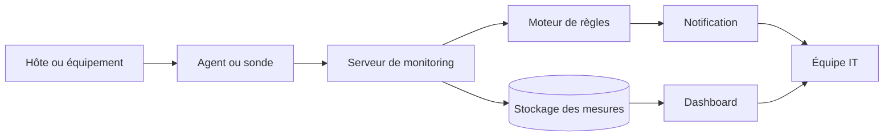
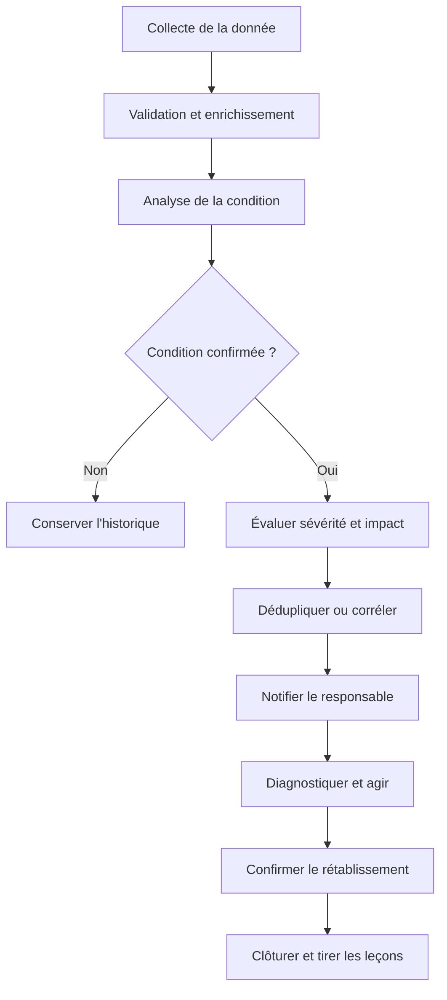
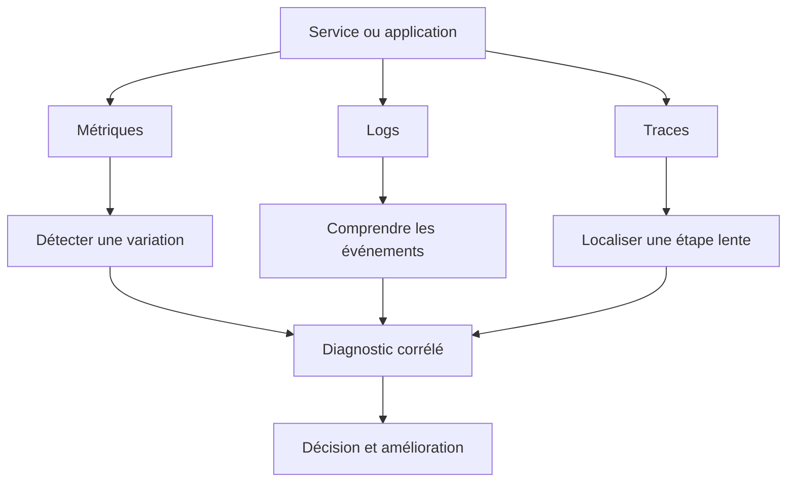

# Les fondamentaux du monitoring

## 1. Introduction et enjeux : passer de la panne subie à l'incident anticipé

### 1.1. Qu'est-ce que le monitoring ?

Le monitoring, ou supervision, consiste à observer régulièrement l'état, le fonctionnement, les performances et la disponibilité d'un système informatique afin de savoir s'il rend le service attendu. Ce système peut être un routeur, un commutateur, un serveur Linux, une base de données, un lien Internet, une application web, une API, un service cloud ou un ensemble de ces composants. La supervision collecte des informations, les compare à des attentes connues, signale les situations anormales et aide les personnes responsables à décider quoi faire.

L'objectif n'est pas simplement d'afficher des voyants verts. Un équipement peut être allumé tout en étant incapable de rendre un service utile. Un serveur peut répondre au ping mais ne plus accepter de connexion à son application. Une base de données peut rester joignable tout en répondant en dix secondes à chaque requête. Un lien réseau peut être « up » alors qu'il perd une partie importante des paquets. Un disque peut fonctionner aujourd'hui mais atteindre bientôt sa capacité maximale. La supervision doit donc mesurer ce qui compte pour le service, pas seulement la présence électrique ou la réponse d'un composant.

Dans un contexte professionnel, on utilise souvent les mots monitoring et supervision comme des synonymes. Le monitoring met particulièrement l'accent sur l'observation et la mesure continues. La supervision recouvre aussi la configuration des contrôles, le suivi des événements, la qualification des alertes et parfois l'orchestration d'actions correctives. Les frontières varient selon les organisations et les outils. Pour ce cours, les deux mots désignent la démarche globale qui consiste à mesurer, interpréter, signaler et améliorer le fonctionnement d'un service informatique.

### 1.2. Attendre la panne ou l'anticiper

Imaginons une boutique en ligne dont le serveur de paiement cesse de répondre un lundi matin. Dans une organisation sans supervision, le premier signal peut être un appel du service commercial : « Les clients ne peuvent plus payer ». Un employé tente d'ouvrir le site, redémarre peut-être le serveur au hasard, puis cherche dans plusieurs fichiers de journaux. Le temps passe, l'origine de la panne reste incertaine, et l'équipe découvre trop tard que le disque contenant les journaux s'était rempli progressivement pendant le week-end.

Cette démarche réactive n'est pas inutile : il faut toujours savoir intervenir lorsqu'une panne survient. Elle devient dangereuse lorsqu'elle constitue l'unique moyen de détecter un incident. Les utilisateurs servent alors de système de détection, souvent au pire moment. Ils signalent le problème après en avoir subi les conséquences et ne disposent pas nécessairement des détails techniques nécessaires au diagnostic.

Avec un monitoring adapté, l'équipe observe en continu l'espace disque, le taux de croissance des journaux, le temps de réponse du paiement, la fréquence des erreurs et la disponibilité du service. Une alerte de capacité peut être déclenchée avant la saturation. Les personnes d'astreinte disposent de graphiques montrant l'évolution de l'espace et d'un lien vers la procédure de nettoyage ou d'extension du volume. Le même événement peut toujours se produire, mais l'organisation possède davantage de chances de le détecter et de le traiter avant qu'il devienne une interruption visible.

Anticiper ne signifie pas prévoir parfaitement chaque panne, ni garantir qu'aucun incident ne se produira. Cela signifie repérer des tendances, détecter rapidement les symptômes, raccourcir le temps de diagnostic et mettre en place des marges de sécurité. La supervision transforme une partie des surprises en signaux interprétables. Elle aide à déplacer l'effort de la réparation improvisée vers la prévention, la préparation et l'amélioration continue.

### 1.3. Pourquoi la supervision est-elle vitale ?

La première raison est la disponibilité. Les utilisateurs attendent que les services soient accessibles lorsqu'ils en ont besoin. Une coupure de quelques minutes peut bloquer une vente, interrompre une formation, retarder un traitement métier ou empêcher une équipe distante de travailler. Mesurer la disponibilité permet de connaître la réalité du service plutôt que de se fier à une impression.

La deuxième raison est la performance. Un service peut être techniquement disponible tout en étant trop lent pour être utilisable. Il faut observer les temps de réponse, les files d'attente, la charge CPU, la mémoire, les accès disque, les erreurs et les délais réseau. Une mesure isolée ne suffit généralement pas : un CPU fortement utilisé peut être normal pendant un traitement planifié, tandis qu'une hausse modérée du temps de réponse peut révéler une dégradation importante.

La troisième raison concerne la sécurité et l'exploitation. Des journaux et des alertes peuvent révéler des authentifications répétées échouées, un changement inattendu de configuration, un certificat proche de l'expiration, une tâche de sauvegarde en échec ou un redémarrage imprévu. Le monitoring ne remplace ni un système de détection d'intrusion ni un audit de sécurité, mais il peut fournir des signaux opérationnels qui justifient une investigation.

La quatrième raison est la capacité de planification. Les courbes historiques montrent si le stockage augmente de manière constante, si le trafic double à certaines périodes, si les sauvegardes saturent le réseau ou si une application consomme plus de mémoire après chaque déploiement. Ces informations aident à dimensionner l'infrastructure, à planifier les évolutions et à distinguer une pointe temporaire d'une tendance durable.

Enfin, la supervision soutient la confiance. Une organisation qui mesure ses services peut communiquer avec davantage de précision sur les incidents, les délais de rétablissement et les améliorations engagées. Elle peut expliquer ce qui a été mesuré, ce qui a été détecté et ce qui reste inconnu. Cette transparence est plus solide qu'une promesse de disponibilité qui n'est étayée par aucun indicateur.

### 1.4. Relier les composants aux besoins des utilisateurs

Une erreur fréquente consiste à superviser uniquement les équipements dont les équipes techniques ont la responsabilité directe. Or, le résultat important est souvent un service rendu à une personne. Un serveur web, une base de données, une passerelle réseau et un fournisseur DNS peuvent chacun apparaître en état de fonctionnement, alors que leur combinaison échoue. Il faut donc partir de la question : « Quel service doit fonctionner, pour qui, et comment reconnaître qu'il ne fonctionne plus correctement ? »

Par exemple, pour un service de messagerie, les objectifs peuvent être la possibilité d'ouvrir une session, d'envoyer un message, de recevoir un message et d'accéder aux boîtes aux lettres. La supervision de l'hôte vérifie la charge et l'espace disque. Le contrôle réseau vérifie la résolution DNS et la connectivité. Le contrôle applicatif vérifie qu'une action représentative réussit. Les journaux montrent les erreurs d'authentification et les échecs de livraison. Ces contrôles se complètent sans être interchangeables.

L'approche orientée service oblige aussi à définir le périmètre. Un lien peut être indisponible sans interrompre le service si un lien de secours fonctionne correctement. Une alerte sur un équipement secondaire ne doit pas nécessairement déclencher le même niveau d'urgence que l'indisponibilité totale d'un service de paiement. Comprendre les dépendances permet d'évaluer l'impact réel et d'éviter de traiter chaque signal technique comme une crise.

### 1.5. Monitoring, observabilité et réaction humaine

Le monitoring répond surtout à des questions préparées à l'avance : le service répond-il, le taux d'erreur augmente-t-il, le disque approche-t-il de sa limite ? L'observabilité cherche à comprendre l'état interne d'un système à partir des signaux qu'il expose, y compris lorsqu'un problème n'avait pas été précisément anticipé. Les deux approches se recouvrent et se renforcent. Un bon monitoring s'appuie sur des données qui rendent l'investigation possible, tandis qu'une démarche d'observabilité utilise souvent des alertes pour attirer l'attention sur les situations importantes.

Aucun outil ne remplace l'analyse humaine. Une alerte est un signal, pas une conclusion complète. Elle peut être fausse, incomplète, retardée ou causée par une dépendance externe. La personne qui intervient doit interpréter le contexte, comparer plusieurs signaux, vérifier l'impact et choisir une action proportionnée. Les tableaux de bord et les règles ne sont utiles que s'ils rendent cette analyse plus rapide et plus fiable.

### 1.6. Les résultats attendus d'une première démarche

Une première implémentation réussie doit permettre de répondre à plusieurs questions pratiques : quels services sont importants, comment leur disponibilité est-elle vérifiée, quelles ressources risquent de manquer, où les erreurs sont-elles enregistrées, qui reçoit une alerte, et quelle action cette personne peut-elle entreprendre ? Il est préférable de répondre correctement à ces questions pour quelques services critiques que de collecter des milliers de valeurs dont personne ne connaît l'utilité.

Le résultat ne se mesure donc pas au nombre de graphiques. Il se mesure notamment par la réduction du délai de détection, la réduction du délai de rétablissement, le nombre de fausses alertes, la capacité à expliquer un incident et la confiance des utilisateurs dans le service. Une supervision mature évolue avec les systèmes et les usages : les contrôles sont révisés, les alertes inutiles sont supprimées, les seuils sont ajustés et les leçons des incidents alimentent les procédures.

## 2. Concepts clés : métriques, logs, traces, disponibilité, indisponibilité et seuils

### 2.1. La télémétrie, matière première de la supervision

La télémétrie désigne les données produites par un système pour décrire son fonctionnement. Selon les besoins, elle prend la forme de valeurs numériques, d'événements textuels ou d'enregistrements liés à une requête. Les métriques, les logs et les traces sont trois familles courantes de télémétrie. Elles répondent à des questions différentes ; les choisir correctement permet d'éviter à la fois les angles morts et la collecte excessive.

La télémétrie peut être collectée par un agent installé sur l'hôte, par un équipement capable d'exposer ses propres informations, par une requête réseau, par une sonde externe ou par l'application elle-même. Une méthode de collecte doit être choisie en fonction de l'information à obtenir, du volume de données, de la sécurité, de la précision et des contraintes de l'environnement. Le collecteur doit aussi être surveillé : un tableau de bord silencieux peut signifier que tout va bien, mais il peut aussi signifier que la collecte est arrêtée.

### 2.2. Les métriques : suivre des valeurs dans le temps

Une métrique est une mesure numérique associée à un nom, à un instant et souvent à des dimensions comme l'hôte, le service, l'interface ou l'environnement. Exemples : utilisation CPU, mémoire disponible, espace disque, nombre de requêtes, nombre d'erreurs, débit réseau, taux de paquets perdus et durée d'une opération. Les métriques sont particulièrement pratiques pour visualiser l'évolution, calculer des tendances, comparer des périodes et déclencher des alertes.

Une métrique doit être interprétée avec son unité, sa période d'échantillonnage et son contexte. « 85 » est une donnée inutile si l'on ignore s'il s'agit de pour cent CPU, de requêtes par seconde ou de secondes de latence. De même, une utilisation mémoire à 80 % peut être normale sur un système qui exploite volontairement la mémoire disponible pour le cache. Elle peut être inquiétante si la mémoire disponible chute rapidement et si le système commence à échanger massivement sur disque.

Il existe différents types de métriques. Une jauge représente une valeur qui peut monter ou descendre, comme la mémoire libre ou le nombre de connexions simultanées. Un compteur cumule des événements depuis un point de départ, comme le nombre total de requêtes traitées ou d'erreurs observées. Pour analyser un compteur, on calcule souvent son augmentation pendant un intervalle afin d'obtenir un débit ou un taux. Un histogramme regroupe des observations, par exemple les durées de requêtes, dans des plages permettant d'estimer leur distribution. La façon exacte de stocker et d'interpréter ces types dépend de l'outil utilisé.

Un taux est souvent plus utile qu'un nombre brut. Cent erreurs dans une journée peuvent être graves si l'application ne traite que mille requêtes, mais relativement limitées si elle en traite cent millions. Un taux d'erreur rapporte les erreurs au nombre de requêtes. Il faut néanmoins définir correctement le dénominateur : si le système ne reçoit presque aucune requête, un pourcentage peut être très instable. Dans ce cas, un nombre minimal de requêtes ou une fenêtre temporelle plus longue peut être nécessaire.

La latence mérite une attention spéciale. La moyenne décrit un temps moyen, mais elle peut masquer une mauvaise expérience pour une minorité d'utilisateurs. Si la plupart des requêtes répondent rapidement et quelques-unes restent bloquées, la moyenne ne suffit pas. Les percentiles aident à comprendre la distribution : le 95e percentile, souvent appelé P95, désigne un seuil sous lequel se trouvent environ 95 % des observations de la fenêtre considérée. Un P99 permet de se concentrer davantage sur les requêtes les plus lentes, à condition de disposer d'assez d'échantillons et d'un calcul correct.

Pour une première démarche, choisissez un ensemble réduit de métriques qui correspondent aux risques connus. Sur un serveur, on peut surveiller CPU, mémoire, stockage, entrées-sorties disque et redémarrages. Sur un service web, on peut suivre le nombre de requêtes, la latence, les erreurs et la saturation. Sur un lien réseau, on mesure la disponibilité, l'utilisation, les erreurs d'interface et la perte de paquets. La sélection sera différente selon le service ; aucun catalogue universel ne dispense de comprendre ce qui compte réellement.

### 2.3. Les logs : comprendre les événements

Les logs, ou journaux, enregistrent des événements qui se sont produits. Ils peuvent contenir une date, une sévérité, un composant, un message, un identifiant de requête, un utilisateur technique ou d'autres attributs. Un journal peut expliquer pourquoi une connexion a été refusée, pourquoi une tâche a échoué, pourquoi une application a redémarré ou pourquoi une dépendance n'a pas répondu. Les métriques montrent une variation ; les logs peuvent aider à identifier ce qui s'est passé pendant cette variation.

Les journaux peuvent être produits par le système d'exploitation, un service, une application, un équipement réseau ou une plateforme cloud. Les centraliser rend les recherches plus efficaces que de se connecter manuellement à chaque machine. Une centralisation utile normalise certains champs, synchronise les horloges, conserve les informations nécessaires et contrôle les droits d'accès. Si chaque système utilise un format et une heure différents, les corrélations deviennent difficiles.

Le niveau de gravité est également important. Les noms exacts varient, mais les catégories habituelles distinguent les événements de diagnostic détaillé, les informations normales, les avertissements et les erreurs critiques. Un message d'erreur ne signifie pas toujours que le service est indisponible ; il faut connaître sa signification et son impact. À l'inverse, une absence de message d'erreur ne garantit pas le bon fonctionnement, notamment si l'application ne journalise pas le cas problématique.

Les logs peuvent contenir des données sensibles : noms de comptes, adresses IP, jetons, identifiants, contenus de requêtes ou données métier. La centralisation ne doit pas devenir une copie illimitée de toutes les informations. Il faut définir ce qui est autorisé, masquer les secrets, limiter les accès, chiffrer les transferts lorsque c'est nécessaire, contrôler la rétention et éviter d'enregistrer des informations personnelles sans justification. Les journaux doivent être utiles à l'exploitation sans devenir une nouvelle source de risque.

### 2.4. Les traces : suivre un parcours entre services

Une trace représente le parcours d'une opération à travers plusieurs composants. Prenons un client qui consulte son solde : sa requête passe par un répartiteur, une API, un service métier puis une base de données. Si l'opération prend trop de temps, une trace distribuée peut montrer la durée passée dans chaque étape et révéler quelle dépendance contribue au délai. La trace est généralement constituée de segments ou d'étendues, souvent appelés spans, qui portent une durée, un nom d'opération et un contexte permettant de les relier.

Les traces sont particulièrement utiles dans les architectures constituées de nombreux services. Un indicateur de latence montre que certaines requêtes sont lentes, mais ne localise pas forcément l'étape responsable. Les logs peuvent contenir des détails sur un échec, mais sont plus difficiles à rapprocher si les identifiants de corrélation manquent. Une trace bien instrumentée relie les étapes et permet de parcourir le chemin d'une requête.

La collecte de traces soulève des questions de volume, de coût et de confidentialité. Toutes les requêtes ne doivent pas nécessairement être conservées en détail indéfiniment. Des stratégies d'échantillonnage peuvent sélectionner une partie du trafic, avec des règles spéciales pour certaines erreurs ou requêtes lentes. L'échantillonnage doit cependant être conçu avec soin : une stratégie naïve peut ignorer les rares incidents que l'on cherche à comprendre.

### 2.5. Les trois familles se complètent

Les métriques répondent à la question « Qu'est-ce qui change, et à quelle fréquence ? ». Les logs répondent à « Quels événements ont été enregistrés et avec quel contexte ? ». Les traces répondent à « Où le temps a-t-il été consommé dans le parcours de cette opération ? ». Ce sont des tendances générales, pas des règles absolues : les outils peuvent relier les signaux, et une même technologie peut proposer plusieurs types de données.

Lorsqu'une alerte signale que le temps de réponse du paiement a augmenté, on peut d'abord regarder les métriques pour identifier l'heure, l'ampleur et les services touchés. Les logs peuvent montrer des erreurs de connexion à la base de données. Les traces peuvent démontrer que les requêtes passent l'essentiel de leur temps à attendre la base plutôt que dans l'API. Les trois perspectives accélèrent l'investigation lorsqu'elles partagent des horodatages cohérents, des noms de services et des identifiants de corrélation.

### 2.6. Uptime, downtime et disponibilité

L'uptime désigne la durée pendant laquelle un système ou un service est considéré comme fonctionnel selon un critère défini. Le downtime est la durée pendant laquelle ce critère n'est plus satisfait. La disponibilité est généralement exprimée en proportion du temps pendant lequel un service est utilisable sur une période donnée. Ces mots semblent simples, mais la difficulté réside dans la définition du service « disponible ».

Est-ce qu'un serveur est disponible s'il répond au ping, mais que l'utilisateur ne peut pas se connecter ? Pour un système d'exploitation, le ping peut être un signal utile. Pour un site marchand, il faut probablement vérifier le parcours applicatif critique. On distingue ainsi la disponibilité d'un composant de celle d'un service de bout en bout. Les deux sont importantes, mais ne prouvent pas la même chose.

La disponibilité peut être exprimée par la formule suivante :

Disponibilité = temps de fonctionnement / (temps de fonctionnement + temps d'indisponibilité) × 100 %

Dans une fenêtre de mesure de 30 jours, si le service a été réellement indisponible pendant 3 heures, le temps total est de 720 heures et la disponibilité mesurée vaut (717 / 720) × 100, soit environ 99,583 %. Ce calcul ne doit pas masquer la méthode utilisée : les maintenances planifiées sont-elles incluses ? Une dégradation partielle compte-t-elle comme une indisponibilité ? Le calcul repose-t-il sur une sonde externe, des données applicatives ou un signal d'infrastructure ? La définition doit être explicite pour comparer les périodes correctement.

Les pourcentages très élevés peuvent donner une impression trompeuse. 99 % de disponibilité autorise environ 7 heures et 12 minutes d'indisponibilité dans une fenêtre de 30 jours de 720 heures. 99,9 % représente environ 43 minutes et 12 secondes sur cette même fenêtre. 99,99 % correspond à environ 4 minutes et 19 secondes, en supposant une période de 30 jours et une indisponibilité comptée de manière continue. Ces estimations montrent que chaque décimale supplémentaire a un coût opérationnel et architectural. Elles n'incluent pas automatiquement les dégradations partielles ni les erreurs de mesure.

Il faut aussi distinguer disponibilité technique et disponibilité ressentie. Un service peut répondre, mais échouer à accomplir l'action métier. Il peut être rapide dans une région et dégradé dans une autre. Il peut fonctionner pour les administrateurs tout en échouant pour les utilisateurs ordinaires. Les sondes, les contrôles de synthèse et les indicateurs métier contribuent à mieux représenter l'expérience réelle.

### 2.7. Les seuils : identifier les situations nécessitant une action

Un seuil, ou threshold, est une valeur ou une condition qui sert à distinguer un état normal d'un état nécessitant une attention. Par exemple, une alerte de stockage peut être déclenchée lorsque l'espace disponible passe sous 15 %. Un service peut être déclaré lent si son P95 dépasse 800 millisecondes pendant plusieurs minutes. Une interface réseau peut être considérée comme suspecte si les erreurs augmentent brusquement. Les valeurs sont des exemples, pas des recommandations applicables automatiquement à toutes les infrastructures.

Un seuil statique compare une mesure à une valeur fixe. Il est simple à comprendre et fonctionne bien lorsque les limites sont stables et connues. Un seuil dynamique peut tenir compte du comportement habituel, de la période de la journée ou de tendances historiques. Une alerte basée sur une anomalie peut repérer un écart qui n'est pas encore au-dessus d'une limite absolue. Ces techniques peuvent réduire certains angles morts, mais elles nécessitent des données de qualité et une compréhension du comportement normal.

La durée compte autant que la valeur. Une hausse CPU à 95 % pendant deux secondes peut être sans conséquence ; la même utilisation maintenue pendant quinze minutes, associée à une hausse de la latence, devient plus préoccupante. Il est donc fréquent de déclencher une alerte lorsqu'une condition persiste pendant une durée définie, ou lorsque plusieurs observations consécutives confirment la situation. Il faut équilibrer la rapidité de détection et le bruit causé par les fluctuations normales.

On distingue souvent un niveau d'avertissement, qui invite à vérifier la tendance et à intervenir avant l'impact, d'un niveau critique, qui exige une action rapide parce que le service est fortement dégradé ou le risque imminent. Les noms et nombres de niveaux dépendent des équipes. Ce qui importe est d'associer chaque niveau à une signification cohérente, à un destinataire et à une réponse attendue.

Un seuil est utile seulement s'il a une raison d'exister. Avant de le régler, posez trois questions : quel risque ce seuil représente-t-il, à partir de quel point une action est-elle nécessaire, et combien de temps l'équipe dispose-t-elle pour agir ? Un seuil de disque à 80 % peut être adapté à un volume qui se remplit lentement, mais trop tardif pour un volume temporaire qui peut croître de plusieurs dizaines de gigaoctets par heure. Sur un service à forte variabilité, un seuil sur le taux d'erreurs peut être plus fiable qu'une valeur absolue fixe.

### 2.8. Polling, push et fréquence de collecte

Dans une architecture de type polling, un système central interroge périodiquement les cibles. Cette approche simplifie la centralisation du calendrier des contrôles et convient aux équipements qui exposent des interfaces de mesure. Dans une architecture de type push, les agents ou applications envoient leurs données à un collecteur. Cette approche peut être pratique pour les environnements dynamiques ou les systèmes qui ne sont pas directement joignables depuis le serveur central. De nombreuses plateformes combinent ces méthodes.

La fréquence de collecte constitue un compromis. Si l'on interroge toutes les secondes un équipement très sollicité, le volume de données et la charge de supervision peuvent devenir importants. Si l'on collecte toutes les quinze minutes, certaines pannes brèves ou pointes de latence peuvent ne jamais être observées. La fréquence doit correspondre au besoin opérationnel, à la volatilité de la mesure, aux capacités de stockage et à la sensibilité à la charge ajoutée.

Un contrôle de disponibilité peut être lancé plus fréquemment qu'un inventaire détaillé. Une métrique de température peut évoluer lentement, tandis qu'un taux d'erreur d'une API peut se dégrader en quelques secondes. La collecte ne doit pas non plus submerger le réseau de gestion. Il faut observer l'impact des contrôles et tenir compte des horaires, des équipements distants, des coûts de transfert et des limites de l'API du fournisseur.

### 2.9. Faux positifs, faux négatifs et qualité des données

Un faux positif est un signal qui indique un problème alors que le problème redouté n'est pas réellement présent ou n'exige pas l'action annoncée. Par exemple, une sonde isolée peut perdre un paquet et annoncer un lien indisponible alors que le service fonctionne normalement. Un faux négatif survient lorsqu'un problème réel n'est pas détecté, par exemple lorsqu'un test ping reste positif alors que la page de paiement échoue systématiquement.

Les faux positifs épuisent l'attention et incitent les personnes à ignorer les notifications. Les faux négatifs créent une confiance excessive dans les tableaux de bord. Il faut donc évaluer non seulement la présence d'une règle, mais aussi sa qualité. Une sonde critique peut être vérifiée depuis plusieurs points, une condition peut exiger plusieurs échantillons, et une alerte peut être corrélée avec l'état de dépendances connues.

La qualité de la donnée dépend des horloges, des unités, des labels, de la fréquence d'échantillonnage, du traitement des valeurs manquantes et du bon fonctionnement des agents. Une horloge décalée de plusieurs minutes peut rendre une corrélation très difficile. Une absence de données ne doit pas toujours être interprétée comme une valeur nulle : si aucun événement n'arrive, le compteur peut être à zéro, mais si le collecteur est en panne, la valeur est inconnue. Il est important de distinguer « zéro » de « aucune donnée reçue ».

### 2.10. Santé, disponibilité et performance : trois questions distinctes

La santé d'un composant décrit si celui-ci semble en état de fonctionner. La disponibilité demande si le service est accessible selon le test choisi. La performance décrit à quel niveau de qualité le service répond. Un composant peut être sain mais indisponible à cause d'un réseau coupé ; un service peut être disponible mais trop lent ; une application peut répondre rapidement à une sonde de santé simple tout en échouant sur une fonction métier.

Une sonde de type liveness indique généralement qu'un processus est vivant. Une sonde de readiness indique plutôt qu'il est prêt à recevoir du trafic. Une sonde métier vérifie une fonction représentative. Il ne faut pas confondre ces contrôles ni rendre un test de santé si complexe qu'il déclenche une cascade de redémarrages pendant une panne de dépendance. Un contrôle doit fournir un signal utile et ne pas aggraver le problème qu'il essaie de détecter.

### 2.11. L'indicateur utile est celui qui permet une décision

Il est possible de collecter des centaines de métriques sans améliorer la fiabilité. Pour chaque donnée, demandez-vous quelle décision elle permet de prendre, qui l'utilisera et dans quelle situation. Un graphique CPU sans seuil, sans contexte et sans relation avec un service ne révèle pas toujours une urgence. En revanche, l'association entre l'augmentation des requêtes, la latence P95 et le nombre d'erreurs peut permettre de décider rapidement s'il faut augmenter la capacité, annuler un déploiement ou examiner une dépendance.

Cette discipline aide à contrôler le coût du stockage, la complexité des tableaux de bord et le nombre de règles à maintenir. Les signaux peuvent être conservés à plusieurs résolutions : les données récentes à haute fréquence pour diagnostiquer un incident, puis des agrégats plus espacés pour comprendre la tendance. La stratégie de rétention doit être cohérente avec les besoins d'enquête, les exigences métier et les contraintes réglementaires.

## 3. Architecture et schémas du monitoring

### 3.1. Les principaux composants d'une architecture de supervision

Une architecture de supervision comprend généralement une source de données, un mécanisme de collecte, un serveur ou une plateforme de traitement, un stockage, un moteur de règles, un système de notification et une interface de visualisation. Les rôles peuvent être réunis dans un même produit ou répartis entre plusieurs services. L'exemple ci-dessous montre une architecture pédagogique avec un agent, un serveur et un tableau de bord. Dans un environnement réel, plusieurs agents, serveurs, collecteurs et espaces de stockage peuvent exister.

L'agent est responsable de la collecte locale ou de l'exposition des données. Il peut lire des compteurs du système, interroger des services locaux, récupérer les informations d'une application ou envoyer les données à un collecteur. Sur certains équipements, il n'y a pas d'agent installable : le serveur de supervision interroge alors l'équipement à travers une interface standard, une API ou une sonde réseau. Dans d'autres architectures, les applications publient directement leurs mesures. L'idée générale reste la même : une donnée fiable doit être obtenue depuis une source identifiée avec une méthode maîtrisée.

Le serveur de monitoring reçoit les données ou interroge les sources, vérifie leur structure, les associe aux hôtes et services, puis les transmet au stockage et au moteur de règles. Le stockage conserve les historiques nécessaires. Le moteur de règles évalue les conditions d'alerte. Le système de notification distribue les messages selon la sévérité, l'heure, le service et les responsabilités. Le dashboard présente les états et les tendances, souvent avec des filtres ou des vues spécifiques aux équipes.

Il est important de noter que le dashboard n'est pas le système de collecte et qu'il ne constitue pas à lui seul une supervision. Un joli écran peut être figé, retardé ou incomplet. De même, une alerte peut être envoyée même si l'équipe n'a pas de tableau de bord centralisé, à condition que la collecte et le moteur de règles fonctionnent. Il faut surveiller ces composants de la plateforme de monitoring : ingestion, retard de traitement, stockage saturé, certificats, files de notifications et santé des agents.

### 3.2. Flux d'une alerte de bout en bout

Une alerte ne se résume pas à un message automatique. Elle repose sur une donnée, une condition, une durée, une décision de sévérité et une action attendue. Une règle bien conçue doit aider la personne qui la reçoit à comprendre le problème, son urgence, son impact potentiel et les premières vérifications à effectuer.

La collecte produit la mesure ou le résultat d'un contrôle. La validation vérifie que la donnée est exploitable, assez récente et correctement identifiée. L'analyse compare la mesure à une règle, éventuellement sur une fenêtre temporelle. Si la condition n'est pas confirmée, le système conserve l'information pour l'historique, mais ne doit pas nécessairement réveiller quelqu'un. Si la condition est confirmée, il estime la sévérité, identifie le service et vérifie si l'événement ressemble à une alerte déjà ouverte.

La déduplication empêche que la même défaillance produise des dizaines de notifications identiques. La corrélation rassemble des signaux qui peuvent provenir d'une cause commune. Par exemple, une passerelle indisponible peut entraîner des alertes de connectivité sur plusieurs serveurs ; le système doit, si possible, montrer le lien entre les événements plutôt que demander à l'équipe d'investiguer chaque hôte indépendamment. La corrélation n'est jamais parfaite, mais elle réduit le bruit et aide à localiser l'origine du problème.

La notification doit atteindre un destinataire qui sait quoi faire. Elle peut contenir le nom du service, l'heure de début, la sévérité, la valeur observée, la condition attendue, les dépendances connues, un lien vers le dashboard et le lien vers une procédure. Le canal doit correspondre à l'urgence : une alerte critique peut exiger un canal immédiat et un mécanisme d'escalade, tandis qu'un avertissement informatif peut être regroupé dans un rapport. Envoyer chaque événement sur le même canal et au même niveau d'urgence rend les messages impossibles à prioriser.

Après l'action, la personne vérifie que le service est réellement rétabli. Un simple redémarrage terminé ne prouve pas que le parcours utilisateur fonctionne. Il faut confirmer le retour des mesures à un état acceptable, la réussite d'un contrôle applicatif et, lorsque c'est pertinent, l'absence de récurrence immédiate. La clôture documente la cause connue, la réparation, la durée de l'impact et les suites à donner.

### 3.3. Les trois piliers de l'observabilité

Les métriques, logs et traces se renforcent lorsque l'équipe peut les relier. Une métrique indique quand une anomalie se produit, les logs fournissent des événements détaillés, et les traces montrent le parcours d'une opération entre composants. On parle souvent des trois piliers de l'observabilité, même si l'observabilité peut aussi mobiliser des profils, des événements, des événements de déploiement et d'autres signaux.

Une plateforme cohérente cherche à conserver des noms de service homogènes, des horodatages synchronisés et des attributs communs. Si une métrique indique que le service commande est lent, l'opérateur doit pouvoir passer à des logs du même service pour la période concernée, puis consulter les traces des requêtes lentes. Sans conventions partagées, les outils restent trois îlots de données difficiles à utiliser.

Le rapprochement a un coût. Les données volumineuses peuvent occuper beaucoup d'espace et certaines opérations de recherche sont coûteuses. Il faut définir la durée de conservation, les champs utiles, les droits d'accès, les taux d'échantillonnage et les exigences de conformité. L'objectif n'est pas de tout collecter sans limite, mais de préserver suffisamment d'informations pour détecter, comprendre et améliorer le service.

### 3.4. Contrôles internes et externes

Un contrôle interne est exécuté depuis l'environnement que l'on administre. Il peut mesurer l'utilisation du CPU, interroger un processus local ou tester l'accès à une base de données depuis un serveur applicatif. Il fournit des détails utiles sur la santé du système et peut détecter les problèmes avant qu'ils ne se traduisent en erreur globale.

Un contrôle externe est réalisé depuis un autre réseau, une sonde distante ou un poste de test. Il vérifie davantage l'expérience réelle d'accès au service : résolution DNS, connexion TCP, négociation TLS, réponse HTTP et parfois parcours métier. Ce point de vue est important parce qu'un contrôle exécuté sur le serveur lui-même peut réussir alors que les utilisateurs ne peuvent pas accéder au serveur à cause d'un pare-feu, d'un problème de routage ou d'un DNS incorrect.

Il est utile de combiner plusieurs points de vue sans multiplier inutilement les sondes. Si une seule sonde externe échoue, il peut s'agir d'un problème sur son propre accès. Si plusieurs sondes indépendantes échouent en même temps et que les métriques applicatives montrent une hausse des erreurs, l'hypothèse d'un incident réel devient plus crédible. Les systèmes critiques peuvent avoir des contrôles de confirmation, avec un compromis entre rapidité et robustesse.

### 3.5. Surveiller le système qui surveille

Le monitoring peut lui-même tomber en panne. Un serveur de supervision peut perdre son stockage, une clé d'API peut expirer, un pare-feu peut bloquer la collecte, un agent peut s'arrêter ou une intégration de notification peut devenir invalide. Le dashboard peut alors continuer à afficher les dernières valeurs connues, parfois avec des couleurs rassurantes, alors qu'il n'y a plus de données récentes.

Pour limiter ce risque, surveillez la dernière date de collecte par source, les retards d'ingestion, le nombre d'agents injoignables, les erreurs de traitement, la capacité du stockage et les échecs de notification. Prévoyez au moins un mécanisme indépendant pour signaler l'indisponibilité majeure de la plateforme, par exemple une sonde externe ou un canal secondaire. Les mécanismes de secours doivent être testés et documentés ; une notification de panne qui utilise uniquement le composant en panne ne constitue pas un véritable secours.

### 3.6. Sécurité de la collecte et des accès

La supervision détient souvent une vue très large du système d'information. Elle peut révéler des noms d'hôtes, des adresses réseau, des volumes de trafic, des erreurs d'application et des détails d'architecture. Un accès excessif à cette plateforme peut donc exposer des informations sensibles. Les agents et collecteurs doivent être authentifiés lorsque c'est possible, les permissions limitées aux informations nécessaires, et les secrets conservés dans un mécanisme adapté plutôt que dans des fichiers de configuration accessibles à tous.

Les protocoles et les modes de transport doivent être configurés selon le risque. Une méthode ancienne qui transmet des secrets en clair ne doit pas être utilisée simplement parce qu'elle est facile à configurer. Les accès d'administration doivent être protégés, les composants mis à jour et les flux réseau restreints. Il faut aussi s'assurer que les notifications n'incluent pas de jetons ou de données privées. Une supervision compromise pourrait aider un attaquant à mieux comprendre les systèmes et à masquer ses actions.

### 3.7. Concevoir un dashboard utile

Un dashboard doit répondre à une question. Une vue d'exploitation peut présenter l'état des services critiques, les alertes ouvertes, la tendance des erreurs et les contrôles de disponibilité. Une vue de capacité peut présenter la croissance du stockage, la mémoire, la charge et les prévisions. Une vue de diagnostic peut regrouper latence, taux d'erreur, requêtes, dépendances et événements de déploiement. Il vaut mieux avoir quelques vues nommées et comprises que des dizaines d'écrans sans propriétaire.

Chaque graphique doit afficher les unités, la période et suffisamment de contexte pour être interprétable. Un pourcentage sans nom de ressource ou une courbe sans légende devient vite inutile. Les couleurs doivent avoir une signification cohérente et être accompagnées de libellés, car la couleur seule n'est pas toujours accessible et peut ne pas suffire à une personne qui consulte l'écran sur un petit appareil. Les dashboards ne doivent pas confondre « aucun problème connu » et « aucune donnée disponible ».

Les tableaux de bord ne sont pas tous destinés au même public. Les exploitants veulent savoir quoi réparer maintenant. Les responsables de services veulent comprendre la disponibilité et la tendance. La direction peut avoir besoin d'indicateurs agrégés de fiabilité et d'impact. Le contenu doit rester adapté à la décision du lecteur, avec des détails accessibles à partir d'une vue de synthèse plutôt que de noyer tout le monde dans les mêmes séries de données.

### 3.8. Choisir les premiers contrôles

Pour commencer, définissez une liste de services et associez à chacun un propriétaire, une criticité, un test de disponibilité, quelques indicateurs de performance et les journaux essentiels. Ajoutez ensuite les règles d'alerte qui peuvent conduire à une action précise. Par exemple, le contrôle DNS peut vérifier la résolution d'un nom critique depuis un réseau utilisateur, la sonde HTTP peut vérifier un statut et un contenu attendu, et un indicateur applicatif peut signaler un taux d'échec élevé.

Privilégiez la lisibilité. Une personne débutante doit être capable d'expliquer ce qui est mesuré, où la donnée est collectée, quelle condition déclenche l'alerte et comment la confirmer. Si la règle nécessite une logique obscure et si personne ne peut expliquer pourquoi elle existe, elle risque d'être peu fiable. Une règle simple et documentée peut être améliorée au fil du temps à mesure que l'équipe comprend mieux le comportement normal.

## 4. Étude de cas : mise en place du monitoring dans une PME

### 4.1. Contexte de l'entreprise

Considérons une PME de 65 salariés qui vend et distribue des équipements professionnels. Elle possède un site web de présentation avec un formulaire de contact, une application de gestion commerciale, un serveur de fichiers, un annuaire d'entreprise, une connexion Internet principale et une liaison de secours. Une partie des outils est hébergée dans les locaux et une partie chez un fournisseur cloud. Deux techniciens assurent l'administration informatique en plus d'autres responsabilités. Ils ne peuvent pas surveiller en permanence chaque écran.

Jusqu'ici, les problèmes sont découverts par les utilisateurs : un lecteur réseau devient lent, les commandes web ne sont plus enregistrées ou le VPN se déconnecte. Les techniciens se connectent ensuite aux serveurs, examinent les journaux disponibles et tentent de reconstruire l'heure de début. Il n'existe pas de vue commune de la disponibilité, et les alertes importantes sont mélangées à des messages sans conséquence.

L'objectif du projet n'est pas d'installer immédiatement une plateforme très complexe. Il est de réduire les surprises, détecter tôt les problèmes critiques et donner aux techniciens une méthode fiable pour diagnostiquer les incidents. Le projet doit rester proportionné au budget, au temps disponible et aux compétences de l'équipe. La PME commence avec les services qui ont l'impact le plus direct sur les ventes et la continuité du travail.

### 4.2. Étape 1 : cartographier les services et les dépendances

La première réunion produit une liste des services essentiels : accès Internet, résolution DNS, authentification, application commerciale, base de données, site web, serveur de fichiers et accès distant VPN. Pour chaque service, les techniciens notent les utilisateurs concernés, les horaires d'usage, les dépendances et les conséquences d'une indisponibilité. Le service commercial explique qu'une interruption de l'application commerciale pendant les heures ouvrables bloque la saisie des commandes, tandis que le site de présentation peut tolérer une courte dégradation sans arrêter la production.

La cartographie évite de surveiller tous les équipements avec la même priorité. Le routeur Internet est important parce que de nombreux services en dépendent. La base de données est critique pour l'application commerciale. Le serveur de fichiers est essentiel pour certaines équipes, mais la perte de son accès n'a pas exactement le même impact pour tous les utilisateurs. Les techniciens identifient les points de défaillance communs : si l'annuaire est indisponible, plusieurs services peuvent rencontrer des erreurs d'authentification ; si le DNS est dégradé, les services semblent parfois injoignables alors que leurs serveurs sont actifs.

La PME conserve cette cartographie avec les informations de contact et les procédures existantes. Le document n'a pas besoin d'être parfait au premier jour. Il doit être assez exact pour guider les priorités, puis être mis à jour lorsque l'architecture change.

### 4.3. Étape 2 : définir des indicateurs utiles

Pour le lien Internet, l'équipe collecte l'état de l'interface, son utilisation, les erreurs et la perte de paquets, puis ajoute une sonde externe vers un service de test stable. Pour l'application commerciale, elle mesure la disponibilité HTTP, le temps de réponse, le taux d'erreur et quelques indicateurs de santé de la base de données. Pour les serveurs, elle surveille CPU, mémoire, espace disque, état des services et redémarrages. Pour l'annuaire, elle effectue un test d'authentification contrôlé avec un compte de test approprié et des permissions limitées.

Les indicateurs sont accompagnés d'une définition. « Application disponible » signifie par exemple que le contrôle peut se connecter, reçoit une réponse attendue et valide une donnée non sensible dans un parcours de test. Il ne s'agit pas simplement de constater que le processus du serveur web existe. « Stockage critique » signifie que l'espace libre ou la croissance projetée ne laisse plus suffisamment de marge pour le fonctionnement et les journaux. Les définitions évitent les désaccords lorsqu'une alerte se déclenche.

L'équipe décide de relever les métriques techniques toutes les minutes pour les serveurs principaux et d'exécuter des sondes de disponibilité plusieurs fois par minute ou quelques minutes selon le service, la charge et les contraintes de l'outil. Ces fréquences sont choisies comme point de départ, et non comme valeurs universelles. Un test trop fréquent peut consommer des ressources ; un test trop rare peut retarder la détection. Après une première semaine, les techniciens examinent le volume de données et l'impact réel des contrôles.

### 4.4. Étape 3 : installer la collecte et la centralisation

La PME choisit une solution de supervision adaptée à ses compétences, à son infrastructure et à son budget. Elle installe un agent sur les serveurs qui permettent cette méthode, configure les identifiants nécessaires sur les équipements réseau et met en place les sondes externes. Les communications sont limitées aux flux nécessaires. Les agents ne reçoivent pas un accès administrateur global lorsque des permissions plus restreintes suffisent. Les mots de passe et clés d'API sont stockés avec contrôle d'accès.

L'équipe synchronise les horloges des hôtes. Sans cette étape, une alerte émise à 10 h 05 peut sembler antérieure au journal qui explique sa cause, simplement parce que deux machines ont des horloges différentes. Les noms de services, d'environnements et d'hôtes sont normalisés. Les tests sont vérifiés de bout en bout : la donnée apparaît avec la bonne unité, à une fréquence attendue, avec une date récente, et elle est exploitable depuis le dashboard.

Les journaux essentiels sont centralisés en priorité : erreurs de l'application commerciale, événements des services critiques, messages du système et événements de sécurité nécessaires à l'exploitation. La PME ne copie pas tous les journaux sans limite. Elle définit une durée de conservation en fonction des besoins techniques et des obligations applicables. Les accès aux journaux sont accordés uniquement aux personnes qui en ont besoin, et les données sensibles sont masquées lorsque cela est nécessaire.

### 4.5. Étape 4 : construire les dashboards

Le premier dashboard affiche une synthèse : disponibilité des services critiques, alertes actives, latence de l'application commerciale, taux d'erreur, capacité des principaux volumes et état du lien Internet. Chaque carte indique le nom du service, l'état, l'heure de dernière collecte et un lien vers des détails. Si les données ne sont pas fraîches, le dashboard affiche clairement que la mesure est inconnue ou obsolète au lieu de présenter une valeur ancienne comme si elle était actuelle.

Un second dashboard se concentre sur l'application commerciale. Il regroupe les requêtes par minute, le P95 du temps de réponse, le taux d'erreur et les principaux événements de l'application. Un troisième tableau suit la capacité et les ressources des serveurs. Les techniciens testent ces vues pendant des opérations ordinaires et demandent aux utilisateurs clés quelles informations les aideraient à confirmer qu'un service est réellement disponible.

Ils évitent de transformer la vue de synthèse en catalogue de toutes les métriques. Un opérateur qui intervient lors d'une panne doit trouver rapidement les services en échec, les dépendances et les premières pistes. Les détails plus complexes restent disponibles dans les vues de diagnostic.

### 4.6. Étape 5 : définir des alertes et une réponse

La PME classe ses alertes par niveau d'urgence. Une alerte critique correspond à une interruption confirmée d'un service métier important, ou à une condition qui menace son fonctionnement immédiat. Un avertissement correspond à une tendance qui nécessite une action planifiée, comme une capacité de stockage qui se rapproche de sa limite. Les événements purement informatifs sont conservés dans l'historique ou dans un rapport plutôt que d'envoyer un message urgent.

Pour une panne du service commercial, la règle exige que la sonde de disponibilité échoue plusieurs fois consécutives ou que plusieurs indicateurs cohérents montrent un échec persistant. L'équipe choisit une durée de confirmation qui équilibre rapidité et risque de faux positifs. Pour l'espace disque, elle utilise un niveau d'avertissement avec une marge suffisante au regard de la vitesse historique de croissance, puis un niveau critique si le volume approche d'une limite qui pourrait affecter le service. La règle est accompagnée d'une procédure expliquant comment vérifier la taille des journaux, les fichiers temporaires, les tâches de sauvegarde et la possibilité d'étendre le volume.

Les notifications critiques arrivent sur le canal opérationnel convenu et sont envoyées aux techniciens responsables. Un mécanisme d'escalade indique qui contacter si personne ne confirme la prise en charge dans le délai défini. Les alertes non urgentes sont regroupées pour ne pas interrompre les tâches de l'équipe. Chaque alerte comporte l'heure de début, le service, la valeur observée, la condition déclenchée, les dépendances pertinentes et un lien vers le runbook lorsqu'il existe.

### 4.7. Étape 6 : simuler les incidents et tester la détection

Avant de considérer le dispositif comme opérationnel, la PME effectue des tests contrôlés. Elle simule une indisponibilité d'une page de test, remplit progressivement un volume temporaire dans un environnement approprié ou arrête un service non critique pendant une fenêtre de maintenance. Chaque test répond à des questions précises : le signal a-t-il été collecté ? Le délai de détection est-il acceptable ? L'alerte a-t-elle atteint le bon destinataire ? Le dashboard montre-t-il une valeur récente ? La procédure est-elle compréhensible ? Le rétablissement est-il détecté automatiquement ?

Les essais sont réalisés avec autorisation, dans un périmètre maîtrisé et avec un plan de retour à la normale. Il ne faut pas provoquer une panne du service commercial réel simplement pour tester la notification si un environnement de test ou une sonde dédiée peut valider le fonctionnement. Les techniciens documentent les résultats et ajustent les règles qui se déclenchent trop tôt, trop tard ou sans informations suffisantes.

Un exercice révèle par exemple que l'alerte de stockage arrive bien, mais que le lien fourni conduit à un tableau de bord général. Les techniciens ajoutent un lien direct vers le volume concerné et une commande de diagnostic validée. Un autre essai montre que le ping continue de répondre alors que l'application ne traite plus de transactions. L'équipe ajoute un contrôle de synthèse de la fonction critique. Ces améliorations viennent d'essais simples, pas seulement de la configuration théorique de l'outil.

### 4.8. Incident simulé : saturation progressive des journaux

Un vendredi matin, le volume contenant les journaux de l'application passe au-dessus du seuil d'avertissement. L'alerte indique que l'espace libre diminue plus vite que d'habitude. Le dashboard montre que le volume a consommé plusieurs gigaoctets depuis la veille. Les techniciens vérifient les journaux et découvrent qu'une erreur de connexion à une dépendance est répétée des milliers de fois par minute. L'alerte de capacité a donné du temps pour agir avant que l'application cesse d'enregistrer les transactions.

L'équipe vérifie d'abord l'étendue de l'impact et confirme que le service reste disponible. Elle identifie la dépendance en échec, cherche pourquoi l'application répète le message et applique une correction de configuration approuvée. Elle nettoie ou archive les journaux selon la procédure, sans supprimer des éléments nécessaires à l'enquête, puis confirme que le volume retrouve une croissance normale. Elle ne se contente pas d'augmenter le seuil ou de supprimer tous les journaux, car cela masquerait le symptôme sans traiter la cause.

Après l'incident, la PME modifie la politique de répétition des messages, définit une limite de rétention et ajoute un indicateur de fréquence des erreurs. Elle conserve une alerte sur la capacité parce que la saturation reste un risque, mais la complète avec un signal sur le volume anormal d'erreurs. L'incident démontre l'intérêt de relier la métrique de stockage aux événements applicatifs.

### 4.9. Étape 7 : mesurer les résultats et maintenir le dispositif

Après un mois, les techniciens évaluent le temps nécessaire pour détecter les incidents, le temps de rétablissement, le nombre d'alertes critiques, le nombre d'alertes inutiles et les services encore dépourvus de contrôles fiables. Ils interrogent également les équipes utilisatrices : découvrent-elles moins souvent les pannes en premier ? Comprennent-elles mieux les interruptions ? Les notifications arrivent-elles au bon moment ? Ces retours complètent les statistiques techniques.

Le dispositif reste vivant. Lorsqu'un nouveau service est ajouté, il reçoit une fiche de supervision, un propriétaire et des règles minimales. Lors d'une évolution d'architecture, les dépendances et les tableaux de bord sont mis à jour. Lorsqu'une alerte se révèle peu utile, elle est ajustée ou supprimée. Après un incident important, l'équipe ajoute les contrôles qui auraient permis de détecter le problème plus tôt, sans créer mécaniquement une alerte pour chaque événement constaté.

Cette PME n'a pas besoin d'une plateforme gigantesque pour commencer. Elle a besoin d'un périmètre bien choisi, d'indicateurs compréhensibles, de seuils justifiés, de notifications testées et de procédures actionnables. La maturité vient ensuite, par itérations, en fonction des risques et de la valeur réelle des informations collectées.

## 5. Pièges à éviter et bonnes pratiques d'exploitation

### 5.1. Trop d'alertes, pas assez de décisions

Le piège le plus fréquent est l'inflation d'alertes. Si chaque seuil franchi, chaque petite fluctuation CPU et chaque paquet perdu envoie une notification immédiate, les personnes reçoivent trop de messages. Une alerte critique se perd alors au milieu des avertissements. Après quelques semaines, les destinataires cessent parfois de lire les notifications ou les font taire sans examiner leur qualité. Ce phénomène est dangereux, car le canal censé attirer l'attention perd sa crédibilité.

Chaque alerte doit être associée à une action ou à une décision. Si aucun destinataire ne peut expliquer ce qu'il doit faire lorsque la condition est vraie, il faut revoir la règle. Les notifications informatives peuvent être regroupées ou envoyées dans un rapport. Les conditions brèves et bénignes peuvent être filtrées ou confirmées par plusieurs échantillons. Les alertes répétées doivent être dédupliquées et, lorsque c'est possible, corrélées à une cause commune.

Une règle utile peut aussi inclure une période de silence après son déclenchement, tant que l'incident reste ouvert, tout en continuant à mettre à jour son état. Il faut éviter que le silence empêche l'escalade ou masque une aggravation. L'objectif n'est pas de cacher les symptômes, mais de séparer l'information nouvelle d'une répétition inutile.

### 5.2. Des seuils copiés sans comprendre le système

Un seuil de 90 % CPU n'est pas universellement correct. Certains serveurs doivent utiliser la capacité disponible pour traiter une charge élevée ; d'autres peuvent se dégrader bien avant d'atteindre cette valeur en raison d'une file d'attente ou d'un composant bloquant. La règle doit être adaptée au rôle du système, à son comportement normal, aux conséquences d'une saturation et au délai nécessaire pour intervenir.

Il faut tenir compte du contexte et de la durée. Une hausse ponctuelle pendant une sauvegarde connue peut être normale. La même hausse associée à une latence croissante, à un taux d'erreur plus élevé et à une file d'attente qui continue à grandir est plus inquiétante. Les seuils statiques restent utiles, mais doivent être révisés à partir de l'historique. Les valeurs dynamiques ne sont pas magiques : une anomalie statistique peut correspondre à un comportement attendu, et une limite légitime peut être dépassée lentement sans être détectée par une simple comparaison au profil habituel.

### 5.3. Confondre ping et disponibilité applicative

Une réponse ICMP prouve que la cible répond à ce test depuis le point de collecte. Elle ne prouve pas que le port TCP attendu est ouvert, que le certificat TLS est valide, que l'application accepte une session ou que le résultat métier est correct. À l'inverse, certains systèmes filtrent volontairement ICMP alors que le service applicatif fonctionne. Un seul test ne doit donc pas représenter toute la disponibilité.

Choisissez un contrôle qui correspond à la promesse du service. Pour un site web, vérifiez la connexion HTTP, le code de réponse attendu et, si nécessaire, la présence d'un élément de contenu. Pour une API, utilisez une requête non destructive prévue pour le contrôle. Pour une base de données, vérifiez la connexion et une opération de lecture limitée adaptée à un compte de contrôle. Les contrôles de synthèse doivent éviter les écritures métier réelles, les opérations coûteuses et l'exposition de secrets.

### 5.4. Ignorer les données absentes ou périmées

Une courbe plate ne signifie pas toujours que le système est stable. Si la collecte s'arrête, le dashboard peut continuer à afficher la dernière valeur reçue. Il faut afficher l'heure de dernière mise à jour et définir ce qui arrive lorsqu'aucune donnée n'est reçue. Les systèmes doivent distinguer les valeurs nulles, les valeurs manquantes et les collectes en retard.

La santé de la collecte peut être contrôlée avec une règle dédiée. Par exemple, si un agent important n'envoie plus de données depuis une période définie, l'équipe reçoit une alerte de collecte. Cette alerte doit être suffisamment indépendante pour fonctionner même si l'agent concerné est précisément le composant qui a cessé de publier. Les tableaux de bord doivent éviter de conserver un vert rassurant sans signaler que la mesure est obsolète.

### 5.5. Collecter trop ou trop peu

Collecter trop peu signifie qu'il devient impossible de diagnostiquer une panne. Collecter tout sans limite entraîne des coûts, une charge inutile et des risques de confidentialité. Il faut sélectionner les données en fonction des questions opérationnelles, fixer une rétention, prévoir l'agrégation et réexaminer les besoins régulièrement. Les traces détaillées d'un service très sollicité peuvent coûter bien plus cher que prévu ; les logs de diagnostic peuvent être conservés moins longtemps que les journaux requis pour des investigations spécifiques, selon la politique de l'organisation.

Les données doivent aussi être utilisables. Un grand volume de messages sans niveaux de gravité cohérents, sans horodatage correct et sans nom de service peut être plus difficile à exploiter qu'un ensemble limité mais normalisé. Définissez des conventions, évitez les champs qui changent constamment de valeur et surveillez la cardinalité des dimensions. Trop de valeurs distinctes dans une métrique peut gonfler le stockage et ralentir les requêtes.

### 5.6. Négliger la synchronisation du temps

Les corrélations reposent souvent sur l'ordre des événements. Si une application utilise une horloge locale mal réglée tandis que le serveur de logs utilise une heure différente, l'opérateur peut croire qu'un effet est survenu avant sa cause. Les systèmes doivent synchroniser leur horloge avec une source de temps adaptée et conserver clairement le fuseau horaire ou utiliser une représentation cohérente telle que l'UTC pour les échanges techniques. Les dashboards peuvent ensuite afficher l'heure locale à l'utilisateur sans perdre la cohérence de stockage.

### 5.7. Oublier le réseau, la sécurité et la plateforme de monitoring

Un agent peut ne plus envoyer ses données parce qu'une règle de pare-feu a changé, parce qu'un certificat a expiré, parce que le DNS de gestion est inaccessible ou parce que les identifiants ont été révoqués. Avant de conclure qu'un hôte va bien ou mal, vérifiez aussi le chemin de collecte. La plateforme de monitoring doit être considérée comme un service critique, doté de sauvegardes, de mises à jour, de contrôles d'accès et de procédures de restauration proportionnées.

Les ports nécessaires doivent être documentés et restreints aux sources autorisées. Les clés d'API doivent être renouvelables et leurs permissions minimales. Les interfaces d'administration ne devraient pas être ouvertes à tout le réseau sans justification. Les notifications doivent éviter d'inclure des secrets ou des données personnelles. La supervision ne doit pas devenir un canal d'exfiltration de données ou une porte d'entrée privilégiée vers l'infrastructure.

### 5.8. Créer un dashboard impossible à lire

Un dashboard illisible mélange de nombreux graphiques, des unités différentes et des couleurs sans convention. L'opérateur doit interpréter la présentation avant de pouvoir agir. Pour réduire ce problème, organisez les vues selon les décisions : vue d'ensemble des services, diagnostic d'une application, capacité, réseau, journalisation. Donnez un titre explicite aux graphiques et affichez une période temporelle claire. Ajoutez des liens pour passer de la synthèse à la cause présumée.

Une vue n'a pas besoin de montrer chaque indicateur collecté. Elle doit présenter les signaux nécessaires au public visé. Les responsables doivent pouvoir repérer l'impact sans examiner des détails inutiles ; les techniciens doivent pouvoir accéder à des mesures plus fines lors de l'investigation. Les couleurs doivent être cohérentes, mais la signification doit aussi apparaître dans le texte et les libellés.

### 5.9. Aucun propriétaire, aucun runbook, aucune révision

Une alerte sans propriétaire finit par être ignorée. Un service sans personne responsable rend difficile la validation des seuils et la priorisation d'une réparation. Une règle sans documentation devient mystérieuse après un changement d'équipe. Chaque contrôle critique devrait indiquer le service, le responsable, la logique de déclenchement, la sévérité, le canal de notification et les premières étapes d'investigation.

Les runbooks doivent être courts au point d'action, précis et testés. Ils peuvent expliquer comment confirmer l'incident, les commandes sûres à exécuter, les dashboards pertinents, les contacts et les critères de retour à la normale. Il ne faut pas copier sans examen une commande dangereuse dans une procédure. Les actions automatiques qui modifient un système doivent faire l'objet d'un contrôle de risque, d'une autorisation et d'un mécanisme de retour arrière.

La révision régulière est essentielle. Après un incident, l'équipe demande si les signaux ont permis une détection assez rapide, si l'alerte a été utile, si le runbook a été suivi, et si une amélioration durable est nécessaire. L'analyse vise l'amélioration du système et des procédures, pas la recherche d'un coupable. Les mêmes problèmes reviendront si les causes organisationnelles, techniques et documentaires ne sont pas corrigées.

### 5.10. Prendre les mesures au mauvais endroit

Un contrôle exécuté depuis le serveur cible ne mesure pas exactement la même expérience qu'un utilisateur distant. Le chemin réseau, le DNS, le proxy, le certificat et le pare-feu peuvent différer. Il faut donc choisir des points de mesure pertinents. Les sondes externes montrent ce que voit le client depuis leur emplacement ; les agents internes exposent des informations détaillées sur le système. Un plan équilibré combine les deux selon la criticité du service.

Plusieurs sondes peuvent améliorer la confiance dans une détection, mais elles ne doivent pas être placées toutes dans le même domaine de panne. Deux sondes dans le même bâtiment peuvent tomber en panne à cause de la même coupure électrique. Deux points de mesure réellement indépendants donnent une confirmation plus solide pour un service exposé à Internet. L'indépendance doit être évaluée de manière réaliste au regard du budget.

### 5.11. Ne jamais tester la chaîne de notification

Une règle peut être correcte et la notification échouer : courrier classé comme indésirable, intégration expirée, canal silencieux ou liste de destinataires obsolète. Les notifications doivent être testées périodiquement, y compris l'escalade et le remplacement d'un responsable indisponible. Il faut confirmer non seulement que l'outil dit « envoyé », mais que la personne ou le canal attendu a effectivement reçu et reconnu le message.

Les tests doivent être contrôlés et ne pas déclencher par accident une véritable crise. Ils peuvent utiliser un service de test ou un type d'événement dédié. Documentez comment tester le système, qui reçoit le message, quelle action est attendue et comment remettre le dispositif en état après l'essai.

### 5.12. Confondre corrélation et causalité

Deux métriques qui évoluent ensemble peuvent être liées sans qu'une soit la cause de l'autre. Une hausse du CPU peut coïncider avec un ralentissement parce que les deux résultent d'un pic de trafic. Augmenter le CPU ne résoudra pas nécessairement le problème si la cause réelle est une base de données lente ou un appel externe bloqué. Utilisez les traces, les logs, les événements de déploiement et les dépendances pour vérifier les hypothèses plutôt que de modifier l'infrastructure sur la base d'un seul graphique.

Une investigation rigoureuse énonce l'hypothèse, cherche les signaux qui la confirment ou la réfutent, puis choisit une action mesurable. Après l'action, l'équipe vérifie si l'indicateur attendu s'améliore et si l'impact utilisateur disparaît. Cette démarche évite les redémarrages répétés qui rendent parfois le problème temporairement moins visible sans le résoudre.

### 5.13. Appliquer automatiquement une correction sans garde-fous

L'automatisation est utile pour les actions sûres et répétables, mais elle peut aggraver une panne si la cause n'est pas bien comprise. Un redémarrage automatique répété peut provoquer une boucle, interrompre une investigation ou supprimer des indices. Avant d'automatiser une réponse, définissez le déclencheur, les préconditions, les limites de répétition, les permissions, la journalisation et le mécanisme de retour à l'état précédent. Pour les actions risquées, une approbation humaine peut être nécessaire.

Commencez par des actions à faible risque, comme enrichir une alerte avec un lien, créer un ticket ou exécuter un diagnostic non destructif. Les réparations automatiques doivent être éprouvées en environnement de test et associées à un suivi qui confirme le résultat. La capacité à agir rapidement ne doit jamais remplacer l'analyse des impacts possibles.

### 5.14. Mesurer les bons résultats

Le nombre de métriques collectées ou d'alertes configurées n'est pas une preuve de réussite. Mesurez la proportion de services critiques couverts, le délai de détection, la durée nécessaire pour rétablir le service, la part de notifications réellement actionnables et le volume de fausses alertes. Demandez aux personnes d'astreinte si les données les aident à comprendre l'incident, et vérifiez si les utilisateurs découvrent moins souvent les interruptions avant l'équipe IT.

L'amélioration doit être progressive. Si une règle génère trop de bruit, analysez pourquoi avant d'augmenter arbitrairement tous les seuils. Si un incident n'a pas été détecté, déterminez si le signal manquait, si le seuil était mal réglé, si la collecte était en panne ou si la définition de disponibilité était insuffisante. La leçon doit conduire à une modification testable, et son effet doit être vérifié lors des incidents suivants ou d'un exercice contrôlé.

## 6. Checklist opérationnelle et « À retenir »

### 6.1. Checklist avant la mise en service

Utilisez la checklist ci-dessous pour vérifier qu'un service est supervisé de manière cohérente. Toutes les lignes ne s'appliquent pas de la même façon à tous les environnements, mais toute exception devrait être volontaire et documentée.

| Domaine | Vérification | Critère d'acceptation |
|---|---|---|
| Service | Le service et son propriétaire sont identifiés. | Un responsable sait valider les attentes et recevoir les alertes. |
| Impact | La criticité et les conséquences d'une panne sont définies. | Les niveaux de priorité reflètent l'impact réel. |
| Dépendances | Les composants, réseaux et services tiers essentiels sont cartographiés. | Les causes communes peuvent être envisagées lors d'un incident. |
| Disponibilité | Un contrôle adapté au service existe. | Le test vérifie une fonction représentative, pas seulement un hôte. |
| Performance | Les indicateurs de latence, d'erreurs ou de capacité utiles sont définis. | Chaque valeur possède un nom, une unité et une interprétation. |
| Collecte | L'agent, la sonde ou l'intégration fournit des données récentes. | Les données sont visibles et leur fraîcheur est contrôlée. |
| Journaux | Les journaux nécessaires sont accessibles et contextualisés. | L'heure, la source et la gravité sont suffisamment cohérentes. |
| Traces | Pour les services distribués, les parcours pertinents peuvent être rapprochés. | Le contexte est exploitable pour les requêtes qui le nécessitent. |
| Seuils | Les seuils ont une justification et une durée de confirmation. | Le seuil déclenche une action à temps et évite le bruit attendu. |
| Notification | La sévérité, le destinataire et le canal sont définis. | Le message parvient à une personne capable d'intervenir. |
| Procédure | Un runbook ou des premières vérifications existent pour les alertes critiques. | L'opérateur peut commencer le diagnostic sans improviser entièrement. |
| Sécurité | Les accès, secrets, transports et rétentions sont contrôlés. | Seules les personnes autorisées accèdent aux données nécessaires. |
| Santé du monitoring | La fraîcheur des données et la chaîne d'alerte sont surveillées. | Une panne de collecte peut être détectée. |
| Tests | Des essais contrôlés ont validé détection et rétablissement. | Les délais et destinataires ont été effectivement vérifiés. |
| Amélioration | Les fausses alertes et incidents sont réexaminés. | Les règles inutiles sont ajustées et les lacunes corrigées. |

### 6.2. Checklist lors d'une alerte

Lorsqu'une alerte arrive, évitez de redémarrer immédiatement un composant sans vérifier le contexte. Commencez par lire le nom du service, l'heure, la sévérité et la condition exacte. Confirmez que les données sont récentes. Déterminez si l'incident concerne un seul composant ou plusieurs services dépendants. Recherchez le changement récent, comme un déploiement, une modification réseau, une sauvegarde ou une rotation de certificat. Utilisez le dashboard pour cadrer la période puis les journaux et traces pour comprendre les événements.

Ensuite, estimez l'impact réel sur les utilisateurs. Une alerte peut signaler une ressource proche de sa limite sans interruption immédiate ; une autre peut signaler une panne totale. Suivez la procédure associée, informez les personnes concernées selon la sévérité et évitez les changements non maîtrisés. Après l'action, vérifiez le résultat avec un contrôle représentatif, surveillez la récidive et documentez les informations utiles. Si le diagnostic prend du temps, communiquez ce qui est connu, ce qui reste incertain et la prochaine étape prévue.

### 6.3. Exemple de fiche d'alerte bien conçue

Une alerte actionnable pourrait se présenter ainsi, en termes simples :

- **Service :** application commerciale.
- **État observé :** le taux d'erreurs HTTP dépasse le niveau convenu depuis cinq minutes.
- **Impact potentiel :** certaines requêtes de consultation ou de commande peuvent échouer.
- **Priorité :** élevée si les contrôles métier échouent eux aussi.
- **Contexte :** hausse commencée à 10 h 14 ; la latence P95 augmente depuis le même moment.
- **Liens :** dashboard du service, recherche des logs sur la période, traces des requêtes lentes.
- **Premières actions :** vérifier la dernière livraison, l'accès à la base et l'état des dépendances.
- **Propriétaire :** équipe applicative ou personne de garde désignée.
- **Rétablissement :** le contrôle métier réussit et les erreurs restent sous le seuil pendant une période de confirmation.

Cet exemple n'est pas une règle universelle, mais il montre les informations nécessaires pour transformer un message en action. Les mots « élevé » et « cinq minutes » doivent être adaptés au service. Il faut savoir pourquoi la règle existe et qui a validé sa sévérité.

### 6.4. Plan d'apprentissage pratique du débutant

Pour pratiquer, commencez par un environnement de laboratoire ou une machine dont vous avez l'autorisation d'observer. Identifiez son nom, son rôle et son propriétaire. Relevez quelques valeurs simples : disponibilité d'un service de test, utilisation CPU, mémoire, espace disque et état d'un service local. Vérifiez que l'horloge est correcte. Notez la fréquence de collecte et l'heure de la dernière donnée.

Créez un dashboard minimal avec une vue de disponibilité, une vue de ressources et un graphique montrant une tendance. Fixez un seuil provisoire sur un environnement de test, puis provoquez une condition contrôlée, par exemple un service de test arrêté pendant une courte période ou une utilisation de ressource simulée. Observez le délai entre le changement et l'alerte. Confirmez que la notification arrive au destinataire prévu et que le rétablissement est détecté après la remise en service.

Ajoutez ensuite un journal et, si l'environnement le permet, un contrôle applicatif. Comparez ce que vous apprend chaque signal. Un ping peut montrer que l'hôte répond ; le contrôle HTTP montre si une route web fonctionne ; le journal explique une erreur ; une trace peut montrer où une requête consomme du temps. Rédigez deux ou trois phrases sur ce que chaque donnée prouve et ce qu'elle ne prouve pas. Cette discipline est essentielle : elle évite de tirer des conclusions plus fortes que les observations.

Pour terminer, écrivez un mini-runbook expliquant le déclencheur de l'alerte, les commandes ou pages de diagnostic autorisées, les risques à éviter, le propriétaire et le critère de rétablissement. Partagez-le avec une autre personne et demandez-lui de suivre les étapes sans explication orale. Si elle ne comprend pas où aller ou quoi vérifier, clarifiez la procédure. Un runbook pratique se juge sur son usage, et non sur sa longueur.

### 6.5. Tableau récapitulatif des concepts

| Concept | Question à laquelle il répond | Exemple | Limite à connaître |
|---|---|---|---|
| Monitoring | Le service fonctionne-t-il selon les attentes ? | Contrôle régulier d'une API. | Une règle ne peut détecter que ce qu'elle mesure ou exprime. |
| Métrique | Comment une valeur évolue-t-elle ? | Latence P95, CPU, taux d'erreur. | Une métrique isolée manque parfois de contexte. |
| Log | Quel événement a été enregistré ? | Erreur de connexion à une base. | Les formats, volumes et données sensibles doivent être gérés. |
| Trace | Quel parcours a suivi une opération ? | Appel d'une API vers trois services. | Le coût et l'échantillonnage doivent être maîtrisés. |
| Uptime | Pendant combien de temps le critère de fonctionnement est-il satisfait ? | Heures de service disponible. | La définition du service disponible doit être explicite. |
| Downtime | Pendant combien de temps le critère n'est-il plus satisfait ? | 20 minutes de panne confirmée. | Les dégradations partielles peuvent être difficiles à classer. |
| Disponibilité | Quelle part de la période mesurée est fonctionnelle ? | Pourcentage sur 30 jours. | Le résultat dépend de la fenêtre et de la méthode de mesure. |
| Seuil | À partir de quelle condition faut-il réagir ? | Espace libre inférieur à une marge définie. | Un seuil générique peut être inadapté. |
| Alerte | Quelle situation exige l'attention d'un responsable ? | Échec persistant d'un contrôle métier. | Une alerte sans action attendue devient du bruit. |
| Dashboard | Quelle vue facilite une décision ? | Santé des services critiques. | Une vue ancienne ou surchargée peut induire en erreur. |
| Runbook | Comment enquêter ou intervenir de manière cohérente ? | Étapes pour confirmer une panne web. | Il doit être à jour, sûr et testé. |

### 6.6. À retenir

Le monitoring n'est pas simplement l'installation d'un outil ou l'affichage d'un graphique. C'est un processus organisé qui relie les objectifs du service, les données collectées, les règles d'analyse, les notifications et les actions humaines. La première priorité est de savoir quel service doit fonctionner et comment mesurer une expérience représentative de son usage.

Les métriques montrent l'évolution et les tendances. Les logs révèlent des événements et apportent du contexte. Les traces expliquent le parcours d'une opération à travers des composants. Les utiliser ensemble accélère le diagnostic, à condition de préserver des horodatages, des noms et des identifiants cohérents. Aucune de ces sources ne répond à toutes les questions à elle seule.

L'uptime, le downtime et la disponibilité doivent être calculés à partir d'une définition claire du fonctionnement attendu. Un serveur joignable n'est pas forcément un service fonctionnel. Un pourcentage élevé ne suffit pas à décrire la qualité perçue par les utilisateurs, surtout lorsque certaines fonctions sont dégradées. Les contrôles doivent correspondre aux conséquences réelles d'une panne.

Les seuils doivent être justifiés par le risque, la tendance et le délai nécessaire pour agir. Un seuil arbitraire peut créer un flot d'alertes ou au contraire laisser passer un incident critique. La durée de confirmation, la corrélation, la déduplication et les niveaux de sévérité permettent de garder un signal opérationnel utile. Une donnée absente ou périmée doit être signalée comme telle plutôt que présentée comme une situation normale.

Enfin, chaque alerte importante doit avoir un propriétaire, un canal de notification, un contexte compréhensible, une procédure et un critère de rétablissement. Il faut tester la collecte, la notification et la procédure, puis apprendre des incidents réels. La supervision devient précieuse lorsque les équipes peuvent détecter plus tôt, diagnostiquer plus vite, réduire les interruptions et améliorer progressivement la fiabilité des services.
