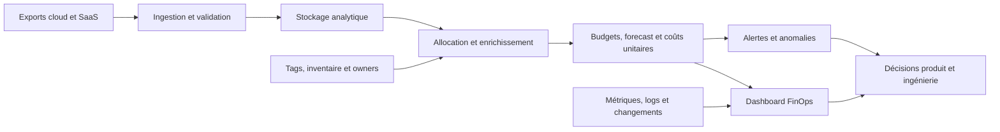
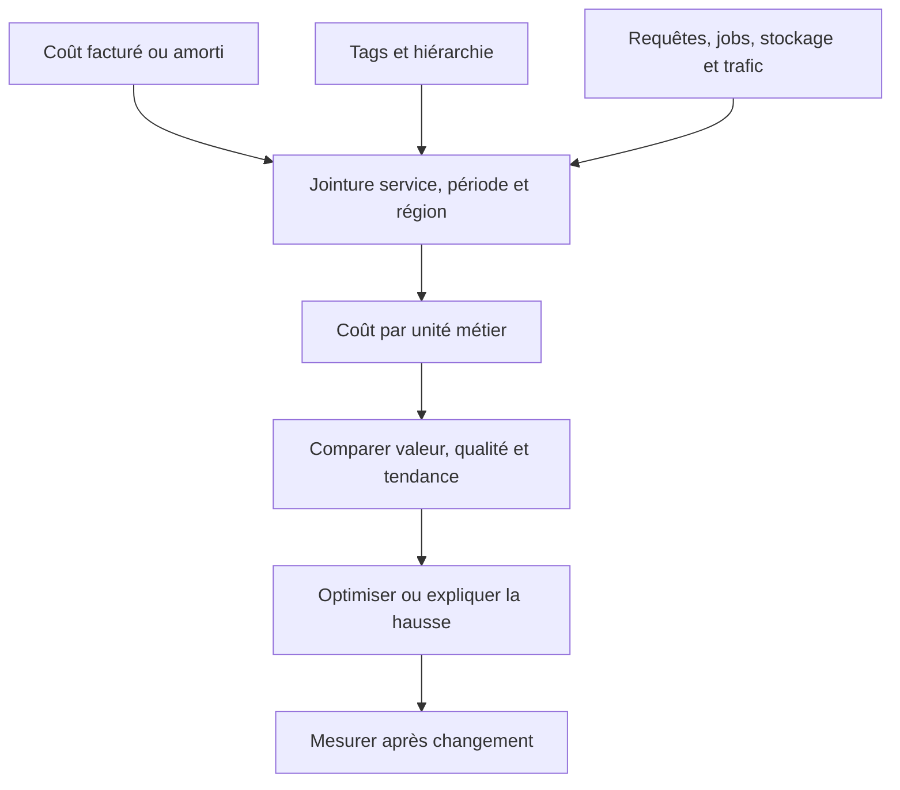
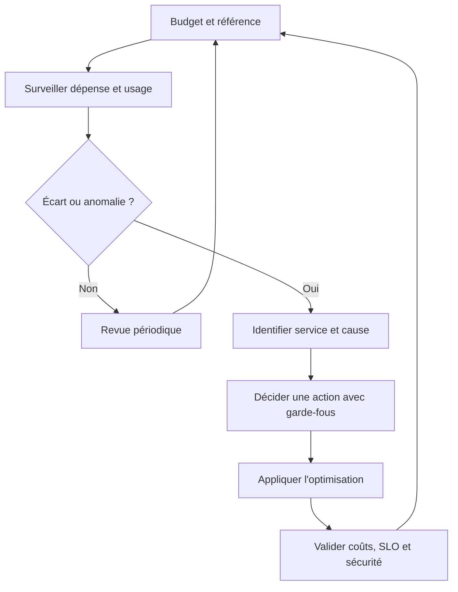
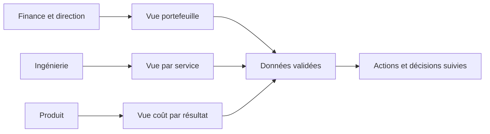
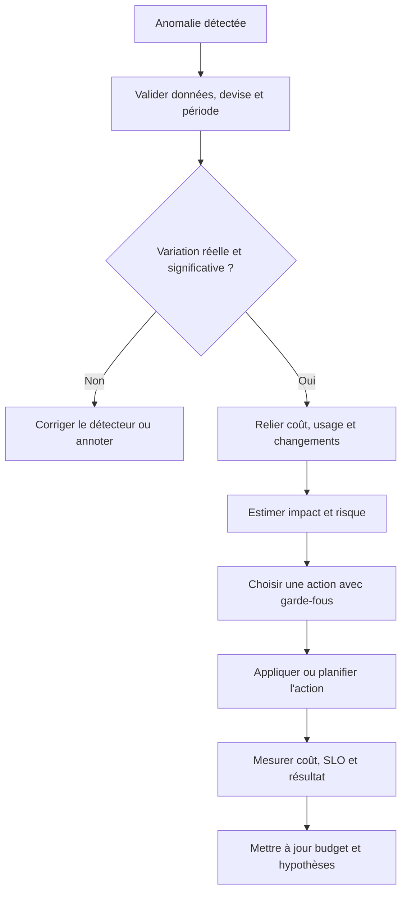

# FinOps et monitoring des coûts

> **Mise en contexte.** Une plateforme peut respecter ses SLO, répondre rapidement et fonctionner sans incident tout en devenant financièrement insoutenable. Une base de données surdimensionnée, des environnements oubliés, des logs conservés sans politique, des requêtes analytiques coûteuses ou une augmentation silencieuse du trafic peuvent faire croître la facture sans dégrader immédiatement l’expérience utilisateur. Le monitoring des coûts rend ces changements visibles, attribue les dépenses aux services qui les provoquent et relie l’usage des ressources à la valeur métier. FinOps complète ainsi la supervision technique : il ne s’agit pas seulement de dépenser moins, mais de savoir où l’argent est utilisé, pourquoi, pour quel résultat et avec quel niveau de qualité de service.

## 1. Introduction

### 1.1. Pourquoi les coûts doivent-ils être supervisés comme un signal de production ?

Les coûts d’infrastructure sont un indicateur du comportement du système. Ils reflètent parfois un succès : davantage d’utilisateurs actifs, plus de transactions ou une nouvelle fonctionnalité populaire. Ils peuvent aussi révéler une anomalie : une boucle de retry, des requêtes SQL inefficaces, une fuite de ressources, une cardinalité de métriques incontrôlée, du stockage sans expiration, du trafic robotisé ou un environnement de test oublié. Le montant final de la facture arrive souvent trop tard pour prévenir une dérive qui a commencé plusieurs jours auparavant.

La supervision classique observe la latence, le débit, les erreurs, la capacité, l’utilisation CPU et la santé des dépendances. Le monitoring des coûts ajoute la consommation et le prix des ressources, l’évolution du budget, les crédits et remises, le coût unitaire par opération et les écarts entre prévision et réalisation. Ces dimensions doivent être rapprochées. Une réduction de coût qui augmente la latence ou le risque de panne n’est pas forcément une optimisation. Une hausse de dépense qui permet de servir deux fois plus de demandes à qualité constante peut être une bonne décision.

Une pratique efficace connecte les données de facturation aux données d’usage et aux objectifs du produit. Elle aide à répondre à des questions opérationnelles : quel service a causé la hausse ? La croissance est-elle liée au volume, au prix unitaire, à la configuration ou à une dépense ponctuelle ? La dépense augmente-t-elle plus vite que le nombre d’utilisateurs ? Les ressources achetées sont-elles réellement utilisées ? Quel compromis entre coût, performance, résilience et sécurité est acceptable ?

### 1.2. Définition de FinOps

FinOps est une pratique opérationnelle et culturelle qui vise à maximiser la valeur issue de la technologie et à rendre les décisions de consommation financièrement responsables. Elle implique les équipes d’ingénierie, de finance, de produit, les achats, les responsables de plateforme et la direction. Les décisions de coût ne peuvent pas être confiées uniquement au service financier, car les principaux leviers techniques se trouvent souvent dans le code, l’architecture, la configuration et les habitudes de développement.

Le cadre FinOps repose sur trois grands types d’activités qui se répètent en continu. **Informer** consiste à collecter les données, rendre les dépenses visibles, les attribuer et établir des prévisions. **Optimiser** consiste à réduire le gaspillage et à améliorer l’efficacité d’utilisation et les conditions tarifaires. **Opérer** consiste à suivre les indicateurs, gouverner les décisions et intégrer les responsabilités financières dans le fonctionnement régulier.

Ces activités ne forment pas une séquence qui se termine une fois pour toutes. Une optimisation révèle parfois que les données d’allocation sont insuffisantes ; une meilleure allocation permet d’établir des budgets plus réalistes ; une prévision plus fiable aide à choisir l’architecture d’une nouvelle fonctionnalité. FinOps est un cycle d’apprentissage qui associe ingénierie, produit et finance autour de décisions fondées sur des données.

### 1.3. Monitoring des coûts, gestion financière du cloud et FinOps

Le **monitoring des coûts** est la collecte et l’analyse des signaux financiers : dépenses courantes, tendances, anomalies, budgets, coûts unitaires et prévisions. La **gestion des coûts cloud** regroupe les mécanismes de dépense, d’allocation, de budget et d’optimisation proposés par les fournisseurs ou les outils tiers. **FinOps** est plus large : il inclut les personnes, les responsabilités, les arbitrages, les processus et le rapprochement entre coût et valeur.

Installer un tableau de bord ne crée pas une pratique FinOps si personne ne possède les budgets, si les ressources ne sont pas attribuées à des équipes et si les alertes restent ignorées. À l’inverse, une organisation peut démarrer sans plateforme complexe : un export de facturation, une convention de tags, une revue hebdomadaire et un plan d’action mesurable peuvent déjà améliorer la visibilité. Les outils automatisent les tâches répétitives ; ils ne remplacent pas la compréhension du contexte métier.

### 1.4. Objectifs pédagogiques

À la fin de ce cours, vous devez savoir définir les indicateurs de coût, organiser l’ingestion des données de facturation, attribuer les dépenses aux produits et équipes, établir des budgets et des prévisions, détecter les anomalies, interpréter le coût unitaire, relier les dépenses aux métriques techniques, choisir des optimisations réalistes et vérifier qu’elles ne dégradent pas la qualité du service.

Vous apprendrez aussi à distinguer coût, prix, usage et valeur, à éviter les conclusions hâtives à partir d’un montant agrégé, à comprendre les coûts partagés et les remises et à structurer une boucle de décision entre ingénierie, produit et finance. Les exemples couvrent le cloud, mais les principes s’appliquent aux licences SaaS, aux plateformes de données, aux centres de données et aux outils d’observabilité.

## 2. Concepts clés

### 2.1. Les quatre dimensions du coût

Une analyse de coût robuste sépare au moins quatre dimensions.

**Usage physique ou logique.** C’est la quantité consommée : heures d’instance, vCPU, mémoire, gigaoctets stockés, requêtes, appels API, données transférées, messages traités ou tokens de modèle.

**Prix unitaire.** Il dépend du service, de la région, de la classe de ressource, du modèle tarifaire, des remises, des engagements et des contrats. Le même volume peut coûter différemment en fonction de l’architecture et des achats.

**Allocation.** Elle répond à la question : à qui attribuer cette dépense ? Elle utilise des comptes, projets, abonnements, labels, tags, centres de coûts, services ou règles de partage. Une dépense non attribuée reste visible financièrement mais difficile à optimiser.

**Valeur métier.** Elle estime ce que la dépense permet de produire : utilisateurs servis, réservations confirmées, commandes réussies, jobs terminés ou capacité de conformité. Elle évite de confondre une baisse de facture avec une amélioration de la valeur.

On peut représenter le coût de manière simplifiée comme l’usage multiplié par le prix unitaire, puis ajusté selon les crédits, remises, engagements, taxes et règles de facturation. Cependant, le détail des factures dépend du fournisseur et du contrat. Utilisez les champs officiels correspondant à l’analyse voulue plutôt que de supposer qu’un calcul unique explique toutes les lignes.

### 2.2. Dépenses absolues et coûts normalisés

Un montant mensuel répond à une question financière, mais ne suffit pas à évaluer l’efficacité. Si la dépense passe de 10 000 à 12 000 unités monétaires alors que le volume traité double, le coût par opération peut s’améliorer. Si la facture reste à 10 000 mais que le nombre d’utilisateurs actifs est divisé par deux, l’efficacité peut s’être détériorée.

Un coût normalisé divise les dépenses d’une période par une unité d’activité utile. Exemples : coût par utilisateur actif, par commande confirmée, par minute de vidéo, par gigaoctet stocké, par job achevé ou par million de requêtes. Le choix du dénominateur est décisif : un « coût par requête » qui inclut les retries, les bots et les erreurs ne représente pas nécessairement le coût de fournir une opération réussie. Il peut également ignorer la complexité variable des opérations.

Les indicateurs unitaires doivent préciser l’unité, la période, la population, les coûts inclus et la source d’activité. Pour comparer des produits, assurez-vous que les définitions sont compatibles. Un coût par client qui inclut seulement l’infrastructure directe pour une équipe et les licences, le support et le stockage partagé pour une autre ne permet pas une comparaison équitable.

### 2.3. Unité économique et coût pour servir

L’unité économique (*unit economics*) relie le coût total d’une capacité ou d’un service à une unité de valeur. Elle peut être purement technique, comme le coût par gigaoctet stocké, ou métier, comme le coût par client actif ou par transaction réussie. Les mesures techniques sont utiles pour l’ingénierie ; les mesures métier aident produit et finance à comprendre les implications.

Exemples de formules :
- Coût par requête = coût du service sur la période / nombre de requêtes éligibles.
- Coût par opération réussie = coût de production associé / nombre d’opérations réussies.
- Coût de stockage par Go-mois = coût de stockage / volume moyen en Go, ajusté à la durée.
- Coût d’une exécution de pipeline = coût des ressources du pipeline / nombre d’exécutions réussies.
- Coût par utilisateur actif = dépenses attribuées au produit / utilisateurs actifs pendant la période.

La difficulté principale est l’allocation. Un service peut utiliser une base de données ou une plateforme commune à plusieurs produits. Une allocation au prorata du nombre de requêtes peut être injuste si les requêtes ont des coûts très différents. Une allocation selon la consommation réelle de CPU ou de stockage peut mieux refléter la charge, mais nécessite des métriques fiables. Une répartition fixe peut être simple à opérer mais doit être revue si l’usage évolue.

Un indicateur unitaire est particulièrement utile lorsqu’il est suivi dans le temps. Une valeur isolée est moins informative que sa tendance, ses variations et les décisions prises en conséquence. Il faut conserver les hypothèses, sinon un changement de définition peut faire apparaître une amélioration qui n’existe pas.

### 2.4. Dépenses directes, partagées et non allouées

Les dépenses **directes** peuvent être rattachées à un service ou une équipe avec une bonne confiance : un cluster dédié, un bucket spécifique ou une licence attribuée à un produit. Les dépenses **partagées** financent plusieurs consommateurs : plateforme Kubernetes, passerelle réseau, identité, monitoring central, outils de sécurité ou support cloud. Les dépenses **non allouées** ne possèdent pas les métadonnées nécessaires ou ne peuvent pas être attribuées de manière défendable.

La stratégie d’allocation doit expliquer le traitement des coûts partagés. On peut utiliser une clé d’usage mesuré, une allocation fixe approuvée, une mesure de consommation ou une règle hybride. La clé doit correspondre au service fourni. Si une plateforme de logs est principalement consommée selon le volume ingéré, une allocation au volume peut être plus juste qu’un partage égal entre équipes ; si les coûts sont liés à un service minimum disponible pour tous, une composante fixe peut être raisonnable.

Les coûts non alloués doivent rester visibles comme une catégorie, avec un objectif de réduction de leur part. Ils ne doivent pas être répartis arbitrairement uniquement pour atteindre 100 % d’allocation. Une attribution estimée peut être utile pour la planification, mais son niveau de confiance doit être explicite afin de ne pas produire une fausse précision.

### 2.5. Tags, labels et hiérarchie des ressources

Une convention de métadonnées minimale peut comporter un propriétaire, un service, un environnement, un centre de coûts et, lorsque cela sert à la gouvernance, une criticité. Les noms exacts varient selon les fournisseurs ; l’objectif est d’avoir une taxonomie stable, contrôlée et compréhensible, pas un ensemble de chaînes libres créées à la demande.

Les tags doivent avoir des valeurs validées et des responsables. Évitez les identifiants personnels ou les données confidentielles dans les tags. Un tag n’est pas un mécanisme d’autorisation et ne remplace pas les politiques d’accès. Les tags d’allocation servent à répondre à une question de gestion financière ; les labels de sécurité peuvent avoir une finalité différente et leurs règles doivent être gouvernées séparément.

Les ressources créées automatiquement devraient hériter de métadonnées standards. Les pipelines d’infrastructure as code peuvent ajouter les tags au provisionnement, et des politiques peuvent refuser ou signaler la création d’une ressource sans propriétaire ou environnement. Une voie d’exception est nécessaire pour certains services gérés ou ressources qui ne supportent pas toutes les métadonnées. Les exceptions doivent être suivies et corrigées lorsque cela devient possible.

Une hiérarchie claire facilite l’analyse : organisation, compte ou abonnement, projet, environnement, produit et service. Un compte dédié donne une isolation forte, mais augmente la charge d’administration. Les tags offrent plus de finesse, mais dépendent de leur couverture et de leur qualité. Les deux approches peuvent être combinées.

### 2.6. Données de facturation : source de vérité et limites

La facture ou l’export détaillé du fournisseur est généralement la source financière principale, mais les données ne sont pas toujours disponibles en temps réel et peuvent être révisées. Les estimations de coût d’une console peuvent différer de la facture finale en raison de crédits, remises, taxes, ajustements, engagements ou délais de publication. Il faut distinguer coût brut, coût amorti, coût net, crédits et taxes selon l’analyse.

Un pipeline de données financières comprend l’extraction ou l’export fournisseur, le stockage, la validation, l’enrichissement par les métadonnées, l’allocation, les agrégations et les dashboards. Le pipeline lui-même doit être surveillé : dernière date d’ingestion, nombre de lignes, sommes par compte, doublons, changements de schéma et écarts avec les chiffres de référence.

Les exports détaillés peuvent contenir des milliers ou des millions de lignes. Il est préférable de les analyser dans un système adapté à l’analytique plutôt que de traiter manuellement chaque fichier. Les champs doivent être interprétés selon le schéma officiel et la version d’export utilisée. Ne mélangez pas les périodes de facture et les périodes d’usage sans le signaler : une facture publiée début juin peut contenir un ajustement concernant une période antérieure.

### 2.7. Coût engagé, coût amorti et coût réellement consommé

Les modèles tarifaires peuvent inclure le paiement à la consommation, des réservations, des engagements de dépense, des remises ou des licences préachetées. Une lecture « facturée ce mois-ci » peut être différente d’une lecture « coût amorti des ressources utilisées ». Une réservation payée d’avance peut faire apparaître une forte sortie de trésorerie au moment de l’achat, tandis que son coût amorti répartit l’engagement sur la période de bénéfice.

Les décisions d’ingénierie doivent utiliser une méthode cohérente. Pour mesurer les coûts associés aux ressources consommées, une vue amortie ou effective peut être plus pertinente. Pour contrôler la trésorerie ou rapprocher le montant d’une facture, la vue facturée est nécessaire. Une bonne plateforme expose le type de coût et ne mélange pas ces vues sans transformation documentée.

Les remises et engagements doivent aussi être évalués avec soin. Acheter une capacité engagée pour réduire le prix unitaire peut être bénéfique si la consommation est stable, mais risqué si la demande chute ou si l’architecture change. Il faut évaluer l’utilisation historique, la flexibilité contractuelle, l’échéance et la possibilité de réaffecter l’engagement.

### 2.8. Budget, prévision et écarts

Un **budget** fixe une enveloppe approuvée pour une période ou un périmètre. Une **prévision** estime la dépense future à partir de la consommation observée, de la saisonnalité, de la croissance attendue, des changements prévus et des engagements. L’écart compare la réalisation à une référence, par exemple : écart en pourcentage = (coût réel − coût budgété) / coût budgété × 100.

Une prévision n’est pas simplement le montant du mois courant multiplié par douze. Les dépenses peuvent être saisonnières, les prix ou remises peuvent changer, et un lancement de produit peut modifier fortement le volume. La méthode doit expliciter ses hypothèses : volume de demandes, croissance utilisateur, stockage moyen, débit réseau, durée de rétention, achats planifiés et date de démarrage des ressources.

Un budget doit être défini par périmètre et propriétaire. Un budget agrégé pour toute l’entreprise peut masquer le dépassement d’un service critique. Des sous-budgets permettent de relier les alertes aux personnes capables d’agir. Il faut aussi distinguer dépense ponctuelle autorisée, croissance attendue et anomalie inattendue. Le dépassement n’indique pas automatiquement un gaspillage, mais doit déclencher une explication et une décision.

### 2.9. Alertes de budget et seuils de dépense

Une alerte de budget signale qu’un montant ou une prévision franchit un seuil. Les seuils peuvent être progressifs, par exemple un avertissement à 70 %, une revue à 85 % et une escalade à 100 % de l’enveloppe, mais ces pourcentages sont des exemples et non des recommandations universelles. Ils doivent être adaptés à la durée de la période, aux engagements connus et au délai nécessaire pour agir. Une alerte à 100 % est souvent tardive si les coûts continuent à s’accumuler pendant l’enquête.

Les alertes basées sur la prévision sont souvent plus utiles que celles basées uniquement sur le montant déjà dépensé. Si les dépenses du mois sont à 60 % mais qu’une projection fiable indique 120 % à la fin du mois, l’organisation peut agir avant le dépassement. Les prévisions dépendent toutefois de la qualité des données, de l’historique et du modèle ; leur incertitude doit être visible.

Une notification utile indique le périmètre, la devise, la période, le montant courant, le budget, le niveau de dépassement, les principaux services responsables, les changements récents et le lien vers l’analyse. L’action peut être de corriger un défaut, arrêter un environnement de test, modifier la rétention, revoir une requête ou demander l’approbation d’une dépense liée à la croissance. Un budget ne doit pas provoquer l’arrêt automatique d’un service critique sans politique de sûreté et analyse d’impact.

### 2.10. Détection d’anomalies de coûts

Une anomalie est une déviation significative par rapport à ce qui était attendu. Elle peut être absolue — une dépense quotidienne dépasse un plafond — ou statistique — le coût évolue différemment de son motif habituel. Elle peut provenir d’une hausse de trafic, d’un transfert inter-région, d’un nombre de snapshots inattendu, d’un cluster de test laissé actif, de logs en boucle ou d’un changement tarifaire.

Le contrôle de seuil est simple et explicable, mais ne détecte pas toutes les évolutions. Une règle fixe de 100 unités par jour peut alerter inutilement lors d’une croissance normale ou manquer une anomalie dans un service dont le coût habituel est très faible. Une méthode statistique peut comparer le coût aux niveaux historiques, à la saisonnalité ou aux variations d’usage. Le résultat doit être présenté avec le contexte et ne doit pas être traité comme une preuve d’incident.

Les anomalies doivent être triées par impact financier, durée, confiance et capacité d’action. Un petit changement sur un service de faible criticité peut être traité par ticket ; une hausse rapide du coût d’un service de production peut nécessiter une investigation immédiate. Une hausse liée à un lancement prévu doit être annotée, ce qui aide à réduire les faux positifs sans désactiver la surveillance.

### 2.11. Relier les coûts aux métriques techniques

Le rapport de facturation indique ce qui est facturé, mais pas toujours pourquoi. Les métriques techniques fournissent le contexte causal : volume de requêtes, CPU, mémoire, capacité utilisée, nombre d’instances, egress réseau, données ingérées, taux de cache, durée des jobs et fréquence des requêtes en base. Les annotations de déploiement permettent de corréler une hausse avec un changement.

Les dimensions doivent être harmonisées. Si les données de coût sont agrégées par projet et les métriques par service, une table de correspondance ou une convention de tags est nécessaire. Les coûts peuvent être publiés quotidiennement, alors que les métriques techniques changent chaque minute ; la corrélation doit respecter la granularité et ne pas suggérer une précision temporelle inexistante.

Un bon diagnostic distingue trois cas :
- Volume en hausse, efficacité stable : le coût augmente parce que la demande augmente.
- Volume stable, coût en hausse : rechercher prix, architecture, ressource surprovisionnée, stockage ou transfert.
- Volume et coût stables, qualité en baisse : le problème peut être une mauvaise allocation, une régression de performance ou une ressource devenue un goulot d’étranglement.

La corrélation n’est pas une causalité garantie. Elle sert à formuler et tester des hypothèses. L’équipe doit consulter les données de prix, les configurations et les changements de code avant d’attribuer la hausse à un seul facteur.

### 2.12. Coût de l’observabilité elle-même

La plateforme d’observabilité génère ses propres coûts : stockage des métriques, logs et traces, transferts de données, traitement des requêtes, rétention et licences. Une collecte trop détaillée peut améliorer le diagnostic mais devenir disproportionnée. Des labels à forte cardinalité multiplient les séries ; une rétention excessive augmente le stockage ; une trace complète de chaque requête peut devenir coûteuse lors d’une forte charge.

L’objectif n’est pas d’éliminer les signaux utiles. Il faut définir le niveau de détail en fonction du risque, du délai de diagnostic et de la durée d’analyse requise. Les métriques agrégées sont adaptées au suivi courant ; les traces détaillées et certains logs peuvent être échantillonnés ou conservés selon une durée différente. Les données de sécurité ou de conformité peuvent exiger un traitement particulier qui ne doit pas être raccourci uniquement pour économiser du stockage.

Mesurez le coût par unité de télémétrie : coût par Go ingéré, par million d’échantillons, par million de lignes de log ou par service supervisé. Associez ces indicateurs au volume réel et au bénéfice diagnostique. Si une nouvelle instrumentation double la facture mais permet de détecter les incidents plus vite, son coût peut être justifié ; si elle produit des champs jamais consultés, elle peut être réduite.

### 2.13. Optimisation technique : droitsizing, élasticité et nettoyage

Le **rightsizing** consiste à ajuster les ressources à la charge observée et à la capacité souhaitée. Une instance surdimensionnée gaspille des ressources ; une instance trop petite peut augmenter la latence, les erreurs et le nombre de retries, ce qui peut augmenter le coût global. La décision doit se fonder sur la distribution de charge, les pics, la marge de résilience et les SLO, et non seulement sur l’utilisation moyenne.

L’élasticité adapte la capacité à la demande. Elle peut réduire le coût lorsque l’usage varie fortement, mais un autoscaler mal réglé peut provoquer des oscillations ou augmenter inutilement la capacité. Les temps de démarrage, les limites de quotas, les dépendances avec état et la capacité minimale nécessaire doivent être mesurés. Une architecture à la demande peut améliorer l’alignement coût-usage, mais elle peut aussi introduire des frais de requête, de transfert, d’observabilité ou de démarrage à froid.

Le nettoyage des ressources non utilisées est souvent efficace : volumes orphelins, anciennes images, environnements éphémères, snapshots, adresses réservées, disques non attachés et copies de données. Toutefois, une ressource apparemment inactive peut servir à la reprise après sinistre, à une conservation légale ou à une opération exceptionnelle. Avant toute suppression, vérifiez le propriétaire, la dernière utilisation, la politique de rétention, les dépendances et la possibilité de restauration. Une politique de cycle de vie est préférable à un nettoyage aveugle.

### 2.14. Optimisation des tarifs et engagements

La réduction du prix unitaire peut venir de remises négociées, d’engagements de consommation, de réservations, d’options de licence et de décisions de placement régional. Elle doit être étudiée séparément de l’efficacité technique. Si le coût unitaire baisse mais que le volume augmente fortement, la dépense totale peut continuer à croître.

Les engagements nécessitent une prévision fiable et une analyse du risque. Un achat offrant une réduction nominale importante peut coûter plus cher si l’usage réel est inférieur aux attentes. La flexibilité des contrats, les échéances, les changements de génération de matériel, la portabilité des workloads et la concentration du risque doivent être pris en compte. Les décisions d’achat appartiennent souvent à une collaboration entre finance, achats, produit et ingénierie.

L’évaluation doit utiliser des méthodes cohérentes : coût facturé pour la trésorerie, coût amorti pour l’utilisation économique des engagements, coûts nets ou bruts selon les besoins. Évitez de comparer un service avant optimisation au coût brut et le même service après optimisation au coût net sans expliquer la différence de méthode.

### 2.15. Le compromis coût, performance, fiabilité et sécurité

L’optimisation ne vise pas un coût minimal isolé. Elle cherche le meilleur rapport entre valeur, coût et risque. Réduire le nombre d’instances peut diminuer la facture mais augmenter la portée d’une panne. Éloigner une donnée peut réduire un coût de stockage mais augmenter la latence et les transferts. Réduire la fréquence des sauvegardes peut économiser du stockage et du trafic tout en augmentant la perte de données potentielle. Diminuer le niveau de logs peut réduire la facture mais ralentir une enquête de sécurité.

Toute optimisation importante doit définir les garde-fous avant l’intervention : SLO, latence maximale, taux d’erreur, capacité de pointe, RPO/RTO, exigences de sécurité et mesures de retour arrière. Testez le changement en environnement contrôlé ou en canari, comparez une période représentative et vérifiez les effets secondaires. Une économie sans mesure de qualité est une hypothèse, pas un résultat.

### 2.16. Gouvernance, responsabilités et culture

FinOps fonctionne mieux lorsque les équipes qui provoquent une dépense ont accès aux données et participent aux décisions. L’ingénierie comprend les leviers de consommation ; la finance connaît les budgets, contrats et règles de facturation ; le produit relie les coûts aux parcours et aux revenus ; la direction définit les arbitrages ; les achats gèrent les engagements et les licences.

Une gouvernance utile fixe une convention de métadonnées, une procédure de budget, les rôles d’approbation, les règles de coût partagé, la méthode de prévision et la cadence de revue. Elle prévoit aussi la gestion des nouvelles ressources : un nouveau service doit avoir un propriétaire, un périmètre de coûts, les tags nécessaires et une estimation. Les exceptions sont enregistrées au lieu d’être ignorées.

Les tableaux de bord ne doivent pas servir à humilier une équipe pour une facture élevée. Le coût doit être analysé à la lumière du volume, de la criticité, de la valeur et de l’état du service. Une équipe qui paie davantage parce qu’elle supporte le parcours le plus important n’est pas nécessairement inefficace. Les comparaisons doivent utiliser des unités et un contexte équitables.

## 3. Architecture et Schémas

### 3.1. Pipeline de données de coûts

Un pipeline de monitoring financier ingère les données des fournisseurs, les valide, enrichit les lignes à l’aide de métadonnées, calcule des agrégats et expose les résultats aux équipes. Il doit distinguer les données financières de référence des métriques techniques qui servent à interpréter les causes.



La qualité du pipeline est un prérequis. Il faut connaître la fraîcheur de l’export, détecter les doublons, vérifier les totaux et documenter les changements de schéma. Les dashboards doivent indiquer leur date de mise à jour ; une facture incomplète ne doit pas être présentée comme le coût final.

### 3.2. Relier coût et usage technique

La relation entre dépense et usage peut être modélisée par service, environnement et période. Les métriques techniques fournissent la quantité de travail ; les rapports de coût fournissent les coûts imputés ou facturés. Les deux sont rapprochés par des clés contrôlées et une granularité compatible.



Si les données techniques sont minute par minute et les coûts quotidiens, une attribution à chaque minute inventerait une précision que la facturation ne fournit pas. Le dashboard doit expliquer la granularité et séparer les corrélations fiables des hypothèses. Il faut également documenter la méthode d’allocation des coûts partagés.

### 3.3. Boucle de gouvernance FinOps

Les coûts ne doivent pas uniquement être examinés à la fin du mois. La boucle opérationnelle comprend l’établissement d’une référence, la surveillance, l’enquête sur les anomalies, la décision, l’exécution puis la validation des résultats.



Chaque action doit avoir un propriétaire, une mesure attendue, une date de vérification et un critère de retour arrière. Une optimisation qui ne produit pas les économies attendues doit être corrigée ou annulée, et le résultat réel doit être partagé.

### 3.4. Dashboard FinOps et alertes

Un dashboard FinOps doit présenter les dépenses réelles, le budget et la prévision, la variation, les principaux services, la part non allouée, les coûts unitaires et les anomalies ouvertes. Une vue globale aide à gérer le portefeuille ; une vue par service aide l’ingénierie à trouver des leviers. Il faut afficher la devise, la période et le type de coût.



Les alertes doivent être reliées à une action réaliste. Un budget peut déclencher une revue, une anomalie peut ouvrir un ticket d’investigation et une hausse brutale avec un risque de facture immédiate peut demander une intervention rapide. Évitez les alertes qui signalent chaque petite variation normale. Le seuil doit tenir compte du cycle de facturation, des délais d’ingestion et du volume.

### 3.5. Flux de traitement d’une anomalie de coûts

La détection automatique n’est que le début du travail. Il faut vérifier que l’anomalie est réelle, rechercher les moteurs, estimer l’impact et appliquer une action sûre. L’équipe conserve ensuite une preuve du résultat afin d’améliorer les règles de détection et la prévision.



Une alerte ne doit pas provoquer une suppression non contrôlée de ressources. Le responsable vérifie les sessions, dépendances et règles de conservation, puis choisit entre une correction de code, un changement de configuration, une modification de capacité ou une revue budgétaire. Les cas attendus sont documentés afin de limiter les faux positifs sans désactiver le système.

### 3.6. Exemple SQL pour explorer un export analytique

Les fournisseurs offrent des schémas et outils différents. L’exemple ci-dessous illustre une agrégation dans une table analytique contenant les champs conceptuels usage_date, service_name, project_id et cost_amount. Les noms de colonnes et les règles de coût doivent être adaptés à l’export réel avant exécution.

```sql
SELECT
  DATE_TRUNC(usage_date, MONTH) AS month,
  service_name,
  project_id,
  SUM(cost_amount) AS total_cost
FROM billing_dataset.cost_export
WHERE usage_date >= DATE_SUB(CURRENT_DATE(), INTERVAL 90 DAY)
GROUP BY month, service_name, project_id
ORDER BY month DESC, total_cost DESC;
```

Cette requête est un exemple pédagogique et dépend du moteur SQL et de son schéma. Les noms de champs, les fonctions de date et les règles de coût doivent être vérifiés avant exécution. Pour un rapport fiable, validez la devise, les crédits, les taxes, les coûts amortis et les ajustements, puis rapprochez le total avec la console de facturation ou la facture officielle.

## 4. Étude de cas

### 4.1. Contexte : croissance des dépenses dans une plateforme SaaS

Une plateforme de formation fournit des cours, examens, laboratoires et dashboards. Les utilisateurs augmentent chaque mois et les coûts d’infrastructure progressent plus vite que le nombre d’utilisateurs actifs. La facture globale ne permet pas d’expliquer la hausse : compute, stockage, egress réseau, données d’observabilité et environnements temporaires sont regroupés dans plusieurs projets.

L’équipe identifie trois causes possibles. Le moteur de laboratoire démarre de nombreuses machines virtuelles qui restent actives après la fin des exercices. Les logs applicatifs contiennent beaucoup de messages répétitifs et sont conservés longtemps sans distinction de criticité. Un changement récent dans le frontend a multiplié les requêtes vers un endpoint de catalogue, ce qui augmente à la fois le compute et le trafic sortant.

La réponse ne doit pas être de couper immédiatement les ressources. Certaines machines peuvent être nécessaires à des sessions actives, certains logs peuvent être exigés pour la sécurité et les appels supplémentaires peuvent résulter d’une nouvelle fonctionnalité attendue. L’équipe commence par attribuer les coûts, rapprocher la consommation des métriques et protéger les SLO.

### 4.2. Construire la visibilité de base

Les projets et ressources reçoivent des métadonnées normalisées pour le service, l’environnement, l’équipe et le centre de coûts. Une table de correspondance est créée pour les ressources qui ne supportent pas les tags souhaités. Les dépenses directes sont attribuées automatiquement ; les dépenses communes sont réparties selon des règles explicites, par exemple au volume de données ingérées pour le pipeline de logs ou à la capacité réservée pour une plateforme partagée.

Les exports de facturation sont chargés dans un stockage analytique avec une validation quotidienne. Le pipeline vérifie la date de dernière ingestion, le nombre de lignes, la devise, les doublons et les écarts importants avec les rapports de référence. Les dashboards distinguent coût net, coût amorti et coût facturé selon la question posée. Une dépense non allouée reste visible au lieu d’être répartie silencieusement.

L’équipe définit des unités de résultat : coût par session de laboratoire terminée, coût par examen soumis et coût par utilisateur actif. Elle calcule une référence sur plusieurs périodes représentatives et tient compte de la saisonnalité. Un coût par session est calculé à partir des dépenses attribuées aux laboratoires et du nombre de sessions terminées, en précisant si les tests internes et les sessions échouées sont inclus.

### 4.3. Budgets et détection de dérive

Chaque service critique reçoit un budget mensuel, une prévision et un propriétaire. Une alerte précoce se déclenche si la trajectoire projetée dépasse la limite, tandis qu’un seuil de dépense réelle sert à confirmer un écart. La notification indique les principaux services responsables, la période, l’évolution du trafic et le coût unitaire. Les seuils sont adaptés aux délais de publication des données et ne supposent pas que l’export de facturation est instantané.

Les anomalies sont rapprochées des événements techniques. Une hausse d’heures d’instance après un déploiement est corrélée à la version, au nombre de sessions actives et aux signaux de l’ordonnanceur. Une augmentation de stockage est reliée au volume et à la rétention des logs. Les données servent à formuler des hypothèses que les équipes peuvent vérifier dans les configurations et les journaux.

La revue hebdomadaire réunit finance, produit et ingénierie pour les services qui dépassent leurs objectifs ou présentent une anomalie. Les décisions comprennent une explication documentée, une action, un propriétaire, un échéancier et les garde-fous à vérifier. Les hausses attendues après un lancement sont annotées, mais la prévision est ensuite comparée au réel pour améliorer les estimations futures.

### 4.4. Optimisation des laboratoires éphémères

L’équipe constate que de nombreuses machines virtuelles de laboratoire restent actives plusieurs heures après la fin d’une session. Elle ajoute un mécanisme de durée de vie, un état d’activité fiable, une période de grâce et un nettoyage supervisé. Les environnements en cours de session ne sont jamais arrêtés uniquement parce qu’ils semblent inactifs pendant un court intervalle ; la règle s’appuie sur l’état de session et des politiques explicites.

L’automatisation enregistre les environnements créés, expirés, arrêtés et supprimés, ainsi que les échecs de nettoyage. Elle possède une liste d’exclusion pour les sessions pédagogiques programmées et un mode simulation avant suppression. Les permissions sont limitées au périmètre des laboratoires. Des alertes surveillent la présence d’environnements sans propriétaire, les ressources dépassant leur durée de vie et les échecs de l’automatisation.

Pour mesurer le résultat, l’équipe compare le coût par session terminée, les heures d’instance par session et le taux d’incident utilisateur. Si la facture diminue mais que les apprenants perdent leur session, l’optimisation est un échec. Le contrôle exige donc que le coût s’améliore sans dégrader la réussite du parcours, la latence de démarrage ou la disponibilité du laboratoire.

### 4.5. Optimiser logs et métriques sans devenir aveugle

La plateforme de logs coûte davantage car elle ingère des messages répétitifs à haut volume. L’équipe classe les logs selon leur valeur : événements de sécurité, audits, erreurs métier, diagnostics détaillés et messages de débogage. Elle conserve les journaux obligatoires selon les règles de conformité, réduit les répétitions non informatives, ajoute une limitation pour les boucles d’erreur et applique des politiques de cycle de vie adaptées.

Les traces sont échantillonnées de façon contrôlée pour les requêtes ordinaires, tandis que les erreurs et transactions lentes peuvent bénéficier d’une politique de conservation plus riche si la plateforme le permet. Les métriques restent agrégées et évitent les identifiants uniques. La stratégie est testée lors d’un incident simulé pour s’assurer que les informations indispensables à l’enquête restent disponibles.

Le coût de l’observabilité est suivi par Go ingéré, par service et par période, mais les décisions ne reposent pas seulement sur le prix. L’équipe vérifie aussi la capacité à diagnostiquer les incidents et la vitesse de résolution. Une économie qui fait perdre la visibilité sur les événements critiques doit être rejetée.

### 4.6. Le changement frontend et la hausse des requêtes

Les métriques révèlent que le nombre d’appels au catalogue a doublé après une nouvelle version. Le coût augmente avec le volume de requêtes, mais le coût par appel reste stable. L’équipe vérifie si les appels sont attendus, si le cache fonctionne et si une même page déclenche plusieurs requêtes identiques. Les traces montrent que certaines données sont rechargées à chaque petit changement d’interface.

Le correctif introduit une mise en cache adaptée, une limitation des appels redondants et des tests de performance. Les équipes suivent le volume de requêtes, les taux de cache, la latence p95, le coût par session et le taux d’erreur. L’objectif n’est pas simplement de réduire les requêtes, mais de préserver la fraîcheur du catalogue et la cohérence des données.

Après le déploiement, l’équipe compare des périodes comparables en tenant compte du nombre d’utilisateurs. Elle vérifie que la baisse du volume n’est pas due à une panne de la fonctionnalité ou à une instrumentation cassée. Le résultat est documenté comme une amélioration mesurée, avec le code et les hypothèses associés.

### 4.7. Résultat et gouvernance durable

Après plusieurs cycles, la plateforme possède une attribution plus précise, une prévision plus utile et une procédure claire pour traiter les anomalies. Les environnements éphémères sont nettoyés de manière sûre, les logs sont conservés selon leur valeur et les appels frontend inutiles ont été réduits. Les équipes connaissent les conséquences financières de leurs changements et disposent de données pour estimer les coûts des nouvelles fonctionnalités.

L’équipe ne s’arrête pas une fois la facture redescendue. Elle maintient les budgets, inspecte la part non allouée, vérifie les prévisions et suit le coût unitaire au fil de la croissance. Les règles d’allocation et les tags sont revus lorsque les services changent. Les optimisations sont répétées si les tendances révèlent de nouvelles opportunités, mais chaque changement conserve des critères de fiabilité et de sécurité.

Le cas illustre une règle importante : les meilleures économies viennent souvent de corrections de conception et de l’élimination du gaspillage, pas d’une réduction uniforme de toutes les ressources. L’analyse par service et par unité d’activité permet de cibler les actions sans appliquer des coupes qui dégradent le produit.

## 5. Pièges à éviter

### 5.1. Confondre facture et efficacité

Une facture plus élevée peut refléter une croissance saine, une hausse de prix ou du gaspillage. Une facture stable peut cacher une baisse de volume ou une détérioration de l’efficacité. Sans coût unitaire, volume et contexte, il est impossible de conclure. Les rapports doivent présenter les montants absolus et les indicateurs normalisés ensemble.

### 5.2. Attribuer les coûts partagés au hasard

Un partage égal entre équipes paraît simple, mais peut être injuste si les consommations diffèrent fortement. À l’inverse, une mesure très précise peut coûter plus à maintenir que le bénéfice obtenu. La clé de répartition doit être documentée, cohérente et proportionnée au besoin de décision. Les estimations doivent être identifiées comme telles, et les coûts non alloués ne doivent pas être cachés.

### 5.3. Faire confiance à des métadonnées incomplètes

Les ressources non taguées peuvent représenter une fraction importante des dépenses. Une convention doit être imposée lors du provisionnement et contrôlée après création. Les ressources qui ne supportent pas les tags ont besoin d’une table de correspondance ou d’une règle d’attribution explicite. Il faut mesurer le taux de conformité et le montant de dépense non attribué.

### 5.4. Réagir trop tard à un budget

Une alerte envoyée seulement à 100 % du budget peut arriver après que l’engagement financier est pratiquement irréversible. Les alertes de trajectoire ou de prévision donnent plus de temps pour agir. Les seuils doivent être choisis selon le délai entre usage et facturation, la vitesse d’accumulation et la capacité des équipes à corriger la cause.

### 5.5. Automatiser des suppressions sans vérification

Une machine peu utilisée peut être réservée à une reprise après sinistre ou à une activité programmée. Un volume apparemment orphelin peut contenir des données critiques. La suppression doit vérifier propriétaire, âge, état, dépendances et politique de conservation. Les actions irréversibles doivent être précédées d’un mode simulation et d’une validation adaptée au risque.

### 5.6. Acheter des engagements sur une prévision fragile

Les remises d’engagement peuvent être intéressantes, mais elles introduisent un risque si la consommation future est surestimée. Évaluez l’utilisation historique, la saisonnalité, les migrations prévues, la flexibilité du contrat et les options de réaffectation. Le prix unitaire inférieur n’est pas une économie si l’organisation paie une capacité inutilisée.

### 5.7. Réduire les logs et les traces sans protéger le diagnostic

La rétention et le volume de télémétrie doivent être adaptés à la valeur et aux obligations de conservation. Une coupe uniforme peut faire disparaître des journaux de sécurité, des informations de transaction ou les traces nécessaires à l’analyse d’incident. Définissez une taxonomie de données, testez le diagnostic dans un exercice et maintenez des politiques distinctes selon la criticité.

### 5.8. Optimiser le coût au détriment des SLO

Supprimer de la capacité peut réduire la facture et augmenter les erreurs sous charge. Éloigner une donnée peut réduire un coût de stockage mais augmenter la latence et les transferts. Réduire les sauvegardes peut économiser du stockage mais augmenter la perte de données. Toute optimisation doit être évaluée avec des garde-fous de performance, de fiabilité et de sécurité, puis mesurée après le changement.

### 5.9. Mélanger les vues de coûts

Les coûts facturés, amortis et nets peuvent différer. Les crédits, remises, taxes et ajustements modifient les totaux. Un dashboard qui mélange ces dimensions d’un mois à l’autre peut montrer une amélioration artificielle. Indiquez le type de coût, la devise, la période et les règles d’agrégation, et rapprochez les totaux avec la source de facturation.

### 5.10. Traiter les anomalies automatiques comme des vérités

Un algorithme peut détecter une variation réelle mais attendue, ou manquer une dérive lente. Une anomalie doit être contextualisée avec les lancements, le trafic, les changements de prix et la saisonnalité. Les modèles doivent être révisés à partir des faux positifs et faux négatifs. Pour les risques importants, associez seuils simples et méthodes statistiques plutôt que de dépendre d’un seul détecteur.

### 5.11. Mesurer des économies sans preuve

Une économie estimée n’est pas toujours une économie réalisée. La différence peut venir d’un changement de volume, d’une remise, d’une période plus calme ou d’un déplacement du coût vers un autre service. Établissez une base de référence, comparez des périodes semblables et documentez les hypothèses. Si possible, mesurez aussi les effets sur la qualité et sur les coûts déplacés ailleurs.

## 6. Checklist / À retenir

### 6.1. Checklist de monitoring FinOps

- [ ] Les sources de facturation sont exportées automatiquement et leur fraîcheur est surveillée.
- [ ] Les sommes, devises, crédits, remises et changements de schéma sont contrôlés.
- [ ] Le type de coût utilisé — facturé, amorti, brut ou net — est explicite.
- [ ] Les ressources suivent une convention de tags ou labels stable.
- [ ] Le montant non alloué est visible et fait l’objet d’un plan de réduction.
- [ ] Les coûts partagés sont répartis selon une méthode documentée.
- [ ] Les budgets possèdent un propriétaire, une période et des seuils d’alerte.
- [ ] Les prévisions tiennent compte des variations attendues et de leurs hypothèses.
- [ ] Les anomalies sont rapprochées du volume, des changements et des métriques techniques.
- [ ] Les coûts unitaires sont calculés avec un dénominateur métier pertinent.
- [ ] Les coûts d’observabilité sont suivis sans sacrifier les informations critiques.
- [ ] Les optimisations ont des garde-fous de SLO, de sécurité et de capacité.
- [ ] Les automatisations de nettoyage sont contrôlées et observables.
- [ ] Les actions ont un propriétaire, une date et un critère de réussite.
- [ ] Les économies sont validées après changement sur une période comparable.
- [ ] Les équipes produit, ingénierie et finance partagent les définitions et résultats.

### 6.2. Formules à retenir

**Écart au budget** = (coût réel − budget) / budget × 100 %.

**Coût unitaire** = coûts attribués au périmètre / nombre d’unités pertinentes.

**Variation d’une période à l’autre** = (coût actuel − coût précédent) / coût précédent × 100 %, lorsque le coût précédent n’est pas nul.

**Taux d’allocation** = coûts correctement attribués / coûts totaux inclus dans la mesure × 100 %.

**Taux de conformité des tags** = ressources éligibles avec métadonnées requises / ressources éligibles × 100 %.

Ces indicateurs sont sensibles au périmètre et à la qualité des données. Une hausse du taux d’allocation peut refléter une meilleure qualité des métadonnées sans changement réel des dépenses. Un coût unitaire peut baisser si le dénominateur augmente, même lorsque la facture totale augmente. Les chiffres doivent donc être interprétés ensemble.

### 6.3. Questions de révision avec correction

**Question 1 : pourquoi un montant mensuel seul ne permet-il pas de juger l’efficacité d’une plateforme ?**

**Correction :** le montant peut augmenter parce que le volume d’usage et la valeur métier augmentent, ou parce que le prix unitaire et le gaspillage augmentent. Un indicateur unitaire, par exemple coût par opération réussie, ainsi que les métriques de volume, de qualité et de prix permettent de distinguer ces situations. Le montant absolu reste utile au contrôle budgétaire mais ne suffit pas à évaluer l’efficacité.

**Question 2 : pourquoi faut-il distinguer coûts facturés et coûts amortis ?**

**Correction :** les achats d’engagement ou de réservation peuvent être facturés à un moment différent de la période où la capacité est consommée. Le coût facturé aide au rapprochement financier et à la trésorerie ; le coût amorti répartit l’engagement selon une méthode adaptée à l’usage économique. Mélanger ces deux vues sans les identifier produit des comparaisons trompeuses.

**Question 3 : quels éléments faut-il fournir pour attribuer correctement un coût partagé ?**

**Correction :** il faut documenter la population de consommateurs, la méthode de répartition, les données utilisées, les hypothèses et le propriétaire. Une mesure d’usage réelle peut être pertinente si elle reflète le principal moteur du coût ; un partage fixe peut être acceptable lorsque le service est commun et que la précision additionnelle ne justifie pas son coût de collecte. Les estimations doivent être signalées comme telles.

**Question 4 : pourquoi une alerte de prévision peut-elle être plus utile qu’une alerte à 100 % du budget ?**

**Correction :** les coûts peuvent s’accumuler avant que les données de facturation soient publiées, et les équipes ont besoin de temps pour corriger la cause. Une prévision qui montre un dépassement probable permet d’agir plus tôt. Son utilité dépend toutefois de la qualité du modèle et de l’historique ; l’incertitude et les changements prévus doivent être présentés.

**Question 5 : comment vérifier qu’une optimisation de coûts est réellement réussie ?**

**Correction :** il faut comparer des périodes et périmètres comparables, utiliser une base de référence, confirmer que les dépenses attendues ont diminué et vérifier les effets sur le coût unitaire, le volume, les SLO, la sécurité et la capacité. Une réduction de facture due à une baisse d’usage ou à une perte de fonctionnalité n’est pas nécessairement une optimisation. Les hypothèses et résultats doivent être documentés.

### 6.4. TP guidé : mettre en place un tableau de bord FinOps

**Objectif :** construire une première vue des dépenses par service, relier une variation aux métriques techniques et produire une action vérifiable. Le TP utilise un export de facturation et un jeu de données technique existant ; il n’exige pas de modifier les ressources de production.

**Étape 1 — Définir le périmètre.** Choisissez un compte ou projet et une période de 30 à 90 jours. Déterminez si vous analysez le coût facturé ou amorti et indiquez la devise. Notez les crédits, remises, ajustements et coûts partagés inclus.

**Étape 2 — Valider les données.** Vérifiez la dernière date d’ingestion, le nombre de lignes, les doublons, les valeurs manquantes et les totaux de référence. Contrôlez que les changements de schéma ne sont pas interprétés comme des coûts nuls. Si le rapport est incomplet, affichez explicitement son statut provisoire.

**Étape 3 — Attribuer les ressources.** Identifiez les champs ou tags correspondant au service, à l’équipe et à l’environnement. Mesurez la part non allouée et la conformité des métadonnées. Pour les coûts partagés, documentez la règle de distribution. Gardez les dépenses non attribuées visibles pour organiser le travail de correction.

**Étape 4 — Construire des indicateurs.** Affichez la dépense quotidienne et mensuelle, l’écart au budget, la prévision de fin de période, les principaux postes de dépense et un coût unitaire pertinent. Associez le coût aux métriques d’activité : requêtes, utilisateurs actifs, jobs terminés ou volume stocké. N’inventez pas une précision minute par minute si les données de facturation sont quotidiennes.

**Étape 5 — Enquêter sur une variation.** Choisissez un poste qui augmente. Comparez l’usage, les configurations, les changements de version, les remises et les prix. Formulez une hypothèse et définissez les données qui permettraient de la confirmer ou de la rejeter. N’appliquez pas de suppression automatique à ce stade.

**Étape 6 — Définir une action et des garde-fous.** Proposez une amélioration, indiquez le propriétaire, la date de vérification, l’économie attendue et les SLO à préserver. Si l’action modifie les ressources, utilisez un plan de test et un mécanisme de retour arrière.

**Livrables attendus :** un dashboard FinOps, la définition des champs de coût, une mesure de qualité des données, une règle d’alerte, une analyse d’anomalie et une action dont le résultat sera mesuré.

### 6.5. Exercice d’application

Un service coûte 12 000 unités monétaires par mois et traite 600 000 opérations réussies. Après une optimisation, son coût passe à 10 800, mais il ne traite plus que 450 000 opérations réussies. Son taux d’erreur augmente aussi de 0,2 % à 0,8 %.

1. Calculez le coût par opération réussie avant et après.
2. Calculez la variation de dépense totale.
3. Expliquez pourquoi la baisse de facture ne suffit pas à déclarer l’optimisation réussie.
4. Donnez deux contrôles à ajouter avant de poursuivre l’optimisation.

**Correction détaillée :**

1. Avant : 12 000 / 600 000 = 0,02 unité monétaire par opération réussie. Après : 10 800 / 450 000 = 0,024 par opération réussie. Le coût unitaire augmente de 20 %.
2. La variation de dépense est (10 800 − 12 000) / 12 000 = −10 %. La dépense totale baisse de 10 %.
3. Le volume d’opérations réussies baisse de 25 % et le taux d’erreur augmente. L’économie peut provenir d’une baisse de capacité qui dégrade le service plutôt que d’une meilleure efficacité. Le coût par opération et la qualité indiquent que le résultat est défavorable malgré la facture plus faible.
4. Surveiller le SLO de réussite et la latence, puis mesurer la capacité et l’utilisation en pointe. Réaliser un test de charge et revenir à la configuration antérieure si les seuils de qualité ne sont pas respectés.

### 6.6. Défi final : établir une pratique FinOps dans une plateforme multi-services

Vous dirigez un environnement comprenant plusieurs services cloud, une base de données partagée, des jobs de données, des licences SaaS et une pile d’observabilité. Les dépenses augmentent de 25 % en trois mois, mais les équipes ne s’accordent pas sur la cause et une part importante des ressources n’a pas de propriétaire clairement identifié.

Votre plan doit décrire les sources financières, la qualité des exports, les tags ou hiérarchies, l’allocation des coûts partagés, les budgets et prévisions par service, les alertes de variation, les coûts unitaires, la corrélation avec l’usage technique, les optimisations candidates, les garde-fous de fiabilité et de sécurité et la cadence de décision entre ingénierie, produit et finance.

**Correction indicative :**

Commencez par fiabiliser les données et le périmètre de coût. Choisissez une méthode cohérente — facturé ou amorti — et conservez des vues distinctes lorsque les besoins diffèrent. Établissez la hiérarchie des comptes et des services, imposez des métadonnées lors du provisionnement et mesurez la part non allouée. Les coûts partagés reçoivent une clé de répartition expliquée et révisable.

Construisez un budget et une prévision pour chaque service significatif, puis analysez les principaux moteurs de la hausse : volumes, prix unitaires, remises, stockage, transferts, ressources inactives et dépenses d’observabilité. Pour chaque anomalie, utilisez les métriques techniques et les changements pour tester une hypothèse. Ne lancez pas un nettoyage automatique sans vérifier les propriétaires, l’usage, la rétention et la restauration possible.

Sélectionnez des optimisations qui présentent une économie plausible et des garde-fous précis. Un rightsizing doit préserver la capacité et les SLO ; une modification de rétention doit préserver les exigences de sécurité et de diagnostic ; une réservation doit être comparée à la prévision et à la flexibilité contractuelle. Mesurez le résultat sur une période représentative en observant à la fois la facture, le coût unitaire, le volume et la qualité. Partagez les résultats et corrigez le processus lorsque l’économie attendue n’est pas observée.

## Conclusion opérationnelle

Le monitoring des coûts transforme une facture souvent tardive et agrégée en un signal exploitable par les équipes qui contrôlent l’architecture et l’usage. Pour que ce signal soit fiable, les données de facturation doivent être validées, les coûts attribués de façon défendable et les indicateurs rapprochés des volumes, des métriques techniques et de la valeur métier. Budgets, prévisions et détecteurs d’anomalies donnent du temps pour agir ; les coûts unitaires évitent de confondre croissance et gaspillage.

FinOps ne se résume pas à une politique de réduction des dépenses. Il s’agit de prendre de meilleures décisions d’investissement technologique, en équilibrant coût, fiabilité, performance, sécurité et valeur. Chaque optimisation doit avoir un propriétaire, des hypothèses, des garde-fous et une vérification après changement. La meilleure économie est celle dont le résultat est mesuré et qui ne crée pas ailleurs un coût ou un risque supérieur à ce qu’elle a supprimé.

### Références techniques

- FinOps Foundation, *FinOps Framework* : https://www.finops.org/framework/
- FinOps Foundation, *What is FinOps?* : https://www.finops.org/introduction/what-is-finops/
- FinOps Foundation, *Allocation capability* : https://framework.finops.org/framework/capabilities/allocation/
- FinOps Foundation, *Unit Economics capability* : https://www.finops.org/framework/capabilities/unit-economics/
- Microsoft Learn, *FinOps Framework overview* : https://learn.microsoft.com/en-us/cloud-computing/finops/framework/finops-framework
- Microsoft Learn, *Budget alerts in Cost Management* : https://learn.microsoft.com/en-us/azure/cost-management-billing/costs/cost-mgt-alerts-monitor-usage-spending
- Google Cloud, *Set up Cloud Billing data export to BigQuery* : https://docs.cloud.google.com/billing/docs/how-to/export-data-bigquery-setup
- Google Cloud, *Cost Management* : https://cloud.google.com/cost-management

Les noms de champs d’export et les capacités de budget varient selon les fournisseurs, comptes et versions. Validez toujours les schémas et les méthodes d’allocation avec la documentation officielle de votre environnement avant d’utiliser ces exemples pour une décision financière.
