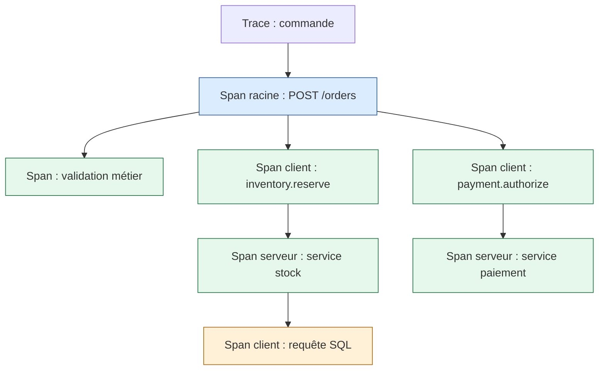
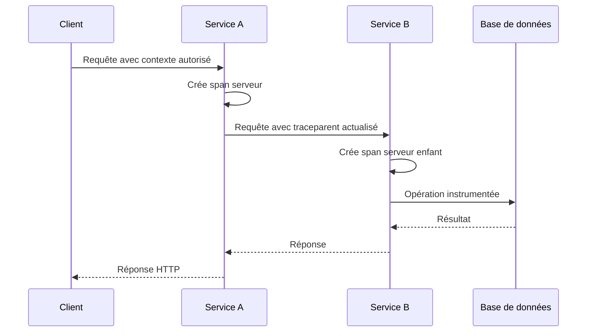
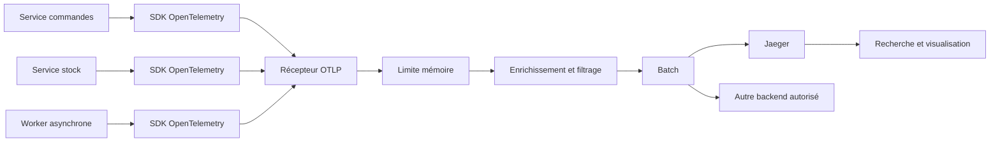
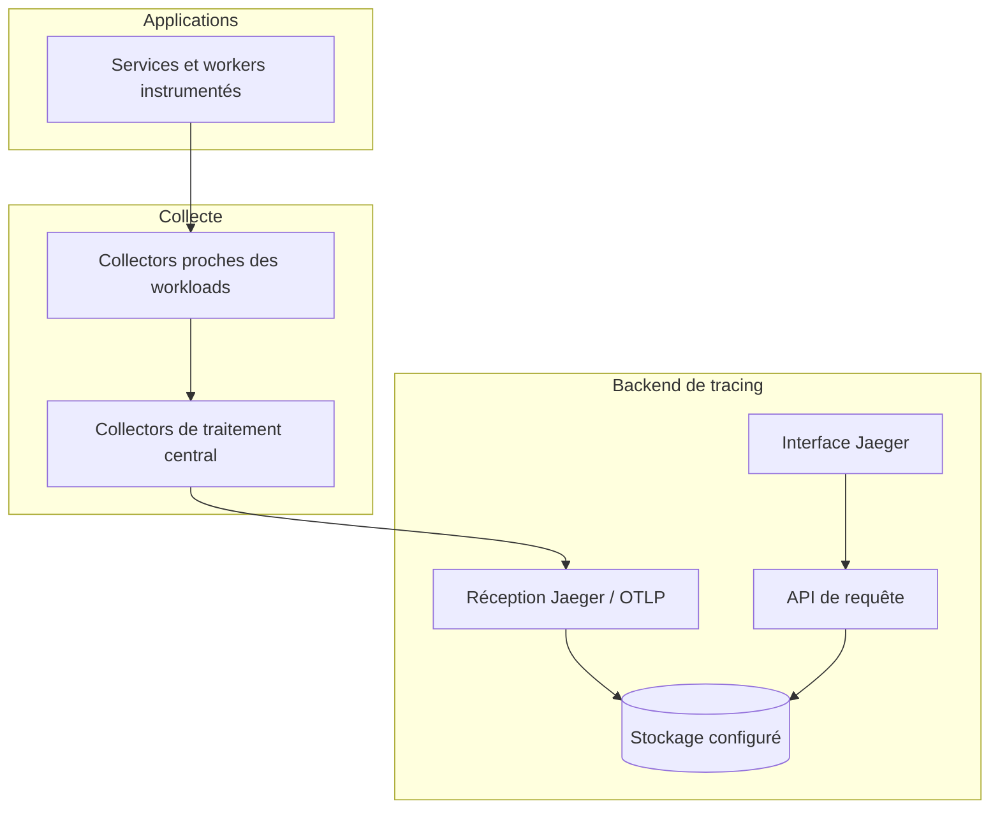
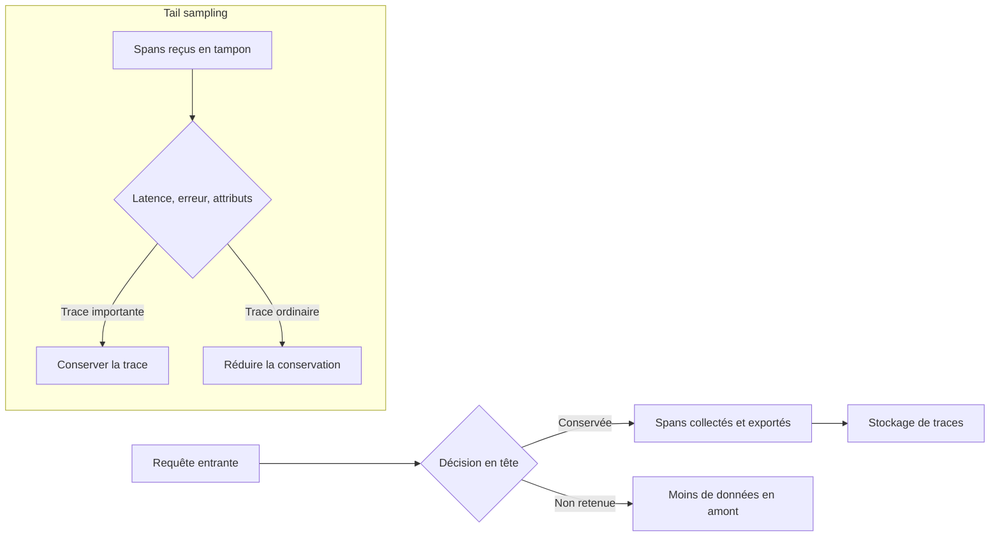
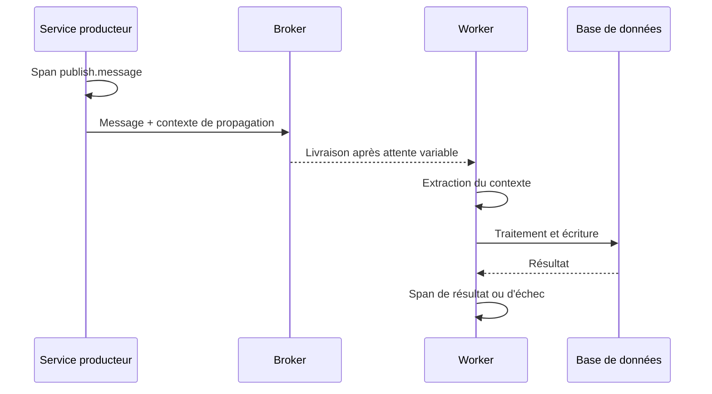
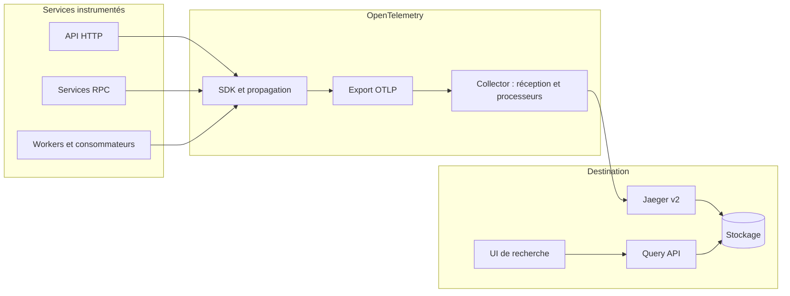
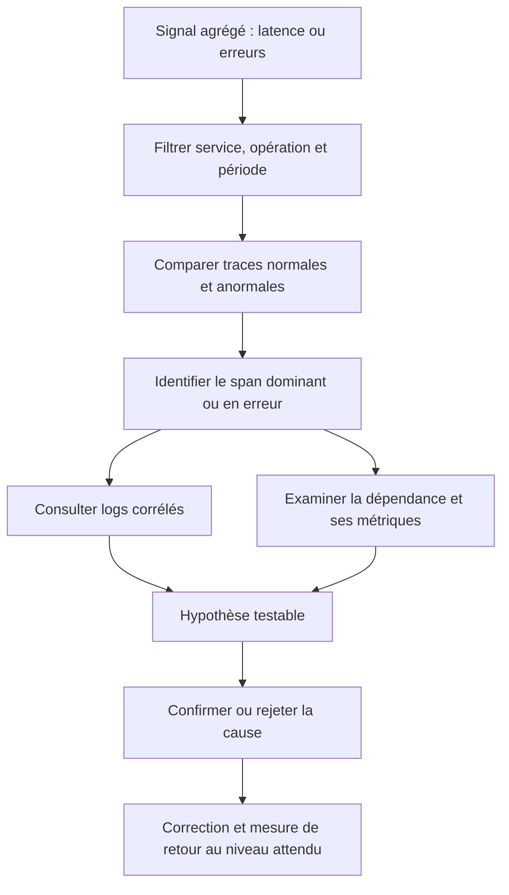

# Tracing distribué (Jaeger, OpenTelemetry)

Le tracing distribué permet de reconstruire le parcours causal d’une opération qui traverse plusieurs processus, services, files de messages et dépendances. Au niveau expert, il ne suffit plus de créer quelques spans dans une application et d’ouvrir une interface : il faut concevoir une architecture de propagation, d’instrumentation, de collecte, d’échantillonnage, de stockage et d’exploitation qui demeure fiable en situation de panne, sous charge et à travers des frontières technologiques. OpenTelemetry fournit des API, des SDK, des conventions sémantiques, un format de transport et un collecteur interopérable ; Jaeger fournit une plateforme de réception, de stockage et d’exploration des traces compatible avec les données OpenTelemetry. L’objectif est de comprendre les responsabilités de chaque brique et de construire une stratégie qui aide réellement les équipes à diagnostiquer un système distribué.

## 1. Introduction

### 1.1 Pourquoi le tracing distribué devient indispensable

Dans une application monolithique, une transaction s’exécute souvent dans un même processus. Les journaux, profils et métriques peuvent suffire à comprendre une part importante du comportement. Dans une architecture distribuée, une seule action utilisateur peut traverser un gateway, un service métier, plusieurs API, une base de données, un broker, des workers asynchrones et un fournisseur externe. Chaque composant peut disposer de ses propres logs, horloges, noms de service, conventions et outils d’exploitation.

Le symptôme apparaît fréquemment dans un composant différent de celui qui a initié le problème. Une API peut attendre un service de stock ; le service de stock peut attendre une base de données ; celle-ci peut attendre un verrou provoqué par une autre transaction. Une mesure de latence globale ne révèle pas forcément cette chaîne. Une recherche textuelle dans tous les logs peut retrouver des événements, mais elle exige un identifiant commun et une chronologie fiable. Le tracing distribué fournit une structure reliant les opérations instrumentées par leur contexte de trace et leurs relations causales.

La question à laquelle il répond n’est pas simplement « quel service est lent ? », mais « comment cette opération est-elle passée d’un composant à l’autre, quelles étapes ont contribué au délai et quels événements se sont produits sur ce chemin ? ». Il aide aussi à comprendre les erreurs intermittentes, les dépendances cachées, les retries, les files d’attente et les comportements émergents qui ne sont visibles qu’à l’échelle du système.

Le tracing n’est pourtant pas une preuve magique de causalité. Un trace peut être incomplet, échantillonné, mal propagé ou construit avec des horodatages peu fiables. Une trace montrant une dépendance lente n’explique pas nécessairement pourquoi elle est lente. Les conclusions doivent être validées avec les métriques, logs, profils, événements de déploiement, informations du runtime et tests contrôlés.

### 1.2 Objectifs de niveau expert

À la fin du cours, l’apprenant doit pouvoir :

- définir le modèle de données d’une trace et distinguer trace ID, span ID, parent, lien, événement et attribut ;
- concevoir une stratégie de propagation de contexte entre HTTP, RPC, messages et tâches asynchrones ;
- choisir une stratégie d’instrumentation automatique, manuelle ou hybride ;
- comprendre la chaîne OpenTelemetry SDK → OTLP → Collector → backend ;
- déployer et exploiter Jaeger dans une architecture adaptée au volume, à la disponibilité et aux besoins de rétention ;
- choisir entre échantillonnage de tête et échantillonnage de fin et anticiper leurs effets ;
- réduire les coûts sans perdre la capacité à investiguer les incidents rares ;
- définir des conventions sémantiques et une nomenclature de services cohérentes ;
- analyser les traces partielles, les horloges désynchronisées, les retries et les appels parallèles ;
- protéger le contexte de trace, les attributs et les données métier sensibles ;
- tester la collecte et le backend eux-mêmes, puis opérer le système en cas de surcharge ou de perte de données ;
- relier traces, métriques, logs et événements de déploiement dans une procédure d’incident.

### 1.3 OpenTelemetry et Jaeger : deux rôles complémentaires

OpenTelemetry, souvent abrégé OTel, est un projet d’observabilité qui propose des API et SDK d’instrumentation, des conventions communes et des composants de collecte et de transport. Il n’est pas un backend de stockage et son API n’est pas la même chose qu’une interface permettant de rechercher toutes les traces. Une application peut être instrumentée avec OpenTelemetry puis exporter ses données vers plusieurs plateformes qui prennent en charge le format concerné.

Jaeger est un système de traçage distribué qui reçoit des traces, les conserve dans un stockage compatible et fournit des moyens de les rechercher et de les visualiser. Jaeger prend en charge les données OpenTelemetry et le protocole OTLP. Les architectures modernes peuvent intégrer un OpenTelemetry Collector afin de traiter, enrichir, filtrer ou router les données avant de les envoyer au backend.

Il est important de tenir compte des évolutions de version. Le projet Jaeger v2 s’appuie sur le framework OpenTelemetry Collector et réunit plusieurs rôles dans une architecture extensible. La documentation officielle indique que Jaeger v1 a atteint sa fin de vie le 31 décembre 2025 ; pour une nouvelle installation, il faut donc partir de la documentation actuelle et éviter d’architecturer une solution nouvelle autour des anciens clients Jaeger. Le projet recommande les APIs, SDK et bibliothèques d’instrumentation OpenTelemetry pour les nouvelles applications. Les détails de déploiement, composants et stockage doivent être vérifiés pour la version précisément utilisée.

Références officielles :
- Concepts OpenTelemetry : https://opentelemetry.io/docs/concepts/
- Traces et spans OpenTelemetry : https://opentelemetry.io/docs/concepts/signals/traces/
- Spécification d’API de tracing : https://opentelemetry.io/docs/specs/otel/trace/api/
- OpenTelemetry Collector : https://opentelemetry.io/docs/collector/
- Jaeger : https://www.jaegertracing.io/docs/
- Migration vers les SDK OpenTelemetry : https://www.jaegertracing.io/sdk-migration/
- W3C Trace Context : https://www.w3.org/TR/trace-context/

### 1.4 Le tracing comme système de preuves opérationnelles

Une trace est une représentation d’une opération, construite à partir des spans émis par des composants instrumentés. Elle apporte des preuves sur les opérations observées, leur durée, leurs attributs et les relations qu’ils ont déclarées. Elle ne décrit pas automatiquement les opérations qui n’émettent pas de données, celles exclues par l’échantillonnage ou celles perdues au cours de l’export.

La conception d’une stratégie experte doit donc poser trois questions séparées. Premièrement, le système produit-il les spans appropriés ? Deuxièmement, ces spans restent-ils reliés entre les services et transportés sans perte excessive ? Troisièmement, le backend permet-il de retrouver rapidement les traces utiles dans la fenêtre où l’incident s’est produit ? Une réponse négative à chacune de ces questions exige un remède différent.

Ajouter davantage de spans peut ne pas résoudre une mauvaise propagation de contexte. Améliorer la propagation n’aide pas si l’exporteur perd les données. Augmenter la capacité du backend n’est pas la bonne réponse si des attributs de cardinalité extrême rendent les requêtes inefficaces. La stratégie doit aborder toute la chaîne.

### 1.5 Cas d’usage à forte valeur

Le tracing distribué est particulièrement utile pour diagnostiquer les transactions comportant plusieurs dépendances, les délais de bout en bout, les appels lents vers des services tiers, les traitements asynchrones, les erreurs propagées entre microservices, les retries en cascade, les dépendances circulaires, les régressions après déploiement et les écarts entre les latences mesurées par les clients et celles vues à l’intérieur du backend.

Il peut aussi révéler le coût caché d’une architecture. Un endpoint peut sembler exécuter une opération unique tout en effectuant des dizaines d’appels internes. Un service peut interroger la même base plusieurs fois de façon redondante, appeler plusieurs dépendances de façon séquentielle au lieu de les paralléliser ou lancer des retries qui multiplient le trafic. Les spans permettent de constater ces motifs et d’évaluer l’impact d’un changement.

La valeur dépend cependant de la qualité de l’instrumentation. Une opération métier majeure cachée dans un span racine opaque restera difficile à diagnostiquer. Une trace composée de milliers de spans très fins peut être impossible à lire. L’objectif n’est ni le moins de spans possible ni le plus de détails possible : il s’agit de représenter les unités de travail qui répondent à des questions d’exploitation utiles.

## 2. Concepts clés

### 2.1 Anatomie d’une trace

Une trace représente un parcours logique. Elle est identifiée par un trace ID. Elle contient un ou plusieurs spans, chacun doté d’un span ID distinct et éventuellement d’une relation parent-enfant. Le span racine représente généralement l’opération initiale ; les spans enfants décrivent des sous-opérations ou des appels vers des dépendances.

Un span comprend notamment un nom, un contexte, des horodatages de début et de fin, un type ou une catégorie, des attributs, des événements, un statut et éventuellement des liens vers d’autres spans. L’API et les conventions exactes définissent les noms de champs et leurs significations. Un attribut décrit le contexte d’une opération, alors qu’un événement horodaté signale ce qui s’est produit pendant la durée du span. Un lien relie le span à un autre contexte sans affirmer nécessairement une relation parentale directe.

La relation parent-enfant exprime une hiérarchie de travail. Elle est adaptée à une requête HTTP qui appelle un service puis une base, mais elle ne décrit pas tous les graphes distribués. Un traitement déclenché par plusieurs messages, un lot agrégant de nombreuses opérations ou une tâche qui dépend de plusieurs travaux antérieurs peut être mieux représenté par des liens. Le modèle de données doit suivre la causalité réelle et non forcer toute architecture dans un arbre simpliste.



Dans une trace réelle, certains appels peuvent se chevaucher. La représentation hiérarchique n’implique pas que l’ensemble des opérations soit exécuté séquentiellement. Il faut examiner les horodatages, les durées et les liens de causalité pour savoir si deux dépendances ont travaillé en parallèle.

### 2.2 Trace ID, span ID et contexte

Le trace ID identifie une trace logique et permet de rassembler des spans appartenant au même parcours. Le span ID identifie une opération individuelle à l’intérieur de cette trace. Le contexte du span inclut les identifiants et les informations de propagation nécessaires à la création de spans enfants et au passage de la frontière d’un processus. OpenTelemetry définit le SpanContext comme un élément à propager entre opérations et processus.

Les identifiants de trace ne doivent pas être confondus avec des identifiants métier. Un numéro de commande peut être utile pour retrouver une transaction métier, mais il peut être prévisible, contenir une information sensible ou être utilisé dans une recherche différente. Le trace ID doit être un identifiant de corrélation généré par le système de tracing. Les systèmes peuvent associer un identifiant métier pseudonymisé à une trace si le besoin est légitime et si la politique de sécurité l’autorise, mais il ne faut pas détourner les champs de protocole pour y stocker ces données.

Les identifiants doivent rester cohérents au sein du parcours. Si un service recrée des traces à chaque requête, les données deviennent fragmentées. Si un service remplace les IDs sans raison ou omet les en-têtes, le parentage peut être perdu. Lorsque la frontière correspond à une limite de confiance, il peut être nécessaire de créer un nouveau contexte ou de contrôler celui reçu afin d’éviter une corrélation non souhaitée. Ce choix doit être explicite et documenté.

### 2.3 Propagation W3C Trace Context

W3C Trace Context définit des en-têtes HTTP standards pour propager les informations de tracing. Le champ traceparent représente la position de la requête dans le graphe de trace avec un format commun ; tracestate peut transporter des informations additionnelles spécifiques à des systèmes de traçage. Ces champs permettent à des composants instrumentés avec des fournisseurs différents de participer à une trace commune lorsqu’ils implémentent correctement le standard.

Une application reçoit un contexte, crée un span d’entrée, puis met à jour la partie du contexte qui représente son opération avant de transmettre une requête sortante. Un proxy qui ne participe pas à l’instrumentation peut se contenter de transmettre les en-têtes selon les exigences applicables. Si le format est invalide, le comportement doit respecter la spécification et la politique de sécurité plutôt que réutiliser aveuglément des valeurs imprévisibles.

Le contexte de trace n’est pas un mécanisme d’authentification et ne doit pas être utilisé pour véhiculer des informations personnelles. Un traceparent peut venir d’un client non fiable. Il faut définir les frontières où l’on accepte ou redémarre le contexte, appliquer des validations adaptées et empêcher que des valeurs entrantes contrôlent des décisions d’autorisation. Les en-têtes de tracing doivent être traités comme des métadonnées de corrélation, pas comme une preuve d’identité.



Lorsque les appels traversent une passerelle, un proxy, une file de messages ou une bibliothèque cliente non instrumentée, il faut vérifier que le contexte continue à être propagé. Voir des traces locales dans chaque service ne prouve pas que la propagation de bout en bout fonctionne.

### 2.4 Parentage et liens de spans

La relation parent-enfant convient lorsqu’une opération découle directement d’une autre et s’exécute dans le cadre de son contexte. Les liens servent lorsque deux opérations doivent être corrélées sans imposer cette hiérarchie. Par exemple, un consommateur de messages peut recevoir un lot de messages associés à plusieurs traces antérieures. Une seule trace peut ne pas constituer le parent naturel de tout le lot ; il peut être plus fidèle d’ajouter des liens vers les contextes producteurs.

Les liens sont également utiles pour les opérations déclenchées par plusieurs sources, les traitements différés et certaines activités périodiques. Une tâche planifiée qui s’exécute sans requête entrante peut créer sa propre trace racine et enregistrer des liens ou des attributs de déclenchement plutôt que de prétendre être enfant d’une ancienne requête terminée. Le modèle exact dépend du scénario.

Un mauvais parentage donne des vues trompeuses. Si un worker garde artificiellement comme parent le span d’une requête HTTP depuis longtemps terminée, la trace peut suggérer une durée ou une causalité qui ne correspond pas à la réalité. Il faut modéliser les frontières de traitement et la durée métier avec soin.

### 2.5 Types de spans et conventions sémantiques

Le type de span indique la nature de l’opération, par exemple serveur, client, producteur, consommateur ou interne. La classification permet de différencier une requête entrante d’un appel sortant ou d’un traitement local. Les conventions sémantiques OpenTelemetry définissent des noms et attributs normalisés pour des familles d’opérations, dont HTTP, RPC, bases de données, messagerie et ressources de runtime.

Les conventions réduisent les différences entre équipes et outils. Si un service utilise un champ personnalisé pour le statut HTTP et un autre utilise un nom différent, les tableaux de bord et transformations deviennent plus complexes. Les conventions évoluent et peuvent avoir des états de stabilité différents ; il faut contrôler la version et les recommandations correspondant aux bibliothèques employées.

Ne pas ajouter des attributs simplement parce qu’ils sont disponibles. Chaque attribut doit avoir un objectif et une classification. Les attributs de ressource décrivent l’entité instrumentée, par exemple le service, l’environnement, la version ou le conteneur. Les attributs de span décrivent l’opération. Distinguer correctement les deux améliore la cohérence des données et évite de répéter des informations qui doivent être définies au niveau ressource.

### 2.6 Événements, statut et exceptions

Un span peut enregistrer un statut et des événements. Les événements sont utiles pour signaler un point important dans le déroulement : un retry, une pause significative, une exception ou un changement d’état. Il ne faut toutefois pas convertir chaque log en événement de span, car cela augmente le volume et rend la chronologie difficile à lire.

Le statut d’erreur doit être défini selon le contrat de l’opération. Certains retours non réussis sont attendus, par exemple un refus métier normal dans un parcours de validation. Marquer toute réponse HTTP non-2xx comme une panne peut donc produire des erreurs artificielles. À l’inverse, si une opération métier échoue malgré un HTTP 200, le span peut devoir être marqué comme en échec selon la sémantique du système.

Les exceptions peuvent être enregistrées pour enrichir le diagnostic, mais leur message peut contenir une URL complète, une requête SQL ou une donnée sensible. Il faut examiner ce qui est capturé et en réduire la portée si nécessaire. Les traces sont des données de production et doivent suivre les mêmes règles de protection des données que les logs.

### 2.7 Instrumentation automatique, manuelle et hybride

L’instrumentation automatique repose sur un agent ou une bibliothèque qui instrumente les frameworks et bibliothèques compatibles : serveur HTTP, client réseau, connecteur de base de données, RPC, broker de messages ou runtime. Elle fournit rapidement une couverture cohérente pour les opérations standard. Sa couverture exacte dépend du langage, des versions de bibliothèques, des options d’activation et du mode de déploiement.

L’instrumentation manuelle ajoute des spans aux opérations spécifiques au métier. Elle est utile pour décomposer un traitement complexe en étapes significatives, mesurer une phase de calcul, identifier une règle métier coûteuse ou représenter une étape de traitement asynchrone qui n’est pas reconnue automatiquement. L’objectif est de rendre une opération compréhensible, pas de mesurer chaque fonction.

Une approche hybride est courante : instrumentation automatique sur les appels connus, spans manuels sur les opérations métier essentielles et enrichissement maîtrisé des ressources. Il faut éviter de créer deux spans équivalents pour le même appel. Une sur-instrumentation peut doubler les données, augmenter le coût, nuire à la lisibilité et imposer un overhead supplémentaire sur le chemin critique.

### 2.8 Délimiter correctement une opération

Un span doit commencer quand l’opération commence réellement et se terminer lorsque son travail instrumenté est achevé. Ouvrir un span avant une file d’attente puis le fermer seulement après la fin du traitement peut être correct si le but est de mesurer le temps de bout en bout ; mais il faut également rendre visible l’attente et le traitement si l’on veut diagnostiquer leur contribution.

Les spans ne doivent pas se prolonger accidentellement après la fin du travail. En programmation asynchrone, les contextes peuvent se propager à travers les tâches, callbacks et coroutines ; le code doit employer les mécanismes d’instrumentation appropriés au runtime. Si un contexte fuit vers une tâche indépendante, elle peut sembler enfant d’une requête sans relation réelle. À l’inverse, perdre le contexte dans une coroutine ou un thread peut casser le graphe.

La durée d’un span représente le temps écoulé, pas nécessairement le temps CPU. Elle peut inclure des attentes réseau, du temps de file, des pauses et des attentes de verrou. Pour identifier la ressource consommée, associer les traces à des métriques et des profils adaptés. Un span très long n’explique pas seul sa cause.

### 2.9 OpenTelemetry SDK : modèle de création et de cycle de vie

Dans OpenTelemetry, un TracerProvider crée ou fournit des traceurs ; un traceur crée des spans. Le SDK initialise le traitement de données, les ressources, les processeurs de spans, le mécanisme d’échantillonnage et les exporteurs. Les détails exacts de configuration varient selon le langage, mais les responsabilités conceptuelles sont similaires.

Le cycle de vie de l’instrumentation doit être cohérent avec l’application. Pour un service long vivant, l’initialisation se fait généralement au démarrage et l’arrêt doit permettre de vider les données encore en attente selon les capacités de l’exporteur. Dans un runtime serverless, la durée de vie courte, les environnements réutilisés et les contraintes de terminaison rendent le flush et la taille des files particulièrement importants.

Ne pas initialiser un nouveau fournisseur et un nouvel exporteur à chaque requête. Cela peut créer une surcharge, des ressources qui fuient et des données exportées de façon incohérente. L’application doit avoir une politique claire d’initialisation, de propagation, d’arrêt et de gestion des erreurs d’export.

Exemple de création manuelle d’un span en Python avec une API OpenTelemetry courante. Les imports, la configuration du SDK et le setup du fournisseur de données sont volontairement séparés, car ils dépendent du paquet et du déploiement utilisés.

```python
from opentelemetry import trace
from opentelemetry.trace import Status, StatusCode

tracer = trace.get_tracer("orders.workflow")

def reserve_inventory(order_id: str) -> None:
    # order_id ne doit pas contenir de donnée sensible.
    with tracer.start_as_current_span("inventory.reserve") as span:
        span.set_attribute("app.operation", "reserve_inventory")
        try:
            perform_reservation(order_id)
        except InventoryUnavailable:
            span.set_status(
                Status(StatusCode.ERROR, "inventory unavailable")
            )
            raise
```

Cet exemple illustre la structuration du travail. La fonction fictive perform_reservation représente l’opération existante. Dans un service réel, une instrumentation automatique du client HTTP ou du pilote peut déjà créer un span d’appel de dépendance. Il faut alors éviter de créer un second span qui représenterait exactement le même appel, sauf si le span externe décrit une étape métier distincte.

### 2.10 OTLP : transport et interopérabilité

OpenTelemetry Protocol (OTLP) transporte les données de télémétrie d’une application ou d’un collecteur vers un composant de réception. Il existe des variantes et configurations d’export selon le transport utilisé. OTLP découple l’instrumentation du backend de stockage, permettant de faire évoluer la plateforme sans réécrire toute l’application lorsque les formats et les fonctions nécessaires sont pris en charge.

L’interopérabilité dépend tout de même des composants. Les conventions sémantiques, les paramètres d’export, l’authentification, les limites de protocole et certaines extensions peuvent diverger. Un backend peut recevoir les spans mais ne pas exploiter tous les attributs de la même façon. Il faut tester la compatibilité avant de considérer l’export OTLP comme une garantie de portabilité totale.

Les endpoints d’export doivent être configurés par environnement et protégés. Un endpoint OTLP ouvert sur un réseau non fiable peut permettre à un tiers d’injecter des données, de consommer des ressources ou d’envoyer des attributs hostiles. Utiliser TLS, un contrôle d’accès et des règles de réseau adaptées. Les clés et certificats doivent être gérés en dehors du dépôt.

### 2.11 Le rôle de l’OpenTelemetry Collector

Le Collector peut recevoir, transformer et exporter des traces, des métriques et des logs. Il se compose généralement de récepteurs, de processeurs et d’exporteurs, assemblés en pipelines. Les récepteurs acceptent des données, les processeurs les enrichissent ou les filtrent, et les exporteurs les transmettent à une destination. Les extensions peuvent ajouter des fonctions de service telles que les contrôles de santé ou d’authentification selon la distribution utilisée.

Le Collector peut ajouter des attributs de ressource, standardiser des valeurs, supprimer des champs sensibles, appliquer un batch, limiter la mémoire ou rediriger les données vers plusieurs backends. Il fournit un point de contrôle opérationnel entre l’application et la plateforme. Il n’est pas automatiquement nécessaire dans toutes les architectures, mais devient utile lorsque plusieurs services, destinations et règles de traitement doivent être gérés de façon cohérente.

Le Collector représente aussi un composant qui peut tomber en panne. Il faut surveiller le volume entrant, le volume exporté, les erreurs, les files, la mémoire, les retries et les rejets. Une file pleine ou un backend inaccessible peut entraîner de la perte. Les paramètres doivent être testés sous charge et lorsque la destination est indisponible.



Un Collector local par machine ou par pod limite parfois la distance réseau entre l’application et la collecte, mais complique la gestion du déploiement et peut multiplier les ressources. Un cluster central facilite certaines politiques et l’échantillonnage en fin de trace, mais demande une capacité suffisante, un routage et une stratégie de haute disponibilité. Le bon choix dépend du trafic, de la tolérance à la perte et des objectifs de traitement.

### 2.12 Architecture Jaeger : réception, stockage et requête

Jaeger sépare conceptuellement les fonctions de réception des spans, de stockage et de requête/visualisation. La v2 construit son exécutable à partir du framework OpenTelemetry Collector et propose une architecture par composants. Elle peut être déployée sous forme d’un service tout-en-un pour une expérimentation ou avec des rôles et un stockage adaptés aux besoins de production. Les composants précis, formats de configuration et backends disponibles dépendent de la version de Jaeger choisie.

Pour un laboratoire, une instance monolithique simplifie le démarrage et permet de comprendre la trace. Pour une charge de production, il faut évaluer la résilience, le dimensionnement des collecteurs et du stockage, le comportement lors des pics et les exigences de rétention. Une instance locale ou en mémoire convient à une démonstration, mais n’est pas automatiquement adaptée à un service où la perte de traces aurait un impact opérationnel important.

Le backend doit répondre aux requêtes de recherche à un coût acceptable. Les fenêtres temporelles, les filtres sur service/opération, la cardinalité des attributs et la distribution des données influencent la performance. Une rétention très longue multiplie le volume stocké et peut accroître le coût d’indexation. Il faut concevoir le stockage et la rétention à partir des cas d’usage, pas seulement de la quantité de disque disponible.



Le dessin représente une architecture possible et non une obligation d’installer deux niveaux de collecteurs. Si le débit est modeste, un seul point de collecte peut suffire. Si l’échantillonnage de fin ou le routage demande que les spans d’une même trace soient réunis, le collecteur central doit être conçu pour répartir les données et maintenir l’affinité de trace.

### 2.13 Échantillonnage de tête

L’échantillonnage de tête, ou head-based sampling, prend une décision tôt dans la trace, généralement au moment où l’opération racine est créée. Le choix est ensuite propagé afin que les composants descendants adoptent une politique cohérente. Cette approche limite rapidement le volume et peut produire des traces complètes pour les requêtes retenues.

L’avantage est l’efficacité en amont : si une trace est rejetée tôt, le système n’a pas besoin de conserver et transférer tous ses spans dans l’espoir d’une décision future. Le compromis est que l’échantillonneur ne connaît pas encore l’issue complète de la requête. Il peut exclure une opération qui échouera ou deviendra lente quelques secondes plus tard. Un ratio fixe de 5 % ne garantit pas que les erreurs rares seront toutes enregistrées.

Pour conserver des cas importants, certaines politiques utilisent un taux plus élevé sur des opérations critiques ou une décision de départ déterministe ou cohérente selon le SDK. Il faut néanmoins empêcher que chaque service prenne une décision incompatible et produise des fragments incohérents. L’échantillonnage doit être évalué au niveau de la trace, pas uniquement au niveau d’un span isolé.

### 2.14 Échantillonnage de fin de trace

L’échantillonnage de fin, ou tail-based sampling, décide après avoir reçu suffisamment d’informations sur la trace, par exemple son statut final, sa latence ou certains attributs. Il peut privilégier les traces en erreur, lentes ou associées à un parcours critique, tout en limitant la conservation des traces ordinaires. Le Collector OpenTelemetry dispose d’un processeur de tail sampling dans certaines distributions ; la stabilité des composants et les options doivent être vérifiées dans la documentation de la version employée.

Cette méthode exige que les spans d’une même trace soient réunis avant la décision. Cela demande de la mémoire, une politique de délai d’attente, du routage, de la capacité de rétention temporaire et une stratégie de répartition entre collecteurs. Si des spans arrivent après la décision, ils peuvent être absents de la trace conservée. En cas de trafic élevé, une configuration insuffisante peut provoquer des pertes ou des décisions incomplètes.

Il faut régler le temps de conservation en fonction de la durée typique des opérations et des délais réseau, puis surveiller la mémoire et les traces incomplètes. Des opérations très longues, des files asynchrones et des services qui exportent tardivement peuvent dépasser cette fenêtre. Le tail sampling ne supprime pas le besoin d’un échantillonnage cohérent ni les contraintes de volume ; il déplace la décision vers une étape qui dispose de davantage de contexte, au prix d’une architecture plus exigeante.



Le schéma compare les principes et ne représente pas la topologie réseau détaillée du Collector. Pour appliquer un échantillonnage de fin, il est nécessaire de vérifier la configuration de processeur exacte, la manière dont les spans sont répartis et les limites de mémoire dans la version choisie.

### 2.15 Stratégie mixte et priorités d’échantillonnage

Une stratégie utile peut conserver une fraction des traces ordinaires, favoriser les erreurs et les latences anormales, couvrir les parcours critiques et limiter certains chemins très verbeux. Les règles doivent être cohérentes avec l’objectif de diagnostic et être explicites. Si la politique ne retient que les erreurs serveur mais exclut les appels fonctionnels qui réussissent avec une mauvaise qualité de données, elle peut manquer des incidents métier importants.

L’échantillonnage basé sur les erreurs n’est efficace que si le statut est bien défini. Si les exceptions ne sont pas marquées ou si les erreurs métier restent invisibles dans les spans, les règles ne reconnaîtront pas les traces importantes. Le test de la politique doit inclure des scénarios normaux, lents, en erreur, asynchrones et avec des dépendances externes.

Il faut également suivre le volume rejeté ou échantillonné et documenter ce que l’on ne peut plus investiguer. Une règle qui économise beaucoup de stockage peut rendre impossible la vérification de certains types d’incident. Les changements de sampling sont des changements d’observabilité et doivent être testés comme tels.

### 2.16 Attributs de haute cardinalité

Un attribut est de cardinalité élevée lorsqu’il prend de très nombreuses valeurs différentes. Un identifiant de requête, un UUID, une URL contenant un identifiant utilisateur, une requête SQL libre ou un message d’erreur variable peut créer un ensemble de valeurs très grand. Ces champs peuvent être utiles à un niveau précis, mais les indexer ou les utiliser pour des regroupements globaux peut augmenter le volume, détériorer les recherches et compliquer les tableaux de bord.

Il faut séparer trois questions : l’information doit-elle être collectée ? doit-elle être conservée ? doit-elle être indexée ou utilisée comme dimension de recherche ? La réponse peut varier. Un attribut peut être précieux pour un événement précis, mais inutile comme label d’agrégation. La configuration exacte du backend détermine les possibilités de stockage et d’indexation.

Les noms de service et de ressource doivent être stables. Les routes web doivent être normalisées, les attributs de version et d’environnement doivent avoir un vocabulaire contrôlé, et les attributs métier doivent être justifiés. Ne jamais mettre des identifiants personnels ou des secrets dans les noms de spans pour rendre les traces uniques. Le trace ID existe déjà pour la corrélation.

### 2.17 Baggage et contexte métier

Le baggage OpenTelemetry permet de propager des paires clé-valeur dans le contexte à travers les opérations instrumentées. Il peut être utile pour transmettre des métadonnées de corrélation non sensibles, lorsque la propagation et les destinations sont contrôlées. Il ne doit pas être confondu avec tracestate, réservé aux informations spécifiques aux systèmes de tracing selon W3C Trace Context, ni avec un mécanisme d’autorisation.

Le baggage peut multiplier la taille des en-têtes et propager involontairement des champs vers des services qui n’en ont pas besoin. Tout élément propagé devrait avoir une finalité documentée, une limite de taille, un propriétaire et une classification de sécurité. Un identifiant client, une adresse e-mail, un jeton ou un nom d’utilisateur n’est pas acceptable par défaut : le transport systématique d’un champ dans toute la chaîne augmente la surface d’exposition.

Il est souvent préférable d’injecter certains attributs localement au span lorsque l’information est disponible et pertinente, plutôt que de la propager à tous les services. La propagation doit suivre les frontières de confiance, les règles de minimisation et les exigences de compatibilité interservices.

### 2.18 Tracing des messages et des systèmes asynchrones

Dans une architecture asynchrone, un service publie un message et un consommateur peut le traiter beaucoup plus tard. Les spans d’émission et de réception peuvent être séparés par une file, un retry, un changement de worker ou plusieurs heures. Le temps entre la publication et le traitement doit être distingué de la durée du traitement lui-même.

Le producteur peut injecter le contexte dans les métadonnées du message via les mécanismes de propagation supportés par la bibliothèque. Le consommateur extrait le contexte et démarre une opération. Le modèle de parentage ou de liens doit refléter la sémantique du broker et le nombre de messages associés. Si un consommateur traite un lot, le choix d’un unique parent peut donner une fausse représentation de la relation entre les messages.

Les retries doivent être visibles. Un premier traitement peut échouer, être remis en file et réussir plus tard. Si chaque tentative écrase le contexte précédent ou si tous les messages partagent le même identifiant sans distinguer les opérations, la trace ne révèle pas le coût des reprises. Ajouter des attributs contrôlés comme le type d’opération et le numéro de tentative lorsque c’est utile, sans créer de cardinalité inutile ni exposer des identifiants métier sensibles.



Pour le diagnostic, suivre séparément le temps de file et le temps de calcul. Une longue durée avant le début du span consommateur peut indiquer une file saturée ou une capacité insuffisante, mais l’absence de spans dans la période peut également refléter une collecte qui ne couvre pas le broker. Les métriques du broker restent nécessaires pour différencier ces cas.

### 2.19 Appels parallèles, fan-out et fan-in

Un service peut lancer des appels parallèles vers plusieurs dépendances, puis réunir leurs résultats. La durée globale dépend alors souvent de la branche la plus lente, tandis que la somme des durées de chaque branche peut être beaucoup plus grande que le temps mural de la requête. Il faut interpréter les barres de durée comme une chronologie et non additionner mécaniquement les spans enfants.

Un fan-out important peut augmenter le volume des traces. Une requête qui appelle cent services crée un graphe plus large et peut être coûteuse à stocker. Le tracing révèle parfois que le fan-out est inutilement large ou que l’agrégation multiplie les appels. Les solutions peuvent inclure la réduction des appels, leur regroupement, une mise en cache ou une modification de l’architecture.

En parallèle, une trace peut contenir des branches qui échouent sans faire échouer l’ensemble de l’opération, selon la tolérance aux erreurs. Il faut définir le statut des spans enfants et de la racine selon le résultat final. Si une dépendance facultative échoue mais que le service renvoie un résultat valide dégradé, marquer toute la trace comme une panne générique peut être trompeur ; il faut préserver la distinction entre erreur d’appel et succès fonctionnel dégradé.

### 2.20 Horloges et ordre temporel

Les horodatages proviennent souvent des processus qui créent les spans. Des machines dont les horloges sont désynchronisées peuvent faire apparaître un span enfant comme s’il commençait avant son parent, ou créer des chevauchements impossibles. Les systèmes de traçage ne peuvent pas corriger parfaitement une horloge qui n’est pas fiable. La synchronisation temporelle des hôtes et le traitement des timestamps sont donc des dépendances opérationnelles.

Il faut interpréter l’ordre causal en même temps que les heures. Le parentage et le contexte peuvent montrer la relation même si les horloges ne sont pas parfaitement alignées. Lorsque la chronologie semble contradictoire, examiner la synchronisation NTP ou le mécanisme de temps des conteneurs, vérifier l’agent et rechercher les spans manquants avant de conclure à une anomalie applicative.

Le temps de bout en bout peut aussi inclure des files et transferts qui ne correspondent pas à un span unique. Un système qui exporte tardivement peut recevoir les données dans un ordre différent de leur ordre de création. L’ordre d’arrivée dans le backend ne doit pas être interprété comme l’ordre d’exécution. Les horodatages et relations du modèle constituent les preuves les plus appropriées, avec leurs limites.

### 2.21 Sampling et conformité interservices

Dans une architecture avec plusieurs langages, les SDK peuvent utiliser des configurations différentes. Si le service racine sélectionne une trace et que les services descendants ignorent le contexte ou prennent leur propre décision, le backend peut afficher des segments séparés. Les règles de sampling doivent être coordonnées et testées à travers les frontières de service.

Le bit de sampling transporté dans le contexte indique une décision de propagation, mais il ne garantit pas qu’un backend conservera effectivement toutes les données. Des limites de mémoire, pertes réseau, délais de queue, règles de filtrage et erreurs d’export peuvent encore supprimer des spans. Il faut surveiller le système de collecte, pas seulement la politique de départ.

Les tests doivent vérifier plusieurs cas : trace choisie, trace non retenue, erreur rare, requête lente, contexte externe non fiable, appel asynchrone et exporteur indisponible. Un test de tracing doit comparer les spans attendus dans le backend, et pas uniquement vérifier qu’un SDK crée un trace ID en mémoire.

### 2.22 Corrélation avec les logs, métriques et profils

Les traces donnent la structure d’un parcours. Les logs apportent des messages détaillés, les métriques montrent une distribution agrégée et les profils peuvent expliquer le travail interne d’une fonction. Relier ces signaux avec les dimensions pertinentes permet de passer d’une alerte globale à un composant, puis à une cause vraisemblable.

Les logs peuvent contenir les trace ID et span ID, selon la configuration et les capacités du langage. Le format doit être standardisé et les champs doivent être disponibles sans copier de grandes quantités de données sensibles dans chaque message. La corrélation doit être testée de bout en bout : un champ mal nommé ou une conversion incorrecte suffit à rendre les recherches inutilisables.

Les métriques peuvent être générées à partir des spans ou produites indépendamment. Les métriques dérivées de spans agrègent les opérations et peuvent alimenter des indicateurs RED, mais elles ne remplacent pas les métriques de saturation du runtime ni les objectifs métier. Le coût et la cardinalité de la génération de métriques doivent être contrôlés avec soin.

### 2.23 Sécurité, frontières de confiance et données sensibles

Les traces peuvent contenir des chemins d’URL, des noms de tables, des messages d’exception, des paramètres et des identifiants. La collecte doit minimiser ce qui est envoyé et protéger les champs nécessaires. Éviter d’enregistrer des jetons, mots de passe, cookies, données financières ou identifiants personnels. Des politiques de nettoyage dans le Collector peuvent réduire certaines données, mais il est préférable de ne pas produire les informations sensibles à la source lorsque cela est possible.

Les endpoints de collecte doivent être sécurisés par TLS, des identités et des contrôles de réseau adaptés. Limiter les permissions de lecture et d’administration du backend. Les trace IDs ne sont pas des secrets d’accès, mais les traces peuvent révéler la topologie, les noms internes, les erreurs de sécurité ou les dépendances de l’application ; l’accès doit donc être limité au besoin opérationnel.

Le contexte venu d’une frontière externe ne doit pas permettre de définir la confiance d’un span, la décision d’autorisation ou une identité utilisateur. Les en-têtes doivent être validés, et les mécanismes de propagation configurés de manière à respecter les frontières de confiance. Le tracing doit rester une métadonnée de diagnostic et ne pas constituer un canal clandestin pour des données applicatives.

### 2.24 Contrôle d’accès, rétention et conformité

L’organisation doit définir qui peut rechercher des traces, qui peut voir les données détaillées, qui peut gérer les règles d’échantillonnage et qui peut modifier la destination d’export. L’accès en lecture aux traces peut suffire pour révéler des secrets ou des informations opérationnelles. Séparer les permissions de consultation, d’administration et de gestion des données.

La rétention dépend de l’utilité opérationnelle, des coûts, des besoins d’audit et des obligations applicables. Les traces détaillées peuvent être conservées moins longtemps que les métriques agrégées. Il faut être explicite sur la durée, la suppression, les sauvegardes et les copies exportées. Le cycle de vie ne s’arrête pas lorsque les données quittent le backend principal.

La stratégie de confidentialité doit être validée dans l’environnement réel, car un filtre peut être mal configuré ou un nouveau span peut introduire un attribut non prévu. Exécuter des tests avec des chaînes synthétiques ressemblant à des secrets et vérifier toutes les destinations. Toute fuite de données sensibles doit être traitée comme un incident, pas comme une simple faute de mise en forme.

### 2.25 Observabilité du système de tracing lui-même

Le tracing est un système de production et doit être surveillé. Les indicateurs importants peuvent comprendre le nombre de spans reçus, exportés, refusés et perdus, la taille des files, les erreurs d’export, le temps d’export, la mémoire du Collector, les retards du backend, la latence de requête et la capacité de recherche. Les noms et métriques exacts dépendent des composants utilisés.

Une application peut continuer à fonctionner alors que l’exporter n’arrive plus à joindre le backend. L’utilisateur ne verra peut-être pas d’erreur, mais l’équipe perdra son outil de diagnostic. Il faut déclencher une alerte sur la collecte anormale, en tenant compte des volumes de trafic et des périodes de faible activité. Un service sans requête ne doit pas être déclaré en panne uniquement parce qu’il n’émet aucun span.

La collecte doit être résiliente sans devenir une dépendance bloquante du chemin critique. Configurer les files, les délais, les retries et l’arrêt propre. Une panne de backend doit avoir un comportement maîtrisé : la télémétrie peut être perdue dans une limite documentée, mais les requêtes métier ne devraient pas être bloquées indéfiniment à cause d’un export. Ce principe doit être testé sous charge et pendant des interruptions réseau simulées.

## 3. Architecture et Schémas

### 3.1 Concevoir un pipeline de tracing de bout en bout

Une architecture de référence comprend l’instrumentation des applications, la propagation du contexte, le transport des spans, les étapes de transformation et la destination. Les services produisent des spans, exportent par OTLP ou un mécanisme compatible, puis le Collector reçoit et traite les données. Le backend conserve les traces et permet leur exploration. Certaines architectures simplifient ou fusionnent des composants, mais les responsabilités doivent rester identifiables.



Le diagramme ne prescrit pas une installation unique. Dans un petit environnement, le Collector peut être omis et l’application peut exporter directement vers le backend si cela est supporté et sécurisé. Dans une architecture plus large, le Collector centralisé peut gérer l’enrichissement, l’échantillonnage, le filtrage et le routage. Il faut évaluer la disponibilité, la capacité, les frontières réseau et le coût de chaque couche.

### 3.2 Collecteur local ou centralisé

Un Collector local, placé en agent ou sidecar, est proche du service producteur. Il peut enrichir les données avec l’environnement local et éviter que chaque application gère les détails de l’endpoint distant. Il répartit aussi une partie de la charge de traitement. En contrepartie, il faut maintenir de nombreuses instances, gérer leurs mises à jour et surveiller leur consommation.

Un Collector centralisé permet d’appliquer une politique commune, de router vers plusieurs destinations et de mettre en œuvre certains traitements nécessitant la réunion de spans provenant de plusieurs services. Mais cette architecture ajoute un saut réseau et crée un composant critique qui doit être dimensionné. Une panne ou saturation du cluster central peut affecter la télémétrie de beaucoup de services.

Une architecture mixte est possible : collecteurs proches des applications, puis niveau central de traitement et d’export. Il faut éviter que l’architecture soit plus complexe que le besoin. Pour décider, comparer le volume de données, la nécessité d’un tail sampling, les exigences de sécurité, la topologie du réseau, le niveau d’isolation recherché et les conséquences d’une perte temporaire.

### 3.3 Réception, processeurs et exporteurs

Les récepteurs prennent les données depuis les protocoles configurés ; les processeurs les transforment ou filtrent ; les exporteurs les envoient aux destinations. La configuration doit déclarer les composants disponibles dans la distribution utilisée et les activer dans le pipeline correspondant. Une entrée présente dans un fichier de configuration n’est pas nécessairement active si elle n’est pas connectée à un pipeline.

Le processeur batch regroupe les données pour améliorer l’efficacité de l’export. Un limiteur de mémoire protège le Collector contre une consommation excessive. Les processeurs d’attributs et de ressources peuvent enrichir ou supprimer certains champs. Le filtrage doit être prudent : supprimer les spans enfants ou des événements sans considérer le graphe peut produire des traces brisées ou une investigation trompeuse.

La gestion des erreurs de l’exporteur est essentielle. Des retries non bornés peuvent consommer la mémoire ; un timeout trop court peut provoquer des abandons ; un backend trop lent peut faire croître les files. Les réglages doivent se baser sur des tests de charge, des interruptions du backend et les limites de ressources réellement disponibles.

### 3.4 Exemples de pipeline du Collector

Le fragment suivant illustre la structure conceptuelle d’un pipeline de traces OTLP avec traitement mémoire, batch et export de diagnostic. Il ne constitue pas une configuration de production prête à appliquer : les noms et options disponibles dépendent de la distribution et de la version du Collector. Pour production, vérifier la documentation de configuration officielle et utiliser une destination sécurisée.

```yaml
receivers:
  otlp:
    protocols:
      grpc:
        endpoint: 0.0.0.0:4317
      http:
        endpoint: 0.0.0.0:4318

processors:
  memory_limiter:
    check_interval: 1s
    limit_mib: 512
  batch:

exporters:
  debug:
    verbosity: basic

service:
  pipelines:
    traces:
      receivers: [otlp]
      processors: [memory_limiter, batch]
      exporters: [debug]
```

Le port d’écoute doit être exposé uniquement au périmètre réseau prévu. En production, remplacer ou compléter l’exporteur de debug par la destination correspondante, sécuriser les transports et régler les limites selon les ressources. Le composant memory_limiter exige un dimensionnement compatible avec le conteneur et le reste du processus ; une limite arbitraire ne remplace pas la mesure du trafic et de l’utilisation réelle.

Tester la configuration en validant que les données entrantes apparaissent dans le pipeline, que le batch envoie les spans et que les erreurs sont remontées. Mettre ensuite en panne la destination de laboratoire et observer les files et le comportement. Le but du test est de comprendre ce qui est perdu, retardé ou retrié plutôt que de supposer que l’exporteur est toujours disponible.

### 3.5 Déploiement de Jaeger : laboratoire et production

Un déploiement tout-en-un convient à l’apprentissage, à une démonstration et à un petit environnement temporaire. Il peut réunir la réception, l’interface et un stockage de laboratoire. Ce mode ne doit pas être considéré comme une architecture HA : la perte du processus ou du disque peut faire disparaître les traces, et les ressources peuvent être insuffisantes pour une charge soutenue.

En production, définir le stockage, les sauvegardes, la rétention, la réplication, les limites d’indexation et les exigences de disponibilité. Les options de stockage de Jaeger et les composants supportés évoluent ; il faut confirmer leur disponibilité et leurs conditions d’exploitation dans la version installée. La topologie doit aussi tenir compte des accès : les collecteurs ont besoin d’écrire, tandis que les opérateurs ont besoin de rechercher les traces sans disposer nécessairement des droits d’administration.

Une architecture distribuée doit décider comment se comporter en période de pic ou de panne. Peut-on accepter une perte limitée des traces ? Faut-il tamponner les données dans une file intermédiaire persistante ? Quelle durée de panne la capacité tampon doit-elle absorber ? Quand l’export reprend, faut-il vider la file à toute vitesse ou limiter le rattrapage pour ne pas saturer le backend ? Ces questions font partie de l’architecture, pas d’un réglage secondaire.

### 3.6 Flux de recherche et diagnostic

L’interface de recherche ne doit pas uniquement montrer une trace détaillée. L’opérateur a souvent besoin de filtrer par service, opération, période, statut ou attribut fiable, de sélectionner une trace représentative et de suivre sa chronologie. La qualité des conventions de nommage et des attributs conditionne directement la valeur de ces vues.



L’analyse doit comparer des échantillons représentatifs. Une trace isolée peut avoir un profil très particulier. Pour une régression récente, comparer la version précédente et la version actuelle sur des routes, régions et volumes compatibles. Pour un problème rare, vérifier la politique d’échantillonnage et la qualité des statuts avant de conclure que l’erreur n’existe pas.

### 3.7 Stratégie de collecte selon la criticité

Tous les services ne requièrent pas le même taux de collecte ni le même niveau de détail. Un chemin de paiement, une authentification ou une opération administrative critique peut justifier une meilleure couverture des erreurs et des latences inhabituelles. Un service de télémétrie à très haut débit peut nécessiter un échantillonnage inférieur pour rester dans les limites de coût, à condition de conserver des signaux agrégés et un mécanisme de diagnostic.

La politique doit être exprimée par service, opération ou classe de trafic quand les outils le permettent. Les règles doivent être versionnées, testées et posséder un propriétaire. Une équipe doit pouvoir répondre à la question : dans quelles conditions une trace est-elle conservée et quelles observations deviennent indisponibles lorsque le taux diminue ?

Les réglages ne doivent pas être uniformes par commodité si le risque métier est très différent, mais une prolifération de règles spécifiques difficiles à maintenir produit de l’incohérence. Définir une politique par défaut puis des exceptions explicites, avec justification, durée de validité et contrôle du volume.

### 3.8 Tester la chaîne complète par injection contrôlée

Une plateforme de tracing doit avoir des tests synthétiques de télémétrie. Créer une requête connue qui passe à travers plusieurs services, vérifier qu’une trace est visible, contrôler les relations entre spans, puis provoquer une erreur et vérifier le statut. Cette méthode confirme la création, la propagation, l’export, l’ingestion et la recherche.

Le test doit aussi contrôler la confidentialité et la politique de rétention. Insérer une chaîne factice de test dans un attribut interdit et confirmer que la règle la supprime, puis vérifier qu’aucune destination secondaire n’a conservé le champ. La chaîne utilisée doit être entièrement synthétique. Ne pas envoyer de secrets réels pour tester les filtres.

Mettre en place des tests de panne contrôlés : exporteur inaccessible, collecteur redémarré, backend lent, file saturée ou volume anormal. Observer la latence métier, les erreurs d’export et les pertes. La collecte doit rester suffisamment indépendante pour ne pas transformer une panne du tracing en panne majeure de l’application.

## 4. Étude de cas

### 4.1 Contexte : commandes lentes et traces fragmentées

Une plateforme d’e-commerce dispose de services de commande, d’inventaire, de paiement, de notifications et d’un worker asynchrone. Les utilisateurs constatent que certaines commandes mettent plus de cinq secondes à se confirmer. Les métriques de latence agrégées montrent une régression, mais les équipes de service consultent des outils différents et ne parviennent pas à relier toutes les étapes.

La première vérification révèle que les spans du service commande sont bien exportés, mais les spans du service inventaire possèdent un trace ID différent. Le service paiement utilise quant à lui une bibliothèque qui ne propage pas le contexte sur une partie des appels sortants. L’instrumentation locale fonctionne dans chaque composant, mais le graphe distribué est fragmenté.

L’équipe vérifie les en-têtes sur chaque frontière HTTP et les mécanismes de propagation dans les bibliothèques. Elle détecte un proxy qui supprime les en-têtes et un client asynchrone qui ne transmet pas le contexte dans le message publié. La cause n’est pas une panne de stockage de Jaeger : l’information de relation n’arrive jamais correctement jusqu’au backend.

### 4.2 Première correction : assurer la propagation

L’équipe rétablit les en-têtes de trace autorisés au niveau du proxy, configure la propagation compatible avec le SDK et ajoute le transfert du contexte aux messages asynchrones. Les services reprennent les contextes entrants et créent leurs propres spans enfants. Les changements de contexte à la frontière de confiance sont documentés, et les en-têtes provenant de clients non fiables sont traités selon la politique définie.

Des tests automatisés enchaînent désormais la requête initiale, l’appel vers inventaire, la publication de notification et le traitement par worker. Le test vérifie que les relations de causalité attendues sont conservées. Pour le chemin asynchrone, il utilise le modèle de relation adapté au broker plutôt que de créer une hiérarchie parentale artificielle.

Après la correction, l’équipe peut visualiser le parcours de commande, mais un second problème apparaît : les traces sont grandes et leur export devient instable pendant les pics. Le volume de spans a augmenté grâce à la couverture retrouvée. La visibilité a progressé, mais elle a révélé une contrainte de capacité qui doit être traitée séparément.

### 4.3 Deuxième correction : examiner le volume et le sampling

Le service commande produit un span par appel HTTP, un span pour chaque requête SQL et plusieurs spans manuels qui dupliquent des appels déjà instrumentés. Certains noms de ressources incluent l’identifiant de commande. L’équipe retire les spans redondants, normalise les noms de ressource et revoit les attributs pour distinguer le contexte utile de la cardinalité inutile.

Elle compare ensuite l’échantillonnage en tête à une politique de fin de trace pour les cas qui demandent de conserver les erreurs et les durées anormales. La politique de fin est testée avec un volume contrôlé et un dimensionnement adapté du Collector, car elle nécessite d’accumuler les spans d’une trace avant la décision. Le système garde un échantillon de requêtes ordinaires et favorise les cas de forte valeur, conformément aux capacités de la configuration retenue.

Les métriques du Collector sont surveillées pendant le changement : taux de spans reçus et exportés, erreurs, mémoire, taille des files et temps de traitement. La trace détaillée n’est plus le seul indicateur de qualité : l’équipe confirme que les données nécessaires restent disponibles et que le pipeline maintient un niveau de pertes acceptable.

### 4.4 Troisième correction : isoler la dépendance lente

Les traces complètes montrent que la plupart des commandes rapides passent par les mêmes services, mais certaines commandes lentes contiennent un long span autour d’un appel inventaire. Une inspection supplémentaire révèle que le service attend parfois une connexion du pool avant d’exécuter une requête. La durée du span englobe ce délai et la requête SQL elle-même ne représente qu’une partie du temps.

Les métriques de pool et les logs corrélés confirment que le nombre de connexions actives est proche de la limite pendant la période de dégradation. L’équipe examine un changement récent qui garde des connexions ouvertes pendant une phase de traitement métier. Elle corrige le cycle de vie des ressources et teste les chemins de succès, d’exception et de timeout pour s’assurer que les connexions sont libérées correctement.

Après le déploiement, la latence p95 baisse et les temps d’attente du pool diminuent. L’équipe compare des fenêtres de trafic équivalentes, vérifie le taux d’erreur et confirme que le délai n’a pas été déplacé vers une autre dépendance. Le tracing a permis de localiser et de relier les opérations, mais les métriques et l’inspection du code ont confirmé la cause racine.

### 4.5 Résultats et enseignements

Le premier résultat est une chaîne de traces cohérente entre requête synchrone et traitement asynchrone. Le deuxième est une politique de collecte plus maîtrisée : moins de spans redondants, noms normalisés et décisions d’échantillonnage explicites. Le troisième est une procédure de diagnostic qui démarre avec des métriques et s’appuie sur les traces, logs, données du runtime et changements de version.

L’équipe documente également les limites : certaines traces peuvent encore être échantillonnées, les données peuvent être perdues en cas de panne de collecte, et toutes les dépendances externes ne fournissent pas nécessairement de spans internes. Les opérateurs savent que l’absence d’un span n’est pas une preuve d’absence d’exécution.

Le suivi inclut la santé de Jaeger, les files du Collector, le volume par service, la latence de recherche et les erreurs d’export. Cela permet de savoir si l’outil d’investigation est lui-même en difficulté. Une chaîne de tracing est utile uniquement si elle reste fiable au moment où les incidents se produisent.

### 4.6 Variante : un traitement asynchrone crée des traces orphelines

Une file de messages reçoit des événements d’un grand nombre de producteurs. Les workers traitent les événements plusieurs minutes après leur publication, mais la recherche Jaeger montre des traces différentes pour les producteurs et consommateurs. L’équipe découvre que la couche de messagerie ne transmet pas le contexte ou que l’instrumentation ne l’extrait pas au point de consommation.

Le correctif injecte le contexte de trace dans les métadonnées prévues par la bibliothèque, puis l’extrait au moment de la consommation. Lorsque le traitement regroupe plusieurs messages, l’équipe utilise un modèle de liens approprié. Les retries sont instrumentés comme des tentatives distinctes, et la durée d’attente dans la file est mesurée séparément du traitement métier.

La validation vérifie les chemins succès, retry, dead-letter et consommation en lot. Elle mesure aussi l’effet de la modification sur le volume de spans et la taille des messages. Le contexte de tracing ne doit pas faire exploser la taille des métadonnées ni transporter des données métier qui n’ont rien à faire dans le protocole.

## 5. Pièges à éviter

### 5.1 Croire que la trace est complète parce qu’elle s’affiche

Une trace visible peut ne contenir qu’une partie du parcours. Certains spans peuvent ne pas avoir été instrumentés, avoir été échantillonnés, perdus pendant l’export ou arrivés trop tard. La présence d’un graphe ne prouve pas qu’il s’agit de la totalité des opérations.

Tester les chemins importants à travers tous les services, vérifier la propagation et suivre les métriques de collecte. Lorsqu’un enfant manque, vérifier les limites de l’instrumentation et la politique de sampling avant de conclure qu’il n’a pas été exécuté.

### 5.2 Réutiliser le même échantillonneur indépendamment dans chaque service

Si chaque service prend une décision indépendante sans tenir compte du contexte, les traces risquent d’être fragmentées. Les SDK doivent appliquer une stratégie cohérente sur le parcours, et les tests doivent vérifier les décisions aux frontières de service. Les mécanismes de sampling en tête sont conçus pour propager une décision de trace ; le comportement doit être vérifié pour les bibliothèques et environnements utilisés.

### 5.3 Mélanger identifiants métier et identifiants de traçage

Un numéro de commande, un identifiant utilisateur et un trace ID ne servent pas au même objectif. Réutiliser un identifiant métier comme trace ID peut créer des risques de sécurité et de corrélation, tout en violant les hypothèses du système. Les IDs doivent conserver leur sémantique et ne pas transporter d’informations sensibles.

### 5.4 Ignorer la propagation asynchrone

Les messages, jobs et événements peuvent être traités longtemps après leur publication. Sans propagation du contexte, le producteur et le consommateur deviennent deux fragments difficiles à relier. À l’inverse, conserver artificiellement un parent de requête terminé peut déformer le modèle. Utiliser le mécanisme de propagation du broker et des liens lorsqu’ils reflètent mieux les relations causales.

### 5.5 Mettre trop d’informations dans les spans

Les URL complètes, requêtes SQL, messages d’erreur et attributs personnalisés peuvent exposer des secrets ou accroître la cardinalité. Collecter uniquement les informations nécessaires, normaliser les noms et appliquer une politique de filtrage testée. Ne pas supposer que le backend masquera automatiquement tout contenu sensible.

### 5.6 Créer des milliers de spans trop fins

Une trace illisible ne devient pas meilleure simplement parce qu’elle contient plus d’informations. Les spans doivent représenter des unités de travail pertinentes. Supprimer les doublons et les opérations trop fines, tout en conservant assez de détail pour localiser les délais importants.

### 5.7 Utiliser le tail sampling sans capacité de tampon

L’échantillonnage de fin exige de recevoir et conserver assez de spans pour prendre une décision à l’échelle de la trace. Sans dimensionnement, affinité de trace, fenêtre de décision et observation de la mémoire, le système peut perdre des données ou saturer. Tester les plus longues traces et le trafic de pointe.

### 5.8 Configurer une rétention illimitée

La rétention des traces détaillées a un coût. Définir des durées selon les investigations, les objectifs de fiabilité et les obligations de conservation. Les métriques agrégées peuvent rester utiles plus longtemps que les traces complètes. Surveiller le volume et la performance de recherche afin d’éviter une dégradation progressive du backend.

### 5.9 Oublier le système d’observabilité

Si le Collector tombe en panne ou que le stockage est saturé, l’application peut fonctionner mais l’équipe perd sa capacité de diagnostic. Surveiller les files, erreurs d’export, mémoire, saturation, latence et pertes. Préparer un comportement maîtrisé lorsque le backend n’est pas joignable.

### 5.10 Prendre les durées de spans comme du temps CPU

Un span mesure généralement le temps écoulé, qui peut inclure attente réseau, file, verrou, pool ou travail CPU. Une longue durée n’implique pas que le processeur est saturé. Associer les traces aux métriques et profils appropriés pour distinguer ces causes.

### 5.11 Additionner les spans parallèles

Quand plusieurs appels se chevauchent, la somme de leurs durées peut dépasser le délai total. Examiner l’axe du temps, la relation parent-enfant et les liens. La durée ressentie par le client est souvent dictée par la branche la plus lente d’un fan-out, mais le modèle d’exécution exact doit être confirmé.

### 5.12 Faire confiance à des horodatages sans vérifier les horloges

Les hôtes désynchronisés peuvent produire des chronologies contradictoires. Le parentage peut rester valide même si les timestamps ne sont pas parfaitement alignés. Vérifier le service de synchronisation de temps et les conditions de collecte avant de conclure à une causalité impossible.

### 5.13 Ouvrir la collecte OTLP à tous les réseaux

Un endpoint de collecte sans contrôle d’accès peut recevoir des données fabriquées ou être utilisé pour épuiser des ressources. Mettre en place TLS, authentification lorsque nécessaire, filtrage réseau et limites de ressources. Ne pas exposer les ports de collecte publiquement sans une conception de sécurité explicite.

### 5.14 Utiliser les vieux clients Jaeger dans une nouvelle application

Les anciens clients Jaeger ont été retirés au profit des SDK OpenTelemetry. Pour un nouveau développement, partir des APIs et SDK OpenTelemetry, puis exporter vers Jaeger par un protocole pris en charge. Une migration d’une application historique peut utiliser une passerelle ou une compatibilité temporaire, mais doit avoir un plan de sortie et ne pas confondre une configuration ancienne avec une recommandation actuelle.

### 5.15 Appliquer des filtres sans tester les traces finales

Supprimer un span enfant peut casser la compréhension d’une trace, et supprimer un attribut de statut peut rendre une règle de sampling inefficace. Tester les filtres et enrichissements avec des traces de laboratoire connues, vérifier le résultat final dans le backend, puis mesurer l’effet sur le volume et la confidentialité. Une configuration valide syntaxiquement peut rester incorrecte opérationnellement.

### 5.16 Ne pas surveiller les changements de convention

Une mise à jour de SDK ou de conventions sémantiques peut changer les noms d’attributs ou les catégories disponibles. Les tableaux de bord et règles peuvent alors devenir silencieusement incomplets. Versionner les conventions, suivre les dépréciations et vérifier les requêtes après chaque mise à jour.

### 5.17 Confondre corrélation et cause racine

La trace peut montrer qu’un appel SQL dure longtemps sans révéler qu’il attend un pool de connexions ou un verrou. Une coïncidence avec un déploiement ne prouve pas la causalité. Combiner traces, logs, métriques, profils et analyse de code, puis valider le correctif avec un test reproductible et des métriques de retour à la normale.

### 5.18 Oublier la qualité des noms de service

Des noms variables par pod, requête ou utilisateur rendent les filtres et tableaux de bord fragmentés. Utiliser des identités de service stables et des attributs de ressource distincts pour la version, l’environnement et l’instance. La convention doit être appliquée de façon cohérente dans tous les langages.

## 6. Checklist / À retenir

### 6.1 Checklist de conception

- Les parcours critiques et les frontières causales sont identifiés.
- Les noms de service, ressources et attributs suivent une convention documentée.
- Les spans correspondent à des opérations significatives, sans duplication excessive.
- Le parentage et les liens reflètent correctement les relations synchrones et asynchrones.
- La propagation de contexte est configurée et testée sur HTTP, RPC, broker et workers.
- Les contextes externes sont validés selon les frontières de confiance.
- L’instrumentation automatique est complétée par des spans manuels seulement lorsque cela apporte une information utile.
- Les champs sensibles, valeurs de forte cardinalité et attributs non nécessaires sont exclus ou protégés.
- Le SDK, le Collector, le protocole OTLP et Jaeger sont choisis selon des versions compatibles.
- Le pipeline reçoit, transforme et exporte les données avec une gestion de ressources documentée.
- La stratégie de sampling est justifiée, coordonnée et vérifiée avec des scénarios normaux, lents et en erreur.
- Le dimensionnement et la rétention sont fondés sur le volume réellement observé.
- Les permissions, secrets, TLS et règles réseau sont documentés et testés.

### 6.2 Checklist de mise en production

- Un trace de bout en bout est visible depuis un scénario de test connu.
- Les spans attendus sont reliés avec des IDs et relations cohérents.
- Les services asynchrones propagent le contexte ou utilisent des liens appropriés.
- Les versions et environnements sont visibles sur les spans.
- Les métriques de collecte signalent les files, erreurs, rejets et pertes.
- Le Collector a été testé sous charge et lors d’une indisponibilité du backend.
- Le backend de tracing possède un stockage, une rétention et une supervision correspondant au service.
- Les règles de filtrage ne créent pas de traces cassées ou de disparition silencieuse de champs importants.
- Les traces et logs ne contiennent pas les secrets de test injectés pour valider les filtres.
- Les tableaux de bord et les requêtes de recherche continuent de fonctionner après une mise à jour de convention.
- Les équipes savent distinguer les traces absentes, les traces échantillonnées et les spans réellement manquants.
- Les procédures d’incident incluent les métriques APM, les logs, les profils et les événements de déploiement utiles.

### 6.3 Procédure experte d’investigation

1. Définir le symptôme, la population affectée et la période.
2. Confirmer l’impact avec des métriques agrégées, des SLI ou des alertes utilisateur.
3. Filtrer les traces par service, ressource, version et région avec une politique d’échantillonnage connue.
4. Comparer des traces lentes et normales qui représentent des parcours similaires.
5. Vérifier la complétude du graphe et la propagation du contexte avant d’interpréter les spans absents.
6. Localiser la durée ou l’erreur et distinguer travail CPU, attente, réseau, file, pool et dépendance.
7. Corréler les logs au trace ID et consulter les métriques du composant concerné.
8. Écrire plusieurs hypothèses si la preuve n’est pas suffisante, puis concevoir une vérification qui les distingue.
9. Appliquer un correctif ou un rollback selon le processus d’incident.
10. Confirmer l’amélioration par des métriques, le test de parcours et les traces post-correction.
11. Contrôler les pertes de collecte et le coût pour vérifier que l’investigation reste disponible.
12. Documenter la cause confirmée, les limites des preuves et les améliorations de prévention.

### 6.4 Mini-projet expert

Créer une application de laboratoire composée d’une API, d’un service de stock, d’une base de données et d’un worker asynchrone. Instrumenter les composants avec OpenTelemetry et exporter les traces via OTLP vers un Collector, puis vers une instance Jaeger compatible avec la version actuelle. Le projet doit permettre d’observer une requête normale, une requête lente, une exception et un message consommé après un délai.

Vérifier les relations entre spans synchrones et asynchrones. Faire passer le contexte dans le message ou utiliser des liens lorsque le modèle de traitement le demande. Ajouter un enrichissement de ressource cohérent avec le service, l’environnement et la version ; ne pas utiliser l’identifiant de commande comme nom de ressource. Tester une règle d’échantillonnage en tête puis étudier les prérequis d’un tail sampling dans un environnement contrôlé.

Simuler ensuite l’indisponibilité de l’exporteur et un pic de spans. Mesurer l’impact sur l’application, la mémoire du Collector, la file, les erreurs d’export et la complétude des traces. Injecter une valeur synthétique qui ressemble à un secret et confirmer qu’elle est supprimée avant la destination. Le projet réussit lorsque l’apprenant peut expliquer ce qui a été conservé, ce qui a été perdu, comment les traces ont été reliées et quelles limites subsistent.

### 6.5 Questions de révision

**Quel est le rôle d’OpenTelemetry par rapport à Jaeger ?** OpenTelemetry fournit des APIs, SDK, conventions et composants de transport/collecte ; Jaeger est une plateforme de tracing qui reçoit, stocke et permet d’explorer les traces. Une application instrumentée avec OTel peut exporter vers un backend compatible sans lier le code à une seule interface.

**Pourquoi un trace ID n’est-il pas un identifiant métier ?** Le trace ID sert à corréler des spans d’une opération distribuée. Un identifiant métier a une autre sémantique et peut être prévisible ou sensible ; les confondre expose des données et crée une corrélation ambiguë.

**Quelle est la différence entre sampling en tête et en fin de trace ?** Le sampling en tête décide tôt, ce qui réduit rapidement le volume mais ne connaît pas l’issue finale. Le sampling en fin de trace peut privilégier les erreurs ou les latences après avoir reçu les spans, mais nécessite tampon, capacité et cohérence de distribution.

**Pourquoi utiliser des liens plutôt qu’un parent unique dans certains traitements asynchrones ?** Un lot peut dépendre de plusieurs messages ou opérations productrices, sans parent naturel unique. Les liens permettent d’exprimer la corrélation causale sans construire une hiérarchie qui ne reflète pas le traitement réel.

**Que doit-on surveiller dans un Collector ?** Le débit reçu et exporté, les erreurs, rejets et pertes, les files, la mémoire, les délais et le comportement lorsque le backend est inaccessible. Le Collector est une brique de production et peut devenir un point de saturation.

**Pourquoi ne pas enregistrer toute la requête HTTP dans chaque span ?** Les corps et en-têtes peuvent contenir des secrets ou données personnelles et augmenter le volume. Une collecte minimale et une politique de redaction testée sont préférables à une capture exhaustive suivie d’un nettoyage incertain.

**Que faire si des spans enfants n’apparaissent pas ?** Vérifier la propagation de contexte, la couverture de l’instrumentation, les décisions de sampling, les erreurs d’export et le filtrage. Une trace visible peut être partielle et l’absence d’un span ne prouve pas que l’opération n’a pas été exécutée.

**Pourquoi les durées de spans parallèles ne doivent-elles pas être simplement additionnées ?** Les appels peuvent se chevaucher ; leur somme peut dépasser le délai de bout en bout. La chronologie et les relations entre spans déterminent la contribution réelle à la durée perçue.

**Pourquoi surveiller la plateforme de tracing elle-même ?** La collecte peut perdre des spans même si l’application fonctionne, ce qui réduit la capacité à comprendre un incident. Des métriques d’export, de file, de mémoire et de stockage révèlent ces dégradations.

**Pourquoi les conventions sémantiques sont-elles importantes ?** Elles fournissent des noms et attributs communs qui améliorent la recherche, les intégrations et la comparabilité entre services et bibliothèques. Les évolutions de conventions doivent néanmoins être suivies pour éviter de casser les tableaux de bord.

### 6.6 À retenir

Le tracing distribué fournit une représentation structurée du parcours d’une opération à travers un système distribué. Les spans décrivent des unités de travail ; les trace IDs relient les opérations ; les parentages et liens expriment des relations causales adaptées aux exécutions synchrones et asynchrones. Une trace reste une vue des opérations effectivement instrumentées et collectées, pas une représentation infaillible de tout le système.

OpenTelemetry sépare l’instrumentation du backend grâce aux APIs, SDK, conventions et protocoles interopérables. Le Collector apporte une chaîne configurable de réception, enrichissement, filtrage et export. Jaeger permet de recevoir, stocker, rechercher et visualiser les traces. La version actuelle de Jaeger et ses composants doivent être confirmés dans la documentation ; les nouveaux développements doivent utiliser les SDK OpenTelemetry plutôt que les anciens clients Jaeger retirés.

La propagation de contexte doit être fiable et respectueuse des frontières de confiance. Le sampling en tête limite le volume tôt ; le sampling en fin de trace peut choisir selon l’issue mais exige une architecture de tampon et de routage. Les attributs doivent être utiles, normalisés et protégés. Le volume, les pertes, la rétention et les coûts doivent être suivis.

Enfin, la valeur opérationnelle ne vient pas de la quantité de traces mais de la capacité à comprendre un incident. Il faut relier les traces aux métriques, logs, profils et événements de déploiement, vérifier les hypothèses avec des preuves indépendantes et surveiller la chaîne de tracing elle-même. Une architecture experte est celle qui reste exploitable quand l’application ou son système d’observabilité sont en difficulté.

### Références techniques officielles

- OpenTelemetry Concepts : https://opentelemetry.io/docs/concepts/
- OpenTelemetry Traces : https://opentelemetry.io/docs/concepts/signals/traces/
- OpenTelemetry Trace API : https://opentelemetry.io/docs/specs/otel/trace/api/
- OpenTelemetry Collector configuration : https://opentelemetry.io/docs/collector/configuration/
- OpenTelemetry Collector processors : https://opentelemetry.io/docs/collector/components/processor/
- Jaeger documentation : https://www.jaegertracing.io/docs/
- Jaeger architecture : https://www.jaegertracing.io/docs/2.dev/architecture/
- Jaeger SDK migration : https://www.jaegertracing.io/sdk-migration/
- W3C Trace Context : https://www.w3.org/TR/trace-context/
