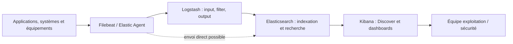
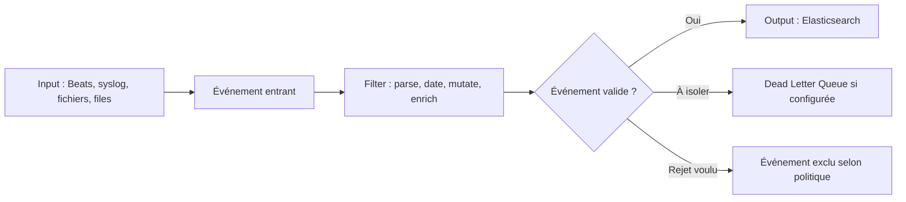
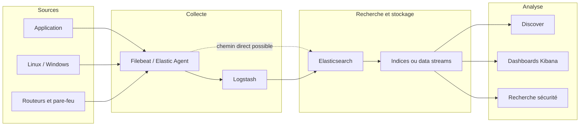
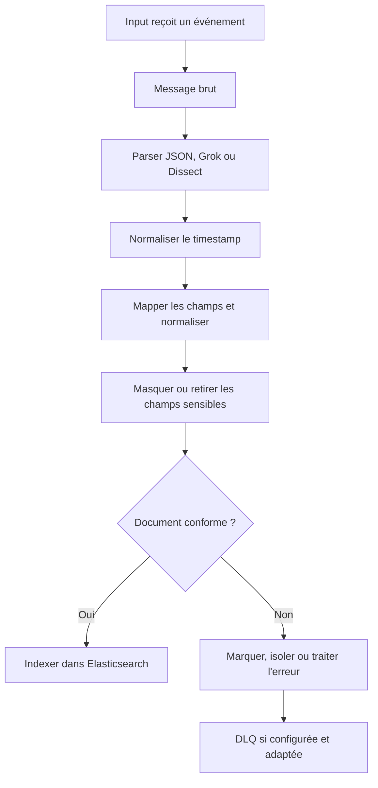
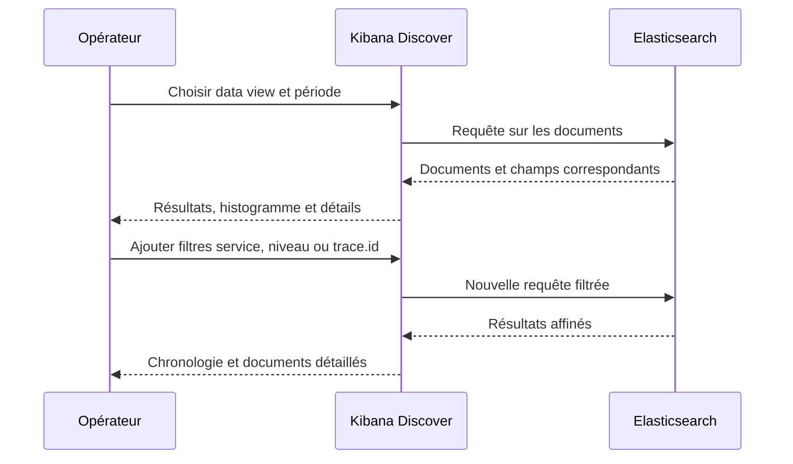
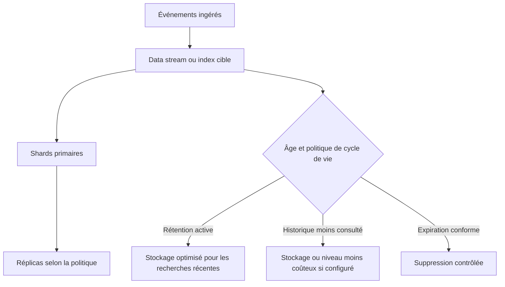
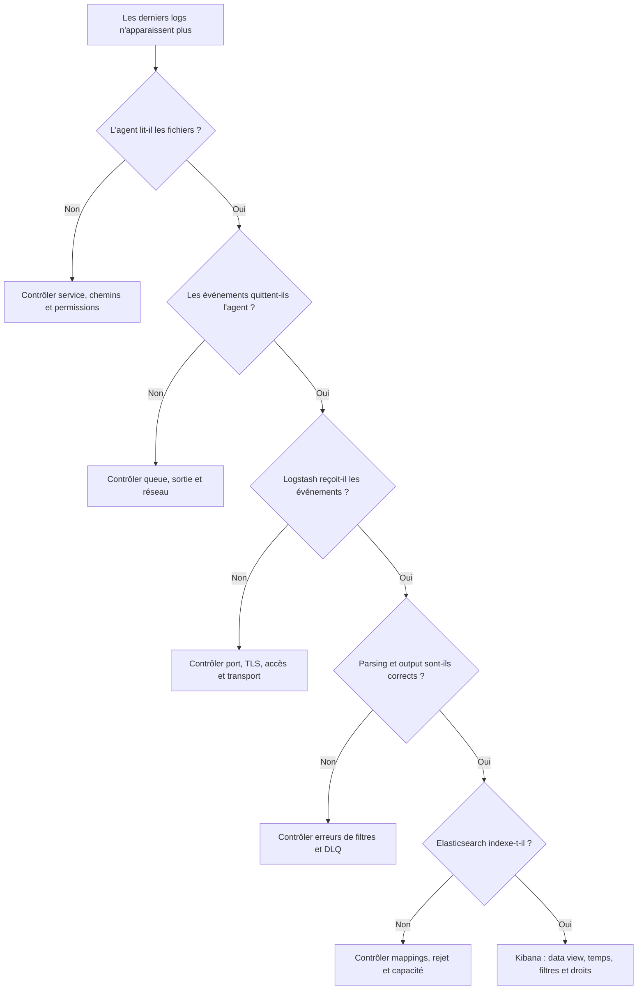
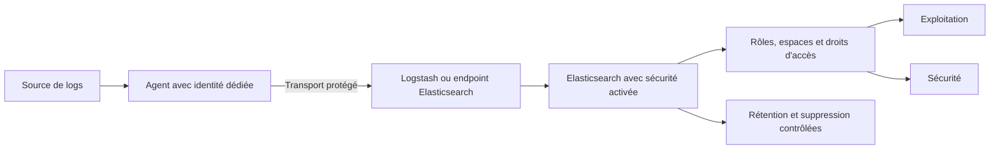

# Stack ELK (Elasticsearch, Logstash, Kibana)

## 1. Introduction

### 1.1. Pourquoi centraliser les logs

Une infrastructure de production produit des événements en permanence. Un serveur Linux écrit des informations sur le noyau, les services et l'authentification. Un serveur web enregistre les requêtes HTTP et leurs codes de retour. Une application signale les opérations métier, les erreurs et les échecs de dépendances. Un pare-feu journalise des décisions de filtrage ; une base de données rapporte ses connexions, ses erreurs et certaines opérations. Si chaque source conserve ses journaux dans un fichier local, l'équipe doit connaître l'hôte, accéder au système et rechercher manuellement les événements. Cette méthode peut suffire à une petite machine, mais devient peu efficace lorsqu'un incident concerne plusieurs composants.

La centralisation des logs permet de rechercher des événements sur plusieurs systèmes à partir d'une interface commune. Elle aide à reconstruire une chronologie, comparer des erreurs, relier une requête à une dépendance et investiguer les changements observés pendant un incident. Elle contribue également à la sécurité, à l'audit et à l'analyse de tendances, à condition que la qualité, la provenance, l'intégrité et la conservation des événements soient maîtrisées.

La stack ELK est une architecture d'observabilité qui associe historiquement **Elasticsearch**, **Logstash** et **Kibana**. Elasticsearch indexe et recherche les documents ; Logstash collecte, transforme et route des événements au moyen de pipelines ; Kibana fournit l'interface de recherche, d'analyse, de visualisation et d'administration. Dans les déploiements modernes, des agents tels que Filebeat ou Elastic Agent peuvent collecter les données et les transmettre directement à Elasticsearch ou passer par Logstash. Les composants exacts dépendent des besoins : un déploiement simple peut ne pas avoir besoin d'un Logstash au milieu, tandis qu'une ingestion complexe peut bénéficier de ses fonctions de transformation et de routage.

L'objectif n'est pas d'envoyer le plus de journaux possible sans discernement. Une plateforme utile reçoit les données nécessaires, les structure, leur ajoute un horodatage et une identité de source cohérents, les indexe selon un modèle adapté, contrôle les coûts de stockage et les rend accessibles aux personnes autorisées. Une collecte mal conçue peut produire des champs incohérents, des index à très forte cardinalité, des erreurs de parsing, des retards d'ingestion et des volumes impossibles à conserver.

> **Mise en contexte — vous rejoignez une équipe NOC/SRE qui exploite une plateforme e-commerce multisite.** Les utilisateurs signalent des erreurs intermittentes au paiement. Les serveurs web, l'API, la base de données et le répartiteur possèdent chacun leurs journaux. L'équipe ne parvient pas à relier les événements, et les différences de fuseau horaire rendent la chronologie confuse. Vous allez concevoir une chaîne de collecte et d'analyse : agents, ingestion éventuelle par Logstash, indexation Elasticsearch, recherche et dashboards Kibana, puis procédures de sécurité, de rétention et de diagnostic.

### 1.2. Les rôles des composants

**Elasticsearch** est un moteur de recherche et d'analyse distribué construit autour de documents JSON indexés. Il permet de filtrer les événements, de rechercher des termes et champs, de calculer des agrégations et de consulter des données dans le temps. Les documents sont organisés en index ou data streams selon le modèle de données choisi. Les shards, réplicas, mappings et politiques de cycle de vie influencent les performances, la résilience et les coûts.

**Logstash** est un moteur d'ingestion et de transformation. Un pipeline comprend des entrées qui reçoivent les données, des filtres qui les analysent ou enrichissent, puis des sorties qui les envoient vers une destination. Il possède de nombreux plugins et peut agréger, convertir, parser, enrichir ou router des événements. Il n'est pas obligatoire dans tous les déploiements : si un agent peut envoyer directement vers Elasticsearch avec un modèle correct et sans transformation complexe, une architecture plus simple peut être préférable.

**Kibana** est l'interface d'exploration et de gestion. Discover permet de rechercher les documents ; les outils de visualisation aident à présenter les tendances ; les dashboards combinent les panels ; les fonctionnalités de gestion permettent d'administrer des ressources prises en charge par la version installée. Kibana envoie des requêtes à Elasticsearch et affiche les résultats, mais ne remplace pas le stockage primaire des documents.

**Filebeat** est un agent léger qui lit des fichiers et transmet des événements. Il peut envoyer à Elasticsearch ou à Logstash. Dans l'écosystème Elastic actuel, Elastic Agent constitue une solution unifiée pour de nombreux cas de collecte et d'intégration. Il reste important de comprendre Filebeat, car de nombreux environnements et exercices l'utilisent encore. Le choix entre Beats, Elastic Agent et d'autres collecteurs doit tenir compte du support de version, des intégrations et des besoins de gestion.

### 1.3. La chaîne d'un événement

Un événement commence par être émis par une source : application, système, équipement réseau ou service cloud. Un agent le lit, lui ajoute éventuellement les informations de provenance puis l'envoie vers la destination configurée. Si Logstash intervient, il reçoit l'événement, le parse, le transforme et l'enrichit. Elasticsearch valide son schéma selon les mappings et l'indexe. Kibana interroge ensuite le jeu de données pour aider l'équipe à rechercher ou visualiser les événements.



Le chemin présenté est courant, mais pas obligatoire dans tous ses détails. Filebeat peut transmettre directement à Elasticsearch, ou Logstash peut recevoir des événements d'autres sources. Plusieurs pipelines peuvent distribuer différents types de données vers différentes destinations. Il faut choisir l'architecture à partir des exigences de transformation, de fiabilité, de sécurité, de volume et de maintenance.

La centralisation introduit aussi des dépendances. Si l'agent ne peut plus transmettre, les événements peuvent s'accumuler dans une file locale selon la configuration, ou être perdus si aucune persistance suffisante n'est prévue. Si Logstash est saturé, les données retardent. Si Elasticsearch refuse l'indexation ou n'a plus d'espace, les sorties échouent. Si Kibana ne répond plus, les documents peuvent continuer d'être collectés mais ne seront pas facilement consultables. Chaque étape doit donc être supervisée séparément.

### 1.4. Les logs, les métriques et les traces

Les logs sont des événements discrets. Ils décrivent ce qui s'est produit, idéalement avec un horodatage, un niveau, un service et un message. Les métriques représentent des mesures numériques répétées dans le temps, telles que le débit de requêtes, la consommation mémoire ou le taux d'erreur. Les traces décrivent le chemin d'une opération à travers plusieurs services, souvent à l'aide d'identifiants de trace et de spans.

ELK est centré historiquement sur la recherche et l'analyse de documents, particulièrement les logs. L'écosystème Elastic peut aussi traiter d'autres signaux, selon les produits, intégrations et licences disponibles. Cependant, il ne faut pas confondre ces formats : une ligne de log n'est pas automatiquement une métrique utile, et une corrélation par timestamp ne remplace pas un identifiant de trace. L'instrumentation doit garder les champs qui permettent de passer d'un signal à l'autre.

Par exemple, un dashboard peut montrer une hausse du taux d'erreur. Les logs indiquent que les réponses 500 proviennent de l'API de paiement. Une trace montre qu'une requête SQL dépasse le délai prévu. Cette combinaison est beaucoup plus puissante que la lecture isolée de milliers de messages. La qualité de la corrélation dépend toutefois de l'horodatage, de la normalisation des noms de services, des identifiants propagés et de la conservation des données.

### 1.5. Ce qu'une bonne plateforme doit garantir

Une plateforme de centralisation des logs doit rendre les événements **disponibles**, **interprétables**, **recherchables**, **sécurisés** et **conservés selon une politique explicite**. Les documents doivent garder leur horodatage d'événement, leur source, leur environnement et les champs importants. Les événements bruts ne doivent pas être détruits pendant le parsing sans raison, et les transformations doivent être testées sur des exemples réels.

La collecte doit être résistante aux interruptions. Les agents et les pipelines doivent avoir des stratégies de reprise, des files ou buffers adaptés au volume et une gestion des échecs. Le système doit alerter sur les documents rejetés, les retards, les files pleines, les erreurs de mapping, l'espace de stockage et la santé du cluster. Une interface verte n'est pas une preuve que les dernières données de toutes les sources sont arrivées.

La sécurité et la conformité sont tout aussi importantes. Les logs contiennent parfois des adresses IP, noms de compte, identifiants de session, jetons ou données personnelles. La plateforme doit limiter les accès, masquer ou supprimer les champs sensibles lorsque nécessaire, chiffrer les transmissions et appliquer des règles de conservation. La centralisation augmente la valeur des logs mais concentre aussi leur sensibilité : un accès trop large peut exposer en une seule recherche les informations de nombreux systèmes.

### 1.6. Les objectifs pédagogiques

À la fin du cours, vous devez pouvoir :

1. décrire le rôle d'Elasticsearch, Logstash, Kibana, Filebeat et Elastic Agent ;
2. comparer une ingestion directe à une chaîne qui passe par Logstash ;
3. concevoir un pipeline input-filter-output ;
4. parser des logs structurés et semi-structurés sans masquer les erreurs ;
5. choisir des champs, types et mappings cohérents ;
6. comprendre index, shards, réplicas, data streams et cycle de vie ;
7. rechercher des événements dans Kibana et construire des dashboards ;
8. contrôler le volume, la fraîcheur, les rejets et les performances ;
9. sécuriser les agents, pipelines, API et accès utilisateurs ;
10. diagnostiquer un retard d'ingestion ou un champ absent ;
11. gérer les logs avec une politique de rétention adaptée ;
12. exécuter une étude de cas de dépannage reproductible.

## 2. Concepts clés

### 2.1. Collecte des événements avec Filebeat

Filebeat suit les sources de journaux configurées et lit les nouveaux événements. Un input définit la source et les paramètres de lecture. Pour les fichiers, l'input filestream est couramment utilisé dans les configurations actuelles ; d'anciens exemples emploient log, dont le statut et la prise en charge doivent être vérifiés dans la version installée. Filebeat gère des harvesters qui lisent les fichiers, agrège les événements et les transmet à une sortie.

Exemple pédagogique de collecte d'un fichier applicatif avec envoi vers Logstash :

```yaml
filebeat.inputs:
  - type: filestream
    id: ecommerce-api-logs
    enabled: true
    paths:
      - /var/log/ecommerce/api/*.log

output.logstash:
  hosts: ["logstash.internal:5044"]
```

Cet exemple suppose que les chemins et l'entrée Logstash sont configurés et accessibles. Il ne constitue pas une configuration de production complète. Dans un environnement sécurisé, ajoutez les paramètres TLS et l'authentification nécessaires selon les versions, vérifiez les permissions de lecture, configurez les champs d'identité utiles et définissez le comportement de queue et de reprise approprié.

Un agent doit être testé sur un fichier réel, notamment lors de la rotation. Il faut savoir comment il suit les fichiers renommés, tronqués ou remplacés, et comment son registre conserve la position de lecture. Une configuration peut lire correctement le fichier courant mais perdre des événements à la rotation si les permissions, les identifiants ou la politique de rotation sont incorrects. Les agents doivent aussi être supervisés : processus, erreurs de sortie, événements en attente et dernier envoi réussi.

### 2.2. Filebeat, Elastic Agent ou autre collecteur

Filebeat est un collecteur spécialisé dans l'expédition des logs. Il peut être adapté lorsqu'une architecture existante repose sur des Beats et que l'équipe maîtrise les configurations de chaque agent. Elastic Agent cherche à unifier la collecte de logs, métriques et autres données au travers d'un seul agent et de politiques gérées, selon le mode de déploiement et les intégrations retenues.

Le choix ne se fait pas uniquement sur le nombre de binaires. Il dépend des versions, des intégrations disponibles, de la manière de déployer la configuration, des permissions, de la charge, du support à long terme et du niveau d'automatisation souhaité. Dans un parc déjà administré par Fleet, l'utilisation d'Elastic Agent peut simplifier les politiques. Dans un parc legacy, Filebeat peut rester présent et fonctionner correctement tant que sa version et son cycle de support sont maîtrisés.

Évitez de déployer deux agents qui lisent le même journal et envoient des copies identiques sans besoin explicite. Cela peut doubler l'ingestion, augmenter le stockage et créer des doublons dans les tableaux de bord. Avant une migration, identifiez les sources, les inputs, les champs ajoutés, les pipelines et les règles de traitement. Testez un groupe pilote, comparez les événements et retirez l'ancien chemin seulement lorsque le nouveau fournit une couverture satisfaisante.

### 2.3. Logstash : input, filter, output

Un pipeline Logstash comprend généralement trois étapes. **Input** reçoit les événements depuis une source : Beats, syslog, fichier, file d'attente ou autre plugin pris en charge. **Filter** analyse, modifie, enrichit ou rejette des événements selon des conditions. **Output** envoie les événements vers Elasticsearch, une autre destination ou plusieurs sorties selon la configuration.



Le pipeline doit être déterministe et testé. Un filtre grok peut parser une ligne, un filtre date peut convertir le timestamp texte en champ temporel, mutate peut renommer ou convertir des champs, et un enrichissement peut compléter la provenance. Les filtres consomment CPU et mémoire ; un pipeline complexe sur plusieurs millions d'événements doit être dimensionné et observé.

La gestion des erreurs doit être explicite. Un événement qui ne correspond pas au pattern ne devrait pas être silencieusement transformé en document apparemment valide avec des champs absents. Une approche robuste marque les erreurs de parsing, conserve le message original si la politique le permet et route les données malformées vers un flux d'analyse séparé. Les mécanismes disponibles, y compris les Dead Letter Queues, dépendent de la configuration et des conditions d'échec.

### 2.4. Exemple de pipeline Logstash

Un pipeline d'exemple peut recevoir les événements d'un agent Beats, parser des logs applicatifs au format JSON ou texte, puis les envoyer vers Elasticsearch. Le code suivant illustre une structure minimale ; les noms des champs, les patterns, les identifiants et les mécanismes TLS doivent être adaptés à l'environnement.

```conf
input {
  beats {
    port => 5044
  }
}

filter {
  if [message] =~ "^[{]" {
    json {
      source => "message"
      target => "app"
      tag_on_failure => ["_json_parse_failure"]
    }
  }

  if [app][timestamp] {
    date {
      match => ["[app][timestamp]", "ISO8601"]
      target => "@timestamp"
      tag_on_failure => ["_date_parse_failure"]
    }
  }

  mutate {
    add_field => { "pipeline_name" => "ecommerce-api" }
  }
}

output {
  if "_json_parse_failure" in [tags] {
    elasticsearch {
      hosts => ["https://elasticsearch.internal:9200"]
      index => "ecommerce-parse-failures"
    }
  } else {
    elasticsearch {
      hosts => ["https://elasticsearch.internal:9200"]
      index => "ecommerce-api"
    }
  }
}
```

Cette configuration est un exemple de logique, pas un fichier prêt à être utilisé sans adaptation. L'authentification et la confiance TLS, les modèles d'index ou data streams, le comportement en cas d'échec de sortie et les types de champs doivent être définis. Le champ app.timestamp n'existe que si le JSON source contient ce chemin. Le filtre date n'est pas nécessaire lorsqu'un champ temporel déjà correct est fourni par la source, mais il reste important de vérifier ce que représente réellement @timestamp.

Dans un déploiement moderne, il peut être préférable d'utiliser une ingest pipeline Elasticsearch ou des intégrations gérées lorsqu'elles couvrent le besoin. Logstash est particulièrement utile lorsque plusieurs sources ont des formats différents, qu'un routage conditionnel ou un enrichissement complexe est nécessaire, ou que des transformations doivent se produire avant l'indexation. Garder le pipeline simple réduit le coût et les risques d'erreur.

### 2.5. Parsing : structure avant recherche

Une ligne de log libre peut contenir un timestamp, un niveau, un nom de composant, un identifiant de requête et un message. Si tout reste dans un seul champ message, l'utilisateur peut effectuer une recherche textuelle, mais il sera plus difficile de filtrer par niveau, calculer les erreurs par service ou comparer la latence selon une route. Le parsing transforme les composants du message en champs structurés, qui peuvent ensuite être indexés et interrogés.

Les formats JSON sont souvent plus simples à parser que du texte arbitraire, à condition que les producteurs utilisent un schéma cohérent. Les logs texte peuvent être traités par des patterns Grok, dissect ou d'autres filtres. Grok permet d'associer une ligne à une expression structurée, tandis que dissect est utile lorsque les séparateurs et la structure sont stables. Le choix doit être validé avec les lignes normales, les erreurs et les cas limites.

Le parsing doit éviter la perte de contexte. Le message original peut être conservé dans un champ contrôlé pour le dépannage, mais il faut évaluer le coût de stockage et les risques de confidentialité. Si un champ de timestamp est illisible, l'événement ne devrait pas prendre silencieusement l'heure d'ingestion comme s'il s'agissait de l'heure réelle de l'incident. Les échecs doivent être signalés et surveillés.

### 2.6. Horodatage et fuseaux horaires

Le champ temporel détermine la place de l'événement dans la timeline. Elasticsearch et Kibana s'appuient couramment sur un champ de date tel que @timestamp. Il faut préciser si le timestamp vient du producteur ou a été généré à l'ingestion. Ces deux heures peuvent différer si l'agent est hors ligne, si le buffer est plein ou si le transport est retardé.

Un pipeline date peut parser une date écrite dans une ligne. Si le log utilise un fuseau explicite, conservez cette information et configurez le parsing selon le format réel. Si le timestamp ne contient pas de fuseau, il faut connaître la convention locale du producteur au moment de l'événement. Supposer que tous les systèmes écrivent en UTC ou que le collecteur utilise le même fuseau peut décaler les événements et fausser la chronologie.

Tous les serveurs devraient être synchronisés par une source de temps fiable. La correction du timestamp ne doit pas masquer une horloge fortement décalée : il faut aussi monitorer la synchronisation. La corrélation entre logs, métriques et traces dépend de fenêtres temporelles compatibles et d'une précision suffisante. En incident, une erreur d'horodatage de plusieurs minutes peut produire une fausse causalité.

### 2.7. Elastic Common Schema et normalisation

Elastic Common Schema (ECS) définit des conventions de champs pour normaliser des événements entre sources. Des champs normalisés facilitent la recherche transversale et la réutilisation de dashboards. Par exemple, les informations sur l'hôte, le service, le processus, la requête HTTP ou le réseau peuvent être placées dans des champs cohérents lorsqu'ils sont disponibles et appropriés.

La normalisation ne signifie pas que chaque source possède toutes les informations ECS. L'équipe doit mapper les données existantes sans inventer de valeurs. Un identifiant de service stable vaut mieux qu'un nom libre qui change à chaque déploiement. Un champ doit garder un type cohérent : un port doit être numérique, une date doit être un champ de date, un booléen ne devrait pas alterner avec une chaîne. Les mappings incohérents provoquent des erreurs d'indexation ou des recherches inattendues.

Il est utile d'adopter une convention d'événement avec au minimum le timestamp, le service, l'environnement, l'hôte, le niveau, le message et, lorsque cela est approprié, un identifiant de corrélation. Les champs de sécurité, les données personnelles et les contenus de requête doivent être évalués séparément. La normalisation facilite les requêtes, mais elle ne remplace pas la gouvernance des données.

### 2.8. Elasticsearch : documents, index, shards et réplicas

Elasticsearch stocke des documents JSON. Les index organisent les documents selon un modèle et une gestion des données. À mesure que l'index grandit, il est réparti en shards primaires ; les réplicas sont des copies de shards qui peuvent améliorer la résilience et le débit de lecture, selon l'architecture. Le nombre de shards, leur taille, les ressources des nœuds, les mappings et les requêtes influencent le coût opérationnel.

Un nombre trop élevé de petits shards augmente les métadonnées et la charge de gestion. Des shards trop gros peuvent compliquer les opérations, la récupération et certaines recherches. Il n'existe pas une taille ou un nombre universel valable pour tous les index : la taille réelle des documents, le débit, le type de requêtes, la mémoire, le disque et la version doivent guider la conception. La meilleure stratégie est testée avec une volumétrie représentative.

Un cluster Elasticsearch peut avoir plusieurs rôles de nœuds selon la version et l'architecture. Il faut distinguer le plan de contrôle, les données, l'ingestion et les fonctions de recherche si la charge ou la criticité justifient une séparation. Les petits déploiements peuvent être plus simples ; les environnements volumineux nécessitent un dimensionnement et une stratégie de disponibilité plus élaborés. Les choix de rôles doivent suivre la documentation de la version.

### 2.9. Mappings et types de champs

Les mappings décrivent comment les champs des documents sont interprétés. Un champ numérique permet des agrégations mathématiques. Un champ de date permet les filtres temporels et les histogrammes. Un champ keyword sert à des filtres exacts, regroupements et tris. Un champ text est analysé pour la recherche plein texte. Une même valeur ne doit pas être traitée indistinctement comme texte libre et comme identifiant exact.

Le mapping dynamique peut être pratique, mais il comporte un risque quand des producteurs émettent des types différents pour un même champ. Si un document envoie un code comme texte et un autre comme nombre, l'indexation peut échouer ou le schéma peut devenir incompatible avec l'usage prévu. Les logs hétérogènes nécessitent donc une normalisation, des templates de mapping et des tests de création d'index.

Une cartographie incorrecte peut provoquer des dashboards vides ou des filtres inefficaces. Un port HTTP stocké comme texte peut ne pas être agrégé comme attendu ; un timestamp non reconnu ne sera pas utilisé correctement par le sélecteur temporel ; un identifiant analysé mot par mot peut retourner des résultats inattendus. Il faut regarder la définition effective du champ dans Elasticsearch plutôt que supposer qu'un texte visuellement identique sera traité de la même manière.

### 2.10. Index classiques et data streams

Un index classique est une ressource d'indexation nommée. Les data streams sont une abstraction qui cible des données append-only générées en continu, comme des logs, événements et métriques. Un data stream s'appuie sur plusieurs backing indices et fournit un nom unique pour les opérations de recherche et d'écriture. Les politiques de cycle de vie peuvent automatiser le rollover, le déplacement ou la suppression selon les besoins de la version et du modèle de stockage.

Le choix entre index et data stream dépend du format de données, des conventions de l'écosystème, des templates, de la politique de rétention et des outils qui envoient les documents. Les intégrations Elastic modernes peuvent utiliser des data streams par défaut. Il faut vérifier le modèle de données réellement créé, et ne pas supposer que l'option index d'un ancien exemple convient à une intégration actuelle.

Les noms de ressources doivent suivre une convention cohérente et permettre de distinguer les données par type, environnement, service et période selon le modèle choisi. Il ne faut pas créer un nouvel index par utilisateur ou par requête. Les petits index nombreux augmentent la charge de métadonnées et compliquent la gestion. Le bon niveau de découpage permet de contrôler la rétention sans perdre la capacité d'interroger plusieurs périodes.

### 2.11. Rétention et Index Lifecycle Management

La rétention répond à plusieurs contraintes : coût, vitesse de recherche, besoins d'analyse d'incident et exigences légales ou organisationnelles. Les logs détaillés d'accès peuvent être conservés moins longtemps que les événements de sécurité critiques ou les agrégats nécessaires aux rapports. La politique doit préciser la durée par type de données, le niveau d'accès, le traitement des données sensibles et les exceptions.

Index Lifecycle Management (ILM) peut automatiser des phases de cycle de vie selon le type de déploiement, les index templates et la configuration. Les politiques peuvent organiser le rollover, le déplacement vers du stockage moins coûteux ou la suppression. Les mécanismes exacts dépendent de la version, de la disponibilité des fonctionnalités et du modèle index/data stream utilisé. Les data streams disposent également de mécanismes de cycle de vie appropriés.

La rétention n'est pas simplement une commande delete. La suppression doit être liée au modèle de données et validée, car une règle mal ciblée peut effacer trop tôt l'historique nécessaire à une investigation. Testez les politiques sur des données de test, surveillez les erreurs de lifecycle et vérifiez le résultat réel. La capacité disque doit être surveillée avec assez de marge pour les opérations de rollover, les réplicas, les segments et la croissance inattendue du volume.

### 2.12. Kibana Discover et la recherche

Discover est l'un des outils principaux de recherche interactive. L'utilisateur sélectionne un data view, définit la fenêtre temporelle, ajoute des filtres et inspecte les documents ou les champs. Il peut rechercher un message, filtrer les événements de niveau ERROR, sélectionner un service ou une instance, et parcourir les documents bruts pour comprendre leur structure.

Une recherche textuelle large peut coûter davantage qu'un filtre exact sur un champ structuré. Le choix du champ, de la période et du type d'opérateur est essentiel. Il est souvent préférable de filtrer d'abord sur le temps et l'environnement, puis sur le service ou l'hôte, avant d'examiner les mots-clés. Les champs normalisés rendent ces opérations plus rapides et plus reproductibles.

L'utilisateur doit savoir si le sélecteur de temps utilise @timestamp et si ce champ reflète bien l'heure de l'événement. Une ingestion tardive peut faire apparaître un événement dans l'historique après son occurrence. Si l'horodatage a été remplacé par l'heure d'ingestion, la recherche temporelle peut masquer ou déplacer le problème. La qualité des données temporelles est aussi importante que la syntaxe de recherche.

### 2.13. Dashboards Kibana

Un dashboard combine plusieurs visualisations et tableaux pour répondre à une question opérationnelle. Pour une API, une vue utile peut afficher le volume de requêtes, le nombre d'erreurs, la répartition par code HTTP, les latences disponibles dans les logs, les hôtes affectés et une timeline d'événements. Pour la sécurité, la vue peut suivre des échecs d'authentification, des sources inhabituelles, les décisions de pare-feu et les événements de changement.

Les panels devraient avoir un but clair, une unité et un filtre cohérents. Une courbe qui agrège toutes les applications en une seule valeur peut masquer un service en difficulté. Une table qui affiche trop de champs devient illisible. Les filtres de dashboard et la plage temporelle doivent correspondre à la même population de données. Les panneaux doivent être testés avec des périodes sans trafic, des pointes et une absence de collecte.

Kibana permet de créer des visualisations et dashboards selon les fonctionnalités présentes dans la version. Les noms des outils et interfaces ont évolué au fil des éditions. Il faut s'appuyer sur la documentation correspondant au déploiement. Le principe reste constant : les visualisations sont des requêtes et des agrégations sur des documents indexés ; elles ne remplacent pas la qualité du modèle de données.

### 2.14. Correlation IDs et traçabilité distribuée

Un identifiant de requête ou de trace permet de relier les événements issus de plusieurs composants. Par exemple, l'API web peut écrire trace.id et request.id, la passerelle peut inclure un identifiant de corrélation, et le service de paiement peut le propager. La recherche peut alors retrouver les événements correspondants dans une fenêtre temporelle, au lieu de se limiter à des messages proches dans le temps.

La propagation doit être cohérente. Si un service génère un nouvel identifiant à chaque étape et ne conserve aucune relation avec l'identifiant parent, la corrélation devient difficile. Les identifiants doivent être conçus pour la traçabilité, pas pour transporter une donnée sensible. Ils ne devraient pas être indexés dans un nombre illimité de dimensions analytiques s'ils entraînent un coût excessif dans les agrégations ; la recherche exacte d'un identifiant individuel demeure cependant un usage fréquent des logs.

Il ne faut pas confondre une corrélation par timestamp avec une corrélation de trace. Deux événements à la même seconde peuvent être indépendants. Un identifiant partagé apporte une preuve plus forte de relation, mais doit être interprété avec la sémantique de l'instrumentation. La synchronisation des horloges reste nécessaire pour reconstruire l'ordre des événements.

### 2.15. Sécurité : authentification, TLS et droits minimaux

Elasticsearch, Kibana, Logstash et les agents transportent ou exposent des données opérationnelles sensibles. L'authentification et le chiffrement doivent être configurés selon les possibilités et recommandations de la version installée. Les agents devraient avoir des identifiants limités aux opérations nécessaires, et les comptes de recherche devraient avoir les droits correspondant aux index ou espaces dont ils ont besoin.

Ne stockez pas les secrets dans un dépôt, une sortie de log ou une ligne de commande exposée. Utilisez les mécanismes de secrets supportés, limitez les droits des fichiers de configuration et appliquez une rotation des identifiants. Les certificats et autorités de confiance doivent être configurés avant d'étendre les agents. Une connexion chiffrée sans vérification de l'identité du serveur n'offre pas la même protection contre une interception qu'une validation correcte du certificat.

Les contrôles d'accès doivent aussi porter sur les documents et champs sensibles lorsque les fonctions le permettent. Les journaux peuvent contenir des adresses IP, des noms, des identifiants de session ou des champs d'URL. Il faut supprimer ou masquer les secrets à la source lorsque c'est possible, et limiter les champs collectés si leur valeur n'est pas nécessaire. Une rétention courte ne suffit pas si tout le personnel peut rechercher des données confidentielles.

### 2.16. Fiabilité de la chaîne d'ingestion

Une chaîne de log peut échouer de plusieurs manières : agent arrêté, fichier illisible, queue saturée, réseau indisponible, pipeline mal formé, plugin qui rejette des événements, Elasticsearch qui applique un mapping incompatible ou disque plein. Chaque couche devrait exposer des indicateurs de santé afin que l'équipe détecte les pertes ou retards, pas seulement les erreurs visibles dans Kibana.

Les buffers et files protègent certaines interruptions, mais leur comportement dépend de la configuration. Une file en mémoire peut être perdue au redémarrage ; une file persistante consomme du disque et nécessite une gestion de capacité. La reprise après une panne du backend peut provoquer un pic d'ingestion. Il faut mesurer le débit de production et le débit d'indexation, puis dimensionner les buffers, Logstash et Elasticsearch pour les pointes et les périodes de rattrapage.

L'idempotence et les doublons méritent aussi de l'attention. Lors d'une reprise, un agent peut retransmettre certains événements selon le comportement de la queue et de l'accusé de réception. Il faut distinguer les doublons réels des messages identiques produits par deux sources. Si l'application fournit un identifiant d'événement stable, il peut aider à gérer certaines situations ; ne fabriquez pas une règle de déduplication qui élimine des événements légitimes simplement parce que leur texte est identique.

### 2.17. Performance et backpressure

La **backpressure** apparaît lorsqu'un composant en aval ne peut plus absorber le débit entrant. Logstash peut accumuler des événements en attente, les agents peuvent remplir leur queue et Elasticsearch peut réduire ou refuser temporairement l'indexation. Des retries sont utiles lorsque l'erreur est temporaire, mais les réessais peuvent augmenter le retard et le volume de travail lorsque la capacité reste insuffisante.

Pour diagnostiquer, mesurez le débit entrant, le débit sortant, la taille des files, les temps de traitement des filtres, les rejets Elasticsearch, les délais de bulk, la JVM, le CPU, la mémoire, le disque et les performances de recherche. Vérifiez aussi si une requête Kibana très coûteuse ou un enrichissement synchronisé contribue à la pression. Il faut distinguer la lenteur de recherche de la lenteur d'ingestion, même si elles peuvent partager la même ressource.

Les améliorations possibles incluent simplifier les patterns, supprimer les champs inutiles, ajuster les lots et workers selon les recommandations, réduire les mappings inutiles, dimensionner les shards et ajouter de la capacité lorsque les mesures le justifient. Modifier des paramètres au hasard peut seulement déplacer le goulot d'étranglement ou provoquer une consommation mémoire plus élevée. Tout ajustement doit être évalué sur un jeu de charge représentatif.

### 2.18. Erreurs d'ingestion et Dead Letter Queue

Certaines erreurs se produisent avant l'indexation, par exemple un parsing qui échoue. D'autres surviennent lorsque Elasticsearch refuse un document, notamment à cause d'un mapping incompatible, d'un document trop volumineux ou de contraintes temporaires de ressources. Il faut classer les erreurs par cause et conserver assez de contexte pour les corriger.

La Dead Letter Queue (DLQ), si elle est configurée et appropriée à la sortie utilisée, permet de conserver certains événements qui ne peuvent pas être traités normalement et d'envisager une récupération contrôlée. Elle ne doit pas devenir un bac sans fond. Son contenu doit être surveillé, limité et rejoué selon une procédure. Une DLQ en croissance peut indiquer un problème de mapping, un champ mal typé ou une incompatibilité non résolue.

Les erreurs de parsing peuvent être marquées avec des tags, par exemple _grokparsefailure ou un tag défini explicitement dans le filtre. Les dashboards de qualité doivent présenter la proportion d'événements mal formés, la source, le pipeline et les champs absents. Une hausse soudaine de parsing failures après un déploiement peut révéler un changement de format dans l'application. La réponse est de corriger le contrat de log ou le pipeline, pas de supprimer silencieusement toutes les lignes problématiques.

### 2.19. Gouvernance et cycle de vie des pipelines

Les pipelines Logstash sont du code opérationnel. Ils doivent être versionnés, revus et testés sur des exemples représentatifs. Un pipeline central très complexe peut devenir difficile à modifier et créer un effet de bord sur plusieurs sources. Une séparation par type de données, environnement ou responsabilité permet de limiter le rayon d'impact, à condition de ne pas multiplier inutilement les pipelines.

Les changements de schéma doivent être traités comme des changements d'interface. Si une application renomme un champ, change une date texte en nombre ou transforme un identifiant en objet, les filtres, mappings et dashboards peuvent échouer. Documentez les champs, les types, les unités et les valeurs attendues. Les tests devraient inclure les documents normaux, les champs manquants, les valeurs inattendues et les versions successives du format.

Les pipelines sont aussi un point d'application de minimisation des données. Ils peuvent supprimer les mots de passe, tokens ou paramètres sensibles avant indexation ; toutefois, il vaut mieux ne pas générer ces valeurs dans les logs dès le départ. Une suppression en aval ne protège pas nécessairement toutes les copies intermédiaires ou les buffers. La stratégie de confidentialité doit être conçue sur l'ensemble du trajet, y compris agents, queues, erreurs et DLQ.

### 2.20. Archivage, sauvegardes et restauration

La rétention automatique et la sauvegarde répondent à des besoins différents. La rétention supprime ou déplace des données selon une politique ; la sauvegarde sert à restaurer des données ou une configuration après une panne ou une erreur. Un système de logs doit sauvegarder les ressources nécessaires à une restauration cohérente, mais il n'est pas toujours économique de conserver chaque document brut dans une sauvegarde longue durée.

Il faut identifier les données qui doivent être récupérables : documents, configurations de pipelines, mappings, templates, politiques de cycle de vie, utilisateurs et rôles, paramètres d'agents et dashboards. Les secrets doivent être sauvegardés dans un système approprié. Les procédures documentent le RPO, le RTO, les dépendances et les tests de restauration. Une sauvegarde jamais restaurée n'a pas démontré qu'elle fonctionne.

La restauration d'un cluster Elasticsearch doit suivre les procédures prises en charge par la version et les snapshots configurés. Copier des fichiers de données à chaud sans respecter les règles du produit peut produire une sauvegarde inutilisable. Il faut aussi prévoir la compatibilité des versions, le stockage de snapshots, l'accès réseau, les permissions et la validation de la récupération. Les sauvegardes et snapshots doivent être protégés contre la suppression ou la modification non autorisée.

## 3. Architecture et Schémas

### 3.1. Architecture complète de centralisation



Le choix d'un chemin direct ou d'un passage par Logstash dépend des transformations, des exigences d'acheminement et du débit. Il est essentiel de surveiller l'agent, le pipeline, l'indexation et les outils d'analyse de manière indépendante. Une panne de Kibana peut rendre l'exploration impossible alors que les données continuent d'arriver ; une panne d'Elasticsearch peut au contraire interrompre l'ingestion même si les agents fonctionnent.

### 3.2. Pipeline Logstash : du texte au document structuré



Un pipeline fiable ne doit pas seulement produire un document indexable : il doit préserver la signification des événements. Le timestamp, le niveau et l'identité du service doivent être cohérents. Les erreurs de parsing doivent rester visibles. La suppression des secrets est une protection complémentaire, mais le meilleur endroit pour empêcher une fuite reste souvent le code qui écrit le log.

### 3.3. Cycle de recherche dans Kibana



Le parcours commence par une période cohérente puis ajoute progressivement les filtres. Les documents doivent conserver un timestamp fiable et des champs normalisés. Un filtre précis sur un champ structuré est généralement préférable à une recherche textuelle imprécise. La recherche ne prouve pas que les données absentes n'ont pas existé : il faut vérifier la source, l'agent et l'ingestion lorsqu'une population attendue disparaît.

### 3.4. Architecture de stockage et cycle de vie



Le diagramme représente des objectifs de cycle de vie et non une obligation de configurer les mêmes phases dans toutes les éditions. Les options disponibles dépendent de la version, du modèle index ou data stream et de l'infrastructure. La politique doit être testée, surveillée et documentée pour éviter une suppression prématurée ou une saturation du disque.

### 3.5. Diagnostic d'une interruption d'ingestion



La démarche isole les couches au lieu de modifier tous les composants à la fois. Le diagnostic doit réunir une preuve pour chaque étape : position de lecture, événements envoyés, statistiques du pipeline, rejets d'indexation, recherche directe dans Elasticsearch et paramètres de Kibana. Les changements sont consignés et vérifiés après correction.

### 3.6. Chaîne de sécurité et d'accès



Les données doivent être protégées pendant le transport, au repos et lors des recherches. Les rôles de l'exploitation et de la sécurité n'ont pas nécessairement besoin des mêmes accès. Les logs ne doivent pas servir à contourner les permissions applicatives : le fait qu'un événement soit centralisé ne signifie pas que tout utilisateur est autorisé à le consulter.

## 4. Étude de cas

### 4.1. Incident : échecs intermittents du paiement

Une boutique en ligne possède des serveurs web, une API de paiement, un service d'authentification et une base de données. Les utilisateurs rencontrent des réponses HTTP 500 et parfois des timeouts. Les équipes remarquent que les erreurs sont intermittentes : le service semble normal lorsqu'un administrateur se connecte après coup. L'objectif est de centraliser les logs pour reconstruire précisément ce qui se passe pendant les périodes concernées.

Le plan de collecte identifie les sources et les formats. Les logs web contiennent l'horodatage, le chemin, le code HTTP, la durée et l'identifiant de requête. L'API contient le service, le niveau, le message et trace.id lorsque disponible. La base journalise les erreurs de connexion et les délais. Les logs d'authentification sont collectés avec une protection renforcée parce qu'ils peuvent contenir des informations sensibles.

Les agents sont déployés progressivement. Filebeat peut lire les fichiers et transmettre à Logstash ; Elastic Agent peut être retenu dans un environnement où une gestion unifiée des intégrations est déjà utilisée. L'équipe choisit un seul mécanisme par source, vérifie les permissions et teste la rotation des fichiers. Le pipeline ajoute un environnement et une identité de service, normalise le timestamp et retire les paramètres sensibles de certaines URLs.

### 4.2. Normaliser les champs

Les applications écrivent parfois le niveau sous level, parfois sous severity, et utilisent différents noms pour le service. La recherche devient compliquée si chaque source possède sa propre convention. L'équipe adopte des noms stables et mappe les champs vers une structure commune compatible avec les conventions choisies. Les niveaux sont normalisés sans perdre le texte original utile, les dates sont analysées avec le fuseau source correct, et les identifiants de requête sont conservés pour la corrélation.

L'équipe refuse de convertir un champ inconnu en valeur arbitraire simplement pour remplir le schéma. Si un timestamp est invalide, l'événement est marqué d'une erreur de parsing et son traitement suit une route contrôlée. Le message original est conservé lorsque cela est autorisé, pour pouvoir corriger le pipeline à partir d'un exemple réel. Le taux d'erreurs de parsing est affiché dans un dashboard de qualité d'ingestion.

Le mapping des champs numériques est vérifié avant l'indexation à grande échelle. La durée de requête est stockée avec un type qui permet les agrégations. Les codes HTTP et ports suivent des types cohérents. Les champs d'URL sont examinés afin de ne pas indexer des jetons ou identifiants de session dans les paramètres de requête. Les conventions de schéma sont versionnées avec le pipeline.

### 4.3. Choisir le pipeline et la destination

Le chemin d'ingestion est choisi selon la complexité. Filebeat lit les fichiers et transmet à Logstash. Logstash parsera le JSON, convertira le timestamp, normalisera les champs et ajoutera des tags opérationnels. Les documents validés seront envoyés vers le modèle de données Elasticsearch prévu ; les échecs seront marqués et dirigés vers le traitement d'erreurs approprié. Si les formats étaient déjà structurés et qu'aucun enrichissement spécifique n'était nécessaire, l'équipe pourrait envisager l'envoi direct d'un agent vers Elasticsearch afin de simplifier l'architecture.

Les pipelines sont testés avec des échantillons du trafic normal, des erreurs applicatives et des lignes malformées. Un test de charge évalue le temps de traitement et l'utilisation des ressources. La destination est configurée avec des identifiants limités et une connexion protégée. Les secrets ne sont pas copiés dans Git ni dans les messages d'erreur.

L'équipe définit une politique de rétention adaptée à chaque type de logs. Les événements nécessaires à l'analyse d'incident restent disponibles durant la période utile, tandis que les données très volumineuses et peu utiles à long terme sont réduites ou supprimées selon la politique de l'entreprise. Les data streams et les politiques de cycle de vie sont utilisés lorsqu'ils correspondent au modèle de données et à la version installée.

### 4.4. Recherche dans Kibana

L'opérateur ouvre Discover, sélectionne la vue de données correspondante et choisit la plage temporelle de l'incident. Il filtre d'abord sur l'environnement de production, puis sur le service de paiement et le niveau ERROR. Il repère un message de timeout et obtient trace.id. Avec cet identifiant, il recherche les événements liés dans l'API et le service d'authentification.

Les logs montrent que certaines demandes du service de paiement échouent après un délai de connexion à la base de données. L'équipe compare ensuite les événements de la base et les journaux d'infrastructure. Les événements du load balancer montrent que les requêtes lentes ont commencé peu après le déploiement d'une nouvelle version. Les métriques confirment une hausse des connexions actives et de la latence. Les logs ne suffisent pas seuls à prouver la cause, mais la corrélation des observations concentre l'investigation.

L'horodatage est essentiel. Les événements provenant d'un système avaient une heure locale sans fuseau et étaient interprétés comme UTC ; la première recherche donnait l'impression que le message de base apparaissait avant la requête API. La correction du parseur date et la synchronisation temporelle rendent la timeline cohérente. Le changement est intégré aux tests de pipeline pour éviter le retour du problème.

### 4.5. Construire un dashboard d'exploitation

Le dashboard affiche le nombre de logs par niveau, les erreurs par service, les codes HTTP, les top messages récurrents et la distribution des délais rapportés dans les événements. Un contrôle de qualité affiche les erreurs de parsing et le dernier événement reçu par service. Les panels de synthèse disposent de liens vers Discover avec les filtres et la période utiles. Une vue séparée permet de chercher les événements détaillés avec les permissions adéquates.

Le nombre de documents n'est pas automatiquement un indicateur de santé. Une hausse des logs peut venir d'une vraie erreur, mais aussi d'un changement de niveau de journalisation ou d'un déploiement qui émet plus de messages. Le dashboard doit tenir compte du volume de requêtes et de l'évolution des sources. Les règles d'alerte sont définies sur des critères actionnables et des seuils testés.

Les champs d'identité du service et de l'environnement sont uniformes, ce qui permet d'utiliser les mêmes panels sur plusieurs cibles. Les utilisateurs peuvent sélectionner un service ou un environnement sans maintenir une copie manuelle du dashboard. Les vues sont versionnées ou exportées selon le processus retenu, et un propriétaire examine périodiquement les requêtes et les liens.

### 4.6. Test de résilience et reprise après incident

L'équipe simule une interruption d'accès de Logstash vers Elasticsearch. Elle vérifie les erreurs du pipeline, l'accumulation des événements en attente, le comportement des buffers et la reprise lorsque la destination redevient accessible. Le test mesure si les agents peuvent conserver les événements pendant la durée prévue et combien de temps prend le rattrapage. La charge de reprise est surveillée afin de ne pas submerger le cluster lorsque la connexion revient.

Un second test utilise un document avec un type de champ incompatible. L'équipe confirme que l'échec est visible, qu'il n'est pas confondu avec un simple retard et que les événements refusés peuvent être inspectés ou rejoués selon le mécanisme configuré. Le pipeline ne doit pas masquer les erreurs de mapping en abandonnant les documents silencieusement.

Un troisième test confirme que l'accès à un espace réservé à la sécurité n'est pas accordé à un utilisateur qui ne possède pas le rôle correspondant. La centralisation ne doit pas réunir toutes les données dans une interface sans contrôle. Les droits, les secrets et les données sensibles sont examinés de manière périodique et après chaque changement d'architecture.

### 4.7. Bilan de l'incident

La cause probable est une modification applicative qui a accru le nombre de connexions et le temps d'attente vers la base. La chronologie complète a pu être reconstruite grâce aux timestamps normalisés, aux identifiants de corrélation et aux données provenant de plusieurs services. L'équipe restaure le comportement attendu, vérifie les métriques, observe la baisse des erreurs et met à jour le runbook.

Le livrable de la mission n'est pas uniquement un dashboard. Il comprend les conventions de logs, les sources collectées, la configuration des agents, les pipelines, les mappings, les règles de rétention, les permissions, les contrôles de qualité et la procédure de reprise. Chaque partie est versionnée et possède une responsabilité explicite.

Après l'incident, l'équipe passe en revue les événements manquants et les erreurs de parsing. Elle vérifie si le volume de données et la rétention sont proportionnés aux usages, si des champs sensibles sont collectés inutilement et si les alertes préviennent suffisamment tôt le prochain incident. La plateforme reste un système vivant qui demande une revue périodique.

## 5. Pièges à éviter

### 5.1. Mettre Logstash partout sans besoin

Logstash apporte une grande souplesse, mais constitue aussi un composant à exploiter, sécuriser, dimensionner et superviser. Si un agent peut envoyer directement des données structurées à Elasticsearch et qu'aucune transformation complexe n'est nécessaire, le passage par Logstash peut ajouter de la latence et des points de panne sans bénéfice suffisant. Choisissez le chemin d'ingestion selon le besoin réel.

### 5.2. Tout conserver dans un seul champ message

Des logs non structurés sont difficiles à agréger et à filtrer. Le parsing permet d'isoler le niveau, le service, la date, le code HTTP ou la durée. Mais le parsing doit être testé et documenté. Un pipeline qui produit des champs vides ou parse incorrectement des erreurs donne une impression de structure sans fournir une mesure fiable.

### 5.3. Ignorer les erreurs de parsing

Les événements mal formés doivent rester visibles. Utilisez des tags, compteurs, routes d'erreurs ou files de rejet selon la configuration. Surveillez leur volume et identifiez les producteurs concernés. Une nouvelle version applicative peut modifier le format et faire échouer une partie de l'ingestion sans que la collecte s'arrête complètement.

### 5.4. Prendre l'heure d'ingestion pour l'heure de l'événement

Un retard d'agent ou de pipeline peut décaler le document si le timestamp source est perdu. Les horloges locales peuvent aussi utiliser des fuseaux différents. Normalisez @timestamp, synchronisez les systèmes et distinguez l'heure du fait de l'heure de réception. Sinon, les recherches temporelles et la corrélation avec les métriques deviennent trompeuses.

### 5.5. Laisser Elasticsearch créer des mappings incohérents

Des champs qui alternent entre texte, nombre, date ou objet peuvent provoquer des erreurs d'indexation. Définissez des conventions, templates et tests de schéma. Inspectez les mappings effectifs. Une valeur qui ressemble à un nombre n'est pas automatiquement indexée comme numérique, et un champ de date non reconnu ne sera pas filtré correctement par la plage temporelle.

### 5.6. Surdimensionner les shards ou en créer trop

Le nombre de shards influence la mémoire, la gestion du cluster et les performances. Les index trop nombreux ou trop petits peuvent augmenter les métadonnées, tandis que les shards très gros peuvent compliquer la récupération. La conception dépend de la volumétrie, des requêtes et des ressources ; testez avec les données représentatives au lieu d'appliquer un nombre universel de shards.

### 5.7. Ignorer les backlogs et les rejets

Un pipeline peut accumuler du retard sans provoquer immédiatement une panne visible pour l'utilisateur. Surveillez le débit entrant et sortant, les queues, les rejets, l'espace disque et les erreurs des agents. Après une interruption, la reprise peut générer un pic. Les files doivent être dimensionnées selon la durée d'interruption prévue et les limites de stockage.

### 5.8. Envoyer des secrets ou données personnelles dans les logs

Les mots de passe, tokens, cookies et paramètres sensibles ne doivent pas être collectés par défaut. Le masquage dans Logstash est une couche de protection supplémentaire, mais le secret peut déjà avoir été écrit sur le disque source. Empêchez sa génération quand c'est possible, protégez les agents et limitez les accès aux données sensibles.

### 5.9. Exposer Elasticsearch ou Kibana sans contrôle

L'interface et l'API peuvent révéler la structure interne, les noms d'hôtes et des données personnelles. Activez les mécanismes de sécurité adaptés, limitez les interfaces réseau, utilisez TLS correctement et attribuez des droits minimaux. Évitez les comptes partagés et vérifiez les permissions des dashboards, index et espaces.

### 5.10. Utiliser les dashboards comme seule alerte

Une courbe ou un panneau rouge n'assure pas que la bonne équipe est prévenue. Définissez un mécanisme d'alerte avec une condition, un propriétaire, un message, une route de notification et une procédure d'escalade. Testez le chemin complet et vérifiez que les alertes de récupération fonctionnent.

### 5.11. Dupliquer les agents

Deux agents qui lisent la même source peuvent envoyer les mêmes événements et augmenter considérablement les volumes. Lors d'une migration entre Filebeat et Elastic Agent, établissez un inventaire des inputs et des outputs, testez les doublons et retirez l'ancien mécanisme après validation. La migration doit préserver les champs, l'identité et la continuité de collecte.

### 5.12. Mettre une rétention sans test

Une règle trop courte peut effacer des événements avant l'enquête ; une règle trop longue peut saturer le stockage et augmenter les coûts. Définissez une durée par type de données, testez les politiques de cycle de vie et surveillez leur exécution. La rétention doit rester cohérente avec les usages, les contraintes de conformité et les capacités de restauration.

### 5.13. Confondre index, data stream et alias

Ces ressources n'ont pas le même comportement. Le modèle adapté dépend du mode d'ingestion et de la version. Une intégration moderne peut créer un data stream alors qu'un ancien exemple s'attend à un index nommé. Vérifiez la destination réelle, le template appliqué, les droits et les politiques de cycle de vie avant de modifier la configuration.

### 5.14. Compter sur une queue sans observer sa capacité

Les buffers permettent parfois d'absorber une interruption temporaire, mais ils ne remplacent pas une destination capable de rattraper le retard. Une queue saturée bloque ou perd les nouveaux événements selon la configuration. Surveillez sa taille, le taux d'entrée et de sortie, l'espace et le comportement après reprise. Testez les interruptions au lieu de supposer que les buffers dureront indéfiniment.

### 5.15. Ne jamais tester les sauvegardes

Les snapshots et sauvegardes ont peu de valeur si leur restauration ne peut pas être réalisée. Testez les procédures de récupération, la compatibilité de version, les permissions et les dépendances de stockage. Documentez le RPO et le RTO. La sauvegarde des données doit être cohérente avec celle des configurations et des secrets nécessaires à la remise en service.

## 6. Checklist / À retenir

### 6.1. Avant d'ajouter une source de logs

- [ ] Le propriétaire, le format, le volume et la sensibilité des événements sont connus.
- [ ] Le timestamp et le fuseau horaire du producteur sont documentés.
- [ ] Les champs structurés utiles sont définis.
- [ ] Les secrets et données personnelles sont évités ou protégés.
- [ ] L'agent retenu correspond au support et à la politique de gestion du parc.
- [ ] Les chemins et permissions de lecture sont testés.
- [ ] Le comportement lors de la rotation de fichiers est validé.
- [ ] Les buffers et la reprise correspondent à l'interruption tolérée.
- [ ] Le choix d'une sortie directe ou Logstash est justifié.
- [ ] Le coût d'ingestion et de stockage est estimé.

### 6.2. Avant de déployer un pipeline Logstash

- [ ] Les entrées, filtres et sorties sont identifiés.
- [ ] Les événements normaux et malformés ont des tests.
- [ ] Le parsing du timestamp est correct et ne masque pas les échecs.
- [ ] Les champs ont des noms, types et unités cohérents.
- [ ] Les secrets sont retirés au plus tôt et ne sont pas recopiés dans les erreurs.
- [ ] Les événements refusés sont marqués ou isolés selon une procédure.
- [ ] Le pipeline est versionné et relu.
- [ ] TLS et les droits d'accès sont adaptés.
- [ ] Le volume et les temps de traitement sont mesurés.
- [ ] Le retour arrière est documenté.

### 6.3. Avant la mise en production Elasticsearch/Kibana

- [ ] Le modèle index ou data stream correspond à l'intégration choisie.
- [ ] Les mappings et templates sont validés.
- [ ] Les shards et réplicas suivent une stratégie de capacité et de disponibilité.
- [ ] La rétention et le cycle de vie sont testés.
- [ ] Les permissions des documents, index, espaces et dashboards sont appropriées.
- [ ] Les sauvegardes et procédures de restauration ont été testées.
- [ ] Les rejets, retards d'ingestion et files sont surveillés.
- [ ] Les recherches et dashboards sont testés sur des données réelles.
- [ ] Les liens de corrélation et runbooks sont vérifiés.
- [ ] Le propriétaire de chaque pipeline critique est connu.

### 6.4. Lorsqu'un événement n'apparaît plus dans Kibana

1. Vérifiez la plage temporelle et le champ @timestamp.
2. Confirmez que l'application écrit encore dans le fichier ou la source attendue.
3. Inspectez l'état de l'agent, les chemins, permissions, queues et erreurs d'envoi.
4. Confirmez la réception par Logstash si le pipeline est utilisé.
5. Examinez les tags de parsing, les rejets, les erreurs de mapping et les files d'échec.
6. Recherchez directement dans Elasticsearch avant de conclure à une panne de Kibana.
7. Vérifiez le data view, les filtres, les droits et les variables de recherche.
8. Après correction, validez la fraîcheur et la continuité des données.
9. Notez les données éventuellement perdues ou retardées et mettez à jour le runbook.

### 6.5. Tableau mental des composants

| Élément | Responsabilité |
|---|---|
| Agent (Filebeat/Elastic Agent) | Lire les sources et transmettre les événements |
| Logstash input | Recevoir les événements |
| Logstash filter | Parser, normaliser, enrichir ou router |
| Logstash output | Envoyer vers la destination |
| Elasticsearch | Indexer, stocker et rechercher les documents |
| Index / data stream | Organiser les documents et leurs données temporelles |
| Mapping | Définir comment les champs sont interprétés |
| Shard | Unité de distribution de l'index |
| Réplica | Copie de shard pour la résilience et certains usages de lecture |
| Kibana Discover | Explorer les documents et les filtres |
| Dashboard Kibana | Présenter des tendances et indicateurs |
| ILM / cycle de vie | Gérer rollover, placement et expiration selon la politique |
| DLQ / traitement des erreurs | Isoler certains événements non traités normalement |
| Queue ou buffer | Absorber temporairement un écart entre production et ingestion |
| Rétention et sauvegarde | Définir la durée des données et la capacité de restauration |

### 6.6. Exercices de consolidation avec correction

**Exercice 1 — Filebeat lit un fichier, mais aucun événement n'apparaît dans Elasticsearch. Quelles couches vérifier ?**

**Correction :** confirmer que le fichier contient de nouvelles lignes, que l'agent dispose des permissions et que l'input les lit, puis vérifier la sortie, la queue et le réseau. Si Logstash est présent, consulter ses statistiques, les erreurs de parsing et la sortie Elasticsearch. Rechercher ensuite directement dans Elasticsearch avant d'accuser Kibana. Cette démarche sépare la collecte, le traitement, l'indexation et la présentation.

**Exercice 2 — Un filtre date décale tous les événements d'une heure. Quel est le problème probable ?**

**Correction :** le format ou le fuseau de la date source n'est probablement pas interprété correctement. Il faut vérifier si le producteur émet un offset, un timestamp UTC ou une heure locale sans fuseau, et configurer le parseur en conséquence. Les horloges doivent également être synchronisées. Il ne faut pas corriger arbitrairement le dashboard, car @timestamp est utilisé par la recherche temporelle et la corrélation.

**Exercice 3 — Après une mise à jour applicative, les événements sont rejetés pour un conflit de type de champ. Comment traiter l'incident ?**

**Correction :** inspecter les documents concernés et les mappings effectifs, déterminer quel producteur a changé le type, puis définir un schéma cohérent et un chemin de migration. Les champs numériques, dates et chaînes doivent garder des types attendus. Les événements rejetés doivent rester accessibles via le mécanisme d'erreur configuré. Le correctif doit être testé avec des données représentatives avant d'être déployé sur toutes les sources.

**Exercice 4 — Pourquoi garder Logstash dans une architecture plutôt que d'envoyer les logs directement depuis l'agent vers Elasticsearch ?**

**Correction :** Logstash est utile lorsque les formats sont hétérogènes, que les événements nécessitent des transformations complexes, des enrichissements ou un routage conditionnel vers plusieurs destinations. Il ajoute toutefois une couche à exploiter et peut augmenter la latence ou constituer un goulot d'étranglement. Le choix doit dépendre du besoin, du débit, de la sécurité et de la facilité de maintenance, et non d'une règle disant que chaque événement doit obligatoirement passer par Logstash.

**Exercice 5 — La queue Logstash augmente alors que le service reste disponible. Que mesurer avant d'ajouter des ressources ?**

**Correction :** comparer le débit entrant et sortant, le temps passé dans chaque filtre, les erreurs de sortie, les rejets Elasticsearch, les tailles de lots, la charge CPU/mémoire et la capacité du cluster. Un filtre coûteux, un mapping rejeté ou une destination lente peuvent créer le backlog. Il faut localiser la limitation puis tester l'ajustement sur une charge représentative, car augmenter les workers ou la mémoire sans diagnostic peut déplacer le goulot.

**Exercice 6 — Un dashboard ne trouve plus de logs récents, mais Elasticsearch est disponible. Quelles vérifications sont prioritaires ?**

**Correction :** vérifier le champ temporel et la plage choisie, rechercher directement des documents dans Elasticsearch, puis inspecter le data view, les filtres, les droits et les mappings. Les événements peuvent être indexés avec un timestamp incorrect ou dans une ressource différente de celle ciblée par Kibana. Il faut aussi vérifier si la source envoie encore les événements. La disponibilité du cluster ne prouve pas que le flux de collecte de chaque application fonctionne.

**Exercice 7 — Pourquoi ne suffit-il pas d'ajouter un filtre Logstash pour supprimer les mots de passe déjà présents dans les logs ?**

**Correction :** le secret peut être écrit sur le disque source, lu par l'agent, conservé dans un buffer ou une file avant d'atteindre Logstash, et apparaître dans certaines erreurs. Le filtrage en ingestion est une défense supplémentaire, mais le meilleur choix consiste à éviter de journaliser le secret dès l'application, puis à contrôler tous les chemins d'accès et les données de diagnostic. Il faut également limiter la rétention et les permissions sur les journaux historiques.

**Exercice 8 — Un déploiement crée un grand nombre de petits index et le cluster devient plus lourd à administrer. Quelle démarche adopter ?**

**Correction :** examiner le modèle de découpage, les templates et l'intégration qui génère les ressources. Créer un index par utilisateur ou par requête est généralement trop granulaire. Un data stream ou un index organisé par type et période peut être approprié selon la version et le modèle de données. Il faut mesurer la volumétrie, adapter la politique de cycle de vie, tester l'effet sur la recherche et conserver une procédure de migration sûre.

### 6.7. Conclusion opérationnelle

La stack ELK relie la collecte, la transformation, l'indexation, la recherche et la visualisation des événements. Elasticsearch fournit le moteur de recherche et de stockage ; Logstash apporte des pipelines d'ingestion puissants lorsque les transformations le justifient ; Kibana permet d'explorer et de visualiser les documents ; les agents fournissent la collecte depuis les systèmes et applications. Dans les déploiements modernes, Elastic Agent et les intégrations peuvent offrir un chemin unifié pour de nombreux usages, tandis que Filebeat reste important dans de nombreuses architectures.

Retenez quatre principes : **structurer les événements dès la source**, **préserver la sémantique du temps et des champs**, **surveiller l'intégralité du chemin d'ingestion**, et **protéger les données selon leur sensibilité**. Une plateforme de logs n'est fiable que si elle rend visibles les erreurs de parsing, les rejets, les retards, la saturation et l'absence inattendue de données. Un dashboard utile doit répondre à une question opérationnelle, tandis que les runbooks et contrôles d'accès déterminent comment les résultats seront utilisés de manière sûre.

### 6.8. Références officielles pour approfondir

- Vue d'ensemble officielle de l'Elastic Stack : https://www.elastic.co/docs/get-started/the-stack
- Documentation Elasticsearch : https://www.elastic.co/docs/solutions/search
- Documentation Logstash : https://www.elastic.co/docs/reference/logstash
- Configuration de Filebeat : https://www.elastic.co/docs/reference/beats/filebeat/configuring-howto-filebeat
- Pipelines d'ingestion Elasticsearch : https://www.elastic.co/docs/manage-data/ingest/transform-enrich/ingest-pipelines
- Data streams : https://www.elastic.co/docs/manage-data/data-store/data-streams
- Documentation de Kibana : https://www.elastic.co/docs/explore-analyze
- Documentation d'Index Lifecycle Management : https://www.elastic.co/docs/manage-data/lifecycle/index-lifecycle-management

Les fonctionnalités, chemins de configuration et options de gestion changent selon la version et le type de déploiement. Vérifiez la documentation correspondant à la version installée, en particulier pour les agents, les data streams, les pipelines, la sécurité et les politiques de cycle de vie.
