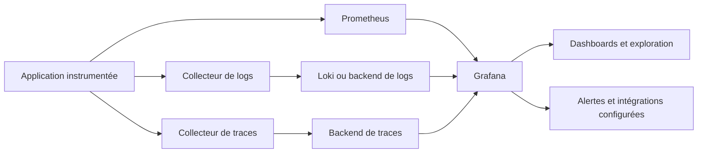
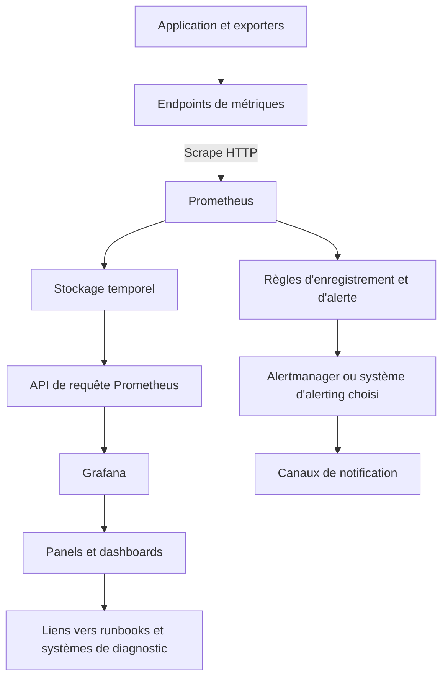
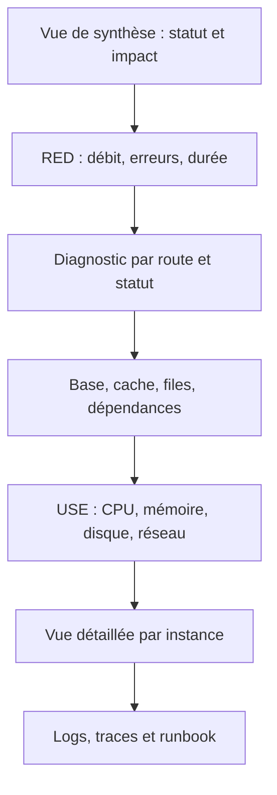
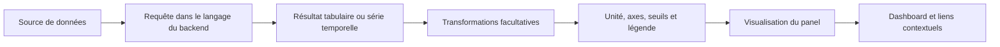
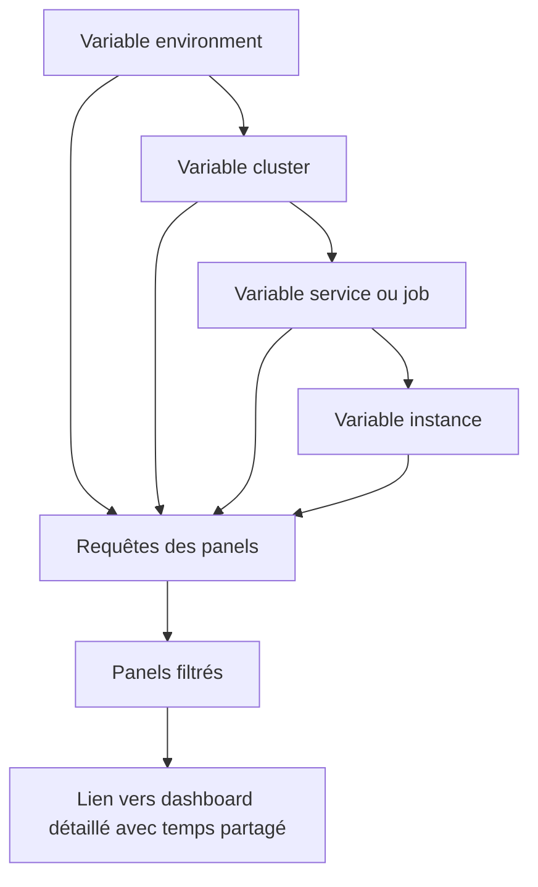
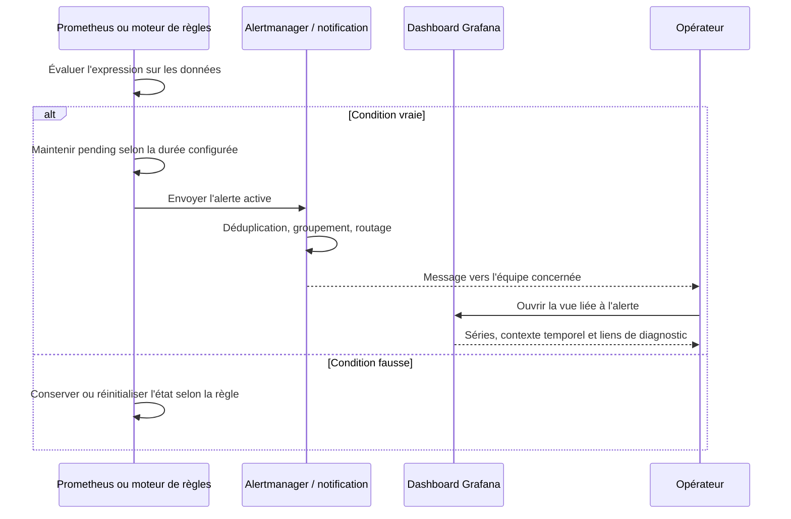

# Dashboards avec Grafana

## 1. Introduction

### 1.1. Pourquoi un dashboard est un outil d'exploitation, pas une décoration

Dans une infrastructure informatique, la quantité de données disponibles augmente rapidement : métriques système, statistiques réseau, temps de réponse d'API, événements de sécurité, traces distribuées, journaux applicatifs, états de bases de données et résultats de traitements planifiés. Pourtant, disposer de données ne garantit pas de comprendre ce qui se passe. Durant un incident, l'équipe doit identifier le périmètre touché, l'impact utilisateur, le moment où la dégradation a commencé, les dépendances qui se comportent anormalement et les actions à tenter en premier. Un dashboard bien conçu réduit le temps nécessaire pour répondre à ces questions.

Grafana est une plateforme de visualisation et d'exploration de données d'observabilité. Elle se connecte à des sources de données comme Prometheus, Loki, Elasticsearch et d'autres systèmes compatibles, puis transforme les résultats de requêtes en panneaux visuels. Elle n'est pas elle-même le système de collecte universel ni le stockage primaire de toutes les données. Dans une architecture courante, Prometheus collecte et stocke les métriques, Loki ou un autre système conserve les logs, un backend de tracing conserve les traces, et Grafana interroge ces sources afin de proposer une vue unifiée.

Un dashboard n'est donc pas une simple page qui contient beaucoup de courbes. Il doit raconter une histoire opérationnelle, répondre à une question claire et guider vers l'étape suivante. Une vue de synthèse peut montrer qu'un service se dégrade ; une vue de service doit permettre d'examiner débit, erreurs et latence ; une vue technique peut alors détailler les instances, la saturation, les dépendances et les changements récents. Cette organisation hiérarchique réduit le besoin de chercher au hasard parmi des dizaines de graphiques.

L'enjeu n'est pas de montrer toutes les mesures disponibles. Il s'agit de sélectionner les informations qui permettent de décider. Un dashboard surchargé augmente le temps d'interprétation et peut masquer le signal important parmi les détails. À l'inverse, une vue trop simplifiée peut donner une impression de santé sans révéler les problèmes localisés. L'équilibre se construit à partir de la mission de l'utilisateur : opérateur NOC, astreinte SRE, administrateur système, développeur d'application ou responsable de service.

> **Mise en contexte — vous êtes responsable de la supervision d'une plateforme de commerce en ligne.** Lors d'une campagne commerciale, le tableau de bord indique que les serveurs sont disponibles, mais le service de paiement devient lent et quelques utilisateurs signalent des erreurs. Votre mission est de construire une vue qui distingue le volume des requêtes, les erreurs, les latences, la saturation des ressources et la santé des dépendances. Vous devez ensuite permettre à l'équipe de passer du signal global à l'instance ou à l'opération problématique, sans perdre le contexte temporel.

### 1.2. Les objectifs d'un dashboard professionnel

Un dashboard professionnel doit d'abord préciser son public et son usage. Une vue d'équipe d'astreinte n'a pas le même objectif qu'une vue de capacité mensuelle. La première doit répondre rapidement à la question « quel service est impacté et que vérifier ensuite ? ». La seconde peut privilégier les tendances, les comparaisons entre périodes, les projections et les coûts. Des panneaux similaires peuvent apparaître dans ces deux vues, mais leur ordre, leur granularité et les indicateurs de priorité seront différents.

Le deuxième objectif est de diminuer le temps de diagnostic. L'utilisateur doit comprendre les axes, les unités, les légendes, les labels et les seuils sans ouvrir la requête source à chaque observation. La troisième est de standardiser l'analyse : deux services comparables devraient présenter les mêmes indicateurs dans un ordre cohérent. La quatrième est de guider l'exploration avec des variables, des liens, des annotations et des vues détaillées. La cinquième est d'éviter la prolifération de dashboards presque identiques qui divergent au fil du temps.

Il faut distinguer **visualisation**, **exploration** et **alerte**. La visualisation permet de voir la tendance. L'exploration permet de formuler et tester des hypothèses avec des filtres ou requêtes. L'alerte demande une intervention selon une règle et un processus opérationnel. Un panel rouge peut aider à remarquer un problème, mais il ne remplace pas une alerte évaluée de manière fiable, routée vers la bonne équipe et associée à une politique de notification. Les alertes Grafana peuvent être utiles dans certains environnements, tandis que d'autres équipes préfèrent conserver les règles dans Prometheus ou une plateforme spécialisée. Il faut choisir une source d'autorité claire et documenter le mécanisme.

### 1.3. La place de Grafana dans une architecture d'observabilité

Grafana interroge les sources de données via leurs APIs ou leurs protocoles pris en charge. Un panel contient une ou plusieurs requêtes, puis transforme le résultat en une visualisation : série temporelle, jauge, valeur stat, tableau, heatmap, histogramme, état dans le temps ou autre type de présentation. Le dashboard contient les panels, les contrôles de temps, les variables et les liens nécessaires à une exploration coordonnée.



Cette architecture permet de corréler plusieurs familles de signaux, mais elle ne signifie pas que Grafana fusionne automatiquement toutes les sources en une seule vérité. Chaque backend conserve sa propre sémantique, sa rétention, ses droits et son mode de requête. Une valeur peut être absente du dashboard parce que la source ne l'a pas collectée, parce que la requête est incorrecte, parce qu'une variable filtre tout, parce que la période est trop courte ou parce que l'utilisateur n'a pas les droits nécessaires.

Le rôle de Grafana est donc d'orchestrer l'exploration et la présentation. Il faut diagnostiquer séparément la disponibilité de la source, les droits d'accès, les résultats de requête et les paramètres de visualisation. Une courbe vide n'est pas une preuve que le service n'a pas fonctionné. Elle peut être un problème de données, de requête, de période, de filtres ou de rendu.

### 1.4. La chaîne fondamentale : source, requête, panel, dashboard

Une **source de données** décrit comment Grafana accède à un backend. Elle comprend notamment un type, un nom, une URL ou une configuration de connexion, et éventuellement des paramètres d'authentification. Une **requête** utilise le langage du backend ; par exemple, PromQL pour Prometheus, LogQL pour Loki ou SQL pour une source compatible. Un **panel** combine la requête avec une visualisation, les unités, les axes, les seuils, les légendes et des transformations éventuelles. Un **dashboard** rassemble plusieurs panels et définit le contexte partagé : période, variables, liens, annotations, rafraîchissement et organisation de la page.

La qualité de chaque couche influence les suivantes. Une source mal configurée rend toutes les requêtes inutilisables. Une requête qui agrège trop tôt perd des dimensions nécessaires au diagnostic. Un panel dont l'unité est erronée montre une valeur trompeuse. Un dashboard mal organisé rend l'ensemble difficile à utiliser même lorsque les données sont correctes.

La conception commence donc par une question opérationnelle. Par exemple : « Le taux d'erreur du paiement a-t-il augmenté ? » Il faut identifier la métrique qui compte les erreurs et le trafic, choisir une fenêtre de calcul, définir le ratio, puis le visualiser en pourcentage avec un titre et une description clairs. Ensuite, on relie le panel à une vue plus détaillée des erreurs par route ou instance. À ce stade, le graphique joue un rôle précis plutôt que d'être une décoration.

### 1.5. Les signaux RED et USE

La méthode RED décrit un service à travers le **débit**, les **erreurs** et la **durée** des requêtes. Elle est particulièrement utile pour les API et les services orientés utilisateur. Elle répond à trois questions : combien de demandes arrivent, combien échouent et combien de temps elles prennent ? Elle permet de construire une première rangée de panels cohérente pour une application.

La méthode USE concerne plutôt les ressources : **utilisation**, **saturation** et **erreurs**. Elle aide à évaluer CPU, mémoire, stockage, interfaces et autres composants. Une forte utilisation n'est pas nécessairement un problème, mais la saturation, les files d'attente ou les erreurs peuvent indiquer que la ressource ne répond plus au besoin. Il est souvent utile d'ajouter des vues système après avoir identifié le symptôme côté service.

Les quatre signaux d'or souvent utilisés en fiabilité sont la latence, le trafic, les erreurs et la saturation. Ils permettent de ne pas confondre la santé d'un serveur avec l'expérience d'un utilisateur. Les panneaux RED révèlent l'impact ; les panneaux USE contribuent à en chercher les causes. Les deux approches sont complémentaires et doivent s'organiser dans l'ordre qui facilite l'intervention.

### 1.6. Comprendre l'utilisateur et le parcours de diagnostic

Avant de créer des panels, identifiez les personnes qui vont les utiliser. Un opérateur NOC a besoin d'identifier la priorité, le périmètre, l'ancienneté et le propriétaire. Un SRE doit comparer les indicateurs de service avec les ressources et les dépendances. Un développeur peut rechercher une route, une version applicative ou un déploiement. Un responsable d'exploitation peut vouloir comparer la tendance et la capacité à moyen terme.

Le dashboard doit donner assez de contexte pour éviter d'interpréter le graphique isolément. Le titre doit préciser ce qui est mesuré et dans quel périmètre. L'unité doit être évidente. La légende doit distinguer les séries utiles. Les seuils doivent avoir un sens connu. La période doit être visible et cohérente avec la question. Les panels doivent être ordonnés pour permettre un passage du général au spécifique. Les liens doivent conduire vers des vues ou systèmes qui aident à poursuivre l'investigation.

Un utilisateur en incident ne devrait pas avoir à deviner si un chiffre est un nombre de requêtes, un débit par seconde ou un total depuis le démarrage. Il ne devrait pas non plus devoir rechercher manuellement la bonne cible dans un dashboard séparé, si un lien contextuel peut lui fournir la vue détaillée. L'expérience du tableau de bord mérite des tests d'usage, au même titre que les requêtes et alertes.

## 2. Concepts clés

### 2.1. Configurer et gouverner les sources de données

Grafana peut enregistrer plusieurs sources de données de même type ou de types différents. Pour Prometheus, la source pointe généralement vers l'URL du serveur Prometheus ou d'un backend compatible. Le nom de la source est utilisé dans les dashboards et les variables. Les identifiants et la configuration de sécurité doivent être stockés selon les mécanismes disponibles dans l'environnement.

Une source de données peut être créée depuis l'interface d'administration, via le provisionnement ou par une API, selon les permissions et le modèle de déploiement. Dans tous les cas, il faut vérifier la connectivité depuis le serveur Grafana ou son environnement d'exécution. Une URL accessible depuis le navigateur du développeur n'est pas nécessairement accessible depuis le conteneur Grafana. L'erreur de source peut venir du DNS, du pare-feu, du certificat, de l'authentification ou de la disponibilité du backend.

Le nom de la source doit être explicite : par exemple Prometheus-Production ou Prometheus-Preproduction, plutôt que DataSource1. Les noms font partie du contrat des dashboards. Si un dashboard cible une source supprimée ou renommée, il peut perdre toutes ses données. Dans les environnements multiples, les variables de source peuvent permettre de réutiliser un dashboard, mais il faut vérifier que les sources sélectionnées exposent les mêmes métriques et labels.

La gouvernance des sources comprend la permission d'interrogation, la gestion des identifiants, le chiffrement des connexions, les timeouts et la limitation des accès. Un dashboard qui interroge une base de production peut exposer des informations sensibles même si son auteur n'a pas accès directement à toute l'application. Les droits des lecteurs et éditeurs doivent être pensés à l'échelle de la plateforme, pas uniquement au niveau des panels.

### 2.2. Créer un dashboard et comprendre les panels

Un dashboard est une page composée de panels. Chaque panel possède une requête ou plusieurs requêtes, un type de visualisation, des options de rendu et des informations complémentaires comme son titre, sa description, sa légende et ses liens. La création pratique consiste à choisir la source, écrire ou construire une requête, sélectionner la visualisation adaptée, définir les unités et seuils, puis sauvegarder le dashboard.

Les panels devraient être suffisamment indépendants pour être compris, mais assez cohérents pour raconter une histoire. Un panel « requêtes/s » peut être suivi d'un panel « taux d'erreur » et d'un panel « p95 de latence ». Une rangée plus bas peut montrer la CPU, les connexions à la base et la taille de la file d'attente. Les titres doivent communiquer une mesure et un périmètre. « API — p95 de latence » est plus utile que « Graphique 4 ».

Le choix de la visualisation dépend du sens de la donnée. Une série temporelle convient aux tendances. Un stat convient à une valeur synthétique comme le nombre de cibles en panne. Une jauge peut illustrer une valeur par rapport à un intervalle, mais elle ne remplace pas une tendance historique. Un tableau convient à un classement ou à une liste d'instances. Une heatmap peut représenter une distribution et son évolution. N'utilisez pas une jauge pour chaque métrique simplement parce qu'elle semble visuellement attractive.

Les options du panel doivent préserver l'honnêteté de la représentation. Des axes trop étendus peuvent rendre une variation importante invisible ; des axes tronqués peuvent exagérer une différence. Des unités mélangées sur le même axe rendent les courbes difficiles à comparer. Des séries empilées peuvent masquer la contribution individuelle. L'objectif est de montrer la relation réelle, pas d'obtenir un graphique spectaculaire.

### 2.3. Construire une première vue de service

Pour une API, un tableau de bord de départ peut s'organiser ainsi :

1. une rangée de synthèse : disponibilité, débit, taux d'erreur et p95 ;
2. une rangée de diagnostic : erreur par route, latence par route, volume par code de statut ;
3. une rangée de capacité : CPU, mémoire, connexions de base de données, longueur de file ;
4. une rangée d'exploitation : état des targets, alertes actives, déploiements et événements récents.

Cette organisation place le signal d'expérience utilisateur avant les indicateurs de ressource. Elle évite de commencer par CPU, RAM et disque sans savoir si ces dimensions sont liées au problème rencontré. Elle aide aussi à comparer des services de manière cohérente quand les équipes utilisent des modèles de dashboard communs.

L'ordre des panels devrait suivre le parcours de l'utilisateur et la chaîne causale probable. Si le trafic et les erreurs se dégradent en même temps, on peut ensuite inspecter les dépendances. Si seule une route pose problème, une vue globale de l'infrastructure n'est pas la première réponse. Si les targets sont absentes, il faut résoudre la collecte avant de conclure que le service est revenu à l'état normal.

### 2.4. Variables de dashboard

Les variables sont des paramètres réutilisables qui permettent au lecteur de changer le contexte affiché sans modifier chaque requête manuellement. Elles sont couramment utilisées pour choisir un environnement, un cluster, un job, une instance, une région ou une source de données. Grafana affiche souvent ces choix sous forme de listes en haut du dashboard.

Sans variables, une équipe peut finir avec un dashboard par serveur, un par environnement et un par région. Cette duplication augmente le nombre d'objets à maintenir et provoque des divergences. Une variable permet de construire un tableau de bord partagé qui s'adapte au contexte choisi.

Exemple de requête PromQL où la variable job filtre le service :

```promql
sum by (instance) (rate(http_requests_total{job=~"$job"}[5m]))
```

La forme exacte du filtre dépend de la variable et de son mode de sélection. Si plusieurs valeurs sont possibles, une expression régulière peut être utilisée dans le sélecteur. Si la variable est configurée pour autoriser une sélection multiple, il faut tester la requête avec une seule valeur, plusieurs valeurs et la valeur « All ». Une variable mal configurée peut rendre les panels vides sans que la source soit en panne.

Les variables doivent être ordonnées selon une logique de dépendance. Par exemple, environnement puis cluster puis instance. Cela permet de réduire le nombre de choix au fur et à mesure. Une variable doit fournir des valeurs cohérentes ; un champ de texte libre peut être dangereux si l'utilisateur peut créer une requête excessivement large ou choisir un périmètre non autorisé. Utilisez la liste des valeurs réellement disponibles lorsque c'est possible.

### 2.5. Requêtes, transformations et calculs

Une requête interroge la source et renvoie une ou plusieurs séries, tables ou valeurs. Une transformation agit ensuite sur le résultat dans Grafana : filtrer, renommer, joindre, pivoter, organiser ou convertir les données. Les transformations sont pratiques pour une présentation rapide, mais elles ne doivent pas cacher une erreur de modèle de données ni remplacer systématiquement une requête adaptée au backend.

Les transformations sont exécutées lors de la préparation du résultat pour la visualisation. Une jointure de grandes tables peut être coûteuse, et combiner des données provenant de sources différentes nécessite des clés fiables. Une transformation peut aussi créer une apparence correcte tout en retirant un label nécessaire pour comprendre l'origine d'une ligne. Il faut s'assurer que l'opération préserve le sens et les unités.

Lorsque l'agrégation peut être faite naturellement dans PromQL ou SQL, il est souvent préférable de la faire à la source, surtout pour réduire le volume transféré. Les transformations de Grafana sont particulièrement utiles lorsque le besoin est surtout de présentation ou que plusieurs résultats doivent être combinés à l'écran. Les calculs opérationnels utilisés dans une alerte doivent rester cohérents avec le calcul présenté dans le dashboard. Si la même mesure est calculée différemment à deux endroits, les équipes peuvent voir une alerte et une courbe contradictoires.

### 2.6. Unités, légendes et seuils

L'unité est une partie de la sémantique. Un débit doit être exprimé en requêtes par seconde, une durée en secondes ou millisecondes de manière cohérente, une quantité de mémoire en octets ou unités binaires appropriées, et un ratio en pourcentage si c'est l'interprétation retenue. Le formatage de l'unité ne change pas les valeurs sous-jacentes, mais influence fortement la manière dont l'utilisateur lit le résultat.

Les légendes devraient révéler les dimensions utiles sans produire une longue chaîne de labels. Par exemple, afficher instance et route peut être pertinent pour un panel de diagnostic, tandis qu'un panel global devrait afficher une seule série par service. Trop de séries rendent le graphique illisible. Trop peu de séries peuvent masquer une instance en difficulté. Le niveau de détail doit correspondre au rôle du panel.

Les seuils peuvent colorer une valeur ou un panel selon des conditions définies. Utilisez-les pour signaler une catégorie opérationnelle, pas pour multiplier les couleurs décoratives. Une valeur de 70 % ne doit pas devenir automatiquement orange sur tous les systèmes : le seuil doit refléter le risque et la capacité de la ressource. Les couleurs doivent rester cohérentes dans les dashboards et être accompagnées d'une unité, d'un contexte et d'un titre explicite.

Ne comptez pas uniquement sur la couleur pour communiquer un état. Une information devrait rester compréhensible pour un utilisateur qui ne distingue pas certaines couleurs ou qui lit une impression monochrome. Ajoutez un nom d'état, une valeur et éventuellement une légende. La couleur est un renfort visuel, pas le seul porteur de sens.

### 2.7. Plages temporelles et rafraîchissement

Grafana permet au lecteur de choisir une période, par exemple les quinze dernières minutes, les dernières heures ou une plage personnalisée. Ce contrôle du temps est essentiel pour comparer les événements et les tendances. Une vue d'incident utilise souvent une fenêtre récente ; une analyse post-incident peut examiner plusieurs heures ; une revue de capacité peut porter sur plusieurs semaines ou mois.

Le rafraîchissement automatique actualise les données à intervalles réguliers. Il doit être adapté à la fréquence des sources et à l'usage du dashboard. Un système qui reçoit des données toutes les heures n'a pas besoin d'être interrogé toutes les dix secondes. Un refresh trop fréquent peut augmenter les requêtes, la charge du backend et le trafic sans améliorer l'information disponible. Pour une vue NOC temps réel, un rafraîchissement plus court peut être justifié si la source dispose de la capacité nécessaire.

La plage de temps doit correspondre à la question. Une requête rate() sur cinq minutes affichée sur douze heures utilise une fenêtre de calcul glissante ; elle ne représente pas une moyenne de douze heures. Un panel de taux d'erreur sur cinq minutes peut donc montrer les variations instantanées dans une vue plus longue, alors qu'une requête calculée sur une heure les lisserait. Le dashboard doit rendre ce choix compréhensible et cohérent avec les décisions prises.

Les dashboards devraient aussi indiquer le fuseau horaire et conserver un contexte temporel lorsqu'on ouvre un lien vers une vue détaillée. Les paramètres de temps partagés facilitent la corrélation avec les logs, les traces ou les événements de déploiement. Sans ce contexte, l'utilisateur peut comparer des périodes différentes et tirer une conclusion incorrecte.

### 2.8. Variables de source, répétition et réutilisation

Une variable de source permet, lorsque l'environnement le prend en charge, de choisir un backend au sommet du dashboard. Elle peut être utile lorsque plusieurs environnements disposent d'une source de même type avec des métriques comparables. Une variable de cluster ou d'instance permet ensuite de filtrer les séries. Cette organisation évite de maintenir une copie pour la production et une autre pour la préproduction, si la structure des métriques et des labels est cohérente.

Les lignes et panels répétables peuvent construire une vue par service ou instance à partir d'une variable. Ils évitent de dupliquer manuellement le même panel, mais peuvent créer beaucoup d'éléments si la variable contient des centaines ou milliers de valeurs. Il faut choisir si la variable doit autoriser une sélection unique ou multiple, et prévoir une vue synthétique lorsque le périmètre est très grand.

La réutilisation doit être gouvernée. Un dashboard de référence devrait avoir un propriétaire, une description et une méthode de modification. Les copies doivent être limitées et clairement identifiées. Si une équipe veut simplement sélectionner une autre instance, une variable est généralement préférable à la copie complète du dashboard. Si le besoin opérationnel diffère réellement, une vue distincte peut se justifier.

### 2.9. Annotations et corrélation avec les événements

Les annotations marquent un événement sur un axe temporel : déploiement, incident, changement de configuration, démarrage d'une maintenance ou modification d'une capacité. Elles peuvent être créées manuellement ou obtenues depuis une source d'événements compatible. Leur valeur vient de la corrélation : une hausse de latence qui apparaît exactement au moment d'un déploiement justifie une hypothèse différente d'une hausse qui suit la croissance du trafic plusieurs heures plus tard.

Une annotation ne prouve pas que l'événement est la cause du symptôme. Elle donne du contexte et facilite l'investigation. Les annotations doivent avoir un horodatage correct, un nom compréhensible et éventuellement un lien vers le déploiement, le ticket ou le compte-rendu. Les étiquettes peuvent servir à filtrer les événements. Évitez les annotations qui reproduisent de gros blocs de log sans structure ou qui exposent des détails sensibles.

Les événements d'exploitation peuvent également être visualisés dans une timeline ou un panel dédié. Cette vue est utile pour les équipes qui veulent comparer des incidents à des modifications sur plusieurs périodes. Le dashboard devrait rendre les événements importants faciles à distinguer des annotations mineures, tout en gardant la possibilité de les filtrer selon le service ou l'environnement.

### 2.10. Navigation et liens contextuels

Une bonne architecture de dashboards réduit l'errance. Un tableau global mène vers un dashboard de service ; un panel de service mène vers le détail d'une instance ; une alerte contient un lien vers la vue qui permet de diagnostiquer la condition. Les liens peuvent transmettre des variables et la plage de temps. Un panel peut aussi fournir des liens externes vers un système de tickets, un outil de déploiement, un dépôt de code ou un runbook.

Un lien contextuel doit transmettre le bon périmètre. Si l'utilisateur clique sur une courbe d'instance, le dashboard suivant devrait idéalement ouvrir la même instance, le même service et la même fenêtre. Sans paramètres, l'utilisateur doit reconstituer manuellement ce contexte. C'est une perte de temps particulièrement coûteuse pendant un incident.

Les liens doivent respecter les droits d'accès. Un lien vers une base de logs ou un ticket sensible ne doit pas contourner les contrôles du système cible. Les paramètres de l'URL ne doivent pas servir à transmettre des secrets. Les destinations externes doivent être documentées et maintenues, car une bibliothèque de dashboards remplie de liens cassés devient une dette de support.

### 2.11. Dashboards de service et stratégie hiérarchique

Une organisation peut disposer d'un tableau de bord de vue d'ensemble, de dashboards par produit ou service, et de vues de composants techniques. Le dashboard global répond à « que faut-il examiner maintenant ? ». Le dashboard de service répond à « le contrat de ce service est-il respecté, et quelles dimensions se dégradent ? ». Le dashboard d'instance ou de dépendance répond à « quel composant précis explique le symptôme ? ».

Une telle hiérarchie doit refléter les dépendances réelles. L'ordre de navigation peut suivre le chemin utilisateur : frontend, API, cache, base de données, file. Les équipes responsables peuvent être identifiées dans des descriptions ou tags. Les vues ne doivent pas toutes présenter le même niveau de détail. Sinon, le dashboard global devient illisible, tandis que la vue technique ne contient pas les détails dont le diagnostic a besoin.

Un tableau de bord devrait être abandonné ou simplifié lorsqu'il n'est plus utilisé, si ses requêtes sont cassées ou si son but n'est pas clair. Les dashboards de test devraient être identifiés comme temporaires. La recherche de dashboards, les tags, les dossiers et les liens sont des éléments de gouvernance, pas seulement des fonctions de classement.

### 2.12. Alertes Grafana et alertes provenant d'autres systèmes

Grafana possède des fonctionnalités d'alerting qui peuvent évaluer des règles, regrouper les alertes et envoyer des notifications vers des contacts ou intégrations. Il peut aussi afficher les alertes produites par d'autres systèmes selon les sources et les intégrations configurées. Le choix doit définir clairement quel système fait autorité pour chaque type de règle.

Si Prometheus et Grafana évaluent des règles similaires sans gouvernance, le même incident peut produire plusieurs alertes, avec des seuils, des délais et des messages différents. Si un seul outil est chargé de l'évaluation mais que l'autre gère la notification, la frontière doit être documentée. Le plus important est de savoir où modifier la condition, où se trouve l'historique et qui reçoit l'alerte.

Une alerte doit être liée à un risque actionnable. La couleur rouge d'un panel ne déclenche pas, à elle seule, un processus d'astreinte fiable. Les règles doivent définir l'expression, la condition de maintien si disponible, les labels, les annotations, le contact ou la politique de notification, ainsi que le comportement quand les données sont absentes ou en erreur. Testez les scénarios normaux, dégradés et de récupération.

### 2.13. RBAC, dossiers et partage

Le contrôle d'accès basé sur les rôles permet de séparer les capacités de lecture, édition et administration. Un lecteur d'un dashboard n'a pas nécessairement besoin de pouvoir modifier sa requête ou de configurer une source de données. Un propriétaire de service peut avoir besoin d'éditer un ensemble de dashboards, tandis qu'un administrateur de plateforme maintient les plugins, les sources et les permissions globales.

Les dossiers regroupent les dashboards par domaine ou fonction et peuvent servir de frontière organisationnelle selon l'édition, la configuration et le modèle de permissions. Il faut éviter de donner à tous les utilisateurs un rôle d'éditeur global simplement pour qu'ils changent un filtre. Les variables sont précisément conçues pour laisser le lecteur adapter sa vue sans modifier la définition du dashboard.

Le partage doit tenir compte de la sensibilité des données. Un dashboard peut révéler la structure d'un réseau, la charge d'un service, les noms des cibles, les incidents et des informations sur les déploiements. Les liens partagés ou captures d'écran peuvent diffuser ces détails au-delà du groupe prévu. Appliquez le moindre privilège, vérifiez les liens publics ou intégrations anonymes si elles existent dans votre contexte, et révisez régulièrement les comptes.

### 2.14. Provisionnement, versionnement et déploiement

Les dashboards peuvent être créés depuis l'interface puis exportés ou gérés par des fichiers et mécanismes de provisionnement pris en charge par l'installation. Les sources de données, dashboards, dossiers et règles peuvent faire partie d'un processus de configuration as code, selon les fonctionnalités disponibles. Le versionnement permet de relire les changements, de comparer les versions, de revenir en arrière et de déployer des objets cohérents entre environnements.

Un dashboard à fort usage ne devrait pas dépendre uniquement d'un clic manuel réalisé par une personne dont personne ne connaît le changement. Le JSON de dashboard, les requêtes, les variables, les descriptions et les dépendances devraient être revus lorsqu'ils sont gérés dans Git. Les environnements de test permettent de vérifier les changements avant qu'ils n'affectent les équipes de production. Les secrets restent en dehors des fichiers versionnés et sont injectés selon les mécanismes sécurisés du système.

Les modifications de modèles ou de panels réutilisés peuvent affecter de nombreuses vues. Une variable renommée peut casser plusieurs requêtes. Une source de données renommée peut rendre des dashboards vides. Un changement de label dans Prometheus peut faire disparaître une série. Le processus de mise en production doit tester les panels critiques, vérifier le rendu et conserver une procédure de retour arrière.

### 2.15. Performance des dashboards

Un dashboard peut ralentir même si le serveur Grafana semble disponible. Les requêtes peuvent parcourir trop de séries, les panels peuvent lancer plusieurs requêtes lourdes, le refresh peut être trop fréquent et les transformations peuvent manipuler de gros résultats. Le volume de points renvoyés, le nombre de panels, la durée de la période et la cardinalité du backend influencent la charge.

Pour améliorer les performances, simplifiez les expressions, agrégerez à la source quand cela est pertinent, utilisez des fenêtres adaptées, évitez les séries inutiles et vérifiez les requêtes lentes. Les règles d'enregistrement peuvent accélérer des agrégations répétées côté Prometheus. Un intervalle de rafraîchissement plus long peut réduire la charge lorsque la fraîcheur immédiate n'est pas nécessaire. Les dashboards de capacité n'ont souvent pas besoin d'un rafraîchissement identique à celui d'une vue NOC.

Le réglage du nombre maximal de points, de la résolution et des intervalles des requêtes dépend des versions de Grafana, des sources de données et des options disponibles. Ne copiez pas aveuglément un paramètre trouvé dans un tutoriel ancien. Mesurez la durée, observez les requêtes dans le backend et testez les changements sur des périodes représentatives. Un panneau plus rapide n'est utile que si la réduction de coût ne masque pas une information nécessaire.

### 2.16. Gestion de la qualité et de l'absence de données

Une donnée absente peut résulter de la panne de la source, de l'échec d'une requête, de la disparition d'une cible, d'un filtre qui ne correspond plus aux labels, d'un intervalle trop court ou de l'absence naturelle de trafic. Il faut distinguer « zéro événement » de « aucune mesure disponible ». Les panels doivent montrer cette distinction plutôt que remplacer systématiquement une absence par zéro.

Les séries de compteur peuvent ne pas exister avant le premier événement si l'application n'initialise pas leur valeur. Une métrique d'erreur inexistante n'est pas toujours équivalente à zéro erreur. Pour éviter les ambiguïtés, l'instrumentation peut exposer de manière cohérente les catégories attendues, et les requêtes peuvent utiliser des constructions adaptées lorsqu'un zéro explicite est correct. Cependant, une valeur par défaut ne doit pas masquer une panne de collecte.

La qualité des données inclut aussi les unités, l'horodatage, la fraîcheur, la stabilité des labels et le respect du type de métrique. Un dashboard devrait avoir une méthode claire pour signaler les panels qui n'ont plus de données et les sources qui ne répondent pas. Une vue globale de monitoring doit montrer l'état de la plateforme de collecte elle-même.

### 2.17. Les dashboards comme documentation vivante

Un dashboard peut documenter un service : son objectif, ses propriétaires, ses dépendances, ses métriques principales, ses seuils et les liens vers les procédures. Un panneau texte ou une description peut expliquer la signification d'une mesure, le calcul utilisé, la limite connue et le comportement attendu. Cette documentation aide un nouvel intervenant et évite que le sens d'une requête ne soit perdu après le départ de son auteur.

Toutefois, un dashboard ne devrait pas remplacer une documentation détaillée d'architecture ou un runbook. Il fournit un contexte rapide et un accès vers les sources. Le runbook doit décrire les actions, les autorisations, les critères d'escalade, les risques et le retour au fonctionnement normal. Les graphes apportent des preuves ; la procédure explique quoi faire avec ces preuves.

Les dashboards qui n'ont plus de propriétaire, dont les panels cassent ou dont les variables ne fonctionnent plus doivent être révisés. Une revue régulière peut examiner les usages, les liens, les sources de données et les requêtes. La gouvernance est plus efficace si chaque dashboard possède un but écrit et une équipe responsable.

## 3. Architecture et Schémas

### 3.1. Flux complet de Prometheus vers Grafana



Ce flux distingue la collecte, le stockage, la visualisation et la notification. Grafana interroge la source et rend les résultats. Le mécanisme d'alerte peut se trouver dans Prometheus et Alertmanager ou dans Grafana, selon le choix de l'équipe et la configuration de l'environnement. La frontière doit être claire pour éviter les doubles alertes ou les divergences de seuils.

### 3.2. Structure d'un dashboard de service



L'ordre suit du symptôme vers les causes possibles. Il ne signifie pas qu'il faut toujours descendre toutes les couches. Lorsqu'une dépendance est clairement indisponible, le diagnostic peut s'orienter directement vers celle-ci. Le dashboard doit réduire le nombre de clics et conserver les paramètres du service, de l'instance et du temps entre les vues.

### 3.3. Source de données, requête, transformation et panel



Si le résultat est incorrect, vérifiez d'abord la requête et la source. Si la valeur est juste mais difficile à lire, examinez les unités, la légende et la visualisation. Les transformations sont utiles pour la présentation, mais ne doivent pas servir à dissimuler une incohérence de données. Une décision d'alerte doit reposer sur une règle fiable, pas uniquement sur le rendu d'un panel.

### 3.4. Variables et navigation guidée



Cette hiérarchie doit être cohérente avec les labels réellement disponibles. Si une variable dépend d'une autre, son filtre doit utiliser le choix du niveau précédent. Il faut tester les cas de valeur unique, sélection multiple et toutes les valeurs, ainsi que la situation où aucun résultat ne correspond. Le lien de détail doit transmettre les paramètres utiles et ne pas exposer de secrets dans l'URL.

### 3.5. Cycle de vie d'une alerte



Le moteur qui évalue l'alerte et le système qui notifie sont deux rôles distincts. La durée de maintien, le routage et la politique de répétition influencent le délai et le volume des messages. L'alerte devrait relier l'opérateur à un dashboard qui montre réellement l'expression et les dimensions responsables de l'incident.

### 3.6. Tableau de bord multi-sources

Dans un contexte d'observabilité, Grafana peut rapprocher des données issues de backends différents : métriques Prometheus, logs Loki, traces d'un backend compatible et autres sources. Cela ne veut pas dire que les modèles de données sont fusionnés automatiquement. Les systèmes restent indépendants et les requêtes sont exécutées selon le langage de chaque source. La corrélation dépend des labels, horodatages, identifiants de trace et liens configurés.

Un dashboard multi-sources devrait privilégier des identifiants cohérents et stables. Un service nommé payment-api dans les métriques mais payment-service-v2 dans les logs est difficile à corréler. Les conventions de labels et les variables doivent être définies au niveau de l'organisation. Les informations temporelles doivent être synchronisées, car des horloges décalées rendent l'analyse des incidents trompeuse.

## 4. Étude de cas

### 4.1. Situation initiale

La plateforme de commerce comprend une API, un frontend, une base de données et plusieurs workers. Le dashboard actuel présente le CPU, la mémoire et le nombre de machines actives. Lors d'une campagne, les plaintes augmentent, mais les panneaux système ne permettent pas de trouver la cause. Le premier travail consiste à établir les quatre questions RED : quel est le débit de requêtes, quel est le taux d'erreur, quelle est la durée des réponses et comment ces valeurs varient-elles par service ou route ?

Les équipes applicatives exposent http_requests_total et un histogramme de durée. L'instrumentation utilise des routes normalisées, une méthode et une classe de statut. Elle évite les labels d'identifiant client ou de commande. Les exporters système exposent la CPU, la mémoire, l'espace disque et les compteurs réseau. La base et les workers exposent les métriques de connexions, d'attente et de durée des traitements.

Grafana est configuré avec Prometheus comme source de données. Une première vue comporte les indicateurs globaux, puis une vue par service et une vue technique. Les panels possèdent des titres explicites, des unités, des descriptions et des liens vers la procédure de diagnostic. Les variables environment, job et instance évitent de créer une copie du dashboard pour chaque hôte. L'équipe peut changer de périmètre sans altérer la définition commune.

### 4.2. Créer les sources et vérifier les données

Dans Grafana, l'administrateur ajoute une source Prometheus pointant vers le serveur de métriques. Le point à vérifier est la connectivité depuis l'environnement où Grafana s'exécute, et non uniquement depuis le poste d'administration. Le test de la source est suivi d'une requête simple telle que up, puis par les requêtes de métriques fonctionnelles. Le lecteur confirme ensuite que le job attendu et ses targets apparaissent.

La page Targets de Prometheus aide à déterminer si la collecte fonctionne. Si la source Grafana est joignable mais qu'une cible est DOWN, le problème se situe potentiellement dans le scrape ou la cible, pas dans Grafana. Si la cible est UP mais que la requête http_requests_total ne retourne rien, la métrique peut ne pas exister sous ce nom ou ne pas être initialisée tant qu'aucune requête n'a été comptée. Il faut inspecter les métriques exposées et les labels.

La source est nommée Prometheus-Production et son usage est documenté. Une source différente est utilisée pour la préproduction. Les permissions empêchent les comptes non autorisés d'accéder à des sources sensibles. Les identifiants ne sont pas intégrés aux dashboards ; la configuration des sources est gérée séparément et les environnements utilisent les mécanismes de secrets prévus.

### 4.3. Première rangée : débit, erreurs et latence

Le débit global peut être affiché avec :

```promql
sum by (job) (rate(http_requests_total[5m]))
```

Le taux d'erreurs peut être calculé à partir des réponses de classe 5xx :

```promql
100 *
sum by (job) (rate(http_requests_total{status=~"5.."}[5m]))
/
sum by (job) (rate(http_requests_total[5m]))
```

La formule suppose que le label status correspond aux classes de réponses et que la métrique est un compteur de requêtes. L'équipe confirme le comportement lorsque le trafic est nul et ne confond pas une absence de série avec zéro erreur. Les unités des panels sont configurées en requêtes par seconde et pourcentage, avec des titres et légendes qui présentent le service concerné.

Pour le percentile 95 des durées, l'équipe utilise l'histogramme approprié :

```promql
histogram_quantile(
  0.95,
  sum by (le, job) (
    rate(http_request_duration_seconds_bucket[5m])
  )
)
```

L'axe affiche les secondes ou une unité équivalente. Les buckets de l'histogramme doivent couvrir la gamme utile des latences. Le percentile reste une estimation, et l'équipe le complète par le volume de requêtes, la proportion au-dessus d'une limite et la comparaison par route. La moyenne seule ne suffit pas, car elle peut masquer quelques requêtes très lentes.

### 4.4. Variables, filtres et liens de détail

Le dashboard expose une variable environment qui sélectionne production ou préproduction, une variable job et une variable instance. La variable instance dépend du job sélectionné afin de ne proposer que les cibles pertinentes. Les requêtes de panel intègrent ces valeurs. L'administrateur teste les sélections unique, multiple et toutes les valeurs, puis vérifie le rendu lorsque l'ensemble sélectionné ne contient aucune donnée.

Un lien depuis le panel de latence ouvre le dashboard de diagnostic du service avec le même intervalle temporel. Un autre lien mène au runbook et au système de déploiement. Les liens ne contiennent pas de secret et respectent les droits du système cible. La description du dashboard explique ce qu'il mesure, qui l'exploite, quelles sont les limites connues et où trouver les procédures.

Les variables permettent de réutiliser la définition, mais elles ne dispensent pas d'une convention de labels. Si un job utilise team et un autre owner, une vue transversale devient plus difficile à maintenir. L'équipe adopte des noms et valeurs normalisés à l'échelle de la plateforme. Les modifications des labels sont revues pour éviter de casser les dashboards et règles déjà déployés.

### 4.5. Localiser le goulot d'étranglement

Le dashboard révèle que le débit reste élevé, que les erreurs augmentent légèrement et que le p95 de l'API dépasse le seuil. La vue par route indique que les requêtes de paiement sont lentes tandis que les consultations de catalogue restent normales. La vue de dépendances montre que la base de données atteint un nombre élevé de connexions simultanées et que la file des workers grandit. La CPU des serveurs web n'est pas saturée.

Cette situation oriente l'enquête vers la base et le traitement asynchrone. L'équipe examine les métriques de connexions, le temps de réponse des requêtes, la longueur de la file et l'âge du message le plus ancien. Elle compare la chronologie avec une annotation de déploiement. Les logs et traces permettent ensuite d'identifier qu'une modification applicative a multiplié les requêtes SQL pour les opérations de paiement.

Le dashboard ne prouve pas seul la causalité ; il réduit l'espace des hypothèses. Les preuves sont confrontées à la version déployée, aux traces et aux journaux de la base. Après correction, l'équipe confirme que le p95 et l'âge de la file diminuent, que les erreurs reviennent à la normale et qu'aucune cible n'a disparu par erreur. L'incident se termine par une amélioration de l'instrumentation et du runbook.

### 4.6. Dashboard d'astreinte et dashboard de capacité

L'équipe crée deux vues distinctes qui réutilisent certaines métriques. Le dashboard d'astreinte affiche les alertes actives, le taux d'erreur, le p95, le débit, la disponibilité de collecte et des liens vers les détails. Il est rafraîchi assez souvent pour l'exploitation et limite le nombre de panels. Le dashboard de capacité présente les tendances CPU, mémoire, stockage, croissance des séries, volumes de requêtes et utilisation des dépendances sur une période plus longue.

Cette séparation évite d'imposer les mêmes choix de temps et de granularité aux deux usages. La vue d'astreinte répond à une question immédiate ; la vue de capacité sert à comparer les périodes et anticiper les besoins. Les unités et les définitions restent cohérentes, de sorte que les équipes ne voient pas des indicateurs calculés différemment selon la page.

Les dashboards ont un owner et sont révisés périodiquement. Les panneaux inutilisés, liens cassés et requêtes coûteuses sont corrigés. La documentation et les noms des variables sont homogènes. Le dashboard de capacité ne reçoit pas un rafraîchissement toutes les quelques secondes sans besoin, car cela augmenterait la charge sans améliorer l'analyse historique.

### 4.7. Tester les erreurs et l'absence de données

L'équipe simule une panne d'exporter en environnement de test. Le panel de métriques système ne doit pas laisser penser que la machine est saine simplement parce que la dernière valeur était normale. Le statut de collecte doit montrer la perte de scrape. Le dashboard présente séparément l'état du service et l'état de ses mesures. Une alerte indique l'absence de collecte après la durée prévue.

Un deuxième test modifie un label dans l'instrumentation, ce qui fait disparaître les séries de la requête existante. La page Targets reste UP, mais un panel devient vide. Ce scénario démontre qu'une collecte réussie ne garantit pas que les noms de métriques et labels attendus sont présents. La procédure de changement doit inclure des tests de compatibilité des requêtes et une validation du dashboard après déploiement.

Un troisième test bloque le récepteur de notification. La règle reste firing, mais le message ne parvient pas à l'équipe. Le diagnostic examine l'état de la règle, la chaîne d'Alertmanager, le récepteur et ses logs. L'équipe s'assure que le système de supervision de la notification possède une voie de détection indépendante lorsque la fonction est critique.

## 5. Pièges à éviter

### 5.1. Construire un dashboard sans question précise

Un dashboard qui accumule des panels sans objectif augmente la charge cognitive et prolonge l'investigation. Chaque vue doit répondre à une mission : synthèse opérationnelle, diagnostic d'un service, capacité, réseau ou revue historique. Si un panel ne guide aucune décision, ne révèle aucune tendance utile et n'apporte aucun contexte, il devrait être supprimé ou replacé dans une vue spécialisée.

### 5.2. Confondre une source accessible et des données valides

Le test de connexion à la source ne prouve pas que toutes les métriques attendues existent. Inspectez les cibles, la fraîcheur, les noms et labels réels. Vérifiez la requête directement avant d'accuser le panel. Une source peut être disponible et un dashboard vide à cause d'un filtre, d'un renommage ou d'une période incorrecte.

### 5.3. Mettre trop de séries dans un panel

Des centaines de séries, de labels et de couleurs rendent souvent la visualisation illisible. Agrégez au niveau adapté et proposez une vue de détail pour les investigations. Utilisez les variables pour choisir une instance ou un service plutôt que d'afficher systématiquement tout le parc dans chaque panel. Vérifiez également le coût de la requête et la charge qu'elle produit sur le backend.

### 5.4. Utiliser des unités incohérentes

Une durée ne doit pas apparaître tantôt en secondes, tantôt en millisecondes sans conversion claire. Une valeur en octets ne doit pas être présentée comme une quantité en mégaoctets sans un formatage correct. Une légende explicite et une unité cohérente rendent la comparaison fiable. Les axes doubles peuvent parfois aider, mais ils doivent être utilisés avec prudence pour ne pas rendre la corrélation visuellement trompeuse.

### 5.5. Choisir le mauvais graphique

Une jauge suggère une valeur par rapport à une plage, pas une évolution temporelle complète. Un panneau stat peut résumer l'état actuel mais cacher les oscillations. Une courbe empilée peut masquer les contributions des séries. Choisissez la visualisation en fonction de la question et de la nature de la donnée, et testez le rendu avec des valeurs extrêmes, absentes et normales.

### 5.6. Actualiser trop fréquemment

Un refresh très fréquent augmente le nombre de requêtes sur Grafana et les sources. Il ne rend pas les données plus fraîches que leur rythme réel de collecte. Adaptez la fréquence à la cadence des mesures et à l'objectif. Une vue d'astreinte peut demander une actualisation rapide, alors qu'une vue de capacité ou un reporting quotidien n'en a souvent pas besoin.

### 5.7. Cacher l'absence de données derrière un zéro

Une valeur vide peut signaler un scrape interrompu, une source inaccessible ou une expression qui ne correspond plus à aucune série. La remplacer automatiquement par zéro peut donner l'impression qu'un service n'a aucun trafic ou aucune erreur. Les dashboards doivent signaler clairement l'absence de données lorsque celle-ci est significative, et présenter séparément l'état de collecte.

### 5.8. Répéter des dashboards au lieu d'utiliser des variables

Un dashboard distinct par hôte ou par environnement produit une dette de maintenance. Les corrections doivent être recopiées et finissent par diverger. Utilisez des variables et des modèles de dashboard lorsque les usages sont similaires. Réservez les dashboards séparés aux besoins opérationnels réellement différents.

### 5.9. Compter sur la couleur seule

Les couleurs doivent renforcer le sens, pas le porter seules. Affichez des valeurs, unités et libellés clairs. Conservez des règles de couleurs cohérentes entre les dashboards et testez la lisibilité en cas de contraste limité. Un état critique doit rester compréhensible dans une liste ou une capture imprimée.

### 5.10. Oublier les permissions et la confidentialité

Les dashboards exposent les données des sources auxquelles ils accèdent. Ils peuvent révéler des noms de machines, de services, de routes, de déploiements ou de ressources. Les rôles, dossiers, permissions et liens doivent respecter les frontières d'accès. Évitez de diffuser publiquement des dashboards de production ou d'insérer des secrets dans les URLs, les requêtes ou les annotations.

### 5.11. Ne pas versionner les changements

Une modification manuelle non documentée peut casser un dashboard important et rendre le retour arrière difficile. Les dashboards, variables, requêtes et règles critiques devraient suivre un processus de revue, de versionnement et de déploiement approprié. Testez les modifications en environnement de validation et contrôlez les panels les plus importants après mise en production.

### 5.12. Laisser la maintenance du dashboard sans propriétaire

Les dashboards sans propriétaire vieillissent : noms de métriques obsolètes, liens cassés, sources renommées, panneaux qui n'affichent plus rien et alertes non alignées. Chaque vue critique doit avoir une équipe responsable, un but écrit et une fréquence de revue. Supprimez les objets temporaires lorsqu'ils n'ont plus d'usage.

### 5.13. Mélanger l'alerte et la visualisation sans gouvernance

Un panel rouge n'est pas équivalent à une alerte exploitable. Si plusieurs systèmes évaluent les mêmes conditions, ils peuvent envoyer des messages en double ou avec des seuils différents. Documentez le système qui évalue la règle, celui qui route l'alerte et l'endroit où elle doit être modifiée. Testez le canal de notification, et pas seulement la couleur affichée.

### 5.14. Ignorer les transformations et les requêtes coûteuses

Les transformations peuvent être commodes, mais une jointure ou un tri sur un résultat volumineux peut peser sur Grafana. Une requête source très large peut déjà être coûteuse avant que les transformations s'exécutent. Examinez les délais, les séries retournées, les agrégations et la fréquence de refresh. Préférez une requête efficace à la source lorsque cela permet de réduire le volume tout en conservant la sémantique.

### 5.15. Ne pas relier les graphes aux actions

Un dashboard indique qu'un service est lent mais ne fournit aucun lien vers la vue d'instance, les logs ou le runbook. L'opérateur doit alors repartir de zéro. Ajoutez des liens contextuels qui transmettent la période et les dimensions pertinentes. Les liens doivent être vérifiés périodiquement et respecter les permissions des systèmes destinataires.

## 6. Checklist / À retenir

### 6.1. Avant de créer une source de données

- [ ] Le backend et son rôle dans l'architecture sont connus.
- [ ] L'URL est accessible depuis l'environnement Grafana, pas seulement depuis le navigateur local.
- [ ] TLS, authentification et droits sont adaptés au contexte.
- [ ] Le nom de la source est explicite et stable.
- [ ] Les dashboards qui dépendront de la source sont identifiés.
- [ ] Les identifiants ne sont pas intégrés en clair dans le dépôt ou les URLs partagées.
- [ ] Une requête simple confirme la présence de données.
- [ ] La procédure de modification ou de renommage est documentée.

### 6.2. Avant de créer un panel

- [ ] Le panel répond à une question opérationnelle définie.
- [ ] La requête est testée directement sur la source.
- [ ] Le titre, l'unité, la légende et la description sont compréhensibles.
- [ ] Le type de visualisation correspond à la mesure.
- [ ] Les seuils correspondent à une limite documentée.
- [ ] Le graphique reste lisible avec plusieurs séries ou des données absentes.
- [ ] Le coût de la requête et la fréquence de refresh sont raisonnables.
- [ ] Un lien de détail ou un runbook est fourni si l'action l'exige.
- [ ] Les dimensions et valeurs ne divulguent pas des données sensibles.
- [ ] Le rendu a été vérifié sur la période et le périmètre attendus.

### 6.3. Avant de rendre un dashboard opérationnel

- [ ] Le public cible, la mission et le propriétaire sont indiqués.
- [ ] Les panels sont ordonnés du signal global au diagnostic précis.
- [ ] Les variables filtrent correctement environnement, service ou instance.
- [ ] Les sélections unique, multiple et toutes les valeurs sont testées.
- [ ] Les liens transmettent le contexte utile.
- [ ] Les annotations aident à comprendre les changements importants.
- [ ] Les permissions d'accès et d'édition sont adaptées.
- [ ] Le dashboard est versionné ou exporté selon le processus de l'équipe.
- [ ] Les requêtes critiques ont été testées après déploiement.
- [ ] Les panels temporaires, doublons et liens cassés sont supprimés.

### 6.4. Lors d'un incident

1. Vérifiez la période choisie, la source et la fraîcheur des données.
2. Confirmez que les targets et métriques existent dans le backend.
3. Exécutez la requête directement pour distinguer un problème de données d'un problème de panel.
4. Regardez d'abord les indicateurs de service puis les ressources et dépendances.
5. Corrélez avec les annotations de déploiement, les logs et les traces.
6. Vérifiez les variables, les filtres et les liens si la vue est vide ou incohérente.
7. Si l'alerte est active mais qu'aucun message n'est reçu, examinez le moteur d'alerte et le routage.
8. Après correction, confirmez le retour à la normale et documentez les améliorations nécessaires.

### 6.5. Principes à retenir

| Élément | Rôle |
|---|---|
| Source de données | Connecte Grafana au backend qui détient les données |
| Requête | Sélectionne et calcule les informations nécessaires |
| Panel | Rend le résultat visible avec unité, axe, légende et options |
| Dashboard | Organise les panels, le temps et la navigation |
| Variable | Permet de filtrer ou réutiliser une vue sans la dupliquer |
| Transformation | Prépare ou combine les résultats pour la présentation |
| Annotation | Ajoute un contexte événementiel à une chronologie |
| Alerting | Déclenche un signal opérationnel selon une condition |
| Dossier et permission | Organisent l'accès et la gouvernance |
| Provisionnement / versionnement | Rend les dashboards reproductibles et auditables |
| Lien contextuel | Guide l'utilisateur vers le prochain niveau de diagnostic |

### 6.6. Exercices de consolidation avec correction

**Exercice 1 — Une source de données est marquée disponible, mais les panels d'un dashboard restent vides. Quelle est la première démarche ?**

**Correction :** tester les requêtes individuellement dans Grafana ou directement dans le backend, puis vérifier les noms de métriques, labels, variables et période. Une source disponible ne prouve pas que les séries demandées existent. La page Targets et les données de la source permettent de distinguer une panne de collecte d'un problème de requête ou de présentation.

**Exercice 2 — Une équipe crée un dashboard par serveur et ne parvient plus à garder les vues identiques. Que proposer ?**

**Correction :** créer un dashboard réutilisable avec des variables de sélection d'environnement, de job ou d'instance. Les variables permettent au lecteur de changer le périmètre sans modifier la définition. Il faut normaliser les labels et tester les sélections multiples, puis réserver les copies à des besoins réellement distincts. La gouvernance réduit la dérive et le coût de maintenance.

**Exercice 3 — Un panel affiche une moyenne correcte, mais les utilisateurs se plaignent de requêtes très lentes. Comment l'améliorer ?**

**Correction :** examiner la distribution des durées, notamment un percentile ou la proportion de requêtes dépassant le seuil de service, en s'appuyant sur un histogramme bien conçu. La moyenne peut masquer une petite partie des requêtes très lentes. Il est aussi utile de ventiler par route normalisée et de conserver un volume suffisant pour interpréter les résultats.

**Exercice 4 — Grafana devient lent après le déploiement d'un dashboard très rafraîchi avec des centaines de séries. Que faut-il examiner ?**

**Correction :** inspecter les requêtes coûteuses, le volume des séries retournées, les transformations, le nombre de panels et l'intervalle de rafraîchissement. Agréger à la source quand c'est pertinent, réduire la cardinalité et utiliser des variables pour limiter le périmètre. Une vue d'astreinte doit fournir le signal utile sans exécuter inutilement des requêtes très lourdes en permanence.

**Exercice 5 — Une alerte affiche un panel rouge, mais aucun intervenant n'est prévenu. Quelle distinction faut-il vérifier ?**

**Correction :** la visualisation et le système d'alerting remplissent des fonctions différentes. Vérifiez d'abord la règle et son état, puis le moteur qui évalue l'alerte, les labels de routage, les silences ou inhibitions, le récepteur et les journaux d'envoi. Une couleur de panel n'est pas une garantie de notification ni de prise en charge.

**Exercice 6 — Un lien de détail ouvre la bonne page, mais la période affichée est différente de celle de l'incident. Comment améliorer l'expérience ?**

**Correction :** configurer un lien contextuel qui transmet les paramètres temporels et les variables pertinentes, par exemple l'instance ou le service sélectionné. Il faut ensuite tester le lien dans une situation réelle et vérifier les permissions du système destinataire. Garder le contexte permet de comparer les mêmes minutes dans les dashboards, logs et traces sans reconstruire la fenêtre manuellement.

**Exercice 7 — Les valeurs de l'unité changent de secondes à millisecondes dans la source après une mise à jour. Quel est le risque ?**

**Correction :** les panels et règles peuvent continuer à afficher les anciennes unités, ce qui rend les valeurs trompeuses ou les seuils faux. Il faut vérifier le contrat de métrique, mettre à jour les requêtes ou transformations de façon cohérente, tester les règles et documenter la migration. Les unités font partie de la sémantique d'une métrique et pas seulement du format d'affichage.

**Exercice 8 — Un dashboard devient vide après un changement de labels, mais les targets sont UP. Que conclure ?**

**Correction :** le scraping fonctionne peut-être toujours, mais les requêtes utilisent des labels qui ne correspondent plus aux séries actuelles, ou un filtre/variable ne sélectionne plus aucune donnée. Inspectez les séries et leurs labels dans Prometheus, corrigez les requêtes et testez les panels critiques. La disponibilité du scrape ne garantit pas la compatibilité des métriques avec les dashboards.

### 6.7. Conclusion opérationnelle

Grafana apporte une interface de visualisation et d'exploration, mais un dashboard fiable commence par les bonnes questions et les bonnes données. La source doit être accessible et gouvernée ; les requêtes doivent préserver la sémantique ; les panels doivent présenter des unités, seuils et légendes lisibles ; les variables doivent favoriser la réutilisation ; les liens et annotations doivent guider le diagnostic ; et les droits doivent protéger les informations.

Adoptez une organisation hiérarchique : synthèse, service, composants, puis détails. Utilisez RED pour comprendre l'expérience et USE pour examiner les ressources. Traitez les alertes comme une chaîne séparée de la simple visualisation, tout en gardant les conditions et les liens cohérents. Versionnez les changements, testez les requêtes, réduisez la cardinalité et révisez régulièrement les dashboards qui comptent pour la production.

### 6.8. Références officielles pour approfondir

- Documentation générale Grafana : https://grafana.com/docs/grafana/latest/
- Créer des dashboards : https://grafana.com/docs/grafana/latest/visualizations/dashboards/build-dashboards/create-dashboard/
- Bonnes pratiques des dashboards : https://grafana.com/docs/grafana/latest/visualizations/dashboards/build-dashboards/best-practices/
- Variables de dashboard : https://grafana.com/docs/grafana/latest/visualizations/dashboards/variables/
- Contrôles de dashboard : https://grafana.com/docs/grafana/latest/visualizations/dashboards/build-dashboards/create-dashboard/dashboard-controls/
- Annotations : https://grafana.com/docs/grafana/latest/visualizations/dashboards/build-dashboards/annotate-visualizations/
- Provisionnement Grafana : https://grafana.com/docs/grafana/latest/administration/provisioning/
- Alerting Grafana : https://grafana.com/docs/grafana/latest/alerting/

Les noms des menus, les options de provisionnement, les permissions et les fonctionnalités d'alerting peuvent varier selon la version et l'édition. Consultez la documentation associée à l'instance installée avant de déployer une procédure.
