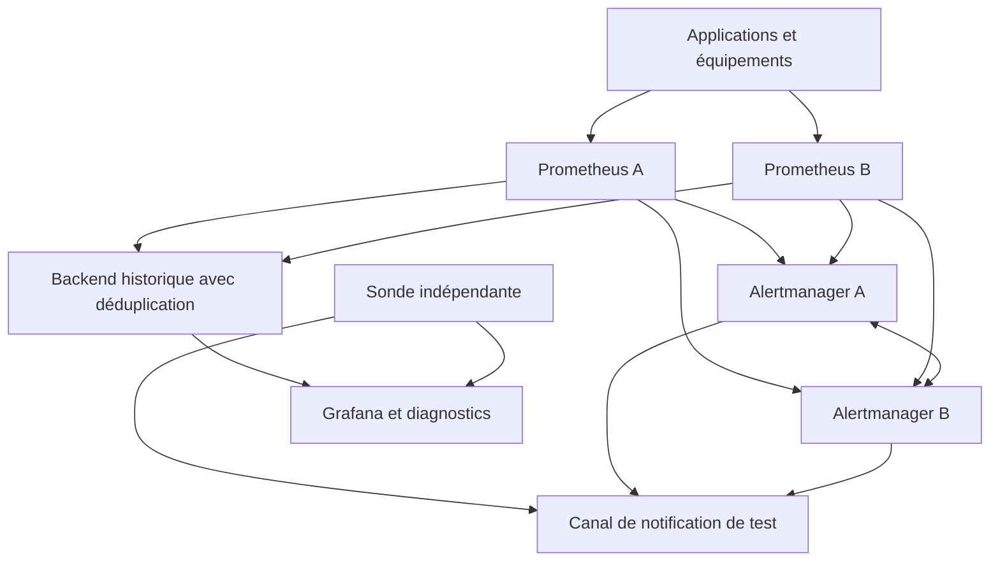
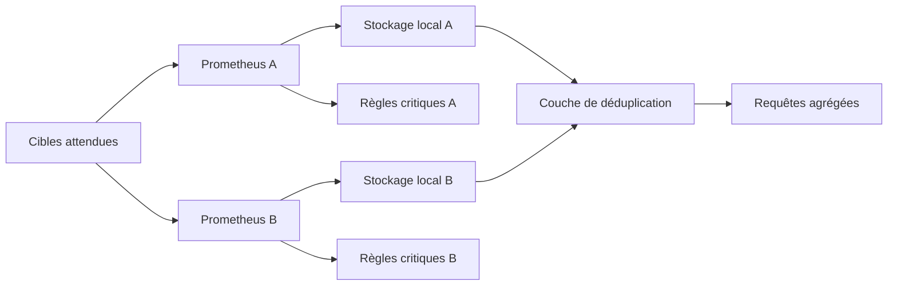
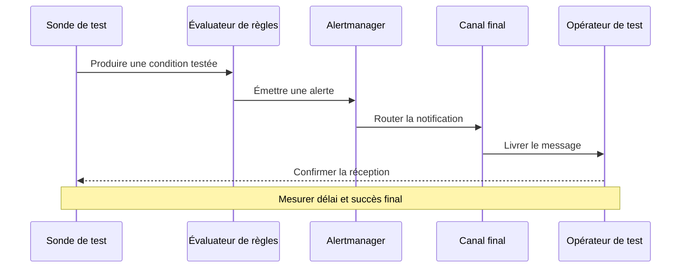
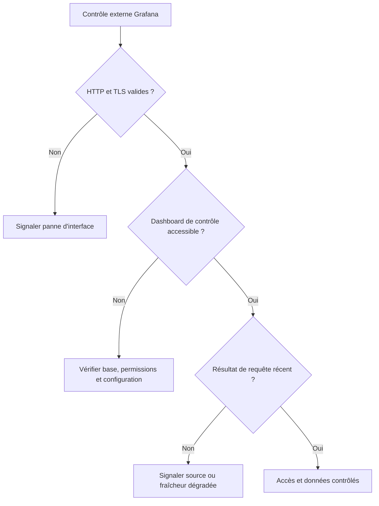
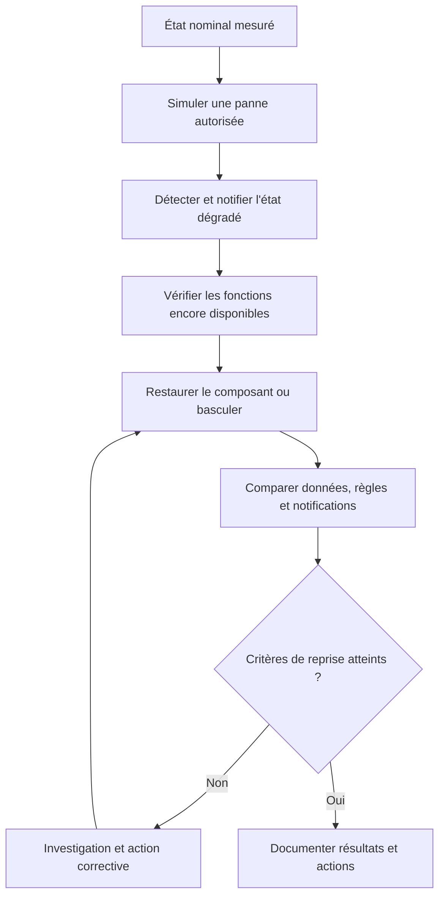

# Monitoring de la haute disponibilité

> **Mise en contexte.** Une application peut continuer à fonctionner alors que son système de supervision est en panne. Dans ce cas, l’équipe perd une partie de ses yeux et de ses oreilles : les métriques ne sont plus collectées, les règles ne sont plus évaluées, les tableaux de bord restent figés ou les notifications n’atteignent plus l’astreinte. Le monitoring de la haute disponibilité consiste à concevoir une chaîne de mesure et d’alerte capable de résister à la perte de composants, à détecter ses propres défaillances et à rétablir ses fonctions dans un délai connu. Il ne suffit donc pas de doubler le nombre de serveurs : il faut vérifier les dépendances, l’état partagé, le stockage, le routage des alertes et les procédures de reprise.

## 1. Introduction

### 1.1. La supervision fait partie du système de production

Un service de supervision est lui-même un service de production. Il dépend de ressources de calcul, de réseau, de stockage, d’identités, de certificats et parfois de fournisseurs externes. Il exécute des collectes périodiques, stocke des mesures, évalue des règles, présente des données et transmet des notifications. La panne de l’un de ces éléments peut dégrader une fonction de supervision, même si le serveur principal reste joignable.

Prenons une API de paiement. Elle est répartie sur plusieurs instances et possède une base de données répliquée. L’application peut continuer à traiter les paiements après la perte d’un nœud. Mais si l’unique Prometheus est arrêté au même moment, l’équipe ne voit plus la hausse des erreurs. Si Alertmanager est opérationnel mais que son unique destination de notification est bloquée, l’alerte peut être calculée sans que personne ne la reçoive. Si Grafana répond toujours avec une page en cache ou un dashboard chargé, les opérateurs peuvent croire que les chiffres sont actuels alors qu’ils proviennent de la dernière collecte réussie.

La disponibilité d’un composant n’est donc pas synonyme de disponibilité de la fonction entière. Une chaîne d’alerte doit parcourir toutes ses étapes, depuis la donnée et la règle jusqu’à la réception par une personne ou un système d’intervention. Une architecture de monitoring fiable donne à cette chaîne un propriétaire, des objectifs, des tests et un processus de reprise.

### 1.2. Distinguer le service supervisé du plan de supervision

Il est utile de représenter l’architecture en deux plans qui interagissent.

Le **plan supervisé** contient les applications, les bases de données, les équipements réseau, les services cloud, les files de messages et les parcours utilisateurs. On y mesure le succès fonctionnel, la latence, le débit, les erreurs et les signaux techniques utiles au diagnostic.

Le **plan de supervision** collecte, conserve et interprète ces signaux. Il comprend les exporters, les agents, les collecteurs, le stockage de séries temporelles, les règles d’alerte, les gestionnaires de notifications, les dashboards, les interfaces d’administration et les outils de métasupervision.

Une panne du plan supervisé peut être détectée par le plan de supervision. Une panne du plan de supervision doit, à son tour, être détectée par une voie en partie indépendante. Si Prometheus est la seule source qui surveille Prometheus, la panne de Prometheus peut supprimer le signal de panne. Si la sonde de secours utilise le même canal de notification que la chaîne qu’elle teste, elle peut être aveugle au défaut qu’elle devait révéler.

Les deux plans doivent avoir des objectifs distincts. La disponibilité de l’application mesure l’expérience utilisateur. La disponibilité du monitoring mesure l’aptitude à collecter des données récentes, calculer les règles, livrer les notifications et fournir des outils de diagnostic. Il faut éviter de confondre leurs tableaux de bord et leurs SLO.

### 1.3. La haute disponibilité n’est pas simplement de la redondance

La haute disponibilité (HA, *High Availability*) vise à maintenir une fonction accessible en cas de défaillance d’un ou de plusieurs composants, dans les limites explicites de l’architecture. Les mécanismes possibles comprennent les instances redondantes, la distribution dans plusieurs domaines de panne, la détection de défaillance, la bascule, la reprise des données et la capacité suffisante des ressources restantes.

Deux serveurs ne constituent pas nécessairement une architecture HA. Ils peuvent être dans le même rack, dépendre du même stockage, partager un seul répartiteur d’entrée ou utiliser une seule identité technique. Un seul incident commun pourrait donc arrêter les deux. Deux instances redondantes peuvent également être configurées différemment : l’une possède une règle critique, tandis que l’autre ne l’a jamais chargée. Le nombre d’instances ne démontre pas le comportement de reprise.

Il faut aussi distinguer disponibilité, durabilité et fraîcheur. Un tableau de bord peut être accessible alors que l’historique est perdu. Les données peuvent être conservées mais ne plus être interrogeables pendant plusieurs heures. Les requêtes peuvent répondre alors que la collecte a cessé et que les dernières valeurs sont anciennes. Chaque propriété doit être vérifiée par un indicateur adapté.

### 1.4. Objectifs pédagogiques

À la fin de ce cours, vous devez pouvoir cartographier les dépendances de la supervision, détecter les points de défaillance uniques, définir des SLI et SLO propres au monitoring, mettre en place des collecteurs redondants, comprendre la différence entre réplication de collecte et réplication de stockage, configurer une architecture résiliente pour Alertmanager et Grafana, surveiller la fraîcheur de la télémétrie, effectuer des sondes synthétiques, tester une bascule et structurer une procédure de reprise.

Les exemples utilisent Prometheus, Alertmanager, Grafana et Blackbox Exporter. Ils illustrent des propriétés générales mais ne constituent pas une configuration complète prête à déployer dans tous les environnements. Les versions, chemins réseau, règles de sécurité et contraintes d’exploitation doivent être vérifiés dans l’environnement réel.

## 2. Concepts clés

### 2.1. Définir le service que le monitoring doit garantir

Avant de choisir une architecture, l’équipe doit définir les fonctions réellement attendues. Une plateforme peut fournir plusieurs niveaux de service : collecte des signaux, calcul des alertes, livraison des notifications, consultation du tableau de bord, conservation de l’historique et administration. Une panne de dashboard peut être gênante sans être aussi urgente qu’une panne du canal de paging.

Pour chaque fonction, documentez le périmètre, le SLI, la cible, la fenêtre, les exclusions, la source de vérité, le propriétaire et les actions associées. Un exemple d’objectif de monitoring peut être : « 99,9 % des alertes synthétiques critiques doivent être reçues par le canal de test dans les 60 secondes après le déclenchement ». La mesure doit aller jusqu’à la réception finale. Le fait qu’un serveur accepte une requête HTTP ne prouve pas que l’utilisateur final a reçu la notification.

Un objectif de fraîcheur peut mesurer la proportion de cibles critiques dont les dernières données ont moins de deux intervalles de collecte plus une marge opérationnelle convenue. Pour un dashboard, l’objectif peut porter sur la capacité d’obtenir une requête de contrôle récente, et non uniquement sur la réponse HTTP de la page. Les valeurs numériques doivent être choisies selon l’impact d’une panne de monitoring et les délais d’intervention attendus.

### 2.2. Définir les SLI de la supervision

Un SLI (*Service Level Indicator*) mesure une fonction observable. Pour le monitoring, les familles importantes sont :

- **Disponibilité d’interface** : les sondes peuvent atteindre le point d’entrée du dashboard et obtenir une réponse acceptable.
- **Fraîcheur de collecte** : les données attendues sont mises à jour dans un délai défini.
- **Couverture de collecte** : les cibles critiques attendues sont bien découvertes et collectées.
- **Disponibilité d’évaluation** : les règles critiques sont chargées et évaluées sans erreurs excessives.
- **Livraison des notifications** : les alertes synthétiques arrivent au destinataire en moins d’un délai convenu.
- **Disponibilité des requêtes** : les requêtes de diagnostic ou de lecture d’historique aboutissent dans le délai utile.
- **Durabilité et récupérabilité** : les données historiques et la configuration peuvent être restaurées selon les objectifs définis.
- **Disponibilité du contrôle d’accès** : les opérateurs habilités peuvent atteindre la plateforme via une identité et une authentification supportées.

Ces indicateurs mesurent des choses distinctes. Grafana peut être disponible pendant que les données de Prometheus sont anciennes. Alertmanager peut recevoir une alerte alors que le connecteur de notification échoue. L’interface peut être inaccessible alors que les notifications continuent à fonctionner. Il faut donc éviter de condenser toutes les fonctions en un seul booléen « monitoring up ».

Les SLI doivent également gérer les données absentes. L’absence d’une métrique ne signifie pas que sa valeur est zéro. Une cible peut avoir été supprimée volontairement, disparaître après une erreur de découverte, ne plus être collectée, ou continuer à fonctionner sans publier la série attendue. Une bonne définition utilise les sources et les règles qui permettent de distinguer ces situations.

### 2.3. Écrire un SLO exploitable

Un SLO (*Service Level Objective*) traduit le SLI en cible sur une fenêtre. Une formulation utile indique :
1. la fonction à garantir ;
2. la population incluse et les exclusions légitimes ;
3. la formule de mesure ;
4. la valeur cible ;
5. la fenêtre d’évaluation ;
6. le propriétaire et les procédures de réponse.

Exemple : « Sur les 30 derniers jours, au moins 99,9 % des tests de livraison de notification réalisés depuis le contrôle indépendant doivent être reçus dans les 60 secondes. Les tests annulés pour maintenance planifiée ne sont exclus que si la fenêtre a été approuvée et documentée à l’avance. »

Cet exemple n’est pas une cible universelle. Une équipe qui supervise des services internes non critiques peut accepter des délais plus longs. Une équipe chargée des services de paiement, de santé ou de sécurité peut avoir besoin d’une latence de notification nettement plus courte. Le SLO doit être justifié par le risque d’une détection retardée et les moyens réels de réaction.

La fenêtre glissante est utile pour surveiller une performance récente en continu. Une fenêtre calendaire est utile pour les bilans mensuels ou contractuels. Le tableau de bord doit toujours indiquer la fenêtre utilisée. Réinitialiser un compteur au changement de mois ne corrige pas une interruption durable et ne doit pas faire disparaître l’historique d’un incident.

### 2.4. Cartographier les points de défaillance uniques

Un point de défaillance unique (SPOF) est un composant ou une dépendance dont la perte interrompt une fonction critique sans chemin alternatif opérationnel. Les SPOF fréquemment oubliés dans les plateformes de monitoring comprennent :

- l’unique instance de collecte ou d’évaluation ;
- une seule destination de notifications ;
- un unique load balancer devant plusieurs gestionnaires d’alertes ;
- une base de données partagée par toutes les instances Grafana sans mode de reprise adéquat ;
- un stockage historique dont la sauvegarde n’a jamais été restaurée ;
- un DNS, un proxy, une route réseau ou un compte de service partagé par tous les réplicas ;
- une seule région qui héberge à la fois le monitoring et les systèmes qu’il surveille ;
- un canal de secours dépendant de la même chaîne de notification que le canal principal ;
- une procédure de reprise connue d’une seule personne ;
- une source d’heure défaillante qui rend les événements difficiles à corréler.

Pour identifier ces risques, dessinez la chaîne complète : producteur de métriques, réseau, collecteur, stockage, règles, routeur d’alertes, fournisseur de notification et personne qui reçoit le message. Pour Grafana, dessinez l’accès web, le répartiteur, les nœuds applicatifs, la base de données, les sources de données et l’identité. Pour la reprise, ajoutez les sauvegardes, les secrets, les accès d’urgence et la documentation.

Il faut distinguer les défaillances techniques des défaillances organisationnelles. Un système peut avoir de multiples réplicas mais aucune personne formée à lancer la reprise. Les accès d’administration peuvent expirer, les runbooks peuvent être obsolètes ou les coordonnées d’escalade inconnues. Ces éléments font partie de l’architecture de disponibilité au même titre que les serveurs.

### 2.5. Active-active et active-passive

En **active-active**, plusieurs instances fournissent ou calculent la même fonction en parallèle. Cette approche peut conserver le service lors de la perte d’un nœud et augmenter la capacité. Elle exige une gestion explicite de l’état, de la charge, de la configuration et des doublons éventuels.

En **active-passive**, une instance sert le trafic et une autre attend qu’une bascule soit décidée ou déclenchée. Ce modèle peut simplifier la gestion d’un état qui ne supporte pas plusieurs écrivains, mais nécessite une détection fiable, une procédure de promotion et des protections contre une situation où deux nœuds se croient primaires.

Le choix doit se faire fonction par fonction. Des collecteurs Prometheus indépendants peuvent scraper les mêmes cibles en parallèle. Cela apporte une redondance de collecte, mais n’implique pas que les données locales soient partagées. Plusieurs instances Grafana peuvent traiter des requêtes simultanément si elles utilisent une configuration et une base partagée adaptées. Les gestionnaires d’alertes peuvent se synchroniser en cluster, mais des doublons de notification demeurent possibles dans certains scénarios.

L’active-active ajoute des coûts : collecte répétée, requêtes de règles en double, stockage supplémentaire, trafic de réplication et opérations plus nombreuses. L’active-passive ajoute des questions de bascule et peut imposer un délai de reprise. Il faut tester le modèle choisi et vérifier qu’il respecte l’objectif, plutôt que de préférer automatiquement l’architecture qui affiche le plus de composants.

### 2.6. Prometheus : collecter en double ne signifie pas répliquer le stockage

Une stratégie courante de haute disponibilité consiste à déployer deux serveurs Prometheus indépendants avec des configurations cohérentes. Les deux collectent les mêmes cibles et évaluent les règles essentielles. Si l’un s’arrête, le second peut continuer à surveiller la même population. Les règles et la configuration doivent être versionnées et déployées de façon reproductible afin d’éviter qu’un seul réplica soit à jour.

Le stockage local Prometheus est propre à chaque instance. Il ne constitue pas une base de données distribuée répliquée automatiquement entre les nœuds. Lorsque les données de plusieurs réplicas doivent être consultées comme une seule série historique, une couche d’agrégation ou de stockage compatible avec la déduplication peut être nécessaire. Elle doit reconnaître les labels qui identifient le cluster et le réplica, et traiter les périodes où une instance est en panne ou reçoit les scrapes avec un léger décalage.

Exemple conceptuel pour identifier un réplica :

```yaml
global:
  external_labels:
    cluster: prod-monitoring
    replica: prometheus-a
```

Le second serveur utilise une valeur de réplica distincte, par exemple prometheus-b. Ces labels identifient la provenance des séries dans les systèmes qui les reçoivent ; ils ne répliquent pas les données et ne garantissent pas à eux seuls la déduplication. La configuration des deux instances doit rester comparable pour les cibles et règles critiques, tout en conservant les informations nécessaires pour diagnostiquer une panne régionale propre à un seul réplica.

Le placement géographique doit répondre au risque visé. Deux instances sur deux machines différentes peuvent survivre à la perte d’un hôte, mais pas nécessairement à la perte du même rack, de la même zone, du même stockage partagé ou du réseau commun. Une séparation en zones peut réduire certains risques, à condition que les dépendances partagées soient elles aussi identifiées.

### 2.7. Alertmanager : préserver l’acheminement et tolérer les doublons

Alertmanager reçoit les alertes, les regroupe, applique des silences et des inhibitions, puis les route vers les destinations. Plusieurs instances peuvent former un cluster et partager l’état nécessaire à la coordination des notifications. La conception favorise généralement la livraison des alertes plutôt que la garantie stricte d’une seule notification. Une partition réseau ou un retard de synchronisation peut donc entraîner des doublons.

Cette sémantique est importante pour la procédure d’astreinte. Il ne faut pas supposer que toutes les notifications arriveront exactement une fois dans tous les scénarios. Le regroupement, les labels stables, les intervalles de répétition et les inhibitions contribuent à limiter le bruit. Les opérateurs doivent néanmoins savoir reconnaître qu’une notification correspond à un incident déjà pris en charge.

Évitez d’introduire un répartiteur unique comme seul chemin de Prometheus vers plusieurs Alertmanager si cette dépendance crée un point de défaillance unique. Dans une configuration HA, Prometheus doit pouvoir envoyer ses alertes aux instances prévues. Le réseau de cluster entre les gestionnaires doit être configuré, autorisé et testé, tout comme les silences et l’état partagé.

Exemple de plusieurs destinations déclarées côté Prometheus :

```yaml
alerting:
  alertmanagers:
    - static_configs:
        - targets:
            - alertmanager-a.internal:9093
            - alertmanager-b.internal:9093
            - alertmanager-c.internal:9093
```

Cet extrait présente le principe, mais le nombre d’instances, les noms d’hôtes, les options de TLS, l’authentification et la topologie de cluster sont propres à votre environnement. La vérification doit confirmer que les alertes arrivent dans le cluster, que les routes fonctionnent et que les défaillances d’une instance n’arrêtent pas la notification critique.

### 2.8. Grafana HA et stockage partagé

Plusieurs instances Grafana derrière un load balancer peuvent maintenir l’accès à l’interface lorsqu’un nœud applicatif tombe. Toutefois, les utilisateurs, dashboards et autres informations persistantes ne doivent pas être conservés uniquement dans une base locale propre à chaque nœud. Une architecture haute disponibilité utilise un stockage partagé supporté, par exemple PostgreSQL ou MySQL selon les exigences du déploiement, et les instances doivent avoir une configuration cohérente.

Le load balancer doit retirer les instances défaillantes et tester un chemin de santé pertinent. Le nom public, les certificats, les paramètres d’URL, les sources de données, les plugins et les secrets doivent être compatibles entre nœuds. Les dashboards et les règles peuvent être versionnés ou déployés par une méthode contrôlée afin qu’un redémarrage ne restaure pas une configuration obsolète.

Grafana Alerting possède également un mode haute disponibilité avec des mécanismes de coordination entre instances. Il faut distinguer la disponibilité de l’interface et la disponibilité de l’évaluation et de la livraison des alertes. Les détails de configuration dépendent de la version et du mode choisi. La documentation Grafana souligne notamment l’importance du stockage partagé et l’existence de compromis entre évaluation redondante, charge de requête et synchronisation.

La base partagée devient une dépendance critique. Sa disponibilité, ses sauvegardes, ses limites de connexion, sa capacité, ses certificats, ses mécanismes de failover et son délai de restauration doivent être testés. Doubler les serveurs Grafana ne rend pas la pile HA si la base peut tomber sans chemin de reprise.

### 2.9. Métasupervision : surveiller les outils qui surveillent

La métasupervision contrôle le système de monitoring lui-même. Elle vérifie que les collecteurs sont vivants, que les cibles attendues existent, que les règles sont bien chargées, que le stockage dispose de capacité, que les requêtes renvoient des données récentes et que les notifications atteignent une destination finale.

La métasupervision doit être assez indépendante pour rester utile pendant la panne qu’elle détecte. Cela peut être une sonde hébergée dans un domaine différent, un service de surveillance externe ou une petite sentinelle qui effectue quelques tests à forte valeur. Il n’est pas nécessaire de construire une seconde plateforme complète identique, mais la sentinelle ne doit pas dépendre exclusivement des mêmes nœuds, du même réseau et du même canal de notification.

La sonde doit tester des fonctions, pas seulement des processus. Le serveur Prometheus peut répondre mais ne plus scraper les cibles. Grafana peut rendre une page alors que la source de données est inaccessible. Alertmanager peut accepter une alerte sans réussir à la transmettre. La métasupervision doit vérifier, autant que possible, les points de mesure et les résultats finaux qui comptent pour l’équipe.

### 2.10. Monitoring actif et passif

Le monitoring passif utilise les signaux produits par l’usage réel : métriques applicatives, logs, traces, événements de réseau et compteurs d’équipements. Il permet d’observer la population réelle, les erreurs et les distributions de latence. Cependant, si aucun utilisateur ne réalise une opération pendant la nuit, les métriques passives ne prouvent pas nécessairement que le parcours est encore fonctionnel.

Le monitoring actif exécute des tests programmés : requête HTTP, résolution DNS, handshake TLS, connexion TCP, ICMP ou transaction synthétique. Il vérifie la capacité à partir d’un point de vue contrôlé et peut détecter un défaut avant le prochain utilisateur. Il ne remplace pas l’observation du trafic réel, car il ne couvre pas toutes les conditions de réseau, tous les comptes ou toutes les données.

La bonne approche combine les deux. Une sonde externe peut détecter l’échec d’un parcours, tandis que les traces permettent de localiser une dépendance lente. Si la sonde réussit mais que les utilisateurs signalent des erreurs, il faut rechercher une différence de population, de localisation ou de contexte d’authentification. Si le trafic réel disparaît mais que la sonde continue à réussir, l’incident peut porter sur la collecte de données plutôt que sur le service métier.

### 2.11. Blackbox Exporter et vérification de bout en bout

Blackbox Exporter permet à Prometheus d’exécuter des sondes HTTP, HTTPS, DNS, TCP, ICMP ou gRPC selon le module et la version utilisés. Dans le modèle multi-cibles, Prometheus interroge l’exporter en lui indiquant la cible ; l’exporter effectue le test et expose son résultat, notamment la métrique de succès de sonde. L’état du processus exporter et le résultat de la sonde doivent être contrôlés séparément.

Exemple conceptuel de scrape HTTP :

```yaml
scrape_configs:
  - job_name: blackbox-http
    metrics_path: /probe
    params:
      module: [http_2xx]
    static_configs:
      - targets:
          - https://status.example.net/health
          - https://portal.example.net/
    relabel_configs:
      - source_labels: [__address__]
        target_label: __param_target
      - source_labels: [__param_target]
        target_label: instance
      - target_label: __address__
        replacement: blackbox-exporter.internal:9115
```

Cet exemple décrit le principe de routage, pas toutes les options de TLS, d’authentification ou de validation métier. Un test HTTP 200 ne prouve pas qu’une opération complète a réussi. Pour un parcours critique, la sonde peut vérifier un contenu attendu, un endpoint fonctionnel ou une transaction synthétique avec un compte de test, une donnée reconnaissable et un mécanisme de nettoyage.

Les tests actifs doivent être conçus pour éviter les effets secondaires. Une sonde trop fréquente peut créer du trafic inutile ; une transaction répétée peut provoquer des écritures ou des notifications parasites ; un compte de test mal protégé peut introduire un risque de sécurité. Limitez les permissions, stockez les secrets correctement, nettoyez les données et documentez exactement ce que la sonde garantit.

### 2.12. Fraîcheur, séries absentes et qualité des données

La fraîcheur est essentielle. Un dashboard qui affiche une valeur vieille de dix minutes peut sembler rassurant lorsqu’une panne vient de commencer. Il faut définir un délai maximal acceptable entre l’événement et sa visibilité dans les outils. Cette valeur dépend de la fréquence de collecte, de la durée des requêtes, des files, des délais d’ingestion et du mode d’agrégation.

Une série absente n’est pas l’équivalent d’une valeur nulle. La cible peut avoir été supprimée, le job de découverte peut avoir disparu, une métrique peut avoir été renommée ou le collecteur lui-même peut être en panne. Une alerte qui ne teste que la valeur zéro peut manquer ces cas. Combinez les signaux d’état de scrape, l’inventaire attendu, la fraîcheur et les contrôles externes.

Il faut également surveiller la synchronisation de l’heure. Les écarts d’horloge affectent l’ordre des événements, la mesure des délais et la corrélation entre traces, logs et métriques. La plateforme doit contrôler la synchronisation temporelle, garder des fuseaux horaires clairement définis pour les rapports et préserver une chronologie cohérente pendant les incidents multi-régions.

### 2.13. Capacité, cardinalité et comportement en surcharge

Le monitoring peut se dégrader sous la charge qu’il doit expliquer. Le nombre de séries actives peut augmenter de manière brutale, les logs peuvent remplir le stockage et les requêtes de dashboards peuvent saturer les composants d’analyse. Une architecture redondante ne protège pas contre une surcharge simultanée de tous ses réplicas.

Surveillez le volume de séries, le taux de collecte, les requêtes concurrentes, les erreurs de stockage, l’espace disque, les files et la durée des requêtes. Évitez les labels non bornés, par exemple les identifiants uniques d’utilisateurs, de transactions ou de requêtes dans les métriques. Ces détails ont généralement davantage leur place dans des logs ou des traces. Les règles d’échantillonnage doivent préserver les données essentielles pendant les périodes de panne.

Définissez une politique de dégradation contrôlée. Si les ressources sont sous pression, les règles de fiabilité critiques et le canal de notification doivent être protégés en priorité. Certains dashboards non essentiels peuvent être moins rafraîchis, les traces peuvent être échantillonnées ou les collectes peu critiques espacées. Il faut décider ces choix à l’avance et mesurer leur effet. Une réduction imprévisible de toutes les données risque de rendre l’observabilité inutilisable au moment critique.

### 2.14. Sauvegarde, reprise et objectifs de récupération

La sauvegarde n’est pas la même chose que la haute disponibilité. Une sauvegarde protège contre certaines pertes de données ; la redondance permet de maintenir une fonction lorsque le composant principal est perdu. Les deux sont complémentaires. Un stockage peut être très disponible mais reproduire une suppression ou une corruption ; une sauvegarde peut être saine mais nécessiter beaucoup de temps pour être restaurée.

Définissez un RPO (*Recovery Point Objective*), qui représente la perte maximale de données acceptable, et un RTO (*Recovery Time Objective*), qui représente le délai cible pour rétablir la fonction. Ces objectifs varient par type de donnée : les règles et dashboards peuvent être versionnés et reconstruits, tandis que l’historique de métriques peut nécessiter des sauvegardes ou un stockage externe. La base persistante de Grafana exige son propre plan de sauvegarde et de restauration.

Un plan de reprise doit mentionner les accès, les secrets, les certificats, la configuration, l’ordre des dépendances et la validation après restauration. Restaurer un fichier ne suffit pas : il faut vérifier qu’il est cohérent, que l’application peut le lire, que les dashboards retrouvent leur source et que les alertes continuent d’être évaluées. Un exercice régulier apporte une preuve opérationnelle et permet de mesurer le délai réel.

## 3. Architecture et Schémas

### 3.1. Chaîne de supervision redondante

Une architecture HA doit permettre à plusieurs réplicas de collecter les données, évaluer les règles et transmettre les alertes. Si une couche d’historique agrège des séries de plusieurs réplicas, elle doit prendre en charge la déduplication. Une sonde externe vérifie parallèlement les fonctions critiques et le canal de notification.



Ce diagramme est un modèle logique, pas un déploiement complet. Le backend historique peut être facultatif selon les exigences. L’important est de savoir quelle fonction reste disponible lorsqu’un composant est perdu et quelle donnée demeure récupérable. Les réplicas doivent avoir une configuration comparable et occuper des domaines de panne adaptés aux risques retenus.

### 3.2. Couverture de collecte et déduplication

Deux instances indépendantes peuvent collecter les mêmes cibles, mais chaque stockage local reste séparé. Une couche d’agrégation doit identifier les séries venant de réplicas différents sans masquer les différences propres à une zone.



Si l’un des réplicas ne peut plus atteindre une cible locale à sa zone, la différence peut être un signal utile et doit rester diagnostiquable. La déduplication concerne des échantillons qui représentent le même événement ; elle ne doit pas simplement supprimer toute différence entre les réplicas.

### 3.3. Tester le chemin de notification

La chaîne d’alerte traverse plusieurs étapes. Une vérification de bout en bout déclenche un événement contrôlé et mesure si le message atteint la destination prévue.



Le test doit utiliser un message reconnaissable et éviter de réveiller inutilement les personnes d’astreinte. Il doit également avoir un chemin de vérification indépendant : la même plateforme qui a perdu sa capacité de notification ne doit pas être la seule à constater que le message n’est jamais arrivé.

### 3.4. Vérifier le dashboard et la source de données

Un contrôle de Grafana doit distinguer la disponibilité du serveur web, l’accès à un dashboard, la capacité d’interroger une source et la fraîcheur des résultats. Une page HTTP peut s’ouvrir alors que les données ne sont plus actualisées.



Le résultat du test doit identifier la fonction défaillante au lieu de renvoyer un statut global trop vague. L’équipe peut ainsi distinguer une panne web d’une panne de base de données, d’une source de données ou d’une collecte devenue obsolète.

### 3.5. Tester la bascule et le retour à la normale

Une bascule ne se termine pas lorsque le serveur de secours démarre. Elle doit préserver les fonctions attendues, signaler la redondance réduite et vérifier que le retour à l’état nominal n’introduit pas de divergence.



Les critères d’acceptation doivent être définis avant le test : délai de détection, délai de notification, fraîcheur des données, perte d’historique acceptable, capacité à poursuivre les règles et délai de retour à la redondance. Les tests doivent être répétés après les changements importants d’architecture.

### 3.6. Règles de contrôle illustratives

Prometheus expose l’état de réussite des scrapes pour ses cibles. Une règle peut signaler qu’une cible critique est présente mais que le scrape échoue. Une deuxième règle peut détecter qu’une série attendue a disparu. Les expressions exactes dépendent du job et de l’inventaire.

```yaml
groups:
  - name: monitoring-health
    rules:
      - alert: CriticalTargetScrapeFailed
        expr: up{job="critical-service"} == 0
        for: 3m
        labels:
          severity: warning
        annotations:
          summary: "Échec du scrape d'une cible critique"
          description: "Vérifier le service, l'exporter, le réseau et la configuration."

      - alert: CriticalTargetSeriesMissing
        expr: absent(up{job="critical-service"})
        for: 5m
        labels:
          severity: critical
        annotations:
          summary: "Série de supervision attendue absente"
          description: "Vérifier la découverte, le job et la collecte."
```

Ces expressions sont pédagogiques. La fonction absent ne décrit pas automatiquement l’ensemble des cibles d’un inventaire dynamique ; il faut adapter l’expression à la population attendue. La règle up à zéro ne couvre pas à elle seule les séries absentes. Avant mise en production, testez les cas où une cible est arrêtée, retirée légitimement, renommée, mal découverte ou inaccessible seulement depuis un réplica.

## 4. Étude de cas

### 4.1. Situation initiale

Une plateforme de formation exploite un portail web, des cours, des examens, des labs et plusieurs bases de données. Le monitoring fonctionne sur une seule instance Prometheus, un Alertmanager, Grafana et une base locale. Les dashboards s’ouvrent rapidement, mais les alertes arrivent dans un canal unique et la restauration dépend d’une personne. La croissance des métriques augmente l’usage disque, et aucune sonde n’exécute de contrôle depuis l’extérieur.

Lors d’une mise à jour, le stockage local manque d’espace. La page Grafana reste accessible et affiche des données historiques, mais les nouvelles séries ne sont plus collectées correctement. Un service métier devient ensuite lent. Les tableaux de bord ne montrent pas rapidement la dégradation, et l’alerte ne parvient pas à l’astreinte. Le problème est finalement découvert par les plaintes des utilisateurs.

L’analyse montre plusieurs faiblesses combinées : absence de redondance de collecte, absence d’alerte indépendante sur le stockage, absence de mesure de fraîcheur, dépendance à un seul canal et absence de procédure validée. Ajouter un second serveur ne résoudrait pas à lui seul la chaîne de livraison, la capacité ni la reprise des données.

### 4.2. Définir les fonctions prioritaires

L’équipe choisit quatre fonctions à mesurer : accès à l’interface de diagnostic, fraîcheur des séries critiques, capacité à évaluer les alertes urgentes et réception finale des notifications. L’historique est suivi séparément avec des objectifs de rétention et de restauration. Chaque objectif reçoit une fenêtre, un propriétaire et un comportement attendu lorsqu’il est dégradé.

À titre d’illustration, l’équipe peut exiger que les alertes de test critiques soient reçues en moins de 60 secondes sur au moins 99,9 % des tests valides d’une fenêtre de 30 jours. Elle peut définir la fraîcheur selon la fréquence de collecte et un délai additionnel qui tient compte de la latence d’ingestion. Ces valeurs doivent être validées dans l’environnement réel ; elles ne sont pas applicables universellement.

L’équipe distingue l’alerte sur la panne de service d’une alerte sur la perte de redondance. Si un Prometheus tombe mais que le second continue, la fonction peut rester disponible tout en étant plus vulnérable à la prochaine panne. L’état réduit de redondance doit donc être signalé et réparé avant de considérer la plateforme comme pleinement opérationnelle.

### 4.3. Mettre en place la redondance

Deux Prometheus sont déployés dans des domaines de panne distincts. Les configurations et règles essentielles sont versionnées et déployées automatiquement. Les deux collecteurs observent la même population de cibles avec des labels de réplica différents. La couche historique est configurée pour agréger les mesures si le besoin de vue commune le justifie, sans compter deux fois les événements qui représentent la même série logique.

Alertmanager est déployé en cluster, avec communication entre les membres et plusieurs destinations déclarées par les producteurs d’alertes. Les règles de regroupement et les canaux sont testés. L’équipe documente le fait que des doublons restent possibles lors de certains scénarios de partition et configure les messages pour qu’ils soient reconnaissables.

Grafana est exécuté sur plusieurs nœuds derrière un répartiteur et s’appuie sur une base persistante partagée dont les sauvegardes sont vérifiées. L’équipe surveille la base, le répartiteur, les certificats, les sources de données et les secrets. Les dashboards et les règles de monitoring sont stockés de façon reproductible afin de pouvoir reconstruire un nœud perdu sans dépendre d’un poste de travail individuel.

### 4.4. Ajouter une sonde indépendante

Une sonde extérieure vérifie l’accès au dashboard de santé et effectue une requête de contrôle qui doit retourner des données récentes. Une vérification distincte déclenche une alerte de test et confirme l’arrivée de la notification dans un canal contrôlé. Les sondes sont exécutées depuis un domaine séparé de la plateforme principale et utilisent des identifiants limités.

Si la page Grafana répond mais que la requête renvoie des données anciennes, le contrôle signale un défaut de fraîcheur. Si le dashboard et la source fonctionnent mais que la notification n’arrive pas, le test de livraison révèle le défaut du chemin d’alerte. Si la sonde ne peut pas joindre Grafana, le message de secours utilise une voie indépendante. Les contrôles sont nommés selon les fonctions qu’ils garantissent, pas selon une notion vague de « santé ».

Le test externe doit lui-même avoir une surveillance. Une sonde qui cesse d’exécuter ses contrôles ne doit pas apparaître comme un succès silencieux. Une deuxième voie peut vérifier la dernière exécution, le succès du job ou le retard de contrôle. La plateforme cherche ainsi à éviter qu’une seule panne transforme le monitoring en absence complète de signal.

### 4.5. Exercice : perdre un réplica Prometheus

Dans un environnement de test ou une fenêtre approuvée, l’équipe arrête Prometheus A. Elle mesure si Prometheus B continue la collecte, si les règles critiques sont évaluées et si les alertes sont délivrées. Elle vérifie aussi que la perte du réplica est signalée par une source indépendante. Le tableau de bord agrégé et les vues propres à chaque instance sont comparés pour identifier les trous de données et les différences de couverture.

Le test vérifie que le redémarrage de A ne crée pas d’erreur de configuration, qu’il reprend la collecte et que la redondance est restaurée. L’équipe ne conclut pas que l’historique est intégralement récupéré uniquement parce que le processus démarre. Elle consulte les données attendues, confirme les comportements de stockage et documente la perte potentielle de données locales.

Les critères de succès incluent le délai de détection de la panne, la continuité des fonctions prioritaires, la réception du message d’état dégradé, la couverture des cibles, le comportement de déduplication et le temps de retour à l’état nominal. Chaque défaut découvert devient une action avec un propriétaire et une échéance.

### 4.6. Exercice : l’alerte existe mais ne parvient pas à l’astreinte

Un déclenchement de test apparaît dans l’interface Alertmanager, mais le canal final ne reçoit rien. L’équipe examine les erreurs du connecteur, la connectivité, les permissions et les limitations du fournisseur. Elle confirme que l’acceptation de l’alerte par Alertmanager ne prouve pas la livraison finale. Le test est répété avec une instance arrêtée, puis avec une destination de test rendue indisponible de façon contrôlée.

L’équipe vérifie le routage alternatif, le regroupement des notifications et la gestion des doublons. Un canal de secours est documenté pour les incidents critiques, en évitant que le canal alternatif repose entièrement sur la même dépendance que le canal principal. La mesure du délai va du déclenchement à la réception, et pas seulement du déclenchement à l’acceptation de l’API.

Après l’exercice, le runbook décrit les étapes de vérification et les messages utiles pour l’astreinte. Les contrôles de livraison sont répétés régulièrement et après les changements importants du fournisseur, du réseau ou de la configuration de notification. Un mécanisme de secours jamais testé reste une hypothèse, pas une garantie.

### 4.7. Gouvernance et amélioration continue

L’architecture est revue à chaque changement important de topologie ou de niveau de criticité. Les revues examinent la redondance, les ressources, les dépendances, la rétention, la restauration et les canaux de notification. Les objectifs sont ajustés sur la base des tests et des incidents, sans exclure rétroactivement les périodes défavorables.

Le responsable de la plateforme s’assure également que les procédures sont connues des personnes d’astreinte, que les accès sont récupérables, que les secrets ne dépendent pas d’un seul utilisateur et que les sauvegardes peuvent être restaurées. Les runbooks sont testés en exercice, les résultats sont documentés et les actions correctives sont suivies.

## 5. Pièges à éviter

### 5.1. Se surveiller exclusivement soi-même

Une pile qui s’observe uniquement avec ses propres données peut perdre son signal au moment de sa panne. Une sonde hébergée sur le même cluster, utilisant le même DNS et le même canal d’alerte, partage souvent les mêmes risques. La voie de métasupervision doit être assez indépendante pour rester utile lorsque la plateforme principale ne fonctionne plus.

### 5.2. Confondre redondance de collecte et stockage répliqué

Deux Prometheus peuvent collecter les mêmes cibles, mais ils ne partagent pas automatiquement leur base locale. L’équipe doit connaître les propriétés du stockage, le mécanisme de sauvegarde, la stratégie de déduplication et la perte acceptable. Tester la panne d’un réplica doit inclure la vérification des données qui demeurent accessibles.

### 5.3. Dépendre d’un seul composant de routage

Un load balancer unique, un proxy de sortie, un fournisseur de notifications ou un DNS peut annuler une partie du bénéfice de redondance. Les chemins doivent être cartographiés du producteur de l’alerte jusqu’à la destination finale. Les canaux de secours doivent être testés et ne devraient pas partager toutes les mêmes dépendances.

### 5.4. Croire que Grafana accessible signifie monitoring sain

Une page peut s’ouvrir pendant que la collecte est interrompue, que la source de données est indisponible ou que les chiffres sont anciens. Le contrôle doit vérifier la requête, la fraîcheur, les permissions et la disponibilité du stockage. Des SLI séparés donnent une explication plus précise qu’un unique statut global.

### 5.5. Ignorer les doublons en cluster

La disponibilité de livraison peut être favorisée au détriment d’une garantie stricte d’envoi exactement une fois. Les doublons sont donc possibles dans certains scénarios. Le regroupement, les labels, les silences, les inhibitions et les procédures d’astreinte doivent limiter le bruit sans risquer de supprimer une alerte critique.

### 5.6. Utiliser une sonde trop simple ou trop intrusive

Une réponse HTTP 200 ne garantit pas un parcours métier réussi. À l’inverse, une sonde qui modifie réellement des données à chaque exécution peut provoquer des effets secondaires. Les tests doivent être représentatifs, non destructifs, limités en permissions, documentés et nettoyés après usage. Le nom d’une sonde doit préciser ce qu’elle vérifie réellement.

### 5.7. Détecter les erreurs mais pas l’absence des données

Une règle qui traite uniquement la valeur zéro peut manquer la disparition totale d’une série. Surveillez les cibles attendues, les erreurs de scrape, la fraîcheur et la découverte de services. Pour des inventaires dynamiques, distinguez une suppression volontaire d’une disparition accidentelle au moyen de sources indépendantes ou d’une politique de découverte documentée.

### 5.8. Placer les nœuds dans le même domaine de panne

Deux machines peuvent partager un réseau, une alimentation, une zone ou une base de données. L’architecture doit correspondre au scénario de panne que l’on cherche à supporter. La séparation géographique complète n’est pas gratuite ; priorisez les dépendances dont la défaillance entraînerait une perte importante de supervision.

### 5.9. Oublier la saturation du monitoring

Une augmentation de cardinalité, de logs, de traces ou de requêtes peut saturer tous les réplicas. Mesurez les volumes, évitez les labels non bornés, définissez les règles de rétention et testez les pics. Pendant une panne, protégez les alertes et métriques essentielles et dégradez de manière contrôlée les fonctions moins prioritaires.

### 5.10. Confondre une sauvegarde avec une reprise prouvée

Une sauvegarde peut être corrompue, incomplète ou trop lente à restaurer. Les tests doivent prouver que les données et configurations sont lisibles, que les accès sont disponibles, que les dashboards retrouvent leurs sources et que les règles critiques sont évaluées. Documentez les délais et la perte de données mesurés, puis comparez-les aux objectifs RTO et RPO.

### 5.11. Tester uniquement le démarrage

Le redémarrage d’un processus ne démontre pas que le service continue pendant la panne, que le routage fonctionne, que les données sont cohérentes ou que la redondance est revenue. Simulez des pannes contrôlées, enregistrez les temps et vérifiez le chemin complet. Le test doit aussi couvrir la restauration du composant perdu, pas seulement le fonctionnement du survivant.

## 6. Checklist / À retenir

### 6.1. Checklist de conception et d’exploitation

- [ ] Le plan supervisé et le plan de supervision sont documentés séparément.
- [ ] Les fonctions critiques du monitoring disposent de SLI, SLO et fenêtres explicites.
- [ ] Les SPOF techniques et opérationnels sont identifiés.
- [ ] Les collecteurs critiques ont une stratégie de redondance testée.
- [ ] Les configurations et règles sont versionnées et déployées de façon cohérente.
- [ ] La différence entre stockage local et réplication de données est documentée.
- [ ] La déduplication des séries est configurée et vérifiée si plusieurs réplicas sont agrégés.
- [ ] Alertmanager dispose de chemins et membres redondants adaptés au besoin.
- [ ] Les doublons de notification sont pris en compte dans les règles et procédures.
- [ ] Grafana utilise un stockage persistant adéquat pour son mode HA.
- [ ] Les bases et stockages persistants ont des sauvegardes testées.
- [ ] Une sonde extérieure vérifie les fonctions critiques de la chaîne.
- [ ] Les tests de livraison vont jusqu’au destinataire final.
- [ ] Les absences de séries et la fraîcheur sont surveillées, pas seulement les valeurs à zéro.
- [ ] La capacité, la cardinalité, le disque, l’heure et les certificats sont contrôlés.
- [ ] Les procédures de bascule, de reprise et de retour à la normale sont testées.
- [ ] Les incidents et exercices produisent des actions suivies par un responsable.

### 6.2. Principes essentiels

**La disponibilité se vérifie de bout en bout.** Un processus sain ne prouve pas qu’une alerte est reçue ou qu’un dashboard affiche des données récentes.

**La redondance n’est pas la réplication.** Des collecteurs indépendants peuvent améliorer la continuité de collecte, mais le stockage et la déduplication exigent une architecture explicite.

**La métasupervision doit être suffisamment indépendante.** La voie de contrôle doit survivre aux pannes les plus importantes de la plateforme principale.

**Le failover est une propriété à tester.** Un système n’est considéré résilient que si les scénarios de panne et les délais de reprise sont mesurés.

**Le système doit rester utile sous pression.** La gestion de cardinalité, du stockage, de la rétention et des requêtes coûteuses fait partie de la disponibilité.

### 6.3. Questions de révision avec correction

**Question 1 : pourquoi plusieurs instances Grafana ne garantissent-elles pas à elles seules la haute disponibilité de toute la supervision ?**

**Correction :** les collecteurs peuvent être arrêtés, les données peuvent être anciennes, les règles peuvent ne plus s’évaluer et les notifications peuvent échouer. En outre, plusieurs instances Grafana peuvent dépendre d’une base de données partagée qui reste un SPOF. Il faut mesurer chaque fonction et vérifier la chaîne de bout en bout, y compris l’accès à des données récentes et la réception de notifications.

**Question 2 : deux Prometheus indépendants répliquent-ils automatiquement leurs stockages locaux ?**

**Correction :** non. Ils peuvent collecter les mêmes cibles et fournir une redondance de collecte, mais leur stockage local reste séparé. Une solution d’agrégation ou d’historique doit définir comment reconnaître les réplicas, dédupliquer les séries et traiter les trous. Les données disponibles après la perte d’une instance doivent être vérifiées, pas supposées.

**Question 3 : pourquoi des doublons de notifications peuvent-ils se produire dans une architecture Alertmanager HA ?**

**Correction :** les instances partagent leur état de notification, mais une partition réseau ou un retard de synchronisation peut rendre la déduplication temporairement incomplète. Le système peut préférer délivrer une alerte en double plutôt que de la perdre. Il faut configurer le regroupement, les répétitions et les procédures d’astreinte pour que les doublons raisonnables ne deviennent pas un flot de pages inutiles.

**Question 4 : quelle est la valeur complémentaire du monitoring actif et du monitoring passif ?**

**Correction :** les sondes actives exécutent un parcours contrôlé même lorsque le trafic réel est faible et peuvent détecter un échec avant le prochain utilisateur. Les métriques passives et les traces décrivent le comportement du trafic réel, ses volumes et ses erreurs. L’association des deux améliore la couverture et les divergences peuvent aider à localiser les défauts de collecte ou les différences de population.

**Question 5 : quelles preuves faut-il exiger avant de déclarer un plan HA opérationnel ?**

**Correction :** il faut réaliser des tests de panne contrôlés et mesurer la continuité de collecte, l’évaluation des règles, la livraison finale des notifications, l’accès aux données, le comportement des dashboards et le délai de retour à la redondance. La restauration doit être testée et les pertes acceptables documentées. Le simple fait que les nœuds démarrent ou que plusieurs serveurs apparaissent dans l’inventaire ne prouve pas la résilience.

### 6.4. TP guidé : vérifier la résilience de la supervision

**Objectif :** démontrer que les fonctions essentielles restent disponibles lorsqu’un composant est perdu. Effectuez les tests dans un environnement d’essai ou pendant une fenêtre approuvée, avec un responsable de sécurité, un plan de retour arrière et un canal de communication.

**Étape 1 — Cartographier la chaîne.** Dessinez les producteurs de métriques, les collecteurs, le stockage, les règles, les gestionnaires d’alertes, les destinations, Grafana et les sources de données. Identifiez le chemin de secours et les composants communs.

**Étape 2 — Définir les critères.** Choisissez des objectifs testables : délai de détection, délai jusqu’à la réception de l’alerte, fraîcheur acceptable, perte historique maximale et délai de retour à la redondance. Les critères doivent être enregistrés avant de lancer l’exercice.

**Étape 3 — Vérifier le fonctionnement nominal.** Exécutez une sonde de dashboard, une requête de contrôle sur des données récentes et une alerte synthétique vers un destinataire de test. Mesurez les délais et vérifiez les journaux avant de simuler la panne.

**Étape 4 — Perdre un collecteur.** Arrêtez un réplica en test. Vérifiez que le second collecte et évalue les règles, que l’état dégradé est détecté et que les tableaux de bord restent utiles. Comparez les données et le comportement du backend de déduplication.

**Étape 5 — Tester une notification.** Dans un environnement isolé, rendez une destination de test indisponible. Vérifiez que l’échec final est détecté et que la voie alternative fonctionne si elle a été prévue. Mesurez le temps jusqu’à la réception, pas seulement jusqu’à l’acceptation de l’alerte par Alertmanager.

**Étape 6 — Restaurer et confirmer.** Remettez le composant en service, vérifiez sa configuration, la récupération des règles, la fraîcheur des données et la disparition de l’état dégradé. Vérifiez également que la redondance est restaurée et que les notifications ne se répètent pas de manière anormale.

**Livrable attendu :** une carte des dépendances, les scénarios exécutés, les mesures de délai et de perte, les limites découvertes, des runbooks mis à jour et des actions attribuées.

### 6.5. Exercice d’application

Une organisation possède deux Prometheus, deux Alertmanager et deux instances Grafana. Les collecteurs sont hébergés dans la même zone, chacun utilise un stockage local, les alertes passent par un unique load balancer, Grafana utilise une base partagée dont la restauration n’a pas été testée et aucun contrôle extérieur ne vérifie la réception des notifications.

1. Identifiez au moins quatre risques.
2. Proposez une architecture de reprise qui ne suppose pas que les stockages Prometheus se répliquent automatiquement.
3. Définissez deux tests qui n’affectent pas les utilisateurs réels.
4. Expliquez comment distinguer une panne de Grafana d’un problème de fraîcheur des données.
5. Décrivez les preuves qui permettraient de considérer le plan HA prêt.

**Correction détaillée :**

1. Les risques incluent la perte commune de zone pour les collecteurs, la séparation des stockages locaux, le load balancer unique de la chaîne d’alerte, la base Grafana partagée dont la reprise est inconnue et l’absence d’une sonde indépendante du chemin de notification. Il faut également vérifier le DNS, les routes réseau, les certificats, les identités et le déploiement cohérent des règles.
2. Les collecteurs doivent être placés dans des domaines de panne adaptés au risque, avec une configuration versionnée. Une couche d’agrégation doit définir la déduplication si l’historique de plusieurs réplicas est réuni. Les Alertmanager doivent avoir un cluster et des chemins d’entrée redondants, tandis que la base Grafana dispose d’une procédure de sauvegarde et de restauration testée.
3. Un premier test arrête un Prometheus de test et vérifie la continuité des scrapes, l’évaluation et le signalement de perte de redondance. Un second test déclenche une alerte synthétique et interrompt un connecteur de test ou une destination isolée afin de vérifier le signalement de non-livraison et la voie de secours.
4. Un contrôle de Grafana vérifie l’accès HTTP/TLS et l’ouverture du dashboard ; un second contrôle exécute une requête sur une métrique témoin et mesure son horodatage. Si l’interface répond mais que la valeur n’est plus récente, il s’agit d’un problème de collecte, de source ou d’ingestion et non uniquement d’une panne du serveur web.
5. Les preuves comprennent les résultats de bascule, les délais de notification mesurés, les données conservées, le test de restauration de la base, les règles de contrôle des séries absentes, les tests de la sonde externe et les runbooks validés. La disponibilité est démontrée par les résultats en conditions de panne, pas par le nombre de nœuds.

### 6.6. Défi final : concevoir le monitoring HA d’un service critique

Vous êtes responsable de la supervision d’une plateforme métier répartie sur plusieurs zones. La chaîne comprend des collecteurs de métriques, un backend historique, des règles de SLO, Alertmanager, Grafana et une base persistante. Les incidents précédents ont montré que des pannes de dépendance et des notifications retardées pouvaient rester invisibles pendant plusieurs minutes.

Concevez un plan complet qui définit les SLI/SLO de la plateforme de monitoring, cartographie les SPOF, justifie le placement des réplicas, décrit les labels de provenance et la stratégie de déduplication, protège la livraison d’alertes et la persistance de Grafana, ajoute une métasupervision indépendante, organise des tests de bascule, définit les règles de capacité et de rétention, et précise les objectifs de sauvegarde, de restauration et de reprise.

**Correction indicative :**

Le plan doit commencer par les fonctions essentielles plutôt que par une liste de produits. Les SLI doivent différencier la fraîcheur, la couverture de collecte, le calcul des alertes, la livraison finale des notifications et l’accès au diagnostic. Les cibles et les fenêtres sont justifiées par les délais de réponse et les conséquences d’une panne de monitoring. Les définitions comportent un propriétaire et une méthode de test.

Les collecteurs indépendants sont placés dans les domaines de panne appropriés, avec des configurations synchronisées et versionnées. Une couche historique ou de déduplication est ajoutée si les données des réplicas doivent être agrégées, sans prétendre que les stockages locaux sont répliqués. Alertmanager reçoit les alertes par des chemins redondants et ses limites de doublons sont documentées. Grafana utilise une base persistante protégée avec une procédure de restauration mesurée.

Une sonde externe vérifie un dashboard, des données récentes et la livraison d’une alerte vers un canal de test. Elle dispose d’une voie indépendante et sa propre exécution est contrôlée. Les scénarios de test comprennent la perte d’un collecteur, l’échec d’une destination, l’indisponibilité d’un nœud Grafana et la restauration de la base persistante. Les résultats sont comparés aux SLO de délai et de perte acceptable.

Enfin, la politique de capacité préserve les données essentielles en cas de surcharge, limite la cardinalité et surveille le stockage, les certificats et la synchronisation de l’heure. Les sauvegardes sont restaurées lors d’exercices récurrents. Les écarts deviennent des actions suivies avec responsables et échéances. Le plan est prêt lorsqu’il est prouvé que les fonctions critiques survivent aux scénarios de panne visés ou se rétablissent dans les délais acceptés.

## Conclusion opérationnelle

Le monitoring de la haute disponibilité se conçoit comme une fonction de production. La redondance seule ne garantit ni la collecte, ni l’historique, ni la livraison des alertes, ni l’accès aux outils. Les dépendances communes, les limites de capacité, les permissions, les procédures et le canal de notification doivent être inclus dans l’analyse. Une plateforme résiliente mesure sa propre fraîcheur, suit l’état réduit de redondance et dispose d’une voie indépendante pour détecter les pannes les plus importantes.

Commencez par les fonctions prioritaires : collecter des données récentes, évaluer les règles, délivrer les alertes et donner aux opérateurs un accès fiable au diagnostic. Définissez des objectifs mesurables, identifiez les points de défaillance uniques, testez les pannes autorisées et restaurez les sauvegardes pour vérifier leur utilité. Le but final n’est pas d’avoir le plus grand nombre de serveurs, mais de conserver une capacité de détection et de réponse lorsque le système est sous contrainte.

### Références techniques

- Prometheus, *High Availability* : https://prometheus.io/docs/alerting/latest/high_availability/
- Prometheus, *Frequently asked questions — High availability* : https://prometheus.io/docs/introduction/faq/
- Prometheus, *Storage* : https://prometheus.io/docs/prometheus/latest/storage/
- Prometheus, *Understanding and using the multi-target exporter pattern* : https://prometheus.io/docs/guides/multi-target-exporter/
- Prometheus, *Configuration reference* : https://prometheus.io/docs/prometheus/latest/configuration/configuration/
- Alertmanager, *High Availability* : https://github.com/prometheus/alertmanager/blob/main/docs/high_availability.md
- Grafana, *Configure high availability for alerting* : https://grafana.com/docs/grafana/latest/alerting/set-up/configure-high-availability/
- Grafana, *Set up Grafana for high availability* : https://grafana.com/docs/grafana/latest/setup-grafana/set-up-for-high-availability/

Les extraits YAML sont des exemples de principe. Validez-les avec les versions des outils et la configuration de sécurité effectivement utilisées. Les objectifs chiffrés doivent être adaptés à la criticité du service et validés par des tests de bout en bout et des exercices de panne autorisés.
