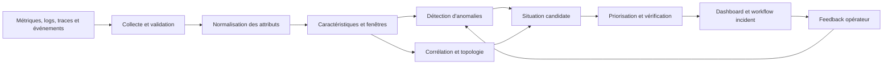
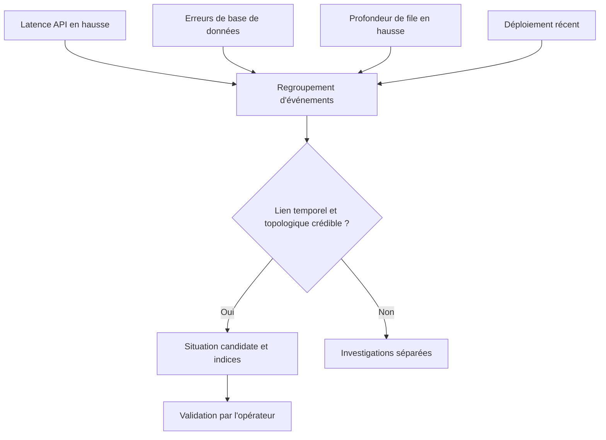
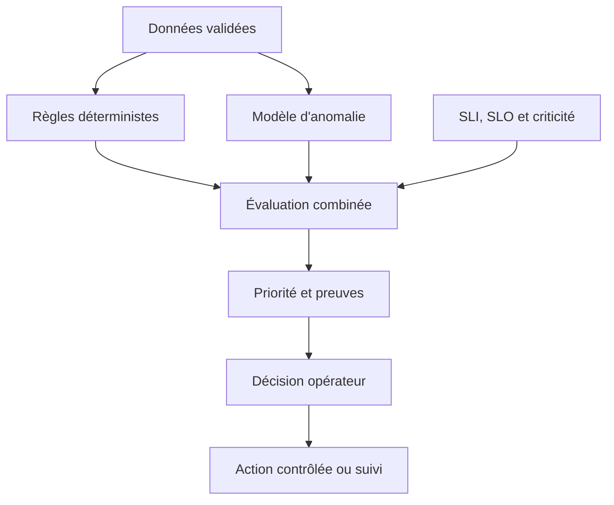
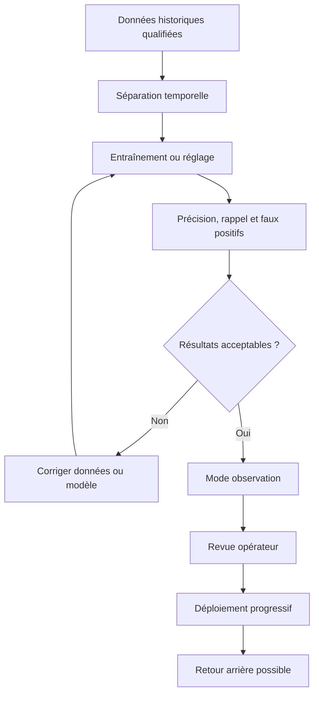
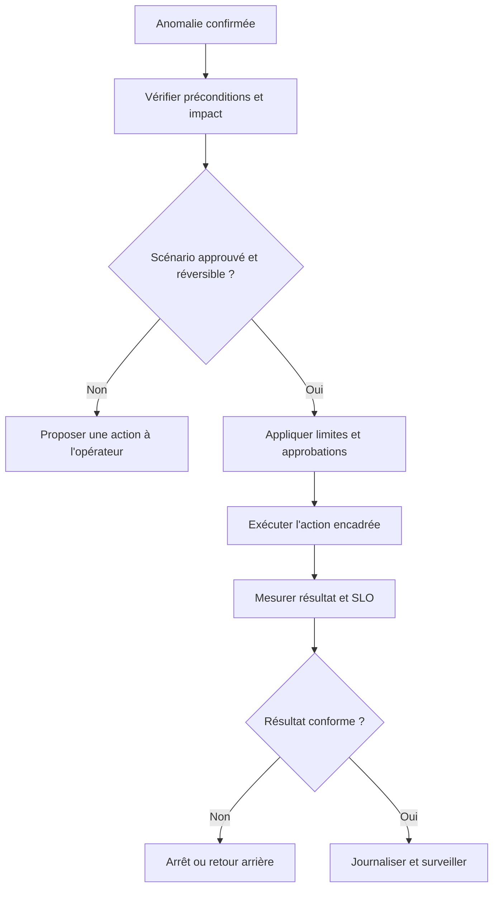

# IA appliquée au monitoring

> **Mise en contexte.** Les systèmes modernes produisent des volumes élevés de métriques, de logs, de traces et d’événements. Pendant un incident, ces signaux se multiplient précisément lorsque les équipes doivent comprendre rapidement ce qui se passe. L’AIOps (*Artificial Intelligence for IT Operations*) applique des méthodes statistiques et d’apprentissage à ces données afin de repérer des comportements inhabituels, rapprocher des événements liés et mieux guider l’investigation. L’objectif n’est pas de remplacer l’observabilité ou le jugement des ingénieurs par une boîte noire : il s’agit de réduire le temps de triage, de rendre les signaux plus utiles et de prendre des décisions plus fiables.

## 1. Introduction

### 1.1. Pourquoi l’IA intéresse la supervision

Les architectures distribuées font intervenir de nombreux composants : frontend, API, files de messages, caches, bases de données, réseaux, services d’identité et fournisseurs externes. Une seule requête utilisateur peut traverser plusieurs de ces éléments. Quand une dégradation apparaît, chaque composant peut émettre son propre signal. Une panne de dépendance peut alors produire une hausse de latence dans plusieurs services, des timeouts, une file qui grandit, des erreurs de connexion et des alertes de capacité. Sans corrélation, l’opérateur doit reconstruire manuellement l’histoire à partir de sources multiples.

Les seuils fixes demeurent nécessaires, mais ils ne conviennent pas à tous les comportements. Un CPU à 80 % peut être normal pendant un traitement planifié et anormal pendant une période de faible trafic. Une hausse des requêtes peut correspondre à une campagne prévue, à une croissance normale ou à une boucle de retry. Un seuil trop sensible provoque de fausses alertes ; un seuil trop permissif retarde le signalement d’une dégradation réelle.

Les méthodes statistiques peuvent apprendre une plage attendue en tenant compte de l’heure, du jour de la semaine ou du volume. Les modèles peuvent aussi rechercher des relations entre plusieurs signaux, regrouper les alertes qui se ressemblent et identifier des incidents historiques comparables. La valeur se mesure par la capacité à détecter plus tôt, à réduire le bruit et à aider l’équipe à choisir une vérification pertinente.

### 1.2. Définir l’AIOps sans exagérer ses capacités

AIOps regroupe les méthodes qui utilisent les données opérationnelles et des techniques statistiques ou d’apprentissage pour améliorer l’exploitation informatique. Les fonctions courantes comprennent la détection d’anomalies, la corrélation d’événements, l’analyse de tendances, la priorisation, l’aide au diagnostic et, dans certains cas, des actions automatisées avec des garde-fous.

Le terme ne désigne pas un algorithme unique. Une solution peut combiner des règles déterministes, des modèles de séries temporelles, des méthodes de regroupement, une cartographie de dépendances, un classificateur d’incident et un assistant de synthèse. Chacun a ses hypothèses, ses modes d’échec et ses critères de validation. Aucun algorithme ne transforme des données incorrectes en une vérité fiable.

L’IA ne peut pas déduire sûrement une causalité lorsque les données disponibles ne la permettent pas. Elle peut constater que la latence monte peu après un déploiement, mais cette proximité temporelle ne prouve pas que le déploiement est la cause. Elle peut suggérer qu’une base de données est un facteur commun, mais l’hypothèse doit être vérifiée par les traces, les logs et les tests. Les résultats doivent donc être présentés comme des faits, des corrélations ou des hypothèses distinctes.

### 1.3. AIOps et observabilité sont complémentaires

L’observabilité fournit les données et les moyens d’explorer l’état interne d’un système : métriques, journaux, traces, événements, profils et contexte des ressources. L’AIOps applique une analyse supplémentaire à ces signaux pour identifier des motifs, établir des priorités ou recommander une investigation. Sans bonnes données d’observabilité, l’AIOps devient une couche de suppositions. Sans accès aux sources, un diagnostic automatique ne peut pas être vérifié.

Les conventions sémantiques d’OpenTelemetry favorisent des noms communs pour les attributs de traces, métriques, logs et ressources, ce qui améliore la corrélation entre composants. Il reste important de vérifier le statut et la version des conventions adoptées : toutes les catégories n’évoluent pas au même rythme. <Cite refs={["turn689706search0","turn689706search3","turn689706search6"]}/>

L’AIOps doit compléter les alertes classiques et non les rendre dépendantes d’un service de machine learning. Les règles critiques liées aux SLO, à la sécurité ou à l’intégrité des données doivent continuer à fonctionner même si le modèle est indisponible. L’équipe doit conserver les tableaux de bord, les requêtes de diagnostic et les procédures classiques, afin de pouvoir continuer à opérer en mode dégradé.

### 1.4. Objectifs pédagogiques

À la fin de ce cours, vous devez savoir identifier les cas d’usage réalistes de l’AIOps, préparer une télémétrie exploitable, construire une détection d’anomalies, distinguer une anomalie statistique d’un incident opérationnel, corréler des événements dans le temps et dans la topologie, réduire le bruit sans supprimer des signaux essentiels, évaluer la qualité des modèles et construire une boucle de retour d’expérience.

Vous devez aussi savoir limiter les privilèges d’un modèle, protéger la confidentialité, surveiller la dérive des données, comparer les performances à une référence, et mesurer si le système aide réellement à détecter, diagnostiquer ou résoudre plus rapidement. Le but n’est pas d’ajouter de l’IA partout : il est de résoudre un problème opérationnel identifié avec une méthode suffisamment fiable et explicable.

## 2. Concepts clés

### 2.1. Les usages adaptés à l’AIOps

L’AIOps peut aider à détecter qu’une série de latence s’écarte de son niveau habituel, regrouper des alertes proches, repérer une corrélation avec un déploiement, comparer une situation à des incidents précédents ou produire une chronologie avec les liens pertinents. Ces tâches sont répétitives, riches en données et souvent coûteuses lorsqu’elles sont exécutées entièrement manuellement.

Il faut distinguer l’aide à l’observation de la décision opérationnelle. Une analyse peut recommander de vérifier le pool de connexions, la latence de la base ou une nouvelle version de service. Une action qui redémarre un cluster, supprime un volume, modifie une règle réseau ou désactive une fonction exige un niveau de contrôle supérieur. La remédiation automatique doit être réservée aux scénarios bornés, testés, observables et réversibles.

Une progression raisonnable comporte trois niveaux. Le premier présente des anomalies et suggestions sans action sur la production. Le second exécute des actions de faible risque dont les conditions et résultats sont déterminés à l’avance. Le troisième permet des remédiations autonomes dans des cas bien bornés, avec audit, arrêt d’urgence et chemin de récupération. Le nombre d’actions autonomes n’est pas une mesure de maturité : une recommandation qui réduit réellement le temps de triage peut être bien plus utile qu’une automatisation dangereuse.

### 2.2. Anomalie, changement et incident : trois notions différentes

Une **anomalie** est une observation qui s’écarte d’un comportement attendu. Elle peut être une pointe, une baisse, une dérive ou une relation inhabituelle entre plusieurs métriques. Une anomalie n’est pas forcément un problème : un lancement planifié peut provoquer une hausse de charge parfaitement normale.

Un **changement** est une modification de code, de configuration, de trafic, de topologie ou de dépendance. Il peut expliquer un nouvel état du système sans être une anomalie. Une migration peut changer la latence de manière prévisible ; elle doit alors être annotée et évaluée selon les objectifs de service.

Un **incident** est un événement opérationnel qui affecte ou menace une fonction, une exigence de sécurité ou un SLO selon la politique de l’organisation. Il doit être évalué à partir de l’impact, de la criticité, des signaux et du contexte. Le modèle peut fournir un avertissement ; l’urgence est déterminée par l’impact et les critères opérationnels.

### 2.3. Baseline et référence de comportement

Une baseline décrit le comportement attendu d’un service dans un contexte défini. Elle peut être calculée sur une période récente, une classe de service comparable, un motif saisonnier ou un modèle statistique. Une baseline unique ne convient pas toujours à toutes les heures et à tous les jours : un service de formation peut avoir beaucoup plus de trafic pendant les examens programmés qu’au milieu de la nuit.

Le choix de la période historique doit tenir compte des changements d’architecture, des saisons et des incidents connus. Si la fenêtre contient une panne prolongée, le modèle peut intégrer ce mauvais état dans la référence. Si la fenêtre est trop courte, la baseline peut être influencée par quelques événements aléatoires. Si elle est trop longue, elle peut ignorer un changement durable du profil d’usage.

La baseline doit évoluer, mais sous contrôle. Les déploiements, changements de ressources et lancements de produit peuvent être annotés. Les périodes confirmées comme incident doivent être conservées pour l’apprentissage et l’analyse, mais pas considérées automatiquement comme le fonctionnement normal. Une revue humaine permet de décider si un nouveau comportement est sain et doit devenir la référence.

### 2.4. Méthodes de détection possibles

Les seuils fixes restent appropriés pour des limites absolues : espace disque presque plein, certificat proche de l’expiration, taux d’erreur qui dépasse une limite de SLO ou nombre de retries supérieur à un plafond explicite. Ils sont simples à expliquer et faciles à tester.

Les seuils dynamiques comparent la valeur actuelle à une plage attendue qui évolue dans le temps. Ils peuvent tenir compte de la saisonnalité, à condition d’avoir suffisamment d’historique. Les méthodes robustes fondées sur la médiane ou une mesure robuste de dispersion sont parfois moins sensibles à quelques valeurs extrêmes qu’une moyenne et un écart-type classiques.

Les méthodes de séries temporelles cherchent les tendances, la saisonnalité et les changements de régime. Les méthodes multivariées examinent plusieurs signaux simultanément : une latence peut être encore sous son seuil, mais devenir inquiétante si la profondeur de file, le taux d’erreur et la saturation d’un pool montent ensemble. Les techniques de clustering regroupent des événements similaires ; les modèles supervisés classent des observations à partir d’exemples étiquetés. Les modèles non supervisés recherchent des structures sans nécessiter une étiquette pour chaque événement.

Aucun modèle n’est optimal pour tous les services. Le choix doit dépendre du coût des faux positifs, du coût des faux négatifs, de la fréquence des changements, du volume de données et de la capacité de diagnostic. Commencez avec une méthode simple et une baseline explicable, mesurez ses limites, puis augmentez la complexité uniquement si le gain est observable.

### 2.5. Exemple : médiane et dispersion robuste

Supposons que la latence p95 d’une API soit observée toutes les cinq minutes. La moyenne historique peut être influencée par des incidents anciens. Une méthode exploratoire compare la valeur actuelle à la médiane d’une fenêtre et à l’écart absolu médian, souvent nommé MAD. Elle peut ainsi signaler une valeur très éloignée du comportement central sans supposer que les valeurs sont parfaitement distribuées selon une loi normale.

L’exemple ci-dessous illustre le calcul du score robuste. Il ne constitue pas un détecteur complet : il ne modélise ni saisonnalité, ni autocorrélation, ni changement de régime, ni validité du SLO. Un score élevé doit être interprété avec le volume, la durée, les signaux voisins et l’impact métier.

```python
import numpy as np

def robust_anomaly_score(history, current_value):
    values = np.asarray(history, dtype=float)
    values = values[np.isfinite(values)]
    if values.size < 20:
        raise ValueError("Historique insuffisant")

    median = np.median(values)
    mad = np.median(np.abs(values - median))

    if mad == 0:
        # Historique quasi constant : utiliser aussi un seuil métier.
        return None

    return float(0.6745 * (current_value - median) / mad)

# Un score élevé déclenche une vérification du contexte,
# pas une action destructive.
```

Une valeur MAD égale à zéro peut arriver lorsque beaucoup de mesures sont identiques. Il faut alors une stratégie alternative, par exemple un seuil absolu métier. Le code doit également gérer les données absentes et les fenêtres qui contiennent des périodes de panne. En production, l’algorithme doit être évalué sur une période distincte et son résultat relié à des actions clairement définies.

### 2.6. Détecter les dérives lentes et les changements de régime

Une pointe isolée et une dérive lente demandent des stratégies différentes. Un pic peut être provoqué par un événement transitoire. Une dérive progressive peut résulter d’une fuite mémoire, d’une croissance de données, d’une augmentation du temps de traitement ou de l’accumulation de travail dans une file. Si le système ne regarde que la valeur instantanée, la dérive peut rester longtemps sous le seuil.

La détection de changement de régime cherche le moment où les propriétés statistiques de la série changent. L’équipe doit distinguer un changement attendu après une mise en production d’une dégradation non souhaitée. Les annotations de déploiement, de maintenance et de campagne fournissent un contexte ; elles ne doivent pas exclure automatiquement les données de l’analyse.

Les fenêtres courtes réagissent vite mais peuvent produire plus de bruit. Les fenêtres longues stabilisent les mesures mais retardent la détection. Une combinaison peut produire un signal rapide d’investigation et une confirmation sur une période plus longue avant d’envoyer une page urgente. Le choix dépend du coût d’un retard et de la tolérance au bruit.

### 2.7. Corrélation d’événements et topologie

Un incident peut produire des dizaines d’alertes. La corrélation regroupe des événements à partir de facteurs comme la proximité temporelle, la similarité des signatures, la version applicative, la région, l’environnement et la topologie de dépendances. Une base partagée en difficulté peut expliquer des symptômes simultanés dans plusieurs API ; un événement limité à un seul service doit rester séparé lorsqu’il n’existe pas de lien crédible.

La topologie est une représentation de la dépendance entre composants : le frontend appelle l’API, l’API utilise le cache et la base, puis dépend d’un fournisseur d’identité. Elle peut provenir de la configuration, de l’inventaire, de traces distribuées ou de relations découvertes automatiquement. Une topologie obsolète peut induire le modèle en erreur. Il faut afficher la source et la date des liens utilisés.

Une corrélation n’établit pas la causalité. Deux métriques peuvent évoluer ensemble parce qu’elles répondent au même volume de trafic, sans que l’une soit la cause de l’autre. Le système devrait présenter les éléments qui soutiennent le groupe et conserver l’accès aux événements sources. Les opérateurs doivent pouvoir confirmer ou séparer les alertes lorsque les circonstances le justifient.

### 2.8. Réduire le bruit sans perdre les signaux utiles

La réduction de bruit vise à limiter les notifications redondantes, pas à faire disparaître les mauvaises nouvelles. Le système peut regrouper les symptômes, dédupliquer les événements répétés ou inhiber une alerte secondaire lorsqu’une alerte parent explique clairement la situation. Mais il doit préserver les événements et leur historique, car plusieurs problèmes indépendants peuvent survenir en même temps.

La priorité devrait prendre en compte l’impact utilisateur, la criticité du service, la durée, le nombre de clients touchés, la confiance dans les données, la consommation du budget d’erreur et l’existence d’une action immédiate. Le score d’anomalie seul ne suffit pas. Une valeur statistiquement exceptionnelle sur un environnement de test ne devrait pas nécessairement être plus urgente qu’une violation SLO persistante sur un parcours critique.

Toute suppression doit être versionnée, expliquée et testée. Les règles de corrélation doivent être vérifiées avec des incidents simultanés, des régions indépendantes et des symptômes qui se ressemblent mais ont des causes différentes. Mesurez également les incidents manqués, et non simplement le nombre d’alertes supprimées.

### 2.9. Aider l’analyse de cause racine sans inventer de certitude

L’AIOps peut réduire le domaine d’investigation en montrant les changements récents, les dépendances concernées, les métriques qui ont bougé en premier, les signatures d’erreur similaires et les traces lentes. Une synthèse peut indiquer que la latence a augmenté peu après un déploiement et coïncide avec un nombre accru d’appels à la base. Il s’agit d’un ensemble d’indices, pas d’une preuve que le déploiement est la cause.

Une sortie d’analyse utile sépare les faits observés avec leurs horodatages, les corrélations, les hypothèses, le niveau d’incertitude et les vérifications qui pourraient confirmer ou rejeter l’explication. Les opérateurs doivent pouvoir ouvrir la métrique, le log ou la trace qui soutient chaque constat. Un résumé sans provenance peut accélérer la lecture mais empêcher une validation fiable.

Les documentations des plateformes AIOps illustrent cette idée de pipeline d’investigation : cadrage du problème, collecte de métriques, logs, traces et événements, détection d’anomalies, corrélation, diagnostic spécifique aux ressources et synthèse des résultats. Cette séquence dépend de la solution choisie et ne garantit pas une cause certaine dans tous les cas. <Cite refs={["turn689706search11","turn689706search9"]}/>

### 2.10. Utiliser métriques, logs et traces ensemble

Les métriques donnent une vue agrégée et historique. Les logs décrivent les événements détaillés. Les traces montrent le chemin d’une opération à travers les services et révèlent les segments qui dominent la latence ou retournent une erreur. Une analyse automatique devient plus pertinente lorsque ces signaux partagent des attributs cohérents et peuvent être reliés sans ambiguïté.

Les conventions sémantiques aident à conserver des noms comparables entre services. Les identifiants de corrélation peuvent se trouver dans les traces et les logs, sous réserve des politiques de confidentialité. Les métriques devraient privilégier des dimensions bornées, car des identifiants uniques dans les labels peuvent créer une cardinalité excessive. Le système doit aussi comprendre si une trace manque parce que la requête n’a pas été échantillonnée plutôt que parce que le service n’a pas reçu de trafic. <Cite refs={["turn689706search0","turn689706search3","turn689706search5"]}/>

La qualité des données doit être explicitement mesurée : retard de collecte, séries absentes, horodatages incorrects, champs mal formés, changement de schéma et évolution des noms. Le modèle ne devrait pas traiter une absence de métriques comme un comportement normal sans information supplémentaire. La santé de la télémétrie fait partie du contexte d’interprétation.

### 2.11. Apprentissage supervisé, non supervisé et approche hybride

L’apprentissage supervisé utilise des observations étiquetées, par exemple des incidents confirmés et des périodes normales. Il peut être efficace pour des incidents récurrents bien documentés, mais dépend des étiquettes. Les incidents rares sont peu représentés ; des équipes peuvent classer différemment des événements similaires ; la topologie et le code changent au fil du temps.

L’apprentissage non supervisé recherche des groupes ou des comportements atypiques sans exiger une étiquette pour chaque observation. Il peut faire émerger des motifs inconnus, mais un comportement rare n’est pas nécessairement nuisible et un comportement fréquent n’est pas forcément sain. Les approches semi-supervisées utilisent un mélange d’exemples étiquetés et non étiquetés ; elles gardent les mêmes exigences de validation et de contrôle des données.

Une approche hybride combine les règles explicites avec les modèles. Les règles surveillent les limites absolues et les objectifs contractuels. Les modèles détectent des écarts contextuels et aident au regroupement. Une règle de sécurité ne doit pas être désactivée parce que le modèle juge un événement normal. Avant de modifier le routage d’alertes, les sorties du modèle peuvent être présentées en mode observation pour mesurer le bruit et la pertinence sans changer le comportement de production.

### 2.12. Modèles génératifs comme assistants d’investigation

Un modèle de langage peut résumer une chronologie, reformuler une alerte, proposer les premières vérifications, comparer les symptômes à des incidents historiques ou rédiger un statut pour les parties prenantes. Son intérêt est de réduire le travail de synthèse lorsque les informations sont dispersées. Il doit cependant travailler à partir de sources et fournir un moyen de les consulter.

Le modèle peut inventer une relation causale, confondre une version, utiliser une commande invalide ou interpréter incorrectement un message. Les journaux peuvent également contenir des secrets ou des données personnelles. Il faut minimiser les données envoyées, contrôler les accès, séparer les faits des hypothèses et exiger des références aux sources dans la synthèse.

Un assistant sûr n’a pas de privilèges d’écriture par défaut. Il peut proposer une commande, mais l’opérateur la vérifie avant exécution. Les actions à fort impact passent par un mécanisme d’approbation séparé. Les requêtes, les résultats et les retours doivent être journalisés selon la politique de sécurité, sans conserver inutilement les données sensibles. La génération de texte n’est jamais une preuve de cause racine.

### 2.13. Évaluer la performance d’un modèle

Un modèle peut générer une visualisation impressionnante sans améliorer les opérations. Il faut évaluer la précision, le rappel, les faux positifs, les faux négatifs, le délai de détection, le nombre d’alertes par incident et les effets sur le temps de triage. La précision mesure la part des alertes positives qui correspondent réellement aux cas recherchés ; le rappel indique la part des cas positifs attendus que le système détecte.

Un modèle peut avoir une grande précision en alertant extrêmement rarement, tout en manquant beaucoup d’incidents. Un autre peut avoir un rappel élevé au prix d’un volume d’alertes qui épuisent l’attention de l’astreinte. Il faut considérer le coût réel de chaque erreur : un faux positif crée du travail inutile, alors qu’un faux négatif peut prolonger une panne. Pour des incidents critiques, les priorités peuvent différer de celles d’un environnement de test.

Évitez la fuite de données entre entraînement et validation. Si des observations presque identiques du même incident sont présentes dans les deux jeux, la performance mesurée sera trop optimiste. Une séparation temporelle et des périodes de validation distinctes donnent une meilleure idée de la capacité à reconnaître les prochains incidents. Les résultats doivent être comparés avec la méthode existante, pas seulement au hasard.

### 2.14. Dérive des données et évolution de l’architecture

La distribution des métriques change lorsqu’un service migre, qu’une fonctionnalité est ajoutée, que le trafic augmente ou que l’instrumentation est modifiée. Une baseline qui ne tient pas compte de ces changements peut générer des alertes permanentes. À l’inverse, un modèle qui se réentraîne automatiquement sur tous les événements risque d’apprendre une panne non résolue comme nouvelle normalité.

La surveillance de la dérive peut examiner la distribution des entrées, les valeurs manquantes, la fréquence des événements et la qualité mesurée sur les incidents confirmés. Les modèles doivent être versionnés avec leurs paramètres, données de référence et métriques d’évaluation. Le réentraînement doit inclure une revue des étiquettes, une comparaison avec une référence et un retour arrière.

Un changement d’instrumentation peut être une source de rupture plus importante que l’algorithme. Si une métrique est renommée, son absence peut sembler être une chute de trafic. Si le système change de fréquence de collecte, la distribution des points évolue. Les déploiements doivent donc annoter les transformations de données et tester l’inférence avant de faire confiance aux résultats.

### 2.15. Gouvernance, sécurité et confidentialité

Les logs et traces peuvent contenir des adresses IP, chemins d’URL, identifiants de comptes, extraits de requêtes ou informations métier. Avant de transmettre ces données à un modèle, définissez les éléments nécessaires, les accès autorisés, la durée de conservation et les règles applicables au fournisseur. La minimisation des données réduit à la fois le risque de confidentialité et le coût de traitement.

Un modèle chargé de résumer un incident n’a pas besoin d’accéder à tous les secrets, d’exécuter des commandes ou de modifier une base de données. Séparez la génération de recommandations de l’exécution d’actions. Les actions automatiques utilisent des interfaces limitées, des préconditions, une journalisation d’audit et des conditions d’arrêt. Les personnes doivent pouvoir désactiver le modèle si son comportement devient dangereux.

La gouvernance précise qui approuve les modèles, qui valide les sources, qui examine les échecs et qui autorise une remédiation. Les retours des opérateurs doivent être enregistrés de manière structurée. Une capacité d’explication ne signifie pas que tous les modèles sont entièrement interprétables, mais l’interface devrait montrer les signaux utilisés et les limites de l’inférence.

### 2.16. Retour humain et amélioration continue

Après un incident, l’équipe peut qualifier les alertes utiles, les faux positifs, les incidents manqués, les groupes incorrects et les indices qui ont accéléré le diagnostic. Les catégories doivent rester stables : incident confirmé, bruit, changement prévu, données incorrectes, anomalie sans impact ou résultat incertain. Sans convention commune, le feedback ne permet pas une évaluation cohérente.

Évitez le bouton « ignorer définitivement » sans contexte. Une alerte qui était fausse à un moment peut devenir importante dans un autre contexte. Les annotations doivent être liées au service, à la version de la règle, à la fenêtre, à la raison de la décision et à l’état du système. Une revue périodique permet de corriger les règles, baselines ou modèles sans accumuler des suppressions locales non contrôlées.

Le feedback peut conduire à une meilleure instrumentation plutôt qu’à un modèle plus compliqué. Ajouter un attribut stable, clarifier le SLI, annoter les déploiements ou corriger une topologie peut donner plus de valeur qu’un algorithme supplémentaire. La boucle d’apprentissage doit donc couvrir l’ensemble du système d’observabilité et les processus humains qui l’utilisent.

## 3. Architecture et Schémas

### 3.1. Pipeline logique AIOps

Une architecture AIOps commence par l’ingestion de données fiables, normalise les attributs, calcule des caractéristiques, détecte les anomalies, corrèle les événements et présente les résultats dans le workflow de l’équipe. Les règles déterministes critiques restent actives en parallèle.



Chaque étape possède ses propres contrôles. Si les horodatages sont incorrects, les corrélations temporelles seront erronées. Si une ressource change d’identifiant sans conserver son identité logique, les historiques peuvent sembler discontinus. Si le modèle reçoit une série vide sans signal sur la qualité de collecte, il peut interpréter l’absence comme un état normal.

### 3.2. Corrélation par service, temps et dépendances

Les alertes peuvent être regroupées selon la période, le service, la région, les signatures d’erreur, les changements récents et les relations topologiques. L’interface doit expliquer pourquoi les événements appartiennent à la même situation et conserver tous les événements sources.



Une topologie périmée peut produire une mauvaise corrélation. Le système doit afficher la source et la date de la relation utilisée, ainsi que les événements qui soutiennent l’hypothèse. La corrélation accélère le triage ; elle ne prouve pas automatiquement la cause.

### 3.3. Détection hybride : règles et modèles

Les règles explicites surveillent les limites de service et les exigences de sécurité, tandis que les détecteurs statistiques recherchent des comportements inhabituels. Les résultats enrichissent une situation commune, mais une règle critique ne doit pas être désactivée simplement parce qu’un modèle apprend une baseline différente.



Le système doit distinguer les sorties des règles de celles du modèle et expliquer comment le niveau de priorité a été calculé. Si le composant IA est indisponible, les règles déterministes continuent de fonctionner et les alertes classiques restent actives.

### 3.4. Évaluation et déploiement progressif du modèle

Avant qu’un modèle influence la production, il doit être évalué sur des périodes distinctes, des incidents connus et des conditions normales. Le déploiement progressif en mode observation permet de comparer ses sorties à la procédure existante sans changer immédiatement le routage.



Les données d’un même incident ne doivent pas apparaître quasi identiquement dans l’entraînement et la validation. La séparation temporelle aide à mesurer la capacité à reconnaître de nouveaux incidents. Le déploiement doit également conserver une procédure de désactivation et un modèle ou ensemble de règles de référence.

### 3.5. Exemple PromQL pour mesurer le taux d’erreur

Avant d’ajouter un modèle, vérifiez la qualité des signaux de base. Pour une instrumentation compatible Prometheus, la requête illustrative suivante calcule le taux d’erreurs serveur d’un service :

```promql
sum(rate(http_requests_total{service="catalogue",code=~"5.."}[5m]))
/
sum(rate(http_requests_total{service="catalogue"}[5m]))
```

Cette expression n’est pas une définition universelle de l’échec. Les noms, labels et codes doivent correspondre à l’instrumentation réelle ; les timeouts et erreurs métier peuvent ne pas être couverts. En production, gérez les périodes sans trafic et assurez-vous que le dénominateur représente les événements éligibles. Un modèle entraîné sur un ratio mal défini ne corrigera pas cette erreur de mesure.

La normalisation de l’instrumentation est essentielle. Les conventions de métriques et de traces aident à garder des noms et attributs comparables entre services ; les agrégations doivent rester interprétables lorsque des labels sont retirés. Limitez les dimensions à forte cardinalité et préservez les liens vers les logs ou traces détaillées lorsque le diagnostic le nécessite. <Cite refs={["turn689706search3","turn689706search5"]}/>

### 3.6. Remédiation contrôlée

Une action automatique doit être précédée d’une vérification des conditions, des permissions, de l’impact et de la possibilité de retour arrière. Un redémarrage, par exemple, peut aider à récupérer un worker bloqué, mais peut aussi interrompre une transaction en cours ou amplifier la charge d’une dépendance.



Une remédiation ne doit jamais être autorisée uniquement par un score d’anomalie. Elle utilise des préconditions vérifiables, un périmètre limité, une politique de nombre de tentatives et une procédure d’escalade. Les résultats sont journalisés afin d’évaluer si l’action a réellement amélioré le service.

## 4. Étude de cas

### 4.1. Contexte : trop d’alertes et diagnostic lent

Une plateforme de formation exploite un catalogue, un système d’examens et des laboratoires interactifs. Les alertes classiques signalent la hausse d’erreurs HTTP, de latence et de profondeur de file. Pendant les périodes d’activité, elles se déclenchent en grand nombre ; l’astreinte reçoit plusieurs notifications associées au même incident. Lorsqu’un examen ne démarre pas, l’équipe parcourt les dashboards, les logs de chaque service et l’historique des déploiements sans savoir quel indice est le plus pertinent.

L’objectif n’est pas de supprimer toutes les alertes ni de laisser un modèle décider seul de la cause. L’équipe veut réduire le temps de triage, mettre en avant les signaux liés et conserver la transparence des observations. Elle choisit deux parcours critiques : démarrage d’examen et création de laboratoire. Chaque parcours possède un SLI, un SLO et une mesure d’impact utilisateur.

### 4.2. Préparer et normaliser les données

Les équipes s’accordent sur les dimensions de service, environnement, région, version et résultat. Les noms et unités des métriques sont normalisés autant que possible à partir des conventions en place. Les traces utilisent un identifiant de corrélation pour relier les appels, et les logs sont structurés avec des champs communs. Les identifiants individuels ne deviennent pas des labels non bornés des métriques.

L’équipe vérifie la qualité de collecte : horodatages, absence de séries, fréquence de scraping, changement de noms, couverture des régions et effet de l’échantillonnage des traces. Les périodes où l’instrumentation a changé sont annotées. Avant de lancer un modèle, elle établit une baseline couvrant plusieurs périodes représentatives et un historique d’incidents suffisamment qualifié pour évaluer les résultats.

### 4.3. Détecter un changement de comportement

Un matin, le démarrage des examens devient lent. La latence p95 augmente plus vite que le volume de requêtes et la profondeur de file s’accroît. Le détecteur signale un écart par rapport à la référence pour ces signaux. Une règle classique indique aussi une hausse des erreurs. Les signaux sont regroupés car ils concernent le même service et une période similaire, avec une dépendance commune.

Le système présente une chronologie, les graphes pertinents, les changements de version récents et les traces lentes. Les traces montrent que l’API d’examen attend plus longtemps une dépendance de base de données. Le déploiement récent est une piste, mais l’équipe la vérifie avant de conclure. Une variation du trafic sur le catalogue pourrait également augmenter la pression sur la même base.

Le regroupement réduit plusieurs notifications redondantes à une situation candidate, tout en conservant les événements sources. L’astreinte examine les preuves et choisit une mitigation. Si la situation est urgente, le rollback ou la désactivation d’une fonctionnalité est évalué selon la procédure ; l’IA n’exécute pas automatiquement cette action.

### 4.4. Évaluer le dispositif

Pendant plusieurs semaines, l’équipe compare les incidents confirmés à ce que le détecteur avait signalé. Elle mesure le délai de détection, les faux positifs, les faux négatifs et la part des groupes d’alertes jugés utiles par l’astreinte. Elle vérifie que les alertes regroupées n’ont pas masqué des incidents indépendants. Les paramètres sont ajustés sur une période distincte puis évalués sur des incidents et des périodes qui n’ont pas servi à les régler.

L’équipe garde les alertes déterministes liées au SLO critique. Le modèle est d’abord déployé en mode observation : ses situations sont visibles, mais ne remplacent pas la route de paging. Après validation, certaines recommandations entrent dans le workflow de triage. La remédiation automatique est réservée aux actions réversibles dont les conditions ont été testées.

Les retours sont structurés. Une situation est qualifiée comme utile, redondante, manquée ou insuffisamment expliquée. Les opérateurs ajoutent le contexte pour distinguer une anomalie normale d’un incident réel. Ces annotations peuvent améliorer la baseline, mais ne deviennent pas une exclusion permanente sans revue.

### 4.5. Gouvernance et amélioration durable

Le propriétaire du modèle surveille sa performance et sa dérive. L’équipe plateforme surveille la qualité et la disponibilité du pipeline de données. Les équipes de service valident les définitions d’incident et la topologie. Les responsables d’exploitation définissent les conditions dans lesquelles les recommandations peuvent influencer le routage ou déclencher une action.

Le modèle est versionné avec ses paramètres, ses sources de données et ses critères d’évaluation. Lorsqu’une migration ou une nouvelle version modifie les métriques, l’équipe revient en mode observation ou vérifie que la référence reste valable. Un rollback du modèle est prévu. La documentation explique quelles décisions dépendent du modèle et quelles règles de sécurité, de SLO ou de conformité restent prioritaires.

La réussite se mesure par des résultats opérationnels : réduction du temps de triage, diminution des notifications redondantes sans hausse des incidents manqués, détection plus précoce et maintien de la qualité des décisions. Une interface générant un résumé convaincant ne suffit pas si les opérateurs passent toujours autant de temps à diagnostiquer le problème.

## 5. Pièges à éviter

### 5.1. Appeler toute variation une anomalie critique

Tout système réel varie. Une pointe attendue, un traitement par lots ou une maintenance peut produire des signaux inhabituels sans constituer un incident. Le modèle doit tenir compte du contexte, de la saisonnalité et des fenêtres de maintenance, tout en conservant des garde-fous sur les limites absolues et les SLO. La bonne réponse à une anomalie est parfois une annotation ou un ticket, pas une page urgente.

### 5.2. Apprendre une panne comme nouvelle normalité

Une baseline qui se met à jour trop vite peut absorber une dégradation persistante. Conservez des critères indépendants, des références stables et une revue des changements. Les périodes confirmées comme incident doivent rester identifiées afin de ne pas devenir automatiquement la référence saine. Les données d’apprentissage et les périodes de panne doivent être étiquetées si le modèle les utilise.

### 5.3. Confondre corrélation et causalité

Deux signaux qui évoluent ensemble peuvent être liés par une cause commune ou par le volume de trafic. L’IA peut proposer une hypothèse, mais elle doit présenter les observations et les liens utilisés. L’opérateur vérifie les traces, les logs, la topologie et les changements avant de déclarer une cause. La chronologie aide à enquêter, mais n’est pas une preuve complète.

### 5.4. Réduire le bruit en supprimant les alertes essentielles

Une corrélation peut masquer un événement parce qu’il ressemble à un autre. Conservez les événements sources, versionnez les règles de regroupement, testez les incidents simultanés et vérifiez que les alertes critiques continuent d’être routées. La réduction du bruit doit être évaluée aussi par les incidents manqués, pas uniquement par le nombre de notifications éliminées.

### 5.5. Optimiser un score plutôt que le résultat

Une précision élevée peut être obtenue en alertant très rarement, tout en ratant les incidents importants. Un rappel élevé peut s’accompagner d’un volume de faux positifs qui épuise l’astreinte. Évaluez les deux, ainsi que le délai de détection, la charge opérationnelle et les conséquences des erreurs. Les seuils sont différents selon le coût d’un faux positif et celui d’un faux négatif.

### 5.6. Utiliser une validation contaminée

Si des exemples presque identiques issus du même incident apparaissent dans l’entraînement et la validation, la performance mesurée est trop optimiste. Séparez les périodes dans le temps, conservez un jeu de test indépendant et évaluez les modèles sur des changements récents. Documentez les versions de données, les étiquettes et la méthode de séparation.

### 5.7. Ignorer la qualité des données

Des horodatages erronés, des métriques renommées ou une absence de séries peuvent être interprétés à tort comme une anomalie métier. Surveillez le pipeline, la fraîcheur et l’instrumentation elle-même. Le modèle doit savoir si les données sont complètes, retardées ou échantillonnées. Si la qualité est insuffisante, le système doit signaler l’incertitude au lieu de rendre une conclusion trop affirmative.

### 5.8. Donner trop de privilèges à un assistant

Un modèle de langage qui peut exécuter des commandes arbitraires ou supprimer des ressources ajoute un risque important. Séparez l’analyse de l’exécution, limitez les outils et privilèges, imposez une validation humaine pour les actions à fort impact et conservez des logs d’audit. Les secrets et informations personnelles doivent être exclus ou minimisés.

### 5.9. Ignorer la dérive et les changements de version

Un modèle peut perdre sa valeur après une migration, un nouveau flux de trafic ou une évolution de nomenclature. Versionnez les modèles, surveillez les distributions, mesurez régulièrement précision et rappel et préparez un retour à une version précédente ou à des règles simples. Le réentraînement ne doit pas être effectué aveuglément sur toutes les observations.

### 5.10. Mesurer la technologie plutôt que le bénéfice

Le nombre de modèles, de graphiques ou d’anomalies détectées ne prouve pas que l’exploitation s’améliore. Mesurez le temps de triage, la proportion d’alertes utiles, les incidents ratés et le temps de mitigation. Si les résultats ne changent aucune décision ni procédure, reconsidérez le cas d’usage ou l’instrumentation plutôt que d’ajouter davantage de complexité.

## 6. Checklist / À retenir

### 6.1. Checklist d’un projet AIOps

- [ ] Le problème opérationnel à améliorer est défini avec un résultat mesurable.
- [ ] Les SLI/SLO et les signaux de référence sont clairement documentés.
- [ ] La télémétrie est suffisamment complète, récente et normalisée.
- [ ] Les changements d’instrumentation et les périodes d’incident sont annotés.
- [ ] Le modèle est évalué sur une période distincte de l’apprentissage.
- [ ] Les faux positifs, faux négatifs, précision, rappel et délais sont suivis.
- [ ] Les règles déterministes de sécurité et de SLO restent actives.
- [ ] La corrélation conserve les événements sources et explique ses indices.
- [ ] Les limites et incertitudes sont visibles pour l’opérateur.
- [ ] Les retours humains sont structurés et versionnés.
- [ ] Les données sensibles et les accès aux modèles sont gouvernés.
- [ ] Les actions automatiques possèdent préconditions, limites et retour arrière.
- [ ] Le modèle peut être désactivé ou remplacé par la procédure classique.
- [ ] Les dérives de données et de performance sont surveillées.
- [ ] Les résultats sont évalués en termes de temps de triage et de qualité de service.

### 6.2. Principes à retenir

**La qualité des données passe avant la sophistication du modèle.** Des mesures incorrectes produisent des analyses incorrectes, même si l’algorithme est avancé.

**L’anomalie n’est pas synonyme d’incident.** Le contexte, l’impact utilisateur et les SLO déterminent l’urgence.

**La corrélation n’est pas une preuve de causalité.** Les suggestions doivent renvoyer vers les faits qui peuvent être vérifiés.

**L’IA complète les règles de fiabilité.** Les seuils absolus, les SLO et les politiques de sécurité restent applicables même si le modèle ne détecte rien.

**Les modèles doivent être évalués dans la durée.** La dérive, les changements d’instrumentation et la saisonnalité peuvent réduire les performances.

**L’automatisation doit être proportionnée au risque.** Commencez par des recommandations et des actions réversibles, puis augmentez l’autonomie uniquement avec des preuves.

### 6.3. Questions de révision avec correction

**Question 1 : quelle différence existe entre une anomalie statistique et un incident opérationnel ?**

**Correction :** une anomalie statistique est un écart par rapport à un comportement attendu. Elle peut correspondre à un changement normal, une maintenance, un pic de trafic ou un incident réel. Un incident opérationnel dépend de l’impact, des objectifs de service et du contexte. L’anomalie constitue un signal à vérifier, pas automatiquement une preuve de panne.

**Question 2 : pourquoi faut-il conserver les règles déterministes lorsqu’on ajoute un modèle AIOps ?**

**Correction :** les règles déterministes permettent de protéger des limites explicites, comme un taux d’erreur ou un seuil de sécurité. Un modèle peut manquer une panne, subir une dérive ou être indisponible. Les règles et les modèles sont complémentaires : l’IA aide à détecter des motifs contextuels, tandis que les garde-fous explicites continuent à fonctionner indépendamment.

**Question 3 : pourquoi la corrélation de plusieurs alertes ne suffit-elle pas à identifier une cause racine ?**

**Correction :** des événements proches dans le temps peuvent être dus à une cause commune sans lien direct, ou être simplement associés à une hausse de charge. Une topologie peut aussi être incomplète. La corrélation réduit le champ d’investigation, mais la cause doit être vérifiée à partir des traces, logs, changements et effets observés pendant une mitigation.

**Question 4 : que faut-il mesurer pour évaluer un détecteur d’anomalies ?**

**Correction :** il faut mesurer précision, rappel, faux positifs, faux négatifs, délai de détection et conséquences pour l’exploitation. La précision indique la part d’alertes positives correspondant aux cas recherchés, tandis que le rappel mesure la proportion de cas positifs détectés. Ces métriques doivent être complétées par la charge d’astreinte, la qualité du triage et les résultats opérationnels.

**Question 5 : quelles précautions prendre avant d’utiliser un assistant génératif pendant un incident ?**

**Correction :** limitez les données accessibles, protégez les informations sensibles, exigez des références aux sources, séparez les faits des hypothèses et n’accordez pas de privilèges d’écriture par défaut. Les commandes proposées doivent être vérifiées et les actions à fort impact doivent passer par une approbation et une procédure de retour arrière. La génération de texte n’est pas une preuve de causalité.

### 6.4. TP guidé : prototype de détection d’anomalies sans risque de production

**Objectif :** créer une expérimentation hors production qui compare un seuil fixe et un détecteur statistique, puis mesure leurs compromis. Utilisez un historique exporté et anonymisé ; aucune action automatique ne doit toucher un système critique.

**Étape 1 — Choisir une métrique.** Prenez une série comme la latence p95, le taux d’erreur ou la profondeur d’une file. Définissez son unité, sa fréquence, sa population et le SLO associé. Confirmez que les valeurs manquantes et les périodes sans trafic sont interprétables.

**Étape 2 — Construire une référence.** Sélectionnez plusieurs périodes normales qui couvrent les variations habituelles. Excluez les périodes d’incident confirmées ou conservez-les avec une étiquette spécifique. Annotez les déploiements et maintenances qui modifient la distribution.

**Étape 3 — Définir deux détecteurs.** Implémentez un seuil fixe lié au SLO et une méthode statistique simple, par exemple une comparaison robuste à la médiane et à la dispersion. Choisissez une fenêtre, un délai de persistance et un volume minimum. Documentez les limites de chaque méthode.

**Étape 4 — Évaluer dans le temps.** Séparez une période de validation qui n’est pas utilisée pour ajuster les seuils. Comparez les alertes aux incidents connus et examinez les faux positifs. Calculez le délai de détection et la part des incidents manqués.

**Étape 5 — Corréler sans conclure trop tôt.** Ajoutez à une anomalie les changements récents, les événements d’autres signaux et les dépendances connues. Présentez les relations comme des hypothèses accompagnées de liens vers les sources. Vérifiez si le regroupement masque des incidents simultanés.

**Étape 6 — Présenter les résultats.** Créez une vue qui montre la série, la référence, les écarts, les alertes et les annotations. Comparez les résultats aux SLO et rédigez une conclusion expliquant quelle méthode aide réellement l’opérateur. Le livrable doit inclure les limites et les actions envisagées avant toute adoption en production.

### 6.5. Exercice d’application

Une API possède un SLO de réussite de 99,9 %. Un détecteur statistique signale une anomalie de latence à 09:05. Le taux d’erreur commence à augmenter à 09:07, et un déploiement a commencé à 09:02. Les traces montrent ensuite un délai accru vers la base de données, mais le trafic total a également doublé en raison d’une campagne prévue. Le détecteur produit quatre alertes supplémentaires dans les services dépendants.

1. Quels faits sont certains et quelles relations restent des hypothèses ?
2. Quelles informations vérifiez-vous avant de déclarer le déploiement responsable ?
3. Comment regrouper les quatre alertes supplémentaires sans masquer un incident indépendant ?
4. Quelle est la valeur de l’alerte statistique par rapport au SLO ?
5. Quel retour d’expérience enregistreriez-vous après stabilisation ?

**Correction détaillée :**

1. Les faits fournis sont les horodatages de la détection, de l’augmentation des erreurs, du déploiement, de la hausse de trafic et du délai constaté dans les traces. Le déploiement et la base de données sont des hypothèses ; la hausse de charge est une autre explication possible, et les phénomènes peuvent contribuer ensemble.
2. Comparez la latence et les erreurs entre versions, vérifiez les routes affectées, le volume et le taux de cache, examinez les traces avant et après le déploiement et cherchez une relation avec un changement de requête ou de pool de connexions. Vérifiez également les symptômes hors du chemin modifié.
3. Utilisez le service, le temps, la topologie et les signatures pour construire une situation candidate. Gardez les alertes sources accessibles et vérifiez chaque service pour confirmer que le SLI et l’impact correspondent au même incident. Un symptôme non expliqué doit rester séparé.
4. L’anomalie de latence peut fournir un avertissement avant la violation du taux de réussite. Sa valeur est d’accélérer l’enquête, mais elle ne remplace pas le SLO et ne prouve pas la cause. Mesurez le gain de détection et le bruit produit sur des périodes représentatives.
5. Enregistrez si la détection était utile, le délai gagné, les fausses alertes, les données manquantes, les liens de dépendance et les vérifications qui ont permis de confirmer ou rejeter l’hypothèse. Utilisez ces éléments pour corriger l’instrumentation, la baseline ou le regroupement sans apprendre automatiquement la période dégradée comme référence normale.

### 6.6. Défi final : concevoir une chaîne AIOps responsable

Vous êtes responsable de la supervision d’une plateforme distribuée comprenant API, base de données, file de messages, frontend et services tiers. Les alertes sont nombreuses, les incidents sont parfois détectés tard et les équipes souhaitent introduire l’IA pour aider le diagnostic. Élaborez une proposition qui décrit le problème ciblé, la qualité des données, les métriques et attributs normalisés, la méthode de détection, la corrélation des dépendances, l’évaluation sur des données distinctes, la gestion du feedback, les protections de confidentialité, les droits du modèle et la procédure de retour arrière.

**Correction indicative :**

Commencez par un cas d’usage mesurable, par exemple réduire le temps de triage des incidents de latence sans augmenter le nombre d’incidents critiques manqués. Vérifiez la fraîcheur de la télémétrie, les SLI/SLO, la cohérence des noms et les annotations de déploiement. Construisez une baseline simple et comparez-la à une méthode plus avancée sur des périodes de validation temporelles.

Le moteur corrèle les alertes selon le temps, la topologie, les changements et les signatures, mais présente les hypothèses avec les événements sources. Les règles de SLO et de sécurité continuent de fonctionner indépendamment. Le modèle est d’abord utilisé en mode observation, puis évalué sur la précision, le rappel, le délai de détection, les faux positifs et la qualité du triage. Les retours des opérateurs sont structurés et versionnés.

Les données sensibles sont minimisées, les permissions du modèle sont limitées et les actions de production sont séparées de la génération d’analyse. Une remédiation automatique n’est introduite que pour un scénario réversible et bien borné, avec préconditions, limites, audit et arrêt d’urgence. Le modèle peut être désactivé sans interrompre la supervision classique. La décision d’adoption s’appuie sur les résultats opérationnels mesurés, pas sur la sophistication de la technologie.

## Conclusion opérationnelle

L’AIOps ajoute une capacité d’analyse aux plateformes d’observabilité : détection de comportements inhabituels, corrélation des événements, priorisation et assistance au diagnostic. Sa valeur dépend de la qualité des données, du contexte métier, de la transparence des hypothèses et de la capacité des équipes à vérifier les résultats. Une anomalie n’est pas nécessairement un incident et une corrélation ne constitue pas une preuve de causalité.

La démarche la plus sûre commence par un objectif modeste et mesurable, une instrumentation cohérente, une baseline explicable et une évaluation sur des périodes distinctes. Conservez les règles déterministes qui protègent les SLO et la sécurité, versionnez les modèles, mesurez les faux positifs et les incidents manqués, et préservez toujours une voie de diagnostic sans IA. L’autonomie doit augmenter avec les preuves et rester proportionnée au risque. Le résultat attendu est un triage plus rapide et des décisions plus fiables, pas une boîte noire à laquelle la production doit faire confiance sans vérification.

### Références techniques

- OpenTelemetry, *Semantic Conventions* : https://opentelemetry.io/docs/concepts/semantic-conventions/
- OpenTelemetry, *Metrics semantic conventions* : https://opentelemetry.io/docs/specs/semconv/general/metrics/
- OpenTelemetry, *Trace semantic conventions* : https://opentelemetry.io/docs/specs/semconv/general/trace/
- Microsoft Learn, *Deep investigations in the Azure Copilot Observability Agent* : https://learn.microsoft.com/en-us/azure/azure-monitor/aiops/observability-agent-deep-investigations
- BMC Helix, *Investigating ML-based independent situations* : https://docs.helixops.ai/bin/IT-Operations-Management/Operations-Management/BMC-Helix-AIOps/aiops261/Monitoring-and-investigating-situations/Investigating-ML-based-independent-situations/

Les exemples et seuils sont pédagogiques. Les méthodes doivent être testées avec les signaux, les exigences de confidentialité et la criticité réels de l’organisation. Avant toute automatisation de production, validez les préconditions, les autorisations, les mécanismes de retour arrière et les résultats de l’évaluation.
