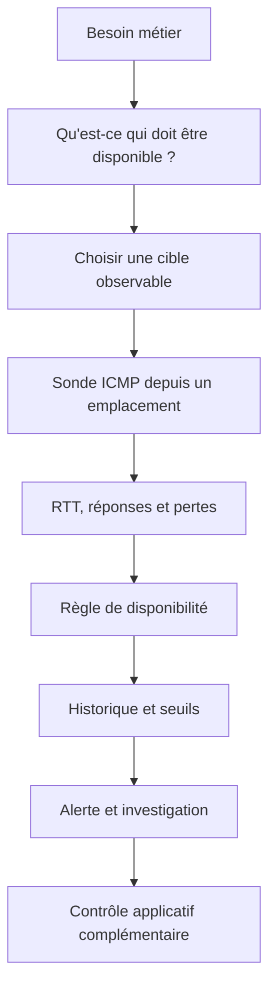
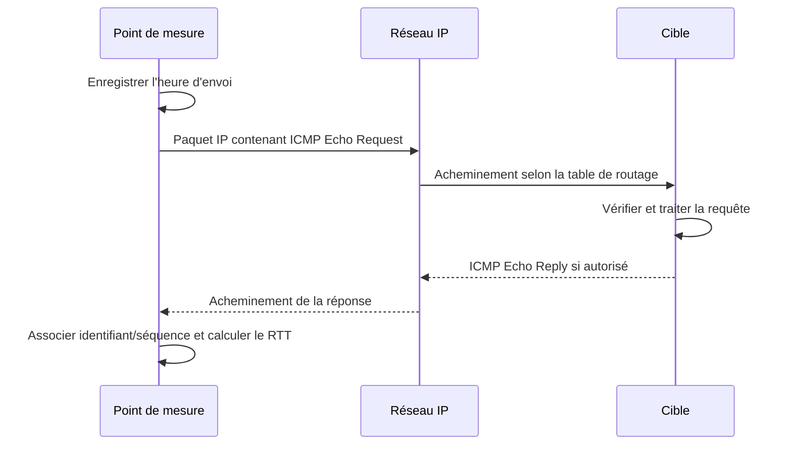
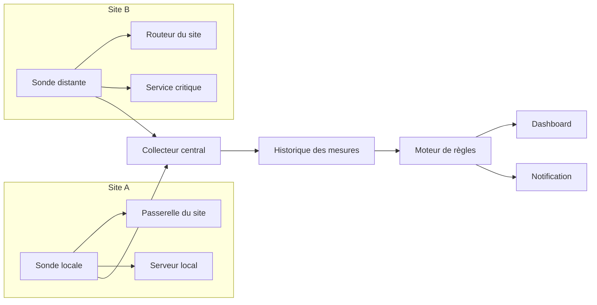
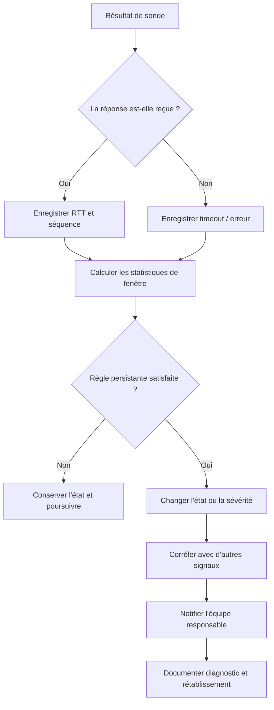

# Surveillance par ICMP (ping, uptime)

## 1. Introduction

### 1.1. Pourquoi surveiller la disponibilité d'un réseau

Un réseau informatique ne se résume pas à des câbles, des adresses IP et des équipements qui affichent un voyant vert. Il constitue un service rendu à des utilisateurs, des applications, des téléphones, des systèmes de paiement, des outils de production ou des plateformes cloud. Pour l'exploitant, une question revient en permanence : les composants nécessaires au service sont-ils joignables depuis les endroits où l'on en a besoin, et le restent-ils dans le temps ? La surveillance par ICMP apporte une première réponse simple, peu coûteuse et largement disponible. Elle permet de vérifier qu'une cible IP répond à une sonde, de mesurer un temps aller-retour et d'observer des pertes de réponses.

La simplicité de cet outil est sa force, mais aussi sa principale limite. Une réponse au ping prouve qu'un échange ICMP Echo a pu être effectué entre le point de mesure et une cible à un instant donné. Elle ne prouve pas que le site web hébergé par cette cible fonctionne, que la base de données accepte des requêtes, que les utilisateurs peuvent s'authentifier ou que toute l'application métier est opérationnelle. À l'inverse, l'absence de réponse ICMP ne suffit pas à conclure qu'un équipement est arrêté : un pare-feu peut filtrer les requêtes, un routeur peut limiter la fréquence des réponses, une politique de sécurité peut interdire Echo, ou le chemin retour peut être différent et défaillant.

La bonne pratique consiste donc à traiter ICMP comme un **signal de connectivité**, à définir précisément ce qu'il mesure, puis à le compléter avec des contrôles de service, des métriques, des journaux et, lorsque c'est utile, des traces distribuées. Ce cours montre comment passer du ping lancé manuellement à un contrôle de disponibilité exploitable en production.

### 1.2. Compétences visées

À la fin de ce cours, vous devez pouvoir expliquer le rôle d'ICMP dans IP, décrire la séquence Echo Request/Echo Reply, distinguer ICMPv4 et ICMPv6, utiliser les principales options de ping sous Linux et Windows, interpréter le temps aller-retour et la perte, et construire une vérification d'uptime raisonnable. Vous devrez également savoir diagnostiquer une absence de réponse sans accuser automatiquement le serveur, concevoir une alerte limitée aux problèmes pertinents, reconnaître les risques de faux positifs et de faux négatifs, et documenter une investigation de manière reproductible.

Le parcours pratique suit une progression volontaire. Nous commencerons par le vocabulaire et le fonctionnement du protocole. Nous examinerons ensuite les outils en ligne de commande, les résultats et leurs limites. Nous passerons aux calculs de disponibilité, aux seuils et à l'architecture de supervision. Enfin, une étude de cas vous fera traiter une dégradation réelle en séparant les symptômes, les hypothèses, les preuves et les décisions. Les exercices de fin de cours permettent de vérifier que vous savez interpréter des observations plutôt que simplement recopier une commande.

### 1.3. Encadré de mise en contexte

> **Situation professionnelle.** Un lundi matin, plusieurs utilisateurs signalent que l'application interne est lente. Le tableau de bord de supervision colore un routeur en rouge parce qu'il ne répond plus au ping. L'équipe réseau pense à une panne de liaison ; l'équipe système pense que le routeur fonctionne mais que son plan de contrôle est surchargé ; l'équipe applicative observe que certaines requêtes HTTP aboutissent encore. L'objectif n'est pas de décider en quelques secondes qui a raison. Il faut collecter des mesures, établir la portée du défaut et vérifier si le contrôle ICMP représente bien le service affecté.

Cette situation illustre la différence entre un indicateur et un diagnostic. Un indicateur attire l'attention sur un phénomène observable. Le diagnostic combine plusieurs sources et élimine progressivement les hypothèses. Une supervision mature ne supprime pas les alertes simples : elle les replace dans un contexte qui permet de décider quoi faire.

### 1.4. Où ICMP se place-t-il dans la pile réseau ?

ICMP signifie Internet Control Message Protocol. Il accompagne IP et transporte des messages de contrôle ou de diagnostic. Dans IPv4, le champ Protocol de l'en-tête IP indique la valeur 1 pour ICMP. ICMP ne fonctionne pas comme TCP ou UDP : il ne s'identifie pas par un port de transport. Une trame Ethernet transporte un paquet IP ; le paquet IP transporte un message ICMP, composé notamment d'un type, d'un code, d'un checksum et de données spécifiques au message. Le type précise la famille de message ; le code affine sa signification.

ICMP peut notamment signaler qu'un réseau ou un hôte est inaccessible, qu'un paquet a dépassé sa durée de vie, ou répondre à une requête Echo. Il faut éviter une idée trompeuse : ICMP ne rend pas IP fiable. Il peut fournir un indice lorsqu'un problème est détecté, mais le message de contrôle lui-même peut être perdu, filtré ou ne pas être émis. Une absence de message d'erreur n'est donc pas une preuve que le paquet original est arrivé. C'est une distinction importante pour la supervision, parce qu'un système de monitoring doit gérer une information incomplète et parfois ambiguë.

### 1.5. Définitions fondamentales

**Sonde** : requête envoyée afin d'observer un comportement mesurable. Dans ce cours, une sonde ping envoie une requête Echo à une adresse IP ou à un nom de domaine résolu en adresse IP.

**Cible** : appareil ou adresse que la sonde tente de joindre. La cible peut être un routeur, un serveur, une passerelle VPN, un équipement industriel ou une interface de service.

**RTT (Round-Trip Time)** : temps mesuré entre l'envoi d'une requête par le point de mesure et la réception de la réponse correspondante. Il inclut les délais de propagation, de transmission, de mise en file et de traitement sur le chemin aller et le chemin retour.

**Perte de sondes** : proportion des requêtes envoyées pour lesquelles aucune réponse correspondante n'a été reçue dans la fenêtre d'attente retenue. Elle ne permet pas toujours de distinguer une requête perdue d'une réponse perdue ou retardée.

**Disponibilité observée** : proportion d'échantillons ou de périodes classés comme disponibles selon une règle documentée. Le mot « observée » est essentiel : cette valeur dépend de la sonde, de son emplacement, de sa fréquence, de son délai d'attente et de la politique de calcul.

**Uptime** : durée pendant laquelle un service est considéré comme opérationnel selon un critère défini. Dans une fiche technique, il peut désigner la durée depuis le dernier redémarrage ; dans une supervision, on parle souvent d'un taux de disponibilité sur une fenêtre. Il faut préciser le sens afin d'éviter des tableaux de bord contradictoires.

### 1.6. Carte mentale de la surveillance



Le choix de la cible vient avant la commande. Si l'objectif est de vérifier la connectivité Internet d'un site distant, une sonde vers la passerelle locale ne suffit pas. Si l'objectif est de vérifier que le serveur d'une application est joignable depuis un réseau utilisateur, la sonde doit idéalement partir d'un point représentatif de ce réseau. Si l'objectif est de mesurer un engagement contractuel de service, la méthode de mesure doit être documentée et cohérente avec le contrat.

## 2. Concepts clés

### 2.1. Anatomie d'une requête Echo

Le ping classique utilise des messages Echo définis initialement pour ICMPv4 par la RFC 792. Une requête Echo IPv4 comporte un type 8 et un code 0 ; une réponse Echo porte un type 0 et un code 0. Le message comprend aussi un checksum, un identifiant, un numéro de séquence et une zone de données. L'identifiant et la séquence aident l'émetteur à associer une réponse à une requête. La réponse doit restituer les données Echo reçues, ce qui permet à l'émetteur de vérifier que la réponse correspond à son test.

L'identifiant et le numéro de séquence sont utiles quand plusieurs requêtes sont en vol ou quand la commande envoie une suite de sondes. Le numéro de séquence augmente généralement au fil des paquets. Si une réponse correspondant à la séquence 4 arrive alors que la séquence 3 manque, le programme peut signaler une perte, puis éventuellement recevoir plus tard la séquence 3 selon l'implémentation et le délai d'attente. Dans les outils courants, le RTT est calculé à partir de l'instant d'envoi et de la réception de chaque réponse.

Le checksum détecte certaines altérations du message ICMP ; il ne chiffre pas le message et n'authentifie pas l'émetteur. Une réponse Echo non chiffrée ne prouve donc pas l'identité d'un équipement au sens cryptographique. Le ping sert à observer la connectivité, pas à fournir une attestation de confiance. Les réseaux peuvent aussi employer des réponses synthétisées ou des équipements intermédiaires qui répondent selon leur configuration. Il faut tenir compte de cette possibilité lorsque la cible se trouve derrière un répartiteur de charge ou une architecture réseau complexe.

### 2.2. Séquence Echo Request/Echo Reply



Le diagramme montre le chemin logique, pas tous les détails d'encapsulation. Sur un LAN Ethernet, la machine émettrice peut d'abord devoir connaître l'adresse MAC du prochain saut. En IPv4, elle peut utiliser ARP pour déterminer la MAC d'un voisin sur le segment ; en IPv6, la découverte des voisins repose sur ICMPv6 Neighbor Discovery. Une fois l'adresse de couche 2 connue, le paquet IP est transporté dans une trame. Les routeurs décapsulent la trame reçue, consultent leur logique de routage, puis réencapsulent le paquet pour le prochain lien.

La réponse suit un chemin qui peut différer du chemin aller. Un RTT regroupe les deux directions ; il ne dit pas à lui seul où le délai s'est produit. Une commande ping ne fournit pas non plus automatiquement la liste des routeurs traversés. Pour localiser les sauts, des outils tels que traceroute ou tracert s'appuient sur des techniques complémentaires utilisant notamment le TTL ou le Hop Limit. Leur résultat doit lui aussi être interprété avec prudence, car certains routeurs ne renvoient pas les messages attendus.

### 2.3. ICMPv4 et ICMPv6

Il ne faut pas confondre les types de messages d'ICMPv4 et ceux d'ICMPv6. Pour ICMPv6, Echo Request est le type 128 et Echo Reply le type 129, conformément aux spécifications IPv6. ICMPv6 participe à des fonctions indispensables à IPv6, notamment la découverte des voisins, la découverte des routeurs et la gestion des erreurs de chemin. Un filtrage IPv6 qui bloque indistinctement tous les messages ICMPv6 peut casser des fonctionnalités légitimes, même si l'intention initiale était de réduire la surface d'attaque.

Avec IPv4, ICMP est identifié par le numéro de protocole IP 1. Avec IPv6, le Next Header associé à ICMPv6 est 58. Cette différence compte pour les ACL, les règles de pare-feu et les captures de paquets. Une règle qui autorise seulement ICMPv4 ne prouve pas que le ping IPv6 fonctionnera. De même, une cible peut avoir une adresse IPv4 et une adresse IPv6, avec des routes, des ACL et des comportements différents. Les tests doivent donc indiquer quelle famille a été utilisée.

Pour séparer les résultats, la plupart des versions de ping sous Linux permettent de forcer IPv4 avec l'option -4 et IPv6 avec -6. Sous Windows, les options équivalentes dépendent de la version et de la syntaxe disponible ; la documentation locale reste la référence. Un test par nom peut résoudre plusieurs adresses ou choisir l'une d'elles selon l'OS, la configuration et les préférences de routage. Lorsque le problème paraît intermittent, comparer les tests IPv4 et IPv6 évite de mélanger deux chemins réseau distincts.

### 2.4. Ce que mesure réellement le RTT

Le temps aller-retour est généralement présenté en millisecondes. Une valeur basse et stable peut être normale pour une cible située sur le même réseau local ; une valeur plus élevée est attendue pour une cible distante ou reliée par une liaison à latence importante. Il n'existe pas de seuil universel « bon » ou « mauvais » sans contexte. Le RTT dépend de la distance physique, de la technologie de liaison, de la congestion, du chemin de routage et du traitement du paquet.

La latence observée par ICMP peut différer de celle du trafic applicatif. Les routeurs peuvent traiter le trafic de contrôle avec une priorité différente de celle du trafic de transit ; une politique de qualité de service peut traiter ICMP autrement ; le serveur peut répondre rapidement au ping tout en ayant une application saturée. À l'inverse, un équipement peut répondre tardivement aux Echo Request parce que son processeur est occupé par d'autres tâches, tandis que le transfert de paquets continue de fonctionner correctement. Le RTT ICMP est un indicateur utile, pas une représentation parfaite de toutes les communications.

La moyenne résume un ensemble mais peut masquer des pointes. Le minimum donne une idée du meilleur temps observé, tandis que le maximum révèle le pire échantillon de la période. Les percentiles, notamment P95 et P99, permettent de décrire la queue de distribution et sont souvent plus utiles que le seul maximum, très sensible à un événement isolé. Pour décider d'une alerte, il vaut mieux étudier la distribution historique et les conséquences pour le service plutôt que d'agir sur une seule valeur exceptionnelle.

### 2.5. Perte de paquets et perte de sondes

La perte de sondes est souvent calculée ainsi : nombre de requêtes sans réponse dans le délai, divisé par le nombre total de requêtes envoyées, multiplié par 100. Si 100 sondes sont envoyées et 3 n'ont pas de réponse reçue à temps, la perte observée est de 3 %. Ce calcul ne dit pas forcément qu'exactement 3 % des paquets applicatifs sont perdus. Les sondes Echo peuvent être traitées différemment, les réponses peuvent être filtrées, et le mécanisme de mesure peut classer une réponse tardive comme une perte.

Une seule sonde sans réponse peut provenir d'une perte transitoire, d'un traitement trop lent, d'un filtre ou d'une congestion ponctuelle. Plusieurs pertes consécutives, observées depuis différents points de mesure et accompagnées de symptômes applicatifs, sont une preuve plus forte d'un problème de connectivité. Les pertes intermittentes peuvent être particulièrement difficiles à comprendre : un ping de cinq paquets peut afficher zéro perte, alors qu'une supervision fonctionnant toute la journée captera plusieurs épisodes très courts. La fréquence d'échantillonnage influe donc sur ce que le système peut détecter.

La perte doit être interprétée en fonction du chemin et de la cible. Si une interface répond à 100 % des sondes depuis le même VLAN mais à 70 % depuis un site distant, le défaut peut être situé sur le WAN, sur un équipement intermédiaire, sur le chemin retour ou dans une politique propre au trafic distant. Il est erroné de conclure sans autres preuves que le serveur perd 30 % de ses paquets. Une supervision multi-emplacements améliore la capacité à isoler le périmètre concerné.

### 2.6. TTL, Hop Limit et outils de chemin

Le TTL d'IPv4 et le Hop Limit d'IPv6 diminuent lors du transit par les routeurs. Quand la limite atteint zéro, un routeur abandonne le paquet et peut envoyer un message ICMP Time Exceeded. Le champ ne constitue pas une mesure directe de la disponibilité de la cible. La valeur TTL qui apparaît dans certaines sorties de ping est généralement celle observée dans la réponse, pas une mesure du nombre exact de sauts aller-retour. Le TTL initial choisi par l'émetteur de la réponse peut varier selon le système.

Traceroute et tracert envoient une série de sondes dont les limites de saut augmentent progressivement, dans le but de faire répondre chaque routeur intermédiaire par un message de dépassement de TTL ou Hop Limit. Certaines sondes de traceroute utilisent UDP ou TCP, selon l'outil et ses options ; le ping classique est différent. Les résultats peuvent contenir des astérisques lorsqu'un saut n'a pas répondu, mais cela ne prouve pas que ce routeur est arrêté. Il peut simplement ne pas répondre à la sonde, alors qu'il continue à transférer le trafic.

Les outils de chemin sont utiles pour localiser une zone de latence ou de perte, mais ne garantissent pas de révéler tous les équipements. Les routes peuvent être asymétriques ou changer pendant le test. L'équilibrage de charge par flux peut conduire différentes sondes à emprunter des chemins différents. Lors d'une investigation, conservez l'heure, le point de départ, la destination, la famille IP et la commande utilisée ; ces détails sont indispensables pour comparer des résultats.

### 2.7. Uptime et disponibilité : ne pas confondre les notions

Le terme uptime peut désigner la durée écoulée depuis le démarrage d'un système. Par exemple, un serveur peut afficher 42 jours d'uptime, ce qui indique qu'il n'a pas redémarré depuis cette durée selon sa propre mesure. Cette information ne prouve pas que le service a été joignable pendant toute la période. Un serveur peut rester démarré mais perdre sa connectivité, ne plus accepter de connexions applicatives ou subir des interruptions partielles.

En supervision, on calcule fréquemment une disponibilité observée sur une fenêtre : une minute, une heure, un jour, un mois ou un trimestre. Il faut définir ce qui compte comme disponible. Une règle peut être « la sonde ICMP répond au moins une fois pendant chaque période de deux minutes » ; une autre peut être « un contrôle HTTPS réussit et renvoie une réponse applicative attendue ». Ces règles ne mesurent pas la même chose. Une cible peut satisfaire la première sans satisfaire la seconde.

Une disponibilité agrégée masque aussi la répartition des incidents. Deux services peuvent avoir 99,9 % de disponibilité mensuelle, mais l'un peut subir une interruption continue de 43 minutes et l'autre plusieurs microcoupures réparties dans le mois. Leur impact utilisateur peut être très différent. Pour une équipe réseau, conserver le journal des événements et les durées d'interruption est donc aussi important que publier un pourcentage unique.

### 2.8. Calculer un taux de disponibilité

Sur une fenêtre définie, une approximation courante est :

Disponibilité (%) = (durée totale de la fenêtre - durée d'indisponibilité) / durée totale de la fenêtre × 100.

Pour une fenêtre de 30 jours, la durée théorique est de 30 × 24 × 60 = 43 200 minutes. Si une définition d'indisponibilité validée identifie 20 minutes d'arrêt, la disponibilité est (43 200 - 20) / 43 200 × 100, soit environ 99,9537 %. Ce calcul suppose qu'on a identifié les minutes indisponibles de manière cohérente et qu'on a choisi de compter chaque minute affectée comme indisponible.

Les pourcentages très élevés peuvent paraître proches, alors que les durées d'arrêt sont sensiblement différentes. Sur une fenêtre de 30 jours, 99 % représentent 7 heures et 12 minutes d'indisponibilité ; 99,9 % représentent 43 minutes et 12 secondes ; 99,99 % représentent 4 minutes et 19,2 secondes environ. Ces conversions aident les équipes à comprendre ce que signifie un objectif de disponibilité. Elles ne remplacent pas la définition du périmètre, des maintenances exclues, des dépendances et de la méthode de calcul.

Il faut également distinguer disponibilité mesurée et engagement contractuel. Un SLA (Service Level Agreement) peut définir des périodes de mesure, des exclusions, des critères de service et des règles de calcul spécifiques. Un résultat de ping ne doit pas être présenté automatiquement comme la preuve du respect ou de la violation d'un SLA applicatif. Le contrôle doit correspondre au service et à la méthode décrits dans l'accord.

### 2.9. Fréquence de sondage, timeout et taille d'échantillon

Une sonde exécutée toutes les secondes réagit plus vite qu'une sonde exécutée toutes les cinq minutes, mais elle génère davantage de trafic, de données et potentiellement de bruit. Pour un parc de plusieurs milliers de cibles, une fréquence trop agressive peut augmenter la charge des collecteurs ou déclencher des mécanismes de limitation. Un rythme d'une à cinq minutes peut convenir à certains contrôles de base ; les besoins réels, les contraintes de capacité et la criticité doivent guider le choix.

Le timeout représente la durée maximale pendant laquelle l'outil attend une réponse avant de classer la sonde comme non répondue. Un timeout trop faible entraîne des pertes apparentes quand la latence normale varie ; un timeout trop élevé retarde la détection et le déclenchement des alertes. Il doit être choisi à partir des temps historiques et de l'objectif de détection. Un timeout n'est pas la garantie qu'une réponse tardive ne surviendra jamais : il fixe seulement la limite d'attente du système de mesure.

La taille d'échantillon conditionne la stabilité des statistiques. Avec quatre sondes, une perte représente 25 % ; avec mille sondes, dix pertes représentent 1 %. Une période de mesure courte donne rapidement un signal, mais peut être sensible au hasard. Une période longue stabilise les agrégats mais peut masquer le début d'une panne. Les alertes efficaces combinent souvent des seuils simples avec une condition de persistance, une fenêtre glissante et un délai de récupération documenté.

### 2.10. État de la cible : disponible, dégradé, inconnu

Un système robuste ne se limite pas toujours à deux états, vert et rouge. Il peut distinguer disponible, dégradé, indisponible et inconnu. L'état disponible correspond au critère choisi et satisfait. L'état dégradé correspond à une cible qui répond mais dont le RTT ou les pertes dépassent un seuil pendant la fenêtre. L'état indisponible signifie que les critères de non-réponse ont été satisfaits pendant un intervalle défini. L'état inconnu signale que le collecteur ou le chemin de mesure n'a pas fourni assez d'informations pour statuer.

L'état inconnu est important. Si le collecteur de supervision s'arrête, il ne faut pas interpréter automatiquement l'absence de nouvelles mesures comme une panne simultanée de centaines d'équipements. L'absence de données peut venir du collecteur, du réseau de supervision, d'une panne de base de données, d'un changement de configuration ou de la cible. Une alerte sur le système de mesure lui-même aide à éviter une cascade d'alertes erronées.

Une transition d'état devrait aussi être traitée avec soin. Une sonde isolée en échec peut faire passer une cible en alerte si la règle est trop stricte ; plusieurs échecs consécutifs peuvent constituer une condition plus robuste. À la récupération, il peut être utile d'exiger plusieurs réponses valides avant de déclarer le retour à la normale. Cette hystérésis réduit les oscillations et rend les tableaux de bord plus lisibles.

### 2.11. Cible IP ou nom DNS

Un ping vers une adresse IP sépare partiellement le diagnostic DNS du test IP. Un ping vers un nom commence normalement par une résolution de nom, puis envoie des sondes à l'adresse choisie. Si le nom ne se résout pas, l'échec survient avant le test ICMP. Si le nom résout une adresse inattendue, le résultat peut être valide pour un autre serveur, une autre région ou une autre famille IP.

Pour investiguer, comparez la résolution DNS avec le ping de l'adresse obtenue. Sur Linux, la commande getent hosts nom, ou des outils comme dig, peuvent montrer les adresses retournées. Sous Windows, nslookup peut aider à vérifier la résolution. Les résultats DNS peuvent varier en fonction du résolveur, du cache, du split-horizon DNS et des mécanismes de répartition. Gardez en tête que ping n'est pas un test de santé DNS complet : il ne vérifie pas nécessairement les délais de réponse du service DNS, sa disponibilité sur UDP/TCP 53, ni l'exactitude d'une réponse métier.

### 2.12. Les réponses ICMP peuvent être filtrées ou limitées

De nombreux réseaux appliquent des règles différentes au trafic de gestion et au trafic utilisateur. Un pare-feu peut laisser passer HTTPS tout en refusant Echo Request. Un routeur peut autoriser les requêtes vers son adresse d'administration mais ignorer celles destinées à son adresse de transit. Certains équipements répondent à faible fréquence lorsqu'ils sont chargés, ou imposent une politique de contrôle-plane policing afin que le traitement des paquets destinés au processeur ne pénalise pas le transfert normal du trafic.

L'absence de réponse doit être traitée comme un symptôme. Avant d'ouvrir un incident de panne serveur, vérifiez si le ping est autorisé, si la politique a récemment changé, si le point de mesure est correct et si d'autres protocoles fonctionnent. Les tests doivent être conformes aux règles de l'organisation : ne contournez pas les ACL et ne lancez pas de sondages massifs sur des réseaux sans autorisation. L'ICMP est utile pour la supervision, mais une politique de sécurité peut légitimement ne pas exposer Echo à tous les emplacements.

### 2.13. Limites d'une sonde unique

Un résultat de ping dépend de l'endroit où la mesure est effectuée. Un serveur peut répondre depuis le VLAN d'administration mais être injoignable depuis le Wi-Fi invité. Une sonde située dans le même centre de données peut voir un chemin très différent de celui d'un utilisateur distant. Une supervision multi-sites permet de détecter cette asymétrie : si une seule sonde échoue alors que les autres réussissent, le défaut peut se situer dans le réseau local de cette sonde plutôt que sur la cible elle-même.

Les cibles multiples sont également importantes. Pour un site distant, surveiller seulement le routeur du site peut vérifier un accès local sans vérifier la connectivité vers Internet. Surveiller seulement une adresse publique externe peut confondre une panne du fournisseur avec un filtrage de cette adresse. Un ensemble raisonné de cibles peut inclure la passerelle locale, une destination connue en amont, un service critique de l'entreprise et un point de référence externe autorisé. Chaque cible doit avoir une fonction documentée ; multiplier les cibles sans objectif augmente le bruit.

Une cible répondant à ICMP peut être une adresse virtuelle gérée par un cluster ou un répartiteur de charge. La réponse ne garantit pas que toutes les instances backend sont saines. Dans un environnement cloud, une adresse peut être joignable alors que le service est dégradé par des règles de sécurité, des problèmes de résolution, une saturation applicative ou une dépendance indisponible. Le contrôle ICMP doit donc être une couche de la stratégie, jamais sa totalité.

### 2.14. Le rôle du plan de contrôle et du plan de données

Dans un routeur, le plan de contrôle gère notamment le routage, les protocoles de voisinage et certaines fonctions de gestion. Le plan de données transfère les paquets selon les décisions déjà établies. Une requête ping destinée à l'adresse propre du routeur peut nécessiter une prise en charge par le plan de contrôle ; les paquets qui traversent le routeur peuvent être transférés par un chemin matériel distinct. Une charge élevée sur le processeur peut ainsi ralentir les réponses de ping sans nécessairement interrompre le transit de tout le trafic.

L'inverse peut aussi arriver : l'interface de gestion du routeur répond depuis un chemin toujours accessible, alors que le plan de données rencontre un défaut qui perturbe les utilisateurs. C'est pourquoi un ping vers la passerelle ne peut pas servir seul de preuve que le routage de bout en bout fonctionne. Une mesure depuis plusieurs segments et un contrôle applicatif sur le chemin réel renforcent le diagnostic.

Cette distinction aide à interpréter des résultats apparemment contradictoires. Si la passerelle répond mais que le serveur distant ne répond plus, plusieurs hypothèses restent possibles : route absente, filtre intermédiaire, panne du serveur, chemin retour défaillant ou Echo désactivé sur la destination. Il faut progresser par étapes et ne pas confondre « l'équipement de bord répond » avec « tous les flux traversent correctement le réseau ».

### 2.15. Construire une politique de seuils

Un seuil de latence doit être fondé sur le contexte. Pour un réseau local, un RTT habituellement inférieur à quelques millisecondes peut être attendu ; pour un accès distant avec satellite ou liaison radio longue portée, un RTT bien plus élevé peut être normal. Un seuil uniforme dans toute l'organisation risque de générer des alertes permanentes dans les zones où la latence naturelle est plus importante. Il est préférable de définir des profils par type de lien, site, classe de service ou cible.

Une politique simple peut déclencher un avertissement lorsque le RTT P95 dépasse une limite pendant dix minutes, puis une alerte critique si la perte dépasse un seuil plus élevé ou si aucune réponse n'est reçue pendant plusieurs cycles. Ce ne sont que des exemples, pas des valeurs universelles. Les seuils définitifs doivent être validés avec l'historique, les besoins métiers et les conséquences de chaque état. Les règles peuvent aussi tenir compte des heures de charge, des fenêtres de maintenance et des dépendances connues.

La condition de persistance compte autant que la valeur du seuil. Déclencher une alerte sur chaque pointe peut fatiguer l'équipe, alors qu'attendre trop longtemps peut retarder la détection. Des fenêtres glissantes, des conditions consécutives et un mécanisme d'hystérésis permettent de trouver un compromis. Pour les changements rapides, un contrôle secondaire à fréquence plus élevée peut apporter une confirmation, à condition de ne pas saturer la cible ni de générer une tempête de sondes.

### 2.16. Matrice de diagnostic de premier niveau

| Observation | Hypothèses possibles | Vérifications utiles |
|---|---|---|
| Pas de réponse depuis une seule sonde | Chemin local, ACL, collecteur, résolution ou cible | Tester depuis un second point, vérifier DNS et état du collecteur |
| Toutes les sondes échouent vers une cible | Cible indisponible, route manquante, filtrage commun ou panne de service | Contrôler les sauts intermédiaires, un port applicatif autorisé et les événements réseau |
| Ping réussi mais application en panne | Service applicatif arrêté, port filtré, saturation ou dépendance en échec | Tester HTTP/TCP, consulter métriques, logs et état applicatif |
| RTT élevé mais pas de perte | Congestion, chemin long, files d'attente ou traitement lent | Comparer P95, traceroute, interfaces et mesures de bout en bout |
| Perte partielle et intermittente | Congestion, lien instable, Wi-Fi, policing ou asymétrie | Prolonger l'échantillonnage, comparer les points et vérifier les compteurs d'interface |
| IPv4 fonctionne, IPv6 échoue | Route, ACL, DNS ou configuration IPv6 distincte | Forcer séparément -4 et -6, inspecter les routes et les règles |
| Aucune nouvelle mesure pour de nombreuses cibles | Collecteur ou réseau de supervision défaillant | Vérifier la santé du collecteur avant de conclure à une panne généralisée |

Cette matrice ne donne pas de verdict automatique. Elle structure les premières vérifications et préserve le raisonnement. Les hypothèses doivent être confirmées avec des preuves. Une sortie ping isolée est rarement suffisante pour attribuer une cause précise.

### 2.17. Ping n'est pas une mesure de bande passante

Le ping mesure principalement le délai de réponse des petites sondes et la proportion de réponses reçues. Il ne mesure pas la capacité maximale d'un lien, ne prouve pas qu'un flux TCP peut atteindre un débit élevé et ne révèle pas à lui seul la qualité d'une application. Une liaison peut répondre rapidement à de petits paquets tout en présentant de mauvaises performances sur des transferts volumineux à cause d'un débit limité, d'une fenêtre TCP, d'un problème de MTU ou d'une perte qui pénalise les retransmissions.

Pour évaluer le débit, il faut utiliser des outils adaptés et autorisés, comme iperf3 dans un environnement de test contrôlé, en expliquant les impacts et en évitant de lancer une charge non planifiée sur la production. Pour une application web, un test HTTP synthétique peut vérifier la résolution DNS, l'établissement TLS, le temps de réponse et le contenu attendu. Pour un service de base de données, un contrôle applicatif dédié peut confirmer la disponibilité sans exposer de données sensibles. Chaque outil mesure une dimension précise.

Les outils ne sont pas interchangeables. Le ping demeure pertinent pour surveiller la connectivité IP, notamment sur de longues périodes et à faible coût. Les tests de débit doivent être ponctuels et encadrés ; les tests applicatifs sont plus proches de l'expérience utilisateur, mais nécessitent un contrôle des dépendances et des identifiants. Une bonne supervision combine ces signaux selon le risque et le coût du contrôle.

### 2.18. Relations entre ICMP, TCP, UDP et l'application

ICMP n'a pas de port TCP ou UDP. Une vérification TCP vers un port donné teste une autre étape : la possibilité d'établir une connexion vers ce service. Un serveur peut répondre au ping alors que le port 443 est fermé ; il peut aussi refuser Echo mais accepter HTTPS. Un test TCP réussissant ne prouve pas non plus que l'application répond de façon fonctionnelle : il peut indiquer seulement qu'une connexion a été établie.

La progression de tests doit être structurée. Vérifier d'abord la résolution du nom quand elle fait partie du parcours, puis la connectivité IP, puis le transport attendu, puis la réponse applicative. Par exemple, si un site web ne fonctionne pas, on peut résoudre son nom, tester le ping de l'adresse si c'est autorisé, ouvrir une requête HTTPS et contrôler le code HTTP ainsi qu'un contenu attendu. Si ICMP échoue mais HTTPS fonctionne, l'hypothèse de filtrage ICMP devient plausible. Si ping réussit mais HTTPS échoue, il faut orienter la recherche vers le port, le TLS, le proxy ou l'application.

Cette approche par couches évite d'arrêter l'investigation au premier signal. Elle empêche aussi de diagnostiquer un problème applicatif à partir d'un outil qui n'a jamais testé l'application. Les critères de réussite doivent être définis avant la mise en production de la surveillance, afin que les tableaux de bord répondent à une question opérationnelle claire.

### 2.19. Les codes d'erreur à reconnaître

Les messages affichés par ping ne sont pas identiques sur tous les systèmes, mais certains cas reviennent souvent. « Destination Host Unreachable » indique qu'une machine a signalé que la destination n'était pas joignable par le chemin tenté. Il faut identifier qui a envoyé le message, car il peut provenir de la machine locale ou d'un routeur intermédiaire. « Destination Net Unreachable » peut indiquer un problème de route vers le réseau. Un timeout signifie seulement qu'aucune réponse correspondant à la sonde n'a été reçue dans la fenêtre d'attente ; il ne révèle pas à lui seul la cause.

« TTL expired in transit » peut apparaître lorsqu'une limite de saut a été atteinte, notamment lors d'une opération de diagnostic du chemin ou en présence d'une boucle de routage. Une erreur de nom ou une absence de résolution DNS survient avant l'envoi de l'Echo Request à la cible résolue. Un message « General failure » sous Windows peut venir de l'environnement local ou de la pile réseau et doit être investigué sur la machine de départ.

La formulation exacte change selon la version du système et la langue. Pour un rapport d'incident, conservez la sortie complète, l'heure, l'adresse source, la destination et les options utilisées. Reformuler « ping ne marche pas » en « depuis la sonde NMS-02 à 10:14 UTC, quatre Echo Request IPv4 vers 192.0.2.10 ont expiré avec un timeout de deux secondes, alors que le contrôle TCP/443 réussit » transforme une impression en observation exploitable.

### 2.20. Sécurité, gouvernance et autorisation

ICMP peut servir à une administration légitime, mais il peut également révéler l'existence de systèmes et contribuer à la reconnaissance d'un réseau. La politique de sécurité doit autoriser les sondes nécessaires, limiter leur portée et documenter les emplacements autorisés. Une sonde de disponibilité régulière envoyée à quelques cibles approuvées n'est pas équivalente à un balayage massif d'un réseau entier. Les tests à grande échelle doivent faire l'objet d'une autorisation explicite et d'une coordination avec les équipes responsables.

Un ping Echo ne contient pas de mécanisme d'authentification du destinataire. Un attaquant peut usurper certaines adresses dans des contextes où la protection réseau est insuffisante, et une réponse observée ne doit pas servir de preuve d'identité. Le contrôle d'accès aux interfaces d'administration, la segmentation, le filtrage anti-usurpation, les journaux et les protections du plan de contrôle restent importants. L'objectif de la supervision est de réduire le temps de détection, non d'ouvrir inutilement un accès large au réseau.

Les sondes produisent aussi des données de fonctionnement : adresses IP, périodes d'indisponibilité, noms d'équipements et topologie implicite. Protégez les tableaux de bord, la configuration des collecteurs et les historiques conformément aux règles de l'organisation. Une indisponibilité peut exposer des informations sensibles sur l'architecture ou le rythme des activités. Les comptes utilisés par les outils de supervision doivent bénéficier du strict nécessaire, être inventoriés et être révoqués proprement lors de leur retrait.

### 2.21. ICMP dans une stratégie de monitoring moderne

Un contrôle ICMP est un composant utile d'une stratégie à plusieurs couches. Au niveau réseau, il répond à la question : une cible IP répond-elle à cette sonde depuis ce point ? Au niveau transport, un test de port peut vérifier qu'un service écoute et qu'un chemin TCP est utilisable. Au niveau applicatif, une sonde synthétique peut confirmer un parcours représentatif. Les métriques décrivent les ressources et les performances ; les journaux donnent des événements contextualisés ; les traces relient les opérations entre services.

La complémentarité doit être planifiée. Surveiller toutes les machines avec un test applicatif lourd peut être coûteux et fragile ; surveiller seulement ICMP peut manquer des pannes majeures. On peut mettre en place une couche de ping fréquente et peu coûteuse, puis des vérifications applicatives sur les services critiques. Lorsqu'un signal réseau est dégradé, la supervision peut enrichir l'événement avec les données de port, de service et de site. Les corrélations doivent toutefois éviter de transformer une hypothèse en certitude.

Il est également utile d'aligner les alertes sur l'impact. Une perte temporaire de ping vers une machine de laboratoire peut ne nécessiter qu'une information. L'indisponibilité persistante de plusieurs passerelles sur un site de production peut demander une alerte critique. L'importance dépend de la fonction, du nombre d'utilisateurs affectés, de l'existence d'un chemin redondant et de la durée. Un bon système de supervision ne traite pas toutes les cibles comme identiques.

## 3. Architecture et Schémas

### 3.1. Architecture de supervision de base

Une architecture minimale comporte une sonde ou un collecteur, une liste de cibles, un ordonnanceur qui lance les tests, un composant qui collecte les résultats, une base de séries temporelles ou un stockage historique, un moteur de règles et un système de notification. Dans une petite structure, ces fonctions peuvent être réunies dans un seul outil. Dans une grande organisation, les sondes peuvent être réparties sur plusieurs sites et transmettre les résultats vers une plateforme centrale.



Le rôle de la sonde est d'émettre des requêtes selon une fréquence et une politique de timeout. Le collecteur conserve l'heure, la cible, la famille IP, le RTT, le résultat, le point de mesure et la version de la configuration. Il doit également surveiller sa propre santé : CPU, mémoire, occupation des sockets, retard de traitement, file d'envoi et capacité à transmettre les mesures. Sans cette surveillance du collecteur, une panne de l'outil peut se faire passer pour une panne générale des cibles.

Le stockage historique permet de tracer des tendances et de comparer une période normale à une période dégradée. Le moteur de règles convertit les résultats en états opérationnels. Le tableau de bord fournit le contexte ; la notification attire l'attention de la bonne équipe. Il faut éviter de confondre ces rôles : le tableau de bord peut être correct sans qu'une alerte soit configurée, tandis qu'une alerte peut être déclenchée sans que le tableau de bord contienne assez de détails pour comprendre pourquoi.

### 3.2. Définir un contrat de sonde

Chaque contrôle doit être décrit comme un petit contrat technique. Un tel contrat contient un identifiant stable, une cible et sa fonction, l'adresse ou le nom attendu, la famille IP, l'emplacement de mesure, l'intervalle, le timeout, le nombre d'échecs qui déclenche l'état indisponible, le nombre de succès nécessaires au retour à la normale, les seuils de latence et de perte, ainsi que la personne ou l'équipe responsable. Un contrat documenté rend la mesure reproductible et facilite les changements.

Par exemple, on peut définir la vérification d'une passerelle de site toutes les 30 secondes depuis une sonde locale, avec un timeout raisonnable, trois échecs consécutifs avant une alerte et deux succès consécutifs pour sortir de l'état critique. Ces valeurs illustrent une méthode, pas une recommandation universelle. Une telle politique doit être évaluée selon les exigences, les limites d'équipement et l'impact d'un faux positif. Si la cible limite ses réponses, réduire l'intervalle peut dégrader la précision plutôt que l'améliorer.

Le contrat doit préciser ce que l'outil ne vérifie pas. Un contrôle ICMP d'une adresse de pare-feu ne vérifie pas tous les tunnels VPN qui traversent ce pare-feu. Un contrôle du serveur ne confirme pas la disponibilité de chaque fonctionnalité de l'application. Les limites doivent être visibles dans la documentation et dans le nom du contrôle, afin d'éviter qu'un tableau de bord « serveur disponible » soit interprété abusivement comme « application métier entièrement disponible ».

### 3.3. Mesurer depuis les bons endroits

La position du collecteur influence fortement le résultat. Pour surveiller un serveur depuis un réseau d'utilisateurs, un contrôle effectué uniquement depuis le même réseau de serveurs peut manquer un problème d'interconnexion. Les sondes distribuées offrent un point de vue plus proche des différentes populations. Elles permettent de comparer la disponibilité entre sites et de déterminer si un défaut concerne une seule région, un fournisseur ou une partie précise du chemin.

Dans la pratique, il faut équilibrer la représentativité, le coût de déploiement, la sécurité et la facilité d'exploitation. Une sonde par grande zone réseau peut suffire pour une première couverture. Les services particulièrement critiques peuvent nécessiter plusieurs points de vue, notamment un contrôle interne et un contrôle externe. Il convient de documenter la topologie réelle des sondes, leurs routes vers les cibles, les ACL applicables et les dépendances de leur connectivité.

La présence de plusieurs points de mesure ne supprime pas toutes les ambiguïtés. Deux sondes peuvent emprunter le même fournisseur ou la même sortie WAN et partager ainsi une cause de panne. Pour limiter les risques de panne commune, identifiez les dépendances partagées et répartissez les sondes de manière réfléchie. La diversité géographique n'est utile que si elle correspond aussi à une diversité pertinente des chemins ou des points d'accès.

### 3.4. Concevoir des règles de disponibilité

Supposons que le contrôle s'exécute toutes les 30 secondes. Un simple échec devrait-il immédiatement marquer la cible indisponible ? Cette règle peut rendre le tableau de bord très réactif, mais les pertes transitoires et les limitations ICMP créeront des alertes instables. Une autre stratégie attend trois échecs consécutifs. Elle réduit certains faux positifs, mais augmente le délai de détection. Le bon choix dépend de l'objectif opérationnel et doit être testé avec des données historiques.

Une règle utile distingue les seuils de dégradation des critères d'indisponibilité. Exemple : le RTT médian reste acceptable mais le P95 dépasse la limite pendant dix minutes ; la cible est dégradée. Si trois cycles successifs n'obtiennent aucune réponse, elle devient indisponible. Lorsqu'elle répond de nouveau, deux succès consécutifs peuvent être exigés pour confirmer le rétablissement. Ce type de règle évite de laisser chaque échantillon imposer seul l'état global.

Les fenêtres de maintenance doivent être modélisées et auditées. Il ne faut pas supprimer un incident au lieu de l'annoter sous prétexte qu'un changement était prévu. Une fenêtre de maintenance indique qu'une interruption est attendue, mais la surveillance doit continuer à produire des données lorsque c'est pertinent. Après la maintenance, vérifiez que l'état est revenu à la normale et que le contrôle n'a pas été désactivé par erreur. La suppression silencieuse d'une alerte peut masquer une panne réelle.

### 3.5. Séparer problème de cible et problème de collecteur

Une panne de collecteur peut produire une absence de résultats pour des centaines de cibles. Si le système interprète cette absence comme une indisponibilité indépendante de chacune, l'équipe reçoit une avalanche d'alertes sans valeur. Une architecture fiable doit superviser le collecteur : heartbeat, retard de collecte, files en attente, synchronisation horaire, disponibilité du stockage et envoi des résultats vers la plateforme centrale. Les mesures doivent comporter un horodatage produit au point de mesure et un horodatage de réception, pour détecter un retard de transmission.

Un modèle simple peut avoir un contrôle du collecteur par un mécanisme indépendant, une supervision du canal de transfert et un signal d'activité périodique. Si le collecteur cesse d'émettre toutes les mesures, le moteur de règles doit produire un événement « données de supervision absentes » plutôt qu'un événement « toutes les cibles en panne ». Si une seule sonde distante est muette mais que les autres collecteurs fonctionnent, l'investigation peut se concentrer sur cette sonde ou son réseau d'accès.

Cette distinction exige une conception explicite des états. « Aucune mesure reçue » n'est pas égal à « mesure reçue indiquant un échec ». Le premier cas décrit une défaillance de l'observation ; le second décrit un résultat négatif de la sonde. Dans les rapports, conservez les deux catégories séparément. Cette règle paraît simple, mais elle prévient beaucoup d'incidents d'exploitation et des erreurs de disponibilité calculée.

### 3.6. Corréler ICMP avec les autres indicateurs

Les résultats de ping gagnent en valeur lorsqu'ils sont corrélés à des signaux indépendants. Par exemple, une hausse du RTT ICMP accompagnée d'une augmentation des erreurs d'interface, d'une saturation de lien et d'une dégradation du temps de réponse HTTPS oriente vers un problème réseau plus crédible que la hausse de RTT seule. À l'inverse, si ICMP devient lent mais que les mesures applicatives et les compteurs de transit restent stables, il faut envisager une priorité de traitement ICMP différente ou une surcharge du plan de contrôle.

La corrélation ne doit pas se transformer en automatisme excessif. Une alerte consolidée peut regrouper plusieurs symptômes sous un incident parent, tout en conservant les observations sources. Il est important de pouvoir revenir aux mesures détaillées et de savoir quelle preuve soutient chaque hypothèse. Le moteur d'alerting doit éviter d'effacer les signaux utiles simplement parce qu'un incident principal existe déjà.

Une pratique utile consiste à annoter le tableau de bord avec les changements connus : mises à jour de firmware, modifications d'ACL, changements de routage, maintenance du fournisseur ou déploiement applicatif. Les corrélations temporelles orientent l'investigation mais ne constituent pas toujours une preuve de causalité. Le changement peut coïncider avec un événement indépendant. La confirmation se fait par des observations techniques et une analyse de la portée.

### 3.7. Exemple de flux de traitement d'un événement



Le flux sépare l'observation initiale de la décision. Un échantillon est une donnée ; la règle de fenêtre produit un état ; l'alerte distribue cet état aux personnes responsables. Conserver les données permet de réévaluer un seuil et d'expliquer après coup pourquoi l'alerte a été déclenchée. Si seule l'alerte finale est conservée, l'équipe risque de ne plus disposer des preuves nécessaires lorsqu'elle commence son investigation.

### 3.8. Qualité des données et horodatage

Un contrôle de disponibilité dépend d'un horodatage cohérent. Si les collecteurs ont une horloge en avance de plusieurs minutes, les graphes peuvent montrer des mesures en dehors de leur ordre réel, les événements peuvent sembler précéder les changements et les calculs de fenêtres peuvent être incorrects. La synchronisation horaire doit donc faire partie du socle de supervision. NTP ou un mécanisme de temps approuvé par l'organisation doit être configuré et surveillé.

Chaque mesure devrait contenir au minimum un identifiant de cible, un identifiant de sonde, un horodatage d'émission, un horodatage de réception, un statut, un RTT s'il existe, un identifiant de séquence si disponible et des métadonnées de configuration pertinentes. Les valeurs absentes doivent être représentées explicitement ; un RTT nul ne doit pas être utilisé pour signifier une absence de réponse, car cela pourrait déformer les moyennes. Une cible sans réponse doit être enregistrée comme un résultat manquant ou négatif selon le modèle de données, avec le timeout et le motif connu.

La qualité des données dépend aussi des changements d'inventaire. Si une adresse IP est réattribuée à une autre machine mais que l'inventaire n'est pas mis à jour, l'outil peut annoncer la disponibilité du mauvais appareil. Les noms, adresses, responsabilités, zones de maintenance et fonctions des cibles doivent être entretenus. Une supervision de qualité n'est pas seulement un ensemble de commandes correctement exécutées ; elle repose sur un inventaire fiable et des propriétaires clairement identifiés.

### 3.9. Dimensionnement des sondes

Pour dimensionner le volume, estimez le nombre de cibles, la fréquence, le nombre de points de mesure et la taille des résultats conservés. Par exemple, 2 000 cibles vérifiées toutes les 60 secondes représentent environ 2 000 mesures par minute pour une sonde unique, soit 2,88 millions d'échantillons par jour, avant réplication par emplacement ou enrichissement. Si trois sondes testent chaque cible, le volume de mesures est multiplié approximativement par trois. Ce calcul ne signifie pas que le réseau est saturé par ces petits paquets ; il montre surtout l'impact sur la collecte, le stockage, les index et les règles d'alerte.

Le dimensionnement doit aussi prendre en compte les limites des cibles. Une sonde peut émettre peu de trafic au regard de la bande passante, mais les équipements répondant sur leur processeur peuvent limiter le traitement de contrôle. Les intervalles doivent être adaptés à l'importance du service et au comportement du parc. Un outil qui concentre toutes les sondes au début de chaque minute crée des pointes ; une répartition temporelle ou du jitter peut lisser la charge.

Les données brutes peuvent être conservées sur une période plus courte, tandis que des agrégats par minute ou par heure sont gardés plus longtemps. Cette politique doit préserver les preuves des incidents et respecter les exigences de rétention. Une rétention trop courte empêche l'analyse des tendances ; une rétention excessive augmente les coûts et la quantité de données potentiellement sensibles. Mesurez la volumétrie réelle avant de figer la politique.

### 3.10. Dashboard utile

Un tableau de bord de ping ne devrait pas se réduire à une grille verte et rouge. Il doit afficher le point de mesure, la cible, la dernière réponse, le RTT actuel, les tendances de latence, le taux de perte sur plusieurs fenêtres, l'état calculé et les changements récents. Les détails doivent permettre à l'opérateur de répondre rapidement à trois questions : qu'est-ce qui est affecté, depuis quand, et depuis quels emplacements ?

Les vues doivent être adaptées aux rôles. Un opérateur réseau peut vouloir grouper les cibles par site, lien WAN ou fournisseur. Une équipe applicative souhaite plutôt voir la disponibilité des dépendances de son application. Un responsable de service peut avoir besoin d'une vue de disponibilité mensuelle et des incidents qui ont contribué aux interruptions. Les mêmes mesures peuvent nourrir plusieurs vues, mais chaque vue doit définir clairement sa signification.

Les couleurs doivent compléter le texte, pas le remplacer. Utilisez des états lisibles et une légende claire. Une cible en état inconnu ne doit pas être représentée exactement comme une cible confirmée indisponible. Les tableaux de bord doivent aussi éviter les rangs ou scores qui n'ont pas de méthode documentée. Un score global peut simplifier une synthèse, mais il ne doit jamais effacer la portée précise du contrôle.

### 3.11. Procédure de diagnostic par étapes

Lorsqu'une alerte ICMP est déclenchée, commencez par confirmer la qualité de l'observation. Vérifiez si le collecteur fonctionne, si les données arrivent à l'heure, et si l'alerte correspond bien à des mesures négatives plutôt qu'à une absence de collecte. Vérifiez ensuite la cible et son rôle, l'emplacement de la sonde, la famille IP, la résolution DNS s'il y en a une, l'intervalle, le timeout et les derniers changements.

Ensuite, comparez depuis un second point de mesure et examinez la passerelle locale, les routes, les voisins réseau, les compteurs d'interface et les journaux disponibles. Si la politique de sécurité le permet, testez un service applicatif attendu en parallèle. Un traceroute peut fournir des indices sur les sauts, mais une série d'astérisques ne désigne pas automatiquement le saut comme cause. Si les outils donnent des résultats contradictoires, conservez les sorties et cherchez la dépendance commune.

Enfin, classez l'impact et communiquez les faits. Le rapport devrait indiquer le début observé, la durée, les sites touchés, le pourcentage de pertes, les RTT pertinents, les tests complémentaires et les hypothèses encore ouvertes. Ne présentez pas une cause probable comme certaine avant confirmation. Après rétablissement, vérifiez la stabilité de plusieurs échantillons, mettez à jour l'incident et décidez si le seuil, l'inventaire ou la documentation doivent être corrigés.

## 4. Étude de cas

### 4.1. Contexte : un site distant devient intermittent

Une entreprise possède un siège, un centre de données et trois sites distants. Une application de gestion des stocks est hébergée au centre de données. Depuis 09 h 12, plusieurs utilisateurs du site Nord signalent des délais irréguliers. Le tableau de bord signale une perte ICMP de 18 % vers la passerelle du site, alors que le ping vers le serveur applicatif montre des RTT variant entre 22 et 240 ms. Depuis le siège, la passerelle répond normalement et le serveur répond avec une latence stable. L'équipe doit déterminer si la panne concerne la cible, le WAN, le collecteur ou l'application.

Le premier réflexe ne doit pas être de redémarrer le routeur. L'équipe vérifie l'heure et la portée de l'alerte, puis constate que le collecteur du site Nord a toujours un heartbeat valide. Les mesures sont récentes, le reste des cibles locales répond normalement, et les pertes sont observées depuis deux sondes du site Nord. Cela rend moins probable un arrêt complet du collecteur. La perte n'affecte pas tous les flux ; l'incident est donc traité comme une dégradation à diagnostiquer, plutôt qu'une panne totale immédiate.

### 4.2. Étape 1 : valider l'observation

L'équipe vérifie que les deux sondes testent les mêmes cibles et emploient la même famille IP. L'une résout le nom de l'application vers une adresse IPv4 ; l'autre utilisait le nom et sélectionnait une adresse IPv6 depuis un changement récent de DNS. Les tests ne sont donc pas strictement comparables. La seconde sonde est corrigée pour que l'essai de diagnostic force d'abord l'IPv4 et l'IPv6 séparément. L'écart de configuration est documenté pour éviter de mélanger deux chemins.

Les résultats montrent que l'IPv4 est affectée sur le site Nord, tandis que l'IPv6 n'est pas annoncée sur ce service interne. L'équipe n'en conclut pas que le protocole est la cause ; elle clarifie d'abord le périmètre mesuré. La résolution DNS est vérifiée indépendamment et renvoie l'adresse attendue. La cible n'a pas changé, et le défaut est observé depuis deux sondes du même site. Ces faits permettent de concentrer l'investigation sur la zone du site ou son accès WAN.

### 4.3. Étape 2 : comparer des cibles en amont et en aval

L'équipe compare la passerelle locale, une adresse d'interconnexion du fournisseur, un serveur de référence au centre de données et le serveur applicatif. Les cibles du VLAN local répondent correctement. La perte apparaît pour les destinations qui traversent le WAN, et le RTT varie fortement en même temps que le trafic du site. Le ping de la passerelle locale n'est donc pas un indicateur suffisant de connectivité de bout en bout, mais il permet de montrer que la première partie du réseau fonctionne.

Les compteurs d'interface sont ensuite examinés. L'interface WAN montre des signes de congestion à certaines heures. Les erreurs physiques ne progressent pas de manière significative, ce qui rend une panne de câble moins probable, sans l'exclure définitivement. Le fournisseur est interrogé avec des horodatages précis et un extrait de mesures. Le rapport ne dit pas « le fournisseur est en panne » ; il indique les pertes observées, leur fenêtre, les cibles affectées et les éléments qui suggèrent une saturation.

### 4.4. Étape 3 : utiliser un test applicatif

Le ping ne reproduit pas le trafic réel de l'application. Un test HTTPS synthétique approuvé est lancé depuis le site Nord et depuis le siège. Depuis le site Nord, l'établissement de la connexion et le temps jusqu'au premier octet sont irréguliers ; depuis le siège, ils restent stables. Les logs applicatifs du serveur ne montrent pas une hausse parallèle des erreurs métier, mais les journaux de la passerelle indiquent que le lien WAN approche de sa capacité pendant les périodes de pointe.

Cette combinaison de preuves renforce l'hypothèse de congestion du chemin WAN. Elle ne prouve pas encore si la cause immédiate est une croissance normale du trafic, une nouvelle sauvegarde, une anomalie de routage ou une politique de qualité de service. L'équipe examine les classes de trafic, le calendrier des jobs et les statistiques sur une période antérieure comparable. Elle découvre qu'une tâche de sauvegarde nouvellement planifiée transfère de gros volumes pendant les heures ouvrées.

### 4.5. Étape 4 : remédiation et confirmation

L'équipe déplace la sauvegarde vers une fenêtre de faible activité et applique, après validation, une politique de limitation adaptée. Elle surveille la perte ICMP, les compteurs WAN et le test HTTPS depuis les mêmes points de mesure. Les RTT retrouvent une distribution stable et la perte tombe à zéro sur la fenêtre de confirmation. Le rétablissement est confirmé par plusieurs échantillons consécutifs et par l'expérience des utilisateurs ; la seule disparition de l'alerte ne suffit pas à clôturer l'incident.

Le rapport final distingue la cause principale, les facteurs contributifs, les symptômes, les impacts et les actions préventives. L'incident n'est pas attribué au serveur simplement parce que le serveur était la cible finale du ping. Le contrôle ICMP a contribué à détecter une dégradation ; les tests complémentaires et les compteurs réseau ont permis de localiser la cause. La supervision devient plus utile lorsque ses signaux participent à un processus d'enquête reproductible plutôt qu'à une conclusion automatique.

### 4.6. Ce que le cas enseigne

Premièrement, un test de bout en bout ne localise pas à lui seul le défaut. Il prouve qu'un chemin d'observation est dégradé entre une sonde et une cible. Deuxièmement, des points de mesure distincts permettent de séparer un problème local d'un problème plus large. Troisièmement, les protocoles et les familles IP doivent être comparés correctement. Enfin, le diagnostic gagne en précision lorsque les sondes ICMP sont rapprochées des tests applicatifs, des compteurs d'interface, des journaux et des événements de changement.

L'équipe aurait pu éviter une partie de la confusion en documentant le choix IPv4/IPv6 et en annotant le nouveau job de sauvegarde. Toutefois, l'objectif d'une bonne supervision n'est pas d'anticiper chaque événement possible : c'est de réduire le délai entre le symptôme et une décision fondée sur des faits. L'après-incident doit proposer des améliorations concrètes, pas seulement une description de ce qui s'est passé.

### 4.7. Exemple de fiche d'incident exploitable

**Titre :** Perte de sondes et latence élevée depuis le site Nord vers le centre de données.

**Début observé :** 09 h 12, heure locale, selon les sondes du site Nord.

**Impact confirmé :** délais irréguliers pour l'application de gestion des stocks ; disponibilité ICMP dégradée sur les destinations distantes depuis deux sondes locales.

**Mesures :** perte ICMP mesurée à 18 % sur une fenêtre documentée ; RTT observés entre 22 et 240 ms ; tests du siège stables ; test HTTPS depuis le site Nord dégradé.

**Hypothèse confirmée :** congestion du lien WAN pendant une tâche de sauvegarde déplacée récemment sur les heures ouvrées.

**Actions immédiates :** déplacer la tâche vers une plage moins chargée, appliquer une limitation approuvée, contrôler les classes de trafic et confirmer la stabilité par sondes et test applicatif.

**Actions préventives :** intégrer la charge des sauvegardes au planning de capacité, documenter les familles IP des cibles, conserver les sorties et surveiller les percentiles de RTT plutôt que la moyenne seule.

Une fiche de ce type rend le résultat compréhensible pour les équipes qui n'étaient pas présentes au moment de l'incident. Elle facilite aussi la comparaison avec un incident futur et aide à mesurer si les actions préventives ont réellement réduit le risque.

### 4.8. Variante : tous les pings échouent, mais le service fonctionne

Imaginons une seconde situation : une entreprise renforce ses ACL pour limiter la reconnaissance réseau. Les Echo Request vers les serveurs sont maintenant filtrées depuis les postes utilisateurs, mais l'application HTTPS demeure accessible et les utilisateurs ne signalent aucune panne. La supervision historique repose pourtant sur ICMP et déclenche des centaines d'alertes. Dans ce cas, il serait inapproprié de demander simplement à l'équipe sécurité de désactiver son filtre sans analyser les exigences.

L'équipe doit vérifier le changement, confirmer que le service applicatif reste disponible et décider si la politique de mesure doit évoluer. Si ICMP n'est plus un contrôle autorisé depuis ce réseau, le monitor doit distinguer « contrôle interdit par politique » d'« hôte indisponible », ou remplacer ce contrôle pour l'objectif métier concerné. Un ping de diagnostic peut rester autorisé depuis un réseau de gestion précis. La réponse relève d'une décision d'architecture et de gouvernance, pas d'une règle universelle.

Cette variante rappelle que la supervision doit s'adapter au modèle de sécurité, tout en conservant des contrôles utiles. Les alertes doivent être mises à jour après tout changement approuvé. Il ne faut pas laisser un contrôle devenu invalide produire du bruit pendant des mois, car les opérateurs finiront par ignorer les alertes et risqueront de manquer une vraie panne.

## 5. Pièges à éviter

### 5.1. Conclure qu'un équipement est en panne après un seul timeout

Un timeout est une observation négative limitée par un délai. Il peut être causé par une requête perdue, une réponse perdue, un traitement retardé, un filtrage, une route asymétrique ou une cible qui ne prend pas en charge ce contrôle. Une sonde unique ne permet pas de trancher toutes ces hypothèses. La réaction la plus utile consiste à vérifier les mesures successives, comparer avec un second point de vue et contrôler d'autres symptômes cohérents.

Dans un environnement critique, on peut choisir une règle à plusieurs échecs consécutifs et une procédure d'escalade rapide. Cette tolérance ne signifie pas ignorer une alerte, mais la qualifier avec des critères explicites. Les seuils doivent être validés en simulation ou à partir des données historiques afin de connaître leur délai de détection, leur fréquence de faux positifs et leur sensibilité aux microcoupures. Une politique adaptée réduit à la fois le bruit et le risque de retard.

### 5.2. Confondre ping réussi et application disponible

Une cible peut répondre à Echo même si le serveur web, le moteur de base de données ou le service d'authentification est arrêté. L'ICMP peut être traité par la pile réseau alors que le processus applicatif ne fonctionne plus. Un serveur saturé peut aussi répondre au ping tout en mettant plusieurs secondes à terminer une requête. Tout indicateur doit être rapproché de son objectif : une sonde ICMP indique une connectivité IP observable, pas la validité fonctionnelle d'une application.

Pour un service critique, définissez un contrôle de bout en bout en plus du ping. Ce contrôle peut résoudre le nom, établir une connexion sécurisée, envoyer une requête sans effet de bord et vérifier un résultat attendu. Les identifiants utilisés doivent avoir des permissions minimales et les requêtes doivent éviter de modifier les données métier. Les tests applicatifs eux-mêmes peuvent échouer à cause d'une dépendance externe ; la supervision doit enregistrer ces étapes afin d'identifier où le parcours a échoué.

### 5.3. Traiter l'absence de réponse comme une perte du paquet aller

Le ping mesure l'arrivée d'une réponse, pas l'observation directe de chaque segment de l'aller. Si aucune réponse n'est reçue, la requête peut avoir été perdue, la cible peut ne pas avoir répondu, ou la réponse peut avoir été perdue ou bloquée sur le chemin retour. Le calcul de perte de ping ne sépare pas automatiquement ces possibilités. C'est pourquoi il faut parler de « perte de sondes observée » et réserver l'attribution de cause aux cas où d'autres preuves la soutiennent.

Des captures de paquets aux points appropriés, des compteurs d'interface, des journaux de pare-feu ou des tests depuis des réseaux différents peuvent aider à localiser l'endroit où la communication échoue. Ces méthodes doivent être conduites avec autorisation et au bon moment, car une capture excessive peut générer des données sensibles ou une charge opérationnelle. Le but est de réduire l'incertitude, pas de collecter tout le trafic sans limite.

### 5.4. Mettre le même seuil partout

Les conditions normales diffèrent entre un LAN de centre de données, une liaison radio, un réseau mobile, un VPN intercontinental et un accès satellite. Le même RTT peut représenter un problème sérieux dans un centre de données et une valeur habituelle sur une liaison longue distance. De même, une faible perte peut être tolérée par certains contrôles mais être préoccupante sur un service interactif. Les règles doivent être définies par contexte et être appuyées par des objectifs de service.

La personnalisation ne doit pas devenir une accumulation arbitraire de seuils impossibles à maintenir. Regroupez les cibles en profils compréhensibles, documentez l'exception et évitez de créer une règle spéciale pour chaque équipement sans justification. Lorsqu'un profil change, conservez la trace de la modification et évaluez ses effets sur les alertes. La qualité de la politique dépend de sa lisibilité autant que de sa précision.

### 5.5. Ignorer le filtrage et le rate limiting

Certains équipements filtrent Echo ou limitent les réponses destinées au processeur. Une surveillance qui envoie des sondes trop souvent peut interpréter cette limitation comme une panne. Avant d'augmenter la fréquence ou de conclure que la cible est défaillante, vérifiez la politique de sécurité, la configuration de contrôle-plane policing et les limites connues du matériel. Une cible qui répond à un faible rythme mais pas à une rafale n'est pas nécessairement indisponible pour le trafic métier.

Ne contournez pas ces politiques par un accroissement massif de la fréquence. Coordonnez-vous avec l'équipe propriétaire, définissez une règle de supervision acceptée et testez son comportement. Dans certains cas, le contrôle applicatif autorisé est plus pertinent que l'ICMP. Dans d'autres, une règle de filtrage peut être ajustée pour permettre uniquement les sondes des collecteurs identifiés, sans ouvrir Echo à tout le réseau.

### 5.6. Ne pas tester IPv4 et IPv6 séparément

Un service peut disposer de routes et de règles de sécurité différentes pour chaque famille IP. Un nom DNS peut retourner plusieurs enregistrements et l'outil peut privilégier une adresse selon l'environnement. Si l'on ne consigne pas la famille, deux résultats ne sont pas forcément comparables. Lors d'un incident, forcez un test IPv4 et un test IPv6, puis vérifiez les routes, les ACL et les enregistrements de nom de chaque famille.

Le fait qu'IPv4 fonctionne ne prouve pas que la configuration IPv6 est correcte ; le fait qu'IPv6 échoue ne signifie pas que tout le service est indisponible. Certains services sont volontairement publiés sur une seule famille. Le contrat de supervision doit donc indiquer quelle famille est attendue et pourquoi. Dans un environnement en transition, la couverture IPv6 doit être explicite et non laissée à la sélection implicite de l'outil.

### 5.7. Oublier le DNS

Un ping lancé vers un nom peut échouer avant l'envoi de la sonde si la résolution de nom échoue. Confondre cet échec avec une panne ICMP peut orienter les équipes vers la mauvaise couche. Il faut séparer la résolution, la route vers l'adresse et la réponse Echo. La commande de diagnostic doit montrer l'adresse réellement testée, surtout lorsque la résolution retourne plusieurs réponses.

La supervision peut inclure un contrôle DNS dédié : réussite de résolution, temps de réponse, serveur interrogé et cohérence du résultat attendu. La vérification dépend du besoin ; certaines organisations utilisent un DNS interne qui ne doit pas être interrogé depuis l'extérieur. Documentez donc le résolveur et le point de mesure. Une supervision DNS bien définie aide à détecter un incident que le ping de l'adresse IP ne pourrait pas révéler.

### 5.8. Utiliser la moyenne seule

La moyenne peut être tirée vers le haut par quelques valeurs extrêmes, ou paraître normale malgré une longue queue de latence pour une minorité de sondes. Pour une analyse de performance, examinez plusieurs statistiques : minimum pour le meilleur cas observé, médiane pour le centre de distribution, P95/P99 pour les retards extrêmes et perte de sondes pour les réponses manquantes. Le maximum peut être utile, mais il est sensible à un événement unique.

Les agrégations doivent conserver l'échelle temporelle. Une moyenne horaire peut masquer une microcoupure de cinq minutes ; une moyenne à la seconde peut être trop bruyante pour un tableau de bord mensuel. Présentez au moins une vue de tendance et une vue d'incident. Le choix des percentiles et de la fenêtre doit être documenté, surtout lorsque les mesures servent à un engagement opérationnel.

### 5.9. Réduire les pannes à un seul équipement

Quand une cible finale ne répond plus, il peut être tentant de déclarer sa panne. Pourtant, le défaut peut se situer dans la résolution DNS, la route, un VLAN, une ACL, le lien WAN, la cible ou le chemin retour. Une approche par étapes compare des cibles proches et lointaines, puis depuis plusieurs points. L'objectif est de trouver la première différence observable, en gardant à l'esprit que les chemins peuvent être asymétriques.

Un routeur intermédiaire qui n'affiche pas de réponse à traceroute n'est pas automatiquement le point de rupture. Certains appareils transfèrent le trafic mais filtrent les messages de diagnostic. Il faut comparer avec la destination finale et avec d'autres outils. Les résultats des outils de chemin sont des indices : ils ne remplacent pas les tables de routage, les compteurs d'interface, les journaux ni l'observation du trafic réel.

### 5.10. Laisser des alertes sans propriétaire

Une alerte qui n'indique pas l'équipe responsable, le service, le site ou la procédure de réponse est difficile à traiter. L'inventaire devrait relier chaque cible à un propriétaire, une criticité, une dépendance, une fenêtre de maintenance et une procédure de diagnostic. Cela évite que chaque incident commence par une recherche manuelle de responsabilité. Les contacts doivent être maintenus à jour, avec un mécanisme de remplacement en cas d'absence.

Les règles doivent aussi être régulièrement révisées. Une cible peut être retirée, déplacée ou remplacée ; un ancien contrôle peut continuer à signaler une adresse réattribuée. Des alertes historiques sans valeur entraînent une fatigue qui réduit la réaction face aux véritables incidents. Le nettoyage de la supervision fait donc partie du cycle de vie des services.

### 5.11. Confondre silence des données et état opérationnel

Si aucune mesure n'arrive, l'état est peut-être inconnu, non pas indisponible. Cette distinction doit apparaître dans les données et dans les tableaux de bord. Un collecteur en échec ne doit pas déclencher automatiquement une panne de toutes ses cibles. La plateforme doit surveiller la collecte, le transport, le stockage et les règles, pas seulement le réseau surveillé.

Pour vérifier cette résilience, réalisez des essais contrôlés : arrêter une sonde en environnement de test, interrompre le canal de transmission, puis confirmer que la plateforme génère une alerte sur le système de mesure. Ces simulations doivent être autorisées et ne pas perturber une production critique. Elles permettent de valider que les états « sans données » et « échec de la cible » sont correctement distingués avant un incident réel.

### 5.12. Déclencher des tests trop agressifs

Une fréquence excessive augmente la charge de la plateforme, le nombre de paquets et les risques de rate limiting. Une sonde ICMP est peu volumineuse, mais le coût opérationnel dépend du nombre de cibles, de la fréquence, du nombre de collecteurs, du traitement par les équipements et des données stockées. Ne lancez pas des boucles de ping sans limite sur un grand parc simplement parce que la commande est facile à exécuter.

Pour un diagnostic, préférez une commande limitée en nombre de requêtes et un intervalle raisonnable. Les options varient entre Linux, macOS, Windows et les versions des outils ; consultez la documentation locale et testez la commande sur une cible autorisée. Les tests de charge doivent être planifiés à part et utiliser un outil adapté, avec des limites et une surveillance de leur impact.

### 5.13. Oublier l'après-incident

Une fois la cible de nouveau accessible, l'incident n'est pas terminé du point de vue opérationnel. Il faut confirmer le rétablissement, noter les mesures, enregistrer la cause confirmée ou les hypothèses restantes et décider si le contrôle doit être ajusté. Une alerte revenue au vert ne signifie pas nécessairement que le problème ne peut pas se reproduire. Les événements intermittents demandent souvent une observation prolongée.

Une revue utile recherche les améliorations du système, pas seulement l'erreur individuelle. L'équipe peut ajuster les seuils, ajouter une sonde distante, améliorer un test applicatif, corriger l'inventaire ou mettre à jour le runbook. Évitez les conclusions qui n'ont pas de preuve, telles que « c'était sûrement un problème réseau ». Si la cause demeure inconnue, écrivez-le et décrivez les mesures nécessaires pour la déterminer la prochaine fois.

## 6. Checklist / À retenir

### 6.1. Checklist avant d'activer une sonde ICMP

- [ ] L'objectif du contrôle est formulé en termes de service ou de connectivité.
- [ ] La cible et son adresse sont validées dans l'inventaire.
- [ ] La famille IP attendue est définie explicitement.
- [ ] Le point de mesure représente le réseau ou l'utilisateur concerné.
- [ ] La politique de sécurité autorise le contrôle depuis cette sonde.
- [ ] L'intervalle, le timeout et les règles de persistance sont documentés.
- [ ] Les seuils de latence et de perte sont adaptés au contexte historique.
- [ ] Le collecteur et le canal de collecte possèdent leurs propres contrôles de santé.
- [ ] Les états disponible, dégradé, indisponible et inconnu sont définis sans ambiguïté.
- [ ] La cible possède un propriétaire, une criticité et une procédure d'escalade.
- [ ] Le contrôle ICMP est complété par un test applicatif lorsque l'objectif l'exige.
- [ ] Les données historiques, la rétention et les droits d'accès sont définis.
- [ ] Les alertes ont été testées avec des scénarios de perte, de filtrage et de récupération.
- [ ] La documentation indique ce que la sonde prouve et ce qu'elle ne prouve pas.

### 6.2. Checklist de diagnostic lorsqu'un ping échoue

1. Vérifier si les données sont récentes et si le collecteur fonctionne.
2. Lire la sortie complète, identifier l'adresse réellement testée et noter l'heure.
3. Distinguer timeout, erreur de route, erreur de résolution DNS et message ICMP reçu.
4. Confirmer la famille IPv4 ou IPv6 et refaire un test explicite si nécessaire.
5. Tester depuis un deuxième point autorisé.
6. Comparer la passerelle locale, les cibles en amont et la cible finale.
7. Vérifier routes, ACL, changements récents et compteurs d'interfaces pertinents.
8. Tester le port ou le parcours applicatif attendu si les règles de sécurité le permettent.
9. Comparer pertes, médiane et percentiles de RTT, pas seulement la moyenne.
10. Enregistrer les observations et garder les hypothèses distinctes des causes confirmées.
11. Confirmer plusieurs échantillons au retour à la normale.
12. Mettre à jour l'incident, les mesures préventives et le runbook.

### 6.3. Les dix idées à retenir

**1. ICMP est un protocole de contrôle, pas un service applicatif.** Le ping classique repose sur Echo Request et Echo Reply. La réponse permet d'observer un échange IP entre un point de mesure et une cible.

**2. Un ping réussi ne prouve pas que l'application fonctionne.** Il ne vérifie pas automatiquement le port, le protocole applicatif, l'authentification, les dépendances ni la qualité métier de la réponse.

**3. Un ping sans réponse ne prouve pas que la cible est arrêtée.** Le filtrage, la limitation de réponses, le chemin retour, la route ou le collecteur peuvent expliquer l'observation.

**4. Le RTT est un temps aller-retour.** Il combine des délais sur les deux directions et ne localise pas seul la partie responsable d'une hausse.

**5. La perte mesurée est une perte de sondes observée.** Elle ne révèle pas automatiquement si la requête ou la réponse a été perdue, ni si le trafic applicatif subit la même perte.

**6. IPv4 et IPv6 doivent être observés explicitement.** Les routes, les ACL, les mécanismes de voisinage et les types Echo diffèrent.

**7. L'uptime d'un système n'est pas la disponibilité du service.** La disponibilité est calculée à partir d'un critère et d'une fenêtre définis, avec une méthode documentée.

**8. Une supervision fiable observe aussi son propre collecteur.** L'absence de données doit être distinguée d'une mesure négative vers la cible.

**9. Les seuils doivent être adaptés à la criticité et au comportement normal.** Les fenêtres, la persistance, l'hystérésis et la fréquence influent sur les faux positifs et le délai de détection.

**10. Le diagnostic combine plusieurs preuves.** ICMP, tests applicatifs, DNS, compteurs d'interface, journaux, routes et changements récents se complètent.

### 6.4. Commandes pratiques à connaître

Sous Linux, des commandes simples permettent de lancer une vérification bornée :

```bash
ping -c 5 192.0.2.10
ping -4 -c 5 192.0.2.10
ping -6 -c 5 2001:db8::10
ping -i 1 -c 10 -W 2 192.0.2.10
getent hosts serveur.example
ip route get 192.0.2.10
traceroute 192.0.2.10
```

Les adresses 192.0.2.0/24 et 2001:db8::/32 utilisées dans les exemples sont des blocs réservés à la documentation. Remplacez-les uniquement par une cible autorisée de votre environnement. L'option -c limite le nombre de requêtes sur les versions iputils courantes ; -4 et -6 forcent la famille. Les options de timeout et leurs unités peuvent varier entre implémentations : vérifiez le manuel installé avant d'utiliser une commande dans un script.

Sous Windows, les commandes suivantes permettent une première vérification :

```powershell
ping -n 5 192.0.2.10
ping -4 -n 5 192.0.2.10
tracert 192.0.2.10
nslookup serveur.example
route print
```

Là aussi, les exemples utilisent une adresse de documentation. Les options exactes varient en fonction de l'outil. Une commande ne devient pas une politique de supervision simplement parce qu'elle fonctionne dans un terminal : la supervision exige un ordonnanceur, un stockage, une gestion des états et une procédure d'alerte. Pour automatiser un contrôle, prévoyez la gestion des erreurs, un timeout défini, des journaux structurés et des tests de non-régression.

### 6.5. Petit laboratoire guidé

**Objectif :** comparer la connectivité de la machine locale vers une passerelle et une destination approuvée, puis expliquer les limites de l'observation.

**Étape A — Préparer le test.** Identifiez une passerelle locale, une cible interne connue et une cible externe approuvée par votre organisation. Notez leur rôle, leurs adresses et les familles IP attendues. Ne scannez pas une plage réseau inconnue ; ne changez pas le pare-feu de production pour faire réussir le test.

**Étape B — Envoyer un nombre limité de sondes.** Lancez cinq requêtes vers chaque cible. Pour chaque commande, conservez l'heure, la destination, le nombre envoyé et reçu, la perte rapportée et les valeurs de RTT. Si la cible n'accepte pas ICMP, inscrivez « contrôle Echo non concluant » au lieu de déclarer directement « serveur en panne ».

**Étape C — Comparer les chemins.** Si la passerelle répond et la cible distante échoue, vérifiez la résolution DNS si un nom est utilisé, la route vers l'adresse et les règles connues. Si la passerelle ne répond pas, vérifiez d'abord si elle est censée répondre à Echo. Un échec de ping vers une passerelle peut être lié à son ACL sans que tout le transfert IP soit interrompu.

**Étape D — Vérifier le service.** Lorsque c'est autorisé, utilisez un contrôle adapté au service, par exemple une requête HTTP vers une URL de test ou une connexion vers un port approuvé. Notez la différence entre le test ICMP et le test applicatif. Si l'application fonctionne alors que le ping échoue, documentez l'écart comme une information utile plutôt que comme une anomalie contradictoire.

**Étape E — Rédiger une conclusion.** Utilisez trois catégories : observations, hypothèses, vérifications restantes. Exemple : observation — les cinq Echo Request n'ont pas eu de réponse ; hypothèse — filtrage ICMP ou défaut du chemin ; vérification restante — tester depuis une sonde de gestion autorisée et consulter la règle de filtrage. Cette séparation évite les conclusions trop rapides.

### 6.6. Exercices avec corrections

**Exercice 1 — Calcul de disponibilité.** Une fenêtre de 30 jours comporte 43 200 minutes. Le critère validé déclare 36 minutes d'indisponibilité. Calculez la disponibilité et expliquez une limite de cette valeur.

**Correction :** (43 200 - 36) / 43 200 × 100 donne environ 99,9167 %. La limite principale est que le résultat dépend du critère de mesure et du découpage des incidents. Il ne décrit pas à lui seul la distribution des interruptions, leur impact sur les utilisateurs ni la disponibilité d'une application si le contrôle est uniquement ICMP.

**Exercice 2 — Perte de sondes.** Un collecteur envoie 200 requêtes et reçoit 194 réponses dans le délai. Calculez la perte observée. Peut-on affirmer que le serveur a perdu exactement 3 % de ses paquets applicatifs ?

**Correction :** Six réponses manquent, soit 6 / 200 × 100 = 3 %. Non, ce chiffre décrit la perte observée pour le contrôle Echo et le délai retenu. Il ne sépare pas la perte de la requête et celle de la réponse et ne prouve pas que TCP ou le trafic applicatif a le même comportement.

**Exercice 3 — Ping OK, application KO.** Un serveur répond à Echo en 2 ms, mais les utilisateurs n'arrivent plus à ouvrir le site HTTPS. Citez quatre vérifications pertinentes.

**Correction :** Vérifier si le service web écoute et si le port 443 est accessible ; contrôler le certificat et la négociation TLS ; examiner le reverse proxy et les journaux applicatifs ; tester une requête HTTP de bout en bout avec le nom DNS attendu. On peut aussi vérifier les dépendances, l'état des processus et les changements récents. Le ping confirme seulement un échange ICMP vers la cible observée.

**Exercice 4 — Ping KO, service OK.** Une ACL bloque Echo Request depuis le réseau utilisateur, mais HTTPS répond normalement. Quelle est la conclusion correcte ?

**Correction :** Le contrôle ICMP échoue depuis ce point de mesure ; cela ne signifie pas que le service HTTPS est indisponible. Il faut vérifier que le filtrage est conforme à la politique, puis ajuster le contrat de supervision pour employer un test autorisé et pertinent. On ne doit pas contourner une ACL de sécurité sans autorisation.

**Exercice 5 — Latence en hausse depuis un seul site.** Les pings sont stables depuis le siège, mais le RTT P95 augmente depuis un site distant au même moment que l'utilisation du WAN monte. Quelle démarche convient ?

**Correction :** Confirmer l'horodatage et le périmètre du contrôle, comparer la passerelle locale et les destinations amont, examiner les compteurs d'interface et la capacité du lien, puis lancer un contrôle applicatif depuis le même site. La corrélation avec l'utilisation WAN oriente l'analyse mais ne prouve pas seule la cause. Conserver les preuves et vérifier si la dégradation disparaît après une action contrôlée.

**Exercice 6 — Choix du timeout.** Un service distant présente un RTT normalement compris entre 70 et 180 ms, avec des pointes occasionnelles autour de 350 ms. Un timeout de 100 ms classe trop souvent des sondes en échec. Comment corriger la politique ?

**Correction :** Revoir le timeout à partir de l'historique et de l'objectif de détection, sans choisir une valeur arbitrairement longue. Définir un seuil séparé de latence élevée et une règle de persistance pour l'indisponibilité. Évaluer la nouvelle configuration sur les données historiques ou un environnement de test, puis mesurer les faux positifs et le délai de détection.

**Exercice 7 — Collecteur silencieux.** Cent cibles deviennent « sans données » au même moment ; les dernières mesures étaient positives et le collecteur associé ne transmet plus depuis cinq minutes. Quel incident doit être ouvert ?

**Correction :** Ouvrir en premier un incident sur la chaîne de supervision ou le collecteur, tout en vérifiant par un contrôle indépendant les cibles critiques. Il ne faut pas déclarer automatiquement cent pannes de cible. Le modèle de données doit distinguer une mesure négative reçue d'une absence de collecte.

**Exercice 8 — IPv4 contre IPv6.** Un nom de serveur résout une adresse IPv4 et une IPv6. Le ping sans option répond parfois, mais un test forcé IPv6 échoue toujours. Que faire ?

**Correction :** Consigner les deux adresses et tester chaque famille séparément ; vérifier si IPv6 est censé être activé pour ce service, puis examiner la route, les ACL, les voisins et la configuration IPv6. Un succès IPv4 ne valide pas IPv6. Si IPv6 n'est pas pris en charge, corriger le contrat de contrôle ; si la famille est attendue, traiter l'échec comme un problème distinct.

### 6.7. Questions de réflexion pour aller plus loin

1. Une cible répond à toutes les sondes depuis le réseau d'administration mais aucune depuis un réseau invité. Quelles données vous aideraient à distinguer une ACL attendue d'un incident de routage ?
2. Comment mesureriez-vous une application dont plusieurs composants sont répartis entre le cloud et un centre de données, sans attribuer abusivement toute erreur au serveur final ?
3. Quelle règle utiliseriez-vous pour une passerelle de site critique afin d'équilibrer détection rapide et maîtrise des faux positifs ? Quels tests permettraient de valider votre choix ?
4. Quels contrôles indépendants permettraient d'éviter qu'une panne du collecteur ne ressemble à une panne de toutes les cibles ?
5. Comment présenteriez-vous la disponibilité sur un mois à un responsable métier tout en gardant la méthode et les limites techniques accessibles aux équipes d'exploitation ?

Une réponse professionnelle ne consiste pas seulement à énumérer des commandes. Elle définit une hypothèse, collecte la preuve qui pourrait la confirmer ou l'infirmer, note les limites du test et choisit la prochaine action en fonction du résultat. C'est précisément ce qui transforme un ping lancé dans un terminal en un contrôle de supervision fiable.

### 6.8. Références techniques pour approfondir

- RFC 792, **Internet Control Message Protocol** : définition historique d'ICMPv4 et des messages Echo. https://www.rfc-editor.org/rfc/rfc792
- RFC 1122, **Requirements for Internet Hosts — Communication Layers** : exigences hôtes relatives à la couche de communication et à ICMP. https://www.rfc-editor.org/rfc/rfc1122
- RFC 4443, **Internet Control Message Protocol (ICMPv6) for the Internet Protocol Version 6 (IPv6) Specification** : types de messages et fonctions d'ICMPv6. https://www.rfc-editor.org/rfc/rfc4443
- RFC 4890, **Recommendations for Filtering ICMPv6 Messages in Firewalls** : recommandations de filtrage ICMPv6. https://www.rfc-editor.org/rfc/rfc4890
- Manuel iputils ping sur Linux : syntaxe et options de l'outil. https://man7.org/linux/man-pages/man8/ping.8.html
- Référence ICMP de l'IANA : registre des types et codes. https://www.iana.org/assignments/icmp-parameters/icmp-parameters.xhtml

Les RFC spécifient des comportements de protocole ; elles ne garantissent pas qu'un équipement particulier répondra à toutes les sondes. Les options exactes de ping dépendent de l'implémentation installée. Dans un environnement professionnel, consultez la documentation de l'OS et du constructeur, validez les règles de sécurité, et testez les procédures dans un contexte maîtrisé avant de les déployer sur un réseau de production.
